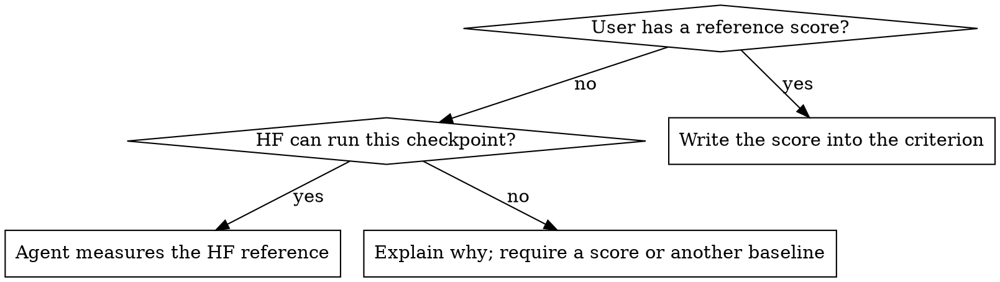

# Modeling task.yaml

Build an agent-flow modeling `task.yaml` through a conversation. The schema is
thin (three paths, optional `slurm-environment`, and two free-text lists), so
what makes a run succeed — the accuracy bars, the features to prove, the
environment — lives in sentences under `completion_criteria` and
`implements_tips`. Your job is to ask for what the user left out and turn
the answers into clear, checkable sentences.

## Which workflow

This skill writes the format of
`agent_flow/workflows/modeling_bringup/task_schema.py`, for two workflows
only: `modeling-v2-onboard` when the user's agent-flow has
`agent_flow/workflows/modeling_v2_onboard/`, `modeling-bringup` otherwise.

- `trtllm-modeling-v2` (`agent_flow/workflows/trtllm_modeling_v2/`) is a
  different workflow with its own spec (`arch`, `members`, `environment`
  sessions, accuracy anchors) and its own `intake`. Never convert the
  task.yaml to it, run its intake, or offer its command, even when the
  user says "v2" or "ModelingV2".
- When the user asks for modeling-v2-onboard and their agent-flow does not
  have it, say so and ask whether to write the task for modeling-bringup
  instead; do not substitute another workflow.
- Everything the run needs is decided by the run itself: it holds its GPU
  nodes and measures the reference scores. Nothing has to be prepared
  before launch beyond what the workflow's check reports. If you find
  yourself listing other preconditions (sessions to start, scores to
  record first), you are on the wrong workflow.
- Run options (backend, model) are command-line flags, never task.yaml
  fields.

## Conversation contract

- Language: pick it from the user's first message in this conversation —
  Chinese if it is written in Chinese, English otherwise — and use it for
  every message after that: forms, recaps, questions, choice labels and
  explanations. Switch only when the user asks you to. Tool output, the
  system locale and the language of files you read do not change it. The
  examples in this skill are in English; translate them. Field names,
  paths, commands and values stay as they are, and the YAML sentences are
  always written in English.
- Part 1 and Part 2 are each asked as one form (see below), one part per
  message; Parts 3 and 4 go one question per message. Ask anything with
  fixed choices (the feature checklist, yes/no) as described in
  "Questions with fixed choices".
- Show values, not verdicts. Whenever you propose, infer, or recap values,
  list every field with its exact value (full paths, names, numbers) and,
  where you checked it, the check result. "All verified" or "already filled
  in" without the values is never enough.
- Never put a value in the YAML the user has not seen. Values you take from
  anywhere other than the user's own words (earlier task.yaml files, the
  environment, the checkpoint) are shown with their source and confirmed.
- Say every default out loud before you use it.
- End each part with a recap of what goes into the YAML, in the same
  field-by-value form, and ask for corrections before moving on.
- Write only what this skill lists. Do not add environment variables
  (PATH, PYTHONPATH, HOME, HF offline, MPI/UCX) or build-artifact symlinks.
  If the user volunteers such details, copy them verbatim into
  `implements_tips`.
- Check paths and settings once, at Finish, with the workflow's own check;
  do not re-implement its checks in the conversation. A problem it reports
  goes back to the user.

## Questions with fixed choices

Use your harness's question tool when it has one and it fits the question:
`AskUserQuestion` in Claude Code, `request_user_input` in Codex. A
single-choice tool cannot ask a multi-select question; ask that one in text.
Codex lists `request_user_input` in Default mode only when the user started
it with `--enable default_mode_request_user_input`; when the tool is not in
your tool list, ask in text.

Otherwise ask in text, in this shape:

```text
Which features should the accuracy run prove? Reply with numbers separated
by commas (e.g. 1,2,3), or "default" to keep the marked ones.
  1. CUDA graph (default)
  2. overlap scheduler (default)
  3. chunked prefill (default)
  4. KV cache reuse
```

- Number every choice and mark the defaults with `(default)`.
- Say how to answer: one number, or numbers separated by commas for a
  multi-select, or "default".
- A yes/no question is numbered too (`1. yes`, `2. no`).
- Repeat the parsed answer back before using it; ask again if a number is
  out of range.

## Forms for Parts 1 and 2

Part 1 and Part 2 each get one form: a single message asking for every item
of that part as a numbered list the user answers in one reply. Part 2's form
is sent only after Part 1 is confirmed.

Look before you ask. Before each form, try every source the part lists
(Part 1: the user's messages, `nvidia-smi`, the current checkout, the
checkpoint directory, e.g. a `modeling_*.py` in it; Part 2: the sources in
its table) and pre-fill each value you found, written out in full with its
source (e.g. "from your message", "from nvidia-smi", "from sacctmgr").
The user's job is to confirm or correct proposals, not to fill in a blank
form. Leave a field blank only when no source answers it, and then say what
you looked at. In Part 2's form, the Slurm fields are answered only if the
user answers yes to "use Slurm?"; pre-fill them anyway.

When the reply arrives (and, in Part 1, after the checkpoint inspection),
send one recap: a table of every field, its value and its source (Part 1
adds the checkpoint facts). Ask about blanks and conflicting values;
otherwise ask the user to confirm the table.

If the user points to an earlier task.yaml, take from it only the fields
this skill writes, and propose them as values with that file as their
source. When the file holds two values for one field (e.g. `slurm_partition`
and `gpu_pool.partition`), show both and ask. Its other content (environment
variables, other tips) is not carried over unless the user asks for it.

## Part 1 — Basic configuration

Items and checks:

| Item | Goes to | Notes |
|---|---|---|
| `reference_code_path` (HF `modeling_*.py`) | top level | — |
| `checkpoint_path` (HF checkpoint dir) | top level | — |
| `trtllm_repo_path` | top level | a clean checkout; modeling-v2-onboard commits its result there |
| Target GPU (e.g. GB300 / sm_103) | `implements_tips` | if `nvidia-smi` works here, propose its GPU and confirm; otherwise ask — never guess the model from a partition name. You may fill in the SM from the GPU name; show it for confirmation |

Inspect the checkpoint with:

```bash
python3 .agents/skills/modeling-task-yaml/scripts/inspect_checkpoint.py <checkpoint_path>
```

Show what it found (architecture, dtype, multimodal, MTP layers,
quantization, weight size, chat template) in the recap. Parts 3 and 4 use
these facts.

## Part 2 — Run mode

Whether the run uses Slurm:

- **No:** omit `slurm-environment` entirely.
- **Yes:** propose `slurm_partition` and `docker_image` (both required,
  under `slurm-environment`), and — only when the user's agent-flow has
  `agent_flow/workflows/modeling_v2_onboard/` — ask whether the run uses a
  **GPU pool**: a set of whole nodes the run holds from its start and
  shares among its workers, instead of each worker submitting its own jobs.

Where each proposal comes from (an earlier task.yaml the user names, or
your memory of this user, takes precedence over the defaults below):

| Field | Source |
|---|---|
| use Slurm? | propose yes when `sinfo` is on PATH |
| `slurm_partition` | `sinfo` partitions with GPUs; propose the default one (marked `*`) and list the others |
| `docker_image` | the CI image in `<trtllm_repo_path>/jenkins/current_image_tags.properties`: `LLM_SBSA_DOCKER_IMAGE` for a Grace-based target GPU (GH200, GB200, GB300), `LLM_DOCKER_IMAGE` otherwise; a local `.sqsh` the user names replaces it |
| `account` | `sacctmgr show assoc user=$USER`; propose the only account, or list them when there are several |
| `qos` | the same association's default QOS; when it has none, list its QOS values or propose omitting the field |
| `container_mounts` | as in the tables below |

**Without a pool**, these optional fields also go directly under
`slurm-environment`; the agents read them:

| Field | Value |
|---|---|
| `account` | omit if the user has none |
| `qos` | omit if the user has none |
| `container_mounts` | a list of paths; together with the checkout they cover `checkpoint_path` and `reference_code_path` |

**With a pool**, they go under `slurm-environment.gpu_pool` instead, never
in both places. The user gives only `nodes` (holder jobs submitted at the
start) and `max_nodes` (the most the planner may grow it to; omit for the
worker count). Fill in the rest yourself from the sources above, and show
each with its source for confirmation:

| Field | Value |
|---|---|
| `account` | required |
| `qos` | omit if the user's association has none to pick |
| `gpus_per_node` | the partition's GPUs per node |
| `hours` | a holder job's time limit: 24, or less if the partition or QOS allows less |
| `container_mounts` | the fewest existing directories that hold `checkpoint_path`, `reference_code_path` and any local dataset path (Part 3); the workspace and the checkout are mounted without being listed |

Say the defaults you leave out: `partition` is `slurm_partition`, and
`reserve` keeps 2 free GPUs from perf work.

## Part 3 — Accuracy

**End-to-end accuracy.** Default: GSM8K via `trtllm-eval`, within 1 point
(absolute) of the reference score. The user may change the dataset or the
tolerance.

Ask where the dataset comes from:

- **A local copy:** ask for its path. If it is missing or empty, tell the
  user and ask again or switch to downloading; do not stop on it. On Slurm,
  the path must be under a container mount: if it is not, propose adding its
  directory to `container_mounts` and show the updated list.
- **Download:** the agent finds and downloads the dataset itself.

Then ask about the reference score. Ask whether they already have a reference score. If not, decide
whether HF can run the checkpoint (below), tell the user the verdict and
why, and ask them to confirm it.



HF cannot run the checkpoint when its quantization is a TRT-LLM-specific
format (e.g. NVFP4, ModelOpt FP8 from `hf_quant_config.json`) or when
`weight_size_gb` exceeds about 80% of the total GPU memory of one node (HF
spreads one model over a node's GPUs with `device_map="auto"`; it does not
span nodes). The other baseline can be a
BF16 checkpoint of the same model (ask for its path and check it) or a
published score (ask for the number and its source). Never write a
criterion the run cannot reach.

If the checkpoint has a chat template, add the chat-template tip below.

**Single-op accuracy.** Always add the op criterion below, unchanged.

## Part 4 — Features

Ask with one multi-select question:

| Feature | Default |
|---|---|
| CUDA graph | on |
| overlap scheduler | on |
| chunked prefill | on |
| KV cache reuse | off |
| speculative decoding | off |
| disaggregated serving | off |
| multimodal (vision part) | off; offer only when Part 1 found the model multimodal |

- All chosen features except disagg and multimodal go into one criterion,
  named as in the table: the end-to-end accuracy bar is met with all of them
  on together. If none are chosen, omit that criterion.
- **Speculative decoding / disagg:** ask each once for optional notes
  (algorithm, draft model, topology). With notes, put them in
  `implements_tips`; without, add the "left to the planner" tip. When the
  checkpoint has MTP layers, tell the user before asking for spec-decoding
  notes, and use the MTP variant of the tip.
- **Disagg** gets its own criterion: `trtllm-eval` runs the model
  in-process and cannot drive a disaggregated server.
- **Multimodal chosen:** add MMMU with the same rules as GSM8K (reference
  score or measured or required baseline, same tolerance, same feature set),
  and ask where its data comes from as for GSM8K.
  **Multimodal model but not chosen:** add the text-only tip.

## Finish

1. Show the complete YAML and ask for changes.
2. Propose a new workspace directory, as a full path, for the user to
   confirm or replace: `<agent-flow>/workspace/<name>`, where
   `<agent-flow>` is the agent-flow directory the user's workflow command
   is installed from (the parent of the `agent_flow` package that the
   command's Python imports; `workspace/` is in agent-flow's `.gitignore`).
   When that directory is inside `trtllm_repo_path`, or no agent-flow is
   installed yet, use the directory beside the checkout,
   `<parent of trtllm_repo_path>/<name>`, and say why:
   modeling-v2-onboard refuses a workspace inside the checkout, because its
   final task commits everything untracked there. `<name>` is the
   checkpoint directory's name in lower case plus `-v2-onboard` when the
   user's agent-flow has `agent_flow/workflows/modeling_v2_onboard/`,
   `-bringup` otherwise; if that directory already exists, append `-2`,
   `-3`, ... until it does not. Once the user confirms, create the
   directory and write `<workspace>/task.yaml`. If the user gives an
   existing directory that already holds a task.yaml, ask before
   overwriting.
3. Check it with the workflow's own check, take each problem back to the
   user, fix, and re-run until it passes:
   - when the user's agent-flow has `agent_flow/workflows/modeling_v2_onboard/`:
     `modeling-v2-onboard --task <workspace>/task.yaml --workspace <workspace> --check`.
     It checks the schema, the checkout, the workspace, the checkpoint, the
     image, the mounts and the GPU pool. It does not create the workspace's
     run state.
   - otherwise: `python3 .agents/skills/modeling-task-yaml/scripts/validate_task_yaml.py <workspace>/task.yaml`
     (the schema only).

   If the command is not on PATH, do not install anything or create an
   environment on your own: tell the user it is missing and ask where to
   install it (`pip install -e <agent-flow>` into the environment they run
   it from). Without it, run only the schema check above.
4. **Slurm with modeling-v2-onboard only:** ask whether to run the runtime
   check now. It submits one short Slurm job that starts the container and
   shows the GPUs, the mounted paths and CUDA PyTorch, but it waits for a
   node. Skipping it starts the run sooner: the run's environment task makes
   the same checks once the planner has started. If the user wants it, add
   `--smoke` to the check command and report its result.
5. Run command.
   - **modeling-v2-onboard** (when the user's agent-flow has
     `agent_flow/workflows/modeling_v2_onboard/`): ask which backend the
     run's planner and workers use, Claude Code (the default) or Codex,
     then give the command:
     `modeling-v2-onboard --task <workspace>/task.yaml --workspace <workspace>`,
     with `--backend codex` added for Codex. The backend is the only
     question: the model and reasoning effort are the workflow's defaults
     for that backend, so ask about neither and add no `--model`.
   - **Otherwise:** give
     `modeling-bringup --task <workspace>/task.yaml --workspace <workspace>`;
     its roles' backends are set by the workflow, so there is nothing to
     choose.

   Then ask whether to start the run now from this session. If yes, start
   it detached, so it outlives this conversation:
   `setsid nohup <command> > <workspace>/launch.log 2>&1 &`. Report its
   PID and the log path, and say that rerunning the same command resumes
   the run. If no, the user runs the command themselves.

## Sentence library

Fill the `<...>` slots; keep the wording.

`completion_criteria`:

- E2E, known score: `"<DATASET> via trtllm-eval scores within <TOL> point(s) (absolute) of the reference score <SCORE> (<SOURCE>)."`
- E2E, measured: `"<DATASET> via trtllm-eval scores within <TOL> point(s) (absolute) of the HuggingFace implementation at reference_code_path, measured by the agent under the same evaluation settings (dataset split, prompt format, chat template, sampling)."`
- E2E, other baseline: `"<DATASET> via trtllm-eval scores within <TOL> point(s) (absolute) of <BASELINE> (<HOW IT IS OBTAINED>)."`
- Op: `"Every op matches its reference within 1 ulp of the output dtype (relative to each row's max magnitude). A wider band needs a stated derivation. A faster replacement need not match the previous op bit for bit."`
- Features: `"The <DATASETS> accuracy bar above is met with <FEATURE LIST> all enabled together."`
- Disagg: `"<DATASETS> served through a disaggregated trtllm-serve deployment (separate context and generation servers) meets the same accuracy bar."`

`implements_tips`:

- `"Target GPU: <GPU> (<SM>)."`
- Local dataset: `"<DATASET> data: <PATH> (pass it to trtllm-eval with --dataset_path)."`
- Downloaded dataset: `"<DATASET> data: no local copy; find and download it yourself, where the evaluation runs can reach it."`
- Chat template: `"The checkpoint ships a chat template (<FILE>); decide whether evaluation must apply it and use the same choice for the reference."`
- Spec/disagg notes: `"<Speculative decoding|Disaggregated serving>: <USER NOTES>."`
- Spec/disagg, no notes: `"<Speculative decoding|Disaggregated serving>: the algorithm and configuration are left to the planner to infer from the checkpoint and the codebase."`
- Spec, no notes, MTP checkpoint: `"Speculative decoding: the checkpoint has <N> MTP layer(s) (<CONFIG KEY>); the algorithm and configuration are left to the planner to infer from the checkpoint and the codebase."`
- Text only: `"Text model only; the vision tower and projector are out of scope."`

## Output shape

```yaml
reference_code_path: /path/to/modeling_<model>.py
checkpoint_path:     /path/to/<checkpoint>
trtllm_repo_path:    /path/to/TensorRT-LLM

slurm-environment:            # only when the user runs on Slurm
  slurm_partition: <partition>
  docker_image: /path/to/image.sqsh
  # without a GPU pool:
  account: <account>
  qos: <qos>
  container_mounts:
    - /path/to/mount
  # with a GPU pool, instead of the three above:
  gpu_pool:
    nodes: <N>
    max_nodes: <M>
    account: <account>
    qos: <qos>
    gpus_per_node: <G>
    hours: <H>
    container_mounts:
      - /path/to/mount

completion_criteria:
  - "<e2e criterion per dataset>"
  - "<op criterion>"
  - "<features criterion>"
  - "<disagg criterion, if chosen>"

implements_tips:
  - "<target GPU>"
  - "<dataset tip per dataset>"
  - "<other tips from the library>"
```

## Common mistakes

| Mistake | Fix |
|---|---|
| Writing a default the user never heard | Say it, then write it |
| Asking Part 1 or Part 2 one field at a time, or merging both into one form | One form per part, one reply each |
| "Slurm config inferred and verified, please confirm" with no values shown | List every field with its value, source and check result |
| Folding disagg into the `trtllm-eval` feature criterion | Disagg gets its own criterion |
| "Agent measures the HF reference" for an NVFP4 / oversized checkpoint | Require a score or another baseline |
| Account / qos / mounts both under `slurm-environment` and under `gpu_pool` | Under `gpu_pool` with a pool, directly under `slurm-environment` without |
| A form of blank fields ("slurm_partition: to fill in") | Pre-fill every field a source answers; leave blank only what none does, and say what you looked at |
| Asking the user for pool fields Slurm or the environment can answer | Ask only `nodes` and `max_nodes`; infer the rest and confirm it |
| Checking paths, image or mounts by hand during the conversation | Run the workflow's check at Finish |
| Running `--smoke` without asking | It waits for a Slurm node; ask first |
| Rewriting the task for `trtllm-modeling-v2` or running its intake | Write the `task_schema.py` format for modeling-v2-onboard or modeling-bringup only |
| Telling the user to start GPU sessions or record a reference score before launch | The run holds its nodes and measures the reference itself |
| Creating a venv or installing agent-flow unasked | Say the command is missing and ask where to install it |
