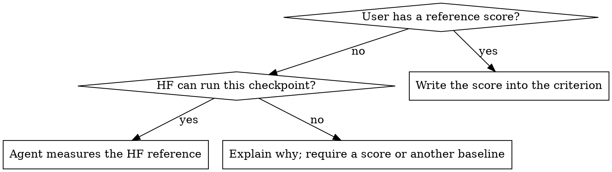

# Modeling task.yaml

Build an agent-flow modeling `task.yaml` through a conversation. The schema is
thin (three paths, optional `slurm-environment`, and two free-text lists), so
what makes a run succeed — the accuracy bars, the features to prove, the
environment — lives in sentences under `completion_criteria` and
`implements_tips`. Your job is to ask for what the user left out and turn
the answers into clear, checkable sentences.

## Conversation contract

- Talk in the user's language; write the YAML sentences in English.
- Part 1 and Part 2 are each asked as one form (see below), one part per
  message; Parts 3 and 4 go one question per message. Use AskUserQuestion
  for anything with fixed choices (the feature checklist, yes/no); without
  it, list the choices in plain text.
- Show values, not verdicts. Whenever you propose, infer, or recap values,
  list every field with its exact value (full paths, names, numbers) and,
  where you checked it, the check result. "All verified" or "already filled
  in" without the values is never enough.
- Never put a value in the YAML the user has not seen. Values you take from
  anywhere other than the user's own words (earlier task.yaml files, the
  environment, the checkpoint) are shown with their source and confirmed.
- Say every default out loud before you use it.
- End each part with a recap of what goes into the YAML, in the same
  field-by-value form, and ask for corrections before moving on.
- Write only what this skill lists. Do not add environment variables
  (PATH, PYTHONPATH, HOME, HF offline, MPI/UCX), build-artifact symlinks, or
  `gpu_pool`. If the user volunteers such details, copy them verbatim into
  `implements_tips`.

## Forms for Parts 1 and 2

Part 1 and Part 2 each get one form: a single message asking for every item
of that part as a numbered list the user answers in one reply. Part 2's form
is sent only after Part 1 is confirmed.

Before each form, look at what is at hand: the user's messages,
`nvidia-smi`, the current checkout, the checkpoint directory (e.g. a
`modeling_*.py` in it). Pre-fill each value you found, written out in full
with its source (e.g. "from your message", "from nvidia-smi", "found in the
checkpoint directory"); leave the rest blank. In Part 2's form, the Slurm
fields are answered only if the user answers yes to "use Slurm?".

When the reply arrives, run that part's checks (and, in Part 1, the
checkpoint inspection), then send one recap: a table of every field, its
value, its source, and its check result (Part 1 adds the checkpoint facts).
Ask about blanks, failed checks and conflicting values; otherwise ask the
user to confirm the table.

If the user points to an earlier task.yaml, take from it only the fields
this skill writes. Map `slurm-environment.slurm_partition` and
`docker_image` directly, and `gpu_pool.account` / `qos` /
`container_mounts` to the same names under `slurm-environment`. When the
file holds two values for one field (e.g. `slurm_partition` and
`gpu_pool.partition`), show both and ask. Its other content (environment
variables, other tips) is not carried over unless the user asks for it.

## Part 1 — Basic configuration

Items and checks:

| Item | Goes to | Check |
|---|---|---|
| `reference_code_path` (HF `modeling_*.py`) | top level | exists |
| `checkpoint_path` (HF checkpoint dir) | top level | exists, has `config.json` |
| `trtllm_repo_path` | top level | exists, is a git checkout (`git -C <path> rev-parse`) |
| Target GPU (e.g. GB300 / sm_103) | `implements_tips` | if `nvidia-smi` works here, propose its GPU and confirm; otherwise ask — never guess the model from a partition name. You may fill in the SM from the GPU name; show it for confirmation |
| `LLM_MODELS_ROOT` | `implements_tips` | directory exists; `datasets/openai/gsm8k` exists and is non-empty — warn if missing |

A path that does not exist goes back to the user; never write it.

Inspect the checkpoint with:

```bash
python3 .claude/skills/modeling-task-yaml/scripts/inspect_checkpoint.py <checkpoint_path>
```

Show what it found (architecture, dtype, multimodal, MTP layers,
quantization, weight size, chat template) in the recap. Parts 3 and 4 use
these facts.

## Part 2 — Run mode

Whether the run uses Slurm:

- **No:** omit `slurm-environment` entirely.
- **Yes:** these five go under `slurm-environment`
  (never under `gpu_pool`, which starts a node pool in modeling-v2-onboard).
  The agents read this whole section.

  | Field | Required | Check |
  |---|---|---|
  | `slurm_partition` | yes | — |
  | `docker_image` | yes | the `.sqsh` exists |
  | `account` | no — omit if the user has none | — |
  | `qos` | no — omit if the user has none | — |
  | `container_mounts` | no — a list of paths | each path exists; together they cover `trtllm_repo_path`, `checkpoint_path`, `reference_code_path` and `LLM_MODELS_ROOT` — name any path left uncovered and ask whether to add a mount |

## Part 3 — Accuracy

**End-to-end accuracy.** Default: GSM8K via `trtllm-eval`, within 1 point
(absolute) of the reference score. The user may change the dataset or the
tolerance. Ask whether they already have a reference score. If not, decide
whether HF can run the checkpoint (below), tell the user the verdict and
why, and ask them to confirm it.



HF cannot run the checkpoint when its quantization is a TRT-LLM-specific
format (e.g. NVFP4, ModelOpt FP8 from `hf_quant_config.json`) or when
`weight_size_gb` exceeds about 80% of the total GPU memory of one node (HF
spreads one model over a node's GPUs with `device_map="auto"`; it does not
span nodes). The other baseline can be a
BF16 checkpoint of the same model (ask for its path and check it) or a
published score (ask for the number and its source). Never write a
criterion the run cannot reach.

If the checkpoint has a chat template, add the chat-template tip below.

**Single-op accuracy.** Always add the op criterion below, unchanged.

## Part 4 — Features

Ask with one multi-select question:

| Feature | Default |
|---|---|
| CUDA graph | on |
| overlap scheduler | on |
| chunked prefill | on |
| KV cache reuse | off |
| speculative decoding | off |
| disaggregated serving | off |
| multimodal (vision part) | off; offer only when Part 1 found the model multimodal |

- All chosen features except disagg and multimodal go into one criterion,
  named as in the table: the end-to-end accuracy bar is met with all of them
  on together. If none are chosen, omit that criterion.
- **Speculative decoding / disagg:** ask each once for optional notes
  (algorithm, draft model, topology). With notes, put them in
  `implements_tips`; without, add the "left to the planner" tip. When the
  checkpoint has MTP layers, tell the user before asking for spec-decoding
  notes, and use the MTP variant of the tip.
- **Disagg** gets its own criterion: `trtllm-eval` runs the model
  in-process and cannot drive a disaggregated server.
- **Multimodal chosen:** add MMMU with the same rules as GSM8K (reference
  score or measured or required baseline, same tolerance, same feature set).
  Check now that `LLM_MODELS_ROOT/datasets/MMMU` exists and is non-empty,
  and warn if not.
  **Multimodal model but not chosen:** add the text-only tip.

## Finish

1. Show the complete YAML and ask for changes.
2. Ask for the workspace directory; write `<workspace>/task.yaml`. If the
   directory does not exist, say so and create it once the user agrees. If
   the file exists, ask before overwriting.
3. Validate with agent-flow's own schema, fix, and re-run until it passes:
   ```bash
   python3 .claude/skills/modeling-task-yaml/scripts/validate_task_yaml.py <workspace>/task.yaml
   ```
4. Give the run command:
   `modeling-bringup --task <workspace>/task.yaml --workspace <workspace>`.
   If `modeling-bringup` is not on PATH, add the install step
   `pip install -e <trtllm_repo_path>/agent-flow`. Mention
   `modeling-v2-onboard` (same arguments) only when the user's agent-flow
   has `agent_flow/workflows/modeling_v2_onboard/`.

## Sentence library

Fill the `<...>` slots; keep the wording.

`completion_criteria`:

- E2E, known score: `"<DATASET> via trtllm-eval scores within <TOL> point(s) (absolute) of the reference score <SCORE> (<SOURCE>)."`
- E2E, measured: `"<DATASET> via trtllm-eval scores within <TOL> point(s) (absolute) of the HuggingFace implementation at reference_code_path, measured by the agent under the same evaluation settings (dataset split, prompt format, chat template, sampling)."`
- E2E, other baseline: `"<DATASET> via trtllm-eval scores within <TOL> point(s) (absolute) of <BASELINE> (<HOW IT IS OBTAINED>)."`
- Op: `"Every op matches its reference within 1 ulp of the output dtype (relative to each row's max magnitude). A wider band needs a stated derivation. A faster replacement need not match the previous op bit for bit."`
- Features: `"The <DATASETS> accuracy bar above is met with <FEATURE LIST> all enabled together."`
- Disagg: `"<DATASETS> served through a disaggregated trtllm-serve deployment (separate context and generation servers) meets the same accuracy bar."`

`implements_tips`:

- `"Target GPU: <GPU> (<SM>)."`
- `"LLM_MODELS_ROOT=<PATH>; GSM8K is under datasets/openai/gsm8k<; MMMU under datasets/MMMU>."`
- Chat template: `"The checkpoint ships a chat template (<FILE>); decide whether evaluation must apply it and use the same choice for the reference."`
- Spec/disagg notes: `"<Speculative decoding|Disaggregated serving>: <USER NOTES>."`
- Spec/disagg, no notes: `"<Speculative decoding|Disaggregated serving>: the algorithm and configuration are left to the planner to infer from the checkpoint and the codebase."`
- Spec, no notes, MTP checkpoint: `"Speculative decoding: the checkpoint has <N> MTP layer(s) (<CONFIG KEY>); the algorithm and configuration are left to the planner to infer from the checkpoint and the codebase."`
- Text only: `"Text model only; the vision tower and projector are out of scope."`

## Output shape

```yaml
reference_code_path: /path/to/modeling_<model>.py
checkpoint_path:     /path/to/<checkpoint>
trtllm_repo_path:    /path/to/TensorRT-LLM

slurm-environment:            # only when the user runs on Slurm
  slurm_partition: <partition>
  docker_image: /path/to/image.sqsh
  account: <account>
  qos: <qos>
  container_mounts:
    - /path/to/mount

completion_criteria:
  - "<e2e criterion per dataset>"
  - "<op criterion>"
  - "<features criterion>"
  - "<disagg criterion, if chosen>"

implements_tips:
  - "<target GPU>"
  - "<LLM_MODELS_ROOT>"
  - "<other tips from the library>"
```

## Common mistakes

| Mistake | Fix |
|---|---|
| Writing a default the user never heard | Say it, then write it |
| Asking Part 1 or Part 2 one field at a time, or merging both into one form | One form per part, one reply each |
| "Slurm config inferred and verified, please confirm" with no values shown | List every field with its value, source and check result |
| Folding disagg into the `trtllm-eval` feature criterion | Disagg gets its own criterion |
| "Agent measures the HF reference" for an NVFP4 / oversized checkpoint | Require a score or another baseline |
| Putting account / qos / mounts under `gpu_pool` | Directly under `slurm-environment` |
| Importing `agent_flow` to validate | Use `scripts/validate_task_yaml.py` |
