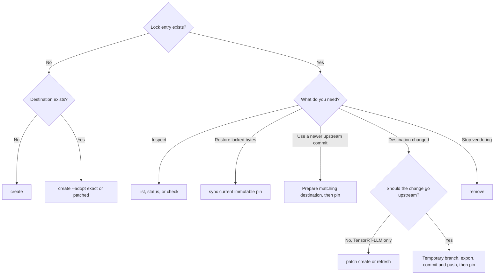

<!-- SPDX-FileCopyrightText: Copyright (c) 2026 NVIDIA CORPORATION & AFFILIATES. All rights reserved. -->
<!-- SPDX-License-Identifier: Apache-2.0 -->

# Vendored Sources

TensorRT-LLM keeps some upstream source trees in this repository so they can be
built, packaged, and reviewed with the code that uses them. The generic
vendoring tool records where each tree came from, materializes it reproducibly,
and rejects destination edits that are not represented by its lock entry.

The generated lock is `3rdparty/vendor_sources.lock.yaml`. It records an
upstream Git URL, an immutable commit, the source and destination directories,
the selected files, any persistent compatibility patch and its content digest,
and a digest of the materialized destination. A short branch or tag may explain
where the commit came from, but the full commit is authoritative.

Use `scripts/vendor/manage.py` for every lock or vendor-state change. Do not
edit the YAML, generated patches, or digests by hand. All examples below use the
default lock. For an isolated test or another consumer repository, place
`--lock PATH` before the subcommand.

For a code-changing PR, start with the
[PrimTS contributor walkthrough](#contributor-workflow-primts-example).
It covers editing the vendored code, exporting to a temporary branch in your
fork, and pinning that branch in TensorRT-LLM. An already-upstream update may
instead use the [upstream-main fast-forward exception](#using-an-upstream-main-pin).
An upstream PR merging alone is insufficient: the chosen pin must contain the
latest canonical dev tip by Git ancestry. Canonical-branch promotion and divergent
upstream refresh remain maintainer workflows.

## Lock contract

A locked vendor has one of two durable states:

- **Exact**: the selected destination files are byte-for-byte copies of the
  selected files at the locked upstream commit.
- **Patched**: applying a deterministic, persistent compatibility patch to
  those upstream files reproduces the destination exactly. Use this patch only
  for TensorRT-LLM-specific adaptations that do not belong upstream.

A destination edit is not a third state. While such an edit is pending,
`status`, the default offline `check`, and the pre-commit check intentionally
fail. Resolve it by discarding it with `sync`, recording a TensorRT-LLM-only
adaptation with `patch`, or exporting an upstream-worthy change and pinning the
resulting commit. `export` accepts this pending destination delta by default and
does not change the lock or persistent patch.

## Include patterns

Each `include` pattern matches a complete path relative to `source` (or
`destination` when checking local files). A file is selected when any pattern
matches. Use `/` separators on every platform, including Windows; matching is
case-sensitive and includes hidden files and directories.

`*`, `?`, and character classes such as `[ab]` or `[!a]` match within one path
component. A component consisting of `**` matches zero or more components.

| Pattern | Selected files |
|---------|----------------|
| `*.py` | Python files directly in the source directory |
| `**/*.py` | Python files in the source directory and all nested directories |
| `*/*.py` | Python files exactly one directory below the source directory |
| `*/**/*.py` | Python files at any nested depth, excluding the source directory |
| `sub/*.py` | Python files directly in `sub` |
| `sub/**/*.py` | Python files in `sub` and all its nested directories |
| `a.py` | Only `a.py` directly in the source directory |
| `**/*` | All files at every depth (the default for `create`) |

Quote patterns in YAML and shell commands, for example `--include '**/*.py'`.
Repeat `--include` to select multiple patterns.

Earlier versions also matched nested paths with `*.py` and bare filenames.
Use `**/*.py` or `**/a.py` when that recursive behavior is intended.

## Choose a command



`sync` only restores the commit and compatibility patch already recorded in the
lock. It never discovers, imports, or pins a newer upstream commit. To move to a
new upstream revision, first make the destination equal that revision plus the
existing compatibility patch, then use `pin`.

## Inspect vendors

List entries, or run the offline integrity status for all or one vendor:

```bash
python scripts/vendor/manage.py list
python scripts/vendor/manage.py status
python scripts/vendor/manage.py status VENDOR
python scripts/vendor/manage.py check VENDOR
```

`status` and the default `check` exit unsuccessfully if the destination has a
pending delta. That failure is expected during an export workflow and remains
until `pin` succeeds.

## Add or adopt a vendor

When neither the lock entry nor destination exists, create both from an
immutable commit and a local upstream checkout:

```bash
python scripts/vendor/manage.py create VENDOR \
  --url https://example.com/organization/repository.git \
  --branch main \
  --commit FULL_COMMIT \
  --source path/in/upstream \
  --destination path/in/tensorrt-llm \
  --include '**/*.py' \
  --repo /path/to/upstream
```

Use `--tag TAG` instead of `--branch BRANCH` for a tagged source. Without
`--repo`, the tool obtains the commit from the recorded URL.

If the destination already exists but has no lock entry, adopt it. Use `exact`
to require an exact upstream match:

```bash
python scripts/vendor/manage.py create VENDOR \
  --url https://example.com/organization/repository.git \
  --commit FULL_COMMIT \
  --source path/in/upstream \
  --destination path/in/tensorrt-llm \
  --include '**/*.py' \
  --adopt exact \
  --repo /path/to/upstream
```

Use `--adopt patched` instead to capture intentional TensorRT-LLM compatibility
adaptations. Adoption never silently accepts an unrepresented difference.

## Restore the current lock

Discard destination edits and reproduce the currently locked upstream commit
plus its persistent patch:

```bash
python scripts/vendor/manage.py sync VENDOR --repo /path/to/upstream
```

This overwrites the selected destination files. It does not update the lock,
look at a branch tip, or choose a newer commit.

## Maintain a TensorRT-LLM compatibility patch

After editing an exact destination for a change that must remain downstream,
create its persistent patch:

```bash
python scripts/vendor/manage.py patch VENDOR create --repo /path/to/upstream
```

After intentionally changing an already patched destination, regenerate the
patch:

```bash
python scripts/vendor/manage.py patch VENDOR refresh --repo /path/to/upstream
```

Drop a no-longer-needed patch only after the destination exactly matches the
currently locked upstream selection:

```bash
python scripts/vendor/manage.py patch VENDOR drop --repo /path/to/upstream
```

Generated patches live under `3rdparty/vendor_patches/`. Review them, but update
them only through the tool. Do not use a persistent patch for a change that
should be contributed upstream; use the export workflow instead.

## Export a destination change upstream

Start with the desired change in the TensorRT-LLM destination. The offline
check now fails by design. In a clean upstream checkout, create a temporary
branch at the currently locked commit **before** exporting:

```bash
git -C /path/to/upstream switch -c trtllm-vendor-fix LOCKED_FULL_COMMIT
python scripts/vendor/manage.py export VENDOR --repo /path/to/upstream
```

The upstream checkout's selected source must be clean before export and its
`HEAD` must equal the locked commit. `export` computes the pending destination
delta relative to the locked materialization, applies only that delta to the
raw upstream source, and leaves the vendor lock, destination, and persistent
compatibility patch unchanged.

Run the upstream tests, review the result, then commit and push the temporary
branch:

```bash
git -C /path/to/upstream add path/in/upstream
git -C /path/to/upstream commit -s -m 'Apply exported fix'
git -C /path/to/upstream push -u origin trtllm-vendor-fix
```

Finally, pin the committed revision from that checkout:

```bash
python scripts/vendor/manage.py pin VENDOR \
  --url https://example.com/my-fork/repository.git \
  --branch trtllm-vendor-fix \
  --commit NEW_FULL_COMMIT \
  --repo /path/to/upstream
```

`pin` first tries the selected files at `NEW_FULL_COMMIT` plus the existing
persistent compatibility patch. They must exactly equal the checked-in
destination. One exception is safe: if the raw new commit itself exactly equals
the destination, upstream has absorbed the compatibility patch, so `pin` drops
that patch and its metadata. Otherwise `pin` does not absorb a mismatch,
regenerate the patch, or copy candidate files into the destination. On success
it durably updates the immutable lock before removing an absorbed patch and
restores passing offline checks. If the patch cannot be removed after that
commit, `pin` succeeds with a warning and leaves a safe, unreferenced orphan;
delete the reported file manually. A failure before the durable lock commit
does not remove the existing patch. If directory synchronization fails after
the atomic replacement, the lock may already show the new pin, but the retained
patch keeps either recovered lock version reproducible.

The same rule applies when adopting a newer commit that was developed upstream
first: prepare the destination to exactly match the proposed commit plus the
existing patch, then run `pin`. Do not use `sync` to look for that commit.

## Contributor workflow: PrimTS example

Suppose you need to fix a validation check in the vendored PrimTS `context.py`.
The source change belongs in FlashInfer; TensorRT-LLM's PR must contain both the
updated vendored files and a lock pointing to your committed temporary branch.
The same export/pin mechanics work for other vendors using their own lock
entry, paths, upstream fork, and maintainer policy.

### 1. Identify the canonical baseline

Start with a clean TensorRT-LLM checkout based on the latest **target base
branch** (`main` or the intended release branch), and your own FlashInfer fork.
Read `vendors.flashinfer-prims-ts` in that base branch's
`3rdparty/vendor_sources.lock.yaml`: its `url`, `branch`, and `commit` identify
the canonical source baseline. If it still points to another contributor's
temporary branch, wait for the preceding promotion or coordinate with the
maintainer; do not treat that temporary branch as the canonical branch.

Replace every placeholder below. `PRIMTS_REPO` must be a new local directory
for this example. The dev-branch name is illustrative: use the branch for your
target base, not a dated branch copied from this document or another PR.
Run all commands from the TensorRT-LLM repository root; `git -C` commands act
on the separate FlashInfer checkout.

```bash
PRIMTS_REPO=/absolute/path/to/new-flashinfer-checkout
PRIMTS_FORK_URL=https://github.com/YOUR_ACCOUNT/flashinfer.git
PRIMTS_DEV_URL=https://github.com/MAINTAINER/flashinfer.git
PRIMTS_DEV_BRANCH=trtllm-prims-ts-dev-YYYYMMDD
PRIMTS_LOCKED_SHA=FULL_40_CHARACTER_LOCKED_COMMIT
PRIMTS_TMP_BRANCH=trtllm-prims-ts-validation-fix

git switch -c feat/prims-ts-validation-fix
python scripts/vendor/manage.py check flashinfer-prims-ts
git clone "$PRIMTS_FORK_URL" "$PRIMTS_REPO"
git -C "$PRIMTS_REPO" fetch "$PRIMTS_DEV_URL" "$PRIMTS_DEV_BRANCH" || {
  echo 'STOP: could not fetch the canonical branch.' >&2
  exit 1
}
PRIMTS_DEV_TIP=$(git -C "$PRIMTS_REPO" rev-parse --verify 'FETCH_HEAD^{commit}') || {
  echo 'STOP: the fetched canonical revision is not a commit.' >&2
  exit 1
}
```

Compare `PRIMTS_LOCKED_SHA` with `PRIMTS_DEV_TIP`. The straightforward path below
assumes they are equal. If they differ, the lock is not the live dev-branch tip:
first rebase onto the consumer base containing the completed promotion, or
follow [the advanced-tip instructions](#if-the-dev-branch-advances). Never
substitute the live tip for the locked SHA when calling `export`.

### 2. Edit and test the vendored code

For this example, edit
`tensorrt_llm/_torch/attention/backends/prims_ts/context.py`, add the appropriate
tests, and run the affected TensorRT-LLM tests. Inspect your pending source delta:

```bash
git diff -- tensorrt_llm/_torch/attention/backends/prims_ts
```

An offline vendor check now fails until you pin the exported change; this is
expected. Do not run `sync`, which would discard the pending edits, or record
an upstream-worthy fix in the TensorRT-LLM-only compatibility patch. Do not
hand-edit the lock or its digests to bypass the check.

### 3. Create the temporary source branch and export

Create the branch at the **locked SHA** in your clean FlashInfer checkout:

```bash
git -C "$PRIMTS_REPO" switch -c "$PRIMTS_TMP_BRANCH" "$PRIMTS_LOCKED_SHA"
python scripts/vendor/manage.py export flashinfer-prims-ts --repo "$PRIMTS_REPO"
git -C "$PRIMTS_REPO" diff -- flashinfer/attention/prims_ts
```

`export` requires that exact starting SHA. It transfers only the pending delta
to `flashinfer/attention/prims_ts`; it does not copy TensorRT-LLM's existing
compatibility patch upstream, change the lock, or commit anything. If the edit
overlaps the compatibility patch and export refuses it, resolve the upstream
change and downstream adaptation deliberately rather than copying the whole
vendored directory over FlashInfer.

### 4. Commit, check the live dev tip, and push to your fork

Run the relevant FlashInfer tests and review the exported changes before committing.
Stage any additional upstream test files explicitly as well.

```bash
git -C "$PRIMTS_REPO" add flashinfer/attention/prims_ts
git -C "$PRIMTS_REPO" commit -s -m 'Fix PrimTS context validation'
git -C "$PRIMTS_REPO" fetch "$PRIMTS_DEV_URL" "$PRIMTS_DEV_BRANCH" || {
  echo 'STOP: could not fetch the canonical branch.' >&2
  exit 1
}
PRIMTS_DEV_TIP=$(git -C "$PRIMTS_REPO" rev-parse --verify 'FETCH_HEAD^{commit}') || {
  echo 'STOP: the fetched canonical revision is not a commit.' >&2
  exit 1
}
git -C "$PRIMTS_REPO" merge-base --is-ancestor "$PRIMTS_DEV_TIP" HEAD
```

The ancestry check must succeed (exit status 0) before continuing. If it fails,
follow the advanced-tip instructions below. The pinned commit must contain the
**latest** dev tip, not just the older commit recorded in the consumer lock,
because the maintainer must be able to fast-forward the dev branch after merge.

```bash
git -C "$PRIMTS_REPO" push "$PRIMTS_FORK_URL" "HEAD:refs/heads/$PRIMTS_TMP_BRANCH"
PRIMTS_NEW_SHA=$(git -C "$PRIMTS_REPO" rev-parse HEAD)
```

Do not push directly to the canonical dev branch. Open the related FlashInfer PR
separately; if it needs different history for upstream review, use a separate
branch. Keep the consumer pin on your temporary branch unless it independently
satisfies the [upstream-main exception](#using-an-upstream-main-pin).

### 5. Pin the pushed commit and verify

```bash
python scripts/vendor/manage.py pin flashinfer-prims-ts \
  --url "$PRIMTS_FORK_URL" \
  --branch "$PRIMTS_TMP_BRANCH" \
  --commit "$PRIMTS_NEW_SHA" \
  --repo "$PRIMTS_REPO"
python scripts/vendor/manage.py check flashinfer-prims-ts
python scripts/vendor/manage.py check flashinfer-prims-ts --repo "$PRIMTS_REPO"
git diff -- 3rdparty/vendor_sources.lock.yaml \
  3rdparty/vendor_patches/flashinfer-prims-ts.patch \
  tensorrt_llm/_torch/attention/backends/prims_ts
```

`pin` verifies that the committed source plus the existing compatibility patch
reproduces your destination. It updates the lock, not the destination files.
Keep the patch unchanged unless it needs a reviewed downstream adaptation or
`pin` removes it because upstream has absorbed it.

### 6. Submit the TensorRT-LLM PR

Stage the lock and vendored files together, plus the relevant tests and any
intentional compatibility-patch changes. Commit with DCO sign-off and push to
your TensorRT-LLM fork (replace the remote name below):

```bash
git add 3rdparty/vendor_sources.lock.yaml tensorrt_llm/_torch/attention/backends/prims_ts
# If the compatibility patch changed or was removed by pin:
git add -u -- 3rdparty/vendor_patches/flashinfer-prims-ts.patch
# Replace these placeholders with the specific regression tests you changed or added:
git add -- path/to/changed_test.py path/to/new_test.py
git diff --cached --stat
git diff --cached
git commit -s -m '[None][fix] update vendored PrimTS context validation'
git push -u YOUR_TRTLLM_FORK_REMOTE HEAD
```

Open the PR against the same target base used in step 1 and run normal CI.
Put this block in the **PR description**, replacing `123` with the real paired
FlashInfer PR number; list all upstream PRs needed to attribute the source delta:

````markdown
<!-- vendor-promotion:start -->
```yaml
schema_version: 1
vendors:
  flashinfer-prims-ts:
    upstream_prs:
      - https://github.com/flashinfer-ai/flashinfer/pull/123
```
<!-- vendor-promotion:end -->
````

If there genuinely is no paired upstream PR, replace `upstream_prs` with a
nonempty `unpaired_reason` explaining why; do not use it to bypass a failed
match. See [contributor metadata](../scripts/vendor/README.md#contributor-metadata)
for multiple PRs and ambiguity resolution.

Leave the lock on your temporary fork branch through review and merge. Do not
delete or rewrite that branch before promotion completes. The maintainer or
bot then fast-forwards the canonical dev branch and creates a separate
**lock-only** PR restoring its URL/branch without changing the reviewed SHA or
vendored code. A paired FlashInfer PR merging does not by itself permit switching
the consumer pin to upstream; the exception below requires exact ancestry.

### Using an upstream-main pin

When all intended changes are already on the configured upstream branch, the
consumer lock may use that upstream repository/branch directly if:

```text
previous canonical pin <= latest canonical dev tip <= chosen upstream pin <= upstream main tip
```

`<=` means Git ancestor-or-equal, not equivalent patches under different SHAs.
Check both live tips against the **exact SHA** you intend to pin, for example
using the source repository and dev variables from the walkthrough:

```bash
PRIMTS_UPSTREAM_URL=https://github.com/flashinfer-ai/flashinfer.git
git -C "$PRIMTS_REPO" fetch "$PRIMTS_DEV_URL" "$PRIMTS_DEV_BRANCH" || {
  echo 'STOP: could not fetch the canonical branch.' >&2
  exit 1
}
PRIMTS_DEV_TIP=$(git -C "$PRIMTS_REPO" rev-parse --verify 'FETCH_HEAD^{commit}') || {
  echo 'STOP: the fetched canonical revision is not a commit.' >&2
  exit 1
}
git -C "$PRIMTS_REPO" fetch "$PRIMTS_UPSTREAM_URL" main || {
  echo 'STOP: could not fetch the upstream branch.' >&2
  exit 1
}
PRIMTS_UPSTREAM_TIP=$(git -C "$PRIMTS_REPO" rev-parse --verify 'FETCH_HEAD^{commit}') || {
  echo 'STOP: the fetched upstream revision is not a commit.' >&2
  exit 1
}
PRIMTS_NEW_SHA=$PRIMTS_UPSTREAM_TIP  # Or an older reviewed commit on main.
git -C "$PRIMTS_REPO" merge-base --is-ancestor "$PRIMTS_DEV_TIP" "$PRIMTS_NEW_SHA"
git -C "$PRIMTS_REPO" merge-base --is-ancestor "$PRIMTS_NEW_SHA" "$PRIMTS_UPSTREAM_TIP"
```

Both checks must succeed. Bring the selected destination files and compatibility
patch into alignment with that exact revision, retaining necessary downstream
adaptations, then use `manage.py pin` as in step 5 with `--url
"$PRIMTS_UPSTREAM_URL" --branch main --commit "$PRIMTS_NEW_SHA"`. `pin` verifies
materialization; it does not import a newer source tree. Commit the source/lock
update together and run normal review and CI.

No upstream PR list, `unpaired_reason`, or vendor-promotion entry is needed for
this qualifying vendor. Other changed vendors still need their own metadata.
Upstream merge commits are allowed. The bot checks live ancestry again before
feedback and promotion; a later dev advance may require a newer pin. If dev and
upstream diverge, use a temporary fork based on dev or ask for a maintainer
refresh rather than forcing the canonical branch or bypassing metadata checks.

Promotion still restores the canonical fork/branch and fast-forwards it only to
the reviewed SHA. It saves versioned ancestry proof instead of individual PR
mappings. See the [toolkit exception and provenance contract](../scripts/vendor/README.md#upstream-main-fast-forward-exception).

### If the dev branch advances

If your changes have not yet been exported, first export and commit at the
locked SHA as in steps 3–4. If you already exported and pinned the change, keep
working on that temporary source branch; do not export the same change again.
Save the previously observed dev tip before fetching, and require the new tip
to contain both that tip and the locked revision. Rebase only after these
checks succeed, resolving conflicts and rerunning tests:

```bash
PRIMTS_PREVIOUS_DEV_TIP=$PRIMTS_DEV_TIP
git -C "$PRIMTS_REPO" fetch "$PRIMTS_DEV_URL" "$PRIMTS_DEV_BRANCH" || {
  echo 'STOP: could not fetch the canonical branch.' >&2
  exit 1
}
PRIMTS_DEV_TIP=$(git -C "$PRIMTS_REPO" rev-parse --verify 'FETCH_HEAD^{commit}') || {
  echo 'STOP: the fetched canonical revision is not a commit.' >&2
  exit 1
}
if ! git -C "$PRIMTS_REPO" merge-base --is-ancestor "$PRIMTS_PREVIOUS_DEV_TIP" "$PRIMTS_DEV_TIP" ||
   ! git -C "$PRIMTS_REPO" merge-base --is-ancestor "$PRIMTS_LOCKED_SHA" "$PRIMTS_DEV_TIP"; then
  echo 'STOP: canonical history changed; ask the maintainer before rebasing.' >&2
  exit 1
fi
git -C "$PRIMTS_REPO" rebase "$PRIMTS_DEV_TIP"
```

If either ancestry check fails, do not rebase or force-push. Ask the maintainer
whether a refresh or history rewrite occurred and which canonical branch to use.

Update the TensorRT-LLM destination to match the rebased selected source files
plus the existing compatibility patch, retaining downstream adaptations. This
may require incorporating other promoted changes or resolving patch conflicts;
neither `sync` nor `pin` imports a new revision for you. Then repeat the ancestry
check, push, pin, source verification, and consumer tests with the **new SHA**.
For an already-published branch, coordinate before rewriting it and use
`--force-with-lease`, or push a new temporary branch and pin that instead.
Never force-push the canonical branch.

Updating only your source branch or PR description does not update the consumer
pin. The bot rechecks live ancestry before promotion; repeat this process if
another promotion advances the dev branch again. After a maintainer refresh
changes the canonical branch name, rebase the consumer PR onto its latest target
base and use that new canonical branch rather than continuing the retired one.

## Remove a vendor

Remove a lock entry and its generated compatibility patch while preserving the
destination:

```bash
python scripts/vendor/manage.py remove VENDOR
```

The preserved destination is no longer protected by the lock. Delete or move
it separately as part of the reviewed migration that removes the vendor.

## Source access and checks

The default check is deliberately offline:

```bash
python scripts/vendor/manage.py check
python scripts/vendor/manage.py check --offline
```

It validates the lock schema and path safety, patch metadata, and the checked-in
destination digest. It never invokes Git, performs DNS resolution, or contacts
a recorded URL. This is the always-run pre-commit check. A pending destination
delta therefore blocks a commit until it is synchronized, patched, or pinned.

When network access is available, attempt verification against every recorded
upstream:

```bash
python scripts/vendor/manage.py check --upstream
```

An inaccessible repository is reported as unavailable rather than failing. If
a commit can be obtained, a source, patch, or destination mismatch is an error.
Trusted maintainer CI can require access to every source:

```bash
python scripts/vendor/manage.py check --upstream --require-access
```

To verify one vendor against an existing checkout without contacting the
recorded URL, provide it explicitly:

```bash
python scripts/vendor/manage.py check VENDOR --repo /path/to/upstream
```

The checkout's configured remote may differ from the lock URL; it only needs to
contain the locked commit. Source-consuming commands accept the same `--repo`
form.

An offline digest proves that the committed destination matches the lock. It
cannot independently prove that a URL, commit, and source directory produced
that destination. Creating and pinning vendors therefore require a fetched or
local repository, and URL or commit changes require vendor CODEOWNER review.
Never put credentials in a lock URL. Run checks that use internal credentials
only in a trusted environment, not with pull-request-controlled scripts.

## Promotion and local monitoring

The generic toolkit under `scripts/vendor/` supports every vendor key in this
lock. `promote.py` prepares a verified lock-only follow-up after a source-update
PR merges; `bot.py` can monitor PRs locally, request missing contributor metadata,
match upstream commits, and publish promotions with squash auto-merge.

See the [toolkit guide](../scripts/vendor/README.md) for the workflow diagram,
contributor description format, author resolution of ambiguous matches,
authentication, configurable private workdirs, daemon launch/stop, and recovery.
No GitHub App or systemd setup is required. All remote writes are opt-in with
`--publish`; operator settings and credentials are not committed to this repo.

Each monitor handles one vendor and consumer base branch. Main and release
branches can use different canonical source branches, but require separate
workdirs and explicit launches. A periodic upstream refresh remains a separate
code-changing PR with normal CI: stop its monitor or configure an audited
`--refresh-branch` target before opening it, then migrate the canonical branch
in the existing workdir after merge. See the toolkit guide's
[base-branch setup](../scripts/vendor/README.md#different-consumer-base-branches)
and [refresh cutover](../scripts/vendor/README.md#switching-canonical-branches-after-a-refresh).

Use the entry points under `scripts/vendor/` directly. The old top-level scripts
and PrimTS-specific CLI aliases are not retained; callers must migrate to the
generic commands and supply their vendor and repository configuration explicitly.

## License and attribution

The vendor lock is a reproducibility record, not a license manifest. Before
adding a vendor, verify that the selected upstream files carry the required
notices and follow [the Python third-party process](py-thirdparty.md) or
[the C++ third-party process](cpp-thirdparty.md), as applicable. Exact upstream
files retain their upstream copyright headers. Add an NVIDIA header only to
files that TensorRT-LLM modifies.

## PrimTS

The `flashinfer-prims-ts` entry selects the complete Python tree under
`flashinfer/attention/prims_ts` and materializes it at
`tensorrt_llm/_torch/attention/backends/prims_ts`. The `**/*.py` selection
deliberately omits upstream README files. Its persistent patch contains only
TensorRT-LLM integration and compatibility adaptations; all other selected
files remain exact upstream copies.

Use the normal commands with `flashinfer-prims-ts`, for example:

```bash
python scripts/vendor/manage.py status flashinfer-prims-ts
python scripts/vendor/manage.py check flashinfer-prims-ts
```
