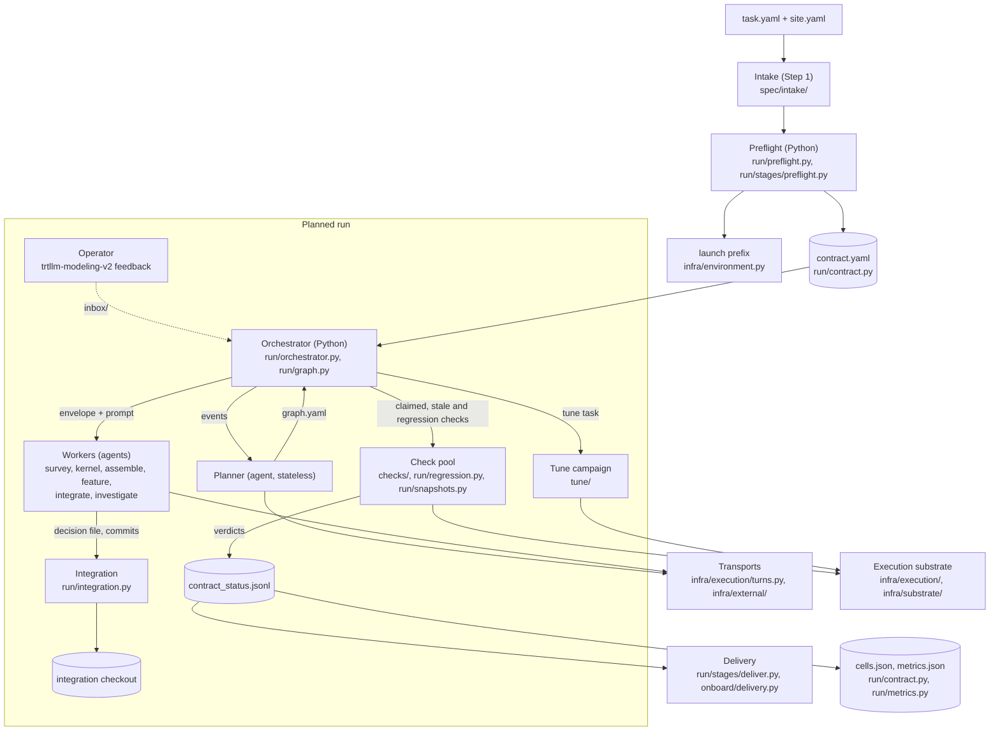
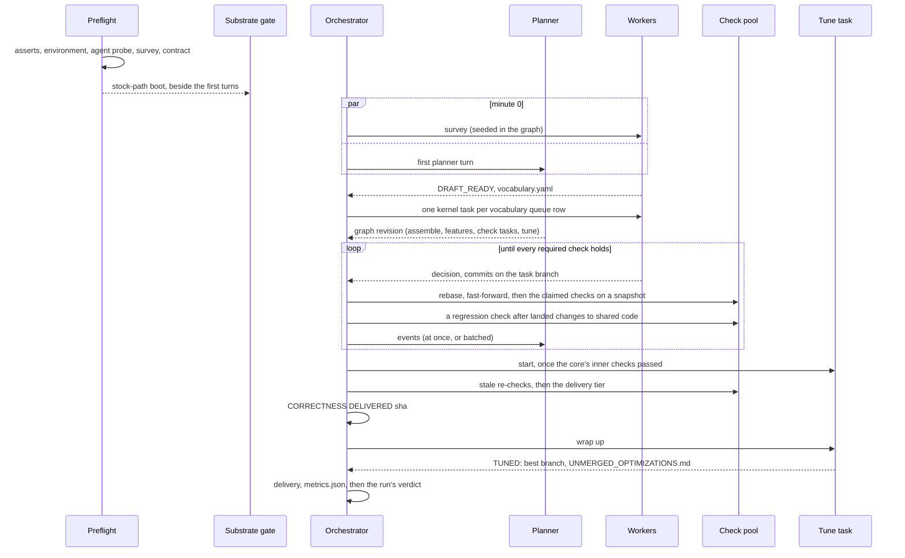

<!--
SPDX-FileCopyrightText: Copyright (c) 2026 NVIDIA CORPORATION & AFFILIATES. All rights reserved.
SPDX-License-Identifier: Apache-2.0
-->

# trtllm-modeling-v2: design

How the trtllm-modeling-v2 workflow is built and why. Operating a run is in
[user-guide.md](user-guide.md), changing the code in
[developer-guide.md](developer-guide.md), and every spec key in
[task.example.yaml](../task.example.yaml). Paths are relative to
`agent-flow/agent_flow/workflows/trtllm_modeling_v2/` unless they name the
TensorRT-LLM checkout.

## 1. Problem, goals and non-goals

### Problem

A ModelingV2 target is a flat, self-contained forward for one HuggingFace checkpoint, assembled only
from catalog entries under `tensorrt_llm/_torch/_experimental/modeling_v2/` and trusted through
accuracy gates rather than shared abstractions. Building one means mapping every computation step
onto the catalog, onboarding or certifying the missing kernels, assembling the forward and its
weights, adding each feature (a speculator, multimodal input, disaggregation, a quantized KV cache),
and proving each at every parallel configuration the target claims. Most of what goes wrong is not
modeling: a launch that cannot spawn ranks, a KV cache sized for the checkpoint's maximum context, a
number measured on the built-in implementation and read as the target's.

### Goals

- Bring one checkpoint, on one GPU architecture and a set of parallel configurations, to a target
  whose every required check passes on one tree.
- Let agents decide how to do the work; keep every decision about whether it is done in Python.
- Use the hardware: independent work runs at once, checks run as devices free up, and correctness is
  delivered without waiting for performance work.
- Survive a crash, a lost allocation or a reload onto new flow code: re-running the command resumes.
- Optionally tune the target's serving performance without making it less correct.

### Non-goals

- Performance as a release gate: a target whose contract holds is deliverable whether or not its
  tune campaign finished.
- Turning a delivered branch into a pull request: lint, headers, splitting and CI are the operator's.
- Enforcing the source embargo with a tool: it is a rule every role prompt carries (section 12).
- Running a cluster scheduler: the run stands on compute sessions an operator or a driver session
  allocates, and the orchestrator's loop never calls the cluster's scheduler. With
  `--manage-sessions` (off by default) a thread beside the loop submits, renews and releases the
  run's own sessions with `sbatch` (section 8.4).

## 2. Principles

**Rules constrain outcomes, not process.** The contract (section 5) is the only definition of done.
Nothing fixes stages, units or their order: a planner agent decomposes the work into a task graph,
and the orchestrator admits any graph that satisfies a short list of outcome rules (section 6.2).

**Agents claim, Python verifies.** A worker reports that it finished; it never reports that a check
passed. A decision is a closed enum in a file, a commit goes through a helper that refuses what the
policy forbids, and a tuner's candidate is measured and judged by Python.

**Checks are exit codes.** A gate is a process that returned zero and printed a number above its
floor, or did not. There is no `--min-score` and no agent scoring an artifact; the anchor comes from
TensorRT-LLM's own accuracy references. Every gate runs with `TRTLLM_MODELING_V2=require`: under
`auto`, a configuration that misses the target's routing silently gets the built-in implementation,
and its number reads as the target's.

**Evidence is keyed to what it measured.** A verdict names the state of the tree it ran on, and one
recorded against another state does not count (section 5.5).

**Preflight is Python.** Before any agent turn, Python proves that the checkpoint parses, the spec is
consistent, the host is usable and the stock path generates a token under the run's runtime block
(section 4.2). A broken host fails in seconds, not hours into a turn where it reads as a target defect.

**One declared launch environment.** `task.yaml`'s `environment` block resolves once
(`infra/environment.py`) into a literal command prefix that every role prompt carries verbatim.
Agents never construct a launcher command, probe for one, or call a test-runner skill; a prefix that
does not fit is a symptom to report, not a problem to solve.

**Correctness before performance.** The first tree on which full support holds is recorded as the
correctness milestone, with no planner turn (section 4.4). Tuning is background work on idle
capacity: it measures its own worktrees, changes nothing a contract check measures, is told to wrap
up once full support holds, and its best branch is an artifact never integrated in the run.

**Resumable everything.** Every record is a file in the workspace, written whole or appended, and
every stage checkpoints before it advances. A stopped process resumes from disk: the graph, the
verdicts, the campaign and the turns already asked are never redone (section 11).

**A mechanism earns its place.** The default contract is what proves the target serves: boot and
accuracy for each unit at its members, and acceptance at or after a speculator. Witnesses and the
envelope boot are proofs a spec or the `certified` profile adds, and machinery no GPU run has
exercised is off until one has ([mechanisms.md](mechanisms.md)).

## 3. Architecture overview



| component | responsibility | code |
|---|---|---|
| intake and spec | derives a user-facing `task.yaml` from a checkpoint, checks, confirms and compiles it; the resolved spec's schema, defaults and variants | `spec/`, `spec/intake/derive.py` |
| preflight | phase 0: intake checks, ordered asserts, launch environment, agent probe, substrate gate, surface survey, contract | `run/preflight.py`, `run/stages/preflight.py`, `run/agent_probe.py` |
| contract | every check the run owes, its tier, its verdicts, the cells and the correctness milestone | `run/contract.py` |
| planner | one stateless agent turn that writes the next task graph | `agents/prompts/planner.py`, `run/stages/planned.py` |
| orchestrator | admits graphs, starts tasks, runs checks, follows shared changes with regression checks, wakes the planner, drains for a reload | `run/orchestrator.py`, `run/graph.py`, `run/drain.py` |
| workers and roles | one agent turn per task on the one worker prompt, briefed by the task's tags; typed decisions per role | `agents/`, `run/progress.py`, `run/stages/` |
| check pool | gates and witnesses on read-only snapshots, admitted by free devices | `checks/`, `run/snapshots.py`, `infra/execution/capacity.py` |
| regression checks | the package tests a batch of shared changes can affect, against the last cleared commit, with no agent turn | `run/regression.py`, `checks/testcache.py` |
| integration | one sparse worktree per task, rebased and fast-forwarded in | `run/integration.py`, `infra/committer.py` |
| substrate | compute sessions whose spool scheduler runs every GPU job; with `--manage-sessions`, the run submits its own | `infra/execution/`, `infra/substrate/` |
| transports | a role turn in this process, or as files for a driver | `infra/execution/turns.py`, `infra/external/`, `infra/dispatch.py` |
| operator surface | the operator loop (wait, status, reload), messages for the planner, the run's budget and metrics | `infra/driver/`, `run/inbox.py`, `run/metrics.py` |
| tune | the performance campaign, one task in the graph | `tune/` |
| delivery | findings, the trees on disk, the delivered tests, the contract on the target as it is | `run/stages/deliver.py`, `onboard/delivery.py` |

[developer-guide.md §1](developer-guide.md#1-package-layout) maps the packages and modules.

## 4. Lifecycle of a run



### 4.1 Intake

Intake turns a request into a confirmed `task.yaml` before any GPU or agent time is spent
([INTAKE.md](../INTAKE.md)). `intake check` runs the feasibility checks against the checkpoint,
`intake confirm` records a digest of what the user agreed to, and `intake compile` (or `--site` on
the run) compiles the request with the cluster's `site.yaml` into `task.resolved.yaml`: per-unit
LLM-API options, anchor discriminators, members, boot and witness blocks, and perf configs. A run
refuses an intake `task.yaml` without `--site` or without a confirmation that still matches; a
resolved spec is accepted as it is. The fast path (`--checkpoint`) derives the request from the
checkpoint, the site and a one-line goal and runs it at once: its checks run in phase 0, and
confirmation is recorded rather than awaited.

### 4.2 Preflight and phase 0

Preflight decides whether the run happens at all. A run started with `--checkpoint` first runs its
intake checks, before the host is touched, every block reported at once (section 4.1). The asserts
then run in order, cheapest first, and the first failure ends the run before the branch exists
(`run/preflight.py`): the checkpoint parses; the member set and its gate count are stated; every
unit's anchor, and every accuracy-gated variant's, resolves; the launcher can build each requested
speculator; each unit's launch paths capture one CUDA-graph list; `TMPDIR` is usable; on a `local`
run, devices are claimed by `memory.free`, utilization and a lone-process probe, and a multi-rank
run's NCCL/MPI substrate answers. On a scheduled environment the allocation is the claim. Notes,
which stop nothing, say what the host's tools change (`check_host_tools`): a git older than 2.40 when
perf is on (section 10.5), and on a `local` run a `python3` on `PATH` older than 3.7, which the
native rebuild script refuses (section 8.5). Then (`run/stages/preflight.py`):

1. **The agent probe.** On the in-process transport, one tiny turn runs on every distinct agent the
   roles resolve to (`run/agent_probe.py`) and must write a nonce, its SHA-256 and the checkout's
   `HEAD` into a file through its Bash tool. Preflight judges the file, never the model's words. A
   pass stands for 12 h while the agents, the CLI, the host and the checkout are unchanged.
2. **The substrate gate.** The stock path boots the checkpoint under the run's runtime block and
   generates a token, on a thread beside the planned run's first turns: a pass costs no wall time,
   and a failure stops the orchestrator (`orchestrator.stoppable`) but leaves the run open, so
   re-running resumes. A pass under 12 h old for the same environment, checkpoint, runtime, options
   file and checkout (`gates/substrate/pass.json`) spares a resumed run. For an architecture the
   stock path does not know, `environment.substrate_checkpoint` names one it does.
3. **The surface survey** records what the checkpoint structurally demands and what the build
   supplies (registered ops, catalog entries, their architectures, the installed FlashInfer's public
   API) in `surface.md`, and the runtime map narrowed to those demands (the engine areas the
   checkpoint touches, where their code and tests live) in `runtime_map.md`, which every worker is
   pointed at.
4. The commit helper, the prompts (with the resolved prefix), `host_facts.md`, the skill and
   `contract.yaml` are written.

`--dry-run` stops here. A new run then enters the planned run with the survey already in its graph
(`run/stages/plan.py`, `orchestrator.seed`), so the survey and the planner's first turn start at once.

### 4.3 The planned run

One loop thread (`GraphOrchestrator.run`) changes the graph. Each running task is a worker turn
followed, in the same thread, by its integration and its claimed checks; checks share one bounded
pool; the planner's turn runs on a thread of its own, one at a time, while tasks keep finishing and
starting, and its revision is applied when it returns. When the survey lands the orchestrator adds
the kernel tasks (section 6.8); from then on the planner shapes the work and the orchestrator starts,
integrates and checks it (sections 5 to 7). Each pass of the loop also takes the operator's messages
(section 6.6), follows every change to shared code with a regression check (section 6.11), and,
once the run is past its budget, starts nothing more (section 4.8).

### 4.4 Bring-up, cells and correctness

The **bring-up** comes first: the first state on which the first unit's boot and accuracy hold at
its narrowest member is recorded once, as the branch `<target branch>-bringup`, the journal line
`BRINGUP DELIVERED <sha>` and a `bringup` line in `correctness.jsonl` (`contract.bringup_checks`,
`workflow._mark_bringup`): a usable one-rank target hours before every member is certified.

**Cells.** A cell is a unit or a variant at one member (`contract.cells`). Each time the contract is
evaluated on a state of the target, every cell whose required checks all passed there is recorded in
`cells.json` with that commit (`workflow._mark_cells`). The commit the most cells hold on at once
gets the branch `<target branch>-best`; the journal says `CELLS <sha>` for the cells that hold anew
and `BEST <sha>` when the branch moves. A run stopped at any moment says what it proved, and where.

The first state of the target on which **full support** holds (`GraphOrchestrator._support_gaps`:
every required check, the delivery tier's included; the delivery files on disk; every landed change
to shared code covered by a regression check that passed; no local variant waiting for promotion)
is the correctness milestone, recorded with no planner turn (`GraphOrchestrator._correctness`,
`PlannedStage._mark_correct`): the branch `<target branch>-correct` (the branch checked out in
`trtllm_repo_path`, or the run's own branch name when it is detached) is set to the commit, the
journal says `CORRECTNESS DELIVERED <sha>` with the hours since the run opened, and
`correctness.jsonl` gets a line. Later work that turns a check red or stale leaves it where it is
(`correctness stays delivered at <sha>: ...`); the next state full support holds on moves it forward.

### 4.5 Delivery

The loop returns `delivered` when nothing is in flight, full support holds on the target as it is,
no required task is open, and no worker report is unread by the planner; a running campaign is told
to wrap up first (section 4.6). Delivery then checks, in order (`run/stages/deliver.py`), each
failure closing the run:

1. **Findings.** An unacknowledged accuracy finding (section 5.3) closes `delivery-failed:findings`.
2. **Disk** (`onboard/delivery.py`): the six trees a finished onboarding touches (the catalog
   entries the target imports, shared ones under `catalog/` and its own under `ops/`; their GPU
   tests; the target; its routing entry; the accuracy anchor; the test-list registration);
   `ops:promoted` (no local variant left in or imported by the target, but those
   `target.keep_local` names; section 6.10); `git:target-committed` and `git:commit-hygiene`; and
   `tests`: the target's own tests and those of the catalog entries it is delivered with, by the
   newest result in the run's test cache that holds at the head (`testcache.head_results`), none
   failing and none still to run. A failure closes `delivery-failed`.
3. **The contract** (`run/contract.py`) on the target as it is now: a verdict recorded against
   another state counts as missing, so a target that changed after it was gated is not delivered
   on old evidence. A failure closes `delivery-failed:contract`.

### 4.6 Tune as a task

With `perf.enabled` the graph must hold one `tune` task. It is held back until every inner-tier check
of the first unit has passed, on the current target or an earlier one, with no failure since. It pins
the commit the target is at when it starts and works only in its own worktrees, so feature tasks
landing meanwhile never reach a measurement. It ranks after every other task, no task may depend on
it, and an `exclusive` task does not wait for it. Once full support holds it is told to wrap up
(`TuneStage.should_stop`): nothing new is dispatched, what is not yet measuring is dropped, what is
measuring finishes. Its report names the best branch, which is never integrated in the run; merging
it into a target that has moved since is an `integrate` task the planner adds, whose checks run on
the merged tree. The changes it kept that the delivered target does not carry are listed in
`<workspace>/UNMERGED_OPTIMIZATIONS.md`. A failed tune task reaches the planner as a report, not a
failed run. `trtllm-modeling-v2 tune` runs the campaign (section 10) on a target onboarded elsewhere.

### 4.7 How a run ends

The run closes with one verdict: `delivered`, or `tuned` when the tune task also finished;
`escalated` or `ceiling`, the planner's answers; `planner-stalled` (section 6.9), `planner-refused`
or `planner-failed: <error>` (section 6.2); `delivery-failed[:findings|:contract]`;
`session-lost:<unit>` (section 8.4); or `budget-spent: <why>` (section 4.8).
[user-guide.md §9](user-guide.md#9-watching-a-run) says what each means and whether re-running the
command re-enters the run. Whatever the verdict, the run writes `metrics.json` as it closes. A run
the phase-0 substrate gate stopped is not closed: it stays open (`stopped`), and re-running resumes
it.

### 4.8 Budget and metrics

`budget: {wall_hours, gpu_hours}` in the spec bounds the run (`run/metrics.py`); intake's
`constraints.budget` compiles to it. Hours count from the run's opening, restarts included, and
device-hours are the devices the run's live sessions hold (else the run's own device count) times
those hours: a held device is paid for whether or not a job runs on it. Once the run is past either
bound (`Services.budget`), the loop starts nothing more, leaves what is in flight to end on its own,
and the run closes `budget-spent: <why>` with the cells it proved.

`metrics.json` says what the run cost and proved, read off the workspace (`metrics.collect`): the
bring-up and correctness milestones and the hours they took; the cells and the best commit; per gate
kind, how many checks ran, passed, failed and said nothing (void), and the device-hours they took
(each verdict's `duration_s` times its member's ranks); turns by role; the refused graphs
(`refusals.jsonl`); the operator's messages taken; restarts. The run writes it as it closes, and
`trtllm-modeling-v2 metrics --workspace W` writes it at any moment.

## 5. The contract and checks

### 5.1 Units, members and tiers

`run/contract.py` compiles the contract from the resolved spec. A **unit** is `core`, then one per
feature in `features:`. A **member** is one configuration the target serves; under `parallel:
unified` the members are `members:` (default `[tp<W>, tep<W>, dep<W>]`), cheapest first. A check is
one gate at one member for one unit, keyed `<unit>:<gate>@<member>` (`core:accuracy[gsm8k]@tep4`). A
**configuration variant** (`variants:`, `spec/variants.py`) is a unit's target served under another
configuration, such as an FP8 KV cache; its checks are named by the variant.

| tier | checks | when they run |
|---|---|---|
| inner | per unit and member: `boot`, `accuracy[<benchmark>]` (with the logit gate on, at the members section 5.9 names); with `accuracy.logits`, `logits`; with `accuracy.serve`, `serve` at the widest member | after a task that claims them, and again when stale |
| proof | with `accuracy.witness.enabled`, the unit's witness (`residency`, `equivalence`, `replay[<unit>]`, `kv_quant`); `acceptance` for every unit at or after a speculator; every variant check | after a task that claims them, and again when stale |
| delivery | with `accuracy.envelope.enabled`, `envelope` at every member of the last unit; with `accuracy.serve`, `serve` at a one-rank member when the last unit has one and serves wider | once every other required check holds and nothing required is open but the campaign and what waits for it |

There is no perf tier: the tune campaign judges its own keeps (section 10). A storage or scheduling
variant (no `acceptance` gate) boots at every member of its unit, where the boot attests the setting
took effect; its accuracy stays at the members it names.

**Profiles.** `profile:` presets how much the contract owes from switches the spec already has; a
switch the spec sets keeps its value (`task_schema.PROFILES`, `_profile_defaults`). The intake
request carries it, and `site.yaml`'s `defaults.profile` gives one to a derived request.

| profile | owes |
|---|---|
| `bringup` | each unit's checks at its cheapest member only; no configuration variant and no delivery check. What it leaves out is accepted in the coverage matrix, and `contract.yaml`'s notes name it |
| `standard` (default) | the contract as the spec states it: boot and accuracy for each unit at its members, acceptance at or after a speculator, and the gates the spec turns on |
| `certified` | also the witnesses, the envelope boot and the serve gate, and each unit's benchmark at every member (`accuracy.benchmark_members: every`), where the spec leaves those unsaid |

**Each check proves what it claims** (`checks/observables.py`). Every feature a check can be about is
registered with its evidence and its oracle: a cache dtype as each rank's worker resolved it;
chunked prefill as a served prompt longer than `max_num_tokens` past what the cache resumed; block
reuse as the reuse probe (section 5.4); a speculator as per-prompt acceptance, each draft depth
beating the one below where no stock speculator exists; a multimodal unit by a check that sends
images (the logit gate over a reference with image prompts, or an image benchmark); the serve gate
by the boot workload's keywords. A variant is about the fields its overlay sets, and a field its
boot did not observe fails the boot: "not attested" never passes the one setting the check exists
for. A variant that changes only lossless settings (a chunk size, block reuse, the capture list) is
held to the reference's greedy tokens as its unit is.

**What the contract proves of the request** is a matrix (`run/requirements.py`, written to
`coverage.yaml` at preflight and into the journal at delivery): one row per unit, per variant and
per pair of units no unit's checks reach together (`disagg+multimodal`), one column per member, and
per cell `certified` (a gate that judges the output runs there), `sampled` (it boots there, and its
output is judged at the members named) or `not covered` with the reason. A cell not covered is a
decision: preflight stops until `coverage.accept` names it (`<feature>@<member>` or `<feature>@*`),
so a delivered run's "fully supported" says exactly what was proven. Two choices the spec already
made are accepted as such: a feature only its witness can see is not covered while witnesses are
off, and neither is a member or variant the `bringup` profile leaves out.

### 5.2 Gates and witnesses

| check | proves | observable |
|---|---|---|
| `boot` | the engine cold-starts under `require` and generates the expected text | keywords matched on generated text only, a multimodal unit sent an image; with a logit reference, the first greedy tokens against the reference's (section 5.9) |
| `accuracy[...]` | the release criterion: `trtllm-eval` against the anchor | score against a statistical floor (section 5.3) |
| `logits` | numerics position by position against the HF reference | the reference's top-1 token at every position that is not an image placeholder: top-1 agreement, mean and largest \|Δ log-prob\|, each within the reference's own bf16-vs-fp32 spread times `threshold_factor` (`checks/logit_agreement.py`) |
| `serve` | `trtllm-serve` starts the target with the accuracy gate's options and answers | one `/v1/completions` request, then the boot prompts (an image prompt as a `/v1/chat/completions` request), held to the boot gate's keywords (`checks/serve_gate.py`) |
| `acceptance` | the speculator drafts as it should | `acceptance_length` on at least 32 natural-text prompts, paired against the previous verdict |
| witnesses | a feature boot and accuracy cannot see is on | two legs that differ in exactly one variable (`checks/witness.py`) |
| `envelope` | the target at its declared limits | `max_batch_size` in flight, prompts at `max_seq_len`, every capture batch replayed, probes keeping their first tokens from a batch-1 run (`checks/envelope_boot.py`) |

Every workload is declared in the spec's `accuracy` block, never sized from the run it judges;
[task.example.yaml](../task.example.yaml) documents each key and default, and each also works inside
one unit's entry. `trtllm-modeling-v2 gate <name>` runs one gate exactly as the orchestrator does
([user-guide.md §12](user-guide.md#12-running-one-gate-standalone)).

`features:` is a closed list (`FEATURE_FAMILIES` in `spec/task_schema.py`), because each family's
checks are wired by name:

| feature | family | gated by |
|---|---|---|
| `mtp`, `eagle3`, `dflash`, `dspark` | speculator | boot, accuracy, **acceptance** |
| `multimodal` | multimodal | boot, accuracy on a multimodal benchmark (or the logit gate over image prompts) |
| `host_offload` | host_offload | boot, accuracy, **residency witness** |
| `disagg` | disagg | boot, accuracy, **equivalence witness** |
| `kv_quant` | kv_quant | boot, accuracy, **kv_quant witness** |
| `decoder_replay`, `encoder_replay` | bounded_replay | boot, accuracy, **replay witness** |

`dspark` is never a spelling of `mtp`: a checkpoint can store its DSpark block drafter as `mtp.*`,
and the schema refuses the two together.

The speculators, host offload, disaggregation and native KV storage are output-identical by
construction, and bounded replay is designed to stay inside the accuracy tolerance: boot and
accuracy pass whether or not the feature does anything. A speculator's proof is its acceptance gate,
owed always: rejection sampling holds the output to the target model's, so a miscomputed draft path
only runs slower. The other witnesses are owed only with `accuracy.witness.enabled: true` or the
`certified` profile (`task_schema.witness_enabled`), and a witness block that declares a workload or
a figure is then required at spec time. Each compares one observable across two legs: device memory
with and without the offload; stored KV bytes per token against a declared figure, plus token
identity with bf16 storage; per-request row counters the target prints (`MODELING_V2_WITNESS
key=<int>` under `TRTLLM_MODELING_V2_WITNESS=1`) against a window and workload the spec declares; or
token-identical output across the disaggregation hop. Token-comparing legs run as processes that
share the AutoTuner's tactics and Triton's autotuning, emptied at the start of each gate run
(`gates.pin_tuning`), so two legs of one configuration do not differ in the last bit. They compare
token ids (`[i] Witness token ids: [...]` under `TRTLLM_WITNESS_FULL_OUTPUT=1`) over at least
`min_generated_tokens` (32): text that agrees without ids, or a continuation too short to compare,
is refused, not passed.

**The equivalence witness.** Leg B is a launcher of the run's own: the witness block names it in
`contrast_command` and the environment that sets it apart in `contrast_env`, and the spec is refused
without both (`EQUIVALENCE_WITNESS_REQUIRED`). A word of `contrast_command` naming a file beside the
spec is resolved against the spec's directory. The launcher runs as one process on a whole node
(`contrast_leg_command`) and starts a context and a generation engine of the member's width itself,
through the prefix `MV2FLOW_WITNESS_ENGINE_LAUNCH` names; the block's `cache_transceiver_config`,
when it sets one, reaches it as `MV2FLOW_WITNESS_TRANSCEIVER`. Its `prompt_tokens` prompts are prose
(`checks/witness_text.py`): the attention pages alone continue a counting pattern, which cannot show
a hop that drops the recurrent state. Before a pass, leg B runs the longest prompt once more with
`MV2FLOW_WITNESS_ABLATE=state`, which destroys the state the generation engine received; unless that
continuation changes, the verdict is `INSENSITIVE, not a pass`. At a `dep` member leg B is handed
`MV2FLOW_WITNESS_RANK_PAIRS`, one (context rank, generation rank) pair per prompt covering every pair
(`0:0,1:1,0:1,1:0` at dep2), and the prompts repeat until there is one per pair.

Beyond reading leg A's workload from the `MV2FLOW_WITNESS_*` variables (`checks/witness.py`), the
launcher must honour:

- `MV2FLOW_WITNESS_RANK_PAIRS`: pin prompt `i`'s context-only and generation-only requests to the
  `i`-th pair (`SchedulingParams(attention_dp_rank=..., attention_dp_relax=False)`) and print
  `[i] Witness ranks: ctx=<c> gen=<g>`. A hop without that line fails the witness.
- `MV2FLOW_WITNESS_ABLATE=state`: on the generation engine, after each generation-only request's
  transfer completes and before its first decode step, zero the recurrent state (conv window and
  SSM state) of every layer that has one, else the request's KV pages, and print
  `Witness ablated: <what>` per request, from any process. Without that line the self-test cannot
  run and the witness fails. A hook in a `sitecustomize` first on the generation engine's
  `PYTHONPATH` can act where the executor takes up a request whose transfer completed
  (`PyExecutor._prepare_disagg_gen_transmission_complete`).

### 5.3 Floors and findings

Accuracy floors are statistical (`checks/stats.py`): by default `anchor - k * SE` with `k = 2` and the
binomial SE of the benchmark's sample count; `rule: tolerance` keeps a fixed width. When every member
of a unit scores more than one SE below the anchor, the unit passes but the run records a
**finding**, which delivery refuses until `floor.acknowledge.<unit>` gives the reason. Per-prompt
baselines and open findings live in `gate_results.jsonl` (`checks/gate_records.py`), which the
acceptance gate also pairs a later tree against.

The acceptance gate compares a unit's run prompt by prompt with the previous verdict
(`regression: {test, alpha, min_effect}`), and with the stock path (`=off`) where it loads the
checkpoint. Where it cannot (recorded per checkpoint and architecture in `gate_results.jsonl`, and
skipped from then on), a draft depth above 1 of a speculator whose depth is a setting (MTP, Eagle3)
must accept significantly more than the same target one depth shallower, on the same prompts in the
same job; at depth 1 a unit declares `min_absolute` with its `floor_source`, or
`measured_reference`, and a floor with no measured source is warned about.

### 5.4 Engine attestation

A gate's argv and the KV-cache keys it hands over are what it asks for; the LLM API and the
executor's worker can change them. Once an engine is up the harness prints one `MV2FLOW_ENGINE`
record (`checks/harness/engine_facts.py`): `modeling_v2`, block reuse, the Mamba snapshot policy, the
KV and SSM cache dtypes (as asked and as resolved), the CUDA-graph batches and padding, the
speculator and its depth, `max_num_tokens`, `max_batch_size`, chunked prefill, TP, EP and attention
DP. Each value comes from the rank's own worker: the gates put `checks/harness/rankhook` first on
`PYTHONPATH` with `MV2FLOW_RANK_FACTS=1`, and every executor worker prints an `MV2FLOW_RANK_ENGINE`
record as its engine is set up, held to the declaration rank by rank. Without those records it comes
from rank 0's worker in the harness process, else from `llm.args`, which only repeats the request.

Boot, both acceptance legs, both envelope legs and every witness leg the quickstart shim runs compare
each field with the unit's resolved declaration (`gates.engine_declaration`); the accuracy gate's
eval shim (`checks/harness/eval_shim.py`) compares block reuse and the cache dtypes. A field that
differs fails the gate, naming it (`gates.attest_engine`); a field the record lacks is `NOT
ATTESTED`, never agreeing. Leg B of the equivalence witness builds its engines outside the shim, so
their configuration is not attested.

Every response carries `cached_tokens`, and after the workload the harness prints one
`MV2FLOW_REUSE` record (`checks/harness/engine_reuse.py`): the requests that resumed from the KV
cache, the tokens and positions they resumed at (recurrent-state snapshot restores, for a hybrid
model), and how many could have. The boot, acceptance and envelope drivers then send the **reuse
probe**: one prompt two KV blocks past the engine's shortest resumable prefix, twice. A unit that
asks for reuse fails a gate where the engine reused nothing although it could have
(`gates.reuse_shortfall`). Without a Mamba state snapshot policy the engine turns block reuse off for
a hybrid model, and a gate whose log says so fails naming the setting
(`gates.reuse_disabled_detail`).

Each verdict carries the recurrent slots every rank logged, rank 0's KV-cache tokens and the free
memory of each device once the engine was up, shown in the journal as `[engine 12/12 fields as
declared; recurrent slots 4096 x4; KV 262144 tokens; reuse probe resumed at 256 of 320 (snapshot
restored); min free 23.97 of 276.62 GiB]`. A device under the larger of
`runtime.min_free_memory_gib` (default 2) and `runtime.min_free_memory_fraction` of the device
(default 0.02) still passes, with `[WARNING: LOW MARGIN: ...]` in its summary.

### 5.5 Fingerprints and staleness

A verdict is recorded under a **marker**, a fingerprint of the commit's tree as the checks see it
(`TrtllmModelingV2Workflow._target_marker`, `workflow.fingerprint`). It hashes git's blob ids of every
path a gate can read: it leaves out `tests/`, `docs/`, `.github/`, `examples/`, `*.md` and the run's
workspace, but keeps the files a gate reads there (`gate_inputs`: the quickstart, the default boot
image, every file the spec's `accuracy`, `runtime`, `variants` or `environment` block names). Of an
anchor table only the entries the run reads count, and the native libraries' sizes and modification
times are added. So a commit that only edits a test list or another model's anchor leaves every
verdict standing, and a native rebuild makes every verdict stale.

A code change is judged by what each check read. The rank hook has every process of a check write
the tree's Python modules it imported (`run/snapshots.py:CheckTree.read`), and the verdict records
that list and the marker narrowed to it (`workflow._narrow_marker`: those Python files, every file of
the tree that is not Python, the native libraries and the anchor entries). A verdict under another
marker holds where its narrowed marker is unchanged (`workflow._verdict_holds`), so a kernel variant
or a feature file a check never imported leaves it standing. A verdict that names no read list
counts as missing under another marker.

What a check reads from outside the checkout (the spec as it applies to its unit, the options'
content, an anchor, a prompts file, the logit reference) is its `inputs` (`contract.check_inputs`), a
digest recorded on every verdict. A verdict on other inputs is stale like one under another marker,
so a run relaunched with a changed floor, draft depth or snapshot policy re-runs exactly the checks
that read it.

### 5.6 Verdict sharing

Boot, accuracy and acceptance checks of different units that run one command on one engine against
one criterion carry one equivalence key (`contract.equivalence_key`: for boot, the runtime block,
speculator, options content and workload; for accuracy, every accuracy input as it applies to the
unit; for acceptance, the runtime block, speculator and depth, options content and acceptance block).
Options are compared by content, never by path. A pass of one on the current marker holds for the
others (`SHARED` in the standing). A check's own verdict always wins, failures are never shared, and
variants never share.

### 5.7 Snapshots per commit, and VOID verdicts

The integration checkout moves while checks run, so a check measures a read-only snapshot of the
commit the checkout is at when the check starts (`run/snapshots.py`): a detached worktree under
`snapshots/<commit>/`, sparse with a task worktree's cone, with the checkout's native build linked
in, shared under a lease by every check of that commit and removed once the checkout has moved past
it and no lease holds it. Every command runs from inside it with it first on `PYTHONPATH`, and on a
spool names it as the job's tree.

What each command imported is read back from its output (the spool's resolve hook, the engine
driver) and recorded in `contract_status.jsonl`. A verdict whose commands imported more than one
tree, or a tree no commit pins, is **void**: measured once more, then recorded as not passing
(`VOID`). An uncommitted change in the checkout is in no snapshot, and each check it would have
reached warns that it did not measure it.

### 5.8 When checks run, and admission by free devices

A finished task's claimed checks (`satisfies`, but delivery-tier ones) run on the merged tree; the
task holds no agent slot while they run. The target is kept verified as it changes (`_settle`): each
landing runs the `RECHECKS_WHILE_BUSY` (4) stale checks likeliest to fail again beside the work in
flight, a member's delivery-tier checks are rehearsed once as soon as its other required checks hold
(advisory: a failure reaches the planner, and the final tree runs them again), and once no required
task is open the rest run, while no optional task that would change the tree starts. The order is
riskiest first (`_by_risk`): those whose last verdict warned `LOW MARGIN` or left the least memory
free, then those of the units the last landed task reaches, then the rest; after a change that may
move device memory (`workflow.memory_relevant`), the checks whose configuration left the least free
(`contract.tightest_checks`) run first. A check the contract already counts as passed on the current
marker is not run again; this is asked as the check starts, so the later of two equivalent checks
reads the earlier one's verdict.

How many checks run at once follows the sessions (`infra/execution/capacity.py`): a check starts when
some session would start its job at once, and otherwise waits in the orchestrator to be placed when a
device frees; never fewer than 2 in flight, never more than 32, and 8 when no session can be read. A
fixed count would pile jobs into a full spool, where they cannot move to a session that frees later.

A check's spool jobs queue at a class (`infra/execution/priority.py`), which a session's scheduler
starts higher first (section 8.1): a check on the way to the first unit's accuracy at 2; every
other contract check, a regression check's tests and a worker's own `trtllm-modeling-v2 gate` run
at 1; the tune campaign's measurements, and any job that names no class, at 0.

### 5.9 Cheaper oracles

With the logit gate owed, a unit's accuracy benchmark runs only at its narrowest member, its widest,
and every member whose served engine the logit gate does not run whole (attention DP, which a
one-prompt-at-a-time gate serves on one rank; every member of a speculator unit whose boot compares
no tokens); the logit gate at every member proves the rest equivalent to the reference.
`accuracy.benchmark_members: every` restores every member, and `contract.yaml`'s notes say where and
why. Wherever a logit reference is named, the boot sends the reference's first text prompts as token
ids (`accuracy.boot.greedy`, 4 prompts x 24 tokens by default), every request runs its whole budget
past any end token, and the boot fails on the first token that is not the reference's beyond a
near-tie no wider than the logit gate's largest delta limit. The logit gate is on when
`logits.reference.json.gz` sits beside the spec, and the serve gate wherever the spec bounds the
server's sequence length; `enabled: false` turns either off. Lossy variants (a quantized KV cache, a
narrower state dtype) owe no logits check and compare no greedy tokens unless their own entry says so.

### 5.10 The serving envelope

The runtime block's limits (`max_batch_size`, `max_num_tokens`, `max_seq_len` and the CUDA-graph
capture batches) are the serving envelope: what the target is claimed to serve. The roles judge
against it, never against the shapes one gate happens to launch: the survey marks a vocabulary row
`CERT`, not `OK`, when its entry's contract stops at the gate workloads; a kernel writer multiplies
each step's `call_sites` by every captured batch size to get the surface it certifies; and the
`assemble` tag has every capacity constant derived from an engine argument and checked against
`runtime_facts.yaml`.

The capture batches are one list per unit (`gates.resolve_capture_list`): the options file's
`cuda_graph_config` when it sets one, else the LLM API's `CudaGraphConfig` rule over the runtime
block's flags. `trtllm-eval` reads it from the options file; boot, acceptance and envelope get it as
`--cuda_graph_padding_enabled` and `--cuda_graph_batch_sizes`, and preflight (`check_capture_lists`)
refuses a unit whose two launch paths would still capture different lists. The KV-cache
configuration is one per unit too: the options file's `kv_cache_config`
(`gates.resolve_kv_cache_config`), `mamba_state_config` above all, reaches the quickstart engines as
`MV2FLOW_KV_CACHE_CONFIG`, merged under the quickstart's own flags, and preflight
(`check_kv_cache_configs`) notes a unit that asks for reuse on a hybrid checkpoint without a snapshot
policy.

## 6. The task graph and the planner

### 6.1 Tasks, kinds and roles

`graph.yaml` is the task graph the planner writes (`run/graph.py`). A task declares `id`, `kind`,
`goal`, `depends_on`, `depends_on_soft`, `touches` (the files it may change, at file granularity
where known), `resources` (`gpus`, `est_minutes`), `satisfies` (contract check keys), `priority`
(`required` or `nice_to_have`), `tags` (further kinds of work it does), `ref` (the unit, a
vocabulary queue row, or `<mode>:<entry>`), `exclusive`, `regression`, `status` and `attempts`; the
orchestrator records a regression check's `covers`. The [planner prompt](../agents/prompts/planner.py)
shows one.

| kind | role | works in | finishes with |
|---|---|---|---|
| `survey` | `surveyor` | the workspace: `plan.md`, `vocabulary.yaml` | `DRAFT_READY` (and a valid vocabulary), `CEILING` |
| `kernel` | `kernel_writer` | its own worktree, integrated; a queue row, `<mode>:<entry>` or `promote:<entry>[,<entry>...]` | `LANDED`; else `FAILED_RECEIPT`, `MACRO`, `BLOCKED` |
| `assemble`, `feature`, `integrate` | `assembler` | its own worktree, integrated | `UNIT_READY`; else `BLOCKED` |
| `investigate` | `assembler` | a scratch worktree, never integrated | `UNIT_READY` with a diagnosis; else `BLOCKED` |
| `tune` | `tuner` turns under Python | the campaign's own worktrees | `TUNED`; else `TUNE_FAILED (<verdict>)` |
| `check` | none: the orchestrator | nothing; its `satisfies` go straight to the check pool, and a regression check (`regression: true`, the orchestrator's own) runs the package tests instead (section 6.11) | done when they pass; a failure wakes the planner |

`BLOCKED` carries one of `vocabulary_gap`, `knowledge_gap`, `accuracy_shortfall`, `environment`.
Every role runs on the agent that drives the run (Codex when a Codex session starts the orchestrator,
else Claude Code) unless the spec's `agents` block routes it elsewhere
([user-guide.md §5](user-guide.md#5-writing-the-spec)).

Every role a task runs as is one **worker**: a single system prompt (`agents/prompts/worker.py`)
whose ending alone differs by role, rendered from the decisions the run validates for it and the
keys its decision file carries (`agents/decisions.py`). What a task asks is said by its **tags**: its
kind first, then the graph's optional `tags` (any worker kind, never on a `check` task), each after
the tags it brings with it (`feature` brings `assemble`). The dispatch carries a section per tag
(`agents/prompts/tags.py`), so a `feature` task that must first find why its check failed is tagged
`investigate` and briefed on both. The planner has a prompt of its own.

### 6.2 Admissibility

`graph.validate` refuses a graph, with every reason batched, unless:

- kinds, priorities and statuses are known, ids are unique, every task has a goal, and dependencies
  exist and form no cycle;
- every required contract check is in the `satisfies` of a task that is not abandoned;
- every `touches` lies inside `commit_policy.allowed_paths`, and no task asks for more devices than
  the site has;
- with `perf.enabled`, the graph has a `tune` task;
- `tags` are worker kinds (`graph.WORKER_TAGS`), and a `check` task takes none;
- a `check` task names contract checks (a regression check names none), has empty `touches` and 0
  GPUs; `depends_on_soft` joins two integrated kinds, never a task that is also in `depends_on`, and
  forms no cycle with the hard edges.

`graph.apply_revision` adds rules about the revision itself: it states a reason; `running`, `done`
and `failed` stay the orchestrator's (a running task it drops is kept); the orchestrator's pending
regression checks are its own too; a failed task may go back to `pending` only while it has attempts
left. A refused graph, or a proposal that cannot be read, returns to the planner at once with the
reasons and the events of the refused turn; the third refusal in a row ends the run
`planner-refused`. A planner turn that raises is asked again on the same events after a wait that
doubles each time, and the fifth in a row ends the run `planner-failed`.

Nothing a turn or a check raises crashes the loop. A task whose checks raised (a lost session) keeps
its work, which has landed: it is done, and those checks run again as re-checks. A landing is a fact,
not a status: whatever reached the target, from a task later failed or abandoned too, is in the next
regression check's batch. If the loop itself fails, the tasks whose threads already ended are
recorded before the process goes.

### 6.3 Statuses, attempts and retries

A task is `pending`, `running`, `done`, `failed` or `abandoned`. It is `done` when its worker gave a
finishing decision, its branch is integrated and its claimed checks pass, and `failed` otherwise; a
failed `nice_to_have` task is `abandoned`. A **retry** is the planner writing a failed task back as
`pending`: it runs again under its own id as its next attempt, and a revision that retries a task
whose third attempt failed (`MAX_ATTEMPTS`) is refused, so a task that keeps failing is reshaped
instead of looped. An **infrastructure failure** (the turn raised, `INTEGRATION_FAILED`, a tune
baseline that could not be measured) sends the task back to `pending` once by itself, as the same
attempt; the count is kept in `planner_events.json`, so a restart grants no second one.

### 6.4 Scheduling

`graph.next_to_start` picks the ready tasks (pending, every dependency done) to start now:

1. Tasks that were running when the last process stopped go first; one that cannot start yet keeps
   its claim, and nothing that conflicts with it starts before it.
2. Then required tasks, longest remaining critical path (`est_minutes`) first.
3. A `nice_to_have` task starts only while no ready required task waits for devices.
4. Two tasks never run together when both declare the very same file in `touches` (a path whose last
   part has a suffix) or either is `exclusive`. Directories never conflict: integration orders tasks
   that share one. An `exclusive` task that must wait holds back every task ranked after it, so the
   run drains to it.
5. `tune` does not start until the first unit's inner checks have passed.
6. A task starts while its `gpus` fit in the capacity left, at most `--max-parallel-tasks` (8) agents
   at once. Slots go by priority (`infra/execution/agent_gate.py`): the planner owns one and goes
   first, then critical-path tasks, other required tasks, side work (a `nice_to_have` task, the
   primers' briefing turns), and a tune campaign's turns last, on slots the feature work leaves
   idle. A task waiting on a soft dependency or running its checks holds no slot and no devices.
   `verify` kernel rows and `check` tasks reserve 0 GPUs: their tests and gates are jobs that take
   their own devices.
7. A task with `depends_on_soft` starts once each soft dependency has started; its integration then
   waits for each to land or end (section 7.4).
8. A `check` task takes no task slot: once its dependencies are done the orchestrator submits its
   checks to the pool itself, and a pass leaves a receipt naming them (a regression check's names
   the commit it cleared).

**Capacity** is the devices of the live spool schedulers (each `status.json`, less quarantined
devices), or with no live session the devices preflight claimed, less the `gpus` running tasks hold
(`capacity.held_gpus`: none for a `tune` task whose jobs all run on `perf.spools`). An agent turn
holds no device, so gate jobs that fill the nodes keep no task waiting.

### 6.5 Planner turns

| | |
|---|---|
| woken at once by | the run starting; a task that failed or whose checks failed; a worker's report (`For the planner ...`); an operator's message (section 6.6); a failed re-check; a `DONE` while the contract does not hold; nothing left to run or start |
| batched | a task that finished green waits up to `--event-window` (60 s) while anything is in flight; one that satisfies no check and that an open task depends on wakes no turn of its own and goes to the next one; while only a campaign runs, events are read at once |
| reads | the operator's messages first, then the spec, contract and verdict paths, the current graph, the contract's standing with the correctness milestone, the runtime facts' key numbers and changes, the target's own paths and where the regression checks stand, the events since its last turn, the refusals of its last graph |
| writes | `graph.proposed.yaml` and a decision: `GRAPH_UPDATED`, `DONE` (the orchestrator verifies), `ESCALATE`, `CEILING`; a suspected defect off the goal goes to `issues.md` |
| cannot | write code, run jobs, mark a check, or set `running`, `done` or `failed` |

The turn is stateless, which keeps a long run from drifting with context. What arrives during a turn
waits in `planner_events.json` for the next, unless that turn's revision already answered it (a task
it retried or dropped, or wrote done at the attempt that finished). Tasks the orchestrator added
during the turn, which its graph could not name, are kept.

Its prompt (`agents/prompts/planner.py`) keeps the plan to the goal: what proves or unblocks a
required check, the features `task.yaml` asks for, then performance work on the capacity the rest
leaves idle. No task shows a shared change harmless to other models, since the regression checks and
the pull request's CI do that. A suspected defect that does not affect delivering this model is
recorded in `issues.md` (what, where, which task found it, the evidence) and given no task. An
unexplained failure is an `investigate` task, or the `investigate` tag on the task that will fix it,
never a bare retry.

### 6.6 Operator messages

`trtllm-modeling-v2 feedback --workspace W "<message>"` (or `--file F`) leaves a message in
`<workspace>/inbox/` (`run/inbox.py`). Each pass of the loop takes what waits there, oldest first:
each message is moved to `inbox/taken/`, journaled (`operator`) and handed to the planner as an
urgent event. The planner's request puts the messages first, under `Messages from the operator: act
on these first`, and the planner says in its `summary` what it did about each. Once taken a message
is an event like any other: a turn whose graph was refused reads it again. A message steers the work;
it never relaxes a check. A requirement changes only through the spec's typed fields,
`coverage.accept` among them, which a reload applies.

### 6.7 Receipts and runtime facts

**Receipts** (`run/receipts.py`). A finished task leaves `tasks/<id>.receipt.yaml`: its decision, the
first paragraph of its summary, the note it ended with, the commits it integrated, a kernel writer's
entry and test result, the commit a regression check cleared (`cleared`), its decision and result
files, and up to three notes its worker addressed `For the orchestrator ...` or `For the planner
...`, each bounded. A task that starts carries its dependencies' receipts in its envelope and its
prompt, under `## Receipts of the tasks this one depends on`, so no planner turn restates results in
a goal.

**Runtime facts** (`run/runtime_facts.py`). Each gate that passes adds the engines it attested to
`runtime_facts.yaml`: per unit and member, the CUDA-graph batches and padding, recurrent-state slots
per rank, the KV pool, free memory, speculation depth, widths and limits; an envelope across members;
and `changes`, where a gate whose own numbers moved since its last pass (not free memory or the KV
pool, which follow the device's other tenants) is a line and a `runtime facts changed` journal event.
Every planner, kernel writer and worker prompt carries the key numbers and the path, so kernels are
certified against measured values, and the planner's request lists the latest changes, from which it
adds a re-certification when a value moves past what an entry certified.

### 6.8 Mechanical kernel tasks

`vocabulary.yaml` is the one agent artifact with a schema, because the orchestrator walks it
(`onboard/vocabulary.py`). Each computation step is `OK` (an entry covers it, quoting the cell, note
or `is_valid` assertion that decides it), `CERT` (an entry exists, not at these values: verify it) or
`GAP` (no entry: onboard one, naming its rung on the sourcing ladder). A queue `target` is
`<category>/<name>` (shared catalog) or `ops/<category>/<name>` (the target's own `ops/`). A `survey`
task whose `vocabulary.yaml` does not validate has failed. The sourcing ladder, cheapest first:

| tier | source | the row names |
|---|---|---|
| 1 | a `torch.ops.trtllm.*` op | the op |
| 2 | an in-tree callable under `tensorrt_llm/_torch/modules/**` | the callable |
| 3 | FlashInfer's public API, for a kernel no trtllm op wraps | `flashinfer.<module>.<name>` |
| 4 | native torch, composed by this run | what tiers 1-3 offered (`tried`) |
| 5 | a Triton kernel, written by this run | what tiers 1-3 offered (`tried`) |

A `ceiling` accounts for all five tiers. When the survey lands, `GraphOrchestrator._add_kernel_tasks`
turns the dispatch queue into tasks with no planner turn: one `kernel` task per row, id
`k<row>-<entry>`, touching the row's entry and its test, one GPU, the row's `depends_on` as edges;
they start at once. The planner wires the rest of the graph to them, places rows the orchestrator
could not, and may reshape those not yet running; a row's `unit` says which assembly needs it first.
A kernel writer that answers `MACRO` names its constituents, which the planner adds with `ref:
<mode>:<entry>`. A kernel writer is told the sourcing tier on record for its entry: its row's, else
the `tier` the last kernel writer that landed the entry wrote, else the vocabulary step's; with none,
it is asked to name the tier.

### 6.9 The revision cap

Each adopted revision counts against `--revision-cap` (default 6), as do a `DONE` while the contract
does not hold and ready tasks that cannot start with nothing running. Progress resets the count: a
task done, or a check turning green. At the cap the run closes `planner-stalled`.

### 6.10 Develop in the target, then promote

Two tasks that declare one file never run together, so certifications of one shared catalog entry
would run one after another. A kernel task on a shared entry therefore lands a **local variant** in
the target's own `ops/`: `ops/<category>/<name>__<site>.py` and its test beside the target's other op
tests (`vocabulary.entry_paths`). The site is the row's `site`, else `r<row>`; a task ref may name it
as `@<site>`. A variant starts as a copy of the entry, keeps its class name, and the target imports
it. Variants touch only the run's own paths, so a later task on the entry runs beside it, and no
regression check follows them. The survey writes one row per shared entry, every call site's shapes
as its cells (`vocabulary._parse_queue` refuses a second row). A task that declares the catalog file
lands in place.

A `promote:<entry>[,<entry>...]` kernel task (`onboard/promotion.py`; the `## Promote` section of the
`trtllm-modeling-v2-entry` skill) merges each entry's variants into the catalog: the union of their
cells, guards and `ARCHS`, one test file, the target's imports pointed at the catalog, the variants
removed, and one certifying run with the claims gates. Promotion is incremental, beside the feature
work: an entry is due once no task still to land a variant of it is pending or running and the
target imports each of its variants (or nothing is left to change the target); every entry due at
once goes in one promote; an entry with an open promote waits for it. A promote declares every file
it rewrites. `target.keep_local` keeps an entry local, and the delivery check `ops:promoted` accepts
its variants.

### 6.11 Regression checks

A task changes **shared code** when its commits land on the target (`kernel`, `assemble`,
`feature`, `integrate`) and its `touches` reach outside the run's own paths (the target's directory
and the one its tests mirror it in). The orchestrator follows every such change with a **regression
check** it adds and wires itself (`graph.add_regression_check`): a `check` task with `regression:
true`, id `regression`, then `regression-2` and so on. The rule binds a run whose graph had no
finished task when the process started.

Regression checks are batched. One covers, as it starts, every landed change to shared code no
earlier check covered: its batch, recorded per attempt as `covers` (`<task>@<attempt>`). While a task
that changes shared code runs, a ready check waits up to 30 minutes (`REGRESSION_WINDOW_S`) after its
batch's first landing for that change to join; one runs at a time, and what lands meanwhile joins the
next batch; one whose batch is empty when it would start closes at once.

A regression check runs no agent turn (`run/regression.py`). In a read-only snapshot of the commit the
checkout is at, one job runs the tests of the modeling_v2 package (`tests/unittest/_torch/modeling_v2`)
that the batch can affect, through the test cache (section 6.12), against the commit the last check
cleared, else the run's starting commit. A test that passed at the base and fails now, a new test that
fails, or a test with no result at the head fails the check, naming each; the planner hears them, and
since no agent has looked, an `investigate` task finds why. A clean check's receipt records the head as
`cleared`. A failed check covers nothing, and no new one is added until a later change to shared code
is pending; the planner may retry the failed one once what it ran on has changed. A shared change's
effect outside the package (the executor, the runtime, other models' forwards) is left to the pull
request's CI.

### 6.12 The test cache

`trtllm-modeling-v2 tests` reuses a recorded test result wherever nothing the test ran on changed
(`checks/testcache.py`). The driver (`checks/testcache_driver.py`) runs one pytest process per test
file and records, for each test, its outcome and everything its process had run on by then: the
tree's modules it loaded, the functions that started (`sys.monitoring`), the files it read, the
directories it listed, the paths whose existence it asked, the module names an import did not find
in the tree, and the tree's shared libraries. Inputs are cumulative: a test that only reads back what
an earlier one computed still depends on what computed it.

A recorded result holds at another commit when the test ran there, or when none of its inputs
differs. A changed module counts only through a function body the process ran, unless the change is
outside function bodies (module-level code, a class body, a signature, a decorator) or in a function a
decorator compiles or traces; a native source change counts for every test of a process that loaded
the tree's library. A test from the first process it starts that can run Python or build code
(`testcache_driver.starts_code`), or from the first frame `torch.compile` compiled, is reused only at
its own commit, and results hold only in the environment they were recorded in (interpreter,
packages, GPUs, the settings variables).

```
trtllm-modeling-v2 tests affected --workspace W --head <commit> --paths <test dirs>
<tree's python> checks/testcache_driver.py run --cache W/test_cache --repo <checkout at head> \
    --selection <the file it wrote> -- -p no:cacheprovider -rA
trtllm-modeling-v2 tests compare --workspace W --head <commit> --paths <test dirs>
```

`tests affected` writes the tests no result holds for to a selection file (a whole file where what its
collection ran changed) and prints the driver command. `tests compare` reads the head's results
against the base's (`--base`, else the commit the last regression check cleared, else the parent of
the run's first integrated commit): `REGRESSED` names each test that passed at the base and fails now,
or is new and fails; `INCOMPLETE` lists what still has to run; `CLEAN` passes. The base is run only for
a test that fails at the head and has no result that holds at the base. A kernel writer's certifying
run of its entry's test goes through the same cache, which delivery's `tests` check and the
regression checks read.

## 7. Workers and integration

### 7.1 The task envelope and the prompt

A worker is one agent turn for one task. Its envelope, `tasks/<id>.json`, holds the task's graph
fields and its dependencies' receipts. Its dispatch carries the task's id, tags and goal, the
envelope's path, the receipts and runtime facts, a section per tag (what that kind of work asks, the
rules the orchestrator acts on, and a table of the traps earlier turns fell into), the role's task
prompt (the paths it reads) and the worktree block (where to work, how to commit).

Its system prompt is the one worker prompt (`agents/prompts/worker.py`): how a worker works (its one
task, its worktree, committing as it goes, never certifying itself, staying inside its goal), where
things live, the modeling_v2 switch, how to read the engine and the evidence and citation rules, then
the ending of its role, rendered from the decision table. Run-scoped blocks follow: the resolved
launch prefix, the source embargo, the spec's `notes` and the decision-file protocol. The prompts
restate no contract the code owns: they point at `tensorrt_llm/_torch/_experimental/modeling_v2/README.md`,
`catalog/_op.py` and the run's `runtime_map.md`. One skill ships
(`agents/skills/trtllm-modeling-v2-entry`, copied on every start into `<workspace>/.claude/skills/` for
Claude Code and `<workspace>/.agents/skills/` for Codex),
because the orchestrator relies on its procedure: an entry and its test, local variants and the
promote, certification. The tuner runs the worker prompt with the campaign's decision schema
(section 10).

A worker ends with a typed decision file (`decisions/<unit>-<role>-<turn>.yaml`, validated against the
role's closed enum by `progress.collect_decision_file`; a reused key gets `.2`, `.3`, claimed
atomically), a report under `reports/`, and, for an integrated kind, commits on its branch. The
orchestrator branches on the decision's first line; a note after it reaches the planner with the
task's event.

### 7.2 Sparse worktrees

Each `kernel`, `assemble`, `feature` and `integrate` task works in `worktrees/<task-id>` on branch
`mv2/<slug>/<task-id>`, cut from the checkout's head (`run/integration.py`): a sparse checkout of the
package, the tests and examples a worker runs, the directories its `touches` name and the top-level
files, because writing a whole TensorRT-LLM tree takes minutes on a shared filesystem. Each checkout
writes 16 files at once (`checkout.workers`). A task that touches `cpp/` or `3rdparty/`, or runs
`exclusive`, gets the whole tree. No config file marks a worktree sparse (the integration's git
commands carry the flags), so a read-only shared `.git/config` is no obstacle; a worker widens its own
with `git sparse-checkout add`. How each worktree was made is a journal `integration` event.

### 7.3 The commit helper

Agents commit only through `<workspace>/bin/commit.sh` (`infra/committer.py`), with
`MV2FLOW_COMMIT_TREE=<worktree>` in a task worktree: an `flock` turns contention into a short queue;
only explicit repo-relative file paths are accepted; untracked symlinks (a worktree's link to the
native build), sandbox placeholder files, the run's workspace and anything outside
`commit_policy.allowed_paths` are refused; author, committer and `Signed-off-by` are the repository's
configured user (or `MV2FLOW_GIT_NAME` and `MV2FLOW_GIT_EMAIL`), proven by a trial commit before the
run starts; and the new commit is undone unless its file list is exactly what was asked for, with no
symlink and no co-author unless the policy allows one. Delivery runs the same rules over the branch
since the merge base (`git:commit-hygiene`).

### 7.4 Rebase, fast-forward and the conflict loop

A finished task's branch is rebased onto the checkout's head as it is then and fast-forwarded in,
under one lock, so the checkout moves only by whole tasks and carries no merge commits. A rebase that
conflicts is aborted and goes back to the task's worker, up to twice (`REBASE_RETRIES`), naming the
conflicting files and the head: the worker resolves in its worktree, re-runs its tests and hands
back. Only then does the task end `INTEGRATION_FAILED` (an infrastructure failure, retried once), and
merging it becomes an `integrate` task. A task with soft dependencies waits, before its rebase, for
each to land or end, so its branch is rebased onto a head that holds what landed; one that ended
without landing is named after the task's decision, and the planner hears which tasks go on without
it. Semantic conflicts (two tasks that change the forward in different files) show up when the merged
tree runs the checks. Integrated branch tips are kept in `integrated.json`, so a stop
mid-integration never integrates a task twice.

### 7.5 Retry from the integration head

A retry works in its task's worktree, whose branch is first rebased onto the checkout's head
(`Integration.refresh`): it starts from what landed since, with its earlier attempts' commits on top.
A worktree with uncommitted changes, off its branch, or whose rebase conflicts is left as it was, and
its worker is told how far behind it is. A retried kernel task's kernel writer is dispatched afresh
rather than handed the failed attempt's decision.

### 7.6 Landing a FAILED_RECEIPT

A kernel writer that cannot make an entry serve a value answers `FAILED_RECEIPT`: the entry's
`is_valid` refuses the input, a guard test proves it, and its `note` records what was measured. Every
caller of the entry needs that, so the commits are integrated (`KernelWriterStage._land_failed_receipt`)
when every file they change is the entry's own (the entry or its local variant, its GPU test, a new
`ops/<category>/__init__.py`). Anything else stays on the branch for the next attempt, and the planner
hears which.

**An engine defect.** When what the entry cannot serve is a defect in shared code outside it (an
upstream kernel, a library the entry wraps, the engine), the kernel writer names it in its decision
file's `engine_defect` block (`progress.parse_engine_defect`): `affects` (`<file>[:<symbol>]`),
`trigger` (the parameter regime that hits it), `detect` (the failing test, or the cell) and
`proposal` (the fix). The orchestrator then adds the `feature` task that fixes it, with no planner
turn (`PlannedStage._defect_fix_task`, `GraphOrchestrator._add_defect_tasks`): it touches the file
`affects` names and, when `detect` names one, the detecting test; its goal carries the receipt's
own words; and its id (`fix-<file>-<hash>`) is the same when the defect is reported again. The
planner is told at once, and retries the failed task once the fix lands or reshapes it. A defect
whose `affects` names no file of the checkout, or whose paths the run may not change, is left to
the planner.

## 8. Execution substrate

`environment.kind` is `local` (this host, the devices preflight claimed) or `session_spool`.
`infra/environment.py` builds the command line and `infra/execution/` decides who runs it: a
subprocess here (`commands.py`), a file in a spool (`spool.py`), or for a role turn the transport
(`turns.py`). A local command runs in a process group of its own, and one that times out or is
interrupted has the whole group ended, `SIGTERM` then `SIGKILL` 10 s later: a launcher's ranks or a
test's workers outlive the shell that started them and would hold their devices. Questions about the
target's git state are asked from the orchestrator's own process (`infra/vcs.py`), never through a
spool job. Operating sessions is in [user-guide.md §6](user-guide.md#6-step-2-compute-sessions), and
building and testing in [BUILD_AND_TEST.md](../BUILD_AND_TEST.md).

### 8.1 Compute sessions and the spool scheduler

On a Slurm/pyxis cluster a run stands on **compute sessions**: allocations whose main process is the
spool scheduler (`infra/substrate/scheduler.py`, standard library only and run by path, because the
container's interpreter is the engine's). A job is a script renamed into `<spool>/pending/`; its
receipt is `done/<name>.rc`, written last, beside the verdict in `done/<name>.json`, whose `reason`
names what happened. Sessions are declared once in `environment.sessions` (spool, role `gates`,
`work` or `any`, nodes, GPUs, time limit), and `trtllm-modeling-v2 session render` writes each entry
script from that block. The scheduler gives each job what its header asks
(`spoolctl.py submit --gpus N|all --wall 2h --tree <checkout> <name> '<cmd>'`):

- one priority queue: by effective priority (the job's `priority` plus one per `aging` it has waited,
  an hour by default), then whole-node jobs before slot jobs, a waiting multi-device job holding the
  devices it needs, then by the pending file's modification time and, within one second of it, the
  `#spool-queued:` stamp the submitter wrote to the microsecond;
- device slots, exported as `CUDA_VISIBLE_DEVICES`; under any scheduler preflight claims no devices;
- a wall limit counted from the job's start and a resident-memory limit; an engine waits for the
  host memory and `/dev/shm` it declares, and a job that prints a failure and then goes silent is
  closed `stalled`;
- the allocation's MPI context (`PMI*`, `PMIX*`, `OMPI*`, `SLURM*`, ...) removed from every job, core
  dumps off; processes that escaped a finished job's session are found by their environment markers
  (spool, watcher and job) and stopped;
- names checked against the requester's prefix (each external turn gets one), and earlier results of
  a reused name archived rather than deleted.

The run's jobs take their `priority` from what they are for (section 5.8).

### 8.2 Placement and borrowing

A spool's **kind** is its name without a trailing replica number (`gates-1` and `gates-2` are one
kind), and a job is offered only spools of its kind (`infra/substrate/placement.py`). A spool can take
a job when a live watcher would admit it and the job can finish before the allocation ends. A job sent
to a spool that will not start it soon (in hand-over, ending before its wall limit, or with no live
watcher) gets a `warning:` from `spoolctl.py submit` naming the spools of its kind that can take it
now, and `--pick` sends it to the one that can start it soonest. The gate pool sends each check to the
least-loaded spool that can take it; a check no gate session would start at once goes to another
session that would, and failing that to a tune dev session (`perf.dev_spools` less `perf.spools`)
while nothing runs or waits there. Check admission (section 5.8) counts by the same rules.

### 8.3 Device memory quarantine and the safe-kill rule

A GPU job starts only on devices whose memory the last job released: one `nvidia-smi` reading as it
is about to start hands out devices with at most `device_max_used_mib` (1024 MiB) in use and holds the
job for the rest. A device still over that after `device_release_wait` (5 min) is quarantined until a
reading finds it released, and leaves the capacity count. **The safe-kill rule:** the scheduler stops
its own jobs (limits, `spoolctl.py cancel`) but never signals a process that still carries the
allocation's MPI context; such a job is marked failed and its devices are quarantined until it exits,
because killing it could take the allocation down with every job on it.

### 8.4 Lost allocations and hand-over

When Slurm requeues a session onto another node, or an allocation ends with jobs running, the next
scheduler on the spool queues each such job again in its place, at most `requeue` times (default 1;
`spoolctl.py submit --requeue N`). A job that may not run again, or whose cancel was requested, is
closed out `reason=node_lost`; one whose processes outlived only their watcher is closed out
`orphaned`. A contract check whose session was lost measured nothing: it is not recorded and costs no
turn, and the orchestrator waits up to `environment.session_wait` (default 1 h) for a session to
heart-beat and re-runs it, at most three times in a row, before the run closes `session-lost:<unit>`.

A session with a `time_limit` writes `<spool>/handover/request.json` `handover_lead` before its end
and stops admitting jobs that would not finish, so they wait for the successor that watches the same
spool. The driver, which holds the cluster's broker tools, starts the successor: `session allocate`
prints the call with `dependency=afterany:<job>` on the allocation the session's live watcher holds,
and `session ack` records the new job. Hand-over state is keyed by allocation: an ack is
`handover/acks/<allocation>.json`, and a successor moves its predecessor's request and acks to
`handover/archive/` when it starts.

With `--manage-sessions` (off by default) the run does this itself, where the orchestrator's host has
`sbatch`, `squeue` and `scancel` (`infra/substrate/managed.py`). Once a minute it submits every
declared session that has no live watcher and no job of the run's in the queue (its entry rendered
first), submits and acknowledges the successor of a hand-over request no ack answers, and when the run
closes it cancels its jobs still in the queue. What it submitted is in `managed_sessions.json`.

### 8.5 Native rebuild hold and provenance

A native rebuild goes through `infra/scripts/incremental_build.sh` (`infra/substrate/rebuild.py`): it
announces the rebuild on every session, whose schedulers hold new GPU jobs against that tree and every
tree whose native build resolves into it (snapshots, task and tune worktrees); gives every installed
library a fresh inode, so processes with the old file mapped keep it; builds, checks the import and
retracts the announcement. Such a task should be `exclusive`, and the rebuild makes every verdict
stale. The script runs `rebuild.py` under `$MV2FLOW_PYTHON`, else the `python3` on `PATH`, and refuses
an interpreter older than 3.7.

Every job carries a resolve hook (`infra/substrate/resolvehook/sitecustomize.py`) that records which
checkout each process imported the package from (`infra/substrate/provenance.py`): an MPI rank
resolves it from its working directory ahead of `PYTHONPATH`, so a job can measure a worktree on rank
0 and the main checkout elsewhere. A job submitted with `--tree <checkout>` runs from that tree, and a
result whose ranks disagree, or that did not import it, is refused (`reason=mixed_checkout`).
Checkouts compare by device and inode. The same records make a verdict void (section 5.7).

## 9. Agent transports

### 9.1 One turn, two transports

A turn is one round trip with one role: a system prompt and a task go out, a text answer comes back,
and the typed decision arrives through the decision file. The in-process and external transports take
the same request and return the same outcome, so nothing in the orchestrator branches on which is in
force (`infra/execution/turns.py`). Both bound a turn by its role's timeout (planner 2 h, surveyor 4 h,
kernel writer 6 h, tuner 8 h, assembler 16 h; `--agent-turn-timeout` sets one for all) and raise
`TurnTimeout` past it, an infrastructure failure.

### 9.2 In process

By default the orchestrator runs every turn on an `AgentLayer`, one agent CLI process per turn, after
the agent probe (section 4.2) proved that each distinct agent can take a turn here and use its Bash
tool. Without an `agents` block a role runs on Claude Code at its default model and the backend's
maximum reasoning effort. Each turn leaves `turns/<id>.request.json`, `.system.md`, `.prompt.md`, an
`.activity.log` written as it streams, `.result.md`, and last `.done` (`answered`, `raised`,
`timed out` or `interrupted`). The CLI turns Claude Code's auto-memory off for the run
(`CLAUDE_CODE_DISABLE_AUTO_MEMORY=1`, unless the environment sets it): that memory is shared by every
worktree of one repository, so one task's notes would reach the others.

### 9.3 External

`--agent-transport external` moves the turn and nothing else (`infra/external/transport.py`), for a
host where the spawned CLI cannot authenticate. The orchestrator writes `dispatch/<id>.request.json`,
`.system.md` and `.prompt.md`, and waits for a driver to write `.result.md` then `.done`. The driver
runs `trtllm-modeling-v2 driver --workspace <ws> wait`, which returns `NEW <id>` (the planner's turn
at once, beside the cap; a worker's within the in-flight cap, `--max-inflight`, 8 by default) or an
event; `claim`, `prompt`, `answer`, `instructions` and `status` complete the loop. The turn hand-out
is `infra/external/driver.py`, with the standing `TURN_INSTRUCTIONS.md` and the `turn_prompt.md`
template beside it. The driver is trusted with nothing but delivering the role's system prompt with
the turn: decisions are validated from the decision file, and verdicts come from gates the
orchestrator ran. When the spec routes a role, `request.json` names its agent; running the turn on a
matching model is the driver's job.

**Adoption on restart.** A relaunched orchestrator waits on an unanswered turn its predecessor asked
rather than asking again, and adopts an answered turn of a task with no outcome yet: the task's first
dispatch collects the decision where that turn wrote it (`ADOPTED` in `driver status`). A turn is
consumed once its task is done, failed or abandoned, so a reopened task is asked afresh; the
planner's answered turns are never adopted.

### 9.4 Heartbeat and the operator loop

Under either transport the orchestrator writes `dispatch/orchestrator.heartbeat` every 30 s and
`orchestrator.exit` when it exits (`infra/dispatch.py`), and holds `.orchestrator.lock` for the whole
run, so two orchestrators never share a workspace. An in-process run still needs someone to answer
session hand-overs (unless `--manage-sessions`) and to notice the orchestrator stop: `driver wait
--sessions-only` (`infra/driver/core.py`) returns every event but `NEW`. Without a fresh heartbeat it
reads the run's ledger (`inflight.json`) and the workspace lock: a held lock is a running
orchestrator, and a free one on the ledger's own host is one that stopped.

### 9.5 Reload and drain

The orchestrator imports the flow's code once, so a fix reaches a running run through a **reload**
(`infra/driver/reload.py`, `run/drain.py`); what an agent runs (the gate CLI, `spoolctl.py`) and spool
jobs read the code as it is when they start. `driver reload` writes `reload.request.json`, the loop
notices it within 5 s and drains: it starts no task, integration, check or planner turn; what is in
flight (integrations, checks, the planner's turn, and on the in-process transport every turn) runs to
its end; external worker turns go on and are adopted by the new process. Then the orchestrator
checkpoints, journals a `reload` event, and re-executes itself (`os.execve` of its own interpreter
command line, under the environment it started with): same pid, log and arguments but for `--clean`.
Past `--timeout` (1800 s) the drain reports `RELOAD_OVERDUE` and keeps waiting; `--force` re-executes
at the deadline without what is left, `--cancel` withdraws. A failed re-exec (`RELOAD_FAILED`) leaves
the run going on the old code. The tune campaign's measurements are not drained: it resumes from its
ledger.

Every start reads `inflight.json`, the previous process's ledger of what it held, and journals
`restart (<how>)`: `reload` (nothing cut short), `hard-stop` (the checks, integrations, worktrees and
turns it cut short, the check jobs it left in the spools, the tasks set back to pending), `closed` (a
run re-entered after it closed) or `unrecorded`. Each start is a line in `restarts.jsonl`.

### 9.6 Primers

Every planner, kernel writer and assembler turn starts by reading the same things: the modeling_v2
package's README, the entry contract, a few entries and their tests, an exemplar target, the run's
spec. Each of those roles gets one **briefing session** (`run/primers.py`; `--no-primers` turns them
off): a turn of its own, started beside the run's first turns on agent slots the work leaves idle,
that reads them once at the checkout's commit and writes a summary under `primers/`. Once it is ready,
each later turn of the role starts as a fork of that session on the in-process transport, told the
commit the reading was done at so it diffs a file against it before relying on it. A turn that cannot
fork (the external transport, or a role on Codex, whose sessions cannot be forked) is pointed at the
summary instead, and that role's primer is told its summary is all later turns get. A fork that
fails drops the primer's session, and the turn runs again pointed at the summary. Until a role's
primer is ready its turns run unprimed, and a primer recorded under other prompts is built again
(`primers.version`).

## 10. Tune design

The tune campaign makes a correct target fast without making it less correct: perf is measured,
never a release gate, every kept change passes the contract's own accuracy gate, and every number
traces to a label directory. The **tuner proposes, Python decides**: a tuner turn implements one
hypothesis in `W/tune/worktrees/<slug>` (branch `tune/<run>/<slug>`, native build linked in), proves it
at the entry level (cells, GPU test) and in a micro-benchmark it writes and runs itself (under
`W/tune/candidates/<slug>/microbench/`, in a job with `--tree` on its worktree), and answers
`CANDIDATE`; Python measures it end to end, applies the keep rule, runs the keep gate and
cherry-picks a keep onto `tune/<run>/best`. The tuner's system prompt is the worker's with the
campaign's decision schema (`agents/prompts/tuner.py`), and every tuner request carries the `tune`
tag's section (`tune/requests.py`): measure first, take one approach, prove it correct and faster,
keep it only if it won. Matching the baseline bit for bit is not a goal, and accuracy is never
traded for speed. The `perf:` block is validated by `tune/schema.py`.

### 10.1 The ladder of phases

The campaign (`tune/stage.py`) checkpoints every step into `state.tune` and climbs one phase at a time:

1. **Keep gate.** With no anchor for the keep gate's unit the task fails `tune-failed:accuracy` before
   measuring anything, unless `perf.campaign.accuracy: {gate: off}` says so (every keep is then
   journaled as `UNGATED`).
2. **Perf smoke.** One short serve per distinct world size (concurrency 1, 4 prompts of 32 tokens, a
   45-minute wall, `perf.campaign.smoke_wall`) on the perf sessions; a launch or teardown defect, or a
   config that does not select the target, ends the task in minutes as `tune-failed:smoke`. Skipped
   once the baseline is measured, and with `perf.campaign.smoke: false`.
3. **Ground truth.** The baseline (`modeling_v2: require`), its `perf.noise_repeats` repeats and, with
   `reference: stock`, the stock reference (`off`), at once over every perf node
   (`tune-failed:baseline` when the baseline cannot be measured).
4. **Speed of light** (`tune/sol.py`). A tuner turn derives each headline metric's SOL ceiling: the
   work one step necessarily does (weight and KV bytes, FLOPs, collectives), priced against the
   hardware with the toolkit's `internal-perf-sol-analysis` skill when the session has it, else by
   hand (`method: reduced`). Python refuses a ceiling the baseline already beats (one fix turn, then
   the campaign goes on without ceilings). Reduced ceilings are scaled by measured over published
   peaks per bound when `sol.yaml` records both. With ceilings, the roadmap ranks items by the gap
   each can recover, `summary.md` shows each measurement's % of SOL, and `perf.goal.pct_of_sol`
   stops the campaign once every headline reaches that fraction. `perf.sol.enabled: false` skips it.
5. **Campaign.** A roadmap turn writes `tune/roadmap.yaml` from a profile and the code (or the
   operator does); candidates run `perf.campaign.max_parallel_tuners` at a time until the goal,
   `max_consecutive_misses` misses, `max_iterations` candidates, or the wall budget; a spent roadmap
   with budget left is refreshed on the moved best tree (`roadmap-2.yaml`, ...; `max_roadmaps`,
   default 2), told what was tried.
6. **Wrap-up.** `t-final` is measured on the best tree, `summary.md` is written, the kept changes are
   listed in `<workspace>/UNMERGED_OPTIMIZATIONS.md` (each one's hypothesis, commits, measured deltas
   and keep gate) for a human to merge, and the task ends `TUNED` with a line for the planner naming
   the best branch.

Both layers measure at one serving config per perf config. Without `perf.identity_configs` it is
derived from the workload (`tune/serving_config.py`): `max_batch_size` is the highest concurrency,
`max_seq_len` is ISL + OSL (+ the draft length), `max_num_tokens` holds a whole prompt plus one token
per other request (a power of two in [8192, 32768]), chunked prefill is on only when a prompt does not
fit it, and CUDA graphs capture every batch size up to the maximum, padded. A target's own switches
are tuner hypotheses, not defaults.

### 10.2 Ground truth, the noise floor and same-host controls

Each perf config (a member, in the campaign's sense) is a run of its own. Every idle perf node takes
its share of the ground-truth runs as one job, first the members its host has not run, so a member's
repeats run beside its baseline on other hosts; the runs one host made of every member are that
host's first control. A measurement starts only on a node where no job of anyone's runs or ended in
the last `perf.campaign.idle_settle_s` (120 s) (`tune/measure.py`): a point measured right after
another job reads low. Per best tree, each node measures a control A before the first candidate B it
measures and A' right after, and a candidate is judged against the mean of its node's controls. The
noise floor is a **same-host** spread, measured on the current best tree; the spread across hosts is
recorded (`cross_host`) and judges nothing, because hosts differ by more than most candidates move.
The jobs in flight are checkpointed (`state.tune.queued_runs`), so a restart adopts them.

`tok_s_user` (`tune/bench.py`) is the output tokens over the end-to-end latency, both summed over every
request of the measured run: Little's law ties it to the point's throughput whichever arrival pattern
the closed loop falls into. Each summary row names that basis (`tok_s_user_basis`) and keeps the mean
of each request's rate as `tok_s_user_per_request`.

### 10.3 The keep rule and re-measurement

`records.compare` calls a candidate a WIN when it is at least `max(min_gain, noise_factor x spread)`
better on some headline metric (tok/s/user at the lowest concurrency, tok/s/GPU at the highest), no
worse than `max(1%, noise_factor x spread)` on any, no slower to a first token, and breaks no
constraint the control kept. A first token is judged at each config's concurrency 1, where TTFT is
one request's prefill rather than its wait in a queue: a mean TTFT more than
`perf.campaign.ttft_tolerance` (default 0.10; `null` judges none) slower than the control's is a
loss. A LOSS whose every loss is within twice its floor (or, for TTFT, twice the tolerance) is what
one disturbed run looks like: the candidate is measured once more on the node, interleaved with a
control (B', then A''), before it counts. A node that leaves before its controls are in sets the
measurement aside (`<label>.unpaired-<time>`). Every measurement and decision is appended to
`perf_ledger.jsonl`.

### 10.4 Inert members and member-gated variants

A candidate often runs its new code at some members only. Its decision names `changed_members` and a
`path_marker`, a line the change prints where its path is taken. A member whose logs lack the marker
while another member's have it, and whose engine reads as the control's, is **inert**: judged
nowhere, a loss there measured again, and a repeated loss journaled as the host's noise
(`tune/inert.py`). A member named in `changed_members` is never inert.

A LOSS whose losing sites (a member at one concurrency) all share a parallel mode no winning site is
in (attention DP on or off, an EP, TP or world size, the requests per rank, or two of these) is
**split** rather than reverted (`tune/split.py`): one tuner turn builds the member-gated variant, the
same change behind that condition read from the target's `mapping`, so the losing mode keeps the old
path. The variant is measured and gated like any candidate, and wins only if it loses nowhere and
every point the candidate won still holds its gain. One variant per candidate;
`perf.campaign.split_variants: false` reverts instead.

### 10.5 Stacking and the keep gate

A candidate is measured in `eval-<slug>`, the current best tree with its commits cherry-picked on top
(`Campaign._stack`), against the controls of that tree on the same host. Winners on one best tree wait
for each other and are stacked: the compatible set with the largest summed gain is picked in the
object store (`git merge-tree --write-tree --merge-base`, `Campaign._pick`), measured and gated once,
and must hold every member's best single gain; a winner that conflicts in the forward goes to a rebase
turn. A git older than 2.40 has no `--merge-base`: there a candidate stacks as one change, a merge of
its last commit, and one whose branch did not start on a commit the best tree holds does not stack.

Before a keep, the **keep gate** (`tune/keep_gate.py`) runs the contract's own accuracy gate
(`gates.run_accuracy_gate`, with the contract's benchmark, anchor row, floor rule, options file and
runtime) on the tree a keep would make the best, at `perf.campaign.accuracy`'s unit and members
(default `core` at `tp1` and its widest member), plus the target's tests and the modeling_v2 contract
tests (`perf.campaign.gate_tests`), side by side on the dev sessions. A part that reached no verdict
runs again (once, twice for the substrate's own return codes), and only a gate whose every part passed
keeps; `tune/gates/<key>/keep.json` records it. A failure that is not the candidate's (a session that
died with its job, a full filesystem) re-queues the measurement the same way instead of reverting it.

### 10.6 Budget and resume

`perf.campaign.max_hours` (none by default) bounds the campaign's wall time from the task's first
start, ground truth, restarts and retries included. Past it nothing new is issued; what was issued is
measured and judged, and the campaign ends with its best kept tree, saying the budget ended it. A
restart or retry resumes from `state.tune` and asks no turn whose answer is on disk; from the second
attempt job names carry the attempt (`tune<run>a2-<label>`), a failed receipt is never adopted, and a
label on disk is reused only when its `meta.json` matches the workload, merged config and commit
(else it is set aside as `<label>.stale-<time>`).

### 10.7 Kernel sourcing and profiling

Kernel sourcing for perf adds two tiers to the onboarding ladder: FlashInfer as installed (a newer
FlashInfer's kernel is an upgrade candidate, not a source) and Triton, CuTe DSL or CUDA written by the
run. When several sources serve one op, all are micro-benchmarked and the alternatives are recorded in
`kernel_choices.json`. Profiling goes through the substrate (`bench.py --nsys`), in session mode by
default: `nsys launch`, then an `nsys start`/`stop` window from outside the server, which never calls
the profiler API. A roadmap turn reads the capture with `nsys stats --report cuda_gpu_kern_sum`:
per-kernel totals, with no split by step class (decode, mixed, prefill).

## 11. Failure handling and resume

`.trtllm_modeling_v2_state.json` records only where the run is; progress lives in the files the run
keeps anyway. `graph.yaml`, `planner_events.json`, `runtime_facts.yaml` and `progress.yaml` are
replaced whole, since a planner turn or another thread may read them while they are written; the
verdict, milestone, gate and perf ledgers and the journal are append-only; decision files are never
overwritten. `--clean` starts over.

| failure | handling |
|---|---|
| a broken host or spec | preflight fails before any branch or agent; fix it and re-run |
| the substrate gate fails beside the first turns | the run stops and stays open; re-running proves it again and resumes |
| a worker's turn raises or times out | an infrastructure failure: the task starts again once, as the same attempt |
| a rebase conflicts | back to the worker twice, then `INTEGRATION_FAILED` (retried once), then an `integrate` task |
| a check's session is lost | not recorded; re-run once a session heart-beats, at most three times, else `session-lost:<unit>` |
| a check imported the wrong tree | `VOID`: measured once more, then not passing |
| a regression check fails | the planner hears each failing test; no new check is added until a later change to shared code is pending |
| the run passes its budget | nothing more starts; the run closes `budget-spent: <why>` with the cells it proved |
| an allocation is lost with jobs on it | the next scheduler requeues them once, else `node_lost` |
| the process stops | re-running resumes: running tasks restart first, cut-short checks and integrations run again, external turns are adopted |

## 12. Security and hygiene

**Source embargo.** `source_embargo` lists paths no role may read: a repo-relative implementation of
this exact checkpoint, an absolute path to a sibling engine's checkout (a directory embargoes its whole
tree), or `package:<path>` inside this package (its own worked examples). The schema refuses an entry
that does not exist. The embargo is a prompt rule, not a tool hook: every role prompt states it and
lists the paths (`agents/prompts/_common.py`, `source_embargo_block`), and the driver's turn
instructions repeat it. Running the embargoed implementation as a black-box accuracy oracle stays
allowed. Outside the embargo the model zoo is an ordinary read under the rule every writing role
carries: *read to understand an interface, never to copy a structure*. A copied forward fails anyway:
it cannot pass the closed-vocabulary audit, is not flat, and leans on shared helpers a target may not
have. A run never materializes `examples/`.

**Commit policy.** Every commit goes through the commit helper (section 7.3), inside
`commit_policy.allowed_paths` (default `tensorrt_llm/ tests/ cpp/ examples/`).

**What a run may not do.** An agent never edits `task.yaml` or the contract, never states that a check
passed, never downgrades a requirement (one that cannot be met is `ESCALATE`), never composes a
launcher command, never reads an embargoed path, and never commits outside the helper. The planner
cannot write code, run jobs or mark checks, and an operator's message steers it but relaxes no check.
The orchestrator's loop never talks to the cluster's scheduler, and the spool scheduler never signals
a process that carries the allocation's MPI context. Records stay in the workspace, never in the
product tree.

## 13. Key design decisions and alternatives considered

| decision | alternative considered | why this one |
|---|---|---|
| a planner writes a free task graph; the orchestrator enforces outcome rules | fixed stages, each with its own review | stage-by-stage control repeats checks, serializes independent work and does not converge; outcome checks stay strict either way |
| checks run by the orchestrator, verdicts are exit codes | an agent reviewing or scoring the result | an agent's verdict can be rationalized and adds latency |
| a regression check the orchestrator adds after shared changes, running the package tests they can affect with no agent turn | a review task whose agent reads the shared diff | a reading is an opinion and costs a turn; test results against the last cleared commit say what regressed |
| one worker prompt, briefed by the task's tags | a system prompt per role | what differs between roles is how a turn ends; a task that does two kinds of work is briefed on both |
| the code, one entry skill and the run's runtime map as the workers' reference | a skill per feature and procedure | knowledge copied into prose drifts from the code it describes |
| a minimal default contract, with profiles that add proofs | every proof owed by default | each proof costs device-hours; boot and accuracy at each member prove the target serves |
| preflight in Python, before any turn | an agent turn that inspects the host | a broken host is seconds to detect in Python and hours to diagnose inside a turn |
| one resolved launch prefix | skills that classify a request, pick an image and build a launcher line | each hop is an LLM decision that fails in a way that reads as a broken environment |
| a sparse worktree per task, rebased and fast-forwarded | a shared checkout with path locks, or merge commits | a shared index cross-attributes commits; merges trip the hygiene check; conflicts go back to the worker who knows the change |
| a locking, self-verifying commit helper | a private `GIT_INDEX_FILE` per agent | an index seeded before a concurrent commit lands silently reverts it |
| checks on read-only per-commit snapshots | checks on the moving checkout | two legs of one check could measure two trees |
| verdicts keyed by a gate-relevant content fingerprint | keyed by commit sha, or by the target's directory | a sha lets docs-only commits invalidate everything; a directory misses shared code the target imports |
| statistical accuracy floors, plus an optional logit gate | a fixed tolerance | a fixed width is several SE wide and passes a defect that moves every member a little |
| the envelope boot at the declared limits | a per-row audit of every runtime value a kernel sees | the envelope runs the real composition at its limits in one gate per member; kernel boundary tests cover drift |
| tune as a background task, and a correctness milestone | perf as a release gate, or tune after delivery | correctness should not wait for performance, and a campaign on its own worktrees cannot invalidate it |
| Python keeps a tuning change by an A/B rule and the contract's accuracy gate | the tuner deciding what to keep | the agent proposes; judgment stays deterministic and reproducible |
| reload by drain and re-exec | kill and relaunch | a kill cuts integrations, checks and turns short; a drain costs nothing |
| local variants in the target, then one promote | every certification editing the shared catalog file | one file serializes every task on it; variants run side by side and touch no shared code until the promote |
| the embargo as a prompt rule | a tool hook that blocks reads | the rule is stated verbatim in every prompt and the driver's instructions; a hook is not built |

## 14. Known limitations

- **The budget is run-wide only.** A task that overruns its `est_minutes` is bounded only by its
  role's turn timeout, and the estimate orders the critical path and triggers nothing. Past the budget
  what is in flight is left to end on its own, unread.
- **Several mechanisms are unproven on GPU.** Managed sessions are off until a GPU run has exercised
  them, and primers are on without one ([mechanisms.md](mechanisms.md)).
- **Regression checks see the package only.** What a shared change does to the engine elsewhere is
  left to the pull request's CI.
- **`nice_to_have` is partial.** The graph schedules such a task only on devices no ready required task
  waits for, and abandons it when it fails. Intake compiles every `nice_to_have` feature as required,
  and there is no budget share and no side branch for an abandoned feature
  ([INTAKE.md §5.7](../INTAKE.md#57-ordering-and-nice_to_have)).
- **`touches` is a declaration.** It drives scheduling, sparse worktrees and which changes are shared
  code, but the commit helper enforces only the commit policy: a commit outside a task's `touches` is
  caught by a rebase conflict or a check, not refused.
- **Intake is not interactive.** The fast path derives a request from the checkpoint, the site and a
  one-line goal; there is no natural-language request parser. Several intake fields have no consumer
  in the run ([INTAKE.md §8](../INTAKE.md#8-compile-taskyaml--siteyaml--the-resolved-spec)), a run
  cannot start from an existing target to add features, and returning an `ESCALATE` to intake is the
  operator's step.
- **Rules without enforcement.** No tool enforces the embargo, and an external driver that drops a
  role's system prompt runs a different agent whose answers still look plausible.
- **Gate blind spots.** A statistical floor cannot see drift smaller than about two SE; the logit gate
  can, when a reference is configured. With witnesses off (the default) nothing shows that
  disaggregation, host offload, a quantized KV cache or bounded replay works; the coverage matrix says
  so. The envelope boot does not detect small numeric drift near a limit. Leg B of the equivalence
  witness builds its engines outside the harness's shim, so their configuration is not attested. There
  is no cheap performance gate (one prefill chunk and one decode step against the previous tree; the
  engine driver's timing mode exists) and no concurrent batch > 1 witness leg.
- **Semantic conflicts are found late.** Two tasks that change the forward in different files integrate
  cleanly and surface only when the merged tree runs its checks.
- **The planner can still thrash.** The revision cap and the refusal and attempt limits bound it; they
  do not make its decomposition good.
- **Tune measures aggregate, text-only serving** at the run's parallel configurations; disaggregated
  and multimodal perf configs are not measured.
- **Evaluation is manual.** The unit tests run on CPU with fakes. Measuring the workflow itself means
  embargoing an onboarded model's in-tree implementation, onboarding it from scratch, and comparing the
  final contract, wall time, GPU-hours and agent turns.
