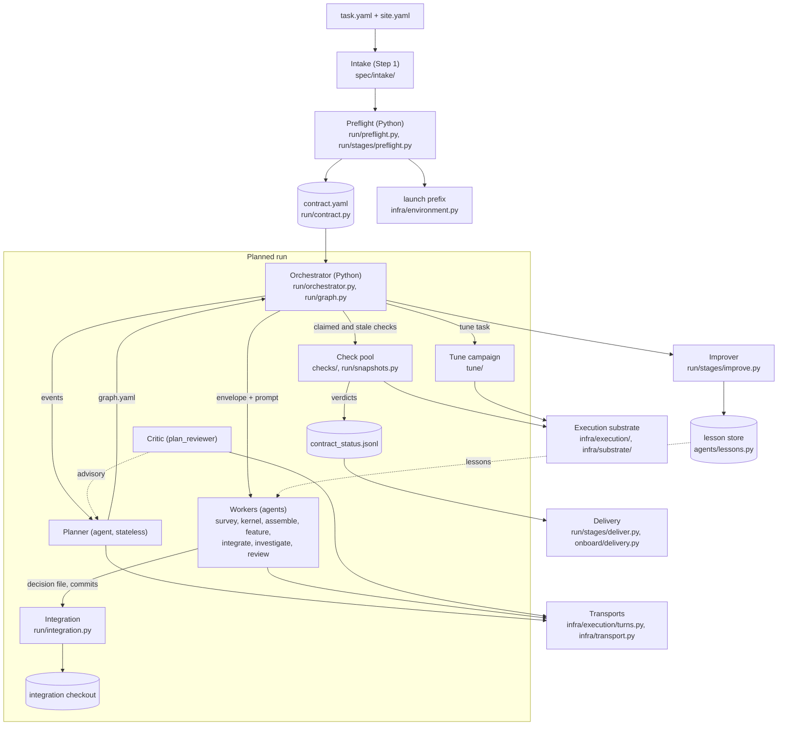
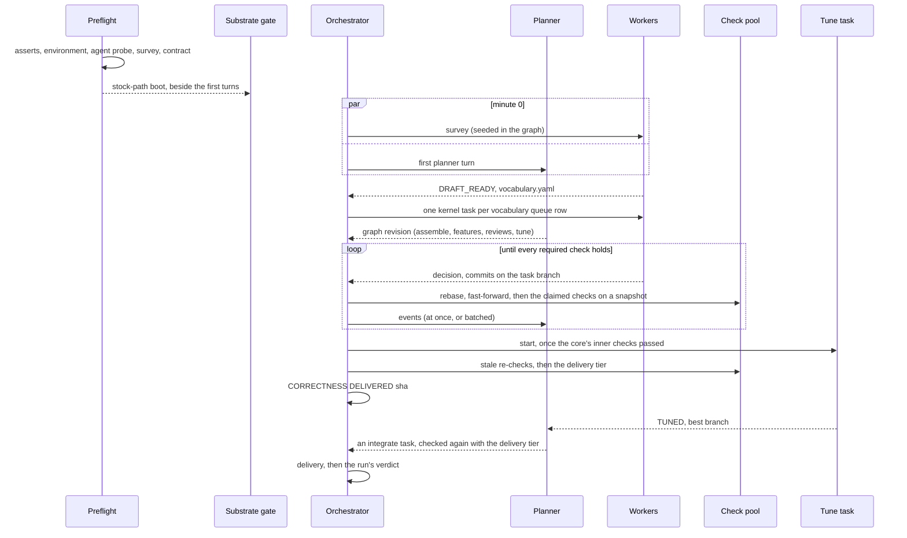

<!--
SPDX-FileCopyrightText: Copyright (c) 2026 NVIDIA CORPORATION & AFFILIATES. All rights reserved.
SPDX-License-Identifier: Apache-2.0
-->

# trtllm-modeling-v2: design

This document describes how the trtllm-modeling-v2 workflow is built and why. It explains and
orients; the exhaustive tables stay in the references beside it:

- [README.md](../README.md): the operator's reference (flags, gates, workspace layout, the tune
  campaign's rules in full);
- [INTAKE.md](../INTAKE.md): Step 1, from a request to a confirmed `task.yaml`;
- [BUILD_AND_TEST.md](../BUILD_AND_TEST.md): building and testing at every scale;
- [TROUBLESHOOTING.md](../TROUBLESHOOTING.md): symptoms, keyed on the verbatim error;
- [LESSONS.md](../LESSONS.md): what real runs got wrong, and the mechanism that now prevents each.

Paths are relative to `agent-flow/agent_flow/workflows/trtllm_modeling_v2/` unless they name the
TensorRT-LLM checkout.

## 1. Problem, goals and non-goals

### Problem

A ModelingV2 target is a flat, self-contained forward for one HuggingFace checkpoint, assembled only
from catalog entries under `tensorrt_llm/_torch/_experimental/modeling_v2/` and trusted through
accuracy gates rather than shared abstractions. Building one means mapping every computation step
onto the catalog, onboarding or certifying the missing kernels, assembling the forward and its
weights, adding each feature (a speculator, multimodal input, disaggregation, a quantized KV cache),
and proving each at every parallel configuration the target claims. Most of what goes wrong is not
modeling: a launch that cannot spawn ranks, a KV cache sized for the checkpoint's maximum context, a
number measured on the built-in implementation and read as the target's.

### Goals

- Bring one checkpoint, on one GPU architecture and a set of parallel configurations, to a target
  whose every required check passes on one tree.
- Let agents decide how to do the work; keep every decision about whether it is done in Python.
- Use the hardware: independent work runs at once, checks run as devices free up, and correctness is
  delivered without waiting for performance work.
- Survive a crash, a lost allocation or a reload onto new flow code: re-running the command resumes.
- Optionally tune the target's serving performance without making it less correct.

### Non-goals

- Performance as a release gate: a target whose contract holds is deliverable whether or not its
  tune campaign finished.
- Turning a delivered branch into a pull request: lint, headers, splitting and CI are the operator's.
- Enforcing the source embargo with a tool: it is a rule every role prompt carries (section 13).
- Running a cluster scheduler: the run stands on compute sessions that an operator or a driver
  session allocates, and the orchestrator never calls the cluster's scheduler.

## 2. Principles

**Rules constrain outcomes, not process.** The contract (section 5) is the only definition of done.
Nothing fixes stages, units or their order: a planner agent decomposes the work into a task graph,
and the orchestrator admits any graph that satisfies a short list of outcome rules (section 6.2). An
agent may report that it finished a task; it never reports that a check passed.

**Checks are exit codes.** A gate is a process that returned zero and printed a number above its
floor, or did not. There is no `--min-score` and no agent scoring an artifact; the anchor comes from
TensorRT-LLM's own accuracy references. Every gate runs with `TRTLLM_MODELING_V2=require`: under
`auto`, a configuration that misses the target's routing silently gets the built-in implementation,
and its number reads as the target's.

**Preflight is Python.** Before any agent turn, Python proves that the checkpoint parses, the spec is
consistent, the host is usable and the stock path generates a token under the run's runtime block
(section 4.2). A broken host fails in seconds, not hours into a turn where it reads as a target defect.

**One declared launch environment.** `task.yaml`'s `environment` block resolves once
(`infra/environment.py`) into a literal command prefix that every role prompt carries verbatim.
Agents never construct a launcher command, probe for one, or call a test-runner skill; a prefix that
does not fit is a symptom to report, not a problem to solve.

**Correctness before performance.** The first tree on which full support holds (every required
check, the delivery files on disk, every shared change reviewed, no variant waiting for promotion)
is recorded as the correctness milestone, with no planner turn (section 4.4). Tuning is background
work on idle capacity: it measures its own worktrees, changes nothing a contract check measures, is
told to wrap up once full support holds, and its best branch is an artifact never integrated in the
run.

**Resumable everything.** Every record is a file in the workspace, written whole or appended, and
every stage checkpoints before it advances. A stopped process resumes from disk: the graph, the
verdicts, the campaign and the turns already asked are never redone (section 12).

Two more follow. **Agents claim, Python verifies**: a decision is a closed enum in a file, a commit
goes through a helper that refuses what the policy forbids, a tuner's candidate is measured and
judged by Python. **Evidence is keyed to what it measured**: a verdict names the state of the tree it
ran on, and one recorded against another state does not count.

## 3. Architecture overview



| component | responsibility | code |
|---|---|---|
| intake and spec | derives a user-facing `task.yaml` from a checkpoint, checks, confirms and compiles it; the resolved spec's schema, defaults and variants | `spec/`, `spec/intake/derive.py` |
| preflight | phase 0: intake checks, ordered asserts, launch environment, agent probe, substrate gate, geometry probe, surface survey, contract | `run/preflight.py`, `run/stages/preflight.py`, `run/agent_probe.py`, `run/geometry.py` |
| contract | every check the run owes, its tier, its verdicts, the correctness milestone | `run/contract.py` |
| planner | one stateless agent turn that writes the next task graph | `agents/prompts/planner.py`, `run/stages/planned.py` |
| orchestrator | admits graphs, starts tasks, runs checks, wakes the planner, drains for a reload | `run/orchestrator.py`, `run/graph.py`, `run/drain.py` |
| workers and roles | one agent turn per task, by kind; typed decisions | `agents/`, `run/progress.py`, `run/stages/` |
| check pool | gates and witnesses on read-only snapshots, admitted by free devices; a member's ready checks share one engine | `checks/`, `checks/bundle.py`, `run/snapshots.py`, `infra/execution/capacity.py` |
| integration | one sparse worktree per task, rebased and fast-forwarded in | `run/integration.py`, `infra/committer.py` |
| substrate | compute sessions whose spool scheduler runs every GPU job | `infra/execution/`, `infra/substrate/` |
| transports | a role turn in this process, or as files for a driver | `infra/execution/turns.py`, `infra/transport.py`, `infra/driver/` |
| tune | the performance campaign, one task in the graph | `tune/` |
| improver | beside the run: lessons, flow issues, patch drafts and known engine defects, kept across runs | `run/stages/improve.py`, `agents/lessons.py` |
| delivery | findings, the trees on disk, the contract on the target as it is | `run/stages/deliver.py`, `onboard/delivery.py` |

The package splits along the same lines:

| package | holds |
|---|---|
| `spec/` | what the user asks: the task schema, configuration variants, Step 1 (`intake/`) |
| `run/` | the run: contract, graph, orchestrator, workflow, state, journal, progress, preflight, receipts, runtime facts, snapshots, integration, drain, and `stages/` (one mixin per concern) |
| `onboard/` | what onboarding knows: the surface survey, the vocabulary schema, the runtime map, delivery's disk checks, the embargo, the logit gate's reference |
| `checks/` | the contract's checks, statistics, the gate CLI, and `harness/` (programs a gate runs on the compute side) |
| `agents/` | roles and their routing, prompts, packaged skills, the lesson store |
| `infra/` | what is not modeling: launch environment, execution, transports, driver, substrate, commit helper, git queries |
| `tune/` | the tune campaign: stage, campaign, keep gate, measurement, records, inert members, splits, SOL |

`cli.py` is the command line; `examples/` holds worked examples for operators, which no run is handed.

## 4. Lifecycle of a run



### 4.1 Intake

Intake turns what the user wants into a confirmed `task.yaml` before any GPU or agent time is spent
([INTAKE.md](../INTAKE.md)). `trtllm-modeling-v2 intake check` runs the feasibility checks against
the checkpoint, `intake confirm --by <name>` records a digest of what the user agreed to, and `intake
compile` (or `--site` on the run itself) compiles it with the cluster's `site.yaml` into
`<workspace>/task.resolved.yaml`. A run refuses an intake-shaped `task.yaml` without `--site` or
without a confirmation that still matches; a resolved spec is accepted as it is.

**The fast path.** `trtllm-modeling-v2 --checkpoint <hf_dir> --site site.yaml --workspace W [--goal
"..."] [--confirm [BY]]` derives the request in seconds (`spec/intake/derive.py`) from the
checkpoint's `config.json` and `hf_quant_config.json`, the site's `device` and `defaults` blocks
and a one-line goal (features, `<feature>@<members>`, `-<feature>`, members, workload, `tune`,
anchor and feature parameters). A feature the checkpoint carries is built unless the goal leaves it
out; what cannot be derived is an open question. The request goes to `W/task.intake.yaml` beside
`W/intake.report.md`, compiles to `W/task.resolved.yaml` and each unit's `W/llm_api/<unit>.yaml`,
and runs at once. Confirmation is recorded, not awaited: `--confirm` or `intake confirm` writes a
`<request>.confirmed` sidecar and never rewrites the request. Once the run is past preflight,
`<request>.started` holds the digest it started from, and an edit after that is refused until it
is confirmed. Re-running the command resumes; another goal or checkpoint needs `--clean`.

Compile, on either path, carries what the gates need: per-unit LLM-API options (runtime switches,
`kv_cache_config`, `cuda_graph_config`, the `speculative_config` from the speculative unit on),
anchor discriminators from the weight and KV formats and the speculator, per-unit members, boot
and witness blocks, and perf configs at each member's parallelism with the draft. What it does not
compile it warns of by name.

### 4.2 Preflight and phase 0

Preflight decides whether the run happens at all. A run started with `--checkpoint` first runs its
intake checks, before the host is touched: the request's feasibility checks and the compiled spec's
anchor (every unit and every accuracy-gated variant), speculation and capture-list checks, every
block reported at once. Its asserts then run in order, cheapest first, and the
first failure ends the run before the branch exists (`run/preflight.py`): the checkpoint parses; the
member set and its gate count are stated; every unit's anchor resolves; the launcher can build each
requested speculator; each unit's launch paths capture one CUDA-graph list; `TMPDIR` is usable; on a
`local` run, devices are claimed by `memory.free`, utilization and a lone-process probe, and a
multi-rank run's NCCL/MPI substrate answers. On a scheduled environment the allocation is the claim.
Then (`run/stages/preflight.py`):

1. **The agent probe.** On the in-process transport, one tiny turn runs on every distinct agent the
   roles resolve to (`run/agent_probe.py`) and must write a nonce, its SHA-256 and the checkout's
   `HEAD` into a file through its Bash tool. Preflight judges the file, never the model's words. A
   pass stands for 12 h while the agents, the CLI, the host and the checkout are unchanged.
2. **The substrate gate.** The stock path boots the checkpoint under the run's runtime block, on a
   thread beside the planned run's first turns (phase 0): a pass costs no wall time, and a failure
   stops the orchestrator (`orchestrator.stoppable`) but leaves the run open, so re-running resumes.
   A pass under 12 h old for the same environment, checkpoint, runtime, options file and checkout
   (`gates/substrate/pass.json`) spares a resumed run.
3. **Phase 0 probes** (`PreflightStage.phase0_probes`) start contract-free measurements on
   threads of their own, beside the survey and the substrate gate; a failure is journaled and
   never stops the run. The one probe is the **geometry probe** (`run/geometry.py`,
   `checks/harness/geometry_probe.py`): it boots the stock path under the run's runtime block once
   per leg (the narrowest member, the widest non-attention-DP member, the widest attention-DP
   member, and the narrowest again under the first speculative unit) and records under `geometry`
   in `runtime_facts.yaml` what each serves: the capture list and padding, the KV pool and its page
   view, the limits, the snapshot policy, the context chunks prompts of each probe length ran in,
   and the declared draft depths. For an architecture the stock path does not know it boots
   `environment.substrate_checkpoint` and keeps only the configuration-decided fields. A resumed
   run whose file holds a probe of the same inputs does not repeat it, and a smith dispatch waits
   for a running probe at most 15 minutes, so kernels are certified against measured shapes.
4. **Known engine defects.** Each `engine_defect` lesson in the run's scopes (section 11) is
   checked against the checkout; a fix the tree lacks is journaled and added to the host facts.
5. **The surface survey** records what the checkpoint structurally demands and what the build
   supplies (registered ops, catalog entries, their architectures) in `surface.md`.
6. The commit helper, the prompts (with the resolved prefix), `host_facts.md`, the skills and
   `contract.yaml` are written.

`--dry-run` stops here. A new run then enters the planned run with the survey already in its graph
(`run/stages/plan.py`, `orchestrator.seed`), so the survey and the planner's first turn start at once.

### 4.3 The planned run

One loop thread (`GraphOrchestrator.run`) changes the graph. Each running task is a worker turn
followed, in the same thread, by its integration and its claimed checks; checks share one bounded
pool; the planner's turn runs on a thread of its own, one at a time, while tasks keep finishing and
starting, and its revision is applied when it returns. When the survey lands the orchestrator adds
the kernel tasks (section 6.8); from then on the planner shapes the work and the orchestrator starts,
integrates and checks it (sections 5 to 7).

### 4.4 Bring-up and correctness milestones

The **bring-up** comes first: the first state on which the first unit's boot and accuracy hold at
its narrowest member is recorded once, as the branch `<target branch>-bringup`, the journal line
`BRINGUP DELIVERED <sha>` and a `bringup` line in `correctness.jsonl` (`contract.bringup_checks`,
`workflow._mark_bringup`). It is a usable one-rank target hours before every member is certified.

The first state of the target on which full support holds (`GraphOrchestrator._support_gaps`:
every required check, the delivery tier's included; the delivery files on disk; no landed change to
shared code without its regression review; no local variant waiting for promotion) is recorded with
no planner turn (`GraphOrchestrator._correctness`, `PlannedStage._mark_correct`): the
branch `<target branch>-correct` (the run's own branch name when detached) is set to the commit, the
journal says `CORRECTNESS DELIVERED <sha>` with the hours since the run opened, and
`correctness.jsonl` gets a line. Later work that turns a check red or stale leaves it where it is
(`correctness stays delivered at <sha>: ...`); the next state full support holds on moves it forward.

### 4.5 Delivery

The loop returns `delivered` when nothing is in flight, full support holds on the target as it is
(section 4.4), no required task is open, and no worker report is unread by the planner; a running
campaign is told to wrap up first (section 4.6). Delivery then checks
(`run/stages/deliver.py`) for unacknowledged accuracy findings, the six trees a finished onboarding
touches with `ops:promoted` (no local variant left in or imported by the target, but those
`target.keep_local` names; section 6.10), `git:target-committed` and `git:commit-hygiene`
(`onboard/delivery.py`), and the contract on the target as it is now. A run is not delivered while
a landed change to shared code is in no regression review's batch (section 6.11).

### 4.6 Tune as a task

With `perf.enabled` the graph must hold one `tune` task. It is held back until every inner-tier check
of the first unit has passed, on the current target or an earlier one, with no failure since. It pins
the commit the target is at when it starts and works only in its own worktrees, so feature tasks
landing meanwhile never reach a measurement. It is background work: it ranks after every other task,
no task may depend on it, an `exclusive` task does not wait for it, and once full support holds it
is told to wrap up (`TuneStage.should_stop`): nothing new is dispatched, what is not yet measuring
is dropped, what is measuring finishes. Its report names the best branch, an artifact of the run
that is never integrated in it.
`trtllm-modeling-v2 tune` runs the campaign (section 10) on a target onboarded elsewhere.

### 4.7 How a run ends

| verdict | when |
|---|---|
| `delivered`, `tuned` | the contract held and delivery passed; `tuned` when the tune task also finished |
| `escalated`, `ceiling` | the planner answered `ESCALATE` (a requirement cannot be met as confirmed) or `CEILING` (a computation step has no implementation anywhere) |
| `planner-stalled` | `--revision-cap` revisions (default 6) without progress, judged only while no task but a campaign runs |
| `planner-refused` | three graphs in a row refused |
| `planner-failed: <error>` | five planner turns in a row raised |
| `delivery-failed`, `delivery-failed:findings`, `delivery-failed:contract` | a delivery check failed |
| `session-lost:<unit>` | a gate's session did not come back within its bounds; re-running resumes there |

Whatever the verdict, the improver reads the run once it closes (section 11). A run the phase-0
substrate gate stopped (`stopped`) is not closed: it stays open, wakes no improver, and re-running
resumes it.

## 5. The contract and checks

### 5.1 Units, members and tiers

`run/contract.py` compiles the contract from the resolved spec. A **unit** is `core`, then one per
feature in `features:`. A **member** is one configuration the target serves; under `parallel:
unified` the members are `members:` (default `[tp<W>, tep<W>, dep<W>]`), cheapest first. A check is
one gate at one member for one unit, keyed `<unit>:<gate>@<member>` (`core:accuracy[gsm8k]@tep4`). A
**configuration variant** (`variants:`, `spec/variants.py`) is a unit's target served under another
configuration, such as an FP8 KV cache; its checks are named by the variant.

| tier | checks | when they run |
|---|---|---|
| inner | per unit and member: `boot`, `accuracy[<benchmark>]` (with the logit gate on, at the members section 5.10 names); with `accuracy.logits`, `logits`; with `accuracy.serve`, `serve` at the widest member | after a task that claims them, and again when stale |
| proof | the unit's witness (`residency`, `equivalence`, `replay[<unit>]`, `kv_quant`); `acceptance` for every unit at or after a speculator; every variant check | after a task that claims them, and again when stale |
| delivery | `envelope` at every member of the last unit; with `accuracy.serve`, `serve` at a one-rank member when the last unit has one and serves wider | once every other required check holds and nothing required is open but the campaign and what waits for it |

There is no perf tier: the tune campaign judges its own keeps (section 10).

A storage or scheduling variant (no `acceptance` gate) boots at every member of its unit, where the
boot attests the setting took effect; its accuracy stays at the members it names.

**Each check proves what it claims** (`checks/observables.py`). Every feature a check can be about is
registered with its evidence and its oracle: a cache dtype as each rank's worker resolved it (every
rank prints its own engine record through the gates' rank hook, so a multi-rank member is not read
from `llm.args`, which only repeats the request); chunked prefill as a served prompt longer than
`max_num_tokens` past what the cache resumed; block reuse as the reuse probe; a speculator as
per-prompt acceptance, each draft depth beating the one below where no stock speculator exists; a
multimodal unit by a check that sends images (the logit gate over a reference with image prompts, or
an image benchmark); the serve gate by the boot workload's keywords. A variant is about the fields
its overlay sets, and a field it is about that its boot did not observe fails the boot: "not
attested" never passes the one setting the check exists for.

**What the contract proves of the request** is a matrix (`run/requirements.py`, written to
`coverage.yaml` at preflight and into the journal at delivery): one row per unit, per variant and
per pair of units no unit's checks reach together (`disagg+multimodal`), one column per member, and
per cell `certified` (a gate that judges the output runs there), `sampled` (it boots there, and its
output is judged at the members named) or `not covered` with the reason; a feature whose output no
check judges anywhere (a multimodal unit judged on text only) is not covered where it boots. A cell not covered is a
decision: preflight stops until `task.yaml`'s `coverage.accept` names it (`<feature>@<member>` or
`<feature>@*`), so a delivered run's "fully supported" says exactly what was proven.

### 5.2 Gates and witnesses

Workloads, floors and options are tabulated in [README.md, The gates](../README.md#the-gates) and
[Gate workloads, floors and findings](../README.md#gate-workloads-floors-and-findings).

| check | proves | observable |
|---|---|---|
| `boot` | the engine cold-starts under `require` and generates the expected text | keywords on generated text; with a logit reference, the first greedy tokens against the reference's |
| `accuracy[...]` | the release criterion: `trtllm-eval` against the anchor | score against a statistical floor |
| `logits` | numerics position by position against the HF reference | top-1 agreement and log-prob deltas within the reference's own bf16-vs-fp32 spread |
| `serve` | `trtllm-serve` starts the target and answers | completion text (and an image chat request, for a multimodal unit) |
| `acceptance` | the speculator drafts as it should | `acceptance_length`, paired against the previous verdict |
| witnesses | a feature boot and accuracy cannot see is on | two legs that differ in one variable (`checks/witness.py`) |
| `envelope` | the target at its declared limits | `max_batch_size` in flight, prompts near `max_seq_len`, every capture batch replayed, probes matching a batch-1 run |

Witnesses exist because four features are output-identical by construction (speculation, host
offload, disaggregation, native KV storage) and bounded replay is designed to stay inside the
accuracy tolerance: boot and accuracy pass whether or not the feature does anything. Each witness
compares a named observable across two legs in one session, with tuning caches pinned across legs
(`gates.pin_tuning`). The disaggregation witness proves it can fail: leg B runs once more with the
transferred state destroyed, and unless the output changes the verdict is `INSENSITIVE, not a pass`.
Without a `contrast_command`, leg B is the flow's own (`checks/harness/disagg_leg_b.py`): it splits
the node into a context and a generation engine of the member's width (so it needs twice the
member's devices), builds both from leg A's argv through the tree's quickstart with the witness
block's `cache_transceiver_config`, and pins each hop to a handed attention-DP rank pair. Its
ablation hooks the generation engine's processes and zeroes the request's recurrent state (else its
KV pages) before the first decode step; an engine whose caches it cannot reach is refused when it
is built. A `contrast_command` is resolved relative to the spec's directory.

### 5.3 Floors and findings

Accuracy floors are statistical (`checks/stats.py`): by default `anchor - k * SE` with `k = 2` and the
binomial SE of the benchmark's sample count; `rule: tolerance` keeps a fixed width. When every member
of a unit scores more than one SE below the anchor, the unit passes but the run records a
**finding**, which delivery refuses until `floor.acknowledge.<unit>` gives the reason. Per-prompt
baselines and open findings live in `gate_results.jsonl` (`checks/gate_records.py`), which the
acceptance gate also pairs a later tree against.

### 5.4 Engine attestation

A gate's argv is what it asks for; the LLM API and the executor's worker can change it. Once an
engine is up the harness prints one `MV2FLOW_ENGINE` record (`checks/harness/engine_facts.py`):
`modeling_v2`, block reuse, snapshot policy, cache dtypes, CUDA-graph batches and padding, the
speculator, limits and widths. The gate fails on any field that differs from the unit's resolved
declaration (`gates.attest_engine`); a field the record lacks is `NOT ATTESTED`, never agreeing. A
`MV2FLOW_REUSE` record and a reuse probe (sent by the boot, acceptance and envelope drivers, the
envelope's in each leg) attest block reuse, and each verdict keeps the least device
memory its engines left free, warning `LOW MARGIN` below the unit's margin.

### 5.5 Fingerprints and staleness

A verdict is recorded under a **marker**, a fingerprint of the commit's tree as the checks see it
(`TrtllmModelingV2Workflow._target_marker`, `workflow.fingerprint`). It hashes git's blob ids of every
path a gate can read: it leaves out `tests/`, `docs/`, `.github/`, `examples/`, `*.md` and the run's
workspace, but keeps the files a gate reads there (the quickstart, the default boot image, every file
the spec's `accuracy`, `runtime`, `variants` or `environment` block names). Of an anchor table only
the entries the run reads count, and the native libraries' sizes and modification times are added.

So a commit that only edits a test list or another model's anchor leaves every verdict standing,
and a native rebuild makes every verdict stale. A code change is judged by what each check read: the
rank hook (`checks/harness/rankhook`) has every process of a check write the tree's Python modules it
imported (`run/snapshots.py:CheckTree.read`), and the verdict records that list and the marker
narrowed to it (`workflow._narrow_marker`: those Python files, every file of the tree that is not
Python, the native libraries and the anchor entries). A verdict under another marker holds where its
narrowed marker is unchanged there (`workflow._verdict_holds`), so a kernel variant or a feature file
a check never imported leaves it standing. A verdict that names no read list (a command imported
the package and said nothing of what it read) counts as missing under another marker, and an empty
marker ("not established") reads as "changed".

What a check reads from outside the checkout -- the spec as it applies to its unit, the options'
content, an anchor, a prompts file, the logit reference -- is its `inputs` (`contract.check_inputs`):
a digest of those, files by content, compiled with the contract and recorded on every verdict. A
verdict on other inputs is stale like one under another marker, so a run relaunched with a changed
floor, draft depth or snapshot policy re-runs exactly the checks that reads; another unit's entry
alone changes nothing.

### 5.6 Verdict sharing

Boot, accuracy and acceptance checks of different units that run one command on one engine against
one criterion carry one equivalence key (`contract.equivalence_key`: for boot, the runtime block,
speculator, options content and workload; for accuracy, every accuracy input as it applies to the
unit; for acceptance, the runtime block, speculator and depth, options content and acceptance block).
Options are compared by content, never by path, so two units on copies of one file share. A pass of
one on the current marker holds for the others (`SHARED` in the standing). A check's own verdict
always wins, failures are never shared, and variants never share.

### 5.7 Snapshots per commit, and VOID verdicts

The integration checkout moves while checks run, so a check measures a read-only snapshot of the
commit the checkout is at when the check starts (`run/snapshots.py`): a detached, sparse worktree
under `snapshots/<commit>/` with the checkout's native build linked in, shared under a lease by every
check of that commit and removed once the checkout has moved past it and no lease holds it. Every
command runs from inside it with it first on `PYTHONPATH`, and on a spool names it as the job's tree.

What each command imported is read back from its output (the spool's resolve hook, the engine
driver). A verdict whose commands imported more than one tree, or a tree no commit pins, is **void**:
measured once more, then recorded as not passing (`VOID`). An uncommitted change in the checkout is
in no snapshot, and each check it would have reached says so. `trtllm-modeling-v2 gate <name>` runs one
gate the same way, on the checkout's commit or `--commit`, or with `--tree` on a tree as it is.

### 5.8 When checks run, and admission by free devices

A finished task's claimed checks (`satisfies`, but delivery-tier ones) run on the merged tree; the
task holds no agent slot while they run. The target is kept verified as it changes (`_settle`): each
landing runs the `RECHECKS_WHILE_BUSY` (4) stale checks likeliest to fail again beside the work in
flight, a member's delivery-tier checks are rehearsed once as soon as its other required checks hold
(advisory: a failure reaches the planner, the final tree runs them again), and once no required task
is open the rest run, while no optional task that would change the tree starts. The order is
riskiest first (`_by_risk`): those whose last verdict warned `LOW MARGIN` or left the least memory
free, then those of the units the last landed task reaches, then the rest. After a change that may move device memory (`workflow.memory_relevant`), the checks whose
configuration left the least free (`contract.tightest_checks`) run first. A check the contract
already counts as passed on the current marker is not run again; this is asked as the check starts,
so the later of two equivalent checks reads the earlier one's verdict.

How many checks run at once follows the sessions (`infra/execution/capacity.py`): a check starts when
some session would start its job at once, and otherwise waits in the orchestrator to be placed when a
device frees; never fewer than 2 in flight, never more than 32, and 8 when no session can be read. A
fixed count would pile jobs into a full spool, where they cannot move to a session that frees up
later, and leave idle sessions unused.

### 5.9 Gate bundles

A cold engine start is most of what a boot, logit, acceptance or accuracy check costs, so the
checks of one unit at one member that are ready together on one snapshot share one engine
(`checks/bundle.py`). They join a bundle as they are admitted: the first leads and holds the
bundle's one admission slot, the rest wait in it holding none. After a 2 s gathering window the
leader captures the command each gate would launch, and the quickstart commands that build one
engine (same launch, quickstart and argv but for `--max_tokens`) form a group. An accuracy check
joins only when its `trtllm-eval` argv and options file state every engine setting the way the
quickstart argv does and set nothing else; the acceptance gate's `=off` leg, a check without the
speculator and a different options file stay separate. The group runs as one job
(`checks/harness/bundle_driver.py`): one engine, then each workload in a section of its own, the
evaluation last, in process. Each gate judges its own section as its own command's output, so
every verdict is its own gate's; the verdict names the bundle (`bundle` in
`contract_status.jsonl`), and the bundle's spec is kept under `gates/<unit>/bundles/`. A section
that failed, ran past its time or never ran, and every section after it, runs again singly under
its own admission; so does an evaluation whose engine is not the one its options declare. An
engine that could not be built is each quickstart gate's own failure.

### 5.10 Cheaper oracles

With the logit gate owed, a unit's accuracy benchmark runs only at its narrowest member, its widest,
and every member whose served engine the logit gate does not run whole (attention DP; every member
of a speculator unit whose boot compares no tokens); the logit gate at every member proves the
rest equivalent to the reference. `accuracy.benchmark_members: every` restores every member, and
`contract.yaml`'s notes say where and why. Wherever a logit reference is named, the boot sends the
reference's first text prompts as token ids (`accuracy.boot.greedy`, 4 prompts x 24 tokens by
default) and fails on the first token that is not the reference's beyond a near-tie no wider than
the logit gate's largest delta limit. The logit gate is on when `logits.reference.json.gz` sits
beside the spec, and the serve gate wherever the spec bounds the server's sequence length;
`enabled: false` turns either off. Variants compare no greedy tokens unless their own entry says so.

## 6. The task graph and the planner

### 6.1 Tasks, kinds and roles

`graph.yaml` is the planner's only output (`run/graph.py`). A task declares `id`, `kind`, `goal`,
`depends_on`, `depends_on_soft`, `touches` (the files it may change, at file granularity where known), `resources`
(`gpus`, `est_minutes`), `satisfies` (contract check keys), `priority` (`required` or
`nice_to_have`), `ref` (the unit, a vocabulary queue row, or `<mode>:<entry>`), `exclusive`,
`regression`, `status` and `attempts`; the orchestrator records a regression review's `covers`. The [planner prompt](../agents/prompts/planner.py) shows one.

| kind | role | works in | finishes with |
|---|---|---|---|
| `survey` | `plan_drafter` | the workspace: `plan.md`, `vocabulary.yaml` | `DRAFT_READY` (and a valid vocabulary), `CEILING` |
| `kernel` | `smith` | its own worktree, integrated; a queue row, `<mode>:<entry>` or `promote:<entry>[,<entry>...]` | `LANDED`; else `FAILED_RECEIPT`, `MACRO`, `BLOCKED` |
| `assemble`, `feature`, `integrate` | `assembler` | its own worktree, integrated | `UNIT_READY`; else `BLOCKED` |
| `investigate` | `assembler` | a scratch worktree, never integrated | `UNIT_READY` with a diagnosis; else `BLOCKED` |
| `review` | `reviewer` (`plan_reviewer` for `ref: plan`) | nothing | `APPROVE`; else `REJECT` |
| `tune` | `tuner` turns under Python | the campaign's own worktrees | `TUNED`; else `TUNE_FAILED (<verdict>)` |
| `check` | none: the orchestrator | nothing; its `satisfies` go straight to the check pool | done when they pass; a failure wakes the planner |

`BLOCKED` carries one of `vocabulary_gap`, `knowledge_gap`, `accuracy_shortfall`, `environment`.
Every role runs on the agent that drives the run unless the `agents` block routes it elsewhere
([README.md](../README.md#choosing-each-roles-backend-and-model)).

### 6.2 Admissibility

`graph.validate` refuses a graph, with every reason batched, unless:

- kinds, priorities and statuses are known, ids are unique, every task has a goal, and dependencies
  exist and form no cycle;
- every required contract check is in the `satisfies` of a task that is not abandoned;
- every `touches` lies inside `commit_policy.allowed_paths`, and no task asks for more devices than
  the site has;
- with `perf.enabled`, the graph has a `tune` task;
- a `check` task names contract checks, has empty `touches` and 0 GPUs; `depends_on_soft` joins two
  integrated kinds, never a task that is also in `depends_on`, and forms no cycle with the hard
  edges;
- **cross-model regression**: every task whose commits land on the target (`kernel`, `assemble`,
  `feature`, `integrate`) and whose `touches` reach outside the run's own paths (the target's
  directory and the one its tests mirror it in) is followed by a required `review` with
  `regression: true`. Reviews are batched (section 6.11); a refusal names the open review the new
  shared tasks should join. The rule binds a run whose graph had no finished task when the process
  started.

`graph.apply_revision` adds rules about the revision itself: it states a reason; `running`, `done`
and `failed` stay the orchestrator's (a running task it drops is kept); a failed task may go back to
`pending` only while it has attempts left. A refused graph returns to the planner at once with the
reasons and with the events of the refused turn, which stay unread until a turn's answer is taken;
the third refusal in a row ends the run `planner-refused`. A proposal that cannot be read is refused
the same way. A planner turn that raises (it timed out or crashed) is asked again on the same events
after a wait that doubles each time, and the fifth in a row ends the run `planner-failed`.

Nothing a turn or a check raises crashes the loop. A task whose checks raised (a lost session) keeps
its work, which has landed: it is done, and those checks run again as re-checks; it spends no attempt.
A landing is a fact, not a status: whatever reached the target, from a task later failed or
abandoned too, is in the next regression review's batch. If the loop itself fails, the tasks whose
threads already ended are recorded before the process goes, and none still running is waited for.

### 6.3 Statuses, attempts and retries

A task is `pending`, `running`, `done`, `failed` or `abandoned`. It is `done` when its worker gave a
finishing decision, its branch is integrated and its claimed checks pass, and `failed` otherwise; a
failed `nice_to_have` task is `abandoned`. A **retry** is the planner writing a failed task back as
`pending`: it runs again under its own id as its next attempt, and a revision that retries a task
whose third attempt failed (`MAX_ATTEMPTS`) is refused, so a task that keeps failing is reshaped
instead of looped. An **infrastructure failure** (the turn raised, `INTEGRATION_FAILED`, a tune
baseline that could not be measured) sends the task back to `pending` once by itself, as the same
attempt; the count is kept in `planner_events.json`, so a restart grants no second one. A task's work
across ids is its **lineage** (`graph.lineage`): a kernel task's queue row, else its kind, `ref` and
id without a re-creation suffix such as `-2` or `-retry`.

### 6.4 Scheduling

`graph.next_to_start` picks the ready tasks (pending, every dependency done) to start now:

1. Tasks that were running when the last process stopped go first; one that cannot start yet keeps
   its claim, and nothing that conflicts with it starts before it.
2. Then required tasks, longest remaining critical path (`est_minutes`) first.
3. A `nice_to_have` task starts only while no ready required task waits for devices.
4. Two tasks never run together when both declare the very same file in `touches` (a path whose last
   part has a suffix) or either is `exclusive`. Directories never conflict: integration orders tasks
   that share one. An `exclusive` task that must wait holds back every task ranked after it, so the
   run drains to it.
5. `tune` does not start until the first unit's inner checks have passed.
6. A task starts while its `gpus` fit in the capacity left, at most `--max-parallel-tasks` (8) agents at once. Slots go by priority (`infra/execution/agent_gate.py`): the planner owns one and goes first, then critical-path tasks, other required tasks, the critic and improver, and a tune campaign's turns last, on slots the feature work leaves idle. A task waiting on a soft dependency or running its checks holds no slot and no devices, a soft dependency is met once its commits are integrated, and a pending task a running one waits for starts first.
   Reviews, `verify` kernel rows and `check` tasks reserve 0 GPUs: their tests and gates are jobs that
   take their own devices as each starts.
7. A task with `depends_on_soft` starts once each soft dependency has started; its integration then
   waits for each to land or end (section 7.4).
8. A `check` task takes no task slot: once its dependencies are done the orchestrator submits its
   checks to the pool itself, with no agent turn, and a pass leaves a receipt naming them.

**Capacity** is the devices of the live spool schedulers (each `status.json`, less quarantined
devices), or with no live session the devices preflight claimed, less the `gpus` running tasks hold
(`capacity.held_gpus`: none for a `tune` task whose jobs all run on `perf.spools`). The reservation is
the task's share, not what a job holds now, so gate jobs that fill the nodes keep no task waiting.

### 6.5 Planner turns

| | |
|---|---|
| woken at once by | the run starting; a task that failed or whose checks failed; a worker's report (`For the planner ...`); the critic's words; a failed re-check; a `DONE` while the contract does not hold; nothing left to run or start |
| batched | a task that finished green waits up to `--event-window` (60 s) while anything is in flight; one that satisfies no check and that an open task depends on wakes no turn of its own and goes to the next one; while only a campaign runs, events are read at once |
| reads | the spec, contract and verdict paths, the current graph, the contract's standing with the correctness milestone, the runtime facts' key numbers and changes, the cross-model regression section, the events since its last turn, the refusals of its last graph |
| writes | `graph.proposed.yaml` and a decision: `GRAPH_UPDATED`, `DONE` (the orchestrator verifies), `ESCALATE`, `CEILING` |
| cannot | write code, run jobs, mark a check, or set `running`, `done` or `failed` |

The turn is stateless, which keeps a long run from drifting with context. What arrives during a turn
waits in `planner_events.json` for the next, unless that turn's revision already answered it (a task
it retried or dropped, or wrote done at the attempt that finished); a failure it kept as failed still
wakes it. Tasks the orchestrator added during the turn, which its graph could not name, are kept.

### 6.6 The advisory critic

The first graph, and every revision that adds or drops more than half of the open tasks, gets one
read-only review by the `plan_reviewer` (`PlannedStage._critique`; `--no-graph-critic` skips it), on
a thread of its own, latest reshaped graph first. Nothing waits for it; a `REJECT` reaches the
planner's next turn as an urgent event. A paper review of the survey's plan (`review`, `ref: plan`) is
the planner's to add.

### 6.7 Receipts and runtime facts

**Receipts** (`run/receipts.py`). A finished task leaves `tasks/<id>.receipt.yaml`: its decision, the
first paragraph of its summary, the note it ended with, the commits it integrated, a smith's entry
and test result, its decision and result files, and up to three notes its worker addressed `For the
orchestrator ...` or `For the planner ...`, each bounded. A task that starts carries its
dependencies' receipts in its envelope and prompt, so no planner turn restates results in a goal.

**Runtime facts** (`run/runtime_facts.py`). Each gate that passes adds the engines it attested to
`runtime_facts.yaml`: per unit and member, the CUDA-graph batches and padding, recurrent-state slots
per rank, the KV pool, free memory, speculation depth, widths and limits; an envelope across members;
and `changes`. Its `geometry` section is the phase-0 probe's (section 4.2), rendered with the values
a verify row's `cells` state; a gate's first pass that serves different numbers is a `changes` line.
Every planner, smith and worker prompt carries the key numbers, so kernels are certified against
measured values and a re-certification follows a measured change.

### 6.8 Mechanical kernel tasks

`vocabulary.yaml` is the one agent artifact with a schema, because the orchestrator walks it
(`onboard/vocabulary.py`). Each computation step is `OK` (an entry covers it), `CERT` (an entry
exists, not at these values: verify it) or `GAP` (no entry: onboard one, naming its rung on the
sourcing ladder). When the survey lands, `GraphOrchestrator._add_kernel_tasks` turns the dispatch
queue into tasks with no planner turn: one `kernel` task per row, id `k<row>-<entry>`, touching the
row's entry and its test, one GPU, the row's `depends_on` as edges; they start at once. The planner
wires the rest of the graph to them, places rows the orchestrator could not, adds the regression
review after those that change shared code, and may reshape those not yet running. A smith that
answers `MACRO` names its constituents, which the planner adds with `ref: <mode>:<entry>`.

**Covered certifications.** A `verify` dispatch that states its required cells (the queue row's
`cells`, or a ```` ```cells ```` block in the task's goal) closes `LANDED` with no smith turn when
the entry and its test are at the checkout's head and every required cell is in the entry's `CELLS`
on the run's architecture in its `ARCHS` (`run/covered.py`, read statically by
`onboard/coverage.py`); its receipt names the covering cells and commit. Anything unreadable, a
missing cell, an uncertified architecture, or a task branch with commits of its own dispatches the
smith as before.

### 6.9 The revision cap

Each adopted revision counts against `--revision-cap` (default 6), as do a `DONE` while the contract
does not hold and ready tasks that cannot start with nothing running. Progress resets the count: a
task done, or a check turning green. At the cap the run closes `planner-stalled`.

### 6.10 Develop in the target, then promote

Two tasks that declare one file never run together, so certifications of one shared catalog entry
would run one after another. A kernel task on a shared entry therefore lands a **local variant** in
the target's own `ops/`: `ops/<category>/<name>__<site>.py` and its test beside the target's other op
tests (`vocabulary.entry_paths`). The site is the row's `site`, else `r<row>`; a task ref may name it
as `@<site>`. Variants touch only the run's own paths, so a later task on the entry (a planner's
re-certification) runs beside it, and none needs a regression review. The survey writes one row per
shared entry, every call site's shapes as its cells, so one smith certifies them all and a promote has
one variant to merge (`vocabulary._parse_queue` refuses a second row). A task that declares the catalog
file lands in place.

A `promote:<entry>[,<entry>...]` kernel task (`onboard/promotion.py`) merges each entry's variants
into the catalog: the union of their cells, guards and `ARCHS`, one test file, the target's imports
pointed at the catalog, the variants removed, one certifying run with the claims gates. Promotion is
incremental, beside the feature work: an entry is due once no task still to land a variant of it is
pending or running and the target imports each of its variants (or nothing is left to change the
target), every entry due at once goes in one promote, and an entry with an open promote waits for
it. A promote declares every file it rewrites. `target.keep_local` keeps an entry local, and the delivery check
`ops:promoted` accepts its variants.

### 6.11 Batched regression reviews

A regression review covers, as it starts, every landed change to shared code no earlier review
covered: its batch, recorded per attempt as `covers` (`<task>@<attempt>`). While a task that changes
shared code runs, a ready regression review waits up to 30 minutes after its batch's first landing
for that change to join; one runs at a time, and what lands meanwhile joins the next batch; one whose
batch is empty when it would start closes with no turn. A failed review covers nothing, and a retry
that lands again or a failed receipt's landed guards are new changes. The planner's request says
what the next batch holds. The review runs only the tests the batch can affect, reusing every other
result from the run's test cache (`checks/testcache.py`; [README.md, Tests after a shared
change](../README.md#tests-after-a-shared-change)), and its receipt names the commit it cleared,
the next review's default base.

## 7. Workers and integration

### 7.1 The task envelope and the prompt

A worker is one agent turn for one task. Its envelope, `tasks/<id>.json`, holds the task's graph
fields and its dependencies' receipts. Its prompt carries the task's goal, the envelope's path, the
receipts and runtime facts, the role's task prompt, the worktree block (where to work, how to commit)
and the lessons in its scopes; its system prompt carries the role's instructions, the resolved launch
prefix, the source embargo, the spec's `notes` and the decision-file protocol. A kernel task's smith
is also told the sourcing tier on record for its entry.

A worker ends with a typed decision file (`decisions/<unit>-<role>-<turn>.yaml`, validated against the
role's closed enum by `progress.collect_decision_file`), a report under `reports/`, and, for an
integrated kind, commits on its branch. The orchestrator branches on the decision's first line; a
note after it reaches the planner with the task's event.

### 7.2 Sparse worktrees

Each `kernel`, `assemble`, `feature` and `integrate` task works in `worktrees/<task-id>` on branch
`mv2/<slug>/<task-id>`, cut from the checkout's head (`run/integration.py`): a sparse checkout of the
package, the tests and examples a worker runs, the directories its `touches` name and the top-level
files, because writing a whole TensorRT-LLM tree takes minutes. A task that touches `cpp/` or
`3rdparty/`, or runs `exclusive`, gets the whole tree. No config file marks a worktree sparse (the
integration's git commands carry the flags), so a read-only shared `.git/config` is no obstacle, and a
worker widens its own with `git sparse-checkout add`.

### 7.3 The commit helper

Agents commit only through `<workspace>/bin/commit.sh` (`infra/committer.py`), with
`MV2FLOW_COMMIT_TREE=<worktree>` in a task worktree: an `flock` turns contention into a short queue;
only explicit repo-relative file paths are accepted; untracked symlinks (a worktree's link to the
native build), sandbox placeholder files, the run's workspace and anything outside
`commit_policy.allowed_paths` are refused; author, committer and `Signed-off-by` are the repository's
configured user, proven by a trial commit before the run starts; and the new commit is undone unless
its file list is exactly what was asked for, with no symlink and no co-author unless the policy allows
one. Delivery runs the same rules over the branch.

### 7.4 Rebase, fast-forward and the conflict loop

A finished task's branch is rebased onto the checkout's head as it is then and fast-forwarded in,
under one lock, so the checkout moves only by whole tasks and carries no merge commits. A rebase that
conflicts is aborted and goes back to the task's worker, up to twice (`REBASE_RETRIES`), naming the
conflicting files and the head: the worker resolves in its worktree, re-runs its tests and hands
back. Only then does the task end `INTEGRATION_FAILED` (an infrastructure failure, retried once), and
merging it becomes an `integrate` task. A task with soft dependencies waits, before its rebase, for
each to land or end, so its branch is rebased onto a head that holds what landed; one that ended
without landing is named after the task's decision, and the planner hears which tasks go on without
it. Semantic conflicts (two tasks that change the forward in
different files) show up when the merged tree runs the checks. Integrated branch tips are kept in
`integrated.json`, so a stop mid-integration never integrates a task twice.

### 7.5 Retry from the integration head

A retry works in its task's worktree, whose branch is first rebased onto the checkout's head
(`Integration.refresh`): it starts from what landed since, the fix it was retried for among it, with
its earlier attempts' commits on top. A worktree with uncommitted changes, off its branch, or whose
rebase conflicts is left as it was, and its worker is told how far behind it is. A retried kernel
task's smith is dispatched afresh rather than handed the failed attempt's decision.

### 7.6 Landing a FAILED_RECEIPT

A smith that cannot make an entry serve a value answers `FAILED_RECEIPT`: the entry's `is_valid` now
refuses the input, a guard test proves it, and its `note` records what was measured. Every caller of
the entry needs that, so the commits are integrated (`SmithStage._land_failed_receipt`) when every
file they change is the entry's own (the entry or its local variant, its GPU test, a new
`ops/<category>/__init__.py`).
Anything else stays on the branch for the next attempt, and the planner hears which.

## 8. Execution substrate

`environment.kind` is `local` (this host, the devices preflight claimed) or `session_spool`.
`infra/environment.py` builds the command line and `infra/execution/` decides who runs it: a
subprocess here, or a file in a spool. Questions about the target's git state are asked from the
orchestrator's own process (`infra/vcs.py`), never through a spool job. Operation is described in
[README.md, Execution substrate](../README.md#execution-substrate) and
[BUILD_AND_TEST.md](../BUILD_AND_TEST.md).

### 8.1 Compute sessions and the spool scheduler

On a Slurm/pyxis cluster a run stands on **compute sessions**: allocations whose main process is the
spool scheduler (`infra/substrate/scheduler.py`, standard library only and run by path, because the
container's interpreter is the engine's). A job is a script renamed into `<spool>/pending/`; its
receipt is `done/<name>.rc`, written last, beside the verdict in `done/<name>.json`. Sessions are
declared once in `environment.sessions` (spool, role `gates`, `work` or `any`, nodes, GPUs, time
limit), and `trtllm-modeling-v2 session render` writes each entry script from that block. The
scheduler gives each job what its header asks: one priority queue (whole-node jobs first, a waiting
multi-device job holding what it needs; within those, by the pending file's modification time, then
within one second of it by the `#spool-queued:` stamp the submitter wrote to the microsecond, then
by name), device slots as `CUDA_VISIBLE_DEVICES`, a wall limit from the
job's start, a memory limit, no MPI context from the allocation, and escaped processes stopped.

### 8.2 Placement and borrowing

A spool's **kind** is its name without a trailing replica number (`gates-1` and `gates-2` are one
kind), and a job is offered only spools of its kind (`infra/substrate/placement.py`). A spool can take
a job when a live watcher would admit it and the job can finish before the allocation ends. The gate
pool sends each check to the least-loaded spool that can take it; a check no gate session would start
at once goes to another session that would, and failing that to a tune dev session (`perf.dev_spools`
less `perf.spools`) while nothing runs or waits there. Check admission (section 5.8) counts by the
same rules.

### 8.3 Device memory quarantine and the safe-kill rule

A GPU job starts only on devices whose memory the last job released: one `nvidia-smi` reading as it
is about to start hands out devices with at most `device_max_used_mib` (1024 MiB) in use and holds the
job for the rest. A device still over that after `device_release_wait_s` (5 min) is quarantined until
a reading finds it released, and leaves the capacity count. The scheduler stops its own jobs (limits,
`spoolctl.py cancel`) but never signals a process that still carries the allocation's MPI context:
such a job is marked failed and its devices are quarantined until it exits, because killing it could
take the allocation down with every job on it.

### 8.4 Lost allocations and hand-over

When Slurm requeues a session onto another node, or an allocation ends with jobs running, the next
scheduler on the spool queues each such job again in its place, at most `requeue` times (default 1).
A job that may not run again, or whose cancel was requested, is closed out `reason=node_lost`; one
whose processes outlived only their watcher is closed out `orphaned`. A contract check whose session
was lost measured nothing: it is not recorded and costs no turn, and the orchestrator waits up to
`environment.session_wait` (default 1 h) for a session to heart-beat and re-runs it, at most three
times in a row, before the run closes `session-lost:<unit>`. A session with a time limit asks for a
successor `handover_lead` before its end and stops admitting jobs that would not finish; the driver,
which holds the cluster's broker tools, starts the successor (`session allocate`, `session ack`) on
the same spool.

### 8.5 Native rebuild hold and provenance

A native rebuild goes through `infra/scripts/incremental_build.sh` (`infra/substrate/rebuild.py`): it
announces the rebuild on every session, whose schedulers hold new GPU jobs against that tree and
every tree whose native build resolves into it (snapshots, task and tune worktrees); gives
every installed library a fresh inode, so processes with the old file mapped keep it; builds, checks
the import and retracts the announcement. Such a task should be `exclusive`, since every worktree
links the checkout's build, and the rebuild makes every verdict stale.

Every job carries a resolve hook (`infra/substrate/resolvehook/sitecustomize.py`) that records which
checkout each process imported the package from (`infra/substrate/provenance.py`): an MPI rank
resolves it from its working directory ahead of `PYTHONPATH`, so a job can measure a worktree on rank
0 and the main checkout elsewhere. A job submitted with `--tree <checkout>` runs from that tree, and a
result whose ranks disagree, or that did not import it, is refused (`reason=mixed_checkout`).
Checkouts compare by device and inode. The same records make a verdict void (section 5.7).

## 9. Agent transports

### 9.1 One turn, two transports

A turn is one round trip with one role: a system prompt and a task go out, a text answer comes back,
and the typed decision arrives through the decision file. The in-process and external transports take
the same request and return the same outcome, so nothing in the orchestrator branches on which is in
force (`infra/execution/turns.py`). Both bound a turn by its role's timeout (planner 2 h, plan
reviewer 3 h, plan drafter and reviewer 4 h, smith 6 h, tuner 8 h, assembler 16 h;
`--agent-turn-timeout` sets one for all) and raise `TurnTimeout` past it, an infrastructure failure.

### 9.2 In process

By default (`--agent-transport inprocess`) the orchestrator runs every turn on an `AgentLayer`, one
agent CLI process per turn, after the agent probe (section 4.2) proved that each distinct agent can
take a turn here and use its Bash tool. Each turn leaves `turns/<id>.request.json`, `.system.md`,
`.prompt.md`, an `.activity.log` written as it streams, `.result.md`, and last `.done` (`answered`,
`raised`, `timed out` or `interrupted`). Past its role's timeout the turn is stopped, its CLI with it.

### 9.3 External

Where the spawned CLI cannot authenticate, `--agent-transport external` moves the turn and nothing
else (`infra/transport.py`). The orchestrator writes `dispatch/<id>.request.json`, `.system.md` and
`.prompt.md`, and waits for a driver to write `.result.md` then `.done`. The driver runs
`trtllm-modeling-v2 driver --workspace <ws> wait`, which returns `NEW <id>` (the planner's turn and
the critic's read at once, a worker's within an in-flight cap of 16) or an event; `claim`, `prompt`,
`answer` and `status` complete the loop (`infra/driver/core.py`). The driver is trusted with nothing
but delivering the role's system prompt with the turn: decisions are validated from the decision
file, and verdicts come from gates the orchestrator ran.

**Adoption on restart.** A relaunched orchestrator waits on an unanswered turn its predecessor asked
rather than asking again, and adopts an answered turn of a task with no outcome yet: the task's first
dispatch collects the decision where that turn wrote it (`ADOPTED` in `driver status`). A turn is
consumed once its task is done, failed or abandoned, so a reopened task is asked afresh; the
planner's, critic's and improver's answered turns are never adopted.

### 9.4 Heartbeat and the operator loop

Under either transport the orchestrator writes `dispatch/orchestrator.heartbeat` every 30 s and
`orchestrator.exit` when it exits, and holds `.orchestrator.lock` for the whole run, so two
orchestrators never share a workspace. An in-process run still needs someone to answer session
hand-overs and notice the orchestrator stop: `driver wait --sessions-only` returns every event but
`NEW` (`ORCHESTRATOR_EXITED`, the reload events, session requests and alerts, `TIMEOUT`).

### 9.5 Reload and drain

The orchestrator imports the flow's code once, so a fix reaches a running run through a **reload**
(`infra/driver/reload.py`, `run/drain.py`). `driver reload` writes `reload.request.json` and the loop
drains: nothing new starts, and what is in flight (integrations, checks, the planner's turn, the
critic's read, and on the in-process transport every turn) runs to its end; external worker turns are
adopted by the new process instead. Then the orchestrator checkpoints and re-executes itself with the
same pid, log and arguments. Past `--timeout` (1800 s) the drain reports `RELOAD_OVERDUE` and keeps
waiting; `--force` re-executes at the deadline, `--cancel` withdraws. Every start reads
`inflight.json`, its predecessor's ledger, and journals what the stop cost in `restarts.jsonl`.

## 10. Tune design

The tune campaign makes a correct target fast without making it less correct: perf is measured,
never a release gate, every kept change passes the contract's own accuracy gate, and every number
traces to a label directory ([README.md, Tuning](../README.md#tuning) states the rules in full). The
**tuner proposes, Python decides**: a tuner turn implements one hypothesis in its own worktree
(branch `tune/<run>/<slug>`), proves it at the entry level and in a micro-benchmark, and answers
`CANDIDATE`; Python measures it end to end, applies the keep rule, runs the keep gate and
cherry-picks a keep onto `tune/<run>/best`.

### 10.1 The ladder of phases

The campaign (`tune/stage.py`) checkpoints every step into `state.tune` and climbs one phase at a
time:

1. **Keep gate.** With no anchor for the keep gate's unit the task fails `tune-failed:accuracy`
   before measuring anything, unless `perf.campaign.accuracy: {gate: off}` says so (every keep is
   then journaled as ungated).
2. **Perf smoke.** One short serve per distinct world size on the perf sessions; a launch defect, or
   a config that does not select the target, ends the task in minutes as `tune-failed:smoke`.
3. **Ground truth.** The baseline (`modeling_v2: require`), its `perf.noise_repeats` repeats and, with
   `reference: stock`, the stock reference (`off`), at once over every perf node
   (`tune-failed:baseline` when the baseline cannot be measured).
4. **Speed of light.** A tuner turn derives each headline metric's SOL ceiling (`tune/sol.py`);
   Python refuses a ceiling the baseline already beats.
5. **Campaign.** A roadmap turn writes `tune/roadmap.yaml` from a profile and the code; candidates
   run `perf.campaign.max_parallel_tuners` at a time until the goal, the miss or iteration budget, or
   the wall budget; a spent roadmap with budget left is refreshed on the moved best tree.
6. **Wrap-up.** `t-final` is measured on the best tree, `summary.md` is written, and the task ends
   `TUNED` with a line for the planner naming the best branch.

### 10.2 Ground truth, the noise floor and same-host controls

Each perf config (a member, in the campaign's sense) is a run of its own. Every idle perf node takes
its share of the ground-truth runs as one job, first the members its host has not run, so a member's
repeats run beside its baseline on other hosts; the runs one host made of every member are that
host's first control. A measurement starts only on a node where no job of anyone's runs or ended in
the last `perf.campaign.idle_settle_s` (120 s) (`tune/measure.py`). Per best tree, each node measures
a control A before the first candidate B it measures and A' right after, and a candidate is judged
against the mean of its node's controls. The noise floor is a **same-host** spread; the spread across hosts is
recorded (`cross_host`) and judges nothing, because hosts differ by more than most candidates move.

### 10.3 The keep rule and re-measurement

`records.compare` calls a candidate a WIN when it is at least `max(min_gain, noise_factor x spread)`
better on some headline metric (tok/s/user at the lowest concurrency, tok/s/GPU at the highest), no
worse than `max(1%, noise_factor x spread)` on any, and breaks no constraint the control kept. The
spread is the current best tree's own floor; one measured on an older best is never used, since a
keep can make a point far noisier. A LOSS whose every loss is within twice its floor is what one
disturbed run looks like: the candidate is measured once more on the node, interleaved with a control
(B', then A''), before it counts. Every measurement and decision is appended to `perf_ledger.jsonl`.

### 10.4 Inert members and member-gated variants

A candidate often runs its new code at some members only. Its decision names `changed_members` and a
`path_marker`, a line the change prints where its path is taken. A member whose logs lack the marker
while another member's have it, and whose engine reads as the control's, is **inert**: judged
nowhere, a loss there measured again, and a repeated loss journaled as the host's noise
(`tune/inert.py`). A member named in `changed_members` is never inert.

A LOSS whose losing sites (a member at one concurrency) all share a parallel mode no winning site is
in (attention DP on or off, an EP, TP or world size, the requests per rank, or two of these) is
**split** rather than reverted (`tune/split.py`): one tuner turn builds the member-gated variant, the
same change behind that condition, so the losing mode keeps the old path. The variant is measured and
gated like any candidate, and wins only if it loses nowhere and every point the candidate won still
holds its gain. One variant per candidate; `perf.campaign.split_variants: false` reverts instead.

### 10.5 Stacking and the keep gate

Candidates are measured cherry-picked onto the current best tree. Winners on one best tree wait for
each other and are stacked: the compatible set with the largest summed gain is measured and gated
once, and must hold every member's best single gain; a winner that conflicts in the forward goes to a
rebase turn. Before a keep, the **keep gate** (`tune/keep_gate.py`) runs the contract's own accuracy
gate (`gates.run_accuracy_gate`, with the contract's benchmark, anchor row, floor rule, options file
and runtime) at `perf.campaign.accuracy`'s unit and members (default `core` at `tp1` and its widest
member), with the target's tests and the modeling_v2 contract tests, side by side on the dev sessions.
Only a gate whose every part passed keeps.

### 10.6 Budget and resume

`perf.campaign.max_hours` (none by default) bounds the campaign's wall time from the task's first
start, ground truth, restarts and retries included. Past it nothing new is issued; what was issued is
measured and judged, and the campaign ends with its best kept tree, saying the budget ended it. A
restart or retry resumes from `state.tune` and asks no turn whose answer is on disk; from the second
attempt job names carry the attempt, a failed receipt is never adopted, and a label on disk is reused
only when its `meta.json` matches the workload, merged config and commit.

## 11. Lessons and the improver

The improver is a role outside the graph that turns what went wrong into lessons later workers are
shown, and into flow issues and patch drafts (`run/stages/improve.py`, `agents/lessons.py`). It runs
beside the run on a thread of its own, so no task, check or planner turn waits for it. It is woken by
what costs the run time:

| wake | read from |
|---|---|
| a `FAILED_RECEIPT`; a worker with no decision, `BLOCKED` or `INTEGRATION_FAILED`; the same work failing again | the task's thread |
| a kernel task certifying again an entry a task of this run certified | `graph.yaml` |
| a required task ready for 30 minutes and not started | `graph.yaml` |
| a planner revision that left the plan as it was | `graph.yaml` |
| a flow issue the driver or a worker reported | `flow_issues.reported.jsonl` |
| a `VOID` verdict | `contract_status.jsonl` |
| the run closing, whatever the verdict | the close, which waits for that last turn |

A watcher reads those files once a minute. Wakes are deduplicated, batched for 60 s, and at most one
improver turn is in flight; `improve/wakes.json` keeps what no turn has read, so a restart loses
nothing. A first ordinary failure is still the planner's to handle. Each wake has a signature;
a flow issue lists in `wakes` the signatures of the wakes its defect causes, and while it has no
`fixed_by` a later wake with one of them is recorded on it as a recurrence and opens no turn.

It writes `lessons.proposed.yaml`. Python keeps a lesson only with a valid scope (`all`,
`role:<role>`, `host:<site>`, `family:<family>`) and kind, a trigger and a lesson of at most 600
characters, and evidence that exists in the workspace. The store is one YAML file per scope under
`--lessons-dir`, shared across runs under a file lock; each scope keeps its 30 most recently seen, and
a dispatch is shown at most 12 of the lessons in its scopes. A lesson never relaxes a requirement or
carries a model's implementation; `--no-lessons` turns the store off for evaluation runs.

A `domain` lesson is about the model, its kernels or the site. A `workflow_defect` lesson works around
this workflow's own code and files a flow issue in `flow_issues.yaml` (symptom, evidence, suspected
`<file>:<function>`, proposed fix), so the operator gets a fix list, not only workarounds. Such an
issue may carry a **patch draft**: a diff, made in a copy of the running commit, that fixes the
package and adds the failing scenario as a test. Python keeps it as `improve/patches/<lesson id>.diff`
only when it applies to the running commit (checked in an index of its own) and touches only the
package and its tests; nothing ever applies it. An `engine_defect` lesson is a defect in the engine
under test keyed by its trigger (`affects`, `regime`, `detect`) and named by its upstream fix
(`upstream_fix`: a commit or a pull request) or, while open, its `disposition`; kept across runs,
these lessons are a registry of known defects that preflight checks the checkout against
(section 4.2), that marks the vocabulary rows in a defect's regime when the survey lands, and that a
smith's `engine_defect` receipt adds to (with the fix task the orchestrator adds for it).
`knowledge: measurement` leaves the registry and the family's lessons out of a run. A lesson
that names the commit that fixed it (`fixed_by`) is retired once that commit is an ancestor of the
running flow code's commit: it stays in the store and is shown to no worker, and is reopened if
proposed again without `fixed_by`. [LESSONS.md](../LESSONS.md) is a different record: the curated
lessons of real runs, each with the mechanism that answers it.

## 12. Failure handling and resume

`.trtllm_modeling_v2_state.json` records only where the run is; progress lives in the files the run
keeps anyway. `graph.yaml`, `planner_events.json` and `runtime_facts.yaml` are replaced whole, since a
planner turn may read them while the loop writes; the verdict, milestone, gate and perf ledgers and
the journal are append-only; decision files are never overwritten. `--clean` starts over.

| failure | handling |
|---|---|
| a broken host or spec | preflight fails before any branch or agent; fix it and re-run |
| the substrate gate fails beside the first turns | the run stops and stays open; re-running proves it again and resumes |
| a worker's turn raises or times out | an infrastructure failure: the task starts again once, as the same attempt |
| a rebase conflicts | back to the worker twice, then `INTEGRATION_FAILED` (retried once), then an `integrate` task |
| a check's session is lost | not recorded; re-run once a session heart-beats, at most three times, else `session-lost:<unit>` |
| a check imported the wrong tree | `VOID`: measured once more, then not passing |
| a bundle's section failed, timed out or never ran | that section and every later one run again singly |
| a phase-0 probe fails | journaled; the run goes on without its numbers |
| an allocation is lost with jobs on it | the next scheduler requeues them once, else `node_lost` |
| the process stops | re-running resumes: running tasks restart first, cut-short checks and integrations run again, external turns are adopted |

## 13. Security and hygiene

**Source embargo.** `source_embargo` lists paths no role may read: a repo-relative implementation of
this exact checkpoint, an absolute path to a sibling engine's checkout, or `package:<path>` inside
this package (its own worked examples). The schema refuses an entry that does not exist. The embargo
is a prompt rule, not a tool hook: every role prompt states it and lists the paths
(`agents/prompts/_common.py`, `source_embargo_block`), and the driver's turn instructions repeat it.
Running the embargoed implementation as a black-box accuracy oracle stays allowed. Outside the
embargo, the model zoo is an ordinary read under the rule every writing role carries: *read to
understand an interface, never to copy a structure*. A run never materializes `examples/`.

**Commit policy.** Every commit goes through the commit helper (section 7.3), inside
`commit_policy.allowed_paths` (default `tensorrt_llm/ tests/ cpp/ examples/`).

**What a run may not do.** An agent never edits `task.yaml` or the contract, never states that a
check passed, never downgrades a requirement (one that cannot be met is `ESCALATE`), never composes a
launcher command, never reads an embargoed path, and never commits outside the helper. The planner
cannot write code, run jobs or mark checks. The orchestrator never talks to the cluster's scheduler,
and the spool scheduler never signals a process that carries the allocation's MPI context. Records
stay in the workspace, never in the product tree. `test_package_hygiene.py` keeps session
placeholders and personal paths out of the package, and `test_worked_examples.py` keeps checkpoint
specifics out of everything a role is handed.

## 14. Key design decisions and alternatives considered

| decision | alternative considered | why this one |
|---|---|---|
| a planner writes a free task graph; the orchestrator enforces outcome rules | fixed stages (plan, smith every kernel, assemble unit by unit, audit, tune), each with its own review | stage-by-stage control repeats checks, serializes independent work and does not converge; outcome checks stay strict either way |
| checks run by the orchestrator, verdicts are exit codes | an agent reviewing or scoring the result | an agent's verdict can be rationalized and adds latency |
| preflight in Python, before any turn | an agent turn that inspects the host | a broken host is seconds to detect in Python and hours to diagnose inside a turn |
| one resolved launch prefix | skills that classify a request, pick an image and build a launcher line | each hop is an LLM decision that fails in a way that reads as a broken environment |
| a sparse worktree per task, rebased and fast-forwarded | a shared checkout with path locks, or merge commits | a shared index cross-attributes commits; merges trip the hygiene check; conflicts go back to the worker who knows the change |
| a locking, self-verifying commit helper | a private `GIT_INDEX_FILE` per agent | an index seeded before a concurrent commit lands silently reverts it |
| checks on read-only per-commit snapshots | checks on the moving checkout | two legs of one check could measure two trees |
| verdicts keyed by a gate-relevant content fingerprint | keyed by commit sha, or by the target's directory | a sha lets docs-only commits invalidate everything; a directory misses shared code the target imports |
| statistical accuracy floors, plus an optional logit gate | a fixed tolerance | a fixed width is several SE wide and passes a defect that moves every member a little |
| the envelope boot at the declared limits | a per-row audit of every runtime value a kernel sees | the envelope runs the real composition at its limits in one gate per member; kernel boundary tests cover drift |
| tune as a background task, and a correctness milestone | perf as a release gate, or tune after delivery | correctness should not wait hours for performance, and a campaign on its own worktrees cannot invalidate it |
| Python keeps a tuning change by an A/B rule and the contract's accuracy gate | the tuner deciding what to keep | the agent proposes; judgment stays deterministic and reproducible |
| reload by drain and re-exec | kill and relaunch | a kill cuts integrations, checks and turns short; a drain costs nothing |
| one engine for a member's ready checks, each judged by its own gate | one engine start per check | the cold start dominates a check's cost; separate sections keep every verdict the gate's own |
| local variants in the target, then one promote | every certification editing the shared catalog file | one file serializes every task on it; variants run side by side and touch no shared code until the promote |
| measure the serving geometry in phase 0 | certify kernels against estimated shapes | estimated shapes surface as late re-certifications once gates show the real ones |
| the embargo as a prompt rule | a tool hook that blocks reads | the rule is stated verbatim in every prompt and the driver's instructions; a hook is not built |

## 15. Known limitations

- **No run-wide budget.** GPU-hour and wall-time limits are not enforced; intake's
  `constraints.budget` is recorded with a warning, and there is no `budget-spent` verdict. A task that
  overruns its `est_minutes` is bounded only by its role's turn timeout; the estimate orders the
  critical path and triggers nothing.
- **`nice_to_have` is partial.** The graph accepts the priority, schedules it only on devices no ready
  required task waits for, and abandons it when it fails. Intake compiles every `nice_to_have` feature
  as required, and there is no budget share and no `<branch>-<feature>-wip` side branch
  ([INTAKE.md, section 5.7](../INTAKE.md#57-ordering-and-nice_to_have)).
- **`touches` is a declaration.** It drives scheduling, sparse worktrees and the cross-model rule, and
  the graph keeps it inside the commit policy, but the commit helper enforces only the commit policy: a
  commit outside a task's `touches` is caught by a rebase conflict or a check, not refused.
- **Intake is not interactive.** The fast path derives a request from the checkpoint, the site and a
  one-line goal; turning free natural language into a `task.yaml` does not exist. Several intake fields have no consumer in the
  run ([INTAKE.md, section 8](../INTAKE.md#8-compile-taskyaml--siteyaml--todays-schema)), a run
  cannot start from an existing target to add features, and `ESCALATE` closes the run: returning the
  requirement to intake is the operator's step.
- **Rules without enforcement.** No tool enforces the embargo, and an external driver that drops a
  role's system prompt runs a different agent whose answers still look plausible.
- **Gate blind spots.** A statistical floor cannot see drift smaller than about two SE; the logit gate
  can, when a reference is configured. The envelope boot does not detect small numeric drift near a
  limit. Leg B of the equivalence witness, the flow's own or a `contrast_command`, builds its engines
  outside the harness's shim, so their configuration is not attested. There is no cheap performance gate (one prefill chunk and one decode step against the
  previous tree) and no concurrent batch > 1 witness leg.
- **Semantic conflicts are found late.** Two tasks that change the forward in different files
  integrate cleanly and surface only when the merged tree runs its checks.
- **The planner can still thrash.** The revision cap and the refusal and attempt limits bound it; they
  do not make its decomposition good.
- **Tune measures aggregate, text-only serving** at the run's parallel configurations; disaggregated
  and multimodal perf configs are not measured.
- **Evaluation is manual.** The unit tests run on CPU with fakes. Measuring the workflow itself means
  embargoing an onboarded model's in-tree implementation, onboarding it from scratch, and comparing the
  final contract, wall time, GPU-hours and agent turns.
