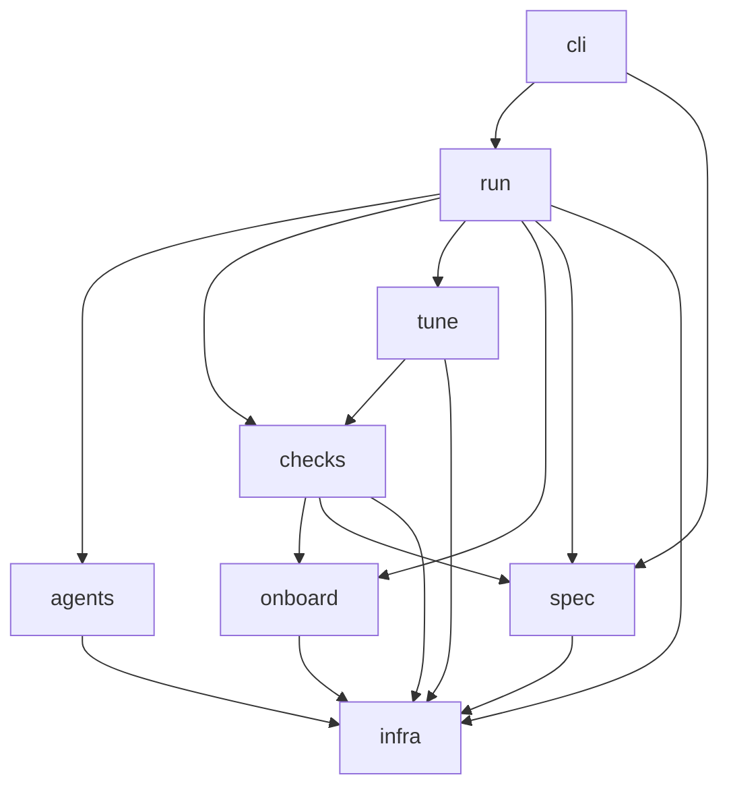
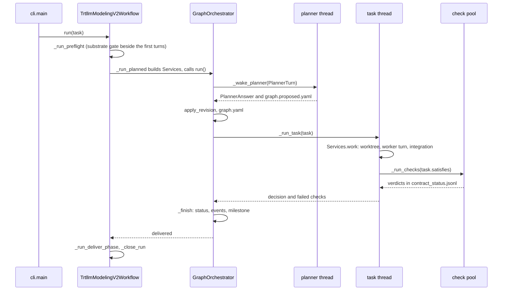

<!--
SPDX-FileCopyrightText: Copyright (c) 2026 NVIDIA CORPORATION & AFFILIATES. All rights reserved.
SPDX-License-Identifier: Apache-2.0
-->

# trtllm-modeling-v2: developer guide

This guide is for engineers who change the workflow itself: its orchestrator, checks, prompts,
skill, substrate and tests. It covers where each part lives, how the parts connect and what to
touch for a given change. [design.md](design.md) explains why the system has this shape, and
[user-guide.md](user-guide.md) covers operating a run.

Paths are relative to the package, `agent-flow/agent_flow/workflows/trtllm_modeling_v2/`, except
`<workspace>/...` (a run's workspace), `tensorrt_llm/...` (the TensorRT-LLM checkout the run
targets) and test files (`agent-flow/tests/workflows/trtllm_modeling_v2/`).

1. [Package layout](#1-package-layout)
2. [The workspace on disk](#2-the-workspace-on-disk)
3. [Control flow](#3-control-flow)
4. [Recipes](#4-recipes)
5. [Testing](#5-testing)
6. [Conventions](#6-conventions)
7. [Changing the flow while a run is live](#7-changing-the-flow-while-a-run-is-live)
8. [Contributing](#8-contributing)

## 1. Package layout

| package | responsibility |
|---|---|
| `cli.py` | The `trtllm-modeling-v2` entry point. It validates the spec, proves the commit identity, locks the workspace, checks that `--manage-sessions` can run here, picks the agent transport and runs the workflow. A first argument listed in `SUBCOMMANDS` (`gate`, `tests`, `intake`, `session`, `spool`, `driver`, `feedback`, `metrics`) dispatches to that tool instead, and `tune` is an alias for `--stage tune`. |
| `spec/` | What the user asks for. `task_schema.py` validates the resolved `task.yaml` (closed keys, all errors in one batch, defaults filled in). `schema_keys.py` holds the shared closed-key check. `variants.py` overlays configuration variants. `intake/` is Step 1: `schema`, `checks`, `freeze` (the `.confirmed` and `.started` sidecars), `compile`, `cli`, and `derive`, the fast path ([INTAKE.md](../INTAKE.md)). |
| `run/` | The run itself: its lifecycle, the contract, the task graph, the orchestrator loop and everything the loop keeps on disk (table below). |
| `run/stages/` | The mixins `TrtllmModelingV2Workflow` is composed of, one per concern: `preflight`, `plan` (the survey's dispatch), `kernel_writer` (kernel tasks), `assemble` (a unit's gates and prompts), `planned` (the services the orchestrator calls, the regression check and the budget among them), `deliver`, plus `common` constants and `remote_turns`. |
| `onboard/` | What onboarding knows, read off disk: `survey.py` (what the checkpoint demands and what the build supplies), `vocabulary.py` (`vocabulary.yaml`), `runtime_map.py` (reads `runtime_index.yaml`; `kernel_sources.yaml` is the kernel-source registry), `delivery.py` (the delivery disk checks), `embargo.py`, `logit_reference.py` (the logit gate's HF reference) and `promotion.py` (local variants, their importers, the `promote` task and the `ops:promoted` check). |
| `checks/` | The contract's checks: `gates.py` (boot, accuracy, acceptance), `witness.py`, `envelope_boot.py`, `serve_gate.py`, `logit_agreement.py`; `stats.py` (standard library only) and `gate_records.py` (`gate_results.jsonl`); `gate_cli.py` (any gate standalone, as the orchestrator runs it); `testcache.py` (`trtllm-modeling-v2 tests {affected,compare}`, which the regression check runs through). |
| `checks/harness/` | Programs a gate's job runs on the compute side, under the measured tree's interpreter: `engine_driver.py`, `engine_facts.py`, `engine_reuse.py`, `quickstart_shim.py`, `eval_shim.py` and `workload_io.py`. None of them imports `agent_flow`. |
| `tune/` | The tune campaign: `stage.py` (the phases, and `UNMERGED_OPTIMIZATIONS.md` at wrap-up), `campaign.py` (candidates, A/B and stacking), `keep_gate.py`; `measure.py`, `records.py` (the ledger, noise floor and keep rule), `inert.py`, `split.py` and `sol.py`; `serving_config.py`; `requests.py` (a tuner's request and turn prompt); `bench.py`, which runs in the container; `schema.py` (the `perf:` block). |
| `agents/` | `roles.py` (the five roles and their agent routing: the agent that started the run, Codex or Claude Code, unless `agents` routes a role), `decisions.py` (every role's decisions: when to choose each, what follows, whether it finishes the task), `prompts/` (`worker.py`, the one system prompt every task's agent runs; `tags.py`, a section per worker tag; `survey.py`, the capture lists a survey's dispatch carries; `planner.py` and `tuner.py`; shared blocks in `_common.py`) and `skills/` (the one packaged skill, `trtllm-modeling-v2-entry`). |
| `infra/` | Everything that is not modeling: `environment.py` (the launch prefix); `execution/` (where commands and turns go; `priority.py`, the class a spool job queues at); `dispatch.py` (what every transport and the operator loop share in `<workspace>/dispatch/`); `external/` (the external transport, `transport.py`, and its turn hand-out, `driver.py`, with `TURN_INSTRUCTIONS.md` and `turn_prompt.md`); `driver/` (the operator loop, `core.py`, its `config.py` and `reload.py`); `substrate/` (compute sessions and spools; `managed.py` for `--manage-sessions`); `committer.py` (the commit helper); `vcs.py` (git questions); `scripts/` (shell wrappers). |
| `examples/` | Worked examples for operators, never handed to a run (see [Conventions](#6-conventions)). |

| `run/` module | holds |
|---|---|
| `workflow.py` | `TrtllmModelingV2Workflow`: initialization, `run`, resume, checkpointing, turn dispatch (`_run_turn`, `_turn_start` for primers), the cells (`_mark_cells`), primers (`_start_primers`, `_build_primer`, `_drop_primer`), managed sessions (`_managing_sessions`), closing (`_close_run`), and the target fingerprint (`_target_marker`, `_narrow_marker`, `_verdict_holds`, `fingerprint`, `gate_inputs`) |
| `preflight.py` | The pure-Python preflight checks (`run_preflight`, `check_checkpoint`, `check_tmpdir`, `check_host_tools`, `claim_devices`, `check_multirank_substrate`, `substrate_gate`, ...) |
| `agent_probe.py` | Preflight's one probe turn per distinct agent (`probe_agents`), judged by the file it writes |
| `contract.py` | `Check`, `Contract`, `compile_contract` (profiles included), `ContractStatus` (`contract_status.jsonl`), `evaluate`, `equivalence_key`, `Milestone` (`correctness.jsonl`), the cells (`cells.json`) and `standing` |
| `requirements.py` | The coverage matrix (`coverage.yaml`) |
| `graph.py` | `Task`, `Graph`, `KINDS`, `WORKER_TAGS`, `validate`, `apply_revision`, `next_to_start`, `MAX_ATTEMPTS`, and the regression checks (`add_regression_check`, `regression_batch`, `unreviewed_shared_changes`) |
| `regression.py` | The regression check, with no agent turn (`run_regression_check`) |
| `metrics.py`, `inbox.py` | `metrics.json` (`collect`, `write`), refused graphs (`record_refusal`) and the budget (`budget_spent`); the operator's messages (`post`, `take`, `is_message`) |
| `primers.py` | One briefing session per role (`Primer`, `primer_prompt`, `primed_preamble`, `summary_note`, `version`) |
| `orchestrator.py` | `GraphOrchestrator` (the loop), `Services` (the workflow as the loop sees it), `PlannerTurn`/`PlannerAnswer`, `seed`, `stoppable` |
| `integration.py` | `Integration`: one worktree and branch per task, rebased and fast-forwarded into the checkout |
| `snapshots.py` | `Snapshots`, `CheckTree`: the read-only snapshot of one commit that every check measures |
| `receipts.py`, `runtime_facts.py` | What reaches a dependent task without a planner turn (`tasks/<id>.receipt.yaml`, `runtime_facts.yaml`) |
| `progress.py` | Decision files: reservation, the closed enum per role (`DECISIONS_BY_AGENT`, from `agents/decisions.py`), `collect_decision_file`, `progress.yaml` |
| `journal.py`, `state.py`, `drain.py` | `journal.md` and `reports/`; the checkpoint; the reload door (`InFlight`), the request watch and the restart ledger |

### Dependencies



The arrows show the main direction. A few imports go the other way, deliberately:

- `agents/prompts` builds role prompts from the code's own values: each role's "Ending your turn"
  section from the decision table (`agents/decisions.py`), which is also the enum `run.progress`
  validates and the source of `run.orchestrator.FINISHED`; `WORKER_TAGS`, `MAX_ATTEMPTS` and
  `REGRESSION_WINDOW_S` from `run.graph`, the sourcing ladder from `onboard.vocabulary`, the serving
  config from `tune.serving_config`, and capture lists from `checks.gates`. The enums and numbers a
  prompt states are the ones the code applies.
- `spec/task_schema.py` validates blocks whose validators live with their owners:
  `agents.roles`, `infra.committer`, `infra.substrate.sessions`, `onboard.embargo`,
  `tune.schema` and `checks.stats`.
- `checks/gate_cli.py`, `tune/keep_gate.py` and `infra/driver/core.py` import from `run/` inside a
  function; `cli._parse_args` breaks the contract → stages → orchestrator import cycle the same way.

Several files run by path under another interpreter and import nothing from the orchestrator's
environment: `infra/substrate/scheduler.py` and `spoolctl.py` (standard library only), the resolve
hook `infra/substrate/resolvehook/sitecustomize.py` (on every spool job's `PYTHONPATH`),
`checks/harness/*`, `checks/serve_driver.py`, `checks/logit_driver.py` and
`checks/testcache_driver.py` (the measured tree's interpreter), `tune/bench.py` (standard library
plus PyYAML), and `onboard/logit_reference.py` (the HF reference environment). The orchestrator
itself runs where there is no numpy, which is why `checks/stats.py` computes everything with
`math`.

## 2. The workspace on disk

One directory per run (`--workspace`) holds all of a run's state. A file is either **replaced
whole** (written under a temporary name, then renamed, so a reader never sees half of it: the
checkpoint, `graph.yaml`, `planner_events.json`, `progress.yaml`, `runtime_facts.yaml`,
`reload.json`, `inflight.json`, `cells.json`, `metrics.json`) or **append-only** (never rewritten: `contract_status.jsonl`, `correctness.jsonl`,
`gate_results.jsonl`, `restarts.jsonl`, `refusals.jsonl`, `journal.md`, the tune
`perf_ledger.jsonl`).

| path | written by | read by |
|---|---|---|
| `task.yaml` | `TrtllmModelingV2Workflow._init_state` (the resolved spec, defaults filled in); `_refresh_workspace_spec` on every resume | every role, `gate --task`, the driver |
| `task.resolved.yaml` | `cli._resolve_intake_task` when `--site` compiles an intake `task.yaml`; `cli._derive_intake_task` on the fast path | the run, as its `--task` |
| `task.intake.yaml`, `intake.report.md` | `derive.write_request` (the fast path) | the run; the operator |
| `<request>.confirmed`, `<request>.started` | `freeze.confirm`; `freeze.stamp_start` once the run is past preflight | `freeze.start_reason` on every start |
| `llm_api/<unit>.yaml` | `intake/compile.py`, beside the resolved spec | the unit's gates (its options file) |
| `.trtllm_modeling_v2_state.json` | `run/state.py` `save_state` (`SCHEMA_VERSION` 2) | `load_state` on resume |
| `.orchestrator.lock` | `cli._claim_workspace` (an `flock`; a second orchestrator exits 3) | none |
| `prompts/<role>.md` | the preflight stage, after composing the bundle (`dump_prompt_bundle`) | operators; `test_prompt_snapshot.py` |
| `contract.yaml` | `PreflightStage._write_contract` (`compile_contract`, on every start) | the planner, the driver |
| `coverage.yaml` | `PreflightStage._check_coverage` (`requirements.requirements_matrix`) | operators; the delivery journal |
| `contract_status.jsonl` | `ContractStatus.record`, from `GraphOrchestrator._run_check` | `evaluate`, `standing`, the planner (by path), `driver status`, `metrics.collect` |
| `correctness.jsonl` | `GraphOrchestrator._correctness` via `contract.record_milestone`; a `bringup` line from `workflow._mark_bringup` | `standing`, `driver status`, `metrics.collect` |
| `cells.json` | `workflow._mark_cells` (`contract.save_cells`), which also moves the `<target branch>-best` branch | `metrics.collect`, the closing journal section |
| `metrics.json` | `metrics.write`, from `_close_run` and `trtllm-modeling-v2 metrics` | operators |
| `refusals.jsonl` | `metrics.record_refusal`, from `_planner_returned` | `metrics.collect` |
| `inbox/`, `inbox/taken/` | `inbox.post` (`trtllm-modeling-v2 feedback`); `inbox.take` moves each message it hands over to `taken/` | `PlannedStage._take_stage_notes`, the planner's next turn; `metrics.collect` counts `taken/` |
| `issues.md` | the planner (suspected defects off the goal) | operators |
| `graph.yaml` | `GraphOrchestrator._save_graph`; `seed` (the survey) | the planner, `_dispatch_task` (turn adoption), `_regression_paths` |
| `graph.proposed.yaml` | the planner's turn | `PlannedStage._planner_turn` |
| `planner_events.json` | `GraphOrchestrator._save_events` (events not yet read, `retries`) | the next process's loop |
| `tasks/<id>.json` | `PlannedStage._envelope` | the task's worker |
| `tasks/<id>.receipt.yaml` | `_keep_receipt` (`receipts.build`, `receipts.write`) | `_dependency_receipts`, for the tasks that depend on it |
| `decisions/<unit>-<role>-<turn>[.<attempt>].yaml` | the role; reserved first by `mark_decision_dispatch`, which stamps `.<name>.dispatched` beside it | `collect_decision_file` |
| `progress.yaml` | `collect_decision_file` (one entry per validated decision) | `latest_entry` |
| `journal.md`, `reports/NN-<role>-<what>.md`, `.dispatch-ordinals/` | `Journal` (`event`, `section`, `record_dispatch` before the turn, `record_result` after it) | operators, receipts |
| `surface.md` | `PreflightStage._take_survey` | the surveyor, the planner |
| `runtime_map.md` | `PreflightStage._take_survey` (the runtime map narrowed to the checkpoint's demands) | every worker; the planner's primer |
| `host_facts.md` | `_write_host_facts` (above the marker); roles append below it | every dispatch (`_context_block`) |
| `plan.md`, `vocabulary.yaml` | the `survey` task (surveyor) | `load_vocabulary` (on `DRAFT_READY`); `_add_kernel_tasks`; kernel writers |
| `boot.yaml` | optional, by an operator or a role | `gates.resolve_boot_spec` when `accuracy.boot` is absent |
| `runtime_facts.yaml` | `runtime_facts.record`, from `_note_runtime_facts` on every passing gate | `runtime_facts.render` in the planner's, kernel writers' and workers' prompts |
| `gate_results.jsonl` | `checks/gate_records.py` (per-prompt baselines, findings) | the acceptance gate, `blocking_findings` at delivery |
| `gates/<unit>/`, `gates/envelope/`, `witness/<unit>/`, `variants/` | the gates, witnesses and variant overlays (files a job reads, on the shared filesystem) | the gate jobs |
| `test_cache/` | `checks/testcache_driver.py` (one record per pytest process) | `tests affected`, `tests compare`, the regression check |
| `regression/<task id>/` | `regression.run_regression_check` (the selections a regression check ran, at the head and the base) | the check's job |
| `gates/substrate/pass.json`, `gates/agent-probe/` | the substrate gate; `probe_agents` | the next start (reused for 12 h in the same environment) |
| `worktrees/<task-id>/`, `worktrees/integrated.json`, `worktrees/attempts.json` | `Integration` | the task's worker; `Integration` on resume |
| `snapshots/<commit>/` | `Snapshots` (read-only, marked by `.mv2flow-snapshot`) | the checks of that commit |
| `turns/<id>.*` | `InProcessTurnExecutor.keep_records` (`request.json`, `system.md`, `prompt.md`, `activity.log`, `result.md`, `done`) | operators; `driver status` |
| `dispatch/` | `ExternalAgentTransport` (`<id>.request.json`, `.system.md`, `.prompt.md`; `.read`, `.adopted`, `.consumed`), the orchestrator heartbeat and exit note; `claims/` by the driver | the driver (`.result.md`, `.done`), `driver wait` |
| `TURN_INSTRUCTIONS.md` | `infra/external/driver.install_instructions` (external transport) | the driver's subagents |
| `reload.request.json`, `reload.json`, `reload.seen`, `inflight.json`, `restarts.jsonl` | `driver reload`; the orchestrator (`run/drain.py`, `infra/driver/reload.py`) | the orchestrator; `driver wait`, `driver status` |
| `tune/` | `tune/stage.py` and `tune/campaign.py`: `configs/`, `data/<label>/`, `perf_ledger.jsonl`, `campaign_state.json`, `worktrees/` (`best`, `<slug>`), `candidates/<slug>/decision.yaml`, `roadmap.yaml`, `sol.yaml`, `gates/<key>/keep.json`, `summary.md` | the tuner, the campaign |
| `UNMERGED_OPTIMIZATIONS.md` | the campaign's wrap-up (`tune/stage.py` `unmerged_optimizations`, from the ledger's `candidate_kept` records) | operators |
| `primers/<role>.md`, `primers/primers.json` | `_build_primer` (each role's briefing summary; `primers.save`) | `_start_primers` on a later start, turns that cannot fork |
| `managed_sessions.json` | `ManagedSessions` (every job a `--manage-sessions` run submitted) | `ManagedSessions.tick` and `release` |
| `bin/commit.sh`, `.commit.lock` | `install_committer` | the kernel writer and assembler (`MV2FLOW_COMMIT_TREE=<worktree>`) |
| `bin/trtllm-modeling-v2` | `gate_cli.install_cli` (the orchestrator's interpreter and package) | agents' shells |
| `.claude/skills/`, `.agents/skills/` | `_materialize_skills` (on every start; the one packaged skill, for Claude Code and for Codex) | the agent session, which runs with the workspace as its working directory |
| `.agent-flow/` | the agent layer, for a system prompt too long for argv | the agent CLI |

`--clean` removes the checkpoint, `plan.md`, `vocabulary.yaml`, `progress.yaml`, `journal.md`,
`host_facts.md`, `reports/`, the graph files, `contract_status.jsonl`, `surface.md` and the reload
ledger. Everything else stays.

## 3. Control flow



### 3.1 `cli.main`

`main` records how to re-execute the process (`_relauncher`, from `sys.orig_argv` and the
starting environment) and dispatches subcommands. For a run it then:

1. Parses the flags. With `--checkpoint`, `_derive_intake_task` derives the request
   (`derive.parse_goal`, `derive.derive_task`), writes it (`derive.write_request`), runs the intake
   checks (`intake/checks.run_checks`) and stops on a block, or resumes the request on disk
   (`derive.resume_problem`). An intake spec is compiled with `--site` (`_resolve_intake_task`),
   and the spec is validated (`load_and_validate_task_yaml`). A spec error exits 2 and lists every
   problem.
2. Resolves the commit identity, makes one trial commit through the helper (`_commit_identity`),
   and pins `MV2FLOW_GIT_NAME` and `MV2FLOW_GIT_EMAIL` for the process.
3. Takes the workspace lock. With `--manage-sessions` it exits 2 unless this host can manage the
   sessions (`ManagedSessions.unavailable`), then ticks once. Under `--agent-transport external` it
   builds an `ExternalAgentTransport` and installs `TURN_INSTRUCTIONS.md`; otherwise it starts the
   orchestrator heartbeat (`infra/dispatch.py`). It sets `CLAUDE_CODE_DISABLE_AUTO_MEMORY=1` unless
   the environment says otherwise.
4. Constructs `TrtllmModelingV2Workflow` with the mechanism switches (`primers`,
   `manage_sessions`), sets `workflow.reexec`, and calls `workflow.run(args.task)`.

### 3.2 `TrtllmModelingV2Workflow.run`

The constructor resolves the turn executor once (`select_turn_executor`: in process, or the
external transport) and applies `--clean`. `run` calls `_init_state`, which validates the spec again
and picks one case:

- **Resume**: reads the checkpoint and continues an open run, refreshing the workspace `task.yaml`
  from the given spec (`_refresh_workspace_spec`).
- **Re-entry**: re-opens a closed run whose verdict is remediable (`REMEDIABLE_VERDICTS`). With
  `--stage tune` it also re-opens a run that closed `delivered` or with a verdict that starts with
  `tune`, at the `tune` stage. Any other closed run is refused.
- **New run**: writes the resolved `task.yaml` and a fresh `WorkflowState`.

`run` then calls `_run_stages` inside `orchestrator.stoppable(workspace)`, which hands out a `stop`
callable the substrate gate calls if it fails while the first turns run. `_run_stages` always runs
preflight, on a resume too, because every prompt and gate carries the resolved environment;
`--dry-run` returns after it. At `planned` it seeds the survey (`PlanStage._start_with_the_survey`)
and runs `_run_planned`; at `tune` (`trtllm-modeling-v2 tune` only) it runs `tune/stage.py`
`run_tune_phase`. A `_SessionLost` raised by any gate closes the run `session-lost:<stage>`; a
keyboard interrupt is journaled and leaves the checkpoint where it was.

### 3.3 The preflight stage

`PreflightStage._run_preflight` runs, in order:

1. `run/preflight.py` `run_preflight`: the checkpoint, the per-unit anchors, speculation support,
   capture lists, KV-cache configs, `TMPDIR`, the host tools, the device claim for a local run,
   the multi-rank substrate, and the run's identity (slug, branch, target path). A
   `PreflightError` stops the run; a `SpecInconsistencyError` gets no troubleshooting hint, because
   the fix is in the spec.
2. `select_command_executor` (`LocalCommandExecutor` or `SpoolCommandExecutor`) and the shell runner
   every gate uses.
3. The notes, then `_prove_agents`: one probe turn per distinct agent, in process only
   (`run/agent_probe.py`).
4. The substrate gate, beside the first turns (`_prove_substrate_beside`) or inline when no `stop`
   was given.
5. `_take_survey` (`surface.md`, `runtime_map.md`), `install_committer` (`bin/commit.sh`),
   `install_cli` (`bin/trtllm-modeling-v2`), the prompt bundle (`build_trtllm_modeling_v2_prompts`,
   then its snapshot), `host_facts.md`, `_materialize_skills`, `_write_contract`, and a checkpoint.

### 3.4 The planned stage and `GraphOrchestrator.run`

`PlannedStage._run_planned` builds `Integration` (`_make_integration`; without a git checkout or with
`--no-task-worktrees` tasks share the checkout), `Snapshots`, a `CheckAdmission` that bounds running
checks by the sessions' free devices, and the `Services` record (`plan`, `work`, `check`,
`free_gpus`, `held_gpus`, `marker`, `finished`, `admit`, `reload`, `correct`, `bringup`, `cells`,
`budget`, `stage_notes`, `regression`, ...). It then constructs `GraphOrchestrator`. With
`perf.enabled`, `required_kinds=("tune",)` refuses a graph without a `tune` task and `start_after`
holds that task until the core's inner checks pass. `own_paths` makes the loop follow changes to
shared code with regression checks.

`_start_primers` builds the primed roles' briefing sessions in the background, and
`_managing_sessions` ticks `ManagedSessions` once a minute (`--manage-sessions`).

`GraphOrchestrator.run` opens three pools: checks (`mv2-check`), tasks (`mv2-task`, up to
`--max-parallel-tasks`) and the planner (one thread), then drives `_drive`. Only the loop's own
thread changes or writes the graph. Each pass of `_drive`:

1. Returns `stopped: <reason>` if the substrate gate asked it to stop, and `budget-spent: <why>`
   once `Services.budget` (`PlannedStage._budget_spent`, `metrics.budget_spent`) says so.
2. Hands finished tasks to `_finish` and settled re-checks to `_settled`, notes the operator's
   messages (`Services.stage_notes`, from `inbox.take`) as urgent events, and applies a returned
   planner turn (`_planner_returned`).
3. Answers a reload request (`_reload_check`, `_drain_step`); while draining nothing starts.
4. Follows every change to shared code with a regression check (`_follow_shared_changes`), then
   starts what `graph.next_to_start` returns (`critical_path_minutes`, `touches_conflict`; the rules
   are in [design.md §6.4](design.md#64-scheduling)): each task is marked `running` and submitted as
   `_run_task(task)`. A `check` task goes to `_start_check_task`, which submits its checks to the
   check pool; a regression check submits `Services.regression` (`PlannedStage._run_regression_check`)
   once it takes its batch (`_regression_step`, recorded as `covers`).
5. With no foreground task running, re-runs stale checks, riskiest first (`_settle`, `_by_risk`).
6. When idle, records the correctness milestone and returns `delivered` if the contract holds, no
   required task is open and no worker report is unread.
7. Wakes the planner when idle, when only background work runs, or when events are due, and returns
   `planner-stalled` after `--revision-cap` revisions without progress. Then it waits on whatever is
   in flight.

### 3.5 A worker turn

`_run_task` calls `Services.work`, which is `PlannedStage._work_task`, in the task's thread:

1. `_work_task_turn` opens the worktree of an integrated kind or a scratch kind under the reload door
   (`Integration.open`), and `_work_in_tree` puts its `worktree_block` on the thread, so every turn of
   the task carries it.
2. `_work_task_body` writes the envelope `tasks/<id>.json` with the dependencies' receipts, then
   branches on the kind: `tune` runs `tune_stage.run_tune_task`; `kernel` resolves its queue row,
   `<mode>:<entry>` or `promote:<entries>` (`_queue_item`) and runs `_run_one_kernel_writer`, which
   gives the kernel writer its tags' sections (`KernelWriterStage._tag_sections`) and where a shared
   entry's local variant lands, or for a promote the variants and importers to merge
   (`_promote_block`); every other kind gets its role
   from `ROLE_BY_KIND`, a dispatch of its header (`tags.task_tags`), its context, its tags' sections
   (`tags.tag_section`) and a role prompt (`_assembler_prompt`, `_surveyor_prompt`), and goes to
   `_dispatch_task`.
3. `_dispatch_task` adopts, on the external transport, an answered turn a previous process never
   consumed. Otherwise it adds the context block, reserves the decision file
   (`mark_decision_dispatch`), journals the prompt (`record_dispatch`), calls `_run_turn`, journals
   the result, and returns `collect_decision_file`: the decision validated against the role's closed
   enum, or `None`.
4. `_run_turn` appends the worktree block, builds a `TurnRequest` (role, prompt, system prompt,
   configured backend, model and effort, decision file) and runs it on the executor.
   `_turn_in_flight` holds it for a reload only when the turn lives in this process. `_turn_start`
   starts a primed role's turn as a fork of its primer (`primers.primed_preamble`; in process only)
   or points it at the primer's summary (`primers.summary_note`); a fork that raises drops the
   primer's session (`_drop_primer`) and the turn runs again.
5. A `survey` that answers `DRAFT_READY` fails unless `load_vocabulary` accepts its
   `vocabulary.yaml`. A kernel writer's `FAILED_RECEIPT` that names an `engine_defect` queues the
   `feature` task that fixes it (`_engine_defect_reported`, `_defect_fix_task`), which the loop adds
   with no planner turn (`GraphOrchestrator._add_defect_tasks`, through `Services.defect_tasks`).
   `_work_task` keeps the receipt.

The decision string returned to the loop is the decision on the first line, optionally followed by
a note that the planner sees with the task's event.

### 3.6 Integration

While the decision is in `FINISHED`, `_work_task_turn` calls `Integration.integrate` under the
reload door: it rebases the task branch onto the checkout's head and fast-forwards it in, under one
lock. Once merged, the worktree is closed, the branch stays as the record and `integrated.json`
keeps the tip. On a conflict the worker is dispatched again with `rebase_block`, up to
`REBASE_RETRIES` (2) times; then the decision becomes `INTEGRATION_FAILED`. A retried task's
worktree is refreshed onto the head first (`Integration.refresh`).

### 3.7 Running a task's checks

In the same thread, `_run_task` hands the task's `satisfies` (less the delivery tier) to
`_run_checks`. The checks run on the shared check pool, each in `_run_check`:

1. It waits for admission (`Services.admit`), then enters the reload door
   (`inflight.hold("check", key)`).
2. It reads the target's marker (`Services.marker`). A check that already holds on this marker, by
   its own verdict or an equivalent check's, does not run.
3. `Services.check` is `PlannedStage._prioritized_check`, which sets the class the check's spool
   jobs queue at (`priority.job_priority`; `AssembleStage` reads it back with
   `current_job_priority`) and calls `_run_contract_check`. That builds a `CheckTree` for the
   checkout's head and, under a lease of that commit's snapshot, runs `_on_snapshot(pin)._gate(check)`,
   a shallow copy of the workflow whose spec, runners and results point at the snapshot.
4. `_gate` picks the function by gate name (anything else is a witness, `_run_witness`) and runs it
   through `_gate_until_verdict`, which re-runs a gate lost to its session up to
   `SESSION_LOSS_RERUNS` times. `CheckTree.settle` stamps what each command imported, voids a result
   that imported more than one tree, and measures a void result once more.
5. After a pass `_note_runtime_facts` updates `runtime_facts.yaml`; once every member of a unit has
   an accuracy verdict, `_note_shift` checks for a systematic shift.

### 3.8 Recording a verdict

`ContractStatus.record(unit, result, marker)` appends one line to `contract_status.jsonl`: unit,
gate (`GateResult.name`) and member, `passed` (false for a void result), detail, the marker, the
read list and its narrowed marker, the least free device memory and `LOW MARGIN`, what each command
imported, `void`, and `duration_s`; optional fields only when they say something. `evaluate` reads
the latest verdict per key: one under another marker counts as missing unless `holds`
(`workflow._verdict_holds`) says its narrowed marker is unchanged, and an equivalent check's pass
covers a check without a verdict of its own.

Back in the loop, `_finish` sets the task `done`, `failed`, `abandoned` (a failed `nice_to_have`),
or `pending` again after an infrastructure failure (`_not_the_task`, once per task, counted in
`planner_events.json`). It also adds one kernel task per queue row when a survey lands
(`_add_kernel_tasks`), resets the stall count on progress, writes the graph and events, records the
milestones and the cells (`_correctness`: `Services.bringup`, `Services.cells`, `Services.correct`),
and checkpoints.

### 3.9 Waking the planner

Every outcome becomes an event through `_note`. An urgent one wakes the planner at once; a green
finish waits up to `--event-window` while work is in flight; a quiet one (`_answered_ahead`) wakes no
turn of its own. `_wake_planner` submits `Services.plan`, which is `PlannedStage._planner_turn`: its
request opens with the operator's messages (`inbox.is_message`), names the task, contract, verdicts
and current graph by path, and carries the contract standing, the runtime facts, the `## Shared
code` section and the other events since the last turn and any refusals.

`_planner_returned` applies the answer:

- `ESCALATE` and `CEILING` end the run with that verdict.
- A graph goes through `graph.apply_revision` and `validate` (`_admission`); tasks the orchestrator
  added during the turn are kept (`_added_during`).
- An adopted graph is saved whole, and events it already answered are dropped (`_drop_answered`).
- A refused graph is recorded in `refusals.jsonl` and goes straight back to the planner, up to
  `MAX_REFUSALS` (3) times; then the run closes `planner-refused`.
- A planner turn that raised is asked again after `PLANNER_RETRY_S`, doubled per failure in a row;
  after `MAX_PLANNER_FAILURES` (5) the run closes `planner-failed: <error>`.

### 3.10 Closing the run

When the loop returns, `_run_planned` journals the standing. If the verdict is not `delivered`, the
run closes with it. Otherwise `DeliverStage._run_deliver_phase` runs its checks in order
([design.md §4.5](design.md#45-delivery)): open blocking findings, `verify_delivery` and the delivered
tests, and `_contract_holds` on the current marker. `_close_run` sets `done` and the verdict,
checkpoints, cancels the run's queued session jobs (`ManagedSessions.release`), writes
`metrics.json`, and closes the journal with the cells that hold, the metrics path and the gate
table. A `stopped` run is not closed.

## 4. Recipes

Each recipe lists the files to change and the tests to add or extend. All of them also need the
documentation the change touches (see [Contributing](#8-contributing)).

### Add a gate

A gate is a command with an exit code. It runs on the target that `_gate` hands it and returns a
`GateResult` whose `name` is the gate name the contract compiled, because the verdict's key is
built from `result.name`.

- `checks/<gate>.py`: a module with `GATE_NAME`, a `<Name>Spec.from_task` that reads its
  `accuracy.<gate>` block and says whether it is `enabled`, and a
  `run_<gate>_gate(env, *, task_data, runner, unit, member, features, workdir, ...)`. Model it on
  `serve_gate.py` or `envelope_boot.py`. Commands go through `runner`, never `subprocess`, so the
  snapshot, the spool and the tests' fake shell all apply. A job the gate launches lives beside it
  (as `serve_driver.py` does) and imports nothing from `agent_flow`. A gate that builds an engine
  attests it (`gates.attest_engine`).
- `run/contract.py` `compile_contract`: add the check at its tier and members. If the block is not
  an accuracy input, add its key to `_NOT_ACCURACY_INPUTS`, otherwise it becomes part of every
  accuracy check's equivalence key.
- `run/stages/planned.py` `_gate`: add the branch that calls the function. If the gate's job needs
  more devices than the member, the `admit` callable built in `_run_planned` must name them, as it
  does with `all` for the equivalence witness.
- `checks/gate_cli.py`: add the name to `GATE_NAMES` and to its dispatch.
- `spec/task_schema.py`: the block's keys (closed, validated) and their addition to
  `ACCURACY_KEYS`. Document every key in `task.example.yaml`.
- Docs: the gate tables in [design.md §5](design.md#5-the-contract-and-checks).
- Tests: unit tests in the style of `test_gates.py`, with a fake shell that prints what the real job
  prints, a failing case included; `test_contract.py`; `test_gate_cli.py`; `test_task_schema.py`.

### Add a witness

A witness serves a feature that boot and accuracy cannot see. It needs a contrast that differs in
exactly one variable, and it must be able to fail on the workload it runs (LESSONS 21-23).

- `checks/witness.py`: a `run_<kind>_witness`, its legs in `WITNESS_LEG_NAMES`, the feature in
  `WITNESS_KINDS`, and its dispatch in `_run_declared_witness`.
- `run/stages/common.py` `WITNESS_GATED_UNITS`: the same row, which `compile_contract` reads to add
  the witness at the proof tier when witnesses are on (`task_schema.witness_enabled`), and
  `requirements.requirements_matrix` to report the feature not covered when they are off. Add the
  verdict name to `contract._WITNESS_GATE`.
- `run/stages/assemble.py` `_witness_block_gap`: the keys `accuracy.witness.<unit>` must set.
- `spec/task_schema.py`: the witness block's keys (`WITNESS_KEYS`, `DECLARED_WITNESS_FEATURES`,
  `KV_QUANT_WITNESS_KEYS`), documented in `task.example.yaml`.
- Tests: `test_witness.py`, with a case showing the witness fails when the feature's effect is
  removed; `test_gate_wiring.py` holds `FEATURE_FAMILIES` and `WITNESS_GATED_UNITS` together.

### Add a feature

A feature is a closed-list entry with a family, a unit in the contract and, when boot and accuracy
are blind to it, a witness or acceptance gate.

- `spec/task_schema.py` `FEATURE_FAMILIES`: the feature and its family (a `speculator` joins
  `SPECULATORS`). Exclusions go there too (as `MTP_NAMESPACE_FEATURES` does).
- `spec/intake/schema.py` `INCREMENT_FEATURES` (or `SPECULATIVE_ALGOS`) and
  `spec/intake/compile.py`, so intake can ask for it; add it to [INTAKE.md §5.3](../INTAKE.md#53-catalog).
- `onboard/runtime_index.yaml`: the engine area a worker reads for it. Workers learn a feature from
  the engine's code through that map and the `feature` tag; no prompt or skill is written per
  feature, and one model's values go in `examples/`.
- The witness (above), or `ACCEPTANCE_GATED_UNITS` in `run/stages/common.py` for a speculator.
- Docs: the feature table in [design.md §5.2](design.md#52-gates-and-witnesses) and the keys in
  `task.example.yaml`.
- Tests: `test_task_schema.py`, `test_intake.py`, `test_contract.py` and `test_gate_wiring.py`.

### Change a prompt, a tag or a role

- What every worker is told: `WORKER_BASE` in `agents/prompts/worker.py` and the shared blocks in
  `_common.py`. What one kind of work asks: its section in `agents/prompts/tags.py`
  (`TAG_PROMPTS`) and the one line the planner chooses it by (`TAG_SUMMARIES`). What one role's
  decision file carries beyond its decision: `ENDING_EXTRAS` in `worker.py`. The planner and the
  tuner's campaign ending have modules of their own. Run-scoped blocks (scope,
  embargo, notes, launch environment, commit helper) are appended by
  `build_trtllm_modeling_v2_prompts`, never written into a module.
- A decision: each role's ending is rendered from the decision table (`agents/decisions.py`), and the
  decision-file block from `DECISIONS_BY_AGENT` and `EXTRA_KEYS_BY_AGENT`, so a new decision is added
  there and in the code that branches on it (`orchestrator.FINISHED`, `_not_the_task`, the stage).
- A tag: every worker kind in `run/graph.py` `KINDS` is one (`WORKER_TAGS`); give it a section in
  `TAG_PROMPTS`, a line in `TAG_SUMMARIES`, and an `IMPLIED` entry when it brings another tag.
- A role: `agents/roles.py` `ROLES`, a field on `PromptBundle` and in `_for_every_role` and
  `with_extensions`, its prompt (`worker.role_prompt`), its decisions in `agents/decisions.py` and
  its enum in `run/progress.py` (`DECISIONS_BY_AGENT`, `_STAGE_BY_AGENT`), its timeout in
  `infra/execution/turns.py` `DEFAULT_ROLE_TURN_TIMEOUTS`, and its routing in `ROLE_BY_KIND` if a
  task kind runs it.
- Tests: `test_prompts.py` (each tag's section, summary and order; a task role's prompt is the
  worker plus its decision block; which roles get the environment and commit-helper blocks),
  `test_decision_table.py`, `test_prompt_snapshot.py` (the composed bundle is what
  `prompts/<role>.md` holds after a dry run) and `test_roles.py`. Assert on a phrase that carries
  the rule, with line breaks folded, not on the whole prompt.

### Add a task kind

- `run/graph.py` `KINDS`, which makes it a worker tag too (`WORKER_TAGS`).
- `agents/prompts/tags.py`: its section (`TAG_PROMPTS`) and its line (`TAG_SUMMARIES`); the
  planner's prompt lists every kind from `TAG_SUMMARIES` (`_KIND_ROWS`), so a missing line fails at
  import.
- `run/stages/planned.py`: `ROLE_BY_KIND`, and a branch in `_work_task_body` if the kind needs its
  own prompt or service.
- `run/integration.py` `INTEGRATED_KINDS` or `SCRATCH_KINDS`; whether the kind's changes are shared
  code, followed by a regression check, is decided from these sets
  (`graph.unreviewed_shared_changes`, `graph.add_regression_check`).
- `agents/decisions.py`: the role's decisions (`test_decision_table.py` holds the prompt, the enum
  and `FINISHED` together).
- `run/orchestrator.py`: `BACKGROUND_KINDS` if the kind runs for hours beside the graph, and a
  `start_after` gate from `_run_planned` if it waits for checks.
- Docs: the kinds tables in [design.md §6.1](design.md#61-tasks-kinds-and-roles) and the
  [README](../README.md#how-a-run-works).
- Tests: `test_graph.py`, `test_orchestrator.py`, and a `test_workflow.py` scenario through the
  fake layers.

### Add a spool or substrate capability

The substrate is a protocol on a shared filesystem. `scheduler.py` and `spoolctl.py` are standard
library only and run by path, and a scheduler change reaches a session only when its allocation
starts again from an entry script rendered by the updated package.

- A job header key (`#spool: gpus=... wall=... requeue=...`): `scheduler.py` `parse_header` and
  admission, the matching `spoolctl.py` flag, and `infra/execution/spool.py` if the orchestrator's
  executor sets it.
- Placement across spools: `infra/substrate/placement.py`, `SpoolCommandExecutor`, and
  `capacity.py` if it changes how many checks start.
- A session key: `infra/substrate/sessions.py` (validation, `render_session_entry`,
  `scheduler_arguments`), documented in `task.example.yaml`; and `managed.py` `render_batch` if a run
  that manages its sessions must pass it to `sbatch`.
- A new verdict reason or return code: an `RC_*` constant, and an entry in
  [TROUBLESHOOTING.md](../TROUBLESHOOTING.md) that quotes `reason=<x>` and `(rc N)`.
- Docs: [design.md §8](design.md#8-execution-substrate) and, for builds,
  [BUILD_AND_TEST.md](../BUILD_AND_TEST.md).
- Tests: `test_spool_scheduler.py` drives real `bash` jobs in a temporary spool with a fake clock.
  Also `test_spool_placement.py`, `test_spool_requeue.py`, `test_spool_sessions.py`,
  `test_managed_sessions.py`, `test_job_priority.py` and `test_execution.py`.

### Add a tune metric or change the keep rule

The tuner proposes and Python judges, so a metric or rule change is a change to `tune/records.py`
and the code that feeds it, never to the tuner prompt alone.

- A metric: `tune/bench.py` writes it into each point of `summary.json` (it runs in the container:
  standard library and PyYAML only). In `tune/records.py`, `Measurement.headline` makes it a
  headline, `SECONDARY` reports it without judging on it, `CONSTRAINT_METRICS` with
  `tune/schema.py` `CONSTRAINT_KEYS` makes it a constraint, and a metric judged for losses only, as
  TTFT at concurrency 1 is (`Measurement.ttft`, `TTFT_TOLERANCE`), carries a tolerance of its own.
  `tune/sol.py` takes ceilings keyed like the headline; `tune/requests.py` and
  `agents/prompts/tuner.py` show it to the tuner.
- The keep rule: `records.compare` and `bands`, `NoiseFloor`, `ground_floors`, `remeasure_reason`;
  `tune/inert.py`; `tune/split.py`; the defaults the campaign takes from `perf.campaign`
  (`tune/stage.py`).
- Docs: [design.md §10](design.md#10-tune-design).
- Tests: `test_tune_noise.py`, `test_tune_ttft.py`, `test_tune_configs.py`, `test_tune_split.py`
  and `test_tune_stage.py`. Measurements in a test are fixtures in the label format `bench.py`
  writes.

### Add a preflight check

Preflight is pure Python and runs before any agent, cheap file reads first, then host probes.

- `run/preflight.py`: a `check_<what>` function that raises `PreflightError` (or
  `SpecInconsistencyError` when the fix is in the spec) or returns notes, called in order from
  `run_preflight`. A check that needs the workspace or the agents belongs to
  `run/stages/preflight.py` `_run_preflight`.
- [TROUBLESHOOTING.md](../TROUBLESHOOTING.md): the preflight table, and an entry for the symptom it
  prevents, ending ``*Caught by:* `check_<what>` ``.
- Tests: `test_preflight.py` with an injected `runner`.

### Add a mechanism, or turn one on by default

- A new one is off until a GPU run has exercised it: a flag in `cli._parse_args` passed to
  `TrtllmModelingV2Workflow` (as `--manage-sessions` is). A proof the contract
  can owe is a spec switch instead (`accuracy.<gate>.enabled`), off unless the spec or a profile
  turns it on (`task_schema._profile_defaults`).
- Turning one on by default needs the GPU run that exercised it and the failure it prevents;
  `metrics.json` shows, per gate kind, what the checks cost and how often they failed or said
  nothing.
- Docs: its row in [mechanisms.md](mechanisms.md), and a flag in the README's flags table, which
  `test_package_hygiene.py` holds to the CLI.

### Add a TROUBLESHOOTING entry

[TROUBLESHOOTING.md](../TROUBLESHOOTING.md) is keyed on verbatim output, the string an operator greps
for. The heading is the error text (`` ### `<verbatim text>` ``), in the section of its layer; the
body says what the symptom is not (usually the model), what it is, and the fix; the entry ends
``*Caught by:* `<symbol>` ``, naming a function, class or constant defined in the package or its
tests, or `*Not caught.*` with why. It cites no code by line number (`file.py:123`), except inside a
quoted diagnostic, and `reason=<x>` and `(rc N)` quote what the scheduler writes.

## 5. Testing

Every test runs on CPU, with no model, no GPU, no cluster and no agent. A test fakes the outside
world at one of the seams the code exposes for it, and lets the real control flow run:

- **Agent layers.** `test_workflow.py` replaces `TrtllmModelingV2Workflow._make_agent` with
  `FakeLayer` (via `_install(monkeypatch, workflow, Script(...))`). A fake turn writes the decision
  file at the path its prompt reserved, and a scripted planner writes its graph to the path in
  `Write the next graph to`. Because the decision file is the whole contract between the
  orchestrator and an agent, a fake that honours it runs the real orchestration.
- **Runners.** The workflow takes `command_runner` (argv commands such as `nvidia-smi`; see
  `healthy_smi`), `shell_runner` (every gate command; see `passing_shell`) and `git_runner` (see
  `fake_git`). `_workflow(tmp_path, ...)` wires the three and turns off the substrate gate (one
  `test_workflow.py` case runs it).
- **Services.** `GraphOrchestrator` takes its workflow as a `Services` record of callables, so
  `test_orchestrator.py`, `test_orchestrator_concurrency.py` and others drive the loop with plain
  functions and a hand-written `Contract`.
- **Real processes where they are the subject.** `test_committer.py` commits into a real git
  repository, `test_integration*.py` builds real worktrees, and the spool tests run real `bash` jobs
  against a fake clock.

`conftest.py` provides `repo` (a minimal TensorRT-LLM checkout with one merged target, built by
`test_delivery._build_repo`), `checkpoint` (an HF config directory) and `task_file` (a local spec
for both). Its autouse fixtures turn `PlanStage.survey_first` off, stop git's upward search at
pytest's base temp directory (`GIT_CEILING_DIRECTORIES`), and set `MV2FLOW_SKIP_AGENT_PROBE=1`
(`test_agent_probe.py` unsets it).

**Concurrency tests.** Each fake that must reach a point while another thread is somewhere else waits
on a `threading.Event` with a deadline (`_WAIT`, 10 s), and the orchestrator polls fast
(`poll_s=0.01`), so a loop that serializes what should overlap fails an assertion instead of hanging.
A sleep only polls a condition under the same deadline, or holds a state long enough for the loop to
act on it in a test that asserts it did not.

**Running**, from `agent-flow/`:

```bash
PYTHONPATH=$PWD python -m pytest -q tests/workflows/trtllm_modeling_v2 -p no:cacheprovider
PYTHONPATH=$PWD python -m pytest -q tests/workflows/trtllm_modeling_v2/test_graph.py
PYTHONPATH=$PWD python -m pytest -q tests/workflows/trtllm_modeling_v2 -k "orchestrator or reload"
```

The suite takes a few minutes on one core; `-p no:cacheprovider` keeps pytest from writing a cache
into the tree.

**Tests that read the TensorRT-LLM checkout** around `agent-flow/` (four directories above the test
file), and skip when it is absent: `test_delivery.py` (both merged targets,
`gpt_oss/gpt_oss_120b__sm_103__tp1` and `deepseek_v3/r1_0528_nvfp4__sm_103__dep4`, pass every
delivery check) and `test_integration_sparse.py` (a sparse worktree holds every package
`tensorrt_llm` imports).

## 6. Conventions

- **Docstrings and comments describe the code as it is**: what a function does and why the code
  needs it, never how it came to be. The rationale and history of a change go in the PR description.
  Module docstrings carry the design of their module, and several are its reference (the spool
  protocol in `scheduler.py`, the transport in `infra/external/transport.py`).
- **Prompts are contracts and traps.** The worker's and the planner's prompts state what a role
  reads, what it writes, its closed decision enum and what it never does. A tag's section says what
  one kind of work asks, and lists the traps real turns fell into as a table of
  `| Impulse | Reality |`. Prompts point at the code for what the code states (the modeling_v2
  package's `README.md`, `catalog/_op.py`, the run's `runtime_map.md`) instead of restating it, and
  a skill holds only a procedure the orchestrator relies on. Facts about a moving tree belong in
  checked registries (`runtime_index.yaml`, `kernel_sources.yaml`), never in prose. A rule that code
  can enforce is enforced by code (the commit helper, decision validation, graph validation), and
  the prompt only explains it.
- **Agents claim, Python decides.** A verdict comes only from a gate the orchestrator runs, and a
  decision outside the role's enum is no decision.
- **No model specifics in the package.** The skill, prompts, registries, `task.example.yaml` and the
  code describe features without naming a checkpoint or its numbers. One model's values go in
  `examples/` only; `_materialize_skills` copies `agents/skills/` and nothing else, and a run that
  onboards that model embargoes the example as `package:examples/<model>.md`.
- **The `MV2FLOW_*` namespace.** Environment variables the flow reads or sets for its jobs use the
  `MV2FLOW_` prefix (`MV2FLOW_SKIP_AGENT_PROBE`, `MV2FLOW_GIT_NAME`, `MV2FLOW_COMMIT_TREE`,
  `MV2FLOW_SPOOL`, `MV2FLOW_JOB_PREFIX`, `MV2FLOW_PYTHON`, ...), and so do the records its harness
  prints and parses (`MV2FLOW_ENGINE`, `MV2FLOW_REUSE`). Switches the engine itself reads keep
  TensorRT-LLM's names (`TRTLLM_MODELING_V2`).
- **Commits go through the helper.** Python never authors a commit on the target; it moves agents'
  commits (rebase and fast-forward in integration, cherry-pick onto `tune/best` in the campaign),
  which keeps their author and sign-off. What may be committed is `CommitPolicy` (`commit_policy` in
  the spec), and delivery audits the same rules.
- **Closed keys and batched errors.** Every spec block rejects unknown keys (`reject_unknown_keys`)
  and reports every problem in one message. `task.example.yaml` documents every key the schema
  accepts.
- **Workspaces stay resumable.** A reload or a relaunch runs new code on an existing workspace. New
  fields are optional and read with defaults; loaders ignore keys they do not know (`Verdict` is
  filtered by `_VERDICT_FIELDS`) and writers omit fields that say nothing (`_UNSAID`). Earlier
  forms of a record stay readable (`LEGACY_ACK_FILENAME`, `AFTER_UNRECORDED`); a verdict recorded
  under an earlier form of the marker is one under another marker, which holds only while its
  narrowed marker is unchanged (`_verdict_holds`). A new scheduling rule binds only runs that start
  under it (`_regression_paths`). `load_state` refuses any other `SCHEMA_VERSION`. Preflight,
  prompts, the skill and the contract are rebuilt on every start, so a contract change can give a
  resumed run new `MISSING` checks. `test_state.py` covers the checkpoint: optional fields, atomic
  saves and the version check.

## 7. Changing the flow while a run is live

The orchestrator imports the flow's code once, at start. Other parts load code at other times:

| what | runs the code |
|---|---|
| the orchestrator, its prompts, the skill and the contract | at its start, or after a reload |
| `bin/trtllm-modeling-v2` (agents' gate CLI) and `spoolctl.py` | at each invocation, from the orchestrator's package path |
| tune `bench.py` jobs and gate jobs | at each job's start |
| a session's scheduler | at its allocation's start, from the package that rendered its entry |

So the package directory a run started from is live for agents and jobs: an edit there reaches them
at once, before the orchestrator reloads.

**Pin the flow.** Start the orchestrator from a dedicated git worktree of the flow branch, checked
out at the commit you chose, and develop in another worktree. A reload re-executes the same
interpreter command line under the same environment, so it imports from the same directory. To
deliver a fix:

1. Commit the fix, with its tests, in the development worktree, and move the pinned worktree forward
   to it (`git -C <pinned> merge --ff-only <commit>`).
2. Run `trtllm-modeling-v2 driver --workspace <ws> reload`
   ([design.md §9.5](design.md#95-reload-and-drain)). `driver wait` returns `RELOADED` once the loop
   runs again on the new code, which must read the workspace it inherits
   (see [Conventions](#6-conventions)).

Do not kill the orchestrator to load a fix: a stop by hand cuts short what it held, and the next
start journals that cost (`restart (hard-stop)`). To change what the run does rather than the code
it runs, leave its planner a message instead (`trtllm-modeling-v2 feedback`).

## 8. Contributing

- **Coding rules.** Follow the repository's `CODING_GUIDELINES.md` and `agent-flow/AGENTS.md`. Ruff
  is configured in `agent-flow/pyproject.toml` (line length 100; rules D, E, F, I, PLE, W). Every new
  file starts with the NVIDIA SPDX header: the comment form in code, and the HTML comment form at the
  top of a Markdown file, as in this one.
- **pre-commit.** Run `pre-commit run --files <changed files>` from the repository root before
  committing; if a hook modifies files, stage them again and recommit. Hooks that need
  repository-root scripts cannot run in a checkout that has only `agent-flow/` on disk.
- **Tests and DCO.** A change that adds behaviour adds the test that would fail without it, and the
  suite passes before the commit. Commit with `git commit -s`: the sign-off and the author are one
  identity, the rule the commit helper enforces for agents.
- **PR titles** follow `[JIRA/NVBUG/None][type] description`; in this package the description names
  the package and states what holds, for example:

  ```text
  [TRTLLM-16460][feat] trtllm_modeling_v2: every contract check measures a read-only snapshot of one commit
  ```

  Types follow `CONTRIBUTING.md` (`feat`, `fix`, `doc`, `test`, `chore`, ...). Keep one concern per
  PR.
- **CODEOWNERS.** `/agent-flow` is owned by `@NVIDIA/trt-llm-agent-devs`.
- **Where docs live.** The reference documents sit at the package root (`README.md`,
  `TROUBLESHOOTING.md`, `BUILD_AND_TEST.md`, `LESSONS.md`, `INTAKE.md`, `task.example.yaml`); all but
  `INTAKE.md` are package data in `agent-flow/pyproject.toml`, so an installed package carries them,
  and every infrastructure failure message names `TROUBLESHOOTING.md` by path. The guides live in
  `docs/`; the [README](../README.md#documents) lists which document owns which topic. Update
  [mechanisms.md](mechanisms.md) when a mechanism is added, removed or turned on by default, and the
  docs a change touches in the same change.
