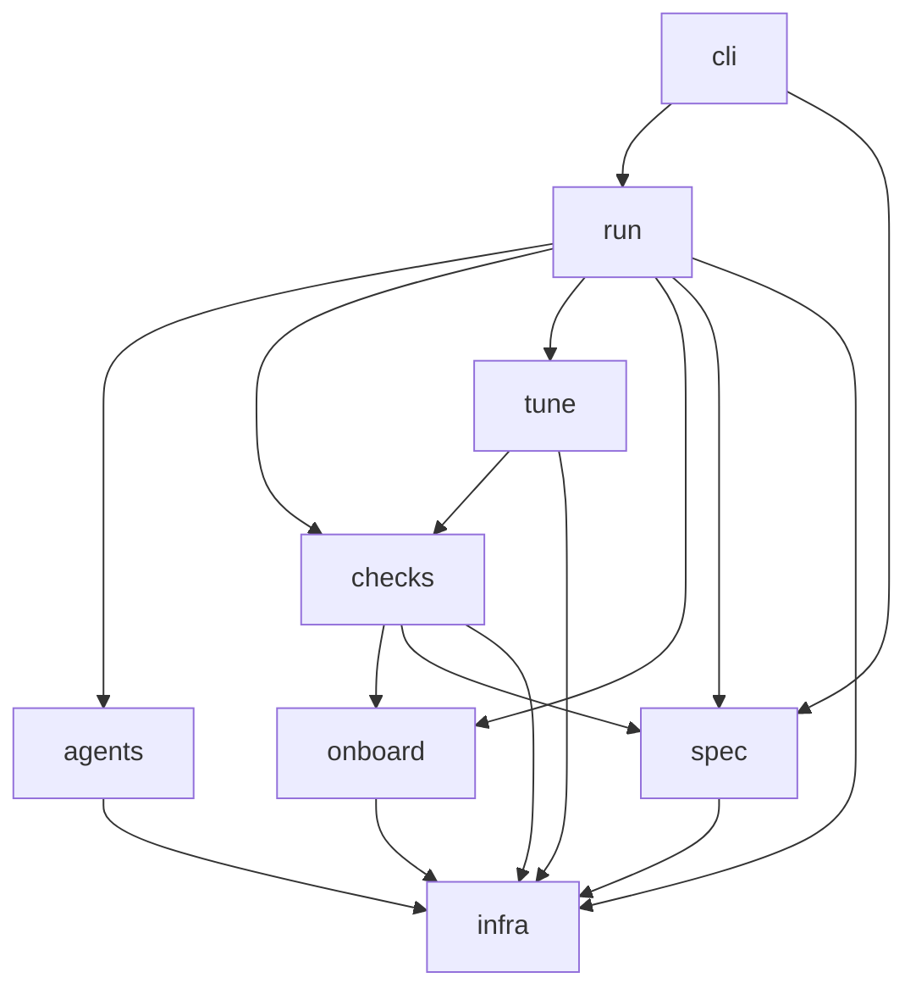
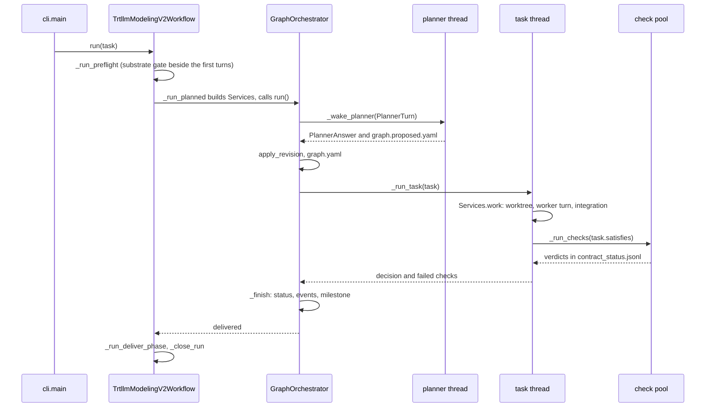

<!--
SPDX-FileCopyrightText: Copyright (c) 2026 NVIDIA CORPORATION & AFFILIATES. All rights reserved.
SPDX-License-Identifier: Apache-2.0
-->

# trtllm-modeling-v2: developer guide

This guide is for engineers who change the workflow itself: its orchestrator, checks, prompts,
skills, substrate and tests. It covers where each part lives, how the parts connect and what to
touch for a given change. [design.md](design.md) explains why the system has this shape, and
[user-guide.md](user-guide.md) covers operating a run. The full tables stay in the reference
documents beside the package: [README.md](../README.md), [TROUBLESHOOTING.md](../TROUBLESHOOTING.md),
[INTAKE.md](../INTAKE.md), [BUILD_AND_TEST.md](../BUILD_AND_TEST.md), [LESSONS.md](../LESSONS.md)
and [task.example.yaml](../task.example.yaml).

Paths are relative to the package, `agent-flow/agent_flow/workflows/trtllm_modeling_v2/`, except
`<workspace>/...` (a run's workspace), `tensorrt_llm/...` (the TensorRT-LLM checkout the run
targets) and test files (`agent-flow/tests/workflows/trtllm_modeling_v2/`).

1. [Package layout](#1-package-layout)
2. [The workspace on disk](#2-the-workspace-on-disk)
3. [Control flow](#3-control-flow)
4. [Recipes](#4-recipes)
5. [Testing](#5-testing)
6. [Conventions](#6-conventions)
7. [Changing the flow while a run is live](#7-changing-the-flow-while-a-run-is-live)
8. [Contributing](#8-contributing)

## 1. Package layout

| package | responsibility |
|---|---|
| `cli.py` | The `trtllm-modeling-v2` entry point. It validates the spec, proves the commit identity, locks the workspace, picks the agent transport and runs the workflow. A first argument listed in `SUBCOMMANDS` (`perf`, `gate`, `intake`, `session`, `spool`, `driver`) dispatches to that tool instead, and `tune` is an alias for `--stage tune`. |
| `spec/` | What the user asks for. `task_schema.py` validates the resolved `task.yaml` (closed keys, all errors in one batch, defaults filled in). `schema_keys.py` holds the shared closed-key check. `variants.py` overlays configuration variants. `intake/` is Step 1 (`schema`, `checks`, `freeze` (the `.confirmed` and `.started` sidecars), `compile`, `cli`, and `derive`, the fast path; see [INTAKE.md](../INTAKE.md)). |
| `run/` | The run itself: its lifecycle, the contract, the task graph, the orchestrator loop and everything the loop keeps on disk (table below). |
| `run/stages/` | The mixins that `TrtllmModelingV2Workflow` is composed of, one per concern: `preflight`, `plan` (survey and paper review), `smith` (kernel tasks), `assemble` (a unit's gates and prompts), `planned` (the services the orchestrator calls), `deliver`, `improve`, plus `common` constants. |
| `onboard/` | What onboarding knows, read off disk. `survey.py` covers what the checkpoint demands and what the build supplies. `vocabulary.py` validates `vocabulary.yaml`. `runtime_map.py` reads `runtime_index.yaml`, and `kernel_sources.yaml` is the kernel-source registry. `delivery.py` runs the delivery disk checks, `embargo.py` handles embargo entries, and `logit_reference.py` builds the logit gate's HF reference. `coverage.py` reads an entry's `CELLS` and `ARCHS` statically and decides whether they cover a verify row's required cells. `promotion.py` finds a target's local variants and their importers, plans the `promote:<entries>` kernel task and holds the delivery check `ops:promoted` (`check_promoted`, `target.keep_local`). |
| `checks/` | The contract's checks. `gates.py` holds boot, accuracy and acceptance, `witness.py` the witnesses, and `envelope_boot.py`, `serve_gate.py` and `logit_agreement.py` the remaining gates. `stats.py` (standard library only) and `gate_records.py` (`gate_results.jsonl`) support them. `gate_cli.py` runs any gate standalone, exactly as the orchestrator does. `bundle.py` groups a member's ready checks onto one engine (`Board`, `Seat`, `capture`, `form_groups`, `split`) and replays each gate on its own section. `testcache.py` is `trtllm-modeling-v2 tests {affected,compare}`: the tests a change can affect at a head, and the regressions against a base. |
| `checks/harness/` | Programs that a gate's job runs on the compute side, under the interpreter of the tree being measured: `engine_driver.py`, `engine_facts.py`, `engine_reuse.py`, `quickstart_shim.py`, `eval_shim.py`, `workload_io.py`, `bundle_driver.py` (one engine, then each bundled gate's workload in a section of its own), `geometry_probe.py` (one boot that prints the `MV2FLOW_GEOMETRY` record) and `disagg_leg_b.py` (the equivalence witness's own disaggregated leg B and its state ablation). None of them imports `agent_flow`. |
| `tune/` | The tune campaign. `stage.py` runs the phases, `campaign.py` covers candidates, A/B and stacking, and `keep_gate.py` the keep gate. `measure.py`, `records.py` (the ledger, noise floor and keep rule), `inert.py`, `split.py` and `sol.py` handle measurement and judgement. `serving_config.py` derives the serving config. `bench.py`, `microbench.py` and `nsys_summary.py` run in the container. `schema.py` validates the `perf:` block, and `cli.py` implements `trtllm-modeling-v2 perf`. |
| `agents/` | `roles.py` (the eight roles and their agent routing), `prompts/` (one module per role, with shared blocks in `_common.py`), `skills/` (the packaged `SKILL.md` trees, copied into every run) and `lessons.py` (the improver's cross-run store and flow issues). |
| `infra/` | Everything that is not modeling. `environment.py` resolves the launch prefix. `execution/` decides where commands and turns go. `substrate/` holds compute sessions and spools, and `driver/` the external-transport driver. `transport.py` is the external transport, `committer.py` generates the commit helper, `vcs.py` asks git questions, and `scripts/` holds shell wrappers. |
| `examples/` | Worked examples for operators. They are never handed to a run (see [Conventions](#6-conventions)). |

| `run/` module | holds |
|---|---|
| `workflow.py` | `TrtllmModelingV2Workflow`: initialization, `run`, resume, checkpointing, turn dispatch (`_run_turn`), closing, and the target fingerprint (`_target_marker`, `fingerprint`, `gate_inputs`) |
| `preflight.py` | The pure-Python preflight checks (`run_preflight`, `check_checkpoint`, `check_tmpdir`, `claim_devices`, `check_multirank_substrate`, `substrate_gate`, ...) |
| `agent_probe.py` | Preflight's one probe turn per distinct agent (`probe_agents`), judged by the file it writes |
| `contract.py` | `Check`, `Contract`, `compile_contract`, `ContractStatus` (`contract_status.jsonl`), `evaluate`, `equivalence_key`, `Milestone` (`correctness.jsonl`) and `standing` |
| `graph.py` | `Task`, `Graph`, `KINDS`, `validate`, `apply_revision`, `next_to_start`, `MAX_ATTEMPTS`, and the cross-model regression rule (`unreviewed_shared_changes`) |
| `orchestrator.py` | `GraphOrchestrator` (the loop), `Services` (the workflow as the loop sees it), `PlannerTurn`/`PlannerAnswer`, `seed`, `stoppable` |
| `integration.py` | `Integration`: one worktree and branch per task, rebased and fast-forwarded into the checkout |
| `snapshots.py` | `Snapshots`, `CheckTree`: the read-only snapshot of one commit that every check measures |
| `receipts.py`, `runtime_facts.py` | What reaches a dependent task without a planner turn (`tasks/<id>.receipt.yaml`, `runtime_facts.yaml`, its `geometry` section included) |
| `geometry.py` | The phase-0 geometry probe: `plan_legs`, `probe_lengths`, `run_leg`, `inputs_digest` (resume reuse), `start_probe` (the phase-0 entry point) and `await_probe` (a smith waits at most `WAIT_S`, 15 min) |
| `covered.py` | `before_smith`: waits for the geometry probe, then `close_if_covered` closes a covered `verify` dispatch `LANDED` with no smith turn |
| `progress.py` | Decision files: reservation, the closed enum per role (`DECISIONS_BY_AGENT`, each role's row of `agents/decisions.py`), `collect_decision_file`, `progress.yaml` |
| `journal.py`, `state.py`, `drain.py` | `journal.md` and `reports/`; the checkpoint; the reload door (`InFlight`), the request watch and the restart ledger |

### Dependencies



The arrows show the main direction. A few imports go the other way, and they are deliberate:

- `agents/prompts` builds role prompts from the code's own values: each role's "Ending your
  turn" section from the decision table (`agents/decisions.py`: per role, every decision, when to
  write it and what the run does next), which is also the enum `run.progress` validates and the
  source of `run.orchestrator.FINISHED`; `KINDS` and `MAX_ATTEMPTS` from `run.graph`, the serving config from
  `tune.serving_config`, and CUDA-graph capture lists from `checks.gates`. The enums and numbers
  a prompt states are the ones the code applies.
- `spec/task_schema.py` validates blocks whose validators live with their owners:
  `agents.roles`, `infra.committer`, `infra.substrate.sessions`, `onboard.embargo`,
  `tune.schema` and `checks.stats`.
- `checks/gate_cli.py`, `tune/keep_gate.py` and `infra/driver/core.py` import from `run/`
  inside a function. The import cycle contract → stages → orchestrator is broken the same way
  in `cli._parse_args`.

Several files run by path under another interpreter and import nothing from the
orchestrator's environment: `infra/substrate/scheduler.py` and `spoolctl.py` (standard library
only), the resolve hook `infra/substrate/resolvehook/sitecustomize.py` (on every spool job's
`PYTHONPATH`), `checks/harness/*`, `checks/serve_driver.py`, `checks/logit_driver.py` and
`checks/testcache_driver.py` (the measured tree's interpreter), `tune/bench.py` (standard library plus PyYAML),
`tune/microbench.py` and `tune/nsys_summary.py` (the engine's container), and
`onboard/logit_reference.py` (the HF reference environment). The orchestrator itself runs where
there is no numpy, which is why `checks/stats.py` computes everything with `math`.

## 2. The workspace on disk

One directory per run (`--workspace`) holds all of a run's state. A file is either **replaced
whole** (written under a temporary name, then renamed, so a reader never sees half of it: the
checkpoint, `graph.yaml`, `planner_events.json`, `reload.json`, `inflight.json`) or
**append-only** (never rewritten: `contract_status.jsonl`, `correctness.jsonl`,
`gate_results.jsonl`, `restarts.jsonl`, `journal.md`, the tune `perf_ledger.jsonl`).

[README.md](../README.md#workspace-layout) shows the tree. This table shows who writes and who
reads each entry:

| path | written by | read by |
|---|---|---|
| `task.yaml` | `TrtllmModelingV2Workflow._init_state` (the resolved spec, defaults filled in); `_refresh_workspace_spec` on every resume | every role, `gate --task`, the driver |
| `task.resolved.yaml` | `cli._resolve_intake_task` when `--site` compiles an intake `task.yaml`; `cli._derive_intake_task` on the fast path | the run, as its `--task` |
| `task.intake.yaml`, `intake.report.md` | `derive.write_request` (the fast path) | the run; the operator |
| `<request>.confirmed`, `<request>.started` | `freeze.confirm`; `freeze.stamp_start` once the run is past preflight | `freeze.start_reason` on every start |
| `llm_api/<unit>.yaml` | `intake/compile.py`, beside the resolved spec | the unit's gates (its options file) |
| `.trtllm_modeling_v2_state.json` | `run/state.py` `save_state` (`SCHEMA_VERSION` 2) | `load_state` on resume |
| `.orchestrator.lock` | `cli._claim_workspace` (an `flock`; a second orchestrator exits 3) | none |
| `prompts/<role>.md` | the preflight stage, after composing the bundle (`dump_prompt_bundle`) | operators; `test_prompt_snapshot.py` |
| `contract.yaml` | `PreflightStage._write_contract` (`compile_contract`, on every start) | the planner, the critic, the driver |
| `contract_status.jsonl` | `ContractStatus.record`, from `GraphOrchestrator._run_check` | `evaluate`, `standing`, the planner (by path), `driver status` |
| `correctness.jsonl` | `GraphOrchestrator._correctness` via `contract.record_milestone`; a `bringup` line from `workflow._mark_bringup` | `standing`, `driver status` |
| `graph.yaml` | `GraphOrchestrator._save_graph`; `seed` (the survey) | the planner, `_dispatch_task` (turn adoption), `_regression_paths` |
| `graph.proposed.yaml` | the planner's turn | `PlannedStage._planner_turn` |
| `graph.critique.yaml` | `PlannedStage._critique` (the graph under review) | the plan reviewer |
| `planner_events.json` | `GraphOrchestrator._save_events` (events not yet read, `retries`) | the next process's loop |
| `tasks/<id>.json` | `PlannedStage._envelope` | the task's worker |
| `tasks/<id>.receipt.yaml` | `_keep_receipt` (`receipts.build`, `receipts.write`) | `_dependency_receipts`, for the tasks that depend on it |
| `decisions/<unit>-<role>-<turn>[.<attempt>].yaml` | the role; reserved first by `mark_decision_dispatch`, which stamps `.<name>.dispatched` beside it | `collect_decision_file` |
| `progress.yaml` | `collect_decision_file` (one entry per validated decision) | roles (`_read_instruction`), `latest_entry` |
| `journal.md`, `reports/NN-<role>-<what>.md`, `.dispatch-ordinals/` | `Journal` (`event`, `section`, `record_dispatch` before the turn, `record_result` after it) | operators, the improver, receipts |
| `surface.md` | `PreflightStage._take_survey` | the plan drafter, the planner |
| `host_facts.md` | `_write_host_facts` (above the marker); roles append below it | every dispatch (`_context_block`) |
| `plan.md`, `vocabulary.yaml` | the `survey` task (plan drafter) | `load_vocabulary` (on `DRAFT_READY`); `_add_kernel_tasks`; smiths |
| `boot.yaml` | optional, by an operator or a role | `gates.resolve_boot_spec` when `accuracy.boot` is absent |
| `runtime_facts.yaml` | `runtime_facts.record`, from `_note_runtime_facts` on every passing gate | `runtime_facts.render` in the planner's, smiths' and workers' prompts |
| `gate_results.jsonl` | `checks/gate_records.py` (per-prompt baselines, findings) | the acceptance gate, `blocking_findings` at delivery |
| `gates/<unit>/`, `gates/envelope/`, `witness/<unit>/`, `variants/` | the gates, witnesses and variant overlays (files a job reads, on the shared filesystem) | the gate jobs |
| `gates/geometry/` | `geometry.run_leg` (each leg's spec and output) | the probe on resume (`geometry.recorded`) |
| `gates/<unit>/bundles/<name>.bundle.json` | `bundle.write_spec`, from the bundle's leader | `harness/bundle_driver.py` |
| `test_cache/` | `checks/testcache_driver.py` (one record per pytest process) | `tests affected`, `tests compare` |
| `gates/substrate/pass.json`, `gates/agent-probe/` | the substrate gate; `probe_agents` | the next start (reused for 12 h in the same environment) |
| `worktrees/<task-id>/`, `worktrees/integrated.json`, `worktrees/attempts.json` | `Integration` | the task's worker; `Integration` on resume |
| `snapshots/<commit>/` | `Snapshots` (read-only, marked by `.mv2flow-snapshot`) | the checks of that commit |
| `turns/<id>.*` | `InProcessTurnExecutor.keep_records` (`request.json`, `system.md`, `prompt.md`, `activity.log`, `result.md`, `done`) | operators; `driver status` |
| `dispatch/` | `ExternalAgentTransport` (`<id>.request.json`, `.system.md`, `.prompt.md`; `.read`, `.adopted`, `.consumed`), the orchestrator heartbeat and exit note; `claims/` by the driver | the driver (`.result.md`, `.done`), `driver wait` |
| `TURN_INSTRUCTIONS.md` | `infra/driver/core.install_instructions` (external transport) | the driver's subagents |
| `reload.request.json`, `reload.json`, `reload.seen`, `inflight.json`, `restarts.jsonl` | `driver reload`; the orchestrator (`run/drain.py`, `infra/driver/reload.py`) | the orchestrator; `driver wait`, `driver status` |
| `lessons.proposed.yaml` | the improver | `agents/lessons.py` `load_proposal` |
| `flow_issues.yaml` | `lessons.record_issues`; the operator adds `fixed_by` | the operator, the improver |
| `flow_issues.reported.jsonl` | the driver and workers (`lessons.report_flow_issue`) | the improver's watcher |
| `improve/wakes.json`, `improve/patches/<lesson id>.diff` | `ImproveStage` (unread wakes; patch drafts it kept) | the next improver turn; the operator |
| `tune/` | `tune/stage.py` and `tune/campaign.py`: `configs/`, `data/<label>/`, `perf_ledger.jsonl`, `campaign_state.json`, `worktrees/` (`best`, `<slug>`), `candidates/<slug>/decision.yaml`, `roadmap.yaml`, `sol.yaml`, `gates/<key>/keep.json`, `summary.md` | the tuner, the campaign, `perf campaign` |
| `bin/commit.sh`, `.commit.lock` | `install_committer` | the smith and assembler (`MV2FLOW_COMMIT_TREE=<worktree>`) |
| `bin/trtllm-modeling-v2` | `gate_cli.install_cli` (the orchestrator's interpreter and package) | agents' shells |
| `.claude/skills/` | `_materialize_skills` (on every start) | the agent CLI, which runs with the workspace as its working directory |
| `.agent-flow/` | the agent layer, for a system prompt too long for argv | the agent CLI |

`--clean` removes the checkpoint, `plan.md`, `vocabulary.yaml`, `progress.yaml`, `journal.md`,
`host_facts.md`, `reports/`, the graph files, `contract_status.jsonl`, `surface.md` and the reload
ledger. Everything else stays.

## 3. Control flow



### 3.1 `cli.main`

`main` records how to re-execute the process (`_relauncher`, from `sys.orig_argv` and the
starting environment) and dispatches subcommands. For a run it then:

1. Parses the flags. With `--checkpoint`, `_derive_intake_task` derives the request
   (`derive.parse_goal`, `derive.derive_task`), writes it (`derive.write_request`), runs the intake
   checks (`intake/checks.run_checks`) and stops on a block, or resumes the request on disk
   (`derive.resume_problem`). An intake spec is compiled with `--site` (`_resolve_intake_task`),
   and the spec is validated (`load_and_validate_task_yaml`). A spec error exits 2 and lists every
   problem.
2. Resolves the commit identity, makes one trial commit through the helper
   (`_commit_identity`), and pins `MV2FLOW_GIT_NAME` and `MV2FLOW_GIT_EMAIL` for the process.
3. Takes the workspace lock. Under `--agent-transport external` it builds an
   `ExternalAgentTransport` and installs `TURN_INSTRUCTIONS.md`; otherwise it starts the
   orchestrator heartbeat.
4. Constructs `TrtllmModelingV2Workflow`, sets `workflow.reexec`, and calls
   `workflow.run(args.task)`.

### 3.2 `TrtllmModelingV2Workflow.run`

The constructor resolves the turn executor once (`select_turn_executor`: in process, or the
external transport) and applies `--clean`.

`run` calls `_init_state`, which validates the spec again and then picks one case:

- **Resume**: reads the checkpoint and continues an open run, refreshing the workspace
  `task.yaml` from the given spec (`_refresh_workspace_spec`).
- **Re-entry**: re-opens a closed run whose verdict is remediable (`REMEDIABLE_VERDICTS`).
  With `--stage tune` it also re-opens a run that closed `delivered` or with a verdict that
  starts with `tune`, at the `tune` stage. Any other closed run is refused.
- **New run**: writes the resolved `task.yaml` and a fresh `WorkflowState`.

`run` then calls `_run_stages` inside `orchestrator.stoppable(workspace)`, which hands out a
`stop` callable. If the substrate gate fails while the first turns run, it calls `stop`.

`_run_stages` always runs preflight, on a resume too, because every prompt and gate carries the
resolved environment. `--dry-run` returns after preflight. The stage then decides what runs:

- At `planned`, it seeds the survey (`PlanStage._start_with_the_survey`) and runs
  `_run_planned`. The run closes `tuned` when the tune phase finished, else `delivered`.
- At `tune` (`trtllm-modeling-v2 tune` only), it runs `tune/stage.py` `run_tune_phase`.

A `_SessionLost` raised by any gate closes the run `session-lost:<stage>`. A keyboard interrupt
is journaled and leaves the checkpoint where it was.

### 3.3 The preflight stage

`PreflightStage._run_preflight` runs these steps in order:

1. `run/preflight.py` `run_preflight`: the checkpoint, the per-unit anchors, speculation support,
   capture lists, KV-cache configs, `TMPDIR`, the device claim for a local run, the multi-rank
   substrate, and the run's identity (slug, branch, target path). A `PreflightError` stops the
   run; a `SpecInconsistencyError` gets no troubleshooting hint, because the fix is in the spec.
2. `select_command_executor` (`environment.kind` to `LocalCommandExecutor` or
   `SpoolCommandExecutor`) and the shell runner every gate uses.
3. The notes, `_known_defects_warning` among them (`lessons.known_defects` over the
   `engine_defect` lessons in scope), then `_prove_agents`: one probe turn per distinct agent, in
   process only (`run/agent_probe.py`).
4. The substrate gate, beside the first turns (`_prove_substrate_beside`) or inline when no
   `stop` was given. A pass recorded in the same environment within 12 h is reused. Outside a
   dry run, `_start_phase0_probes` then starts each of `phase0_probes` (`Phase0Probe`; today
   `geometry`, which calls `geometry.start_probe`) on a thread of its own; a probe's failure is
   journaled, and `_await_phase0_probes` lets a stage wait for one.
5. `_take_survey` (`surface.md`), `install_committer` (`bin/commit.sh`), `install_cli`
   (`bin/trtllm-modeling-v2`), the prompt bundle (`build_trtllm_modeling_v2_prompts`, then its
   snapshot), `host_facts.md`, `_materialize_skills`, `_write_contract`, and a checkpoint.

### 3.4 The planned stage and `GraphOrchestrator.run`

`PlannedStage._run_planned` builds `Integration` (`_make_integration`; without a git checkout or
with `--no-task-worktrees` tasks share the checkout), `Snapshots`, a `CheckAdmission` that bounds
running checks by the sessions' free devices, and the `Services` record (`plan`, `work`, `check`,
`free_gpus`, `held_gpus`, `marker`, `critique`, `finished`, `admit`, `reload`, `correct`). It then
constructs `GraphOrchestrator`. With `perf.enabled`, `required_kinds=("tune",)` refuses a graph
without a `tune` task and `start_after` holds that task until the core's inner checks pass.
`own_paths` turns on the cross-model regression rule for a run with no finished task yet.

The improver's watcher and its single in-flight turn run beside the loop (`ImproveStage`:
`_improver_watching`, `_improver_tick`, `_improver_wake`, `_improver_loop`); a task's end reaches it
through `_improver_task_ended` without waiting.

`GraphOrchestrator.run` opens four pools: checks (`mv2-check`), tasks (`mv2-task`, up to
`--max-parallel-tasks`), the planner (one thread) and the critic (one thread). It then drives
`_drive`. Only the loop's own thread changes or writes the graph. Each pass of `_drive`:

1. Returns `stopped: <reason>` if the substrate gate asked it to stop.
2. Hands finished tasks to `_finish` and settled re-checks to `_settled`, applies a returned
   planner turn (`_planner_returned`) and moves the critic along (`_critic_step`).
3. Answers a reload request (`_reload_check`, `_drain_step`); while draining nothing starts.
4. Starts what `graph.next_to_start` returns, up to the free task slots: each task is marked
   `running` and submitted as `_run_task(task)`. A `check` task goes to `_start_check_task`
   instead, which submits its checks to the check pool and holds no task slot. A regression review
   that is due takes its batch (`_regression_step`, recorded as `covers`) or closes with no turn
   when the batch is empty.
5. With no foreground task running, re-runs stale checks, riskiest first (`_settle`, `_by_risk`).
6. When idle (no task, re-check, planner turn or critic read in flight), records the
   correctness milestone and returns `delivered` if the contract holds, no required task is open
   and no worker report is unread; otherwise it notes a `DONE` that does not hold, or ready tasks
   that can never start.
7. Wakes the planner when idle, when only background work (the tune campaign) runs, or when
   events are due, and returns `planner-stalled` after `--revision-cap` revisions without
   progress. Then it waits on whatever is in flight.

### 3.5 Starting a task

`next_to_start` orders ready tasks (dependencies done) as follows:

1. Tasks that were `running` when the last process stopped.
2. Required tasks, longest critical path first (`critical_path_minutes` over `est_minutes`).
3. `nice_to_have` tasks, only while no ready required task waits for devices.

Two tasks conflict when both name the same file in `touches` or either is `exclusive`
(`touches_conflict`). A waiting `exclusive` task holds back everything ranked after it. A task
of a gated kind (`start_after`) waits until the checks it is gated on hold. A task's
`depends_on_soft` must have started, not finished; the task's thread waits for them to land or
end before integrating. Devices come from `free_gpus` (the live sessions' devices
less what running tasks hold), and `capacity.held_gpus` counts a tune task on its own perf
sessions as holding none.

### 3.6 A worker turn

`_run_task` calls `Services.work`, which is `PlannedStage._work_task`, in the task's thread:

1. `_work_task_turn` opens the worktree of an integrated kind (`kernel`, `assemble`, `feature`,
   `integrate`) or a scratch kind (`investigate`) under the reload door (`Integration.open`,
   sparse unless `exclusive` or a `cpp/`/`3rdparty/` path), and `_work_in_tree` puts its
   `worktree_block` (where the worker works, how it commits) on the thread, so every turn of the
   task carries it.
2. `_work_task_body` writes the envelope `tasks/<id>.json` with the dependencies' receipts, then
   branches on the kind: `tune` runs `tune_stage.run_tune_task` on the commit the checkout is
   at; `kernel` resolves its queue row, `<mode>:<entry>` or `promote:<entries>` (`_queue_item`)
   and runs `_run_one_smith`, which first calls `covered.before_smith` (wait for the geometry
   probe, then close a covered `verify` with no turn) and gives the smith where a shared entry's
   local variant lands, or for a promote the variants and importers to merge (`_promote_block`,
   from `promotion.local_variants` and `promotion.variant_imports`); every other kind gets its role from `ROLE_BY_KIND` and a kind-specific
   prompt (`_assembler_prompt`, `_plan_drafter_prompt`, `_plan_reviewer_prompt` for
   `ref: plan`, `_reviewer_prompt`) and goes to `_dispatch_task`.
3. `_dispatch_task` adopts, on the external transport, an answered turn a previous process never
   consumed instead of asking again. Otherwise it adds the context block, reserves the decision
   file (`mark_decision_dispatch`), journals the prompt (`record_dispatch`), calls `_run_turn`,
   journals the result, counts lesson feedback, and returns `collect_decision_file`: the
   decision validated against the role's closed enum, or `None`.
4. `_run_turn` appends the worktree block and the lessons in the role's scopes, builds a
   `TurnRequest` (role, prompt, system prompt, configured backend, model and effort, decision
   file) and runs it on the executor. `_turn_in_flight` holds it for a reload only when the
   turn lives in this process.
5. A `survey` that answers `DRAFT_READY` fails unless `load_vocabulary` accepts its
   `vocabulary.yaml`. `_work_task` keeps the receipt and hands the outcome to the improver
   (`_improver_task_ended`), which wakes on a `FAILED_RECEIPT`, no decision, `BLOCKED`,
   `INTEGRATION_FAILED`, or the same lineage failing again.

The decision string returned to the loop is the decision on the first line, optionally followed
by a note that the planner sees with the task's event.

### 3.7 Integration

While the decision is in `FINISHED`, `_work_task_turn` calls `Integration.integrate` under the
reload door. That rebases the task branch (`mv2/<slug>/<task-id>`) onto the checkout's head and
fast-forwards it in, under one lock, so the checkout moves only by whole tasks and carries no
merge commits. Once merged, the worktree is closed, the branch stays as the record and
`integrated.json` keeps the tip. On a conflict the worker is dispatched again with
`rebase_block` (the conflicting files and the head to rebase onto), up to `REBASE_RETRIES` (2)
times; then the decision becomes `INTEGRATION_FAILED`, an infrastructure failure that starts the
task again once. A retried task's worktree is refreshed onto the head first
(`Integration.refresh`). `investigate` worktrees are never integrated.

### 3.8 Running a task's checks

In the same thread, `_run_task` hands the task's `satisfies` (less the delivery tier) to
`_run_checks`. The checks run on the shared check pool, each in `_run_check`:

1. It waits for admission (`Services.admit`: a session would start its job now), then enters the
   reload door (`inflight.hold("check", key)`).
2. It reads the target's marker (`Services.marker`, the fingerprint of the tree the gates
   measure). A check that already holds on this marker, by its own verdict or an equivalent
   check's, does not run.
3. `Services.check` is `PlannedStage._run_contract_check`: it builds a `CheckTree` for the
   checkout's head and, under a lease of that commit's snapshot, runs
   `_on_snapshot(pin)._gate(check)`, a shallow copy of the workflow whose spec, runners and
   results point at the snapshot. A bundled gate (`bundle.bundled`: boot, logits, acceptance,
   accuracy) first takes a seat on the `bundle.Board` (`_seat_of`): the leader
   (`_lead_bundle`) captures each seat's command with `bundle.capture`, forms groups
   (`bundle.form_groups`) and runs one `bundle_driver.py` job; every seat's gate then runs on
   `bundle.replaying`, which hands it its own section as its command's output. A seat assigned
   `SINGLE`, or whose section failed, runs its gate as before.
4. `_gate` picks the function by gate name (boot, `accuracy[...]`, acceptance, `envelope`,
   `logits`, `serve`; anything else is a witness, `_run_witness`) and runs it through
   `_gate_until_verdict`, which re-runs a gate lost to its session up to `SESSION_LOSS_RERUNS`
   times. `CheckTree.settle` stamps what each command imported, voids a result that imported
   more than one tree, and measures a void result once more.
5. After a pass `_note_runtime_facts` updates `runtime_facts.yaml`; once every member of a unit
   has an accuracy verdict, `_note_shift` checks for a systematic shift.

### 3.9 Recording a verdict

`ContractStatus.record(unit, result, marker)` appends one line to `contract_status.jsonl`: unit,
gate (`GateResult.name`) and member, `passed` (false for a void result), detail, the marker (the
snapshot's when the result names one), the least free device memory and `LOW MARGIN`, what each
command imported, and `void`; optional fields only when they say something. `evaluate` reads the
latest verdict per key: one under another marker is stale and counts as missing, and an
equivalent check's pass covers a check without a verdict of its own.

Back in the loop, `_finish` sets the task `done` (a `FINISHED` decision and its checks passed),
`failed`, `abandoned` (a failed `nice_to_have`), or `pending` again after an infrastructure
failure (`_not_the_task`, once per task, counted in `planner_events.json`). It also adds one
kernel task per queue row when a survey lands (`_add_kernel_tasks`, `k<row>-<entry>`), resets the
stall count on progress, writes the graph and events, records the correctness milestone
(`_correctness` through `Services.correct`, which is `_mark_correct`: the branch
`<target branch>-correct` and a line in `correctness.jsonl`), and checkpoints.

### 3.10 Waking the planner

Every outcome becomes an event through `_note`. An urgent one (a failure, a worker's report, a
critique, a failed re-check, nothing left to start) wakes the planner at once; a green finish
waits up to `--event-window` while work is in flight. A quiet one (`_answered_ahead`: a green
finish that satisfies no check and that an open task depends on) wakes no turn of its own and
goes to the next turn something else wakes.

`_wake_planner` submits `Services.plan`, which is `PlannedStage._planner_turn`. Its request
names the task, contract, verdicts and current graph by path and carries the contract standing,
the runtime facts, the cross-model regression note, the events since the last turn and any
refusals. It dispatches the planner and reads `graph.proposed.yaml` and the decision
(`GRAPH_UPDATED`, `DONE`, `ESCALATE`, `CEILING`).

`_planner_returned` applies the answer:

- `ESCALATE` and `CEILING` end the run with that verdict.
- A graph goes through `graph.apply_revision`: statuses the orchestrator owns are carried over,
  attempts are counted, a retry of a task whose third attempt failed (`MAX_ATTEMPTS`) is refused,
  and `validate` runs. Tasks the orchestrator added during the turn are kept (`_added_during`).
- An adopted graph is saved whole, and events it already answered are dropped
  (`_drop_answered`). If it is the first graph, or adds or drops more than half of the open
  tasks (`_reshaped`), the critic reads it.
- A refused graph goes straight back to the planner with the refusals and the refused turn's
  events, up to `MAX_REFUSALS` (3) times. After that the run closes `planner-refused`.
- A planner turn that raised is asked again on the same events after `PLANNER_RETRY_S`, doubled per
  failure in a row; after `MAX_PLANNER_FAILURES` (5) the run closes `planner-failed: <error>`.

### 3.11 Closing the run

When the loop returns, `_run_planned` journals the standing. If the verdict is not `delivered`,
the run closes with it. Otherwise `DeliverStage._run_deliver_phase` runs three checks in order,
each closing the run on failure: open blocking findings (`delivery-failed:findings`),
`verify_delivery`'s disk checks over the in-tree trees, commit hygiene included
(`delivery-failed`), and `_contract_holds` on the current marker (`delivery-failed:contract`).
`_close_run` sets `done` and the verdict, checkpoints, runs the improver's last turn and waits for
it (outside preflight and dry runs), and closes the journal with the gate table. A `stopped` run
(the phase-0 substrate gate failed) is not closed.

## 4. Recipes

Each recipe lists the files to change and the tests to add or extend. All of them also need the
documentation the change touches (see [Contributing](#8-contributing)).

### Add a gate

A gate is a command with an exit code. It runs on the target that `_gate` hands it and returns a
`GateResult` whose `name` is the gate name the contract compiled, because the verdict's key is
built from `result.name`.

- `checks/<gate>.py`: a module with `GATE_NAME`, a `<Name>Spec.from_task` that reads its
  `accuracy.<gate>` block and says whether it is `enabled`, and a
  `run_<gate>_gate(env, *, task_data, runner, unit, member, features, workdir, ...)`. Model it on
  `serve_gate.py` or `envelope_boot.py`. Commands go through `runner`, never `subprocess`, so
  the snapshot, the spool and the tests' fake shell all apply. A job the gate launches lives
  beside it (as `serve_driver.py` does) and imports nothing from `agent_flow`. A gate that builds
  an engine attests it (`gates.attest_engine`) so its runtime facts are recorded.
- `run/contract.py` `compile_contract`: add the check at its tier and members. If the block is
  not an accuracy input, add its key to `_NOT_ACCURACY_INPUTS`, otherwise it becomes part of
  every accuracy check's equivalence key.
- `run/stages/planned.py` `_gate`: add the branch that calls the function. If the gate's job
  needs more devices than the member, the `admit` callable built in `_run_planned` must name
  them, as it does with `all` for the equivalence witness.
- `checks/gate_cli.py`: add the name to `GATE_NAMES` and to its dispatch, so
  `trtllm-modeling-v2 gate <name>` runs the gate exactly as the orchestrator does.
- `spec/task_schema.py`: the block's keys (closed, validated) and their addition to
  `ACCURACY_KEYS`. Document every key in `task.example.yaml`.
- Docs: [README.md](../README.md#the-gates) and the contract table in [design.md](design.md).
- Tests: unit tests in the style of `test_gates.py`, with a fake shell that prints what the real
  job prints, a failing case included; `test_contract.py` (compiled when enabled, absent when
  not, at its tier); `test_gate_wiring.py` (reached from the orchestrator and the gate CLI);
  `test_gate_cli.py`; `test_task_schema.py`.

### Add a witness

A witness serves a feature that boot and accuracy cannot see. It needs a contrast that differs
in exactly one variable, and it must be able to fail on the workload it runs (LESSONS 21-23).

- `checks/witness.py`: a `run_<kind>_witness`, its legs in `WITNESS_LEG_NAMES`, the feature in
  `WITNESS_KINDS`, and its dispatch in `_run_declared_witness`.
- `run/stages/common.py` `WITNESS_GATED_UNITS`: the same row, which `compile_contract` reads to
  add the witness at the proof tier. Add the verdict name to `contract._WITNESS_GATE`.
- `run/stages/assemble.py` `_witness_block_gap`: the keys `accuracy.witness.<unit>` must set. A
  missing block fails the check rather than skipping it.
- `spec/task_schema.py`: the witness block's keys (see `WITNESS_KEYS`,
  `DECLARED_WITNESS_FEATURES`, `KV_QUANT_WITNESS_KEYS`), documented in `task.example.yaml`.
- Tests: `test_witness.py`, and a sensitivity test in the style of
  `test_witness_sensitivity.py` showing the witness fails when the feature's effect is removed.
  `test_gate_wiring.py` holds `FEATURE_SKILLS` and `WITNESS_GATED_UNITS` together.

### Add a feature

A feature is a closed-list entry with a skill, a unit in the contract and, when boot and
accuracy are blind to it, a witness or acceptance gate.

- `spec/task_schema.py` `FEATURE_SKILLS`: the feature and its skill. Exclusions go there too
  (as `MTP_NAMESPACE_FEATURES` does for two readings of one namespace).
- `spec/intake/schema.py` `INCREMENT_FEATURES` (or `SPECULATIVE_ALGOS`) and
  `spec/intake/compile.py`, so intake can ask for it. Add it to the catalog in
  [INTAKE.md](../INTAKE.md) §5.3.
- `agents/skills/trtllm-modeling-v2-<name>/SKILL.md`: front matter whose `name` is the
  directory, a description, and every repository path and `file:symbol` it cites resolvable,
  with no line numbers. Describe the mechanism, never one model's values (those go in
  `examples/`).
- The witness (above), or `ACCEPTANCE_GATED_UNITS` in `run/stages/common.py` for a speculator.
  `compile_contract` then owes the proof-tier check.
- Docs: the feature table in [README.md](../README.md#feature-increments) and the keys in
  `task.example.yaml`.
- Tests: `test_task_schema.py`, `test_intake.py`, `test_skills.py`
  (`test_every_feature_has_the_skill_the_schema_promises`), `test_contract.py` and
  `test_gate_wiring.py`. `test_worked_examples.py` keeps an `examples/` fragment valid.

### Change or add a role prompt

A prompt states the role's contract and its traps (see [Conventions](#6-conventions)).

- Change a role: edit `SYSTEM_PROMPT` in `agents/prompts/<role>.py`. Shared blocks live in
  `_common.py`. Run-scoped blocks (scope, embargo, notes, launch environment, commit helper) are
  appended by `build_trtllm_modeling_v2_prompts`, never written into a module. The decision block
  is generated from `DECISIONS_BY_AGENT` and `EXTRA_KEYS_BY_AGENT`, so a new decision is added
  there and in the code that branches on it (`orchestrator.FINISHED`, `_not_the_task`, the
  stage).
- Add a role: `agents/roles.py` `ROLES`, a field on `PromptBundle` and in `_for_every_role` and
  `with_extensions`, a module in `agents/prompts/`, its enum in `run/progress.py`
  (`DECISIONS_BY_AGENT`, `_STAGE_BY_AGENT`), its timeout in
  `infra/execution/turns.py` `DEFAULT_ROLE_TURN_TIMEOUTS`, and its routing in
  `ROLE_BY_KIND` if a task kind runs it.
- Tests: `test_prompts.py` covers the role list, size, the decision file, retired products, the
  tree layout, the `## Red flags` table with `| Impulse | Reality |` rows, and the rules each role
  must hear. `test_planner_prompt.py` checks that the planner hears the scheduling rules.
  `test_prompt_snapshot.py` checks that the composed bundle is what `prompts/<role>.md` holds
  after a dry run. `test_roles.py` covers routing. Assert on a phrase that carries the rule, with
  line breaks folded (as `test_planner_prompt.py` does), not on the whole prompt.

### Add a task kind

- `run/graph.py` `KINDS`.
- `agents/prompts/planner.py` `_KIND_ROWS`: one line the planner reads per kind. The prompt is
  built from `KINDS`, so a missing row fails at import.
- `run/stages/planned.py`: `ROLE_BY_KIND`, and a branch in `_work_task_body` if the kind needs
  its own prompt or service.
- `run/integration.py` `INTEGRATED_KINDS` (its commits land on the target) or `SCRATCH_KINDS`
  (a worktree that is never integrated). Whether the kind changes code other models run is
  decided from these sets (`graph.unreviewed_shared_changes`).
- `agents/decisions.py`: the role's decisions, each with when to write it, what follows and
  whether it `finishes` the task; the prompt, the enum and `run/orchestrator.py`'s `FINISHED` are
  read from it (`test_decision_table.py` holds them together).
- `run/orchestrator.py`: `BACKGROUND_KINDS` if the kind runs for hours beside the graph, and a
  `start_after` gate from `_run_planned` if it waits for checks.
- Docs: the kinds table in [design.md](design.md) and [README.md](../README.md#the-pipeline).
- Tests: `test_graph.py` (validation, scheduling), `test_orchestrator.py` (the loop's handling
  of its decisions), `test_planner_prompt.py`, and a `test_workflow.py` scenario through the fake
  layers.

### Add a spool or substrate capability

The substrate is a protocol on a shared filesystem. `scheduler.py` and `spoolctl.py` are
standard library only and run by path, and a scheduler change reaches a session only when its
allocation starts again from an entry script rendered by the updated package (the entry execs
the package's `scheduler.py` by absolute path).

- A job header key (`#spool: gpus=... wall=... requeue=...`): `scheduler.py` `parse_header`
  and admission, the matching `spoolctl.py` flag, and `infra/execution/spool.py` if the
  orchestrator's executor sets it.
- Placement across spools: `infra/substrate/placement.py`, `SpoolCommandExecutor`, and
  `capacity.py` if it changes how many checks start.
- A session key: `infra/substrate/sessions.py` (validation, `render_session_entry`,
  `scheduler_arguments`), documented in `task.example.yaml`.
- A new verdict reason or return code: an `RC_*` constant, and an entry in
  [TROUBLESHOOTING.md](../TROUBLESHOOTING.md) that quotes `reason=<x>` and `(rc N)`.
- Docs: [README.md](../README.md#execution-substrate) and, for builds,
  [BUILD_AND_TEST.md](../BUILD_AND_TEST.md).
- Tests: `test_spool_scheduler.py` drives real `bash` jobs in a temporary spool with a fake
  clock, so admission and limits are observed on real processes. Also `test_spool_placement.py`,
  `test_spool_requeue.py`, `test_spool_hangs.py`, `test_spool_sessions.py` and
  `test_execution.py`. `test_substrate_docs.py` fails when a reason or return code is missing
  from the docs.

### Add a tune metric or change the keep rule

The tuner proposes and Python judges. A metric or rule change is a change to `tune/records.py`
and the code that feeds it, never to the tuner prompt alone.

- A metric: `tune/bench.py` writes it into each point of `summary.json` (it runs in the
  container: standard library and PyYAML only). In `tune/records.py`, `Measurement.headline`
  makes it a headline, `SECONDARY` reports it without judging on it, and `CONSTRAINT_METRICS`
  with `tune/schema.py` `CONSTRAINT_KEYS` makes it a constraint. `tune/sol.py` takes ceilings
  keyed like the headline; `tune/requests.py` and `agents/prompts/tuner.py` show it to the
  tuner.
- The keep rule: `records.compare` and `bands` (threshold and floor per metric), `NoiseFloor`,
  `ground_floors`, `remeasure_reason`; the members judged nowhere (`tune/inert.py`); the member
  split (`tune/split.py`); the defaults the campaign takes from `perf.campaign`
  (`tune/stage.py`). `trtllm-modeling-v2 perf ab` judges an A/B by hand as the campaign does.
- Docs: [README.md](../README.md#tuning) and the tuning table in [design.md](design.md).
- Tests: `test_tune_noise.py` (the floors and the LOSS rules), `test_tune_bench.py`,
  `test_tune_configs.py`, `test_tune_split.py`, `test_tune_sol.py`, `test_tune_ground.py`,
  `test_tune_stage.py`. Measurements in a test are fixtures in the label format that
  `bench.py` writes.

### Add a preflight check

Preflight is pure Python and runs before any agent, cheap file reads first, then host probes.
A check asked per unit runs once the unit list is resolved.

- `run/preflight.py`: a `check_<what>` function that raises `PreflightError` (or
  `SpecInconsistencyError` when the fix is in the spec) or returns notes, called in order from
  `run_preflight`. A check that needs the workspace or the agents belongs to
  `run/stages/preflight.py` `_run_preflight`.
- [TROUBLESHOOTING.md](../TROUBLESHOOTING.md): the preflight table, and an entry for the
  symptom it prevents, ending ``*Caught by:* `check_<what>` ``.
- Tests: `test_preflight.py` with an injected `runner`. `test_troubleshooting.py`
  `test_the_preflight_table_matches_the_checks_preflight_runs` names the checks the table must
  list. Add your check to that list.

### Add a phase 0 probe

A phase-0 probe is a contract-free measurement that runs beside the survey and the substrate gate.

- `run/stages/preflight.py`: a `Phase0Probe(name, start)` appended to `PreflightStage.phase0_probes`;
  `start(workflow)` runs on a thread of its own, must never stop the run, and should skip itself on
  a resume whose inputs are unchanged (as `geometry.inputs_digest` does).
- Its numbers reach prompts through `runtime_facts.yaml` (a section of its own and `render`).
- Tests: `test_geometry_probe.py` shows the pattern (legs, resume reuse, a failure journaled).

### Add a TROUBLESHOOTING entry

[TROUBLESHOOTING.md](../TROUBLESHOOTING.md) is keyed on verbatim output, the string an operator
greps for:

- The heading is the error text (`` ### `<verbatim text>` ``), in the section of its layer. The
  body states what the symptom is not (usually the model), what it is, and the fix.
- The entry ends ``*Caught by:* `<symbol>` ``, naming a function, class or constant defined in
  the package or its tests, or `*Not caught.*` with why.
- No line-number citations (`file.py:123`, `` `:123` ``), except inside a quoted diagnostic.
- `reason=<x>` and `(rc N)` quote what the scheduler writes.

Tests: `test_troubleshooting.py` resolves every `*Caught by:*` symbol, enforces the citation
rule, checks that the README links the file and that it is package data (the failure hint names
its path), and keeps the preflight table. `test_substrate_docs.py` holds the scheduler's
reasons and codes to it.

## 5. Testing

Every test runs on CPU, with no model, no GPU, no cluster and no agent. A test fakes the outside
world at one of the seams the code exposes for it, and lets the real control flow run:

- **Agent layers.** `test_workflow.py` replaces `TrtllmModelingV2Workflow._make_agent` with
  `FakeLayer` (via `_install(monkeypatch, workflow, Script(...))`). A fake turn writes the decision
  file at the path its prompt reserved (`Write your decision file to exactly this path`), and a
  scripted planner writes its graph to the path in `Write the next graph to`. Because the decision
  file is the whole contract between the orchestrator and an agent, a fake that honours it runs
  the real orchestration.
- **Runners.** The workflow takes `command_runner` (argv commands such as `nvidia-smi`; see
  `healthy_smi`), `shell_runner` (every gate command; see `passing_shell`, which prints what
  `trtllm-eval` and the engine driver print) and `git_runner` (questions about the checkout;
  see `fake_git`). `_workflow(tmp_path, ...)` wires the three and turns off the substrate gate
  and the critic, each of which has its own tests.
- **Services.** `GraphOrchestrator` takes its workflow as a `Services` record of callables, so
  `test_orchestrator.py`, `test_orchestrator_concurrency.py` and others drive the loop with
  plain functions and a hand-written `Contract`.
- **Real processes where they are the subject.** `test_committer.py` commits into a real git
  repository, `test_integration*.py` builds real worktrees, and the spool tests run real `bash`
  jobs against a fake clock.
- **Both transports.** `test_turns.py` runs the turn contract against the in-process and the
  external transport.
- **Whole runs.** `test_flow_simulation.py` drives the real orchestrator from the first graph to
  `delivered` through the fakes of `flow_sim.py`: a target that moves one state per landing,
  workers that sleep their task's duration and return the scenario's decision, checks that pass
  unless the scenario fails them on a state, a campaign that runs until it is told to stop, and a
  planner that answers events by rule. The scenarios cover the tail no GPU run has reached:
  widths, features, a promotion per entry, the delivery tier and the milestone; a campaign that
  full support stops; contained failures; liveness; and re-checks while the target changes.
  `Simulation.run` fails a run that does not end. Run it after any change to scheduling.

`conftest.py` provides `repo` (a minimal TensorRT-LLM checkout with one merged target, built by
`test_delivery._build_repo`), `checkpoint` (an HF config directory) and `task_file` (a local spec
for both). Its autouse fixtures turn `PlanStage.survey_first` off (a scripted planner writes the
whole graph), stop git's upward search at pytest's base temp directory
(`GIT_CEILING_DIRECTORIES`), and set `MV2FLOW_SKIP_AGENT_PROBE=1` (`test_agent_probe.py` unsets
it).

**Concurrency tests.** Each fake that must reach a point while another thread is somewhere
else waits on a `threading.Event` with a deadline (`_WAIT`, 10 s), and the orchestrator polls
fast (`poll_s=0.01`), so a loop that serializes what should overlap fails an assertion instead
of hanging. In one, the planner's second turn waits for an event only task `b`'s worker sets,
so the test passes only if `b` starts while that turn runs. A sleep only polls a condition under
the same deadline, or holds a state long enough for the loop to act on it in a test that
asserts it did not.

**Tests by mechanism.** `test_intake_fast_path.py` (derive, the sidecars, phase-0 intake checks),
`test_geometry_probe.py`, `test_certification_coverage.py` (covered closes), `test_promotion.py`,
`test_check_tasks.py`, `test_soft_dependencies.py`, `test_regression_batches.py`,
`test_gate_bundle.py` (grouping, splitting, replay, isolation, the real bundle driver over a fake
engine), `test_cheaper_oracles.py` (benchmark members, boot greedy tokens, the bring-up),
`test_testcache.py`, `test_disagg_leg_b.py` and `test_improver_patches.py`.

**Hygiene tests** hold the package to its conventions:

- `test_package_hygiene.py`: no session placeholders (`.mcp.json`, `.claude/`) or empty files
  tracked, and no personal path (a user's home, per-user cluster storage) in any tracked `.py`,
  `.md`, `.yaml`, `.sh` or `.json` under the package or the tests, `docs/` included. The README
  flags table must match the CLI exactly and name every subcommand.
- `test_worked_examples.py`: `examples/` fragments use real schema keys, a run materializes
  skills and never examples, and no role-facing file names an example's checkpoint.
- `test_prompts.py`, `test_planner_prompt.py` and `test_prompt_snapshot.py` (see the prompt
  recipe); `test_skills.py` (structure, resolvable paths and `file:symbol` citations, no line
  numbers); `test_troubleshooting.py`, `test_substrate_docs.py` and `test_build_and_test_doc.py`
  (the reference docs held to the code and the tree).

**Running**, from `agent-flow/`:

```bash
PYTHONPATH=$PWD python -m pytest -q tests/workflows/trtllm_modeling_v2 -p no:cacheprovider
PYTHONPATH=$PWD python -m pytest -q tests/workflows/trtllm_modeling_v2/test_graph.py
PYTHONPATH=$PWD python -m pytest -q tests/workflows/trtllm_modeling_v2 -k "orchestrator or reload"
```

The whole suite is about 2,400 tests and takes a few minutes on one core. `-p no:cacheprovider`
keeps pytest from writing a cache into the tree.

**Tests that read the TensorRT-LLM checkout.** Some tests read the checkout around
`agent-flow/` (`REPO_ROOT`, four directories above the test file). `test_delivery.py`,
`test_skills.py`, `test_kernel_sources.py`, `test_runtime_index.py`, `test_dspark.py`,
`test_speculation_support.py` and `test_build_and_test_doc.py` are among them, and README
[Tests](../README.md#tests) says what each holds. Most skip when the sources are absent. In a
checkout that has only `agent-flow/` and the root files on disk (a sparse worktree), five fail
instead: `test_skills.py`'s `test_every_repo_path_a_skill_names_exists`,
`test_every_file_symbol_citation_resolves` and `test_the_symbol_citation_rule_actually_bites`,
`test_dspark.py::test_the_accept_rate_line_does_not_depend_on_the_algorithm`, and
`test_speculation_support.py::test_this_tree_handles_the_speculators_upstream_ships`. Run them
in a full checkout before merging a change to skills or speculation.

## 6. Conventions

- **Docstrings and comments describe the code as it is.** They state what a function does and
  why the code needs it now, never how it came to be. The rationale and history of a change go
  in the PR description. Module docstrings carry the design of their module, and several are
  the reference for it (the spool protocol in `scheduler.py`, the transport in `transport.py`).
- **Prompts are contracts and traps.** A role prompt states the contract: what the role reads,
  what it writes, its closed decision enum and what it never does (state that a check passed,
  edit the spec, compose a launcher). It also lists the traps that real turns fell into, as a
  `## Red flags` table of `| Impulse | Reality |`. Procedure belongs in skills. Facts about a
  moving tree belong in checked registries (`runtime_index.yaml`, `kernel_sources.yaml`), never
  in prose. Run-scoped facts are appended by the bundle builder. A rule that code can enforce is
  enforced by code (the commit helper, decision validation, graph validation), and the prompt
  only explains it.
- **Agents claim, Python decides.** Agents report through typed decision files. A verdict comes
  only from a gate the orchestrator runs, and a decision outside the role's enum is no decision.
- **No model specifics in the package.** Skills, prompts, registries, `task.example.yaml` and
  the code describe features and mechanisms without naming a checkpoint or its numbers. One
  model's values go in `examples/` only. `_materialize_skills` copies `agents/skills/` and
  nothing else, and a run that onboards that model embargoes the example as
  `package:examples/<model>.md`.
- **The `MV2FLOW_*` namespace.** Environment variables the flow reads or sets for its jobs use
  the `MV2FLOW_` prefix (`MV2FLOW_LESSONS_DIR`, `MV2FLOW_SKIP_AGENT_PROBE`, `MV2FLOW_GIT_NAME`,
  `MV2FLOW_COMMIT_TREE`, `MV2FLOW_SPOOL`, `MV2FLOW_JOB_PREFIX`, ...), and so do the records its
  harness prints and parses (`MV2FLOW_ENGINE`, `MV2FLOW_REUSE`). Switches that the engine
  itself reads keep TensorRT-LLM's names (`TRTLLM_MODELING_V2`).
- **Commits go through the helper.** Agents commit only through `<workspace>/bin/commit.sh`
  (`infra/committer.py`). The helper is serialized, path-scoped, filtered and signed off as the
  repository's user, and it undoes a commit that is not exactly what was asked for. Python
  never authors a commit on the target. It moves agents' commits (rebase and fast-forward in
  integration, cherry-pick onto `tune/best` in the campaign), which keeps their author and
  sign-off. What may be committed is `CommitPolicy` (`commit_policy` in the spec), and delivery
  audits the same rules (`git:commit-hygiene`).
- **Closed keys and batched errors.** Every spec block rejects unknown keys
  (`reject_unknown_keys`) and reports every problem in one message. `task.example.yaml`
  documents every key the schema accepts (`test_task_schema.py`).
- **Workspaces stay resumable.** A reload or a relaunch runs new code on an existing workspace.
  New fields are optional and read with defaults. Loaders ignore keys they do not know (`Verdict`
  is filtered by `_VERDICT_FIELDS`) and writers omit fields that say nothing (`_UNSAID`), so old
  lines read as before. Old records are restated in memory, never rewritten on disk
  (`_adopt_head_markers`), and earlier forms stay readable (`LEGACY_ACK_FILENAME`,
  `AFTER_UNRECORDED`). A new scheduling rule binds only runs that start under it
  (`_regression_paths`). `load_state` refuses any other `SCHEMA_VERSION`, so that changes only
  when nothing else works. Preflight, prompts, skills and the contract are rebuilt on every
  start, so a contract change can give a resumed run new `MISSING` checks. `test_state.py`,
  `test_resume_order.py`, `test_workflow_marker.py` and `test_handover_state.py` cover resume.

## 7. Changing the flow while a run is live

The orchestrator imports the flow's code once, at start. Other parts of the flow load code at
other times:

| what | runs the code |
|---|---|
| the orchestrator, its prompts, skills and contract | at its start, or after a reload |
| `bin/trtllm-modeling-v2` (agents' gate CLI) and `spoolctl.py` | at each invocation, from the orchestrator's package path |
| tune `bench.py` jobs and gate jobs | at each job's start |
| a session's scheduler | at its allocation's start, from the package that rendered its entry |

So the package directory a run started from is live for agents and jobs. An edit there reaches
them at once, before the orchestrator reloads.

**Pin the flow.** Start the orchestrator from a dedicated git worktree of the flow branch,
checked out at the commit you chose, and develop in another worktree. A reload re-executes the
same interpreter command line under the same environment, so it imports from the same
directory. To deliver a fix:

1. Commit the fix, with its tests, in the development worktree, and move the pinned worktree
   forward to it (`git -C <pinned> merge --ff-only <commit>`).
2. Run `trtllm-modeling-v2 driver --workspace <ws> reload`. The orchestrator drains (no new
   task, integration, check or planner turn; in-process turns are waited for), checkpoints and
   re-executes itself on the new code. `driver wait` returns `RELOADED` once the loop runs
   again. `--force` and `--cancel` handle a drain past its `--timeout`. See
   [README.md](../README.md#reloading-and-relaunching) and the
   [TROUBLESHOOTING entry](../TROUBLESHOOTING.md#a-flow-fix-has-to-reach-a-running-run-and-a-relaunch-would-cut-work-short).

Do not kill the orchestrator to load a fix. A stop by hand cuts short what it held, and the
next start journals that cost (`restart (hard-stop)`, `restarts.jsonl`). Relaunch with the same
command only when `driver status` says the orchestrator `exited`. The new code must read the
workspace it inherits (see [Conventions](#6-conventions)).

**Flow issues and lessons.** When a worker hits a defect in the workflow, the improver files a
`workflow_defect` lesson. That is a workaround shown to later turns, plus an entry in
`<workspace>/flow_issues.yaml`: symptom, evidence, the suspected `<file>:<function>`, and a
proposed fix. That file is the fix list. Fix the issue, land the fix in the pinned worktree as
above, and record `fixed_by: <commit>` on the issue. On its next turn the improver checks that
the commit is in the running code (`git merge-base --is-ancestor <commit> <running head>`, the
command its request gives) and repeats the lesson with `fixed_by`. `agents/lessons.py` then
retires the lesson: it stays in the store, is journaled once, and is shown to no worker. The
running head (`RUNNING_HEAD`) is read when the package is imported, so a fix counts only after
the reload that loads it, and only when the pinned directory is a git checkout whose history
holds the commit. A retired lesson proposed again without `fixed_by` is
reopened. The store lives outside the workspace (`--lessons-dir`, `MV2FLOW_LESSONS_DIR`) and is
shared across runs. An evaluation run that must start from what the package ships uses
`--no-lessons`. See [README.md](../README.md#lessons-and-the-improver).

## 8. Contributing

- **Coding rules.** Follow the repository's `CODING_GUIDELINES.md` and `agent-flow/AGENTS.md`.
  Ruff is configured in `agent-flow/pyproject.toml` (line length 100; rules D, E, F, I, PLE, W).
  Every new file starts with the NVIDIA SPDX header: the comment form in code, and the HTML
  comment form at the top of a Markdown file, as in this one. Update the year in a modified
  file's header.
- **pre-commit.** Run `pre-commit run --files <changed files>` from the repository root before
  committing. If a hook modifies files, stage them again and recommit. Hooks that need
  repository-root scripts cannot run in a checkout that has only `agent-flow/` on disk; run them
  in a full checkout before the PR.
- **Tests and DCO.** A change that adds behaviour adds the test that would fail without it, and
  the suite passes before the commit. Commit with `git commit -s`: the sign-off and the author
  are one identity, the rule the commit helper enforces for agents.
- **PR titles** follow `[JIRA/NVBUG/None][type] description`. In this package the description
  names the package and states what now holds, for example:

  ```text
  [TRTLLM-16460][feat] trtllm_modeling_v2: every contract check measures a read-only snapshot of one commit
  ```

  Types follow `CONTRIBUTING.md` (`feat`, `fix`, `doc`, `test`, `chore`, ...). Keep one concern
  per PR.
- **CODEOWNERS.** `/agent-flow` is owned by `@NVIDIA/trt-llm-agent-devs`.
- **Where docs live.** The reference documents sit at the package root (`README.md`,
  `TROUBLESHOOTING.md`, `BUILD_AND_TEST.md`, `LESSONS.md`, `INTAKE.md`); the first four are
  package data in `agent-flow/pyproject.toml`, so an installed package carries them, and every
  infrastructure failure message names `TROUBLESHOOTING.md` by path. Guides, the design
  included, live in `docs/`; skills in `agents/skills/` (copied into every run); worked examples
  in `examples/`. Update the docs a change touches in the same change: several are held to the
  code by the tests in [Testing](#5-testing).
