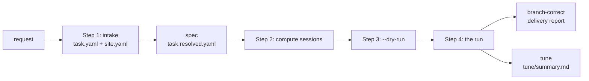

<!--
SPDX-FileCopyrightText: Copyright (c) 2026 NVIDIA CORPORATION & AFFILIATES. All rights reserved.
SPDX-License-Identifier: Apache-2.0
-->

# trtllm-modeling-v2 user guide

This guide takes an operator from a HuggingFace checkpoint to a delivered, and
optionally tuned, modeling_v2 target: what to prepare, what to write, what to
run and what to watch. [design.md](design.md) explains why the workflow is
shaped the way it is. [README.md](../README.md) is the reference for every
gate, flag and workspace file; this guide links into it instead of repeating
its tables.

## 1. Who this is for, and what you get

You are the operator. You have a checkpoint that TensorRT-LLM should serve
through a modeling_v2 target, a TensorRT-LLM checkout to build it in, and GPUs
to gate it on. You write the spec, start the run, keep its compute sessions
alive and decide what is kept. The agents write the code; the orchestrator, a
plain Python process, runs every check.

A finished run leaves:

| what | where |
|---|---|
| the target branch | the branch checked out in `trtllm_repo_path` when the run started. Each task works in a worktree of its own and lands on this branch as a fast-forward, so the branch moves by whole tasks and carries no merge commits |
| `<branch>-bringup` | a branch set once, to the first commit on which the first unit's boot and accuracy hold at its narrowest member: a usable one-rank target long before the rest is certified |
| `<branch>-correct` | a branch set to the first commit on which every required check of the contract held, the delivery tier's included. It moves forward when the contract holds on a later commit; `correctness.jsonl` in the workspace lists each one |
| the delivery report | the journal's closing sections: `delivery checks` (the files a finished onboarding touches, commit hygiene), `contract` (every required check on the target as it is) and the verdict |
| the tune summary | with `perf.enabled: true`: `<workspace>/tune/summary.md`, and the best tree on the branch `tune/<run>/best` (`<run>` is a short id derived from the workspace) |

The run does not open a pull request: lint, copyright headers, splitting the
branch into reviewable changes and CI are yours. Intake (step 1) is optional;
you can write the spec (section 5) directly, or let the run derive it from
the checkpoint (the fast path, section 4).



## 2. Prerequisites

**A TensorRT-LLM checkout with a native build.**

- A git checkout on a branch of its own: the branch the run lands on. Give
  each run its own checkout and branch.
- A native build and the interpreter that imports it, which is
  `environment.python`. [BUILD_AND_TEST.md](../BUILD_AND_TEST.md#1-build)
  has the build; an onboarding rarely needs a rebuild
  ([section 0 there](../BUILD_AND_TEST.md#0-first-ask-do-you-need-to-build-at-all)).
- A git identity: `user.name` and `user.email` in the checkout, or both
  `MV2FLOW_GIT_NAME` and `MV2FLOW_GIT_EMAIL`. Once the spec validates, the CLI
  makes one trial commit through the run's commit helper in a throwaway
  repository and refuses to start unless it is signed off by its author
  ([Commits](../README.md#commits)).
- A reachable `commit_policy.base_ref` (default `origin/main`, else
  `upstream/main`, else `main`): delivery audits every commit since it.
- git-lfs content the gates read: a multimodal unit with no image prompt of
  its own sends `tests/integration/test_input_files/merlion.png`.

**The checkpoint.** A HuggingFace directory whose `config.json` declares
`architectures` (the modeling_v2 family is derived from `architectures[0]`),
readable wherever the gates run. Its directory name matters twice: the
target's checkpoint segment is guessed from it (`target.checkpoint_segment`
overrides the guess), and the default `accuracy.model_key` is the last two
path components, which is right only for a path ending in `<org>/<model>`.

**Where GPU work runs** (`environment.kind`):

- `local`: this host has the GPUs. Preflight claims idle devices of the
  declared architecture (by free memory and a lone-process probe) and, for a
  multi-rank run, proves that NCCL and MPI answer. Every member must then have
  the same world size.
- `session_spool`: a Slurm cluster with pyxis/enroot. The run stands on
  long-lived compute sessions (section 6). You need a partition and account, a
  container image (a squashfs file on shared storage mounts in seconds; a
  registry reference is imported once per allocation) and mounts for the
  shared filesystem. `environment.python` is a path inside the container.

Either way `environment.env` sets `TMPDIR` and `CLAUDE_CODE_TMPDIR` outside
`/tmp`, and `TMPDIR` is at most 61 characters: the LLM API binds a unix
socket under it.

**An agent backend login.** In process (the default), the orchestrator starts
one agent CLI per turn: `claude` for a role on the `claude-code` backend,
`codex` for one on `codex`. Log in once on the launching host, under the
`HOME` (and `CLAUDE_CONFIG_DIR`) the run will have; when the organization
requires a newer CLI than the SDK bundles, point `AGENT_FLOW_CLAUDE_CLI` at
it. Under the external transport the orchestrator's host needs no login
(section 8).

**Accuracy anchors.** Every unit's accuracy gate compares against one row of
a reference table: `accuracy.reference_yaml` (default
`tests/integration/defs/accuracy/references/<benchmark>.yaml`), the row's
`model_key`, and its `discriminators` (`quant_algo`, `kv_cache_quant_algo`,
`spec_dec_algo`, matched exactly). Preflight resolves the row of every unit
and stops before any agent turn when one is missing.

- The row exists: name it with `model_key` and, for a quantized checkpoint
  or a speculator unit, `discriminators`.
- No row exists (a new architecture, no implementation in tree): score the
  checkpoint's reference implementation, the HuggingFace `transformers` one
  or a sibling engine serving it, on the benchmark and protocol the gate will
  use (`accuracy.benchmark`, plus `benchmark_args` for a chat template or a
  shot count). Add the row, note beside it where the number came from, and
  commit it on the target branch before the run, since gates measure commits.
  An anchor is never invented and never measured by the run it judges.
- Optional, in the same phase: the logit gate's reference, made on the HF
  implementation with `onboard/logit_reference.py`
  ([Gate workloads, floors and findings](../README.md#gate-workloads-floors-and-findings)).
- A speculator on an architecture the stock path cannot load has no `=off`
  leg to compare acceptance against: declare a measured reference drafter's
  acceptance (`measured_reference`), or `min_absolute` with its
  `floor_source`.

**GPU architecture.** `arch` is required and never inferred: `sm_100`
(B200), `sm_103` (GB300); receipts and the target's path are keyed by it. A
`local` run claims devices of that architecture; under `session_spool` it is
taken on trust. The native build must include it (`--cuda_architectures`),
and NVFP4 weights need `sm_100` or later.

## 3. Install

The orchestrator runs in an interpreter of its own (Python 3.11 or later). It
does not import TensorRT-LLM; gates and agents run under `environment.python`.
Without the console script, put the package on `PYTHONPATH` in an interpreter
that has agent-flow's dependencies, which is also how a run takes flow code
from another checkout (a reload re-executes the same command line).

```bash
python3 -m venv /path/to/venv-mv2
/path/to/venv-mv2/bin/pip install -e /path/to/TensorRT-LLM/agent-flow
/path/to/venv-mv2/bin/trtllm-modeling-v2 --help
# or:
PYTHONPATH=/path/to/TensorRT-LLM/agent-flow python3 -m agent_flow.workflows.trtllm_modeling_v2.cli --help
```

## 4. Step 1: intake

### The fast path

With a `site.yaml` for the cluster, one command derives the request from the
checkpoint and runs it:

```bash
trtllm-modeling-v2 --checkpoint /path/to/checkpoint --site site.yaml --workspace "$WS" \
    --goal "mtp disagg@tp1/tep4 tp1 tep4 dep4 isl=8192 osl=1024 tune" [--confirm [BY]]
```

It reads the checkpoint's `config.json` and `hf_quant_config.json`, the site's
optional `device` block and `defaults` block (`members`, `workload`,
`accuracy`, `boot`, `witness`), and the goal: features (`<feature>@<members>`
gates one on those members only, `-<feature>` leaves out one the checkpoint
carries), members, workload (`isl=`, `osl=`, `max_seq_len=`,
`concurrency=1/16/64`), `tune`, and the anchor and feature parameters
(`benchmark=`, `model_key=`, `draft_len=`, `kv=fp8`, `chunk=`, ...;
[INTAKE.md](../INTAKE.md#the-fast-path) lists them). A feature the checkpoint
carries is built unless the goal leaves it out. The run writes
`$WS/task.intake.yaml` (every value with its provenance) beside
`$WS/intake.report.md`, compiles it to `$WS/task.resolved.yaml` and each
unit's `$WS/llm_api/<unit>.yaml`, and starts. Phase 0 runs the intake checks
first and stops the run with every block listed. `intake derive` writes the
request without running it.

The run does not wait for a confirmation. `--confirm` (or `intake confirm`)
records one in `task.intake.yaml.confirmed`; once the run is past preflight,
an edit of the request is refused until it is confirmed. Re-running the same
command resumes; another goal or checkpoint needs `--clean`.

### The request and the site

Intake separates what you want from how the cluster runs it
([INTAKE.md](../INTAKE.md)). The user-facing `task.yaml` (`version: 1`)
states the requirements: goals, model, device, parallelism, workload,
features with a status, the accuracy benchmark, perf goals, constraints and
notes. `site.yaml` is written once per cluster: `trtllm_repo_path`,
`environment`, `agents`, `perf` (`spools`, `dev_spools`, `env_script`) and
`commit_policy`, and, for the fast path, `device` and `defaults`. For DeepSeek-R1 in NVFP4, built and then tuned:

```yaml
version: 1
goals: [onboard, tune]
model:
  checkpoint: /path/to/DeepSeek-R1-FP4
device: {arch: sm_100, gpus_per_node: 4, nodes: 1}
parallelism:
  - {kind: tep, world: 4}
  - {kind: dep, world: 4}
workload: {isl: 1024, osl: 1024, max_seq_len: 9216, max_batch_size: 64, concurrency: [1, 64]}
features:
  {cuda_graph: required, overlap_scheduler: required, prefix_reuse: required,
   speculative: {status: required, params: {algo: mtp}}, multimodal: out_of_scope}
accuracy: {benchmark: gsm8k, model_key: deepseek-ai/DeepSeek-R1}
perf:
  goal: {ratio_to_baseline: 1.1}
constraints:
  embargo: [tensorrt_llm/_torch/models/modeling_deepseekv3.py]
  base_ref: origin/main
notes: |
  Reuse the NVFP4 MoE kernels in tensorrt_llm/_torch/modules/fused_moe; add no CUDA.
open_questions: []
```

Its `site.yaml` holds the `trtllm_repo_path` and `environment` blocks of the
fuller spec in section 5, and that spec's `perf.spools`, `perf.dev_spools` and
`perf.env_script`; compile copies them into the resolved spec unchanged.

```bash
trtllm-modeling-v2 intake check task.yaml                  # feasibility checks; exit 1 on any block
trtllm-modeling-v2 intake confirm task.yaml --by "Your Name"
trtllm-modeling-v2 intake compile task.yaml --site site.yaml -o task.resolved.yaml
```

`check` prints a line per finding, such as
`[pass] checkpoint: architecture DeepseekV3ForCausalLM`, from the checkpoint's
`config.json` and the request
([INTAKE.md section 6](../INTAKE.md#6-feasibility-checks)). `confirm` refuses
while a block or an open question stands, then writes
`{by, at, sha256}` to `task.yaml.confirmed` beside the file, which it never
rewrites. `compile` writes the resolved spec and each unit's LLM-API options
file under `llm_api/` beside it (runtime switches, `kv_cache_config`,
`cuda_graph_config`, the `speculative_config` from the speculative unit on),
derives the anchor's discriminators from the weight and KV formats and the
speculator, carries per-unit members, boot and witness blocks and perf
configs at each member's parallelism, validates it with the pipeline's own
schema, and prints a `warning:` naming each key it drops and each
requirement no check will hold (a `nice_to_have` feature is built as
required, for one).

Then either run `--task task.yaml --site site.yaml`, which compiles the
confirmed file into `<workspace>/task.resolved.yaml` at every start and refuses one
that is unconfirmed or changed since, or run `--task task.resolved.yaml` as it
is, keeping the confirmed `task.yaml` beside it as the record of what was
asked. Take the second way when the run needs keys intake does not carry,
such as `variants`, `perf.campaign` or a key compile warned it dropped. The
fuller spec in section 5 is the example's file, completed that way.

## 5. Writing the spec

The resolved spec is the only file the run reads. Every block is closed: a
misspelled key is an error that names the nearest real key, never a silent
default. [task.example.yaml](../task.example.yaml) documents every key and
default; this section says which ones decide the outcome.

| block | what it decides |
|---|---|
| `checkpoint_path`, `arch`, `parallel` | the target's identity: its slug and its path under `modeling_v2/models/<family>/` |
| `features` | the units: `core`, then one per feature, each owing its own checks. Closed list: `mtp`, `eagle3`, `dflash`, `dspark`, `multimodal`, `host_offload`, `disagg`, `kv_quant`, `decoder_replay`, `encoder_replay` ([Feature increments](../README.md#feature-increments)) |
| `members` | with `parallel: unified`, the configurations every unit is gated at (default `[tp4, tep4, dep4]` at world size 4) |
| `variants` | configurations a built unit must also serve (a KV-cache dtype, a draft depth), each with its own checks; they build nothing |
| `accuracy` | the release criterion: benchmark, anchor row, floor, protocol, options files and every gate's workload |
| `runtime` | the switches and flags every gate command runs with, and with them the serving envelope |
| `environment` | where GPU work runs: interpreter, variables, sessions |
| `perf` | the tune campaign (section 11) |
| `agents`, `source_embargo`, `notes` | which backend and model a role runs on; paths no role may read; free text every role is given |
| `target`, `scope`, `commit_policy` | overrides of the derived identity; `text_only` for a multimodal checkpoint built as a language model; what commits may touch |

**Units and members.** Each unit is gated at each of its members: boot and
accuracy, plus its own proof (acceptance for a unit whose target keeps a
speculator on; a witness for `host_offload`, `disagg`, `kv_quant` and the
replay features). Accuracy takes roughly an hour per gate, so members multiply
cost; naming fewer members is how a run buys a cheaper answer and says so. The
planner decides the order of the work. `members`, `runtime`,
`accuracy.llm_api_options`, `benchmark`, `reference_yaml`, `model_key`,
`discriminators` and `samples` also take a mapping from unit to value
(`members`, `runtime`, `benchmark` and `reference_yaml` then need a `default`
key); the acceptance and boot workloads take per-unit entries beside their
run-wide keys.

**Accuracy and floors.** The default floor is `rule: statistical`: the anchor
less `k` (2) standard errors over the benchmark's sample count. When every
member of a unit scores more than one standard error under the anchor, the
unit passes but the run records a finding, which delivery refuses until
`accuracy.floor.acknowledge.<unit>` gives the reason. `benchmark_args` is the
protocol (`--apply_chat_template`): a mismatch with the anchor's protocol reads
as a large regression that is not there. Set `accuracy.max_seq_len` and
`max_batch_size`, which `trtllm-eval` takes as its own flags. A speculator
unit's options file carries its `speculative_config`, or its gates measure the
base path ([Gate workloads, floors and findings](../README.md#gate-workloads-floors-and-findings)).

**Cheaper oracles.** With the logit gate owed, a unit's benchmark runs only
at its narrowest member, its widest and every member the logit gate cannot
stand for (attention DP; a speculator unit whose boot compares no tokens);
`accuracy.benchmark_members: every` runs it at every member. Wherever a logit
reference is named, the boot also holds its first greedy tokens to the
reference's (`accuracy.boot.greedy`, 4 prompts x 24 tokens by default). The
logit gate is on when `logits.reference.json.gz` sits beside the spec, the
serve gate wherever the spec bounds the server's sequence length; `enabled:
false` turns either off.

**Shared kernels.** A kernel task on a shared catalog entry lands a local
variant in the target's `ops/`, and one `promote` task merges the variants
into the catalog before delivery. `target.keep_local` lists entries
(`<category>/<name>`) to keep local, which delivery then accepts.

**The disaggregation witness.** Without a `contrast_command` the flow
provides leg B itself, which needs twice the member's devices on the node;
`cache_transceiver_config` in the witness block configures it (default
`{backend: DEFAULT, transceiver_runtime: auto}`). A `contrast_command` naming
a file beside `task.yaml` is resolved against that directory, and then needs
`contrast_env`.

**The serving envelope.** `runtime.extra_flags` (`--max_seq_len`,
`--max_batch_size`, `--max_num_tokens`) and the CUDA-graph capture batches are
what the target claims to serve. Smiths certify catalog entries against them,
the reviewer holds capacity constants to them, and the envelope gate serves
the finished target at those limits at delivery; it needs `--max_seq_len` in
the flags, and without it the engine sizes its cache for
`max_position_embeddings` anyway. The capture list comes from the options
file's `cuda_graph_config`, else from the runtime flags; preflight prints it
per unit and refuses a unit whose launch paths would capture different lists
([The serving envelope](../README.md#the-serving-envelope)).

**Environment.** `TRTLLM_MODELING_V2: require` in `environment.env` is
mandatory: under `auto` a configuration that misses the target's routing
silently runs the built-in implementation, and its numbers read as the
target's. For an architecture the stock path cannot load, name
`environment.substrate_checkpoint`, a checkpoint it can, so the substrate gate
still proves the launch path; `--skip-substrate-gate` gives up more.

**Agents, embargo, notes.** Without an `agents` block every role
(`planner`, `plan_drafter`, `plan_reviewer`, `smith`, `assembler`, `reviewer`,
`tuner`, `improver`) runs on `claude-code` at the backend's defaults. Route a
role elsewhere only for a reason, such as a plan reviewer on another provider
([Choosing each role's backend and model](../README.md#choosing-each-roles-backend-and-model)).
An embargo entry is repo-relative, absolute outside the repository (a
sibling engine's checkout) or `package:<path>`, and must exist; it is a rule
every role's prompt states, not a tool hook
([Source embargo](../README.md#source-embargo)). `notes` never relaxes a gate,
the embargo or the scope.

### A minimal spec

One host with four GPUs, `gpt-oss-120b` at TEP4, no features:

```yaml
checkpoint_path: /path/to/gpt-oss-120b
trtllm_repo_path: /path/to/TensorRT-LLM
arch: sm_100
parallel: tep4

environment:
  kind: local
  python: /path/to/TensorRT-LLM/.venv-3.12/bin/python
  env:
    TRTLLM_MODELING_V2: require
    TMPDIR: /path/to/scratch/tmp
    CLAUDE_CODE_TMPDIR: /path/to/scratch/tmp

runtime:
  cuda_graph: true
  extra_flags: [--max_seq_len=9216, --max_batch_size=16]

accuracy:
  benchmark: gsm8k
  reference_yaml: tests/integration/defs/accuracy/references/gsm8k.yaml
  model_key: openai/gpt-oss-120b      # the path's last two parts would read to/gpt-oss-120b
  max_seq_len: 9216
  max_batch_size: 16
```

Its contract is three required checks: `core:boot@tep4`,
`core:accuracy[gsm8k]@tep4` and, at delivery, `core:envelope@tep4`. The target
lands at `.../modeling_v2/models/gpt_oss/gpt_oss_120b__sm_100__tep4`.

### A fuller spec

DeepSeek-R1 in NVFP4 on a Slurm cluster: unified over TEP4 and DEP4, an MTP
unit, an FP8 KV-cache variant, per-unit options, the serve gate, and a tune
campaign on perf sessions of its own:

```yaml
checkpoint_path: /path/to/DeepSeek-R1-FP4
trtllm_repo_path: /path/to/TensorRT-LLM
arch: sm_100
parallel: unified
members: [tep4, dep4]
target: {checkpoint_segment: r1_nvfp4}
features: [mtp]
variants:
  kv_fp8: {unit: core, members: [dep4], note: KV cache stored as FP8,
           runtime: {extra_flags: [--kv_cache_dtype=fp8]},
           llm_api_options: {kv_cache_config: {dtype: fp8}},
           accuracy: {discriminators: {quant_algo: NVFP4, kv_cache_quant_algo: FP8}}}
notes: |
  Reuse the NVFP4 MoE kernels in tensorrt_llm/_torch/modules/fused_moe; add no CUDA.
source_embargo: [tensorrt_llm/_torch/models/modeling_deepseekv3.py, /path/to/vllm]
runtime:
  cuda_graph: true
  extra_flags: [--max_seq_len=9216, --max_batch_size=64, --max_num_tokens=8192]
environment:
  kind: session_spool
  python: /path/to/TensorRT-LLM/.venv-3.12/bin/python
  env: {TRTLLM_MODELING_V2: require, TMPDIR: /path/to/scratch/tmp, CLAUDE_CODE_TMPDIR: /path/to/scratch/tmp}
  partition: batch
  account: your-account
  container_image: /path/to/images/trtllm.sqsh
  container_name: trtllm-modeling-v2
  mounts: [/path/to/shared:/path/to/shared]
  spool: /path/to/shared/run/spool-gates-1
  sessions:
    - {name: gates-1, spool: /path/to/shared/run/spool-gates-1, role: gates, gpus_per_node: 4,
       time_limit: "24:00:00", handover_lead: "01:00:00"}
    - {name: work-1, spool: /path/to/shared/run/spool-work-1, role: work, gpus_per_node: 4,
       time_limit: "24:00:00"}
  session_wait: 1h
accuracy:
  benchmark: gsm8k
  reference_yaml: tests/integration/defs/accuracy/references/gsm8k.yaml
  model_key: deepseek-ai/DeepSeek-R1
  discriminators:
    core: {quant_algo: NVFP4}
    mtp: {quant_algo: NVFP4, spec_dec_algo: MTP}
  floor: {rule: statistical, k: 2.0}
  max_seq_len: 9216
  max_batch_size: 64
  llm_api_options: {core: options/core.yaml, mtp: options/mtp.yaml}   # beside this file
  acceptance: {dataset: /path/to/datasets/gsm8k, num_prompts: 32, max_tokens: 256}
  envelope: {enabled: true}
  serve: {enabled: true}
agents:
  roles: {plan_reviewer: {backend: codex}}
commit_policy: {base_ref: origin/main}
perf:
  enabled: true
  workload: {isl: 1024, osl: 1024, concurrency: [1, 64]}
  spools: [/path/to/shared/run/spool-perf-1]
  dev_spools: [/path/to/shared/run/spool-work-1]
  env_script: /path/to/shared/run/perf_env.sh
  sol: {enabled: true, gpu: gb200}
  campaign: {max_hours: 24, accuracy: {unit: core, members: [dep4]}}
```

```yaml
# options/mtp.yaml; options/core.yaml is the same without speculative_config
cuda_graph_config: {enable_padding: true, max_batch_size: 64}
kv_cache_config: {free_gpu_memory_fraction: 0.8}
speculative_config: {decoding_type: MTP, max_draft_len: 3}
```

Its contract is 16 required checks: boot, accuracy and serve for `core` and
`mtp`, acceptance for `mtp` at both members, boot and accuracy for `kv_fp8` at
DEP4, and at delivery the envelope for `mtp` at both members. The target lands
at `.../models/deepseek_v3/r1_nvfp4__sm_100__unified`.

### Validating a spec

Both specs above validate with `load_and_validate_task_yaml`
(`spec/task_schema.py`) with their placeholder paths created; every anchor
row they name, the variant's included, resolves in the repository's
`gsm8k.yaml`, and preflight's file checks accept them. Validation checks that
the paths a spec names exist, so validate where the orchestrator runs:

```bash
python3 -c 'import sys; from agent_flow.workflows.trtllm_modeling_v2.spec.task_schema import load_and_validate_task_yaml as v; v(sys.argv[1]); print("ok")' task.yaml
```

## 6. Step 2: compute sessions

A `local` run has no sessions. Under `session_spool` a session is one
allocation whose main process is the spool scheduler: work is a file renamed
into `<spool>/pending/`, and the scheduler gives each job the devices, wall
limit and memory limit its header asks for, removes the allocation's MPI
context from it, and never kills a process that still carries that context
([Execution substrate](../README.md#execution-substrate)).

**Declare** sessions in `environment.sessions`: a `name`, an absolute `spool`
on the shared filesystem (one per session), a `role` (`gates`, `work` or
`any`), `nodes`, `gpus_per_node`, `time_limit`, `handover_lead` (default 1 h)
and optional `env`, `setup`, `scheduler` options and `qos`; `partition`,
`account`, `container_image`, `container_name` and `mounts` default to the
`environment` block's. Then **render and submit** each one; never write an
entry script by hand:

```bash
trtllm-modeling-v2 session render     --task task.yaml --name gates-1   # writes <spool>/session_entry.sh
trtllm-modeling-v2 session submission --task task.yaml --name gates-1   # prints the call that starts it
trtllm-modeling-v2 session status     --task task.yaml                  # heartbeat, end, queue of each
```

`session submission` prints a Slurm-broker tool call
(`mcp__slurm-broker__slurm_submit(...)`) for a session that holds those tools.
Without them, submit an allocation with the same fields (image, partition,
account, nodes, GPUs per node, time limit, mounts, job name) whose command,
once per node inside the container, is `bash <spool>/session_entry.sh`. The
spec's validation needs `environment.spool` to exist: start the gate session
first, or start the run with `--wait-for-spool MINUTES`.

**Hand-over.** A session with a `time_limit` writes a successor request
`handover_lead` before its end and stops admitting jobs that would not finish;
they wait in the spool for the successor, which watches the same spool. The
orchestrator never calls Slurm; whoever can submit does:

```bash
trtllm-modeling-v2 session requests --task task.yaml                  # requests nobody answered
trtllm-modeling-v2 session allocate --task task.yaml --name gates-1   # the call, with dependency=afterany:<job>
trtllm-modeling-v2 session ack --task task.yaml --name gates-1 --job <new id> --after <job>   # as allocate printed
```

`session watchdog --task task.yaml` blocks until a session is stale (no
heartbeat for 180 s), ending without a successor (within 1800 s) or
quarantined, and prints the alert, or `OK` after 3000 s; during a run the
driver loop (section 8) does this. A gate whose session is lost is not
recorded and costs no agent turn: it runs again once a session heart-beats,
waiting up to `environment.session_wait` (default 1 h), at most three times in
a row. Past either bound the run closes `session-lost:<unit>`, which
re-running resumes.

**Perf sessions** (`perf.spools` for whole-node measurements,
`perf.dev_spools` for the tuners' one-GPU jobs and the keep gate) are best
kept out of `environment.sessions`: then the campaign holds none of the run's
devices. The `session` commands read only a file's `environment` block, so
declare them in a small file of their own and render them from it.

## 7. Step 3: the dry run

```bash
WS=/path/to/shared/runs/r1-nvfp4      # the workspace; on the shared filesystem under session_spool
trtllm-modeling-v2 --task task.yaml --workspace "$WS" --dry-run
```

`--dry-run` runs preflight and stops before the first planner turn. Keep the
workspace outside the checkout; under `session_spool` gate jobs read their
files from it. In order:

| step | what it proves or prints |
|---|---|
| intake (`--checkpoint`) | the derived request's feasibility checks and the compiled spec's anchor, speculation and capture-list checks, every block at once |
| schema | every problem with the spec, in one message |
| commit identity | a trial commit through the commit helper is signed off by its author |
| checkpoint | `config.json` parses; the target's family, segment and path |
| members | the member set per unit and how many accuracy gates it costs |
| anchors | each unit's anchor row resolves, with the number it found |
| speculation, capture lists, KV cache | the gates' launchers support the declared speculator; each unit's launch paths capture the same CUDA-graph batches (printed per unit); a note for a hybrid checkpoint that asks for block reuse without a state snapshot policy, whose gates would fail |
| `TMPDIR` | set, outside `/tmp`, short enough for a unix socket |
| devices (`local`) | idle devices of the declared architecture claimed; NCCL and MPI answer for a multi-rank run |
| known engine defects | a note for each `engine_defect` lesson whose upstream fix the checkout lacks |
| agent probe (in process) | every distinct agent the roles run on takes one small turn whose Bash tool writes a nonce, its hash and the checkout's `HEAD` to a file preflight checks |
| survey | what the checkpoint demands and what the build has (`surface.md`) |
| contract | every check the run owes (`contract.yaml`, and a `contract:` section in `journal.md`) |

It also writes `host_facts.md` and each role's composed prompt under
`prompts/`, and prints the slug, the target path, the world size, the devices,
the launch prefix every GPU command carries, and preflight's notes. Read the
notes.

The dry run does not run the **geometry probe** (phase 0's boot per serving
width, whose numbers kernels are certified against) nor the **substrate gate**, the cold start that proves
the host generates a token on the stock path under the run's runtime block.
The real start runs it beside the first agent turns; its failure stops the
run, which re-running resumes. Its pass, like the agent probe's, stands for
12 h for later starts in the same environment (`gates/substrate/pass.json`;
delete it to prove the substrate again). `gate boot --mode off` (section 12)
tries the launch path before any turn is spent. A failed probe says, per
agent, what the turn said and what to do; `MV2FLOW_SKIP_AGENT_PROBE=1` skips
the probe when the probe itself is what is broken.

## 8. Step 4: start the run

### In process (the default)

The orchestrator runs every role turn itself, one agent CLI per turn. Launch
it from a plain terminal or a tmux session on the login node, not from inside
another agent's session: a turn started there inherits that session's sandbox,
its Bash tool fails, and the turn can still end as if it had worked.

```bash
tmux new -s mv2
export AGENT_FLOW_CLAUDE_CLI="$(command -v claude)"    # when the bundled CLI is too old
trtllm-modeling-v2 --task task.yaml --workspace "$WS" 2>&1 | tee -a "$WS.log"
# or the fast path: --checkpoint /path/to/checkpoint --site site.yaml --goal "..." in place of --task
```

The run locks its workspace (`.orchestrator.lock`): a second orchestrator on
it refuses to start. The sessions still need hand-overs and someone must notice
the orchestrator stop, so on a `session_spool` run keep the operator loop
going, on the orchestrator's host, in a session that can submit allocations:

```bash
trtllm-modeling-v2 driver --workspace "$WS" wait --sessions-only
```

The first word of its output is the event: `ORCHESTRATOR_EXITED` (read the
log; relaunch unless the run closed), `RELOADED`, `RELOAD_OVERDUE`,
`RELOAD_FAILED`, `SESSION_REQUEST` (the hand-over of section 6),
`SESSION_STALE`, `SESSION_ENDING`, `SESSION_QUARANTINED` (look at that
session) or `TIMEOUT` (call it again). It never returns `NEW`.

### External transport

Use `--agent-transport external` when the orchestrator's host cannot
authenticate an agent (`EROFS ... credentials.lock`, `Not logged in`). The
orchestrator writes each turn to `<workspace>/dispatch/` and waits, and an
already-authenticated driver session runs the turns; decisions are still
validated and every verdict still comes from a gate the orchestrator ran
([Running where the orchestrator cannot authenticate an agent](../README.md#running-where-the-orchestrator-cannot-authenticate-an-agent)).

```bash
trtllm-modeling-v2 --task task.yaml --workspace "$WS" --agent-transport external   # writes TURN_INSTRUCTIONS.md
trtllm-modeling-v2 driver --workspace "$WS" wait                 # NEW <id>, or a session or orchestrator event
trtllm-modeling-v2 driver --workspace "$WS" prompt <id> --claim  # the instruction to hand one subagent
trtllm-modeling-v2 driver --workspace "$WS" answer <id> --from result.md
trtllm-modeling-v2 driver --workspace "$WS" status               # turns, claims, sessions, correctness
trtllm-modeling-v2 driver --workspace "$WS" release <id>         # a claimed turn whose subagent died
```

The subagent reads the turn's system prompt in full, then its prompt, does
the work, and writes `dispatch/<id>.result.md` and only then
`dispatch/<id>.done`; a driver that delivers only the user prompt runs a
different agent. A request names its agent when the spec routes the role. A
relaunched orchestrator adopts every unanswered turn.

### Concurrency

| knob | default | what it bounds |
|---|---|---|
| `--max-parallel-tasks` | 8 | agents working at once, by priority: the planner first (one slot is its own), critical-path tasks, other tasks, critic and improver, tune last on idle slots; capacity and files permitting |
| checks in flight | as many as the sessions' free devices start at once: at least 2, at most 32; 8 when no session can be read | not a flag |
| `driver --max-inflight` | 8 | external transport: turns handed out at once (the orchestrator itself never has more than `--max-parallel-tasks` agents waiting on the driver). An option of `driver`, before the action: `driver --workspace "$WS" --max-inflight 8 wait` |
| `--event-window` | 60 s | how long a green task waits to reach the planner with the events after it |
| `--revision-cap` | 6 | graph revisions without a check turning green before `planner-stalled` |
| `--agent-turn-timeout` | per role | assembler 16 h, tuner 8 h, smith 6 h, plan drafter and reviewer 4 h, plan reviewer 3 h, planner 2 h |
| `perf.campaign.max_parallel_tuners` | 4 | tune candidates in flight |

Many concurrent turns on one account stall
([`Agent stalled`](../TROUBLESHOOTING.md#agent-stalled-no-progress-for-600s-stream-watchdog-did-not-recover)):
lower `--max-parallel-tasks`, and `--max-inflight` under external transport.
Every flag is in [Flags](../README.md#flags).

## 9. Watching a run

```bash
tail -f "$WS/journal.md"
trtllm-modeling-v2 driver --workspace "$WS" status
tail -f "$WS"/turns/*.activity.log
```

- **`journal.md`**, written as events happen, one
  ``- `<time>` **<event>** — <detail>`` line each. A `gate` event opens
  `[PASS]`, `[FAIL]` or `[VOID]` and the check's label (`[PASS] boot@tep4`),
  then the tree measured and what the engine attested, and
  `[bundle <name>: <checks>]` when the check shared its engine with others of
  its member (a `bundle` line says why any ran singly); others include
  `integration`, `planned` (`[planner]`, `[retry]`, ...), `finding` and `tune`.
- **`driver status`**: the orchestrator's state (`running`, `exited`, or
  `unknown` with the host to ask on), what it holds now
  (`orchestrator holds: turn <role> <task> <age>`), a pending reload, the
  correctness line, and each session's heartbeat and queue.
- **The contract standing**: `N passed, M failed, K missing`, a line per
  `FAILED`, `VOID`, `MISSING` or `SHARED` check, and where correctness stands.
  Every planner turn carries it (the latest `reports/NN-planner-*.md`), and
  the journal closes the planned run with it. `contract.yaml` lists the
  checks, `contract_status.jsonl` every verdict with the commit it measured.
- **`graph.yaml`**: every task's kind, status, attempts and dependencies, and
  each revision's reason. **`turns/<id>.*`** (in process): each turn's prompt,
  `activity.log` (tool calls and the CLI's stderr, as they stream), result and
  `done`; `reports/NN-<role>-<what>.md` keeps each dispatch.
- **`runtime_facts.yaml`**: what the engines of passed gates ran, per unit and
  member (captured batches, recurrent slots, KV pool, free memory, widths,
  limits), what changed between passes, and under `geometry` what the phase-0
  probe measured before any kernel was certified.
- **`flow_issues.yaml`**: workflow defects the improver filed, each with its
  symptom, evidence, suspected `<file>:<function>`, a proposed fix and
  sometimes a patch draft under `improve/patches/` (a fix and its test,
  checked to apply to the running commit, never applied): your fix list for
  the flow itself. The improver runs beside the run, woken by what costs it
  time: a `FAILED_RECEIPT`, a repeated failure or certification, a required
  task ready for 30 minutes, a planner turn that changed nothing, a `VOID`
  verdict, a reported flow issue.
- **Regression reviews** batch landed shared changes: each review's `covers`
  in `graph.yaml` lists the changes it clears, and the run is not delivered
  while one is in no batch.

**The bring-up milestone.** The first time the first unit's boot and accuracy
hold at its narrowest member, the journal says `BRINGUP DELIVERED <sha>`, the
branch `<branch>-bringup` is set, and `correctness.jsonl` gets a `bringup`
line. It is set once.

**The correctness milestone.** The first time every required check holds on
one commit, the journal says
``**CORRECTNESS DELIVERED <sha>** — <h> h after the run started (...); all N required checks of the contract hold on it, the delivery tier's included; branch `<branch>-correct` ``,
the branch is set, and `correctness.jsonl` gets a line. Later work that turns
a check red or stale leaves it there (`correctness stays delivered at <sha>:
...`); it moves forward when the contract holds again.

**Closing verdicts**, the journal's last section:

| verdict | meaning | re-running the same command |
|---|---|---|
| `delivered` | the contract holds on the target and the delivery checks passed | says the run completed; `tune` re-enters it |
| `tuned` | delivered, and the tune task finished | as `delivered` |
| `escalated` | the planner found a requirement that cannot be met as stated | re-enters, after you change the task |
| `ceiling` | the planner found a computation step with no implementation anywhere, with the evidence | says the run completed |
| `planner-stalled` | `--revision-cap` revisions without a check turning green | re-enters, after you add what it lacked (a hint in `notes`, a resource) |
| `planner-refused` | the planner's graph was refused three times in a row | says the run completed |
| `planner-failed: <error>` | five planner turns in a row raised (timed out, crashed) | re-enters, after the cause is fixed |
| `delivery-failed`, `delivery-failed:findings`, `delivery-failed:contract` | a delivery check failed, an accuracy finding is unacknowledged, or the contract does not hold on the target as it is | re-enters, after the repair |
| `session-lost:<unit>` | a gate's session did not come back within `session_wait` | re-enters at that gate |

A substrate gate that fails beside the first turns stops the run without
closing it (`stopped`, with no improver turn); re-running resumes.

## 10. Steering

**Reload, never kill.** To load changed flow code (a fix from
`flow_issues.yaml`, say) into a running run:

```bash
trtllm-modeling-v2 driver --workspace "$WS" reload            # drain, then re-execute
trtllm-modeling-v2 driver --workspace "$WS" reload --force    # past --timeout, without what is left
trtllm-modeling-v2 driver --workspace "$WS" reload --cancel
```

The orchestrator starts nothing new, lets what is in flight finish
(integrations, started checks, the planner's turn; in process, every agent
turn too), checkpoints, and re-executes itself with the same pid, log and
arguments; `driver wait` then returns `RELOADED`. Past `--timeout` (1800 s) it
returns `RELOAD_OVERDUE` once and the drain goes on waiting. The new process
reads the spec again, so a reload is also how a spec change reaches a run
([Reloading and relaunching](../README.md#reloading-and-relaunching)).

**Stop and resume.** Re-running the same command resumes from the checkpoint:
the graph, the verdicts and the tune campaign are on disk. A hard stop
(Ctrl-C, a crash, a lost host) cuts short what was in flight: those checks run
again, running tasks start again, and the journal's `restart (hard-stop)` line
names what the stop cost. Relaunch only when `driver status` says `exited`.

**`--clean`** deletes the checkpoint and the run's records (state, plan,
vocabulary, progress, journal, reports, graph, verdicts, the reload ledger,
host facts, the survey) so the next start is a new run. It does not touch the
checkout: commits on the target branch stay. For a run that shares nothing
with an earlier one, use a new workspace and a new branch.

**Retrying.** The planner retries failed tasks (writing them back as
`pending`, up to three attempts), and an infrastructure failure (a turn that
raised, `INTEGRATION_FAILED`, an unmeasurable tune baseline) gets one retry of
its own. You retry a closed run by re-running it when its verdict re-enters.

Leave alone a failed task or check (the planner is woken at once),
`INTEGRATION_FAILED`, `VOID` and `MISSING`, which the run handles itself
([The planned run](../TROUBLESHOOTING.md#the-planned-run)), and a gate whose
session went away. Step in for a failed preflight or substrate gate,
`ORCHESTRATOR_EXITED` or a session alert, a verdict that asks for a repair
(for `delivery-failed:findings`, fix the target or acknowledge the finding in
`accuracy.floor.acknowledge` with the reason), and an entry in
`flow_issues.yaml` (fix the flow, or review and apply its patch draft, then
reload). To hand the improver a flow issue you noticed, append one JSON
object to `$WS/flow_issues.reported.jsonl` (`symptom` required; `evidence`,
`suspected`, `proposed_fix` optional).

Do not edit the integration checkout by hand: a check measures a snapshot of a
commit, so an uncommitted edit is measured by nothing, and each check warns
about it. Stop a spool job with `trtllm-modeling-v2 spool cancel <name>`
(`spoolctl.py cancel`), never by signalling its processes. Do not copy an old
decision file to a new request's path.

## 11. Tune

Onboarding makes the target correct; the tune campaign makes it faster without
making it less correct. Performance is measured, never a release gate, and
every kept change passes the accuracy gate ([Tuning](../README.md#tuning)).

**Chained.** With `perf.enabled: true` the planner puts one `tune` task in the
graph. It is held until the core's inner checks have passed, then runs on the
devices the build work leaves idle, pinned to the commit the target was at, in
worktrees of its own. Delivery does not wait for it.

**Standalone.** `trtllm-modeling-v2 tune --task task.yaml --workspace "$WS"`
(the same as `--stage tune`) tunes a target the checkout already holds, or
re-enters a run that closed `delivered` or after an earlier campaign, with a
budget of its own. It needs a `perf:` block.

**Sessions.** Measurements run on `perf.spools` (default: the run's sessions),
each on a node that has run nothing for `perf.campaign.idle_settle_s` (120 s);
tuner jobs and the keep gate on `perf.dev_spools`. Every perf job sources
`perf.env_script`: write one (interpreter on `PATH`, `PYTHONNOUSERSITE=1`);
without the key, jobs source `<workspace>/tune/env.sh`, which the run does not
write. The keep gate needs the unit's anchor; `perf.campaign.accuracy:
{gate: off}` runs without one and journals every keep as `UNGATED`.

**What runs.** A perf smoke per world size; ground truth (the baseline
under `modeling_v2: require`, its repeats for the same-host noise floor, the
stock reference under `off`); a speed-of-light turn; a roadmap; then
candidates, one hypothesis per worktree, measured A, B, A' on one node and
kept only when they win beyond the noise floor and pass the keep gate. It
ends at `perf.campaign.max_iterations` (12) candidates,
`max_consecutive_misses` (3), spent roadmaps, a reached `perf.goal` or the
wall budget `max_hours`.

**Reading the result.** `<workspace>/tune/summary.md` holds the table of the
baseline, the stock reference, the controls and the best tree's final
measurement; the kept changes; the goal; the speed-of-light table; the best
tree and its commit; and why the campaign ended. `tune/perf_ledger.jsonl`
has every measurement and decision. To compare measurements by hand:

```bash
trtllm-modeling-v2 perf table --baseline "$WS/tune/data/t-baseline" "$WS"/tune/data/t-*
```

**Keeping a result.** In a chained run, merging the best branch into a target
that has moved is an `integrate` task the planner adds; the checks and the
delivery tier run again on the merged tree, and `<branch>-correct` moves
forward when they hold. A standalone campaign merges nothing: its best tree is
the branch `tune/<run>/best`. Merge or cherry-pick it onto your branch, then
gate the result (section 12) before relying on it.

## 12. Running one gate standalone

`trtllm-modeling-v2 gate <name>` runs one gate or witness exactly as the
orchestrator does, resolved from the same spec, on a snapshot of a commit.

```bash
trtllm-modeling-v2 gate accuracy   --task "$WS/task.yaml" --unit core --member dep4
trtllm-modeling-v2 gate acceptance --task "$WS/task.yaml" --unit mtp --commit <sha>
trtllm-modeling-v2 gate boot       --task "$WS/task.yaml" --tree /path/to/another/worktree
trtllm-modeling-v2 gate boot       --task "$WS/task.yaml" --mode off     # the stock path, as a control
```

- Names: `boot`, `accuracy`, `acceptance`, `envelope`, `witness`, `serve`,
  `logits`. `--unit` defaults to `core` and takes a feature or a variant
  (`--unit kv_fp8`); a witness needs the unit whose feature it witnesses.
  `--member` defaults to the unit's cheapest member.
- Without `--commit` or `--tree` it measures the commit the checkout is at;
  with the workspace's `task.yaml` the run's own snapshots are reused.
  `--tree` measures a tree as it is, uncommitted work included: that is how a
  defect is replayed on the trees before and after its fix.
- `--workdir` (default `./trtllm-modeling-v2-gates`) holds the files the job
  reads; on a `session_spool` run put it on the shared filesystem. `--results`
  keeps acceptance baselines across trees. Exit 0 on a pass, 1 on a failure,
  2 on a usage or spec error; `--json` prints the verdict as JSON.

## 13. Common problems

[TROUBLESHOOTING.md](../TROUBLESHOOTING.md) is keyed on the verbatim text of a
failure: search it for the string you saw. Every entry there read as a model
defect while it happened, and every one was the environment.

| you see | look at |
|---|---|
| `MPI_ERR_SPAWN` | [`MPI_ERR_SPAWN: could not spawn n processes`](../TROUBLESHOOTING.md#mpi_err_spawn-could-not-spawn-n-processes) |
| `Impossible to fit in any sequence in kvCache` | [the kvCache entry](../TROUBLESHOOTING.md#impossible-to-fit-in-any-sequence-in-kvcache): set `--max_seq_len` |
| `NVRTC ... could not open source file "cuda.h"` | [the NVRTC entry](../TROUBLESHOOTING.md#nvrtc--could-not-open-source-file-cudah): `PATH`, not a rebuild |
| the engine hangs at startup | [The engine hangs at startup and never returns](../TROUBLESHOOTING.md#the-engine-hangs-at-startup-and-never-returns) |
| `EROFS ... credentials.lock`, `Not logged in` | [The agent plane](../TROUBLESHOOTING.md#the-agent-plane); `--agent-transport external` |
| `Agent stalled: no progress for 600s` | [too many concurrent turns](../TROUBLESHOOTING.md#agent-stalled-no-progress-for-600s-stream-watchdog-did-not-recover) |
| `no watcher heartbeat in <spool>` | [the session is not running](../TROUBLESHOOTING.md#no-watcher-heartbeat-in-spool-the-session-is-not-running-exit-70) |
| a run closed `session-lost:<unit>` | [Compute sessions and the spool](../TROUBLESHOOTING.md#compute-sessions-and-the-spool) |
| the driver waits and nothing happens | [The driver waits and nothing happens](../TROUBLESHOOTING.md#the-driver-waits-and-nothing-happens) |
| `MISSING <unit>:<gate>@<member>` for a check that passed | [the MISSING entry](../TROUBLESHOOTING.md#missing-unitgatemember-for-a-check-that-passed-before) |
| `[VOID] <gate>@<member>` | [the VOID entry](../TROUBLESHOOTING.md#void-gatemember-or-void-check-in-the-standing) |
| `INTEGRATION_FAILED` | [the integration entry](../TROUBLESHOOTING.md#integration_failed-conflicts-with-the-integration-head--in-files) |
| a large accuracy regression | [The accuracy gate reports a large regression that is not there](../TROUBLESHOOTING.md#the-accuracy-gate-reports-a-large-regression-that-is-not-there): the protocol |
| a speculator unit scores like the base | [A feature's gate re-measures the base path](../TROUBLESHOOTING.md#a-features-gate-re-measures-the-base-path) |
| `TUNE_FAILED (tune-failed:smoke)` | [the perf smoke entry](../TROUBLESHOOTING.md#tune_failed-tune-failedsmoke-the-perf-smoke-failed-the-baseline-is-not-started) |
| an import from the wrong tree | [The import resolves to a different tree](../TROUBLESHOOTING.md#the-import-resolves-to-a-different-tree-than-the-one-you-are-measuring): `PYTHONNOUSERSITE=1` |

## 14. FAQ

**How long does a run take, and how do I make it cheaper?** Most of the wall
time is gates: every member pays boot and accuracy per unit, and accuracy
takes roughly an hour. The dry run prints the member set and the number of
accuracy gates before anything is spent. Name fewer members (per unit if one
unit is worth less). With a logit reference the benchmark runs only where
the logit gate cannot stand for it, and checks of one member share one engine
start; turning `serve` or `logits` off saves more, and the contract then says
what was covered.

**Can I change the spec while the run goes?** Edit the file the run was
started with and reload (section 10): the new process reads it and compiles
the contract again. An intake `task.yaml` must be confirmed again after an
edit; a fast-path request edited after its run started is refused until it
is confirmed.

**Can I commit to the target branch by hand?** A commit of yours moves the
target like a task's: a code change makes every verdict on the old state
stale, and the checks run again. It must also pass
delivery's commit hygiene (signed off by its author, no co-author trailer), so
commit with `git commit -s`, or better, let a task make the change.

**My architecture has no stock implementation. What changes?** Declare
`environment.substrate_checkpoint`, add the anchor row yourself (section 2),
and give a speculator unit an acceptance floor tied to a measurement.
