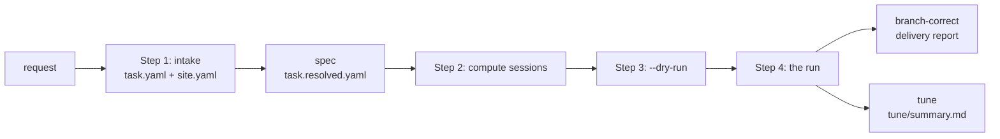

<!--
SPDX-FileCopyrightText: Copyright (c) 2026 NVIDIA CORPORATION & AFFILIATES. All rights reserved.
SPDX-License-Identifier: Apache-2.0
-->

# trtllm-modeling-v2 user guide

This guide takes an operator from a HuggingFace checkpoint to a delivered, and
optionally tuned, modeling_v2 target: what to prepare, what to write, what to
run and what to watch. [design.md](design.md) explains how the run works,
[the README](../README.md#flags) lists every flag, and
[task.example.yaml](../task.example.yaml) every spec key.

## 1. Who this is for, and what you get

You are the operator. You have a checkpoint that TensorRT-LLM should serve
through a modeling_v2 target, a TensorRT-LLM checkout to build it in, and GPUs
to gate it on. You write the spec, start the run, keep its compute sessions
alive and decide what is kept. The agents write the code; the orchestrator, a
plain Python process, runs every check.

A finished run leaves:

| what | where |
|---|---|
| the target branch | the branch checked out in `trtllm_repo_path` when the run started. Each task lands on it as a fast-forward, so it moves by whole tasks and carries no merge commits |
| `<branch>-bringup` | set once, to the first commit on which the first unit's boot and accuracy hold at its narrowest member: a usable one-rank target long before the rest is certified |
| `<branch>-correct` | the first commit on which every required check held, the delivery tier's included; it moves forward when the contract holds on a later commit, and `correctness.jsonl` lists each one |
| `<branch>-best` and `cells.json` | per cell (a unit or a variant at one member), the latest commit on which all its checks passed, and the commit the most cells hold on at once: what a run proved, and where, even when it stopped short of delivery |
| the delivery report | the journal's closing sections: `delivery checks`, `contract` (every required check on the target as it is) and the verdict, with the cells that hold |
| `metrics.json` | what the run cost and proved: the milestones, the cells, the checks of each gate kind with their device-hours, turns by role, refused graphs, operator messages, restarts |
| `issues.md` | suspected defects a worker met outside this model's delivery, which the planner recorded instead of chasing |
| the tune summary | with `perf.enabled: true`: `<workspace>/tune/summary.md`, the best tree on `tune/<run>/best`, and `<workspace>/UNMERGED_OPTIMIZATIONS.md`, the kept changes the delivered target does not carry |

The run does not open a pull request: lint, copyright headers, splitting the
branch into reviewable changes and CI are yours. Intake (step 1) is optional:
you can write the spec (section 5) directly, or let the run derive it from the
checkpoint (section 4).



## 2. Prerequisites

**A TensorRT-LLM checkout with a native build.**

- A git checkout on a branch of its own, the branch the run lands on. Give
  each run its own checkout and branch.
- A native build and the interpreter that imports it, which is
  `environment.python`. [BUILD_AND_TEST.md](../BUILD_AND_TEST.md#1-build)
  has the build; an onboarding rarely needs a rebuild
  ([section 0 there](../BUILD_AND_TEST.md#0-first-ask-do-you-need-to-build-at-all)).
- A git identity: `user.name` and `user.email` in the checkout, or both
  `MV2FLOW_GIT_NAME` and `MV2FLOW_GIT_EMAIL`. The CLI makes one trial commit
  through the run's commit helper in a throwaway repository and refuses to
  start unless it is signed off by its author
  ([design.md §7.3](design.md#73-the-commit-helper)).
- A reachable `commit_policy.base_ref` (default `origin/main`, else
  `upstream/main`, else `main`): delivery audits every commit since it.
- git-lfs content the gates read: a multimodal unit with no image prompt of
  its own sends `tests/integration/test_input_files/merlion.png`.

**The checkpoint.** A HuggingFace directory whose `config.json` declares
`architectures` (the modeling_v2 family is derived from `architectures[0]`),
readable wherever the gates run. The target's checkpoint segment is guessed
from its directory name (`target.checkpoint_segment` overrides the guess), and
the default `accuracy.model_key` is the last two path components, which is
right only for a path ending in `<org>/<model>`.

**Where GPU work runs** (`environment.kind`):

- `local`: this host has the GPUs. Preflight claims idle devices of the
  declared architecture and, for a multi-rank run, proves that NCCL and MPI
  answer. Every member must then have the same world size.
- `session_spool`: a Slurm cluster with pyxis/enroot. The run stands on
  long-lived compute sessions (section 6). You need a partition and account, a
  container image (a squashfs file on shared storage mounts in seconds; a
  registry reference is imported once per allocation) and mounts for the
  shared filesystem. `environment.python` is a path inside the container.

Either way `environment.env` sets `TMPDIR` and `CLAUDE_CODE_TMPDIR` outside
`/tmp`, and `TMPDIR` is at most 61 characters: the LLM API binds a unix
socket under it.

**An agent backend login.** In process (the default), the orchestrator starts
one agent CLI per turn: `claude` for a role on the `claude-code` backend,
`codex` for one on `codex` (the newer of the `codex` on `PATH` and the runtime
agent-flow pins, or the one `CODEX_BIN` names: a login offers a new model only
to a client that knows it). Log in once on the launching host, under the
`HOME` (and `CLAUDE_CONFIG_DIR`, `CODEX_HOME`) the run will have. Under the external
transport the orchestrator's host needs no login (section 8).

**Accuracy anchors.** Every unit's accuracy gate compares against one row of
a reference table: `accuracy.reference_yaml` (default
`tests/integration/defs/accuracy/references/<benchmark>.yaml`), the row's
`model_key`, and its `discriminators` (`quant_algo`, `kv_cache_quant_algo`,
`spec_dec_algo`, matched exactly). Preflight resolves the row of every unit
and stops before any agent turn when one is missing.

- The row exists: name it with `model_key` and, for a quantized checkpoint
  or a speculator unit, `discriminators`.
- No row exists (a new architecture): score the checkpoint's reference
  implementation, the HuggingFace `transformers` one or a sibling engine, on
  the benchmark and protocol the gate will use (`accuracy.benchmark`, plus
  `benchmark_args` for a chat template or a shot count). Add the row, note
  beside it where the number came from, and commit it on the target branch
  before the run, since gates measure commits. An anchor is never invented
  and never measured by the run it judges.
- Optional, in the same phase: the logit gate's reference, made once on the
  HF implementation. It loads the checkpoint twice, in bf16 and then in fp32
  for the spread, one after the other (`--device-map auto` spreads each):

  ```bash
  python <package>/onboard/logit_reference.py --model <checkpoint> --out logits.reference.json.gz \
      [--trust-remote-code] [--image <repo-relative png> --image-root <tree>] [--prompts prompts.yaml]
  ```

  Its default prompts are three short ones and one of 8704 tokens, one
  context chunk past the default `max_num_tokens`; make it longer than the
  unit's own `max_num_tokens` (`--long-tokens`) so it crosses a chunk. The
  long prompt's context logits are held in device memory (8704 x vocabulary x
  4 bytes), which the KV-cache fraction must leave room for. Put the file
  beside the spec, or name it in `accuracy.logits.reference`.
- A speculator on an architecture the stock path cannot load has no `=off`
  leg to compare acceptance against: declare a measured reference drafter's
  acceptance (`measured_reference`), or `min_absolute` with its
  `floor_source`.

**GPU architecture.** `arch` is required and never inferred: `sm_100`
(B200), `sm_103` (GB300); receipts and the target's path are keyed by it. A
`local` run claims devices of that architecture; under `session_spool` it is
taken on trust. The native build must include it (`--cuda_architectures`),
and NVFP4 weights need `sm_100` or later.

## 3. Install

The orchestrator runs in an interpreter of its own (Python 3.11 or later). It
does not import TensorRT-LLM; gates and agents run under `environment.python`.
Without the console script, put the package on `PYTHONPATH` in an interpreter
that has agent-flow's dependencies, which is also how a run takes flow code
from another checkout (a reload re-executes the same command line).

```bash
python3 -m venv /path/to/venv-mv2
/path/to/venv-mv2/bin/pip install -e /path/to/TensorRT-LLM/agent-flow
/path/to/venv-mv2/bin/trtllm-modeling-v2 --help
# or:
PYTHONPATH=/path/to/TensorRT-LLM/agent-flow python3 -m agent_flow.workflows.trtllm_modeling_v2.cli --help
```

## 4. Step 1: intake

[INTAKE.md](../INTAKE.md) is the reference for the request, the site and
every intake command.

**The fast path.** With a `site.yaml` for the cluster, one command derives
the request from the checkpoint and runs it:

```bash
trtllm-modeling-v2 --checkpoint /path/to/checkpoint --site site.yaml --workspace "$WS" \
    --goal "mtp disagg@tp1/tep4 tp1 tep4 dep4 isl=8192 osl=1024 tune" [--confirm [BY]]
```

The goal names features (`<feature>@<members>` gates one on those members
only, `-<feature>` leaves out one the checkpoint carries), members, workload,
`tune`, and anchor and feature parameters
([INTAKE.md §2](../INTAKE.md#2-the-fast-path) lists them). A feature the
checkpoint carries is built unless the goal leaves it out. The run writes
`$WS/task.intake.yaml` (every value with its provenance) beside
`$WS/intake.report.md`, compiles it to `$WS/task.resolved.yaml` and each
unit's `$WS/llm_api/<unit>.yaml`, and starts; phase 0 runs the intake checks
first and stops the run with every block listed. `intake derive` writes the
request without running it. The run does not wait for a confirmation:
`--confirm` (or `intake confirm`) records one, and once the run is past
preflight an edit of the request is refused until it is confirmed.
Re-running the same command resumes; another goal or checkpoint needs
`--clean`.

**The request and the site.** The user-facing `task.yaml` (`version: 1`)
states the requirements ([INTAKE.md §4](../INTAKE.md#4-taskyaml); a worked one
is in [examples.md §1.1](examples.md#11-the-request-taskyaml-and-siteyaml));
`site.yaml`, written once per cluster, holds `trtllm_repo_path`,
`environment`, `agents`, `perf` sessions and `commit_policy`.

```bash
trtllm-modeling-v2 intake check task.yaml                  # feasibility checks; exit 1 on any block
trtllm-modeling-v2 intake confirm task.yaml --by "Your Name"
trtllm-modeling-v2 intake compile task.yaml --site site.yaml -o task.resolved.yaml
```

`check` prints a line per finding, such as
`[pass] checkpoint: architecture DeepseekV3ForCausalLM`
([INTAKE.md §6](../INTAKE.md#6-feasibility-checks)). `confirm` refuses while
a block or an open question stands, then writes `{by, at, sha256}` to
`task.yaml.confirmed` beside the file, which it never rewrites. `compile`
writes the resolved spec and each unit's options file under `llm_api/` beside
it, validates it with the run's own schema, and prints a `warning:` naming
each key it drops and each requirement no check will hold.

Then either run `--task task.yaml --site site.yaml`, which compiles the
confirmed file into `<workspace>/task.resolved.yaml` at every start and
refuses one that is unconfirmed or changed since, or run
`--task task.resolved.yaml` as it is. Take the second way when the run needs
keys intake does not carry, such as `variants`, `perf.campaign` or a key
compile warned it dropped.

## 5. Writing the spec

The resolved spec is the only file the run reads. Every block is closed: a
misspelled key is an error that names the nearest real key, never a silent
default. [task.example.yaml](../task.example.yaml) documents every key and
default; this section says which ones decide the outcome.

| block | what it decides |
|---|---|
| `checkpoint_path`, `arch`, `parallel` | the target's identity: its slug and its path under `modeling_v2/models/<family>/` |
| `features` | the units: `core`, then one per feature, each owing its own checks. Closed list: `mtp`, `eagle3`, `dflash`, `dspark`, `multimodal`, `host_offload`, `disagg`, `kv_quant`, `decoder_replay`, `encoder_replay` ([design.md §5.2](design.md#52-gates-and-witnesses)) |
| `members` | with `parallel: unified`, the configurations every unit is gated at (default `[tp4, tep4, dep4]` at world size 4) |
| `variants` | configurations a built unit must also serve (a KV-cache dtype, a draft depth), each with its own checks; they build nothing |
| `profile` | how much the contract owes: `bringup`, `standard` (the default) or `certified` ([design.md §5.1](design.md#51-units-members-and-tiers)) |
| `accuracy` | the release criterion: benchmark, anchor row, floor, protocol, options files, every gate's workload, and which optional gates are on |
| `budget` | what the run may spend: `wall_hours` and `gpu_hours` ([design.md §4.8](design.md#48-budget-and-metrics)) |
| `runtime` | the switches and flags every gate command runs with, and with them the serving envelope |
| `environment` | where GPU work runs: interpreter, variables, sessions |
| `perf` | the tune campaign (section 11) |
| `agents`, `source_embargo`, `notes` | which backend and model a role runs on; paths no role may read; free text every role is given |
| `target`, `scope`, `commit_policy` | overrides of the derived identity; `text_only` for a multimodal checkpoint built as a language model; what commits may touch |

**Units and members.** Each unit is gated at each of its members: boot and
accuracy, plus acceptance for a unit whose target keeps a speculator on.
`host_offload`, `disagg`, `kv_quant` and the replay features pass boot and
accuracy whether or not they work; their witnesses are owed only with
`accuracy.witness.enabled: true` (or the `certified` profile), and without
them the coverage matrix reports those features not covered. Accuracy takes
roughly an hour per gate, so members multiply cost: naming fewer members, or
`profile: bringup` (one member per unit), buys a cheaper answer and says so.
`members`, `runtime`, `accuracy.llm_api_options`, `benchmark`,
`reference_yaml`, `model_key`, `discriminators` and `samples` also take a
mapping from unit to value (`members`, `runtime`, `benchmark` and
`reference_yaml` then need a `default` key).

**Accuracy.** The floor is statistical by default
([design.md §5.3](design.md#53-floors-and-findings)); a finding (every member
of a unit more than one SE under the anchor) blocks delivery until
`accuracy.floor.acknowledge.<unit>` gives the reason. `benchmark_args` is the
protocol (`--apply_chat_template`): a mismatch with the anchor's protocol
reads as a large regression that is not there. Set `accuracy.max_seq_len` and
`max_batch_size`, which `trtllm-eval` takes as its own flags. A speculator
unit's options file carries its `speculative_config`, or its gates measure the
base path. With a logit reference the benchmark runs only where the logit gate
cannot stand for it ([design.md §5.9](design.md#59-cheaper-oracles)).

**The serving envelope.** `runtime.extra_flags` (`--max_seq_len`,
`--max_batch_size`, `--max_num_tokens`) and the CUDA-graph capture batches are
what the target claims to serve ([design.md §5.10](design.md#510-the-serving-envelope)).
Set `--max_seq_len` in the flags: without it the engine sizes its cache for
`max_position_embeddings`. Preflight prints each unit's capture list and
refuses a unit whose launch paths would capture different lists.

**Shared kernels.** A kernel task on a shared catalog entry lands a local
variant in the target's `ops/`, and a `promote` task merges the variants into
the catalog before delivery. `target.keep_local` lists entries
(`<category>/<name>`) to keep local, which delivery then accepts.

**The disaggregation witness.** Leg B is a launcher of your own: the witness
block names it in `contrast_command` and the environment that sets it apart
in `contrast_env`, and the spec is refused without both. It runs as one
process on a whole node and starts a context and a generation engine of the
member's width, so the node needs twice the member's devices;
`cache_transceiver_config` in the witness block is handed to it. A
`contrast_command` naming a file beside `task.yaml` is resolved against that
directory, and the launcher must honour the contract in
[design.md §5.2](design.md#52-gates-and-witnesses).

**Environment.** `TRTLLM_MODELING_V2: require` in `environment.env` is
mandatory: under `auto` a configuration that misses the target's routing
silently runs the built-in implementation, and its numbers read as the
target's. For an architecture the stock path cannot load, name
`environment.substrate_checkpoint`, a checkpoint it can, so the substrate gate
still proves the launch path; `--skip-substrate-gate` gives up more.

**Agents.** Without an `agents` block, an in-process run starts every role
(`planner`, `surveyor`, `kernel_writer`, `assembler`, `tuner`) on the agent
that started the orchestrator, at maximum reasoning effort: Codex when a Codex
session started it (its commands carry `CODEX_THREAD_ID`), else Claude Code at
its default model. An external transport's driver runs each turn on its own
agent. Route a role
elsewhere only for a reason, such as the planner on another provider: the
block sets the backend (`claude-code` or `codex`), model, reasoning effort
and extra MCP servers for every role (`defaults`) or one (`roles.<name>`),
and the spec is read again on every resume.

```yaml
agents:
  defaults: {backend: claude-code, model: claude-opus-5-5, reasoning_effort: xhigh}
  roles:
    planner: {backend: codex}
```

A role on Codex gets no Stop hook; its decision file is validated when it is
read, like every role's. One with no `model` runs the model the operator's
Codex is set to (`$CODEX_DEFAULT_MODEL` names another). Under the external transport each request names the
role's agent, and running the turn on a matching model is the driver's job.

**Embargo and notes.** An embargo entry is repo-relative, absolute outside
the repository (a sibling engine's checkout), or `package:<path>`, and must
exist; it is a rule every role's prompt states, not a tool hook
([design.md §12](design.md#12-security-and-hygiene)). `notes` never relaxes a
gate, the embargo or the scope.

### A minimal spec

One host with four GPUs, `gpt-oss-120b` at TEP4, no features:

```yaml
checkpoint_path: /path/to/gpt-oss-120b
trtllm_repo_path: /path/to/TensorRT-LLM
arch: sm_100
parallel: tep4

environment:
  kind: local
  python: /path/to/TensorRT-LLM/.venv-3.12/bin/python
  env:
    TRTLLM_MODELING_V2: require
    TMPDIR: /path/to/scratch/tmp
    CLAUDE_CODE_TMPDIR: /path/to/scratch/tmp

runtime:
  cuda_graph: true
  extra_flags: [--max_seq_len=9216, --max_batch_size=16]

accuracy:
  benchmark: gsm8k
  reference_yaml: tests/integration/defs/accuracy/references/gsm8k.yaml
  model_key: openai/gpt-oss-120b      # the path's last two parts would read to/gpt-oss-120b
  max_seq_len: 9216
  max_batch_size: 16
```

Its contract is three required checks: `core:boot@tep4`,
`core:accuracy[gsm8k]@tep4` and `core:serve@tep4`, the serve gate being on
because `accuracy.max_seq_len` bounds the server's sequence length. With
`accuracy.envelope: {enabled: true}` it would also owe `core:envelope@tep4` at
delivery. The target lands at
`.../modeling_v2/models/gpt_oss/gpt_oss_120b__sm_100__tep4`.

### A fuller spec

DeepSeek-R1 in NVFP4 on a Slurm cluster: unified over TEP4 and DEP4, an MTP
unit, an FP8 KV-cache variant, per-unit options, the serve gate, and a tune
campaign on perf sessions of its own:

```yaml
checkpoint_path: /path/to/DeepSeek-R1-FP4
trtllm_repo_path: /path/to/TensorRT-LLM
arch: sm_100
parallel: unified
members: [tep4, dep4]
target: {checkpoint_segment: r1_nvfp4}
features: [mtp]
variants:
  kv_fp8: {unit: core, members: [dep4], note: KV cache stored as FP8,
           runtime: {extra_flags: [--kv_cache_dtype=fp8]},
           llm_api_options: {kv_cache_config: {dtype: fp8}},
           accuracy: {discriminators: {quant_algo: NVFP4, kv_cache_quant_algo: FP8}}}
notes: |
  Reuse the NVFP4 MoE kernels in tensorrt_llm/_torch/modules/fused_moe; add no CUDA.
source_embargo: [tensorrt_llm/_torch/models/modeling_deepseekv3.py, /path/to/vllm]
runtime:
  cuda_graph: true
  extra_flags: [--max_seq_len=9216, --max_batch_size=64, --max_num_tokens=8192]
environment:
  kind: session_spool
  python: /path/to/TensorRT-LLM/.venv-3.12/bin/python
  env: {TRTLLM_MODELING_V2: require, TMPDIR: /path/to/scratch/tmp, CLAUDE_CODE_TMPDIR: /path/to/scratch/tmp}
  partition: batch
  account: your-account
  container_image: /path/to/images/trtllm.sqsh
  container_name: trtllm-modeling-v2
  mounts: [/path/to/shared:/path/to/shared]
  spool: /path/to/shared/run/spool-gates-1
  sessions:
    - {name: gates-1, spool: /path/to/shared/run/spool-gates-1, role: gates, gpus_per_node: 4,
       time_limit: "24:00:00", handover_lead: "01:00:00"}
    - {name: work-1, spool: /path/to/shared/run/spool-work-1, role: work, gpus_per_node: 4,
       time_limit: "24:00:00"}
  session_wait: 1h
accuracy:
  benchmark: gsm8k
  reference_yaml: tests/integration/defs/accuracy/references/gsm8k.yaml
  model_key: deepseek-ai/DeepSeek-R1
  discriminators:
    core: {quant_algo: NVFP4}
    mtp: {quant_algo: NVFP4, spec_dec_algo: MTP}
  floor: {rule: statistical, k: 2.0}
  max_seq_len: 9216
  max_batch_size: 64
  llm_api_options: {core: options/core.yaml, mtp: options/mtp.yaml}   # beside this file
  acceptance: {dataset: /path/to/datasets/gsm8k, num_prompts: 32, max_tokens: 256}
  envelope: {enabled: true}
  serve: {enabled: true}
agents:
  roles: {planner: {backend: codex}}
commit_policy: {base_ref: origin/main}
perf:
  enabled: true
  workload: {isl: 1024, osl: 1024, concurrency: [1, 64]}
  spools: [/path/to/shared/run/spool-perf-1]
  dev_spools: [/path/to/shared/run/spool-work-1]
  env_script: /path/to/shared/run/perf_env.sh
  sol: {enabled: true, gpu: gb200}
  campaign: {max_hours: 24, accuracy: {unit: core, members: [dep4]}}
```

```yaml
# options/mtp.yaml; options/core.yaml is the same without speculative_config
cuda_graph_config: {enable_padding: true, max_batch_size: 64}
kv_cache_config: {free_gpu_memory_fraction: 0.8}
speculative_config: {decoding_type: MTP, max_draft_len: 3}
```

Its contract is 17 required checks: boot and accuracy for `core` and `mtp` at
both members and serve for each at TEP4, acceptance for `mtp` at both members,
for `kv_fp8` boot at both members (a storage variant's boot attests the setting
wherever its unit runs) and accuracy at DEP4, and at delivery the envelope for
`mtp` at both members. The target lands at
`.../models/deepseek_v3/r1_nvfp4__sm_100__unified`.

### Validating a spec

Validation checks that the paths a spec names exist, so validate where the
orchestrator runs:

```bash
python3 -c 'import sys; from agent_flow.workflows.trtllm_modeling_v2.spec.task_schema import load_and_validate_task_yaml as v; v(sys.argv[1]); print("ok")' task.yaml
```

## 6. Step 2: compute sessions

A `local` run has no sessions. Under `session_spool` a session is one
allocation whose main process is the spool scheduler: work is a file renamed
into `<spool>/pending/`, and the scheduler gives each job the devices, wall
limit and memory limit its header asks for
([design.md §8](design.md#8-execution-substrate)).

**Declare** sessions in `environment.sessions`: a `name`, an absolute `spool`
on the shared filesystem (one per session), a `role` (`gates`, `work` or
`any`), `nodes`, `gpus_per_node`, `time_limit`, `handover_lead` (default 1 h)
and optional `env`, `setup`, `scheduler` options and `qos`; `partition`,
`account`, `container_image`, `container_name` and `mounts` default to the
`environment` block's. Then **render and submit** each one; never write an
entry script by hand:

```bash
trtllm-modeling-v2 session render     --task task.yaml --name gates-1   # writes <spool>/session_entry.sh
trtllm-modeling-v2 session submission --task task.yaml --name gates-1   # prints the call that starts it
trtllm-modeling-v2 session status     --task task.yaml                  # heartbeat, end, queue of each
```

`session submission` prints a Slurm-broker tool call
(`mcp__slurm-broker__slurm_submit(...)`). Without those tools, submit an
allocation with the same fields (image, partition, account, nodes, GPUs per
node, time limit, mounts, job name) whose command, once per node inside the
container, is `bash <spool>/session_entry.sh`. The spec's validation needs
`environment.spool` to exist: start the gate session first, or start the run
with `--wait-for-spool MINUTES`. Multi-node sessions are in
[infra/scripts/mn/README.md](../infra/scripts/mn/README.md).

**Hand-over.** A session with a `time_limit` writes a successor request
`handover_lead` before its end and stops admitting jobs that would not finish;
they wait in the spool for the successor. The orchestrator never calls Slurm;
whoever can submit does:

```bash
trtllm-modeling-v2 session requests --task task.yaml                  # requests nobody answered
trtllm-modeling-v2 session allocate --task task.yaml --name gates-1   # the call, with dependency=afterany:<job>
trtllm-modeling-v2 session ack --task task.yaml --name gates-1 --job <new id> --after <job>   # as allocate printed
```

With `--manage-sessions` (off by default) the run does this itself, from a
host that has `sbatch`, `squeue` and `scancel`, and lists what it submitted in
`<workspace>/managed_sessions.json`.

`session watchdog --task task.yaml` blocks until a session is stale (no
heartbeat for 180 s), ending without a successor (within 1800 s) or
quarantined, and prints the alert; during a run the driver loop (section 8)
does this. A gate whose session is lost is not recorded and costs no agent
turn: it runs again once a session heart-beats, waiting up to
`environment.session_wait` (default 1 h), at most three times in a row; past
either bound the run closes `session-lost:<unit>`, which re-running resumes.

**Perf sessions** (`perf.spools` for whole-node measurements,
`perf.dev_spools` for the tuners' one-GPU jobs and the keep gate) are best
kept out of `environment.sessions`, so the campaign holds none of the run's
devices. The `session` commands read only a file's `environment` block, so
declare them in a small file of their own and render them from it.

## 7. Step 3: the dry run

```bash
WS=/path/to/shared/runs/r1-nvfp4      # the workspace; on the shared filesystem under session_spool
trtllm-modeling-v2 --task task.yaml --workspace "$WS" --dry-run
```

`--dry-run` runs preflight and stops before the first planner turn. Keep the
workspace outside the checkout; under `session_spool` gate jobs read their
files from it. In order:

| step | what it proves or prints |
|---|---|
| intake (`--checkpoint`) | the derived request's feasibility checks and the compiled spec's anchor, speculation and capture-list checks, every block at once |
| schema | every problem with the spec, in one message |
| commit identity | a trial commit through the commit helper is signed off by its author |
| checkpoint | `config.json` parses; the target's family, segment and path |
| members | the member set per unit and how many accuracy gates it costs |
| anchors | each unit's and each accuracy-gated variant's anchor row resolves, with the number it found |
| speculation, capture lists, KV cache | the gates' launchers support the declared speculator; each unit's launch paths capture the same CUDA-graph batches; a note for a hybrid checkpoint that asks for block reuse without a state snapshot policy |
| `TMPDIR` | set, outside `/tmp`, short enough for a unix socket |
| host tools | a note when git is older than 2.40 with perf on, or when a `local` run's `python3` on `PATH` is older than 3.7, which the native rebuild script refuses (set `MV2FLOW_PYTHON`) |
| devices (`local`) | idle devices of the declared architecture claimed; NCCL and MPI answer for a multi-rank run |
| agent probe (in process) | every distinct agent the roles run on takes one small turn whose Bash tool writes a nonce, its hash and the checkout's `HEAD` to a file preflight checks |
| survey | what the checkpoint demands and what the build has (`surface.md`), and the engine areas those demands touch (`runtime_map.md`) |
| contract | every check the run owes (`contract.yaml`, and a `contract:` section in `journal.md`) |

It also writes `host_facts.md` and each role's composed prompt under
`prompts/`, and prints the slug, the target path, the world size, the devices,
the launch prefix every GPU command carries, and preflight's notes. Read the
notes.

The dry run does not run the substrate gate (the cold start that proves the
host generates a token on the stock path under the run's runtime block). The
real start runs it beside the first agent turns; a failure stops the run,
which re-running resumes. Its pass, like
the agent probe's, stands for 12 h for later starts in the same environment
(`gates/substrate/pass.json`; delete it to prove the substrate again).
`gate boot --mode off` (section 12) tries the launch path before any turn is
spent.

## 8. Step 4: start the run

### In process (the default)

The orchestrator runs every role turn itself, one agent CLI per turn. Launch
it from a plain terminal or a tmux session on the login node, not from inside
a Claude Code session (from Codex, see the next section): a turn started there
inherits that session's sandbox,
its Bash tool fails (`... srt-mux-*.sock ... EPERM`), and the turn can still
end as if it had worked. The Claude Agent SDK bundles its own `claude`, which
can be older than the organization's minimum version; `AGENT_FLOW_CLAUDE_CLI`
names the binary every turn launches (without it a `claude` on `PATH` newer
than the bundled one is used).

```bash
tmux new -s mv2
export AGENT_FLOW_CLAUDE_CLI="$(command -v claude)"
trtllm-modeling-v2 --task task.yaml --workspace "$WS" 2>&1 | tee -a "$WS.log"
# or the fast path: --checkpoint /path/to/checkpoint --site site.yaml --goal "..." in place of --task
```

Preflight's agent probe proves every agent can take a turn here before
anything is spent. A failure stops the run and says, per agent, what the turn
raised or said, the CLI's stderr, where the turn's files are, and what to do:
`AGENT_FLOW_CLAUDE_CLI` for a refused CLI, a plain terminal for a sandbox
`EPERM`, a login, or `--agent-transport external`.
`MV2FLOW_SKIP_AGENT_PROBE=1` skips the probe when the probe itself is what is
broken.

The run locks its workspace (`.orchestrator.lock`): a second orchestrator on
it refuses to start. On a `session_spool` run keep the operator loop going, on
the orchestrator's host, in a session that can submit allocations, so the
sessions get their hand-overs (unless `--manage-sessions`) and someone notices
the orchestrator stop:

```bash
trtllm-modeling-v2 driver --workspace "$WS" wait --sessions-only
```

The first word of its output is the event: `ORCHESTRATOR_EXITED` (read the
log; relaunch unless the run closed), `RELOADED`, `RELOAD_OVERDUE`,
`RELOAD_FAILED`, `SESSION_REQUEST` (the hand-over of section 6),
`SESSION_STALE`, `SESSION_ENDING`, `SESSION_QUARANTINED` (look at that
session) or `TIMEOUT` (call it again). It never returns `NEW`.

### From a Codex session

Codex can drive a run, from an interactive session or a `/goal`. Started from
a Codex session, the orchestrator runs every role on Codex, on the model that
Codex is set to and with the newer of its `codex` and the pinned runtime.
`agents: {defaults: {backend: codex}}` in `site.yaml` keeps that when the run
is relaunched from anywhere else.

- Run the Codex session with full access
  (`codex --dangerously-bypass-approvals-and-sandbox`, or
  `sandbox_mode = "danger-full-access"`): the orchestrator, its gates and its
  role turns need Slurm, the shared filesystem and the network, outside
  Codex's sandbox. Each role turn runs with full access and no approvals.
- Start the orchestrator detached, so that it outlives the command that
  started it, and watch it with `driver status` and `driver wait --sessions-only`:

  ```bash
  setsid nohup trtllm-modeling-v2 --task task.yaml --workspace "$WS" > "$WS.log" 2>&1 < /dev/null &
  trtllm-modeling-v2 driver --workspace "$WS" status
  ```

- The run copies its skills to `<workspace>/.agents/skills`, where Codex finds
  them, as well as to `.claude/skills`. Codex cannot fork a session, so a
  Codex role's primer hands it a summary.

### External transport

Use `--agent-transport external` when the orchestrator's host cannot
authenticate an agent (`EROFS ... credentials.lock`, `Not logged in`): the
orchestrator writes each turn to `<workspace>/dispatch/` and waits, and an
already-authenticated driver session runs the turns
([README](../README.md#running-where-the-orchestrator-cannot-authenticate-an-agent)).

```bash
trtllm-modeling-v2 --task task.yaml --workspace "$WS" --agent-transport external   # writes TURN_INSTRUCTIONS.md
trtllm-modeling-v2 driver --workspace "$WS" wait                 # NEW <id>, or a session or orchestrator event
trtllm-modeling-v2 driver --workspace "$WS" prompt <id> --claim  # the instruction to hand one subagent
trtllm-modeling-v2 driver --workspace "$WS" answer <id> --from result.md
trtllm-modeling-v2 driver --workspace "$WS" status               # turns, claims, sessions, correctness
trtllm-modeling-v2 driver --workspace "$WS" release <id>         # a claimed turn whose subagent died
```

The subagent reads the turn's system prompt in full, then its prompt, does
the work, and writes `dispatch/<id>.result.md` and only then
`dispatch/<id>.done`. A relaunched orchestrator adopts every unanswered turn.

### Concurrency

| knob | default | what it bounds |
|---|---|---|
| `--max-parallel-tasks` | 8 | agents working at once, by priority: the planner first (one slot is its own), critical-path tasks, other tasks, primers, tune last on idle slots |
| checks in flight | as many as the sessions' free devices start at once: at least 2, at most 32; 8 when no session can be read | not a flag |
| `driver --max-inflight` | 8 | external transport: worker turns handed out at once. An option of `driver`, before the action: `driver --workspace "$WS" --max-inflight 8 wait` |
| `--event-window` | 60 s | how long a green task waits to reach the planner with the events after it |
| `--revision-cap` | 6 | graph revisions without a check turning green before `planner-stalled` |
| `--agent-turn-timeout` | per role | assembler 16 h, tuner 8 h, kernel writer 6 h, surveyor 4 h, planner 2 h |
| `perf.campaign.max_parallel_tuners` | 4 | tune candidates in flight |

Many concurrent turns on one account stall
([`Agent stalled`](../TROUBLESHOOTING.md#agent-stalled-no-progress-for-600s-stream-watchdog-did-not-recover)):
lower `--max-parallel-tasks`, and `--max-inflight` under external transport.

### Opt-in switches

`--manage-sessions` is off until a GPU run has validated it; primers are on,
and `--no-primers` turns them off. [mechanisms.md](mechanisms.md) says what
each is for.

## 9. Watching a run

```bash
tail -f "$WS/journal.md"
trtllm-modeling-v2 driver --workspace "$WS" status
tail -f "$WS"/turns/*.activity.log
```

- **`journal.md`**, written as events happen, one
  ``- `<time>` **<event>** — <detail>`` line each. A `gate` event opens
  `[PASS]`, `[FAIL]` or `[VOID]` and the check's label (`[PASS] boot@tep4`),
  then the tree measured and what the engine attested; others include
  `integration`, `planned` (`[planner]`, `[retry]`, `[regression]`, ...),
  `regression`, `operator`, `CELLS <sha>` and `BEST <sha>`, `finding` and
  `tune`.
- **`driver status`**: the orchestrator's state (`running`, `exited`, or
  `unknown` with the host to ask on), what it holds now
  (`orchestrator holds: turn <role> <task> <age>`), a pending reload, the
  correctness line, and each session's heartbeat and queue.
- **The contract standing**: `N passed, M failed, K missing`, a line per
  `FAILED`, `VOID`, `MISSING` or `SHARED` check, and where correctness stands.
  Every planner turn carries it (the latest `reports/NN-planner-*.md`).
  `contract.yaml` lists the checks, `contract_status.jsonl` every verdict with
  the commit it measured.
- **`graph.yaml`**: every task's kind, status, attempts and dependencies, and
  each revision's reason. **`turns/<id>.*`** (in process): each turn's prompt,
  `activity.log` (tool calls, text and the CLI's stderr, as they stream),
  result and `done`; `reports/NN-<role>-<what>.md` keeps each dispatch. An
  in-process turn past its role's timeout is stopped and retried once as an
  infrastructure failure.
- **`runtime_facts.yaml`**: what the engines of passed gates ran, per unit and
  member, and what changed between passes.
- **Regression checks** (`regression`, `regression-2`, ... in `graph.yaml`)
  follow landed changes to shared code; each runs the modeling_v2 package
  tests its batch can affect, with no agent turn, and its `covers` lists the
  changes it took.
- **`cells.json`**, the `<branch>-best` branch and **`metrics.json`**:
  `trtllm-modeling-v2 metrics --workspace "$WS"` writes the metrics at any
  moment.
- **`issues.md`**: suspected defects off this model's goal, which the planner
  records and does not chase.

**The milestones.** The first time the first unit's boot and accuracy hold
at its narrowest member, the journal says `BRINGUP DELIVERED <sha>` and the
branch `<branch>-bringup` is set, once. The first time every required check
holds on one commit, the journal says
``**CORRECTNESS DELIVERED <sha>** — <h> h after the run started (...); all N required checks of the contract hold on it, the delivery tier's included; branch `<branch>-correct` ``,
and `correctness.jsonl` gets a line. Later work that turns a check red or
stale leaves it there (`correctness stays delivered at <sha>: ...`); it moves
forward when the contract holds again.

**Closing verdicts**, the journal's last section:

| verdict | meaning | re-running the same command |
|---|---|---|
| `delivered` | the contract holds on the target and the delivery checks passed | says the run completed; `tune` re-enters it |
| `tuned` | delivered, and the tune task finished | as `delivered` |
| `escalated` | the planner found a requirement that cannot be met as stated | re-enters, after you change the task |
| `ceiling` | the planner found a computation step with no implementation anywhere, with the evidence | says the run completed |
| `planner-stalled` | `--revision-cap` revisions without a check turning green | re-enters, after you add what it lacked (a hint in `notes`, a resource) |
| `planner-refused` | the planner's graph was refused three times in a row | says the run completed |
| `planner-failed: <error>` | five planner turns in a row raised (timed out, crashed) | re-enters, after the cause is fixed |
| `delivery-failed`, `delivery-failed:findings`, `delivery-failed:contract` | a delivery check failed, an accuracy finding is unacknowledged, or the contract does not hold on the target as it is | re-enters, after the repair |
| `session-lost:<unit>` | a gate's session did not come back within `session_wait` | re-enters at that gate |
| `budget-spent: <why>` | the run went past `budget.wall_hours` or `budget.gpu_hours`; the cells it proved stay in `cells.json` and on `<branch>-best` | says the run completed |

A substrate gate that fails beside the first turns stops the run without
closing it (`stopped`); re-running resumes.

## 10. Steering

**Reload, never kill.** To load changed flow code or a changed spec into a
running run:

```bash
trtllm-modeling-v2 driver --workspace "$WS" reload            # drain, then re-execute
trtllm-modeling-v2 driver --workspace "$WS" reload --force    # past --timeout, without what is left
trtllm-modeling-v2 driver --workspace "$WS" reload --cancel
```

The orchestrator starts nothing new, lets what is in flight finish,
checkpoints, and re-executes itself with the same pid, log and arguments;
`driver wait` then returns `RELOADED`, or `RELOAD_OVERDUE` once past
`--timeout` (1800 s) while the drain goes on waiting
([design.md §9.5](design.md#95-reload-and-drain)). The new process reads the
spec again.

**Tell the planner.** To steer a running run (do this first, drop that, try
this instead), leave a message for its planner:

```bash
trtllm-modeling-v2 feedback --workspace "$WS" "drop the mtp-dp work until core-dp's accuracy passes"
trtllm-modeling-v2 feedback --workspace "$WS" --file note.md
```

The run takes waiting messages at its next loop, journals each as `operator`,
and wakes the planner at once; its next turn reads them first and says in its
summary what it did. A message steers the work; it relaxes no check. A
requirement changes only through the spec's typed fields (`coverage.accept`,
say), which a reload applies.

**Stop and resume.** Re-running the same command resumes from the checkpoint.
A hard stop (Ctrl-C, a crash, a lost host) cuts short what was in flight:
those checks run again, running tasks start again, and the journal's
`restart (hard-stop)` line names what the stop cost. Relaunch only when
`driver status` says `exited`.

**`--clean`** deletes the checkpoint and the run's records (state, plan,
vocabulary, progress, journal, reports, graph, verdicts, the reload ledger,
host facts, the survey) so the next start is a new run. It does not touch the
checkout: commits on the target branch stay. For a run that shares nothing
with an earlier one, use a new workspace and a new branch.

**What to leave alone, and when to step in.** The planner retries failed tasks
(up to three attempts), and an infrastructure failure gets one retry of its
own; leave alone a failed task or check, `INTEGRATION_FAILED`, `VOID`,
`MISSING` and a gate whose session went away
([The planned run](../TROUBLESHOOTING.md#the-planned-run)). Step in for a
failed preflight or substrate gate, `ORCHESTRATOR_EXITED` or a session alert,
and a verdict that asks for a repair (for `delivery-failed:findings`, fix the
target or acknowledge the finding with the reason).

Do not edit the integration checkout by hand: a check measures a snapshot of a
commit, so an uncommitted edit is measured by nothing. Stop a spool job with
`trtllm-modeling-v2 spool cancel <name>`, never by signalling its processes.
Do not copy an old decision file to a new request's path.

## 11. Tune

Onboarding makes the target correct; the tune campaign makes it faster without
making it less correct ([design.md §10](design.md#10-tune-design)).

**Chained.** With `perf.enabled: true` the planner puts one `tune` task in the
graph. It is held until the core's inner checks have passed, then runs on the
devices the build work leaves idle, pinned to the commit the target was at, in
worktrees of its own. Delivery does not wait for it.

**Standalone.** `trtllm-modeling-v2 tune --task task.yaml --workspace "$WS"`
(the same as `--stage tune`) tunes a target the checkout already holds, or
re-enters a run that closed `delivered` or after an earlier campaign, with a
budget of its own. It needs a `perf:` block.

**Sessions.** Measurements run on `perf.spools` (default: the run's sessions),
each on a node that has run nothing for `perf.campaign.idle_settle_s` (120 s);
tuner jobs and the keep gate on `perf.dev_spools`. Every perf job sources
`perf.env_script`: write one (interpreter on `PATH`, `PYTHONNOUSERSITE=1`);
without the key, jobs source `<workspace>/tune/env.sh`, which the run does not
write. The keep gate needs the unit's anchor; `perf.campaign.accuracy:
{gate: off}` runs without one and journals every keep as `UNGATED`.

**Reading the result.** `<workspace>/tune/summary.md` holds the table of the
baseline, the stock reference, the controls and the best tree's final
measurement; the kept changes; the goal; the speed-of-light table; the best
tree and its commit; and why the campaign ended. `tune/perf_ledger.jsonl`
has every measurement and decision.

**Keeping a result.** The run merges nothing the campaign kept: correctness is
delivered without it, and the best tree stays on the branch `tune/<run>/best`.
`<workspace>/UNMERGED_OPTIMIZATIONS.md` lists each kept change the delivered
target does not carry, with its hypothesis, commits, measured deltas and keep
gate. Merge or cherry-pick what you keep onto your branch, then gate the
result (section 12) before relying on it.

## 12. Running one gate standalone

`trtllm-modeling-v2 gate <name>` runs one gate or witness exactly as the
orchestrator does, resolved from the same spec, on a snapshot of a commit.

```bash
trtllm-modeling-v2 gate accuracy   --task "$WS/task.yaml" --unit core --member dep4
trtllm-modeling-v2 gate acceptance --task "$WS/task.yaml" --unit mtp --commit <sha>
trtllm-modeling-v2 gate boot       --task "$WS/task.yaml" --tree /path/to/another/worktree
trtllm-modeling-v2 gate boot       --task "$WS/task.yaml" --mode off     # the stock path, as a control
```

- Names: `boot`, `accuracy`, `acceptance`, `envelope`, `witness`, `serve`,
  `logits`. `--unit` defaults to `core` and takes a feature or a variant
  (`--unit kv_fp8`); a witness needs the unit whose feature it witnesses.
  `--member` defaults to the unit's cheapest member.
- Without `--commit` or `--tree` it measures the commit the checkout is at;
  with the workspace's `task.yaml` the run's own snapshots are reused
  (`--snapshots` puts them elsewhere). `--tree` measures a tree as it is,
  uncommitted work included, and its verdict names that tree (`git describe`,
  `-dirty`): that is how a defect is replayed on the trees before and after
  its fix.
- `--workdir` (default `./trtllm-modeling-v2-gates`) holds the files the job
  reads; on a `session_spool` run put it on the shared filesystem. `--results`
  keeps acceptance baselines across trees. Exit 0 on a pass, 1 on a failure,
  2 on a usage or spec error; `--json` prints the verdict as JSON.

## 13. FAQ

**How long does a run take, and how do I make it cheaper?** Most of the wall
time is gates: every member pays boot and accuracy per unit, and accuracy
takes roughly an hour. The dry run prints the member set and the number of
accuracy gates before anything is spent. Name fewer members (per unit if one
unit is worth less), or take `profile: bringup` for one member per unit. With
a logit reference the benchmark runs only where the logit gate cannot stand
for it; turning `serve` or `logits` off saves more, and the contract then says
what was covered. A `budget` bounds the wall clock and device-hours outright,
and `metrics.json` says where the hours went.

**Can I change the spec while the run goes?** Edit the file the run was
started with and reload (section 10): the new process reads it and compiles
the contract again. An intake `task.yaml` must be confirmed again after an
edit; a fast-path request edited after its run started is refused until it
is confirmed.

**Can I commit to the target branch by hand?** A commit of yours moves the
target like a task's: the checks it reaches run again. It must also pass
delivery's commit hygiene (signed off by its author, no co-author trailer), so
commit with `git commit -s`, or better, let a task make the change.

**My architecture has no stock implementation. What changes?** Declare
`environment.substrate_checkpoint`, add the anchor row yourself (section 2),
and give a speculator unit an acceptance floor tied to a measurement.

**Something failed. Where do I look?** [TROUBLESHOOTING.md](../TROUBLESHOOTING.md)
is keyed on the verbatim text of a failure: search it for the string you saw.
