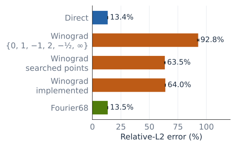

<!-- SPDX-FileCopyrightText: Copyright (c) 2026 NVIDIA CORPORATION & AFFILIATES. All rights reserved. -->
<!-- SPDX-License-Identifier: Apache-2.0 -->

# WinoVAE measurement notes

These notes accompany the [WinoVAE article](../../tech_blog/blog31_WinoVAE_Faster_Video_VAE_with_Winograd_Convolutions.md). Component timings with random weights, accuracy tests with trained weights, and CPU numerical experiments are separate measurements.

## GPU measurements

| Result | Hardware and measurement date | Conditions |
| :--- | :--- | :--- |
| BF16 Wan VAE generation profile, Figure 1 | One B200; Tue 6 Oct 2026 | Cosmos3-Nano-Sim-Bimanual, 901 frames at 832 × 480, two denoising steps per chunk. Decode 10.5 s, transformer 12.2 s, prompt plus encoding 3.9 s. |
| Spatial convolution sweep, Figure 12 | One GB200, Mon 26 Oct 2026, PyTorch 2.14.0+cu132 | Random FP16 operands, four input frames, CUDA-graph replay, L2 flushed, CUPTI first-to-last kernel span, median of 20. Includes transforms. The exact implementation version was not recorded. |
| Halo comparison, Figure 16 | Four GB200 GPUs in one tray; Sat 24 Oct 2026 | Back-to-back runs on the same node. CUDA graphs. Median of ten calls. SM clock 2.0 GHz. 720p: 189 frames. 480p: 121 frames. The exact implementation versions and weight source were not recorded. |
| Decoder timing, Figure 15 | One GB200; Tue 27 Oct 2026 | Random weights with Cosmos3 VAE dimensions; BF16; 189 frames, 1280 × 720. One latent frame per chunk. Two warmups, ten graph replays, L2 flush. Median CUPTI first-to-last kernel span. PyTorch 2.14.0+cu132, cuDNN 9.24.0. The measured implementation combined CUDA C++ and CuTe DSL kernels. |
| Checkpoint accuracy, Table 3 | One GB200; Tue 27 Oct 2026 | Cosmos3-Nano weights. Real 121-frame 832 × 480 clip resized to 720p. FP32 Diffusers reference. Decode latents from the reference encoding. |
| Streaming integration | One B300; Wed 28 Oct 2026 | Cosmos3-Nano-Sim-Bimanual, 901 frames at 832 × 480, seed 42, 64/8 history window, transformer CUDA graphs and VAE kernels launched individually. Median of three timed generation runs. The BF16 Wan VAE baseline already included decoder fusions. |
| Hopper encode and decode | One H200; Thu 22 Oct 2026 | Random Cosmos3-sized weights, BF16, 189 frames at 1280 × 720. CUDA transforms and cuBLAS batched GEMMs, before the CuTe DSL transform port. Two warmups, ten CUDA-graph replays, L2 flush, CUPTI first-to-last kernel timing. PyTorch 2.14.0+cu132, cuDNN 9.24.0. Implementation `e4d8920cf53f`. |
| Strong scaling, Table 6 | One eight-B300 node; Wed 21 Oct 2026 | Same node and implementation `9592c1121665` at 1, 2, 4, and 8 GPUs. Random Cosmos3-sized weights, BF16, 189 frames at 1280 × 720, width split, NCCL halo exchange, two warmups and ten CUDA-graph replays. |
| Frame-buffer capacity, Table 4 | One B300; Thu 29 Oct 2026 | Random Cosmos3-sized weights, 189 frames at 1280 × 720, one latent frame per chunk. CUDA graphs, median of three CUPTI measurements. Rounded values are recorded in [the implementation PR](https://github.com/NVIDIA/TensorRT-LLM/pull/21576). Raw per-capacity result files and an exact implementation identifier are unavailable. |
| Dynamic NVFP4 comparison, Table 5 | One B300; Tue 3 Nov 2026 | Original Cosmos3-Nano BF16 checkpoint, same 121-frame real clip at 832 × 480 and resized to 1280 × 720. Identical BF16 latents for every decoder, FP32 Wan VAE reference. Ten CUDA-graph replays after two warmups, 128 MiB L2 flush, CUPTI first-to-last kernel timing. PyTorch 2.14.0+cu132, cuDNN 9.24.0, TF32 disabled. |

### Decoder profiles and additional workload coverage

Figure 1 combines two measurements from October 6, 2026. The 26.6-second generation total contains a 10.5-second VAE decode. The decoder-only 10.1-second breakdown is reconstructed: the profile after normalization fusion contributes 7.4 seconds, and the measured normalization-fusion saving contributes 2.7 seconds. Its six category values are rounded to tenths of a second. It is not a kernel partition of the 10.5-second generation-path measurement.

Figures 13 and 14 cover four workload families on one B300 and one H200 respectively. Their values are retained in `hardware_b300` and `hardware_h200` in `data.json`. All use BF16 source tensors and random weights at Cosmos3 VAE dimensions. The November 1 B300 records do not identify an implementation commit. The October 22 H200 records identify `e4d8920cf53f`; these are the unthrottled single-GPU runs, using CUDA transforms and cuBLAS GEMMs. They are from the same measurement set as the H200 paragraph, rather than the separate earlier single-GPU sweep. Full-call timings are median CUPTI first-to-last kernel times from ten graph replays after two warmups, with L2 flushed. Streaming decode uses the benchmark's steady-state `step_latency.step_ms` metric for two latent frames producing eight output frames. The B300 aggregate stores it as `step_ms`.

Figures 17 and 18 use the October 24 B200 width-scaling runs, implementation `c79e84335cff`, one eight-GPU node, random weights, CUDA graphs, ten timed iterations and two warmups. WinoVAE uses Fused GPUDirect P2P. Both axes are log2. The eight-GPU 832 × 480 runs include only WinoVAE because the tested baselines require equal shards. No absent baseline point is extrapolated. These runs are separate from the B300/NCCL series in Table 6. `b200_strong_scaling` contains every plotted point and hashes of the source records.

Figure 20 uses a dedicated November 1 B300 profiling run with random weights, 189 frames at 1280 × 720, one latent frame per chunk, and CUDA graphs. The central values are median first-to-last kernel spans. Ring fractions use summed per-kernel durations, categorized by the recorded kernel-name rules in `b300_decoder_profile`. Those rules reproduce the original profile classification; a fused kernel is counted as a whole rather than splitting its instructions among categories. About 73.6% of WinoVAE's categorized kernel time lies in convolution-related categories, including input/output transforms. Convolution/GEMM kernels excluding the separate transforms account for about 58.2%. Source hashes and classification rules are included with the values.

The added end-to-end execution arrangements share the streaming-integration setup above. Sequential decode on one GPU takes 20.5/16.5 seconds for BF16 Wan VAE/WinoVAE, same-GPU overlap takes 21.0/16.9 seconds, and decode on a second GPU takes 15.2/14.2 seconds. These rounded whole-generation results do not isolate convolution speed or follow the component timing protocol.

These GPU results were measured with pre-release WinoVAE code. The recorded implementation identifiers are retained in `data.json` where available. The convolution sweep and halo comparison lack those identifiers, which limits exact reproduction. The WinoVAE code and numerical experiment scripts are not yet publicly available. The figures can be reproduced from saved values with the downloadable Python script.

The measured sweep sizes are recorded in `data.json`. Figure 12 compares three implementations of spatial 3 × 3 convolution: two-dimensional F(2 × 2, 3 × 3) with cuBLAS, two-dimensional F(4 × 4, 3 × 3) with specialized kernels, and fused one-dimensional F(2,3) along width with direct height filtering. The third path changes both decomposition and fusion. The F4 cuBLAS series remains in the data. The 1024-channel 1440p point was omitted because the transformed buffers did not fit on one GPU. The fused path was measured only at 256 output channels, starting at 360 × 640.

Figure 16 shows width sharding. Height-sharded NCCL/Fused GPUDirect P2P times, in milliseconds, are 460.3/432.9 for 720p decode, 149.2/144.4 for 720p encode, 185.5/151.6 for 480p decode, and 49.8/44.9 for 480p encode. These compare communication paths at four GPUs, not strong-scaling speedups against a separate single-GPU run.

In separate single-GPU VAE decode measurements, GB200 telemetry showed a 1200 W power cap, with software power-cap throttling and SM clocks around 900 to 1040 MHz. Separate cross-node checks found about 6% timing variation for memory-bound kernels and 20 to 25% for clock-bound kernels. Speedup comparisons use the same hardware setup within each experiment.

### Incremental fusion measurements

Table 2 uses recorded GB200 full-model timings from Thu 15 Oct and Fri 16 Oct 2026. The video-decode changes saved 1716.19, 867.85, 220.52, and 23.93 ms. Their percentages use the same 5963.98 ms original decode denominator. Before/after pairs are 5963.98/4247.79 ms for RMSNorm plus SiLU, 4223.85/3356.00 ms for folded upsampling and gather, 3356.00/3135.48 ms for deferred bias, and 4247.79/4223.85 ms for residual addition. The ordering in the table groups related work rather than constructing a cumulative speedup.

The first-frame Conv2d comparison is 20.95/9.17 ms for a 1024 × 1024 image. Its benefit is concentrated in the initial frame, so it contributes much less to a long video. The encoder group is 921.09/741.00 ms for 189 frames at 1280 × 720 and includes downsampling fusion, block-exit Winograd combines, and deferred biases. Saved timing records do not identify every modified kernel snapshot, limiting exact reproduction of these incremental measurements.

### Eager execution and memory accounting

The separate untraced B300 execution test takes the median of five host-wall-time trials, synchronizing before and after each trial. Each trial contains one call for videos longer than 100 frames and twenty calls otherwise. It does not trace CUPTI or flush L2 inside the trial. Measured eager/graph times include 357.557/354.473 ms for 121-frame 480p decode, 124.565/124.285 ms for its encode, 2470.144/2460.408 ms for 901-frame 480p decode, and 923.356/921.385 ms for its encode. Single-image 832 × 480 encode takes 2.591/1.122 ms. The exact implementation identifier was not recorded.

The benchmark reports `torch.cuda.max_memory_allocated() / 2**30`, so its field named `peak_alloc_gb` is expressed here in GiB. For Table 5, the counter resets immediately before the first untimed accuracy call, with the model and input already allocated. This precedes timing warmup, so the peak includes lazy weight packing and any autotuning allocations during that call. It includes live allocations and temporaries, but does not measure steady-state inference alone, CUDA-graph capture peak, or reserved allocator capacity. Frame-buffer capacity measurements and the trained-checkpoint comparison are separate experiments.

### Trained-checkpoint NVFP4 comparison

Table 5 uses implementation `b40c7e9758e046dbf256f92cd80c7ad5df4ff09b` with a benchmark adapter that calls the NVFP4 loader without changing runtime kernels. The native build uses CUDA 13.2.1. `data.json` records the benchmark and result SHA256 hashes, timing values, errors, and peak allocations.

FP32 Wan VAE encodes the resized clip. Its latents are rounded to BF16 once and shared by all decoders, including the FP32 decode reference. The dynamic NVFP4 loader selects 49 convolution modules across the model, including 28 decoder modules. All use runtime activation scales, with zero static-scale modules. No calibrated ModelOpt checkpoint or its layer exclusions is substituted for this configuration. This distinguishes the experiment from calibrated NVFP4 evaluation.

All six measured decodes completed with no NaNs. First-call peak allocations at 480p are 6.38 GiB for BF16 Wan VAE, 11.04 GiB for WinoVAE, and 6.83 GiB for dynamic NVFP4. At 720p they are 13.20, 17.73, and 13.49 GiB. The additional untraced wall timings in `data.json` still use CUDA-graph replay and must not be interpreted as eager timings. Relative-L2 error on one clip does not establish perceptual quality across a video dataset.

Absolute RMS errors for the checkpoint test are retained here alongside the article's relative-L2 comparison:

| VAE implementation | Decode RMS | Encode RMS |
| :--- | ---: | ---: |
| BF16 Wan VAE | 0.001845 | 0.003075 |
| WinoVAE | 0.001730 | 0.002592 |
| Diffusers BF16 | 0.001845 | 0.003078 |

## Precision study

The spatial-F4 simulation uses 64 tiles, 1024 input channels, 64 output channels, and three held-out seeds. Source tensors are BF16-rounded Gaussian values. Transforms and contraction use FP64, with V, U, and M rounded to the tested storage type. Final output rounding is excluded.

Let bᵢ and gᵢ be rows of the input and filter transforms, and aᵢ a column of the output transform. The sensitivity objective is κ = (1/12) Σᵢ ‖aᵢ‖² ‖bᵢ‖² ‖gᵢ‖². Under an independent relative-rounding noise model with RMS amplitude τ at each of three storage boundaries, relative output RMS error is approximately √3 τ κ. This model predicts average error under the stated noise assumptions. It does not bound the worst case.

Eight differential-evolution searches moved five finite points with infinity fixed. Another eight moved all six projective points. BFGS refined the candidates. The best-found set had κ = 4.742483, compared with 6.944444 for {0, 1, −1, 2, −1/2, ∞}. A separate exhaustive grid searched positive a,b ≤ 3 in {0, ±a, ±b, ∞}, with denominators 2, 4, 8, 16, and 32. The implemented {0, ±3/2, ±5/8, ∞} set has κ = 4.779807. Spatial and temporal F4 use different coefficient sets.

The best-found continuous spatial-F4 representative was {0, ±1.5350571, ±0.6514416, ∞}.

The larger-tile experiments use 32 tiles, 1024 input and output channels, and three seeds. For optimized F8, scaling input and filter coordinates by powers of two, with compensating output-transform scaling, reduced FP16 relative-L2 error from about 1.75 to 0.040. With textbook points, the same balancing reduced the error from about 100 to 0.114. The extreme unbalanced failures came from transformed-filter underflow and subnormal precision loss. No overflow was observed. Balanced F6 reached about 0.73% and optimized balanced F8 about 4.0%. These are isolated convolution simulations.

## Arithmetic and workspace model

Figure 10 assumes equal channel counts C = 1024, a 3 × 3 filter, and FP16 storage for V and M. Transform operation counts apply the illustrative matrices along columns and rows: one addition per extra nonzero coefficient and one multiplication per coefficient other than ±1. Weight preparation is excluded. The point sequence is 0, 1, −1, 2, −1/2, 1/2, −2, 4, −1/4, with infinity appended as required by the tile size. The implementation uses the optimized coefficients described in the precision study.

GEMM FLOPs count multiply-add as two. The workspace model counts V and M once each, excluding original inputs, outputs, weights, padding, and library workspace. Reading and writing both intermediates doubles their byte count before cache effects. Neither panel is a measured GPU performance curve. The source script's SHA256 and exact plotted values are in `data.json`.

## NVFP4 decomposition comparison



*Mean relative-L2 error across three seeds. Whiskers show the range. Both operands are quantized and other arithmetic uses FP64. This experiment measures isolated convolution error.*

| Method | Relative-L2 error | Products |
| :--- | ---: | ---: |
| Direct NVFP4 | 13.36 to 13.51% | 144 |
| Winograd, {0, 1, −1, 2, −1/2, ∞} | 92.15 to 93.50% | 36 |
| Winograd, continuous search | 63.20 to 63.94% | 36 |
| Winograd, implemented points | 63.93 to 64.07% | 36 |
| Fourier68 | 13.37 to 13.53% | 68 |

Product counts are real channel dot products per 4 × 4 output tile, excluding transforms and quantization.

The decomposition comparison uses seeds 5001, 5002, and 5003 with 64 spatial 6 × 6 tiles, 1024 input channels, and 64 output channels. Source tensors are BF16-rounded Gaussian values. Weights are normalized by 1/√(9 C_in). Both operands are quantized. Transforms, products, and reconstruction otherwise use FP64. Product storage and final output rounding are excluded.

The quantizer groups 16 consecutive input-channel values. Each operand tensor uses g = 448 × 6 / max|x|. Each block scale g × block_max / 6 is rounded to E4M3. Scaled payloads are rounded to E2M1, using nearest-even rounding and saturation. Scale subnormals are included. This specifies a format-level simulation, not the calibrated TensorRT-LLM checkpoint recipe.

Fourier68 uses four real coordinates and sixteen complex-conjugate pairs on a 6 × 6 grid. Each complex pair requires four real products, giving 68 products overall. A 52-product variant uses three real products per complex pair but had higher error under independent NVFP4 rounding. Neither variant has a GPU timing or trained-VAE quality result.

## Channel sorting and scale search

| Channels and treatment | Direct NVFP4 | Winograd NVFP4 |
| :--- | ---: | ---: |
| Gaussian; standard blocks | 13.403% | 64.109% |
| Gaussian; channel sorting | 13.473% | 63.681% |
| Gaussian; balance, sort, scale search | 12.118% | 57.960% |
| Stress case; standard blocks | 87.288% | 225.427% |
| Stress case; channel sorting | 13.515% | 64.517% |
| Stress case; balance, sort, scale search | 12.118% | 57.960% |

*Mean relative-L2 error over three seeds, with FP32 transforms and accumulation. Direct and Winograd receive the same treatment.*

The channel-grouping comparison uses seeds 5101, 5102, and 5103 with 32 input tiles of size 3 × 6 × 6, 1024 input channels, and 64 output channels. Each tile produces one 4 × 4 spatial output tile. Spatial Winograd uses the implemented F4 points. Temporal taps are summed in the channel contraction, with no temporal Winograd transform. BF16 sources are compared with an FP64 direct reference. Coefficients, transforms, dequantized GEMM accumulation, and reconstruction use FP32. Only V and U are quantized. M stays FP32. Final output rounding is excluded.

For each coordinate, the legal reordering is V′ = V D P and U′ = Pᵀ D⁻¹ U, where D is a positive diagonal matrix and P is a shared channel permutation. It preserves V′U′ = VU. The reciprocal-gain stress case draws channel gains from [1/16,16] while preserving the exact convolution.

The scale search tests 13 factors from 0.55 through 1.15, minimizing block squared error weighted by the partner operand's channel RMS squared. Weight statistics use independent calibration activations. Enhanced Winograd variants also use a global scale per coordinate. The search is limited to those factors and that objective. It does not cover arbitrary scales or use ModelOpt Local-Hessian calibration. Activation-side search adds online work.

The full treatment rows are in `data.json`, including balance-plus-sort without scale search (direct 13.437%, Winograd 64.101%). The matched simulated BF16 output-rounding error is 0.1663%. It is not a cuDNN measurement. In a companion 2D test, using ideal FP32 block scales still produced a Winograd output error of 63.257%. The tested heuristics do not determine whether optimized permutations or reconstruction-aware calibration could close the remaining gap.

Static permutations leave the GEMM product count unchanged. At 1024 channels, per-coordinate maps and FP32 balancing scales occupy 288 KiB per layer. Spatial F4 activation balancing adds 2.25 multiplies per input channel per output pixel. A separate FP32 reorder adds 18 bytes per input channel per output pixel. The reorder can share a kernel with transform/quantization to avoid the separate pass. Gather and coalescing costs remain unmeasured. The three-temporal-slice probe processes three times that activation volume.

The direct [NVFP4 Wan VAE implementation](https://github.com/NVIDIA/TensorRT-LLM/blob/main/tensorrt_llm/_torch/visual_gen/models/wan/wan_vae.py) supports activation scales computed at runtime or calibrated by ModelOpt, with selected/excluded modules. The loader dequantizes checkpoint weights into BF16 before runtime repacking and requantization, whereas the synthetic test tensors use Gaussian weights. The CPU arithmetic also differs from CUDA arithmetic.

## Reproducing the figures

From the repository root, with Matplotlib and NumPy installed:

```bash
python docs/source/blogs/media/tech_blog31/plot.py
```

This regenerates SVG and PNG figures from recorded data, including the workload and architecture figures implemented in `overview_plots.py`. It does not rerun GPU benchmarks or numerical searches. Numerical replay used NumPy 2.5.4 and SciPy 1.18.1. Fixed-candidate F4 and FP8/MXFP8 replays matched saved scalar results. This replay verification covers fixed candidates, excluding the continuous searches and the larger F6/F8 sweeps.
