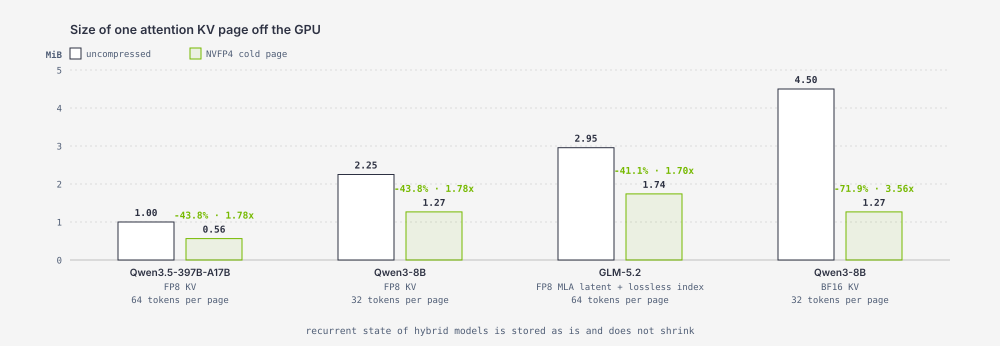
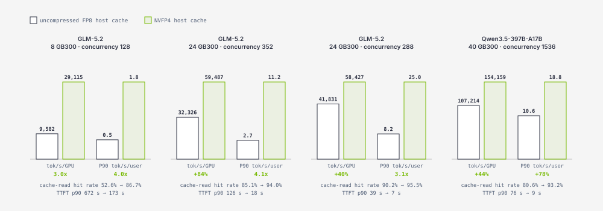
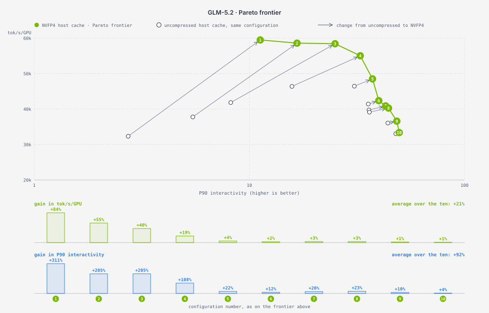
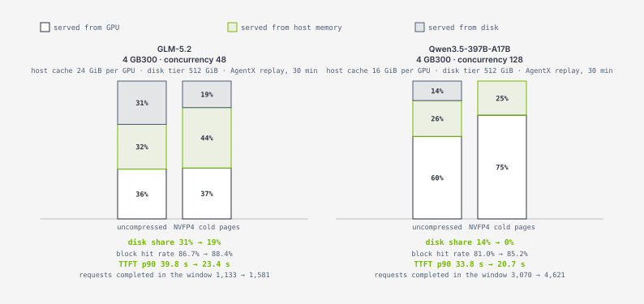
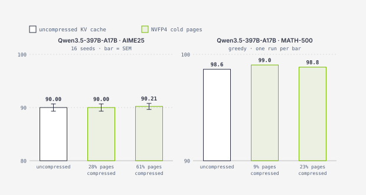

# KV Cache Compression in TensorRT LLM

**Table of Contents**
- [Introduction and Motivation](#introduction-and-motivation)
- [Overview of KV Cache Compression in TensorRT LLM](#overview-of-kv-cache-compression-in-tensorrt-llm)
- [KV Cache Compression Framework Design](#kv-cache-compression-framework-design)
  - [Design Philosophy](#design-philosophy)
  - [Architecture Overview](#architecture-overview)
  - [Configuration and Setup of KV Cache Compression](#configuration-and-setup-of-kv-cache-compression)
  - [KV Cache Compression in the Executor Iteration Loop](#kv-cache-compression-in-the-executor-iteration-loop)
  - [KV Cache Compression in Cross-Request KV Management](#kv-cache-compression-in-cross-request-kv-management)
- [Algorithm Implementations](#algorithm-implementations)
  - [NVFP4 Cold-Page Compression](#nvfp4-cold-page-compression)
  - [TriAttention](#triattention)
- [Evaluation](#evaluation)
  - [NVFP4 Cold-Page Compression](#nvfp4-cold-page-compression-1)
  - [TriAttention](#triattention-1)
- [Summary and Future Work](#summary-and-future-work)
  - [Current State](#current-state)
  - [Future Work](#future-work)

## Introduction and Motivation

Agentic workloads change what a serving system has to do. Instead of answering once, an agent works through a job in many steps, and it calls the model again with every tool result. Each call carries the whole conversation so far, so the prompt grows turn by turn while the answer stays short. Figure 1 shows how far production traffic has already moved in this direction: prompts dominate and keep getting longer, the KV cache behind them runs to tens of gigabytes per conversation, almost every prompt is a prefix the system has seen before, and that prefix comes back within minutes. For this workload **KV cache compression is critical**. Every byte of KV cache saved pays back many times: a smaller cache keeps more turns resident, reuses more prefixes instead of recomputing them, and frees memory for more requests.

<figure>
  
</figure>

<em>Figure 1: LLM serving today. On a one-year production trace, requests are prompt-heavy, outputs are getting shorter, a single long context carries tens of gigabytes of KV, and almost all reuse arrives within minutes. In agentic coding traces, almost the entire prompt is reusable prefix. Sources: <a href="https://arxiv.org/abs/2608.13573">Nixon et al., A Year in LLM Serving (2026)</a> for the first six tiles, and our <a href="https://nvidia.github.io/TensorRT-LLM/blogs/tech_blog/blog27_Evaluating_Agentic_Serving_with_Trace_Replay_and_Job_Level_Metrics.html">trace-replay blog</a> for the last one.</em>

Compression itself is not new. TensorRT LLM already stores the active cache in low precision and lets [sparse attention](blog17_Sparse_Attention_in_TensorRT-LLM.md) skip part of it. Both act inside the forward pass. Yet a KV cache spends most of its life **outside the attention kernel**: waiting between prefill chunks and decode steps, parked while a tool runs, kept after the request for the next turn, and moved to host or disk memory when the GPU is full. Each of these moments is a chance to compress, and until now no part of the serving stack was in charge of them. This blog introduces a **KV cache compression framework** that turns these moments into well-defined attachment points and lets any compression method plug into the ones it needs. The cache manager keeps ownership of every page and the attention kernels never see a compressed page, so one framework serves every model and compression can be co-designed with storage, transfer and compute at the system level. Two methods ship on it today:

- **[NVFP4 cold-page compression](#nvfp4-cold-page-compression)**: keeps attention KV pages in NVFP4 only while they are **cold**, that is, while they sit in host or disk memory. The conversion runs inside the copy, and the page returns to its original precision when it comes back to the GPU. On an agentic replay with a growing disk tier it completes up to **1.64x the requests** with up to **1.9x lower time to first token** on the same hardware.
- **[TriAttention](#triattention)**: a training-free method that periodically scores the tokens generated so far and **evicts the least useful ones** between decoding steps once a sequence exceeds its budget. On Qwen3-8B it delivers up to **1.6x the decode throughput** at the same batch size and **2.7x the dense peak** once the dense cache runs out of memory, with accuracy within noise of dense from an 8k-token budget on.

The next section gives an overview of what ships, followed by the framework design, how each method is built on it, and the evaluation.

## Overview of KV Cache Compression in TensorRT LLM

The general idea is simple: **shrink the KV cache at every safe point of the serving workflow, not only inside the forward pass**. Figure 2 shows how this fits with the two paths TensorRT LLM already has. Active KV cache quantization sets the data type of the GPU cache and is read and written by every forward step. Sparse attention changes which KV entries attention keeps or reads. The **KV cache compression framework** covers the rest: it runs at stable boundaries outside the forward pass, between steps or when a page moves between cache tiers, and it works on KV pages across the whole inference system, from the GPU cache at runtime to host and disk storage.

<figure>
  
</figure>

<em>Figure 2: The TensorRT LLM stack. KV cache compression sits in the compression layer next to quantization and sparse attention. It changes what is stored in the KV cache and touches neither the kernels below nor the serving layers above.</em>

To demonstrate the framework's generality, we have built two methods on it that act at different points in the life of a KV cache:

*   **NVFP4 cold-page compression**: stores attention KV pages as NVFP4 while they sit in host or disk memory. A page is encoded on the way out and decoded on the way back, so the GPU cache and the attention kernels keep the model's normal KV data type.
*   **TriAttention**: runs between decode steps. It scores the generated tokens with an importance measure calibrated offline per attention head and keeps only a fixed budget of them. The prompt is never touched.

The two tables below summarize the current coverage.

| Method | When It Runs | What It Changes | Supported Attention Types[^attn-types] |
| :--- | :--- | :--- | :--- |
| **NVFP4 cold-page compression** | When a page moves between the GPU and host or disk memory | How attention KV is stored while off the GPU | MHA / MQA / GQA / MLA / hybrid |
| **TriAttention** | Periodically between decode steps | Which KV tokens are kept | MHA / MQA / GQA |

<em>Table 1. The two methods built on the framework: when each one runs, what it changes, and the attention types it supports.</em>

[^attn-types]: MHA: multi-head attention. MQA: multi-query attention. GQA: grouped-query attention. MLA: multi-head latent attention. For hybrid models, only the KV of the attention layers is compressed.

| Memory Tier | NVFP4 Cold-Page Compression | TriAttention |
| :--- | :--- | :--- |
| **GPU (active KV)** | Unchanged (FP16 / BF16 / FP8) | Generated tokens evicted periodically |
| **Host memory** | NVFP4 | Not affected |
| **Disk** | NVFP4 | Not affected |

<em>Table 2. What each method does to the KV cache in each memory tier.</em>

**Note**: Currently, this design targets and is optimized for NVIDIA Blackwell GPUs and newer architectures.

The rest of the blog covers the framework design shared by all methods, with cold-page compression as the worked example. The interface between the cache manager and a page encoder is in the [cold-page codec design guide](https://github.com/NVIDIA/TensorRT-LLM/blob/main/docs/source/developer-guide/kv-cache-cold-page-codec.md), and the APIs for adding a method are in the [KV Cache Compression Development Guide](https://github.com/NVIDIA/TensorRT-LLM/blob/main/docs/source/developer-guide/kv-cache-compression-development.md).

## KV Cache Compression Framework Design

Our goals for the framework are two. A user turns a compression method on with **one configuration block** and nothing else. A developer adds a new method with **plain Python and kernels**, without touching the runtime. The framework takes care of the rest.

### Design Philosophy

Beyond the forward pass, a serving system offers **extra opportunities to compress the KV cache**: moments where the KV already exists, nothing is reading it, and a dedicated algorithm can run at exactly that time. Using them well means three things:

- **Untouched attention**: attention reads the KV cache as before.
- **Seamless insertion**: no exposed overhead; the compression kernels hide inside existing steps and nothing else in the runtime changes.
- **General to models**: works on KV pages, not on model-specific operators.

To insert precisely, we define five stages in the life of a KV cache (Figure 3):

1. **Prefill-chunk stage**: after each prefill chunk.
2. **After-prefill stage**: right after prefill, before the first decode step.
3. **Decode stage**: between decode steps (TriAttention).
4. **Tool-call stage**: around a tool call, while the request waits.
5. **After-request stage**: after the request, KV kept for reuse on GPU, host or disk (cold-page compression).

<figure>
  
</figure>

<em>Figure 3: Five stages in the life of a KV cache where compression can run. TriAttention acts at the decode stage (stage 3) and cold-page compression at the after-request stage (stage 5). The dashed stages are in scope and have no method yet.</em>

These stages fall into two groups, and each group has its own integration path. Stages 1 to 3 happen while a request is running, so **iteration-driven** methods hook into the executor loop at each stage boundary and transform the retained KV before the next step reads it; TriAttention is one. Stages 4 and 5 happen while no request is running: the cache manager holds the KV, keeps it across requests, and moves it between GPU, host and disk memory. For them we define **cross-request KV management** methods, which run inside the cache manager. A method may use either path or both, and in both the cache manager keeps ownership of every page.

### Architecture Overview

The framework has three parts, shown in Figure 4:

- **Compression config**: one block that selects the method and carries its options; a factory builds the method from it before the model runs.
- **Compression manager**: the class a method inherits. It already sits at every hook in the executor loop and in the cache manager's page migration; a method overrides the functions for the stages it needs and the compression flow is in place.
- **Method-specific kernels**: a method could bring its own kernels, new algorithms as well as fusions with existing parts of the runtime.

The executor and the KV cache manager are existing components. The framework does not replace them; it meets them at the hooks and leaves scheduling and memory ownership where they are.

<figure>
  
</figure>

<em>Figure 4: The KV cache compression framework and its execution order. The config builds the manager (1). The manager inserts a hook into the executor and one into the KV cache manager (2). The concrete method inherits the manager and runs inside those hooks (3), launching its own kernels (4). Highlighted boxes are the framework parts; white boxes are existing system components, with the stages each one hosts today and in the future.</em>

In the current implementation, **storage-bound** compression is the first cross-request mechanism: it acts when a page moves to host or disk memory and defines how the page is stored there. Today TriAttention implements the decode stage (stage 3) and NVFP4 cold-page compression the offload part of the after-request stage (stage 5). The other stages are reachable the same way and will be filled as new methods need them. The rest of this section covers the configuration and the two paths.

### Configuration and Setup of KV Cache Compression

**The idea.** One config block says which method to run and with what parameters. From it the framework works out which modules to engage and whether the rest of the setup allows it. The block, `kv_cache_compression_config`, holds:

- **`algorithm`**: which method to run. One method can be active per LLM instance.
- **Method options**: the method's own parameters, e.g. for TriAttention the token `budget`, the eviction period, the `eviction_mode` and the calibration file.

It works the same in the Python API, in `trtllm-serve` YAML and in `trtllm-bench`; the full option table is in the [KV Cache Compression feature documentation](https://github.com/NVIDIA/TensorRT-LLM/blob/main/docs/source/features/kv-cache-compression.md).

Before anything is built, a factory reads the block and wires things up: which modules the method engages (the cache manager's page migration for cold-page compression, the executor loop for TriAttention), whether block reuse and the configured speculative decoding mode stay valid, and whether the platform matches, since some methods target a specific one (e.g. TriAttention currently requires Blackwell or a newer architecture). An unsupported combination is rejected with a clear message; otherwise the compression manager is built and bound to KVCacheManagerV2 (V2 from here on). For the interfaces, see the [KV cache compression development guide](https://github.com/NVIDIA/TensorRT-LLM/blob/main/docs/source/developer-guide/kv-cache-compression-development.md).

### KV Cache Compression in the Executor Iteration Loop

**The idea.** The stages inside a request (stages 1 to 3 in Figure 3) are reached by riding on callbacks the executor already makes. The executor calls every resource manager before the forward pass, after it, and when a request ends. The compression manager registers last, so it runs after the KV cache manager has updated its state, and maps these callbacks onto five hook functions, one per moment: request start, end of prefill, before and after each decode step, and request finish (Figure 5). Every hook does nothing by default. A method overrides the hook of the stage it wants, and its code runs there.

<figure>
  
</figure>

<em>Figure 5: How the hooks reach the executor iteration loop. Every BaseResourceManager receives three callbacks per iteration: before the forward pass, after it, and when a request ends. KVCacheCompressionManager inherits BaseResourceManager and turns the three callbacks into the five hooks. A method overrides the hooks it needs.</em>

Two rules for methods on this path: the policy that picks tokens stays separate from the shared compaction kernel, and GPU work finishes before a page is shrunk or freed. TriAttention uses `on_generation_step_end`; the other hooks are in place for new methods.

### KV Cache Compression in Cross-Request KV Management

**The idea.** Outside a request the cache manager owns the KV, so compression plugs into the cache manager at the points where pages move. During a tool call (stage 4 in Figure 3) and after the request (stage 5), V2 decides which pages stay on the GPU, move to host or disk memory, are reused or transferred, and it does no compression itself. Every reused page is a prefill that never runs, and compression lets the tiers hold more of them. The framework adds compression at three points:

- **Offload and onboard**: when a page leaves the GPU and when it returns. A codec encodes the page on the way out and decodes it on the way back, and V2 never sees the difference. This is the storage-bound mechanism; NVFP4 cold-page compression lives here.
- **Transfer**: when a page moves to another worker.
- **Request end**: when a request finishes or pauses for a tool.

Today the offload path is the one with a shipped method. The other points are reserved for methods that need them, and the same path could later serve contexts that are similar but not identical, so that one cached block serves prompts that differ around it (KVCOMM is a published example). How the NVFP4 codec is built is described in the NVFP4 cold-page compression section below and in the [cold-page codec design guide](https://github.com/NVIDIA/TensorRT-LLM/blob/main/docs/source/developer-guide/kv-cache-cold-page-codec.md).

## Algorithm Implementations

In this section, we walk through the two KV cache compression methods currently implemented in TensorRT LLM, focusing on how each method works and how it integrates with the framework. For a quick-start guide and runnable configurations, please refer to the [KV cache compression examples](https://github.com/NVIDIA/TensorRT-LLM/tree/main/examples/kv_cache_compression).

### NVFP4 Cold-Page Compression

#### Introduction

**The idea.** Pages that leave the GPU are the cheapest place to compress: they are being copied anyway, nothing reads them while they are cold, and only the pages pushed out by memory pressure are touched. Cold-page compression stores attention KV pages as NVFP4 while they sit in host or disk memory and keeps the model's normal data type, FP16, BF16 or FP8, on the GPU. The attention kernels never see the compressed form. To try it, see the [NVFP4 cold-page example](https://github.com/NVIDIA/TensorRT-LLM/blob/main/examples/kv_cache_compression/nvfp4_cold_page.md).

NVFP4 is NVIDIA's 4-bit floating-point format: 4-bit values (E2M1) with one 8-bit (E4M3) scale per 16 values, 4.5 bits per value on average, the same format TensorRT LLM uses for weights and for the active KV cache. Applying it to cold pages buys four things:

- **Accuracy-friendly**: only pages that go cold are rounded, once; everything on the GPU stays at full precision.
- **Free transfer**: the encode runs inside the copy that moves the page, so there is no extra pass over the data.
- **Fewer bytes to move**: a page shrinks to 4.5 bits per value, from 8 or 16, on its way across PCIe and the storage link.
- **One payload per page**: data, scales and lossless buffers are packed in one fixed-size block with one base address, so the tiers address it like any other page.

Figure 6 compares the three layouts of one KV page.

<figure>
  
</figure>

<em>Figure 6: One KV page of one layer, holding K and V for 32 tokens, in three layouts. The hot page on the GPU stores 16 bits per value in one pool. The NVFP4 active KV cache and the NVFP4 cold page hold the same bytes, 4-bit data plus one 8-bit block scale per 16 values. The active cache keeps them in two pools that attention reads together; the cold page packs them into one fixed-size block with one base address.</em>

#### How It Works in TensorRT LLM

Cold-page compression is a compression manager on the cross-request path, enabled with `algorithm: quantization_for_cold_page` and `quant: nvfp4`. Figure 7 follows one page out of the GPU and back.

**Encode, on the way out.** When V2 offloads pages, it hands the codec a batch of page indices and a stream. A fused kernel reads the GPU pages, computes the block scales, quantizes, and writes the packed cold pages straight into the host slots, so quantization and transfer are one pass and no calibration is needed. Which buffers are quantized is decided once at start-up from the page layout: the attention K and V buffers, and for an MLA layer the latent key. Everything else in the page is copied as it is: recurrent and convolution state of hybrid layers and the index buffer of DeepSeek Sparse Attention.

**Decode, on the way back.** When a request needs the page again, the fused counterpart dequantizes it into the GPU pool in its original data type before attention reads it. Target and draft caches are both covered, so speculative decoding works with the codec enabled.

**The RoPE part of K.** By default the position-encoded (RoPE) values are quantized like the rest; DeepSeek-V4 stores them as two FP4 components (2FP4), the second holding the first one's rounding error, matching the model's native KV-cache approach. Setting `skip_rope_quantization: true` keeps the RoPE part at its original precision, trading compression ratio for accuracy. These are options to explore and validate per workload; see the [NVFP4 cold-page example](https://github.com/NVIDIA/TensorRT-LLM/blob/main/examples/kv_cache_compression/nvfp4_cold_page.md#deepseek-v4).

**Kernel design.** The encode must not be slower than the copy it replaces. The kernels therefore mirror the cache manager's own host-copy kernel, with the same thread-block count and split policy: each block streams whole 16-value scale groups in through a multi-stage `cp.async` ring, quantizes in shared memory, and writes 128-bit stores straight into the mapped host slot, so the store is the transfer. One launch covers up to 256 buffers and a whole batch of pages, and lossless buffers take a vectorized copy in the same launch.

<figure>
  
</figure>

<em>Figure 7: One page leaving and returning to the GPU inside the KV cache manager. A page goes cold when its request pauses or ends, or under memory pressure. A fused kernel quantizes the 16-bit hot page and copies it to the host and disk tiers as one 4.5-bit cold block in a single pass, and a fused decode kernel dequantizes and copies it back when an active request reuses it.</em>

The implementation lives in `tensorrt_llm/_torch/kv_cache_compression/quantization_for_cold_page/` (manager and layout policy), `cpp/tensorrt_llm/batch_manager/kv_cache_compression/` (native codec) and `cpp/tensorrt_llm/kernels/nvfp4ColdPageKernels.cu` (fused encode and decode kernels).

### TriAttention

#### Introduction

**The idea.** In a long generation most of the KV cache is generated tokens, and most of them will not matter to the queries still to come. [TriAttention](https://arxiv.org/abs/2604.04921) (ICML 2026) predicts which ones matter from per-head query statistics collected once offline, and every few tokens evicts the rest and compacts the cache, so decoding reads a shorter cache and more sequences fit on the GPU. The prompt is never touched; only generated tokens are evicted. Figure 8 shows one round. For details, see the paper and the [TriAttention example](https://github.com/NVIDIA/TensorRT-LLM/blob/main/examples/kv_cache_compression/triattention.md).

<figure>
  
</figure>

<em>Figure 8: TriAttention keeps the prompt intact and evicts generated tokens. Every β new tokens, the generated tokens are scored with the calibrated query statistics of each head. The `budget` highest-scoring tokens stay, the rest are evicted, and the cache is compacted, so decoding continues over a shorter cache.</em>

#### How It Works in TensorRT LLM

**The score.** With rotary position embedding, the attention logit between a query and a key is a sum over frequency bands of the query magnitude times the key magnitude times the cosine of the rotation angle, which grows with the distance between the two positions. Replacing the unknown future query by each head's calibrated mean pre-RoPE query (`E_q`, `E_q_norm`, with the RoPE frequencies `omega`) gives an expected logit that depends only on the key and its position, so it can be computed from the K cache alone. That expected logit is the importance score.

**One eviction round.** Every `beta` generated tokens, once a sequence is over its budget, TriAttention scores every generated token and head, normalizes the scores per head, and keeps the `budget` highest. In the default `union` mode each KV head nominates its top tokens and the union is re-ranked by each token's best score; `per_head` and `per_layer_perhead` keep separate sets per head. The kept K and V are compacted in place and the new length is reported to V2, which frees the pages.

**Kernels.** A fused CuTe DSL kernel on Blackwell reads the K pages directly from the paged cache, applies the calibrated cosine and sine coefficients from a precomputed mean-phase table, and produces the per-head scores with their normalization statistics in one pass; in `union` mode its epilogue also reduces them into the selection rows, the per-head modes use a Triton reduction. A CuTe DSL radix top-k picks the `budget` tokens, a Triton pass settles ties deterministically, and a native CUDA kernel compacts K and V. No K or V leaves the paged cache for scoring.

**Injection into decoding.** TriAttention is an iteration-driven manager that overrides one hook, `on_generation_step_end`, so a round runs right after V2 has updated the cache and before the next decode step reads it. It is enabled with `algorithm: triattention` plus `budget`, `beta`, `eviction_mode` and `calibration_path`. When the hook fires, the requests that have generated `beta` new tokens since their last round and exceed their budget run the round in Figure 9; a speculative step that confirms several tokens triggers at most one. Block reuse stays valid because only the generated suffix is compacted and the prompt prefix that V2 reuses is preserved, and decoding keeps running the model's standard attention kernel over the compacted cache.

<figure>
  
</figure>

<em>Figure 9: One TriAttention eviction round in TensorRT LLM, one box per kernel. The generation-end hook picks the due requests; a Triton kernel gathers the mean-phase rows; the fused CuTe DSL kernel scores every generated token from the K pages; the selection rows are produced in the same kernel for `union` mode and by a Triton reduction for the per-head modes; a CuTe DSL radix top-k and a Triton tie-settling pass choose the kept tokens; a native CUDA kernel compacts K and V; and the cache manager takes the new length and the freed pages.</em>

For calibration, configuration and current requirements, see the [TriAttention example](https://github.com/NVIDIA/TensorRT-LLM/blob/main/examples/kv_cache_compression/triattention.md).

## Evaluation

This section consolidates performance and accuracy results for the KV cache compression methods supported in TensorRT LLM. Every comparison is against TensorRT LLM's own uncompressed configuration on the same hardware, software build, and serving configuration; only the compression setting differs.

### NVFP4 Cold-Page Compression

Unless otherwise specified, the experiments below use GB300 GPUs, the PyTorch backend, the paged KV cache manager, and block reuse enabled. Before any result was accepted we confirmed that pages were actually compressed during the measured window, using the offload and onboard byte counters on the `/metrics` endpoint and an Nsight Systems trace.

#### Performance

The compression ratio follows from the format. Packed NVFP4 data plus one 8-bit scale per 16 values costs 0.5625 bytes per value, against 2 bytes for FP16 or BF16 and 1 byte for FP8. Figure 10 shows the measured size of one attention KV page off the GPU for four models. The recurrent-state buffers of hybrid models are stored as they are and do not shrink.

<figure>
  
</figure>

<em>Figure 10: Measured size of one attention KV page off the GPU, uncompressed and as an NVFP4 cold page. FP8 pages shrink by 43.75%, BF16 pages by 71.9%; the GLM-5.2 MLA page shrinks a little less because its index buffer stays lossless.</em>

The serving effect of a smaller cold page is more capacity in the host and disk tiers, and therefore a higher prefix-cache hit rate when the working set does not fit. We show it in three settings, from a well-provisioned published configuration to a deliberately GPU-limited one.

**A published configuration.** Figure 11 shows GLM-5.2 at a published InferenceX configuration on 32 GB300s. The uncompressed host tier already reads 96.2% of the prefixes, close to the 97.2% the trace allows, so throughput is neutral. NVFP4 buys latency: P90 interactivity (output tokens per second per user) rises and the P90 time to first token (TTFT) falls.

<figure>
  
</figure>

<em>Figure 11: GLM-5.2 · published InferenceX configuration · 32 GB300s · AgentX replay. Throughput is unchanged; P90 interactivity and TTFT improve.</em>

**Beyond the published frontier.** When the host tier is under pressure, NVFP4 raises the hit rate, and the serving metrics follow. Figure 12 shows one point from our search: GLM-5.2 at concurrency 288 on 24 GB300s, where the uncompressed tier reads only 90.2% of prefixes. NVFP4 raises that to 95.5%, lifts throughput per GPU by 39.7%, triples P90 interactivity, and cuts TTFT from 38.7 to 6.9 seconds, which puts this configuration on the Pareto frontier.

<figure>
  
</figure>

<em>Figure 12: GLM-5.2 · 24 GB300s · concurrency 288 · AgentX replay. NVFP4 lifts the cache-read hit rate from 90.2% to 95.5% and improves every serving metric.</em>

**The largest gains.** Figure 13 shows the four configurations from our search where NVFP4 cold pages changed the result most. In each one the uncompressed host tier reads far fewer prefixes than the trace allows, so requests recompute long prompts and queue behind them. NVFP4 raises the hit rate by 5 to 34 points, and throughput per GPU and P90 interactivity follow: GLM-5.2 at concurrency 128 on 8 GB300s triples its throughput, and Qwen3.5-397B-A17B at concurrency 1536 on 40 GB300s gains 44%.

<figure>
  
</figure>

<em>Figure 13: The four serving configurations with the largest NVFP4 gains · AgentX replay. Each panel is one configuration run with the uncompressed host cache and with the NVFP4 host cache, two or three repeats per setting; bars are throughput per GPU and P90 interactivity, with the cache-read hit rate and P90 TTFT below.</em>

Figure 14 shows the effect along the GLM-5.2 Pareto frontier. Each green point is an NVFP4 configuration that no other NVFP4 configuration beats on both axes; the hollow point joined to it is the same configuration without compression. The gain is largest where the uncompressed tier misses most and fades to nothing where it already reads most prefixes.

<figure>
  
</figure>

<em>Figure 14: GLM-5.2 · 8 to 48 GB300 · the ten highest-throughput points of the NVFP4 Pareto frontier. Top: each green numbered point is an NVFP4 configuration, the hollow point is the same configuration with an uncompressed host cache, and the arrow shows the change. Bottom: the gain of each numbered configuration in tok/s/GPU (green) and in P90 interactivity (blue). Two repeats per setting; AgentX replay.</em>

**A GPU-limited deployment.** The third setting is a resource-constrained configuration: Qwen3.5-397B-A17B served on ten GB300s (prefill on 2 GPUs, generation on 8 GPUs) at concurrency 192. With the host tier alone the uncompressed setting reads only 57% of prefixes. Figure 15 grows the disk tier from 0 to 1,024 GiB. NVFP4 hits more, completes more, and answers sooner at every disk size. The gain peaks at 512 GiB: 64% more requests completed and 48% sooner.

<figure>
  
</figure>

<em>Figure 15: Qwen3.5-397B-A17B · ten GB300s · concurrency 192 · growing disk tier. NVFP4 completes more requests, hits more, and answers sooner at every disk size.</em>

**Where the hits come from.** A hit rate alone does not say which tier served the prefix. TensorRT LLM now counts every full-block hit by the tier it came from. Figure 16 uses these counters on one GB300 node (4 GPUs, TP4/EP4) with a 512 GiB disk tier and the GPU cache capped so that the working set spills out of it. Both settings reach a similar hit rate in each case. What changes is where the hits are served from. For GLM-5.2 at concurrency 48 with 24 GiB of host cache per GPU, the share of hits served from disk falls from 31% to 19%, p90 TTFT drops from 40 s to 23 s, and 1,581 requests complete in the 30-minute window instead of 1,133. For Qwen3.5-397B-A17B at concurrency 128 with 16 GiB of host cache per GPU, no hit is served from disk at all, p90 TTFT drops from 34 s to 21 s, and 4,621 requests complete instead of 3,070. The same host memory holds more pages, so the prefixes that used to come back from disk now come back from host memory.

<figure>
  
</figure>

<em>Figure 16: GLM-5.2 · 4 GB300 · concurrency 48 (left) and Qwen3.5-397B-A17B · 4 GB300 · concurrency 128 (right) · where reuse hits are served from. Each bar splits the full-block hits of a 30-minute AgentX replay by tier. The hit rate is similar in both settings of each pair; with NVFP4 cold pages fewer hits are served from disk, the tail TTFT falls, and more requests complete in the window. GPU cache capped at 50% (GLM-5.2) and 35% (Qwen3.5) of free GPU memory.</em>

#### Accuracy

Cold-page compression is lossy, so the remaining question is how much accuracy it can cost. Two facts bound the answer.

First, a page is quantized only when it leaves the GPU, and at most once per offload. In most deployments the host tier has headroom, so most pages never leave the GPU and are never quantized at all; attention reads them exactly as they were written. Even under heavy cache pressure, only part of the pages that attention reads have been through the codec. The worst case is a deployment where every page is re-quantized on every turn. Even then a page never carries more than one NVFP4 rounding at a time, so the accuracy of cold-page compression is bounded below by that of a fully NVFP4 KV cache, a configuration TensorRT LLM already ships and whose loss is small and well characterized. Every real deployment sits strictly inside that bound.

Second, repeated quantize-and-dequantize round trips do not compound. A value can move on the first round trip, in rare cases once more on the second, and never after that. We measure this as a distance. For a value with original $x_0$ and value $x_r$ after $r$ round trips, in a block whose original maximum is $m$,

$$
d_{\text{orig}}(r) = \frac{|x_r - x_0|}{m}, \qquad d_{\text{prev}}(r) = \frac{|x_r - x_{r-1}|}{m}.
$$

Figure 17 reports both over every finite FP8 code and every FP16 and BF16 value whose block scale is a normal E4M3 code. The distance to the original is the quantization error itself, a median below 1% of the block maximum and a worst case of 17%, and it is the same after every round trip. The distance to the previous round trip is zero for every value from the second round trip on. End to end, Qwen3-8B on AIME24 and AIME25 loses about 2 points after one round trip, within the noise of this setup, and the second round trip reproduces every output of the first.

<figure>
  
</figure>

<em>Figure 17: NVFP4 round trips do not accumulate error. Left: distance to the original value after 1 to 4 round trips, as a percentage of the block maximum on a log scale, for every finite FP8 code and every FP16 and BF16 value with a normal block scale; the dot is the median, the bar reaches the 90th percentile, the tick is the maximum. The distribution is the quantization error, and it does not change with the number of round trips. Middle: distance to the previous round trip on the same scale; from the second round trip on it is exactly zero for every value, drawn on the baseline. The one exception is the exhaustive FP8 layout that lays all 254 codes out in order, where 18 of 1,024 values move once more at the second round trip and never again. Right: Qwen3-8B accuracy on AIME24 and AIME25 (30 questions, 8 seeds) after 0, 1 and 2 round trips; the second round trip reproduces all 480 outputs of the first. Distances come from a scalar reference model of the codec that reproduces the change counts of the production kernels exactly.</em>

Figure 18 shows the end-to-end measurements on larger models. Each pair is the same model, hardware and configuration with and without NVFP4 cold pages. On Qwen3.5-397B-A17B, AIME25 is 90.00% with and without compression when 28% of the reused pages are compressed, and 90.21% when 61% are; MATH-500 is 98.6% against 99.0% and 98.8%. DeepSeek-V4-Flash on GPQA Diamond moves by 0.15 points, DeepSeek-V4-Pro on IFBench by 0.25 points. The largest difference is 0.40 points.

<figure>
  
</figure>

<em>Figure 18: Accuracy with and without NVFP4 cold pages on large models. Qwen3.5-397B-A17B on AIME25 (16 seeds, error bar is the standard error) and MATH-500 (greedy, one run per bar); DeepSeek-V4-Flash on GPQA Diamond (1,980 generations); DeepSeek-V4-Pro on IFBench (4 seeds, error bar is the standard deviation, mean of the four IFBench scores). Labels under the Qwen bars give the share of reused pages that had been compressed before scoring.</em>

Together, these two facts mean that cold-page compression cannot drift with repeated offloading. Its accuracy cost is at most one NVFP4 rounding of the pages that actually leave the GPU, and it does not grow with the number of times a page is offloaded and brought back.

### TriAttention

#### Performance

TriAttention shrinks the decode KV cache of every running sequence, so it helps in two ways: decoding reads a shorter cache at the same batch size, and more sequences fit on the GPU. We measure both on Qwen3-8B on one B200 with 1,024 input and 16,384 output tokens per request, CUDA graphs and the overlap scheduler on, and three fresh-process runs per point on the same GPU. Figure 19 shows aggregate output throughput per GPU against batch size for the dense cache and for TriAttention with budgets of 4,096 and 2,048 tokens and an eviction period equal to the budget.

At matched batch sizes the compacted cache decodes faster: at batch size 32, budget 4,096 gives 27% more output throughput than dense and budget 2,048 gives 60% more. Beyond that the dense cache runs out of memory at batch size 64, while TriAttention keeps scaling: budget 2,048 reaches 6,670 tok/s at batch size 64 and 8,198 tok/s at batch size 128, 2.7x the dense peak on the same GPU.

<figure>
  
</figure>

<em>Figure 19: TriAttention on Qwen3-8B, one B200, 1,024 input and 16,384 output tokens. Aggregate output throughput per GPU against batch size for the dense KV cache and for TriAttention with budgets of 4,096 and 2,048 tokens. The dense cache runs out of memory at batch size 64; TriAttention continues to batch size 128.</em>

#### Accuracy

Eviction is lossy by design, and the budget sets the trade. Figure 20 shows AIME25 accuracy against the decode KV budget for Qwen3-8B and GPT-OSS-120B in `union` mode, with the dense result as the dashed line. Each point is 30 problems with 4 samples, so single points carry about 4 to 5 points of noise. With aggressive budgets of 1,000 or 2,000 tokens for outputs that run to 32,000 tokens, accuracy drops sharply. At 4,096 tokens, the budget used for the throughput results above, the drop is about 5 points on both models while the decode KV shrinks 7.9 times on Qwen3-8B. From 8,192 tokens on, accuracy is within noise of dense on both models while the decode KV still shrinks 2 to 4 times. The friendly region is therefore wide, and the budget can be chosen per deployment to trade a known amount of accuracy for capacity.

<figure>
  
</figure>

<em>Figure 20: AIME25 accuracy against the decode KV budget for TriAttention in union mode with the eviction period equal to the budget, on Qwen3-8B (left) and GPT-OSS-120B (right). The dashed line is the dense cache. The label under each bar is the decode-KV compression relative to dense at that budget.</em>

For configuration, the calibration workflow, and validated modes, please refer to the [TriAttention example](https://github.com/NVIDIA/TensorRT-LLM/blob/main/examples/kv_cache_compression/triattention.md).

## Summary and Future Work

### Current State

The KV cache compression framework, NVFP4 cold-page compression, and TriAttention are in TensorRT LLM today and ready to use. Both methods are turned on with one configuration block and work with the mainstream model families; the tested list is in the [KV Cache Compression feature documentation](https://github.com/NVIDIA/TensorRT-LLM/blob/main/docs/source/features/kv-cache-compression.md#tested-models), and runnable configurations are in the [examples](https://github.com/NVIDIA/TensorRT-LLM/tree/main/examples/kv_cache_compression). The framework is ready to extend: a new method inherits the manager base, plugs into the stages it needs, and brings its own kernels, without changes to the attention kernels, the cache manager, or the serving loop.

### Future Work

The framework is built to grow. We will keep adding compression techniques for the new era of long-context, reasoning and agentic workloads, as the workload and the hardware evolve.

The goals do not change: better use of GPU memory and bandwidth, higher throughput and lower latency, and accuracy that holds on real tasks. New methods will land through the same framework, with the same one-block configuration and no changes to the attention kernels, the cache manager or the serving loop.

## References

- W. Nixon, J. Durbin, F. Standhartinger, H. S. Gunawi, and J. Yang. A Year in LLM Serving: Workload Evolution, Caching and Load-Balancing. [arXiv:2608.13573](https://arxiv.org/abs/2608.13573), 2026.
- W. Mao et al. TriAttention. ICML 2026. [arXiv:2604.04921](https://arxiv.org/abs/2604.04921).
- KVCOMM: Online Cross-context KV-cache Communication for Efficient LLM-based Multi-Agent Systems. NeurIPS 2025. [arXiv:2510.12872](https://arxiv.org/abs/2510.12872).
- RocketKV: Accelerating Long-Context LLM Inference via Two-Stage KV Cache Compression. ICML 2025. [arXiv:2502.14051](https://arxiv.org/abs/2502.14051).
- TensorRT LLM, [KV Cache Compression feature documentation](https://github.com/NVIDIA/TensorRT-LLM/blob/main/docs/source/features/kv-cache-compression.md) and [examples](https://github.com/NVIDIA/TensorRT-LLM/tree/main/examples/kv_cache_compression).
