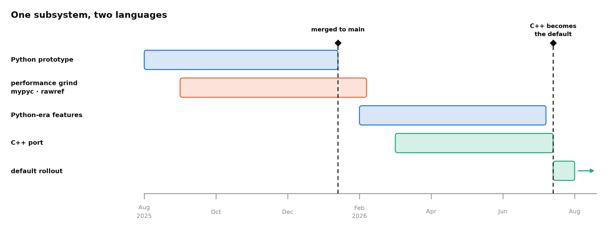

# From Python to C++: Rewriting KVCacheManagerV2 in the Age of Coding Agents

By NVIDIA TensorRT LLM Team

**Table of Contents**
- [Introduction](#introduction)
- [Why We Wrote It in Python First](#why-we-wrote-it-in-python-first)
- [The Performance Grind](#the-performance-grind)
  - [Fighting the Interpreter](#fighting-the-interpreter)
  - [mypyc and the Price of Its Constraints](#mypyc-and-the-price-of-its-constraints)
  - [Offloading Pieces to C++](#offloading-pieces-to-c)
- [The Turn](#the-turn)
  - [Why C++ and Not Rust](#why-c-and-not-rust)
- [Running the Translation](#running-the-translation)
  - [The Plan Came First](#the-plan-came-first)
  - [Differential Testing](#differential-testing)
  - [What C++ Bought Us Beyond Speed](#what-c-bought-us-beyond-speed)
- [Lessons](#lessons)
- [Future Work](#future-work)
- [Acknowledgment](#acknowledgment)

## Introduction

KVCacheManagerV2 (KVCM2) is TensorRT LLM's redesigned KV cache manager. The companion post, [KVCacheManagerV2: Redesigning KV Cache Management in TensorRT LLM](./blog29_KVCacheManagerV2_Redesigning_KV_Cache_Management_in_TensorRT-LLM.md), describes what it does and why the previous design needed replacing. This post is about something narrower and, we think, more broadly applicable: how it was built, and what we learned when the reasoning behind one of our biggest decisions quietly stopped being true.

We deliberately wrote KVCM2 in **Python**, accepting a known performance penalty, because we believed a Python KV cache manager would be far more approachable for community contributors. We spent months defending that choice — micro-optimizing, compiling with mypyc, writing a custom C extension to work around mypyc's limitations, even taking the workload's execution characteristics to NVIDIA's CPU architecture teams. And then, over roughly a year, the premise underneath the decision dissolved. Coding agents got good enough that the language a contributor already knows stopped being the binding constraint. So we translated about 12,000 lines of Python into roughly 17,000 lines of C++, with agents doing most of the typing, and made C++ the default backend.

Both halves of that story are worth telling honestly, including the parts where we were wrong.

<div align="center">
<figure>
  
</figure>
</div>
<p align="center"><sub><em>Figure 1: KVCacheManagerV2 project timeline.</em></sub></p>

<!-- FIGURE BRIEF (not rendered) — Fig 1: Horizontal timeline / Gantt with overlapping bars. Python
prototype (Aug-Dec 2025); performance grind, mypyc and rawref (Sep 2025-Jan 2026); merged to main
(Jan 2026); Python-era feature build-out (Feb-Jul 2026); C++ port, overlapping (Mar-Jul 2026); C++
becomes default backend (Jul 2026); model-by-model rollout (Aug 2026). -->


## Why We Wrote It in Python First

KVCM2 began in late August 2025 as 1,882 lines of Python in a single commit. The core — storage manager, per-request cache, copy engine — was functionally complete 19 days later, and the first test landed five days after that.

The choice of Python was deliberate, and at the time it was the single most important decision about the project. It rested on one argument.

**Contribution barrier.** TensorRT LLM's community is overwhelmingly a PyTorch community. A researcher who wants to try a new eviction heuristic, a new snapshot policy for Mamba, or a different prefix-reuse strategy is far more likely to have the tooling, the muscle memory and the willingness to do that in Python than in a C++ subsystem requiring a container build and a long compile to see a change. KV cache policy is exactly the area where good ideas come from outside the core team, and we wanted the cost of trying an idea measured in minutes.

This was not a hypothesis we invented in a vacuum. In the period before KVCM2 started we had heard the same complaint repeatedly, and from every direction: V1 being C++ made it hard to work with. It came from users, from our own product managers, and from engineers on other teams inside NVIDIA. Writing the replacement in Python answered all of them, and everyone who had raised it was satisfied with the decision at the time.

It is worth being equally clear about what the choice was *not*. It was not a shortcut to a better design. The lifecycle abstraction at the centre of KVCM2 is in the very first commit — 34 lines folding each layer's retention behaviour into a value type and deduping those into integer ids, the same two members the C++ registry has today. What it gained over the following year was reach rather than a new shape: sink tokens, an SSM variant, and the stale-range function that made the concept explicit. Python did not help find that, and it would not have been harder to write in C++.

What we did expect to pay for was performance. The manager's work is per-request and per-step bookkeeping rather than per-token math, so the hypothesis was that on GPU-bound workloads it would sit comfortably inside the shadow of the model's forward pass.

Whether the contribution argument held up is harder to say than we would like. Fourteen engineers besides the original author landed changes to the Python implementation between February and July 2026 — runtime integration, sparse-attention support, cache salting, multimodal hashing, prefetch, host-pool prefaulting, a Python-side scheduler. But they were all colleagues at NVIDIA, and most of that work was integration, fixes and eventually the translation itself, rather than the outside experimentation the choice was meant to invite. The complaints stopped, which was worth something. Beyond that, the honest answer is that we do not know — and now probably never will. KVCM2 is only just becoming the default for the models most people run, and a subsystem users are not yet running is not one they have any reason to experiment with. By the time it sits in everyone's path, it will be C++.

The performance assumption is where it got interesting.

## The Performance Grind

The hypothesis was right for large-chunk prefill and wrong for high-throughput decode. When each scheduler step advances many requests by a single token, the manager's per-step work does not hide behind the forward pass — it *is* a meaningful share of the step. The repository still contains the microbenchmark we used to see this, which sweeps the per-step token interval from 1 to 2048 and reports manager throughput. Small intervals are the decode-like regime, and that is where the curve fell off.

<div align="center">
<figure>
  
</figure>
</div>
<p align="center"><sub><em>Figure 2: Manager throughput against per-step token interval, by backend.</em></sub></p>

<!-- FIGURE BRIEF (not rendered) — Fig 2, NUMBERS STILL NEEDED; this is the key data figure. Line chart,
x = per-step token interval (1, 2, 4 ... 2048, log scale), y = manager throughput in tokens/sec (log
scale). Three series: pure Python, Python + mypyc, C++. Small intervals are the decode-heavy regime where
per-step manager overhead cannot hide behind the forward pass. Reproducible today from
tests/unittest/kv_cache_manager_v2_tests/test_kv_cache_manager_v2.py with PRINT_TIME=1 and
TLLM_KV_CACHE_MANAGER_V2_BACKEND={python,cpp}. -->


What followed was months of defending the Python decision.

### Fighting the Interpreter

The optimization work took the shape it usually does in Python: reduce the number of interpreted operations on the hot path, at some cost to how the code reads.

We manually inlined small helper methods at their call sites, and said so in the code — comments reading "manually inlined for better performance" appear throughout the utility module, on close, get, handle, event query, synchronize and record paths. We added explicit fast paths for small step intervals, then inlined a function inside the fast path to make it faster still. We flattened the object graph: a commit titled "remove type-rich handles" deleted 553 lines and added 379, a net simplification driven purely by speed. That is also why `Page` inherits from `Slot` rather than containing one — Python walks the method resolution order on every attribute lookup, so a flat class with inherited fields beats a composed object where you would write `self.inner.field`. It is a design choice made for the interpreter, not for the domain.

We also accepted the readability cost explicitly rather than silently. The block-key hasher still carries the comment "this function is perf-critical, expect compromised code quality." We are not proud of that line, but we prefer an honest marker to a quiet compromise. Alongside this went `__slots__` on essentially every class, and roughly fifty hot-path assertions gated behind a debug flag so that invariant checking costs nothing in release.

### mypyc and the Price of Its Constraints

The largest single lever was **mypyc**, which compiles type-annotated Python into C extension modules. mypyc compatibility became a design constraint within a month of the first test, and the full infrastructure landed in late November 2025 in a commit touching 23 files, adding 2,553 lines and removing 1,772 — essentially the entire package re-typed in one pass to satisfy the compiler. Within a month it was a first-class build option, and it remains available today behind a build flag.

The speedup was substantial: roughly **4x** on the manager's hot path. But mypyc constrains what Python you are allowed to write, and two constraints hurt.

First, the exceptions module had to be excluded entirely, because mypyc cannot compile classes inheriting from the builtin `Exception`.

Second, and much more invasively: **mypyc does not support `weakref`**. A KV cache manager is full of deliberate weak back-references — page to storage manager, page to holder, committed page to block, block to parent, manager to living caches — precisely to break the ownership cycles a cache graph naturally forms. Without `weakref`, those become either leaks or strong cycles.

So we wrote our own. `rawref` is a small C extension providing a weakref look-alike backed by raw object IDs, with a singleton pattern so repeated reference creation is free. Its README does not oversell it: it dereferences raw memory addresses, is inherently unsafe, and does not keep its target alive, so the caller must guarantee the object is not collected while references exist. Every participating class had to declare a `__rawref__` attribute and invalidate it on destruction.

It worked. It was also 664 lines of unsafe C, written to work around a limitation of a compiler we had adopted to work around a limitation of the language. In hindsight, that is the moment the cost curve turned.

### Offloading Pieces to C++

We also moved selected work out of Python entirely, roughly four months before the full port. A small C++ and CUDA helper module took over page-index table construction and batched copies.

Notably, the immediate trigger was not CPU overhead but a Linux kernel bug: on kernels 6.11 through 6.13, pinning more than 2 GB of memory in one call fails, so we switched to chunked registration — and since asynchronous memory copies cannot cross chunk boundaries, we moved the copy into a kernel.

But the pattern it established was the problem. Once part of a subsystem lives in C++ and part in Python, invariants must be maintained by hand across the boundary. The C++ header still carries a comment asking the reader to keep its constants aligned with the corresponding Python module. We were paying interop cost *and* dual-maintenance cost, and getting neither language's full benefit.

One more avenue is worth recording, because it is the kind of thing a GPU company can do. We took a profile of what the manager actually spends time on — attribute lookup chains, reference counting, small short-lived objects, dictionary probes — to NVIDIA's next-generation CPU architecture teams, to explore whether the dynamic-language patterns dominating this workload could be better served by future silicon. That conversation was useful in both directions, and we mention it because it shows how seriously we took the Python bet: we were prepared to argue it all the way down to the core.

## The Turn

Through 2026, something changed that had nothing to do with KV caches.

Coding agents became good enough that the language a contributor is fluent in stopped being the binding constraint on whether they can contribute. A researcher with a good idea about eviction policy can now express that idea and have a competent first draft in C++ produced from it, without having spent years in C++. The barrier we had designed the entire project around — contributors know Python, not C++ — had substantially eroded.

What did *not* erode was **code review**. Reviewing a change still requires understanding the language it is written in, the invariants it must preserve, and the failure modes it can introduce. Review is where our team's throughput is actually bounded, and no amount of generation capacity moves that bound. If anything, cheap generation makes review *more* of a bottleneck, not less.

Rewriting the original decision under the new constraint gives a different answer. If generation is cheap and review is the bottleneck, the right language is the one your reviewers are strongest in. The TensorRT LLM core team's reviewers are strongest in C++, and the rest of the inference core is C++. Keeping the KV cache manager in Python was buying a contribution benefit that had largely evaporated, at a cost — interpreter overhead, mypyc constraints, `rawref`, dual-language invariants — that had not.

We did not have to infer that the barrier had fallen; we went back and asked. Before committing to the translation we returned to the same constituency whose complaints had pushed us to Python in the first place — users, product managers, engineers on other teams — and put the new reasoning to them: the subsystem would go back to C++, on the grounds that coding agents had made the language a much weaker constraint on who can contribute. We received no objections and no expressed concerns. The argument that had been decisive against C++ when the project started no longer persuaded the people who had originally made it — inside the lifetime of a single subsystem.

### Why C++ and Not Rust

We did seriously consider Rust. Its ownership model maps unusually well onto this problem: the page ownership graph is exactly what `Rc` and `Weak` and lifetimes are designed to make explicit, and much of the "audit every destructor for re-entrancy" work we ended up doing in C++ would have been compiler-enforced.

We chose C++ anyway, for the same reason we stopped choosing Python: review capacity, not writing capacity, is the constraint. A Rust KV cache manager inside a C++ inference core would have had a small pool of qualified reviewers on the team, would have needed its own FFI boundary to the rest of the batch manager, and would have imposed build and toolchain integration costs on every downstream consumer. Our migration plan noted one concrete instance of the trade while discussing GIL handling: unlike Rust, C++ imposes no compile-time constraints on which types may be used across GIL release points, so no data structure changes were required. The very rigor that makes Rust attractive would have forced structural changes to a design we had already validated. Given that agents could produce competent C++, and that C++ is what our reviewers and our surrounding codebase speak, C++ was the lower-risk answer.

## Running the Translation

The first C++ commit landed in March 2026 and the port merged at the end of July, roughly five months later. The approach was not "point an agent at a directory."

### The Plan Came First

A migration document specified a 19-phase, bottom-up decomposition with an explicit dependency graph, mapping each Python module to its C++ target: common types and configuration first, then the lifecycle registry, then math and CUDA utilities, then virtual memory, storage, eviction, copy engine and radix tree, then pages and the storage manager, then the per-request cache and the manager itself, then the nanobind bindings, and finally deletion of the Python implementation.

Just as importantly, the plan wrote down the *idiom* translations, not only the file mapping — what should change in translation and what must not. Three examples give the flavor. On composition: in C++, member access through composition compiles to the same pointer-offset arithmetic as base-class member access, so there is no performance difference, and composition should be preferred wherever it expresses ownership or containment more clearly — inheritance only for genuine IS-A polymorphism. On references: `rawref` exists solely to work around mypyc's lack of `weakref`, so in C++ it becomes `std::weak_ptr` directly, and the singleton backing attribute disappears entirely. On the eviction queue: `std::list` provides O(1) erase by iterator with stable iterators, which is exactly what the design needs, so no external library is required.

The plan also enumerated the ownership graph edge by edge — page to storage manager weak, committed page to block weak, request cache to manager strong — and flagged the hazards up front: `shared_ptr` cycles, destructor re-entrancy, and the fact that the per-request cache module, with its state machine, beam handling, sliding-window logic and rollback paths, would need the most time and testing.

Throughout, we treated the Python implementation as the executable specification. The commit log for March and April 2026 reads like a single repeated instruction: use the generator pattern to mirror Python behavior, translate Python `with` statements more consistently, fix C++ logic that does not align with Python, make C++ logic align with Python better — culminating in an explicitly enumerated 15-item parity audit.

We then audited invariants *separately* from translating them. On a single day in May, the branch took roughly 25 single-purpose commits, almost all of the form "add missing assertion" or "fix a case the translation got subtly wrong": assert on empty rather than returning zero; fix a staging buffer reporting grain-aligned size instead of actual size; fix an integer overflow in a slot-count computation; add missing preconditions to a lifecycle factory. This is the part of agent-assisted translation that is easy to underestimate. Agents are very good at producing code that *looks* right, and the invariant audit is where "looks right" becomes "is right."

### Differential Testing

The single most important engineering decision of the port was making the two implementations substitutable at import time. The Python package is a dispatcher:

```python
_BACKEND = os.environ.get("TLLM_KV_CACHE_MANAGER_V2_BACKEND", "cpp").lower()

if _BACKEND == "python":
    from ._core import KVCacheManager, _KVCache, ...       # pure Python implementation
else:
    from tensorrt_llm.bindings.internal.batch_manager import kv_cache_manager_v2 as _cpp
    KVCacheManager = _cpp.KVCacheManager                    # nanobind C++ bindings
```

Symbol for symbol, the same public surface resolves either to pure Python or to the C++ bindings. Which means the same 8,382-line, 167-test Python suite runs unmodified against both backends, and any behavioral divergence surfaces as a test failure rather than as a production incident six months later.

That suite is not API-level mocking. It drives a fake engine that compiles CUDA kernels through NVRTC and actually writes and verifies KV data through the pages the manager hands out, across GPU, host and disk tiers, with the manager's own migration and eviction running underneath. Its twenty test classes cover batching and no-batching, disaggregated serving, hybrid models, heterogeneous page granularity, quota resizing and pool rebalancing, SSM support, sliding-window scratch reuse, partial-coverage reuse, constraint-based partitioning, salting, events and statistics.

The division of labor with the C++ tests is deliberate. Behavior is covered by the shared Python suite run on both backends; 35 focused C++ tests cover only what has no Python analogue — strongly typed indices, the digest pool including a bit-for-bit check that bulk hashing equals per-token hashing, host-memory syscalls and huge-page handling, slot-allocator shrink, and statistics plumbing. Every phase of the migration had to pass on both backends before it was considered done.

### What C++ Bought Us Beyond Speed

Interpreter overhead was the motivation, but several benefits were structural.

The workarounds evaporated: `rawref` became `std::weak_ptr`, mypyc's type constraints became ordinary C++ types, and the excluded exceptions module became a non-issue. Composition came back — with the attribute-lookup argument gone, ownership relationships could be expressed as containment again, and the C++ guide now states the rule positively. Strong typing got cheaper rather than more expensive: Python's `NewType` wrappers became strongly typed index templates, so block ordinals, page indices, cache levels, beam indices, lifecycle IDs and pool-group indices are now distinct types that cannot be implicitly compared or converted, with the discipline enforced at compile time and free at runtime.

Two more wins were only available in C++. The copy engine used to call C++ copy primitives back *through* the Python binding layer; it now calls them directly. And because KVCM2 is single-threaded by contract, `std::shared_ptr`'s atomic reference counting is pure waste on the hot path — replacing it with a non-atomic smart pointer on hot cache types was a meaningful gain with no analogue in Python. Finally, public entry points that touch no Python objects now release the GIL for their entire duration.

The Python implementation did not disappear on merge day. It remains in the tree as the reference implementation and differential-test oracle, selectable through an environment variable. That is a deliberate, if temporary, cost we pay for confidence.

<div align="center">

| | V1 (for reference) | KVCM2 (Python) | KVCM2 (C++) |
| :--- | :--- | :--- | :--- |
| Implementation | 7,630 lines | 11,912 lines | 17,471 lines |
| Python bindings | 760 lines | — | 2,193 lines |
| Extra machinery | — | `rawref`, 664 lines of C | — |
| Public API | 362 methods / 6 classes | — | 88 methods / 2 classes |
| Dedicated tests | 11,160 lines | 8,382 lines / 167 tests, shared across both backends | plus 35 focused C++ tests |

</div>

## Lessons

**Language choice is a review-capacity decision, not a writing-capacity decision.** This is the generalizable finding. For most of software history those two were the same thing, so the distinction did not matter. They have now come apart. If your bottleneck is producing code, optimize for who can write it. If your bottleneck is reviewing code — and for most mature systems it is — optimize for who can *read* it deeply enough to catch the subtle thing.

**The Python bet was overtaken rather than disproved.** It was made for exactly one reason — lowering the barrier for contributors outside the core team — and that reason was grounded in complaints we were actually receiving, not in speculation. It did not cost us design quality, and it did not cost us much development time. What it cost was performance, and then the escalating machinery required to claw performance back. What it bought is unresolved, and by now unresolvable: the engineers who showed up were colleagues doing integration work, and KVCM2 only began reaching default status for key models as the translation itself was landing, so the outside experimentation Python was chosen to invite never got its chance to happen in Python. The clearest verdict we do have came from the people who had asked for Python in the first place — when we proposed going back to C++, not one of them objected. Absent the change in what coding agents can do, we would still be writing this subsystem in Python today.

**Watch for workarounds compounding.** The clearest signal that the Python bet had gone underwater was not a benchmark. It was writing 664 lines of unsafe C to replace `weakref`, because of a compiler we had adopted to make Python fast enough. When your workarounds start needing workarounds, re-examine the premise rather than the workaround.

**A parallel reference implementation is worth its weight during a migration.** The dispatcher that made Python and C++ substitutable at import time turned a 22,000-line rewrite from a leap of faith into an incrementally verifiable process. If you are contemplating a large translation, build that switch *first*.

**Agents change the cost of writing, not the cost of being wrong.** Agent-assisted translation produced a working C++ port far faster than hand-writing it would have. It did not reduce — and arguably increased — the need for explicit invariants, an enumerated parity audit, adversarial review, and a test suite that exercises real data movement rather than mocking it. The plan, the invariant list and the differential test harness are what made agent output trustworthy. The generation was the easy part.

## Future Work

- **Retiring the Python implementation**: It remains as the differential-test oracle. Once the C++ backend has enough production mileage and the C++ tests cover the remaining behavior, the duplicate goes away.
- **Extending the pattern**: The dispatcher-plus-shared-suite approach generalizes to other subsystems where a Python prototype has outgrown its performance envelope, and we expect to reuse it.
- **Sharpening the invariant audit**: The most valuable artifact of this migration was the enumerated list of invariants that translation could silently violate. Producing that list systematically, rather than by hand, is an obvious next step for agent-assisted work of this kind.

## Acknowledgment

KVCacheManagerV2 is the work of many people across the TensorRT LLM team, spanning both the Python and C++ eras. We thank everyone who contributed implementation, integration, review and testing — and the reviewers in particular, who turned out to be the resource this whole story was really about.
