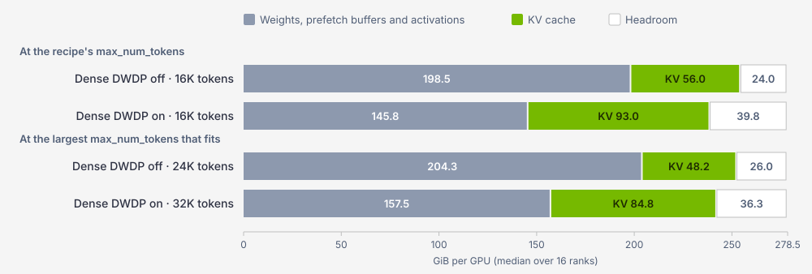
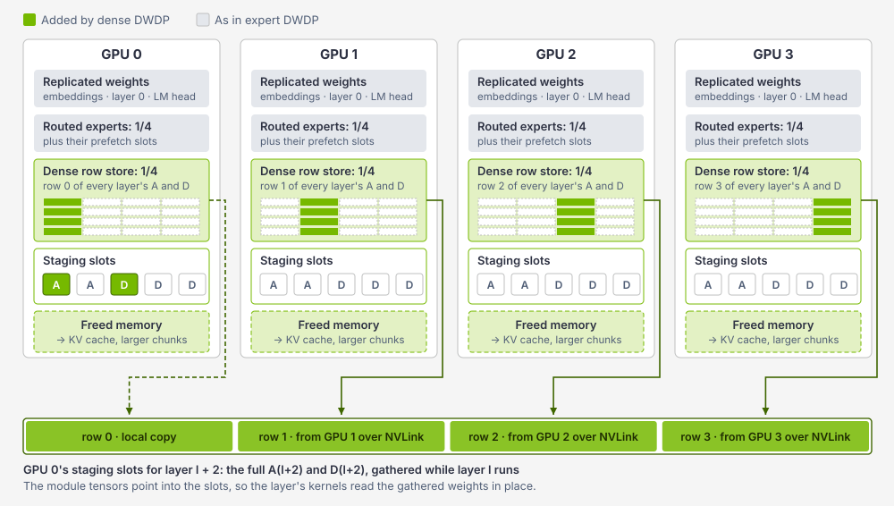
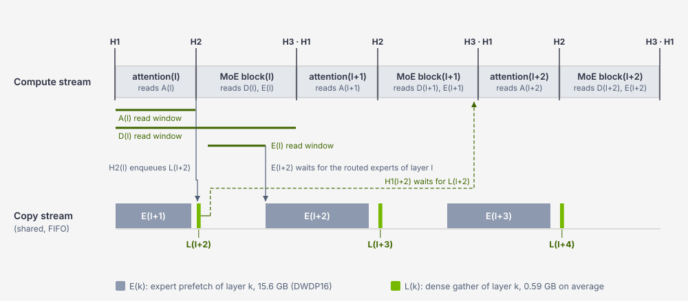
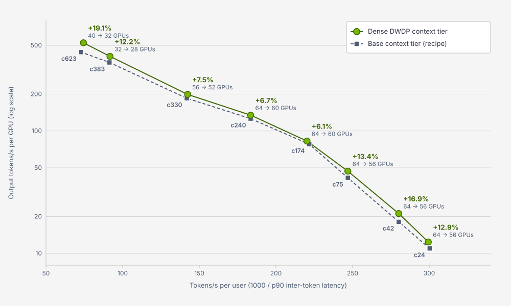

# Dense DWDP: Extending Distributed Weight Data Parallelism to Dense Weights on Vera Rubin NVL72

By NVIDIA TensorRT LLM Team

DWDP ([Tech Blog 19](blog19_DWDP_Distributed_Weight_Data_Parallelism_for_High_Performance_LLM_Inference_on_NVL72.md)) lets each context GPU of a disaggregated deployment store only a slice of the routed experts and prefetch the rest from its peers before each MoE layer. On a hybrid model such as Kimi-K3, sharding the experts leaves a second large block of replicated memory: the attention weights, the shared expert, the latent projections and the router of every MoE decoder layer, about 54 GiB that every context GPU holds in full. Dense DWDP shards these weights as well. Each GPU keeps a 1/N row shard of every layer and gathers a layer's full weights from its peers over NVLink two layers before the layer runs, on the copy stream that already carries the expert prefetch. On NVIDIA Vera Rubin NVL72, this gives each Kimi-K3 context GPU 52.7 GiB of HBM back, about a fifth of its memory. Spent on longer prefill chunks and a larger KV cache, the freed memory lets the context tier serve the same agentic coding load with 4 or 8 fewer GPUs: across eight points of an end-to-end Pareto curve, output tokens per second per GPU rise by 6.1% to 19.1% (median 12.5%) at the same tokens per second per user, with a longer time-to-first-token (TTFT) tail at the two points of highest load (TTFT p90 rises from 15.9 s to 23.0 s where the gain is 19.1%). Dense DWDP has been merged into TensorRT LLM ([PR #21012](https://github.com/NVIDIA/TensorRT-LLM/pull/21012)).

## Table of Contents

- [Motivation](#motivation)
  - [The Memory That Expert DWDP Leaves Replicated](#the-memory-that-expert-dwdp-leaves-replicated)
  - [Why Memory Turns into Throughput on Agentic Workloads](#why-memory-turns-into-throughput-on-agentic-workloads)
- [Dense DWDP Overview](#dense-dwdp-overview)
  - [High-Level Design](#high-level-design)
  - [Two Modes](#two-modes)
  - [Transfer Budget](#transfer-budget)
- [Dense DWDP Implementation](#dense-dwdp-implementation)
  - [Configuration](#configuration)
  - [Key Components](#key-components)
  - [Runtime Flow](#runtime-flow)
  - [Correctness](#correctness)
  - [Current Code-Level Constraints](#current-code-level-constraints)
- [Key Optimizations](#key-optimizations)
  - [Sharing the Expert Prefetch Pipeline](#sharing-the-expert-prefetch-pipeline)
  - [Committing Dense Weights Before the Expert Prefetch Ring](#committing-dense-weights-before-the-expert-prefetch-ring)
  - [A Balanced Expert Partition for Any Group Size](#a-balanced-expert-partition-for-any-group-size)
- [Evaluation](#evaluation)
  - [Experimental Setup](#experimental-setup)
  - [No Overhead at the Same Settings](#no-overhead-at-the-same-settings)
  - [End-to-End Evaluation](#end-to-end-evaluation)
  - [Trading Throughput for Time to First Token](#trading-throughput-for-time-to-first-token)
  - [Accuracy](#accuracy)
  - [Reproducing Steps](#reproducing-steps)
- [Summary](#summary)

## Motivation

### The Memory That Expert DWDP Leaves Replicated

DWDP targets MoE weights because they dominate a model's memory footprint. That holds for Kimi-K3 as well: the model has 2.8 trillion parameters, most of them in the 896 routed experts of each of its 92 MoE layers, and a DWDP16 context worker stores only 56 of the 896 experts of each layer. Everything else is replicated on every GPU of the group, and for a hybrid model that is not small. Kimi-K3 interleaves 69 Kimi Delta Attention (KDA) layers, a linear-attention design with a recurrent state, with 24 MLA layers, and each MoE layer has a shared expert, a router and latent projections around its routed experts. Table 1 lists these weights on one context GPU.

| Weights per context GPU (GiB) | Expert DWDP only | With dense DWDP |
| --- | ---: | ---: |
| KDA attention | 29.9 | sharded |
| Shared expert | 11.7 | sharded |
| MLA attention | 6.2 | sharded |
| Latent projections | 4.5 | sharded |
| Router | 2.2 | sharded |
| This GPU's row shard (1/16) | -- | 3.4 |
| Staging slots | -- | 1.5 |
| Kept replicated: embeddings, LM head, layer 0, vision encoder | 7.0 | 7.0 |
| **Total** | **61.5** | **11.9** |

*Table 1. Non-expert weights on one Kimi-K3 context GPU of a DWDP16 group, with the [NVIDIA Kimi-K3 NVFP4](https://huggingface.co/nvidia/Kimi-K3-NVFP4) checkpoint (medians over 16 ranks). Dense DWDP moves 58.3 GB (54.3 GiB) per GPU; the free memory that CUDA reports grows by 52.7 GiB, which includes allocator fragments released with the weights.*

### Why Memory Turns into Throughput on Agentic Workloads

Agentic coding traffic sends long prompts that mostly repeat. In the [AgentX](https://inferencex.semianalysis.com/datasets) coding traces from SemiAnalysis InferenceX that we use below, requests average about 150K tokens, and about 95% of the prompt tokens hit the prefix cache. A context GPU spends its memory on two things that set its throughput on such traffic:

- **KV cache.** A prefix hit needs the conversation's KV pages and, for Kimi-K3's KDA layers, a snapshot of the conversation's recurrent state. A context GPU that serves more conversations needs more of both, or its prefix reuse drops and it computes prompts again.
- **Prefill chunk size (`max_num_tokens`).** Each forward of a DWDP16 context worker prefetches 92 × 15.6 GB, about 1.4 TB, of remote experts, which takes about 1.3 s at the rate the gather sustains. A forward with too few tokens to cover that is bound by the copies, so longer chunks amortize the prefetch better. Longer chunks also need more activation memory: without dense DWDP, 24K tokens is the longest chunk that fits next to a useful KV cache, and 32K runs out of memory.

Figure 1 shows how dense DWDP changes this budget. At the recipe's 16K-token chunk, the freed memory raises the KV cache from 56.0 to 93.0 GiB per GPU. Spending part of it on longer chunks pays off more: with 32K-token chunks, a dense DWDP context GPU still has 84.8 GiB of KV cache, 76% more than the best configuration without dense DWDP at 24K tokens.

<div align="center">
<figure>
  
</figure>
</div>
<p align="center"><sub><em>Figure 1. HBM of one Kimi-K3 context GPU (DWDP16, Vera Rubin, NVFP4 KV cache), median over 16 ranks. The KV cache takes 70% of the memory left after weights and activations (65% in the 24K row); the rest is headroom.</em></sub></p>

## Dense DWDP Overview

### High-Level Design

For each MoE decoder layer `l` of Kimi-K3 (layers 1-92; layer 0 has a dense MLP and stays replicated), dense DWDP handles two blobs: the attention weights `A(l)`, KDA or MLA, and the MoE-dense weights `D(l)`: router, shared expert, latent projections and their norm. The routed experts stay with expert DWDP, and tensors under 1 MiB stay replicated.

- **Row shards.** Each blob is cut into N rows, one per rank of the group. A rank keeps its rows of every layer in a row store of CUDA virtual memory that it exports as a FABRIC handle, and it maps every peer's row store read-only.
- **Staging slots.** Each rank has a ring of 2 attention slots and a ring of 3 MoE-dense slots, each large enough for a full layer. At setup, dense DWDP points the module tensors of each layer into that layer's slots, once. The model keeps reading its weights through its usual attributes, so no kernel and no model math changes.
- **Gathers two layers ahead.** After the attention of layer `l`, each rank gathers the rows of layer `l+2` from every rank, its own included, into its slots. The gather is the SM fabric gather kernel that expert DWDP already uses (`trtllm::dwdp_fabric_gather`), on expert DWDP's copy stream.

Figure 2 shows the idea for a group of four GPUs.

<div align="center">
<figure>
  
</figure>
</div>
<p align="center"><sub><em>Figure 2. Dense DWDP with a DWDP group of four GPUs. Each GPU stores one row of every layer's dense weights and gathers full layers into a few staging slots; the figure shows GPU 0 gathering layer l+2. Every GPU does the same for its own slots.</em></sub></p>

### Two Modes

Dense DWDP runs either on top of expert DWDP or without it (Table 2). The launch gate picks the mode when a server starts.

| | Attached | Standalone |
| --- | --- | --- |
| Where | context servers of a DWDP group, one GPU per worker | one attention-DP context instance, for example DEP16 |
| Group that shares the rows | the DWDP group | the attention-DP ranks of the instance |
| Copies | the expert prefetch's copy stream and transfer | a copy stream of its own |
| Configuration | `dwdp_config.enable_dense: true` | `dwdp_config: {enable_experts: false, enable_dense: true}` |

*Table 2. The two modes of dense DWDP. All results in this blog use the attached mode.*

### Transfer Budget

As Tech Blog 19 did with its roofline analysis, we first check whether the extra transfers can hide behind compute. Table 3 compares the bytes each GPU of a DWDP16 group receives per MoE layer.

| Per MoE layer, per GPU (DWDP16) | Expert prefetch `E(l)` | Dense gather `L(l)` |
| --- | ---: | ---: |
| Bytes received | 840 experts × 18.58 MB = 15.6 GB | 0.59 GB (mean over 92 layers) |
| Time at about 1.1 TB/s | about 14 ms | about 0.5 ms |
| Per forward (92 layers) | about 1.44 TB, 1.3 s | about 55 GB, 50 ms |

*Table 3. Transfers per MoE layer of a Kimi-K3 DWDP16 context worker. The rate is the one the TMA gather sustains in production on Vera Rubin.*

The dense gathers add about 4% to the bytes that each context forward already moves for the experts. Two consequences follow. First, the dense gathers need no compute window of their own: a forward whose compute hides the expert prefetch with 4% to spare hides both. Second, the transfer has to be fast, which favors the SM gather over the copy engines: in a microbenchmark on four Vera Rubin GPUs that pulled 184 MB from three peers, the TMA gather kernel reached 1,151 GB/s, the register gather kernel 819 GB/s and the copy engines about 565 GB/s. The gather occupies about 30 SMs while it runs, as it already does for the experts.

## Dense DWDP Implementation

### Configuration

Dense DWDP is a prototype feature, off by default, configured through four new fields of `DwdpConfig` in [`tensorrt_llm/llmapi/llm_args.py`](https://github.com/NVIDIA/TensorRT-LLM/blob/abb78b8afd/tensorrt_llm/llmapi/llm_args.py):

- `enable_dense` (default `false`): turns dense DWDP on. Set it on the context servers only, with the same value on every server of the group.
- `enable_experts` (default `true`): expert DWDP. `false` together with `enable_dense: true` selects the standalone mode.
- `copy_mode` (default unset): the transfer of every DWDP copy, expert prefetch and dense gathers alike: `per_slice`, `batched` (copy engines) or `gather` (the SM fabric gather).
- `gather_kernel` (default unset): with `copy_mode: gather`, the gather kernel, `register` or `tma`.

The context server configuration of the attached mode, one GPU per worker in a DWDP group of 16, looks like this:

```yaml
tensor_parallel_size: 1
disable_overlap_scheduler: true
cuda_graph_config: null
moe_config:
  backend: CUTEDSL
dwdp_config:
  dwdp_size: 16
  enable_dense: true
  copy_mode: gather
  gather_kernel: tma
```

And the standalone mode on one DEP16 context instance:

```yaml
tensor_parallel_size: 16
moe_expert_parallel_size: 16
enable_attention_dp: true
cuda_graph_config: null
dwdp_config:
  enable_experts: false
  enable_dense: true
  copy_mode: gather
  gather_kernel: tma
```

`LLM()` and `trtllm-serve` check these settings when they build the LLM arguments (`TorchLlmArgs.validate_dwdp_launch`), and each worker checks its host before the model is built. The [MoE performance guide](https://github.com/NVIDIA/TensorRT-LLM/blob/main/docs/source/developer-guide/moe-perf-guide.md#dense-dwdp) lists every requirement.

### Key Components

Dense DWDP lives in [`tensorrt_llm/_torch/modules/dwdp/dense/`](https://github.com/NVIDIA/TensorRT-LLM/tree/abb78b8afd/tensorrt_llm/_torch/modules/dwdp/dense). Its parts follow the life of a dense weight:

- **`gate.py`**, the launch gate: checks what dense DWDP needs from the host (FABRIC peer memory; in standalone mode, the MPI backend and the gather op) and picks the mode, before the model exists.
- **`layout.py`**: collects each layer's dense tensors from the roots its decoder layer declares (`dense_dwdp_roots`), checks them and lays them out as the `A` and `D` blobs. A digest of the layout lets the ranks compare their layouts.
- **`store.py`**: the row store, one virtual-memory allocation per rank, exported as a FABRIC handle and mapped read-only by the peers.
- **`plan.py`**: the per-layer copy plans, one gather per layer that covers the `A` and `D` rows of every peer and the local rows, and the launcher that runs them with the selected transfer.
- **`repoint.py`**: points module tensors into the staging slots and restores them if setup fails.
- **`runtime.py`**: the slot rings, the CUDA events and the per-layer hooks.
- **`setup.py`**: the setup phases P1-P6.
- **`manager.py`**: `DenseDwdpManager`, the owner of the committed runtime in both modes. In attached mode the expert DWDP manager, `DwdpManager` in [`tensorrt_llm/_torch/pyexecutor/dwdp.py`](https://github.com/NVIDIA/TensorRT-LLM/blob/abb78b8afd/tensorrt_llm/_torch/pyexecutor/dwdp.py), creates it and sets it up first.

On the model side, Kimi-K3's decoder layers in [`modeling_kimi_linear.py`](https://github.com/NVIDIA/TensorRT-LLM/blob/abb78b8afd/tensorrt_llm/_torch/models/modeling_kimi_linear.py) declare their dense roots and call four hooks (Table 4).

| Hook | Where | What |
| --- | --- | --- |
| H0 | model forward entry | Enqueues the gathers of the first two layers unless the previous forward already did; after an aborted forward, first waits for every slot's readers (a write-after-read barrier). |
| H1 | decoder layer entry | Makes compute wait for the layer's slots (read after write). |
| H2 | after the attention call | Closes the attention read window and enqueues the gathers of the next layers whose slots are free: `L(l+2)` within a forward. |
| H3 | after the MoE block | Closes the MoE-dense read window and fills free slots the same way. |

*Table 4. The hooks that Kimi-K3's decoder layers call.*

### Runtime Flow

1. **Launch checks and managers.** The LLM arguments are checked when they are built. Before the model is built, the creator runs the gate and creates the managers: in attached mode, `DwdpManager` creates the `DenseDwdpManager`. Decoder layers capture the dense manager when they are constructed.

2. **Setup, once, after the weights are loaded.** Setup runs six phases with one collective after each of the first five and a sixth that agrees on the outcome:

   - P1 collects the layout, its digest and per-blob checksums, compares them across ranks and checks that the free memory covers the store and the slots;
   - P2 allocates the row store and the slots and writes this rank's rows;
   - P3 maps the peers' rows and builds the copy plans;
   - P4 gathers every layer and checks the bytes in the slots against the original weights;
   - P5 repoints the module tensors and checks every layer again;
   - P6 drops the original weights and scans for tensors that still hold them.

   If any rank fails, every rank restores its weights (P1-P5) or releases the dense state (P6) and raises: there is no fallback to replicated weights. In attached mode, the expert DWDP setup runs only after dense DWDP has committed, and the KV cache is sized after both, so it receives the freed memory. Setup takes about 7 s.

3. **Every forward.** H0 primes the first two layers. In every layer, H1 waits for the slots, H2 enqueues `L(l+2)` once the attention of layer `l` has released the attention slot that `l+2` reuses, and H3 releases the MoE-dense slot. Expert DWDP enqueues `E(l+2)` right after the routed experts of layer `l`, inside the MoE block and before H3: the routed experts are the only kernels that read the expert slot that `E(l+2)` reuses, and the copy waits for them. Within a forward, the shared copy stream therefore runs `... E(l+1), L(l+2), E(l+2), L(l+3) ...`, each copy enqueued in the order its data is needed (Figure 3). At the end of a forward, the copies of the first layers of the next forward are already enqueued, so the next forward starts primed.

<div align="center">
<figure>
  
</figure>
</div>
<p align="center"><sub><em>Figure 3. Per-layer pipeline of attached dense DWDP. The dense gather of layer l+2 starts after the attention of layer l has released its slot and finishes long before layer l+2 needs it. The expert prefetch of layer l+2 reuses the expert slot of layer l and starts once the routed experts of layer l have read it, before the MoE block ends. Copies are drawn to scale with each other; the compute lane is schematic.</em></sub></p>

Every dependency in this flow is a CUDA event between the compute stream and the copy stream. Between setup and teardown, the host never waits for the GPU.

### Correctness

Dense DWDP replaces the weights of a running model, so its protocol is built around one invariant: a slot is written only when no kernel can read it, and read only after its copy has finished.

- **Read windows.** All reads of `A(l)` happen between H1 and H2 of layer `l`, and all reads of `D(l)` between H1 and H3. A copy into a slot waits for the end of the read window of the layer that held it (write after read), and compute waits for the copy (read after write). Expert DWDP applies the same rule to its two expert slots, where the routed experts of a layer are the only readers.
- **All or nothing.** Setup compares layouts, checks every gathered byte before and after the repointing, and commits only if every rank agrees.
- **Guards.** Weight reloads and incremental weight updates refuse a model whose dense weights dense DWDP has moved.

During development we also served the workload with a debug watchdog that checksummed each slot when its layer started: about 3.95 million checks on 16 ranks found no mismatch. The merged version keeps the protocol and drops the watchdog.

### Current Code-Level Constraints

- Dense DWDP supports Kimi-K3, the only model whose decoder layers declare dense roots today.
- It runs on eager context servers: no CUDA graphs or `torch.compile`, no LoRA, speculative decoding or sleep mode, and pipeline and context parallel size 1.
- It needs FABRIC peer memory handles, as on NVL72 systems.
- It runs on context servers only: `trtllm-serve` refuses `enable_dense` on a generation server.
- The attached mode needs tensor parallel size 1 and the overlap scheduler off, as expert DWDP does. The standalone mode needs the MPI backend.
- Weights cannot be reloaded or updated once dense DWDP has sharded them.

## Key Optimizations

### Sharing the Expert Prefetch Pipeline

A separate pipeline for the dense weights, for example copy engines on a second stream, looks simpler but would compete with the expert prefetch for NVLink, without a common order, and the copy engines are about half as fast as the SM gather. Dense DWDP instead adds its gathers to the expert prefetch's copy stream and uses its transfer. One FIFO in deadline order keeps each copy ahead of its first reader, adds no SM reservation beyond the expert gather's, and adds no synchronization. At the same settings, dense DWDP costs no measurable throughput ([No Overhead at the Same Settings](#no-overhead-at-the-same-settings)).

### Committing Dense Weights Before the Expert Prefetch Ring

The order of the two setups matters for the peak memory. The expert prefetch ring is large: two slots for the remote experts of one layer each, 27 GiB per GPU at DWDP8 and 29 GiB at DWDP16. If the ring were allocated while the replicated dense weights are still resident, the setup peak would be the sum of both. Dense DWDP therefore commits first and returns the replicated weights to the allocator before the ring is allocated, so the peak is the larger of the two phases.

This is what makes small DWDP groups possible. A DWDP8 context GPU stores 112 experts per layer; after dense DWDP commits it has about 64 GiB free for the 27 GiB ring, which leaves about 30 GiB of KV cache. With the dense weights still replicated, the same GPU would have about 17 GiB, not enough for the ring.

### A Balanced Expert Partition for Any Group Size

Once memory no longer dictates group sizes, the expert partition must allow any `dwdp_size`. Expert DWDP required `(dwdp_size - 1) * stride + size == num_experts`, so a group size that does not divide the expert count needed overlapping ranges: Kimi-K3 on DWDP12 used ranges of 82 experts with a stride of 74 and stored 88 experts twice in every MoE layer. With `num_experts_per_worker` and `num_prefetch_experts` left at 0, expert DWDP now gives each rank `floor` or `ceil` of `num_experts / dwdp_size` contiguous experts: 8 ranks of 75 and 4 of 74 at DWDP12, 16 ranks of 45 and 4 of 44 at DWDP20. On DWDP12 this frees 10.7 to 12.5 GiB per GPU.

## Evaluation

### Experimental Setup

- **Hardware:** NVIDIA Vera Rubin NVL72, 278.5 GiB of usable HBM per GPU; the context and generation servers of a deployment share one NVLink domain.
- **Model:** [NVIDIA Kimi-K3 NVFP4](https://huggingface.co/nvidia/Kimi-K3-NVFP4).
- **KV cache:** NVFP4 (the last two MLA layers in FP8), 128-token pages, KV cache manager V2, per-conversation block reuse.
- **Serving:** disaggregated. Context servers are one-GPU workers in a DWDP group, with the CuTeDSL MoE backend, the TMA gather and chunked prefill. Generation servers use Helix parallelism ([Tech Blog 22](blog22_Helix_Parallelism_Scaling_Multi_Million_Token_Decoding_with_KV_Cache_Sharding.md)) or DEP16, with DSpark speculative decoding (5 or 7 draft tokens).
- **Workload:** the AgentX coding traces, replayed with AIPerf at a fixed concurrency for one hour per run. Each configuration ran once; no request failed. The replayed requests carry random token IDs, so the generation servers fix the speculative acceptance: 2.84 accepted draft tokens per step with 7 draft tokens, and 2.62 with 5, the same in both arms of every comparison.
- **Metrics:** tokens per second per user is `1000 / p90 inter-token latency`. Throughput per GPU divides by all GPUs of the deployment, context and generation. TTFT includes queueing.
- **Code:** the measurements ran an earlier revision of the dense DWDP code of PR #21012 on a development branch of TensorRT LLM, which supported Kimi-K3's NVFP4 KV cache before main did. The runtime protocol (read windows, events, copy plans, repointing) is the same as in the merged version, which replaces the earlier environment variables with the `dwdp_config` fields above and tightens the setup checks.

### No Overhead at the Same Settings

Dense DWDP should cost nothing when its memory is not used. Table 5 compares runs that differ only in `enable_dense`, at the recipe's 16K-token chunk.

| Comparison (16K-token chunks) | Dense DWDP off | Dense DWDP on | Change |
| --- | ---: | ---: | ---: |
| Context only, DWDP16, concurrency 128: requests/s | 13.25 | 13.25 | 0.0% |
| End to end, 32 GPUs, concurrency 383: output tokens/s/GPU | 362.2 | 363.3 | +0.3% |
| End to end, 32 GPUs, concurrency 383: total tokens/s/GPU | 47,771 | 47,783 | +0.0% |

*Table 5. Same configuration with and without dense DWDP. The context-only row runs one DWDP16 context tier (16 GPUs) on its own, with a generation side that only receives the KV cache. Total tokens include the prompt tokens served from the prefix cache.*

The dense gathers hide behind compute, so all of the gain comes from spending the freed memory.

### End-to-End Evaluation

The end-to-end study takes eight points of a Kimi-K3 Pareto curve, from concurrency 24 to 623. At each point, the base runs the recipe's context tier: 16 GPUs as a DWDP16 group with 16K-token chunks, or 24 GPUs as a DWDP24 group at concurrency 623. The dense DWDP arm keeps the generation servers and the client unchanged and replaces the context tier with a smaller one: 8 GPUs (DWDP8, 16K-token chunks), 12 GPUs (DWDP12, 32K) or 16 GPUs (DWDP16, 32K). With fewer context GPUs, each GPU serves more conversations, so at concurrency 24 to 240 the dense arm gives the KDA states 45% of the KV cache pool instead of the recipe's 14%, which keeps prefix reuse at the base's level (Table 6). The recipes at concurrency 330 to 623 use 45% in both arms.

<div align="center">
<figure>
  
</figure>
</div>
<p align="center"><sub><em>Figure 4. End-to-end Pareto of Kimi-K3 on Vera Rubin NVL72. Each pair of points shares its generation servers and client; labels give the output throughput gain per GPU and the GPU counts of the deployment.</em></sub></p>

| Concurrency | Generation | GPUs (context) | Tokens/s/user | Output tokens/s/GPU | Gain | Prefix reuse |
| ---: | --- | --- | --- | --- | ---: | --- |
| 24 | 3 × Helix16, batch 1 | 64 (16) → 56 (8) | 300.3 → 299.4 | 10.97 → 12.38 | +12.9% | 95.9% → 96.0% |
| 42 | 6 × Helix8, batch 1 | 64 (16) → 56 (8) | 280.1 → 280.1 | 18.08 → 21.14 | +16.9% | 96.3% → 96.3% |
| 75 | 3 × Helix16, batch 4 | 64 (16) → 56 (8) | 246.9 → 246.9 | 41.39 → 46.93 | +13.4% | 95.4% → 95.3% |
| 174 | 3 × Helix16, batch 8 | 64 (16) → 60 (12) | 221.7 → 220.3 | 77.85 → 82.63 | +6.1% | 95.3% → 95.5% |
| 240 | 3 × Helix16, batch 16 | 64 (16) → 60 (12) | 183.5 → 183.5 | 126.06 → 134.50 | +6.7% | 95.1% → 95.7% |
| 330 | 5 × Helix8, batch 16 | 56 (16) → 52 (12) | 141.8 → 142.5 | 184.81 → 198.73 | +7.5% | 95.4% → 95.3% |
| 383 | 1 × DEP16, batch 8 | 32 (16) → 28 (12) | 91.4 → 91.7 | 362.45 → 406.65 | +12.2% | 95.3% → 95.1% |
| 623 | 1 × DEP16, batch 16 | 40 (24) → 32 (16) | 72.9 → 74.4 | 440.52 → 524.79 | +19.1% | 95.3% → 94.9% |

*Table 6. End-to-end results, base → dense DWDP. Gain is the change of output tokens per second per GPU.*

Dense DWDP raises the output throughput per GPU at every point, by 6.1% to 19.1% with a median of 12.5%, while tokens per second per user stay within 2.1%. The gain comes from serving the same load with fewer GPUs, not from faster ones: at seven of the eight points the total output throughput of the deployment stays within -1.8% to +2.3% of the base, so the gain follows the share of GPUs that the smaller context tier saves. Removing 8 of 64 GPUs gives +13% to +17%, 4 of 64 or 56 gives +6% to +8% and 4 of 32 gives +12%. The eighth point is concurrency 623: removing 8 of 40 GPUs would give +25% at equal output, but the 16-GPU context tier becomes the bottleneck there and the total output falls by 4.7% (from 17,621 to 16,793 tokens per second), which leaves +19.1% ([Trading Throughput for Time to First Token](#trading-throughput-for-time-to-first-token)).

A smaller context tier keeps up because, at most points, compute does not set its size. At concurrency 24 to 240 the base tier serves 0.7 to 7.7 requests per second, while a saturated 16-GPU DWDP16 tier sustains about 13 (measured with the context tier on its own at concurrency 128). Memory sets the floor instead. A DWDP8 group fits only with dense DWDP ([Committing Dense Weights Before the Expert Prefetch Ring](#committing-dense-weights-before-the-expert-prefetch-ring)), and with fewer context GPUs each GPU holds the KV pages and KDA states of more conversations, which the freed memory pays for. Only close to saturation, at concurrency 383 and 623, does a smaller tier lengthen the TTFT tail.

### Trading Throughput for Time to First Token

A smaller context tier carries more load per GPU, which shows first in the TTFT tail. TTFT p90 stays within 2 s of the base at six of the eight points, and rises at concurrency 383 (14.6 to 18.0 s) and 623 (15.9 to 23.0 s). Table 7 shows the choices at concurrency 623, the throughput end of the curve, where we ran three context tiers with dense DWDP.

| Context tier | GPUs | Output tokens/s/GPU | Total tokens/s/GPU | TTFT p50 / p90 / p99 (s) |
| --- | ---: | ---: | ---: | --- |
| Base: 24 GPUs, DWDP24, 16K | 40 | 440.5 | 59,272 | 6.5 / 15.9 / 78.7 |
| Dense DWDP: 24 GPUs, 32K | 40 | 449.0 (+1.9%) | 60,531 (+2.1%) | 6.7 / 11.7 / 60.5 |
| Dense DWDP: 20 GPUs, 32K | 36 | 490.2 (+11.3%) | 65,689 (+10.8%) | 6.8 / 14.3 / 71.6 |
| Dense DWDP: 16 GPUs, 32K | 32 | 524.8 (+19.1%) | 70,156 (+18.4%) | 6.8 / 23.0 / 107.3 |

*Table 7. Context tiers at concurrency 623; the generation server (DEP16, batch 16) is the same in all four.*

Dense DWDP moves the whole trade-off between throughput and latency:

- **Same GPUs, lower latency.** With 24 context GPUs, dense DWDP raises the KV cache from 67.7 to 97.4 GiB per GPU and doubles the chunk; TTFT p90 falls from 15.9 to 11.7 s and p99 from 78.7 to 60.5 s.
- **Fewer GPUs, same latency.** With 20 context GPUs, output throughput per GPU rises by 11.3% while TTFT p90 (14.3 s) and p99 (71.6 s) stay below the base's.
- **Fewest GPUs, longer tail.** With 16 context GPUs, output throughput per GPU rises by 19.1%, but the context tier becomes the bottleneck: the p90 of the time requests wait in the context queue grows from 8.4 s to 13.8 s, and the generation server, which ran 13.8 of 16 requests per step on average in the base, runs 12.6. TTFT p90 grows to 23.0 s.

Under a TTFT p90 target of 20 s, the 20-GPU context tier is the best choice at this point.

### Accuracy

Dense DWDP moves weights; it does not change them. On GSM8K (1,319 questions) with an attached DWDP16 context server, two runs without dense DWDP scored 96.13% and 96.21% and two runs with it scored 97.35% and 96.13%. The runs with and without dense DWDP differ in 38 to 50 answers, fewer than the 54 answers in which the two runs without it differ from each other.

### Reproducing Steps

The context server of the concurrency-623 point with 16 dense DWDP context GPUs used this configuration on each of its 16 one-GPU workers, written here with the merged `dwdp_config` fields:

```yaml
tensor_parallel_size: 1
moe_expert_parallel_size: 1
enable_attention_dp: true
attention_dp_config:
  kv_cache_routing_conversation_affinity: true
  kv_cache_routing_new_conv_placement: least_queued
disable_overlap_scheduler: true
cuda_graph_config: null
enable_chunked_prefill: true
max_batch_size: 16
max_num_tokens: 32768
max_seq_len: 996672
moe_config:
  backend: CUTEDSL
  use_low_precision_moe_combine: true
dwdp_config:
  dwdp_size: 16
  enable_dense: true
  copy_mode: gather
  gather_kernel: tma
kv_cache_config:
  dtype: nvfp4
  tokens_per_block: 128
  use_kv_cache_manager_v2: true
  enable_block_reuse: true
  block_reuse_config:
    policy: per_conversation
    max_num_turns: 5
  free_gpu_memory_fraction: 0.7
  pool_ratio: [0.13, 0.02, 0.40, 0.45]
  host_cache_size: 171798691840  # 160 GiB
  mamba_ssm_cache_dtype: bfloat16
  mamba_state_config:
    additional_snapshot_offsets_from_end: [0]
cache_transceiver_config:
  backend: NIXL
```

The generation server was one DEP16 instance:

```yaml
tensor_parallel_size: 16
moe_expert_parallel_size: 16
enable_attention_dp: true
max_batch_size: 16
max_num_tokens: 96
max_seq_len: 997696
cuda_graph_config:
  batch_sizes: [1, 2, 4, 8, 16]
  enable_padding: true
moe_config:
  backend: MEGAMOE_CUTEDSL
  use_low_precision_moe_combine: true
speculative_config:
  decoding_type: DSpark
  max_draft_len: 5
  block_size: 5
  speculative_model: <Kimi-K3 DSpark draft checkpoint>
kv_cache_config:
  dtype: nvfp4
  tokens_per_block: 128
  use_kv_cache_manager_v2: true
  enable_block_reuse: false
  free_gpu_memory_fraction: 0.9
  host_cache_size: 68719476736  # 64 GiB
  mamba_ssm_cache_dtype: bfloat16
cache_transceiver_config:
  backend: NIXL
```

Launch the context workers with `--server_role CONTEXT`, then replay the AgentX traces against the disaggregated endpoint at concurrency 623 for one hour. The generation workers ran with `TLLM_SPEC_DECODE_FORCE_NUM_ACCEPTED_TOKENS=2.62`, the fixed acceptance described in the setup; do not set it when you serve real traffic.

## Summary

- On hybrid MoE models, the dense weights that expert DWDP leaves replicated are large: about 54 GiB per Kimi-K3 context GPU. Dense DWDP shards them and gives each GPU 52.7 GiB of HBM back.
- The dense gathers add about 4% to the bytes that expert DWDP already moves, ride the same copy stream in deadline order, and cost no measurable throughput at the same settings.
- The freed memory is worth what it buys: longer prefill chunks and a larger KV cache. On Vera Rubin NVL72 this lets the context tier serve the same agentic load with fewer GPUs, for 6.1% to 19.1% more output throughput per GPU along the Pareto curve.
- Fewer context GPUs means more load per GPU. At the throughput end the context tier can be sized to the TTFT budget, from lower latency at the same GPUs to the most throughput with a longer tail.
- Dense DWDP needs high-bandwidth peer memory access and a compute window that covers the expert prefetch, which is why it targets context servers on NVL72 systems.
