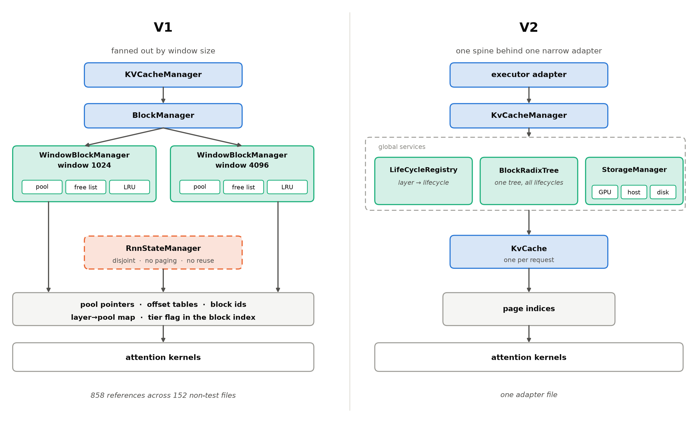
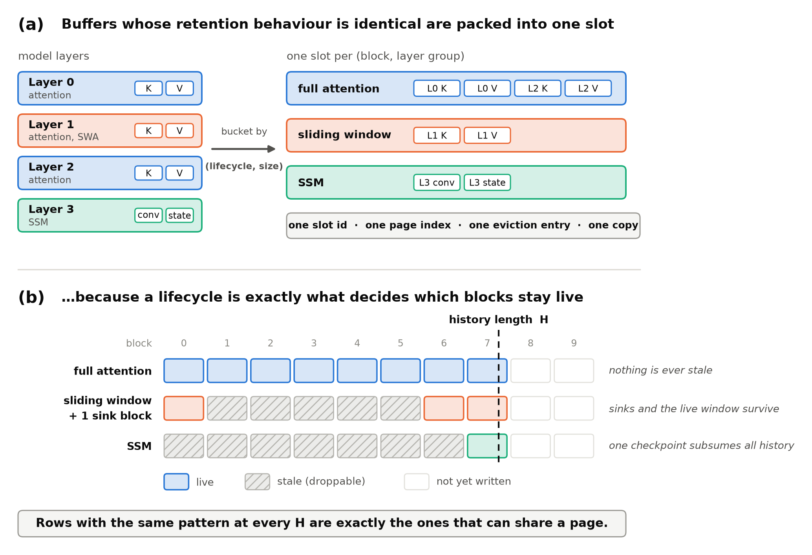
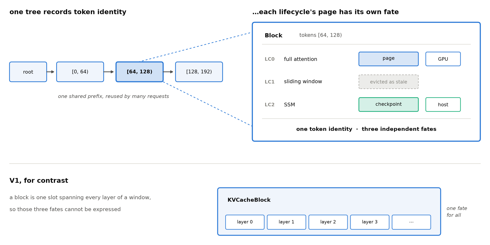
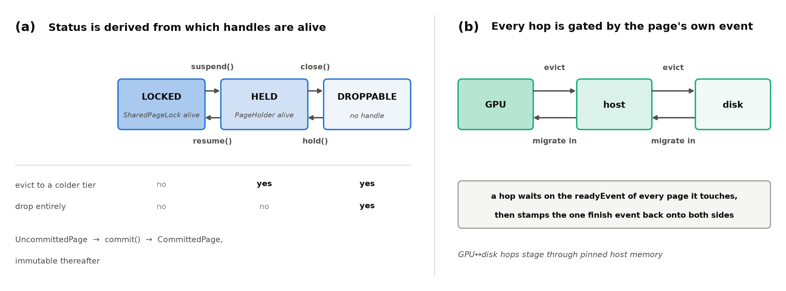
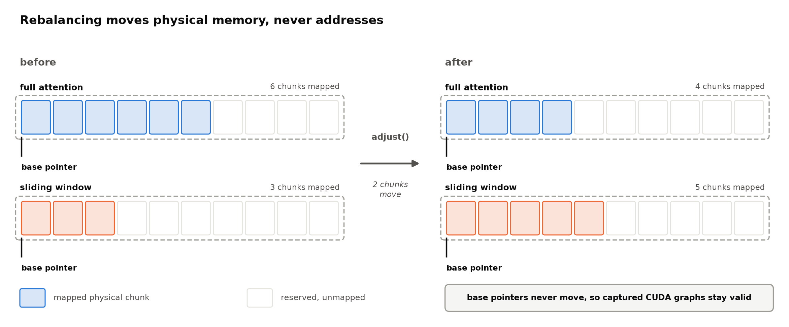

# KVCacheManagerV2: Redesigning KV Cache Management in TensorRT LLM

By NVIDIA TensorRT LLM Team

**Table of Contents**
- [Introduction and Motivation](#introduction-and-motivation)
- [Why a Second KV Cache Manager](#why-a-second-kv-cache-manager)
  - [One Block, All Layers](#one-block-all-layers)
  - [Sliding Windows as Parallel Managers](#sliding-windows-as-parallel-managers)
  - [Recurrent State Had No Home](#recurrent-state-had-no-home)
  - [The Interface Was the Implementation](#the-interface-was-the-implementation)
- [KVCacheManagerV2 Design](#kvcachemanagerv2-design)
  - [Design Philosophy](#design-philosophy)
  - [Describing a Model](#describing-a-model)
  - [Lifecycles: Grouping Buffers Into Big Pages](#lifecycles-grouping-buffers-into-big-pages)
  - [One Tree, Many Lifecycles](#one-tree-many-lifecycles)
  - [Pages, Locks, and Tiers](#pages-locks-and-tiers)
  - [Tracking Data Dependencies](#tracking-data-dependencies)
  - [Elastic Memory](#elastic-memory)
  - [Suspend, Resume, and Scratch Slots](#suspend-resume-and-scratch-slots)
  - [Block Keys and Reuse Scopes](#block-keys-and-reuse-scopes)
  - [The Public API](#the-public-api)
  - [Flexibility in Practice](#flexibility-in-practice)
- [Current State](#current-state)
  - [The Implementation Was Python First](#the-implementation-was-python-first)
- [Future Work](#future-work)
- [Acknowledgment](#acknowledgment)

## Introduction and Motivation

The KV cache is the largest and most contended resource in an LLM inference server. It decides how many requests fit on a GPU, how much of a conversation can be reused across turns, and how long a million-token context takes to prefill. Everything else — scheduling, batching, attention kernels, disaggregated serving — negotiates with it.

TensorRT LLM's original KV cache manager, which we will call V1 throughout this post, has served that role since the project began and remains the default for most models today. But over the past two years the shape of the models it manages changed faster than the shape of the manager could follow. Sliding-window attention arrived, then *variable* sliding-window attention (VSWA) where the window alternates layer by layer. State-space and Mamba layers arrived, whose "cache" is not a growing list of tokens at all but a fixed-size recurrent state. Sparse attention arrived, attaching auxiliary per-layer buffers with their own shapes and dtypes. Each was accommodated, and each accommodation left a mark.

KVCacheManagerV2 (KVCM2) is a ground-up redesign built around a single question: *which buffers, across which layers, live and die together?* Answering that question explicitly — instead of assuming the answer is "all of them" — is what lets one manager serve full attention, sliding-window attention, and recurrent state with a single prefix-reuse tree, a narrow public API, and first-class GPU/host/disk storage.

This post describes that design.

## Why a Second KV Cache Manager

V1 solved the problem it was given — paged KV cache for uniform, full-attention transformer models — and then absorbed several years of new model architectures without a redesign.

We did not set out to replace it. We set out to add a single feature: letting a sliding-window model stop retaining out-of-window blocks, both during inference and when matching a prefix for reuse. That sounds like a bounded change. It was not. Work began in July 2025; the preliminary refactors merged in August, sliding-window reuse itself in September, and out-of-window block detachment in October — and correctness work continued well beyond that, including two defects serious enough to be tracked as production bugs, one an accuracy regression when variable sliding-window attention was combined with block reuse. Workarounds introduced along the way were still being cleaned up the following May.

The lesson was not that the feature was hard. It was that V1 had reached a state where a change of that shape could no longer be made safely — where each accommodation had to be threaded through assumptions that were never designed to bend. That conclusion arrived partway through the attempt rather than after it: the first KVCacheManagerV2 prototype commit dates from August 2025, written while the sliding-window work was still in flight and months before it finally settled.

Four structural issues explain why, and each reappears later as something KVCM2 does differently.

### One Block, All Layers

In V1, a cache block is a single slot spanning every layer of the model. As the header puts it, a block holds only metadata and no pointers, because it is reused across all layers.

Packing many layers into one block is the right instinct — managing each layer's buffers separately would mean an order of magnitude more page objects, page-table entries, eviction-queue nodes and memory transfers. The cost is that a block is a single indivisible slot, so everything packed into it must agree on its geometry. The user documentation states the consequence directly: multiple layers are packed within one block, which requires all of them to have the same number of heads and the same attention window size.

<div align="center">

| Property | Can it vary per layer in V1? |
| :--- | :--- |
| `num_kv_heads` | Yes — via multiple pools within a window |
| Attention window size | Yes — via one `WindowBlockManager` per window |
| `head_dim`, KV dtype | Per window only |
| `tokens_per_block` | No — one global scalar for the whole model |
| Buffer count and layout | No |

</div>

`tokens_per_block` is not merely a manager-level scalar; it reaches the attention kernel as `mTokensPerBlockLog2`, which also constrains it to a power of two. A 256-token sliding-window layer group therefore cannot be given a smaller page than a full-attention group, even though that is exactly what memory efficiency wants. This is why Gemma4 hybrid attention and sparse-attention models are routed to V2 unconditionally: their per-layer buffer layouts cannot be represented in V1's unified pool at all.

### Sliding Windows as Parallel Managers

V1 supports VSWA by instantiating a separate `WindowBlockManager` per distinct window size, each with its own memory pool, free list and LRU eviction policy. That makes the multi-pool topology part of the ABI — the capacity scheduler, the disaggregated-serving cache formatters and the Python resource manager all iterate window sizes themselves — and it fixes the memory split at initialization, which the documentation is candid is not optimal. A starving sliding-window pool cannot borrow from an idle full-attention pool, because each window's eviction policy sees only its own blocks.

Sliding windows also sit awkwardly against prefix reuse. V1's eviction policy can only evict *leaf* blocks of the radix tree, which the docs note works well for full attention but not for limited attention. A sliding window wants to free the *front* of a sequence — an interior node of the prefix trie, exactly what a leaf-only free queue cannot hold. This is the wall the effort described above ran into, and its residue is visible in the code: sentinel placeholder blocks with a magic negative ID, a third pseudo-level in the eviction policy to park them, traversal-only trie nodes so matching can walk past an evicted anchor, and a constant extra-block fudge factor in the block-count math. Under sliding-window attention V1 still disables beam search, KV-connector block hashing, retention pinning by block ID, and prefix-aware scheduling.

One more consequence is easy to miss: under sliding-window attention, V1 still allocates blocks for the *entire* prompt during context, because out-of-window blocks are only detached during generation. A 256-token window on a 128K prompt still pays 128K of block allocations to prefill.

### Recurrent State Had No Home

In V1, Mamba/SSM recurrent state is managed by `RnnStateManager`, which is not a cache manager at all: it allocates two dense, statically sized tensors and hands out whole-sequence slots from a free list. No paging, no prefix reuse, no radix tree, no priorities, no eviction, no host offload, no cache events. Capacity is `max_batch_size` sequences regardless of their length.

For hybrid models — attention layers interleaved with Mamba layers, like Nemotron-H or Qwen3-Next — that split forces prefix caching off for the *entire* model, enforced by an assertion in the hybrid manager. The logic is unavoidable: reusing an attention prefix without the matching recurrent state at that position produces wrong results, and a slot-based state manager has no notion of "the state after token *N*."

The alternative branch is worse in a different way. It forces recurrent state into the KV block manager by registering it under a sentinel "window size" of `0x80000001`, which required a second pool memory layout, a second species of placeholder block, a third eviction level, a dedicated disaggregation formatter, and roughly a dozen `isRecurrentState()` branches through the allocator. Selecting among the resulting managers takes about 180 lines of branching that raises `ValueError` for eight distinct unsupported feature combinations.

### The Interface Was the Implementation

`BaseKVCacheManager` declares 61 pure-virtual methods, and one of them — `getBlockManager()` — makes roughly 86 more reachable. What crosses that boundary includes raw device pool pointers as `void*` tensors, the layer-to-pool mapping, internal block objects returned straight out of tree lookups, and flat element offsets the manager computes into the pool tensor on the kernel's behalf.

The storage tier count is encoded in the sign bit of the 32-bit block index that attention kernels dereference. Adding a third tier is therefore not a cache-manager change; it is a kernel ABI change across every attention backend. The blast radius is measurable: excluding the V2 subtrees, `KVCacheManager` and `BaseKVCacheManager` appear 858 times across 152 non-test files, including 33 files under the attention backends alone. V1's unit test is 11,160 lines — 2.3× the implementation it covers — a fair proxy for how much behavior is load-bearing and observable from outside.

<div align="center">
<figure>
  
</figure>
</div>
<p align="center"><sub><em>Figure 1: V1 and V2 KV cache manager architectures.</em></sub></p>

<!-- FIGURE BRIEF (not rendered) — Fig 1: Side-by-side block diagram. Left, V1: fans out into one
WindowBlockManager per window size, each with its own pool, free list and eviction policy, alongside a
disjoint RnnStateManager; show raw pool pointers and offset tables reaching directly into attention
kernels. Right, V2: one KvCacheManager owning the global services -- LifeCycleRegistry, BlockRadixTree
and a StorageManager spanning GPU, host and disk -- and creating one KvCache per request, which is what
yields page indices to the kernels. -->


## KVCacheManagerV2 Design

### Design Philosophy

Four principles shape the design.

- **Treat buffer contents as opaque.** The manager knows a buffer's role and its size in bytes. It does not know its shape, its dtype, or its memory layout, and it never interprets what is inside.
- **Group by behavior, not by proxy.** Buffers are coalesced into pages based on whether they are provably allocated, evicted, promoted and freed together — not on whether they happen to share a window size.
- **Separate token identity from memory.** The prefix-reuse tree records *which tokens*; pages record *which memory*. One tree serves every layer group, and each group independently reports how much of a matched prefix it can actually restore.
- **Make data dependencies a property of the resource.** The CUDA event saying when a page is safe to touch is a field of that page, established and discharged by the ownership types. Ordering is therefore fine-grained, uniform across migration, eviction and reuse, and difficult to get wrong by omission.
- **Keep the public surface narrow.** No pool pointers, no block IDs, no offset tables, no window-size parameters. Everything that maps TensorRT LLM's executor concepts onto the manager lives in an adapter outside the core.

### Describing a Model

KVCM2 does not accept a model shape as a bag of scalars. It accepts a list of layer descriptions, where each layer is either an attention layer or an SSM layer and carries its own list of buffers. An `AttentionLayerConfig` has a layer ID, a vector of `BufferConfig`, an optional `slidingWindowSize` and an optional `numSinkTokens`; an `SsmLayerConfig` has a layer ID and its buffers. Each `BufferConfig` names a `DataRole` — key, value, block scales, indexer K, conv state, and so on — its size in bytes per page, and optionally a `tokensPerBlockOverride` that must divide the manager's global `tokensPerBlock`.

Everything V1 had to make uniform is per-layer here: the number of buffers, each buffer's byte size, its role, and even its page granularity. A DeepSeek-V4 layer that needs an auxiliary indexer K cache simply declares an extra buffer. A Mamba layer declares its conv state and SSM state as two buffers. Neither requires a new code path in the manager.

Note what a buffer description does *not* contain. There is no head count, no head dimension, no dtype, no element count, and no notion of how keys and values are arranged relative to each other. A buffer is a role and a number of bytes; a page is a range of bytes; a migration is a byte copy. The role is an opaque string key used only for grouping, which is why registering a new one requires no core change.

The break from V1 is measurable. V1's cache manager mentions `numKvHeads` 43 times, `sizePerHead` 49 and `kvFactor` 17, and its pool descriptor carries a `layerFirstLayout` flag plus boolean fields named `containsBlockScales` and `containsIndexerKCache` — the allocator knows what kind of tensor lives in each pool and computes the flat element offsets kernels index with. The KVCM2 core contains not one occurrence of any of those terms. That knowledge did not vanish; it moved to the executor-facing adapter, where it belongs. Layout is a contract between the model and the kernel, not between the model and the allocator, and once the allocator is out of that conversation a new attention variant can lay its memory out however its kernels prefer.

### Lifecycles: Grouping Buffers Into Big Pages

This is the central idea, and it is fundamentally a memory-layout idea rather than a policy one.

Managing KV cache at the granularity of individual per-layer buffers is expensive. A 60-layer model with two buffer roles per layer has 120 buffers per block; tracking, allocating, evicting and migrating each separately means 120 page objects, 120 eviction-queue entries, 120 page-table indices, and 120 small memory transfers every time that block moves between tiers. You want big pages.

You can only merge buffers into one page if they are always allocated, evicted, promoted and freed **together**. If two buffers could become droppable at different times, packing them into one page forces the whole page to stay resident for the longer-lived one, trading memory for bookkeeping. So the merging criterion is precisely: two buffers belong in the same page when their retention behavior is identical and tied — under every sequence length, the same blocks are live for both.

That equivalence relation is what a **lifecycle** names. Concretely, `createStorageConfig` buckets every buffer of every layer by `(lifeCycleId, size)`; each bucket becomes a `CoalescedBuffer` laid out contiguously inside one slot, and lifecycles whose slot-size lists match are merged into a shared pool group with mirrored allocation. The key buffers of all twenty full-attention layers become one contiguous region in one slot, and a single `SlotId` addresses "this block, for this entire layer group."

The consequences run through the whole system.

- **The page table shrinks by a factor of the group size.** V2 stores one page index per (block, layer group), not per (block, layer) — which is what `PageIndexMode::SHARED` means.
- **Eviction bookkeeping shrinks identically.** One page object, one LRU node, one priority and one CUDA ready event per (block, lifecycle), instead of per (block, layer, role).
- **Migration becomes bandwidth-bound instead of latency-bound.** Offloading a block moves a handful of large contiguous regions rather than a hundred small ones. For host and disk tiers, that is the difference between a usable feature and an unusable one.
- **The per-step question becomes cheap.** Deciding what must be resident is a computation over layer *groups*, of which there are two or three, not over layers, of which there are sixty.

A lifecycle expresses its retention behavior through exactly one function: given a history of *H* tokens, which of the sequence's blocks are *stale*? There are two implementations, and together they are the entire semantic difference between full attention, sliding-window attention with sinks, and a recurrent state.

```cpp
// Attention: full attention is never stale; a sliding window keeps sinks and the live window.
HalfOpenRange<BlockOrdinal> AttnLifeCycle::getStaleRange(int historyLength, int tokensPerBlock) const
{
    int numBlocks = divUp(historyLength, tokensPerBlock);
    BlockOrdinal start{std::min(numBlocks, numSinkBlocks)};
    if (!windowSize.has_value())
        return {start, start};                                  // empty: nothing is ever stale
    BlockOrdinal windowStart{(historyLength + 1 - *windowSize) / tokensPerBlock};
    return {start, std::max(start, windowStart)};
}

// SSM: the recurrent state subsumes all history before the current checkpoint.
HalfOpenRange<BlockOrdinal> SsmLifeCycle::getStaleRange(int historyLength, int tokensPerBlock) const
{
    return {BlockOrdinal{0}, BlockOrdinal{historyLength / tokensPerBlock}};
}
```

Two lifecycles are equal — and therefore coalescable — when these functions agree for every input. A `LifeCycleRegistry` maps every layer to a lifecycle and deduplicates them into integer `LifeCycleId`s, publicly aliased as `LayerGroupId`. A 36-layer GPT-OSS model with alternating windows collapses to two lifecycles; a hybrid Mamba model collapses to two, one attention and one SSM. Downstream, everything — page allocation, eviction, migration, pool sizing, event reporting, statistics — is indexed by lifecycle rather than by layer or window size.

It is worth being precise about how this differs from V1, because V1 coalesces across layers too. The difference is the equivalence class. V1 merges every layer sharing a window size, a proxy that breaks whenever layers differ in head count, head dimension, dtype, buffer count or page granularity, and that cannot express a recurrent state at all. V2 merges exactly the layers whose retention behavior is provably identical and lets everything else about them differ, since buffers of different sizes simply land in different pools of the same group. V2 is not coalescing *less* than V1; it is coalescing on the right relation, which is what makes it safe to apply aggressively. Adding a new retention behavior means adding a struct with a `getStaleRange` method, and the storage layer discovers a new group to coalesce automatically.

<div align="center">
<figure>
  
</figure>
</div>
<p align="center"><sub><em>Figure 2: Lifecycles group buffers into big pages, and why the grouping must be by lifecycle.</em></sub></p>

<!-- FIGURE BRIEF (not rendered) — Fig 2, two panels; the most important figure in the post.
(a) Coalescing: buffers from many layers bucketed by (lifecycle, size) and packed contiguously into one
slot per (block, layer group). Callout: "one slot id, one page index, one eviction entry, one copy."
(b) Why by lifecycle: a token timeline with a marker at history length H and three stacked rows — full
attention (nothing stale), sliding window + 1 sink block (sinks and live window live, span between them
stale), SSM (everything before the checkpoint stale). The point the figure must land: rows with the same
pattern at every H are exactly the ones that can share a page. -->


### One Tree, Many Lifecycles

The second structural idea follows directly. In V1 a tree node *is* a block of memory. In KVCM2 a tree node is a **token range** that holds one page slot per lifecycle: `Block` carries its tokens, a back-pointer to its parent, and a `TypedVec<LifeCycleId, CommittedPage*> storage` whose entries are null when that lifecycle has nothing cached for those tokens. Each of those slots is itself a coalesced multi-layer slot, so even a 60-layer model's tree node holds only two or three page slots.

This decouples which tokens (tree structure, shared globally across requests) from which memory (per-lifecycle pages, sized and evicted independently). A block covering tokens [512, 576) may simultaneously hold a full-attention page, a sliding-window page and an SSM checkpoint — or only some of them, if the sliding-window page was already evicted as stale while the full-attention page survives. That last case is exactly what a per-window V1 block cannot express: the two groups share a token identity but not a fate.

A page also need not cover its whole block. `CommittedPage::numTokensInBlock` may be smaller than the block's token span, and it means different things per lifecycle: for attention it is a reusable *prefix*, compared with `>=`, so a page covering 40 of a block's 64 tokens serves any request matching 40 or fewer; for SSM it names an *exact* recurrent-state checkpoint and reuse must be truncated to it, because a Mamba state is only valid at the position it was captured. A slot keeps only the page with the largest recorded coverage, so coverage grows monotonically.

Matching is consequently two-phase. A digest walk down the tree finds the longest token prefix, optionally extended by a partial match against the best-matching child. Then `pruneMatch` runs a fixed-point loop that shortens the match until every lifecycle can be satisfied: SSM first, truncating to the last available exact snapshot, then each attention lifecycle in turn, checking only the blocks **outside** that lifecycle's stale range. Each retry strictly shortens the match, so it terminates.

That last clause is why sliding-window prefix reuse works at all. A sliding-window lifecycle is not required to have pages for blocks it would have discarded anyway; it needs only its sink blocks and its trailing window. For hybrid models the manager also reports `numTokensBeforeHybridPruning`, obtained by pruning a second time with the SSM lifecycle excluded, which answers the question operators actually ask: attention alone would have matched N tokens, and recurrent-snapshot availability cut it to M.

<div align="center">
<figure>
  
</figure>
</div>
<p align="center"><sub><em>Figure 3: A radix-tree block holds one page slot per lifecycle.</em></sub></p>

<!-- FIGURE BRIEF (not rendered) — Fig 3: The radix tree with a shared prefix path; zoom into one Block
showing its token range and a small array of per-lifecycle page slots. Give the three slots different
fates to make the point: full attention resident on GPU, sliding window evicted as stale, SSM checkpoint
in host memory — three independent fates for one shared token identity. Inset contrasts V1, where a
block is one slot spanning all layers of a window. -->


### Pages, Locks, and Tiers

Pages carry an explicit status that governs what the system may do to them. A `LOCKED` page is required on GPU and may be neither evicted nor dropped; a `HELD` page may migrate to a colder tier but not be dropped; a `DROPPABLE` page may be either. The status is not stored — it is derived from which smart pointers are alive, and transitions happen through the RAII types `PageHolder`, `UniqPageLock` and `SharedPageLock`.

One ownership consequence deserves emphasis: for a droppable committed page, the eviction queue may be the *only* strong owner, since the radix tree references committed pages without owning them permanently. A page must therefore be excluded from one level's eviction policy before being scheduled into another's.

`StorageManager` owns a stack of cache levels — GPU, host and disk, where disk is a real tier with its own eviction rather than a debug transfer mode. Freeing space cascades: to free *N* GPU slots the manager evicts *N* pages from GPU, which fall to the host level; if the host level lacks room the procedure recurses there, and at the last level evicted pages must be droppable and are simply released. Migration is always batched — targets are grouped by (source level, pool group) and issued as one transfer per group — so resuming a suspended request with 200 host-resident blocks is a handful of batched copies, not 200 individual ones. GPU-to-disk transfers hop through a CUDA-registered pinned-host ring buffer allocated in 1 MB grains, each grain protected by its own CUDA event so transfers pipeline instead of serializing.

A page also need not keep the same representation on every tier. A **cold-page codec** transforms pages between the hot multi-pool layout and a single contiguous cold blob, through a deliberately small pluggable interface: `encode` and `decode`, plus queries for how many bytes a cold page needs and where its page indices live. Both directions run on the GPU and take a CUDA stream, so a codec slots into the same event-ordered migration machinery as an ordinary copy rather than adding a host-side stage. The default codec is lossless and simply concatenates the hot pools into one blob. This is buffer opacity paying off a second time — because the core never interprets a page's contents, a codec is free to re-represent them however it likes once they leave the GPU tier. The interface and default codec are merged, and a custom codec has already been built against it, with KV cache compression the first application.

<div align="center">
<figure>
  
</figure>
</div>
<p align="center"><sub><em>Figure 4: Page status and tier migration.</em></sub></p>

<!-- FIGURE BRIEF (not rendered) — Fig 4: State diagram. UncommittedPage -> (commit) -> CommittedPage,
with LOCKED / HELD / DROPPABLE transitions annotated by the RAII type that causes each, since status is
derived from which handles are alive. Second axis: GPU -> host -> disk migration with the CUDA events
gating each hop. -->


### Tracking Data Dependencies

Almost everything a KV cache manager touches is asynchronous: pages are written by attention kernels, migrated between tiers by copy engines, and handed on to later requests. KVCM2 handles this with one idea — **the dependency is a field of the resource, not an entry in a table keyed by it.** The first member of a storage slot is the CUDA event describing when that slot became safe to touch, so a slot cannot be held without its readiness. The same mechanism covers every case: a recycled slot carries its previous owner's completion, a migrated page carries the copy's, a shared page carries the merged completions of all its readers, and a request that changes stream carries an event recorded on the old one. There is no separate protocol for migration, for eviction, or for reuse.

The benefit is a partial order rather than a total one. Placing work on a stream orders *everything* dispatched to it, related or not — two transfers of disjoint blocks serialize simply because one was issued first. Deriving the wait set from the data orders only what genuinely depends on what: a migration waits on the pages it touches and nothing else, and since each batch runs on a pooled stream, independent batches do not serialize either. This does not cost an event per page. Pages that become ready together share one, and wait sets are deduplicated before being issued, so the number of stream-wait calls tracks distinct readiness moments rather than page count.

It is also hard to misuse, which is the property we would defend most strongly. Synchronization is not something a caller remembers to do; it is what the types do. The temporary stream used for a migration waits on all prior events in its constructor and records its finish event when the scope exits, deliberately skipping that record during stack unwinding so a failed migration cannot publish a false completion. No API hands out memory without also handing out its readiness, and none takes it back without recording completion. Stream-safety falls out of the same design: the stream is per-request state and each reader records on its own, so different requests can run on different streams — though that means one host thread driving several streams, not concurrent access, and the current runtime does not yet exercise it.

V1 takes the other approach, deliberately. It is stream-oriented: transfers run on two long-lived copy streams beside the execution stream, and events are glue between them — a slot-keyed table ordering the copy streams against each other, cleared twice per iteration, plus a pair of whole-stream joins bracketing each step. No block, pool or request owns an event, and the cache manager's own translation unit contains none at all. Correctness therefore rests on a protocol rather than on structure: one synchronization method must be called before the first sequence of a step and another after the last, and forgetting either is a silent race rather than a compile error. Its streams are fixed at construction, so per-request streams cannot be expressed, and its own header calls the result functionally equivalent to putting all transfers in the forward-pass stream. For a two-tier cache where offload is rare, that costs little. It becomes expensive exactly where KVCM2 is built to operate: three tiers, with suspend and resume moving many pages every step.

### Elastic Memory

Within each level, lifecycles map to pool groups: one pool per coalesced-buffer size, with a per-group quota share and a `PerLevelEvictionController` holding priority-sorted LRU queues, lowest priority evicted first and least-recently-used within a priority. Because a slot already spans an entire layer group, an eviction decision is made once per (block, lifecycle) and moves all of that group's layers at once.

Two mechanisms make this elastic where V1's split is static.

**CUDA virtual memory.** The obvious way to resize a pool — allocate a new buffer, copy, free the old one — is unusable here, and the reason is CUDA graphs. TensorRT LLM captures the decode step into CUDA graphs during warmup and replays them for the rest of the run, and a captured graph freezes the device addresses its kernels were captured with. Move a KV pool and every captured graph is left pointing at an address that is no longer valid. The only recovery is to re-capture, which is expensive enough to defeat the purpose of rebalancing in the first place. A KV cache manager that cannot resize without invalidating captured graphs cannot really resize at all.

So each GPU pool reserves a virtual address range once and maps physical chunks into it on demand, with stack discipline: mapped bytes always equal the number of physical chunks times the chunk size, and never exceed the reserved virtual size. Growing or shrinking a pool changes only *which physical pages back that range*. The base address held by the kernels — and baked into every captured graph — never moves. That is what makes runtime rebalancing between a sliding-window group and a full-attention group possible at all.

**Ratio-driven rebalancing.** The manager samples closed requests into moving averages of reused length, capacity and history length, and every hundred samples recomputes a target ratio across pool groups. When the drift exceeds a threshold, quotas are adjusted by shrinking and expanding pool groups while preserving persistent pages. The GPU target is clamped by a floor derived from configured constraints — a list of batch descriptions that must always remain runnable — so auto-tuning can never tune the system into being unable to serve its guaranteed workload. For a hybrid Mamba model, this is what lets the attention KV pool and the Mamba state pool find their own balance for the workload actually being served, rather than the one guessed at startup.

<div align="center">
<figure>
  
</figure>
</div>
<p align="center"><sub><em>Figure 5: Elastic pools over CUDA virtual memory.</em></sub></p>

<!-- FIGURE BRIEF (not rendered) — Fig 5: Two pool groups side by side, each a fixed virtual address
range with a variable number of mapped physical chunks. Show a before/after of quota rebalancing:
physical chunks move from group A to group B while both base pointers stay put. The payoff to
annotate is not the pointer itself but what it protects: captured CUDA graphs stay valid. -->


### Suspend, Resume, and Scratch Slots

Two capabilities fall directly out of the page-status machine, and both address problems that were awkward in V1.

**Preemption without recomputation.** When the scheduler needs to evict a request, `suspend()` demotes every one of its locks to holders, taking its pages from `LOCKED` to `HELD`: eligible to migrate to host or disk, but not to be dropped. `resume()` reverses it, batch-migrating whatever moved back to GPU. The request keeps its place in the radix tree and its committed prefix throughout. Where V1 must drop a preempted sequence and recompute its prefill, V2 can park it in host memory and bring it back. The V2 scheduler is built around this, with victim selection and self-eviction, and a `maxUtilForResume` headroom parameter ensures resumption does not immediately re-trigger eviction.

**Scratch slots for sliding-window prefill.** Recall V1's problem: under sliding-window attention, context still allocates blocks for the whole prompt. KVCM2 solves this with the same stale-range primitive it uses everywhere else. The scratch range is the intersection of two sets — blocks that will already be out of window once this entire chunk becomes history, and blocks this chunk newly writes. Those blocks get *shared* scratch slots instead of unique pages, so a sliding-window layer prefilling a very long prompt allocates memory proportional to its window rather than to the prompt.

### Block Keys and Reuse Scopes

Prefix identity is a SHA-256 chain. The root key is the digest of the request's `ReuseScope` — an optional LoRA task ID and an optional salt derived from the user's `cache_salt` — and each subsequent block key is the digest of the previous key concatenated with that block's tokens. The generator is lazy, so a request that mismatches on its second block never hashes the remaining hundred.

The choice of a cryptographic hash is a deliberate security boundary. The tree is a globally shared, cross-request and cross-tenant index; prefix matching is decided purely by digest equality with no re-verification of the underlying tokens; and the hashed input, which includes tokens, the user-supplied cache salt and multimodal content bytes, is attacker-influenceable. A collision would silently reuse another request's KV blocks. Substituting a non-cryptographic hash or truncating below 256 bits would require adding a token-content equality check on match. Because each distinct reuse scope gets its own tree root, tenant isolation is structural — different salts produce provably disjoint subtrees, not merely different hash inputs.

The SHA-256 implementation is vendored rather than taken from OpenSSL, deliberately avoiding a libcrypto dependency in the wheel. It compiles a portable scalar core plus per-architecture hardware transforms — x86 SHA-NI and ARMv8 crypto extensions — selected once at runtime, so the security property does not cost throughput.

Hashing the tokens efficiently required its own design. `TokenIdExt` is a 4-byte self-describing token handle whose high bit tags the low 31 bits as either a normal vocabulary token ID stored verbatim, or an index into a pool slot holding a 32-byte multimodal content digest. The layout is a contract, not a coincidence: a non-negative token ID has the same four-byte little-endian image as the handle holding it. That yields two things. Ordinary `int32` token buffers can be reinterpreted directly into a non-owning `TokenSpan` with no per-token Python object and no copy. And because a block of ordinary text tokens is a contiguous little-endian `int32` array, the common case hashes with a single 128-byte SHA-256 write instead of 32 four-byte writes, each of which would re-enter the buffered-block state machine. Multimodal blocks fall back to a per-run path, and both forms are verified bit-for-bit identical against a per-token reference.

### The Public API

A request is represented by a `KvCache` object with a small, explicit lifecycle. It starts `SUSPENDED`, becomes `ACTIVE` through `resume()`, and must eventually be `close()`d. Its normal flow is to match the input tokens against the radix tree within a reuse scope, allocate request-local pages for unmatched blocks, lock or migrate the required committed pages to GPU, commit completed blocks back to the tree, and then suspend or close. `resize()` adjusts capacity and history length; `prefetch()` is a best-effort tier hint; `commit()` finalizes full blocks and `stopCommitting()` is a distinct terminal transition that releases stale held sliding-window pages.

The kernel-facing contract is deliberately narrow. There are no raw pool pointers, no block IDs, no offset tables, no `getBlockManager()` escape hatch and no window-size parameters. The caller supplies an `int32` buffer through `setBasePageIndexBuf`, and the manager writes page indices into it directly — no per-step copy of the page table.

The size difference is easy to state. KVCM2's entire public surface is two classes across two headers: `KvCacheManager`, whose 54 methods include 12 explicitly marked as internals used by `KvCache`, and `KvCache` with 46 — 88 user-facing methods in total, against V1's 362 across six classes. The ownership shape differs too. V1's manager owns per-request state and hands out IDs; in KVCM2 the caller holds a `shared_ptr<KvCache>` and the cache holds a `shared_ptr` to its manager, so the cache keeps the manager alive while the manager's registry of living caches is deliberately non-owning.

White-box access for tests exists but is quarantined in a separate `KvCacheIntrospection` class that reaches private state through friendship, keeping diagnostics off the production API surface. Everything that maps TensorRT LLM's executor concepts — requests, scheduled batches, torch tensors, attention metadata — onto this API lives in an adapter under `_torch/pyexecutor/`. The KVCM2 core knows nothing about any of them.

### Flexibility in Practice

The design's real test came from models that did not exist when it was written. Supporting DeepSeek-V4 and Kimi K3 — two architectures with genuine structural novelty — required **no new features in the KVCM2 core**. The two properties that bought that are the ones described above: grouping by lifecycle rather than by a proxy, and treating buffer contents as opaque bytes.

The clearest evidence is structural: the KVCM2 C++ core contains zero references to any model name. V1's core contains twelve, among them a configuration field whose documented values are `NONE`, `NEMOTRON` and `QWEN3_NEXT` — model identities encoded in the cache manager's own configuration struct. In KVCM2 a model is only ever a list of layers and buffers, and the manager has no vocabulary for saying "this one is a DeepSeek."

**DeepSeek-V4** brought sparse attention with auxiliary per-layer indexer buffers carrying their own shape and dtype — precisely the case that cannot be represented in V1's unified pool. KVCM2 needed no new pool species and no new core feature to absorb it, because "an extra buffer on this layer, with this role and this size" is already all a model description says — and because the manager never had to know what an indexer cache *is*.

**Kimi K3**, a hybrid linear-attention model, arrived after the C++ translation and gives clean numbers. Bringing it up on KVCM2 changed 545 lines, of which 35 insertions and 16 deletions were in the C++ core; a follow-up correcting conv-state layout and SSM iteration statistics touched the core by 12 more. Both were fixes to existing behavior rather than new capability. The bulk of the work went where it belongs — the model definition, the hybrid cache-manager subclass, manager selection, and roughly 300 lines of new tests.

That is the extension pattern in general. A new architecture arrives as a subclass of the executor-facing adapter — `DeepseekV4CacheManager`, `DSACacheManagerV2`, `MambaHybridCacheManagerV2` — plus a description of its layers and buffers. The core stays a general-purpose page allocator that has never heard of the model.

## Current State

KVCM2 is the default KV cache manager for a growing set of models, each for a reason that traces directly back to one of V1's structural limits. Users can select explicitly through `kv_cache_config.use_kv_cache_manager_v2`, which defaults to `auto`.

<div align="center">

| Model | Why V2 by default |
| :--- | :--- |
| Hybrid Mamba (Nemotron-H, Qwen3-Next) | Attention KV and Mamba state pools must be sized together |
| DeepSeek-V4 | Sparse attention attaches auxiliary per-layer buffers |
| GPT-OSS | Sliding window on every other layer (VSWA); pools sized independently |
| Gemma3 / Gemma4 (text and multimodal) | Alternating sliding-window and full-attention layers |

</div>

Gemma4 hybrid attention and sparse-attention models route to V2 unconditionally, because their per-layer buffer layouts cannot be represented in V1's unified pool at all.

<div align="center">

| Capability | V1 | KVCM2 |
| :--- | :--- | :--- |
| Buffer contents | Shape, dtype and layout known to the manager | Opaque bytes; role plus size only |
| What a page coalesces | All layers sharing a window size | All layers sharing a lifecycle, split by buffer size |
| Per-layer `head_dim` / dtype / layout | Per window only | Per layer |
| Per-buffer `tokens_per_block` | One global scalar | Per buffer, via override |
| VSWA pool sizing | Static split fixed at init | Continuously rebalanced |
| Sliding-window prefix reuse | Not supported end-to-end | Supported |
| Sliding-window prefill memory | Allocates the full prompt | Window-proportional, via scratch slots |
| Attention + SSM in one manager | Separate manager or sentinel window | One lifecycle among others |
| Prefix reuse for hybrid Mamba | Must be disabled model-wide | Supported |
| Storage tiers | GPU + pinned host | GPU + host + disk |
| Data-dependency tracking | Stream-oriented; events join a fixed set of streams, no data structure owns one | Resource-oriented; every page carries its own readiness event |
| CUDA stream binding | Fixed at construction: one execution stream plus two copy streams per window group | Per request; different requests may use different streams |
| Preemption | Drop and recompute | Suspend to host/disk, then resume |
| Runtime pool resizing | Not supported | CUDA VMM; base pointers stable, captured graphs survive |
| Block-key hash | 64-bit, non-cryptographic | Chained SHA-256, per-scope roots |
| Stats and events granularity | Per window size | Per lifecycle (layer group) |
| Beam search | Supported | Not yet |

</div>

V1 remains the default everywhere else, and it is not a legacy path. It is a mature, heavily tested implementation, and one runtime feature still keeps a model on it: beam search. `max_beam_width > 1` is the sole entry on V2's incompatible-feature list; everything else that once forced a fallback, including the KV connector, is now served on V2. The routing logic reflects the distinction honestly — for models where V2 is structurally required, requesting beam search raises rather than silently downgrading; for a plain model it warns and falls back to V1.

<div align="center">
<figure>
  
</figure>
</div>
<p align="center"><sub><em>Figure 6: End-to-end serving impact on models where V2 is the default.</em></sub></p>

<!-- FIGURE BRIEF (not rendered) — Fig 6, NUMBERS STILL NEEDED. Throughput/latency comparison, two
panels. (a) GPT-OSS (VSWA): V1 vs V2, isolating the benefit of independently sized sliding-window and
full-attention pools. (b) Nemotron-H (hybrid Mamba): V1 with prefix reuse disabled — its only correct
option — vs V2 with prefix reuse enabled, on a multi-turn or agentic trace where reuse matters most. -->

### The Implementation Was Python First

KVCM2 spent its first year as pure Python. That was deliberate: V1 being C++ was a complaint we heard repeatedly from users, product managers and other teams, and Python answered it. The cost was performance, and the machinery to recover it escalated — mypyc compilation, then a custom C extension to replace `weakref`, which mypyc does not support. Coding agents changed the calculus: they made the implementation language a much weaker constraint on who can contribute, while code review — the real bottleneck — still rewards the language a team's reviewers know best. So we translated it to C++, with agents doing most of the typing, and when we put that reasoning to the people who had asked for Python in the first place, none of them objected. The Python implementation stays in the tree as a differential-test oracle, since the same suite runs against both backends.

## Future Work

- **KV cache compression**: The cold-page codec interface is complete and a custom codec already works against it. Because encode and decode are stream-ordered GPU work, compression costs a little GPU time on the migration path rather than host time, and buys substantially more effective host- and disk-tier capacity. It is the next thing to reach users.
- **Smarter rebalancing**: The ratio-driven quota adjustment currently samples the live batch. Feeding it workload-level signals such as conversation structure and expected reuse should let it converge faster and overshoot less.
- **Beam search**: Multi-beam support is designed for throughout — the data structures are beam-indexed — but the commit path is not yet complete.
- **Retiring V1**: With the key models already on V2, the remaining families are being migrated one at a time, each behind accuracy and performance validation. Once that finishes, V1 goes away and the adapter stops needing to speak two dialects.
- **Broader default rollout**: Each model family moved to V2 by default is preceded by accuracy and performance validation, and the list will keep growing.

## Acknowledgment

KVCacheManagerV2 is the work of many people across the TensorRT LLM team, spanning design, implementation, integration, review and testing. We thank everyone who contributed, and the reviewers in particular.
