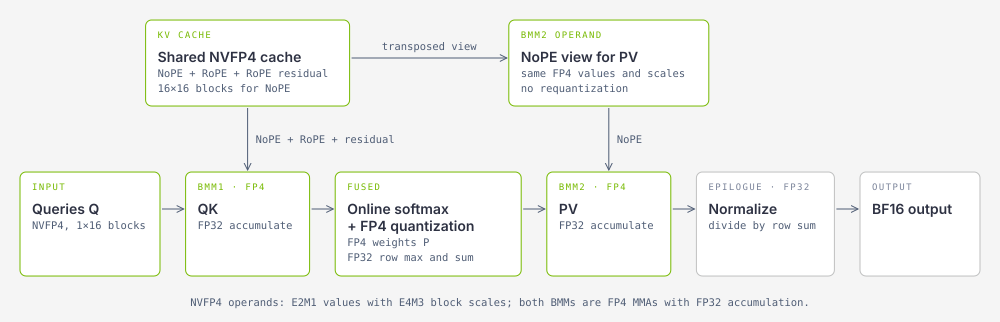
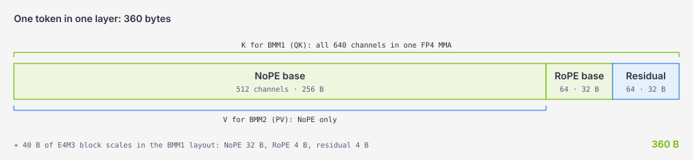
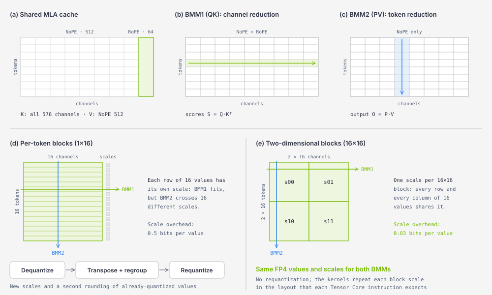
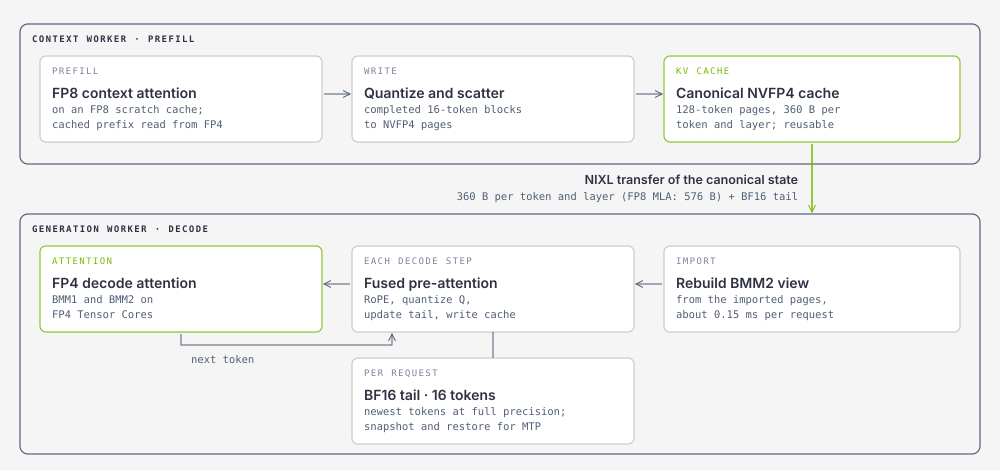
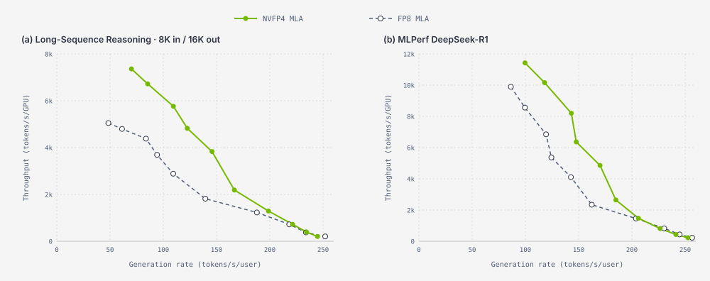

<!--
SPDX-FileCopyrightText: Copyright (c) 2026 NVIDIA CORPORATION & AFFILIATES. All rights reserved.
SPDX-License-Identifier: Apache-2.0
-->

# NVFP4 MLA: Unified 4-bit KV Cache Storage and Attention Compute in TensorRT LLM

By NVIDIA TensorRT LLM team

## Table of Contents
- [NVFP4 MLA: Unified 4-bit KV Cache Storage and Attention Compute in TensorRT LLM](#nvfp4-mla-unified-4-bit-kv-cache-storage-and-attention-compute-in-tensorrt-llm)
  - [Table of Contents](#table-of-contents)
  - [Introduction](#introduction)
  - [Why MLA Needs 4-bit Compute, Not Just 4-bit Storage](#why-mla-needs-4-bit-compute-not-just-4-bit-storage)
    - [One Latent, Two BMMs](#one-latent-two-bmms)
    - [MTP Makes MLA Decoding Compute-Bound](#mtp-makes-mla-decoding-compute-bound)
    - [NVFP4 in Brief](#nvfp4-in-brief)
  - [Design](#design)
    - [Quantizing Q, K, P, and V](#quantizing-q-k-p-and-v)
    - [Selective RoPE Residual Compensation](#selective-rope-residual-compensation)
    - [Two-Dimensional Blocks for the Shared Latent](#two-dimensional-blocks-for-the-shared-latent)
    - [The Canonical Cache: 360 Bytes per Token and Layer](#the-canonical-cache-360-bytes-per-token-and-layer)
  - [The Decode Attention Kernel](#the-decode-attention-kernel)
  - [Integration in TensorRT LLM](#integration-in-tensorrt-llm)
    - [Writing the Cache During Prefill and Decode](#writing-the-cache-during-prefill-and-decode)
    - [Speculative Decoding with MTP](#speculative-decoding-with-mtp)
    - [Disaggregated Serving](#disaggregated-serving)
    - [Prefix Reuse and Chunked Prefill](#prefix-reuse-and-chunked-prefill)
  - [How to Use](#how-to-use)
  - [Evaluation](#evaluation)
    - [Setup](#setup)
    - [Accuracy](#accuracy)
    - [KV Cache Footprint](#kv-cache-footprint)
    - [Attention Kernel](#attention-kernel)
    - [Generation Step](#generation-step)
    - [Disaggregated Serving Throughput](#disaggregated-serving-throughput)
    - [Agentic Multi-Turn Serving](#agentic-multi-turn-serving)
  - [Limitations and Future Work](#limitations-and-future-work)
  - [Acknowledgements](#acknowledgements)
  - [References](#references)

## Introduction

Multi-head latent attention (MLA) caches one compressed latent vector per token instead of separate keys and values for every head. It has become the attention mechanism of several leading open models, including DeepSeek-V3, DeepSeek-R1, Kimi K2.6, Kimi K3 and LongCat-Flash. Even so, the latent cache grows with every token and every concurrent request, and each decode step reads all of it. Long reasoning traces and agentic sessions keep growing contexts alive across many turns, which makes the capacity of this cache, and the time attention spends reading it, a dominant cost of serving.

FP8 is the usual KV cache format for these models today. Going to 4 bits looks like a storage problem, but for MLA it is just as much a compute problem: with multi-token prediction (MTP), MLA decoding is compute-bound on current GPUs, so a smaller cache alone does not make attention faster. NVFP4, the 4-bit block-scaled format that NVIDIA Tensor Cores execute natively, addresses both costs: it stores the cache in fewer bits than FP8 and multiplies at a higher rate than FP8.

In this blog, we introduce **NVFP4 MLA** in TensorRT LLM. It stores the MLA KV cache in NVFP4 and, during decode, runs **both attention batched matrix multiplications (BMMs) on native FP4 Tensor Cores**. It is an algorithm-system co-design with three parts:

- **Selective RoPE residual compensation** stores a second FP4 component only for the 64 quantization-sensitive RoPE channels, which restores accuracy without leaving the NVFP4 format.
- **Two-dimensional quantization blocks** make one NVFP4 copy of the shared latent valid for both BMMs, although the two reduce it along different axes, so the cache never needs to be requantized.
- **A matching kernel and cache system** quantize queries and softmax weights online and integrate the FP4 cache with paged KV cache management, MTP, disaggregated serving and prefix reuse.

The results, for DeepSeek-R1 on NVIDIA Rubin GPUs unless noted otherwise:

- **Accuracy:** NVFP4 MLA **matches BF16 average accuracy** on DeepSeek-R1 and Kimi K3 across nine benchmarks covering reasoning, coding, instruction following, 128K-token long context and agentic tool use.
- **Memory:** the cache takes **360 bytes per token and layer**, **3.20x smaller than BF16 and 1.60x smaller than FP8** on DeepSeek-R1, and 3.05x smaller than BF16 on Kimi K3.
- **Attention kernel:** up to **1.70x faster** than FP8 MLA.
- **Serving:** **13% to 46% more throughput per GPU** at the same number of requests in flight, from 256 to 2,048, in disaggregated serving with MTP. With only a few requests per GPU, the two precisions perform about the same.
- **Agentic serving:** up to **3.5x lower p90 time to first token (TTFT)** in multi-turn agent replays, once FP8 starts evicting session histories.

NVFP4 MLA complements the [NVFP4 cold-page compression](blog30_KV_Cache_Compression_in_TensorRT-LLM.md#nvfp4-cold-page-compression) described in our previous blog. Cold-page compression keeps KV pages in NVFP4 only while they sit off the GPU, and attention still sees the model's normal KV format. NVFP4 MLA keeps the active cache on the GPU in NVFP4 and computes attention on it directly.

<!-- TODO(before publishing): link the NVFP4 MLA paper once it is public. -->

## Why MLA Needs 4-bit Compute, Not Just 4-bit Storage

### One Latent, Two BMMs

For every token, MLA caches a single latent vector that all heads share. In DeepSeek-R1, this latent has 576 channels: 512 content channels without position rotation, called **NoPE**, and 64 channels with rotary position encoding, called **RoPE**. In FP8, that is 576 bytes per token and layer. Kimi K3 uses the same 512 + 64 layout, although it applies no positional encoding to the 64-channel part; we keep calling that part RoPE for both models.

For decode, TensorRT LLM uses the absorbed form of MLA: the key and value up-projections are folded into the query and output projections, so attention runs directly on the cached latent for all 128 query heads. Two BMMs read the cache:

- **BMM1 (QK)** multiplies the queries with all 576 latent channels and **reduces over channels** to produce the attention scores.
- **BMM2 (PV)** multiplies the softmax weights P with the 512 NoPE channels and **reduces over cached tokens** to produce the output. The RoPE channels contribute to the scores only.

The same cached values are therefore consumed in two orientations, by two BMMs that reduce along different axes. In grouped-query attention (GQA), K and V are separate tensors whose layouts can be chosen independently. In MLA they are one tensor, and this coupling shapes the whole design below.

### MTP Makes MLA Decoding Compute-Bound

Absorption trades bytes for math. For each cached token, one query position performs 278,528 FLOPs of BMM work in DeepSeek-R1 (2 × 128 heads × (576 + 512) channels), so FP8 MLA does 484 FLOPs per byte of cache. MTP raises this further. It scores several query positions, the next token and the draft tokens, against the same cache, and a kernel that reuses each cache read across all of them multiplies the arithmetic intensity. With MTP=3, four query positions share each read, and FP8 MLA does **1,934 FLOPs per byte**. That is more than twice the ridge point of a Rubin GPU, about 911 FLOPs per byte (17.5 PFLOP/s of dense FP8 compute over 19.2 TB/s of HBM bandwidth).

Measurements confirm the analysis. At 30K tokens of context, the optimized FP8 MLA decode kernel reads its cache at 8.7 TB/s without MTP. With MTP=3, it reads at only 2.8 TB/s, 14% of peak bandwidth, while sustaining 5.3 PFLOP/s of BMM work: **with MTP, FP8 MLA decoding is limited by matrix throughput, not by memory bandwidth**.

This bounds any storage-only approach. An NVFP4 cache that is dequantized to FP8 before attention runs the same FP8 matrix multiplications and the same softmax as FP8 MLA, adds the dequantization, and only shortens memory reads that are not the bottleneck. On this workload (batch 26, MTP=3, 30K context), it therefore cannot beat the 163 µs of FP8 MLA. NVFP4 MLA completes the same work in **97 µs**, because its FP4 BMMs shorten the computation itself. Storage and compute have to move to 4 bits together.

### NVFP4 in Brief

NVFP4 encodes each value as a 4-bit E2M1 number and attaches one FP8 E4M3 scale to every block of 16 values, plus one FP32 scale for the whole tensor. Compared with MXFP4, which uses power-of-two scales over blocks of 32 values, the smaller blocks and fractional scales follow local value ranges more closely. Block-scaled FP4 Tensor Core instructions consume the 4-bit codes and their scales directly and accumulate in FP32. One of their requirements matters a great deal for MLA: each operand must carry its scales along **its own reduction axis**.

## Design

Figure 1 shows the decode dataflow of NVFP4 MLA. The shared cache holds the latent in NVFP4 together with an FP4 residual for the RoPE channels. BMM1 reads the whole cache along channels, BMM2 reads its NoPE part along tokens, and the queries and softmax weights are quantized on the fly, so both BMMs run with FP4 operands on both sides.

<div align="center">
<figure>
  
</figure>
</div>
<p align="center"><sub><em>Figure 1: Decode dataflow of NVFP4 MLA. The shared NVFP4 cache holds the NoPE and RoPE channels plus an FP4 residual for RoPE. BMM1 (QK) and BMM2 (PV) both multiply FP4 operands on FP4 Tensor Cores and accumulate in FP32. Online softmax turns the scores into FP4 weights for BMM2, and the output is normalized in FP32. BMM2 reads the same FP4 values and scales as BMM1, in a transposed view and without requantization.</em></sub></p>

### Quantizing Q, K, P, and V

During decode, NVFP4 MLA quantizes all four attention operands. Each operand is quantized in blocks that follow the reduction axis of the BMM that consumes it:

| Operand | Consumed by | Block shape, one scale per block | Tensor scale |
|---|---|---|---|
| Queries Q | BMM1 | 1×16 along channels | Calibrated offline |
| RoPE part of the cache (K only) | BMM1 | 1×16 along channels | Calibrated offline |
| NoPE part of the cache (K and V) | BMM1 and BMM2 | 16×16, tokens × channels | Calibrated offline |
| Softmax weights P | BMM2 | 1×16 along tokens | Fixed |

The queries are quantized at every step by the pre-attention kernel, and P is quantized inside the attention kernel. P needs no calibration: stable softmax weights lie in (0, 1], so a fixed tensor scale of 1/2688, the reciprocal of the largest E2M1 magnitude (6) times the largest E4M3 magnitude (448), maps the row maximum to the top of the NVFP4 range, and no block scale can saturate. Both BMMs accumulate in FP32, and softmax keeps the scores, the running row maxima and sums, and the final normalization in FP32.

### Selective RoPE Residual Compensation

Quantizing these operands naively costs accuracy. Across the nine benchmarks of the [evaluation](#accuracy), NVFP4 for all four operands without compensation loses **5.71 points** on average on DeepSeek-R1 and **16.48 points** on Kimi K3. To find where the error comes from, we recorded the BF16 cache of every MLA layer of both models and measured how well NVFP4 reconstructs it. **The error concentrates in the 64 RoPE channels.** In the first six MLA layers of both models, their values peak at 3.9 to 125 times the NoPE maximum and change sharply from token to token, while the 512 NoPE channels stay flat.

NVFP4 MLA therefore keeps one NVFP4 component for NoPE and adds a second FP4 component only for RoPE, holding the quantization error of the first:

$$\widehat{E}_R = \mathcal{Q}_{1\times16}\left(C_R - \widehat{C}_R\right)$$

where $C_R$ is the RoPE part of the cache, $\widehat{C}_R$ its NVFP4 base, and $\mathcal{Q}_{1\times16}$ NVFP4 quantization in 1×16 blocks. The residual uses the same blocks as the RoPE base, with its own scales. Compensating these 64 of the 576 channels lowers the mean reconstruction error (normalized mean squared error, NMSE) of the whole cache by **44.4%** on DeepSeek-R1 and **72.2%** on Kimi K3, with NoPE unchanged. On the RoPE channels themselves, the error drops by 66.8x and 70.4x, to 3.3x and 4.0x below that of keeping RoPE in FP8.

<div align="center">
<figure>
  
</figure>
</div>
<p align="center"><sub><em>Figure 2: Cache layout of one token. The NoPE base (B<sub>N</sub>) and the RoPE base (B<sub>R</sub>) form the base NVFP4 latent; the RoPE residual (E<sub>R</sub>) is a second FP4 component for the 64 RoPE channels only. Each component stores E2M1 values with its own E4M3 block scales.</em></sub></p>

Why an FP4 residual instead of keeping RoPE in FP8, which would also fix the error? Because the residual keeps BMM1 a **single** block-scaled FP4 matrix multiplication. The kernel stores the base and the residual as separate FP4 tiles, places them side by side along the reduction dimension, and repeats the RoPE query in front of both:

$$S = \left[\,\widehat{q}_N,\ \widehat{q}_R,\ \widehat{q}_R\,\right]\left[\,\widehat{C}_N,\ \widehat{C}_R,\ \widehat{E}_R\,\right]^{\mathsf T} = \widehat{q}_N\widehat{C}_N^{\mathsf T} + \widehat{q}_R\left(\widehat{C}_R + \widehat{E}_R\right)^{\mathsf T}$$

BMM1 is thus one FP4 matrix multiply-accumulate (MMA) over 640 channels with one operand format and one scale layout, and the base and the residual are never merged into a wider tensor. An FP8 RoPE part would need a second MMA at the FP8 rate, with its own operand format and scale layout, and it would also be less accurate. The residual costs 36 bytes per token and layer (32 bytes of values and 4 bytes of scales), 10% of the cache, and it affects BMM1 only, because RoPE does not enter BMM2.

### Two-Dimensional Blocks for the Shared Latent

BMM1 reduces the NoPE latent over channels and BMM2 reduces it over tokens, and each needs one scale per 16 values along its own axis. A conventional per-token 1×16 layout fits BMM1 but runs the wrong way for BMM2 (Figure 3d). Feeding BMM2 from it means dequantizing the cached values, transposing and regrouping them, and requantizing them into token-wise blocks: a second rounding of values that are already quantized, plus extra memory traffic and synchronization right before BMM2. Quantizing a second, BMM2-oriented copy from the original BF16 values avoids the second rounding, but it nearly doubles the cache that has to be stored and transferred.

NVFP4 MLA instead quantizes the NoPE latent in **16×16 blocks of 16 tokens by 16 channels, with one scale per block** (Figure 3e). Every 16-value row and every 16-value column of a block shares that scale, so the block is valid in both reduction directions: both BMMs read **the same FP4 values and the same scales**, with no wider intermediate tensor and no dequantize-requantize pass. The logical scale overhead also drops from 0.5 to 0.03 bits per value. The Tensor Core instructions still expect a BMM-specific scale layout, so the kernels repeat each block scale along the block's 16 rows for BMM1 and along its 16 columns for BMM2. The RoPE base and residual keep 1×16 blocks, because only BMM1 reads them.

<div align="center">
<figure>
  
</figure>
</div>
<p align="center"><sub><em>Figure 3: (a) The shared MLA cache: K uses all 576 channels and V uses the 512 NoPE channels. (b) BMM1 reduces over channels and (c) BMM2 reduces over tokens. (d) With per-token 1×16 blocks, BMM2 needs a dequantize, regroup and requantize pass that rounds the values a second time. (e) With 16×16 blocks, one scale covers 16 values in both directions, so both BMMs use the same FP4 values and scales.</em></sub></p>

### The Canonical Cache: 360 Bytes per Token and Layer

Putting the pieces together, one DeepSeek-R1 layer stores the following for every token:

| Component | Bytes per token |
|---|---|
| NoPE values, 512 channels in E2M1 | 256 |
| RoPE base values, 64 channels in E2M1 | 32 |
| RoPE residual values, 64 channels in E2M1 | 32 |
| E4M3 block scales in the BMM1 layout (NoPE 32, RoPE base 4, RoPE residual 4) | 40 |
| **Total** | **360** |

That is 5.0 bits per cached value, compared with 8 for FP8 and 16 for BF16. We call this state the **canonical cache**. It is what TensorRT LLM stores, transfers between disaggregated workers and keeps for prefix reuse. On Rubin, generation workers additionally keep a decode-time view of the NoPE values for BMM2; see [Limitations and Future Work](#limitations-and-future-work).

## The Decode Attention Kernel

On Rubin GPUs, the decode attention of NVFP4 MLA is a CuTe DSL kernel. Native FP4 Tensor Core throughput speeds up the whole kernel only if the work around the BMMs keeps up. Both BMMs consume fine-grained scales, and between them the scores have to become softmax weights that are quantized, scaled and packed into FP4 before BMM2 can start. In FP8 this score-to-weight stage is a type conversion; in FP4 it also has to derive the block scales, and it can easily eat the gain of the faster BMMs. Three optimizations keep it off the critical path:

- **Fusing online softmax with FP4 quantization of P.** For every block of 16 scores, the block maximum defines a bias for the exponent, so a single fused multiply-add produces a value that is already in the FP4 range. The kernel converts and packs it right away, before the row maximum over the whole sequence is known. Once the cross-partition reduction produces that maximum, only the block scale remains to be computed. Because each code is computed against its block maximum, no code can saturate, and the division by the softmax sum happens in FP32 after BMM2.
- **Balancing P construction and accumulator rescaling.** Online softmax must also rescale the BMM2 accumulator whenever the running maximum changes. Rather than dedicating separate warp groups to building P and to rescaling, each worker group builds the FP4 weights for its part of a score tile and rescales a complementary part of the accumulator, so this stage does not serialize the pipeline.
- **Reusing FP4 P operands across BMM2 output tiles.** Each packed slice of P contributes to several BMM2 output tiles. The kernel keeps it resident through the Tensor Core operand-reuse mechanism instead of loading it again for every output tile, which leaves more issue bandwidth for building P.

The kernels live in [`tensorrt_llm/_torch/attention/backends/fp4_mla/`](https://github.com/NVIDIA/TensorRT-LLM/tree/main/tensorrt_llm/_torch/attention/backends/fp4_mla).

## Integration in TensorRT LLM

A fast kernel is only part of the work. The FP4 cache also has to be written during prefill, extended one token at a time during decode, rolled back when draft tokens are rejected, moved between disaggregated workers and reused across turns, all without letting quantization error accumulate. In TensorRT LLM, NVFP4 MLA is a dedicated path of the TRTLLM attention backend with its own cache manager, `Fp4MlaKVCacheManagerV2`, which builds on `KVCacheManagerV2`. Figure 4 follows a request through it.

<div align="center">
<figure>
  
</figure>
</div>
<p align="center"><sub><em>Figure 4: A request in disaggregated serving with NVFP4 MLA. The context worker runs FP8 context attention and writes completed 16-token blocks into the paged NVFP4 cache. Only the canonical state, together with a small BF16 tail, is transferred. The generation worker rebuilds the BMM2 view from the imported pages and decodes with FP4 attention, keeping the newest tokens of each request in a BF16 tail until their block is complete.</em></sub></p>

### Writing the Cache During Prefill and Decode

The cache is paged in blocks of 128 tokens, a page size that TensorRT LLM selects automatically for NVFP4 MLA. During prefill, context attention runs the existing FP8 MLA context kernel on an FP8 scratch cache, and a quantize-and-scatter kernel writes the completed 16-token blocks of the prompt into the paged NVFP4 cache. FP4 attention compute is used for decode, where cache reads and BMM work grow with every generated token.

A 16×16 block can be quantized only once all 16 of its tokens exist, but decode adds one token per step. Each request therefore owns a slot in a **16-token BF16 tail**, a ring buffer that keeps the newest tokens at full precision. At each decode step, a fused pre-attention kernel applies RoPE, appends the new token to the tail, quantizes the queries, refreshes the active FP4 block from the BF16 values and writes the cache. Once a block has all 16 tokens, it is frozen. Every FP4 block is therefore quantized from BF16 values and never from FP4 values, and error cannot accumulate through repeated requantization. At 4K tokens of context and a batch of 128, this fused pre-attention kernel is 1.74x faster than the pre-attention work of FP8 MLA (see [Generation Step](#generation-step)).

### Speculative Decoding with MTP

MTP writes draft tokens into the cache before they are verified. Before these speculative writes, the runtime snapshots the BF16 tail; afterwards, it commits the accepted tokens and restores the positions that rejected tokens overwrote. Completed FP4 pages are never modified during rollback, so rejected tokens cannot leak into the persistent cache. The MTP layer uses the same NVFP4 cache format, so a DeepSeek-R1 request has 62 NVFP4 cache layers: 61 MLA layers plus the MTP layer.

### Disaggregated Serving

In disaggregated serving, context and generation run on separate workers, and the cache of every prompt crosses the network once. NVFP4 MLA transfers only the canonical state: the packed values, the BMM1-order block scales and the BF16 tail. For DeepSeek-R1, that is **360 bytes per token and layer instead of 576 bytes with FP8, 37.5% fewer bytes**. The BMM2-facing layout is derived from the canonical state, so the generation worker rebuilds it from the imported pages before the first decode step of the request; in a micro-benchmark, the batched rebuild costs about 0.15 ms of host time per request for all 62 cache layers. NVFP4 MLA moves its cache with the NIXL backend and the Python transceiver runtime.

Context workers do not decode, so they keep only the canonical cache. As a result, a context worker holds about 1.6x as many tokens as with FP8 in the same memory, which matters for the [agentic workloads](#agentic-multi-turn-serving) below.

<!-- TODO(before publishing): describe how a context-only cache is enabled once the context-only and block-reuse PRs are merged (#20888 and the dense FP4 MLA block-reuse PR), and add their links. With MTP, the context worker also runs draft steps on the MTP layer, which keeps its decode-time views. -->

### Prefix Reuse and Chunked Prefill

Agentic and multi-turn workloads resend a growing history with every turn. Serving them efficiently depends on finding that history in the cache instead of prefilling it again. NVFP4 MLA supports KV cache block reuse and chunked prefill, together or separately. When a request finds cached blocks, context attention gathers the cached FP4 prefix into the operands of the FP8 context kernel and merges the attention over the prefix with the attention over the new tokens; the later chunks of a chunked prefill take the same path. Reuse works on whole 128-token blocks, and chunk boundaries align with the 16-token quantization tiles. Because the prefix is read back from the NVFP4 cache, context attention sees the same values that decode sees.

<!-- TODO(before publishing): align this section with the merged block-reuse implementation. -->

## How to Use

NVFP4 MLA is enabled by setting the KV cache data type of an MLA model to `nvfp4`. In a `trtllm-serve` configuration file:

```yaml
kv_cache_config:
  dtype: nvfp4
speculative_config:
  decoding_type: MTP
  max_draft_len: 3
```

Or with the LLM API:

```python
from tensorrt_llm import LLM
from tensorrt_llm.llmapi import KvCacheConfig, MTPDecodingConfig

llm = LLM(
    model="nvidia/DeepSeek-R1-0528-FP4-v2",
    tensor_parallel_size=4,
    moe_expert_parallel_size=4,
    enable_attention_dp=True,
    kv_cache_config=KvCacheConfig(dtype="nvfp4"),
    speculative_config=MTPDecodingConfig(max_draft_len=3),
)
```

TensorRT LLM then does the following automatically:

- It uses `Fp4MlaKVCacheManagerV2`. NVFP4 MLA requires KV cache manager V2, so do not set `use_kv_cache_manager_v2: false`.
- It sets `tokens_per_block` to 128 and logs `Change tokens_per_block to: 128 for using FP4 MLA attention`. If you enable chunked prefill, make `max_num_tokens` a multiple of 128.
- On Rubin (SM107) GPUs, it selects the CuTe DSL kernels described in this blog. They are built with the `nvidia-cutlass-dsl` package that TensorRT LLM installs as a dependency.

For disaggregated serving, use the NIXL backend with the Python transceiver runtime on both context and generation workers:

```yaml
cache_transceiver_config:
  backend: NIXL
  transceiver_runtime: PYTHON
```

NVFP4 MLA supports DeepSeek-V3 and DeepSeek-R1 models and Kimi K3. For Kimi K3, NVFP4 is used in 22 of its 24 MLA layers, and the last two MLA layers keep an FP8 cache.

<!-- TODO(before publishing): Kimi K3 support depends on #20888; on main today, `supports_fp4_mla_attention` excludes hybrid linear-attention models. -->

Two environment variables control the kernels:

| Environment variable | Default | Effect |
|---|---|---|
| `TRTLLM_FP4_MLA_ATTENTION_BACKEND` | `cutedsl` on SM107 when the CuTe DSL kernels can be loaded; `triton` otherwise | Selects the NVFP4 MLA kernels. If the CuTe DSL kernels cannot be loaded, TensorRT LLM falls back to a Triton implementation without an error, and other GPU architectures always use the Triton implementation. Set this variable to `cutedsl` to raise an error instead of falling back. |
| `TRTLLM_FP4_MLA_CUTEDSL_FUSED_V_TRANSPOSE` | `0` | Set to `1` to let generation workers decode directly from the canonical cache, transposing V inside the attention kernel. Decode-resident state shrinks from 648 to 392 bytes per token and layer, at a latency cost. See [Limitations and Future Work](#limitations-and-future-work). |

We recommend setting `TRTLLM_FP4_MLA_ATTENTION_BACKEND=cutedsl` in production deployments on Rubin, so that a broken environment cannot silently fall back to the slower path. All results in this blog use the CuTe DSL kernels.

## Evaluation

### Setup

**Accuracy.** We compare NVFP4 MLA with three baselines on DeepSeek-R1 and Kimi K3:

- **BF16** keeps the KV cache and all attention BMM operands in BF16.
- **FP8 MLA** casts the KV cache and all four BMM operands (Q, K, P and V) to FP8 E4M3.
- **Naive NVFP4 MLA** quantizes the KV cache and all four operands to NVFP4 with the block layouts of NVFP4 MLA, but without the RoPE residual.

All configurations keep the weight format of the checkpoint.

**Performance.** All performance results are for DeepSeek-R1 with MTP=3 on NVIDIA Rubin GPUs, served by TensorRT LLM. FP8 MLA and NVFP4 MLA share the same KV cache manager, NIXL transfer, runtime settings and parallel layout. They differ only in the cache and attention precision and in the page size: 128 tokens for NVFP4 MLA, and 32 tokens for FP8 MLA, whose decode kernel on this GPU does not support 128-token pages. The serving workloads use natural-text prompts, so that MTP acceptance reflects real text. In the table, DEP *n* denotes attention data parallelism with expert parallelism over *n* GPUs.

| Workload | Description | Layout |
|---|---|---|
| MLPerf | All 4,388 DeepSeek-R1 MLPerf evaluation prompts in a fixed random order. Inputs average 804 tokens. Outputs end naturally, average about 3.8K tokens and are capped at 20K tokens. Decode contexts average about 5K tokens. | One context worker (DEP2) and one generation worker (DEP16), 18 GPUs |
| Long-Sequence Reasoning | Problems from the same set packed into prompts of about 8K tokens, with about 16K output tokens per request. Decode contexts average about 16K tokens. | Two context workers (DEP2 each) and one generation worker (DEP16), 20 GPUs |
| AgentX | 123 recorded Claude Code sessions from the SemiAnalysis InferenceX AgentX benchmark that fit a 160K-token context, replayed with their recorded think times. Each operating point keeps a fixed number of sessions alive for 15 minutes. The context worker uses prefix reuse, chunked prefill and session affinity, with a KV cache budget of 43 or 12 GiB per GPU plus 8 GiB of host memory. | One context worker (DEP2) and one generation worker (DEP4) |
| Generation step | Aggregated server on one node. Each wave of 4*B* requests, with a per-GPU batch of *B* and *L* random input tokens per request, generates 1,024 tokens per request. We report the median device time of decode-only steps at the full batch. | DEP4 |
| Attention kernel | One decode call of one MLA layer with 128 heads, captured in a CUDA Graph and timed with CUDA events. NVFP4 MLA times include its helper kernels; FP8 MLA times use the FP8 MLA kernel of the generation workers. Neither includes the pre-attention kernel. | One GPU |

### Accuracy

NVFP4 MLA **matches BF16 average accuracy on both models**. Its nine-task average differs from BF16 by +0.01 points on each model, compared with -0.07 and -0.33 points for FP8 MLA. No task drops by more than 1.5 points with NVFP4 MLA, including the long-context tasks and the agentic τ²-Bench, whereas FP8 MLA drops by up to 1.60 points. The naive baseline shows that this result is not automatic: without the RoPE residual, NVFP4 loses 5.71 and 16.48 points on average, and up to 56 points on a single Kimi K3 task.

DeepSeek-R1:

| Configuration | GPQA | IFBench | AIME 2025 | LiveCodeBench v6 | SciCode | RULER 128K | MRCR 128K | AA-LCR | τ²-Bench | Average | Δ vs. BF16 |
|---|---|---|---|---|---|---|---|---|---|---|---|
| BF16 | 80.07 | 39.53 | 87.14 | 71.31 | 42.60 | 92.97 | 36.35 | 52.52 | 35.75 | 59.80 | |
| FP8 MLA | 80.16 | 37.93 | 87.60 | 71.75 | 42.27 | 92.67 | 37.21 | 52.62 | 35.42 | 59.74 | -0.07 |
| Naive NVFP4 MLA | 77.38 | 34.87 | 73.80 | 62.11 | 40.64 | 90.52 | 29.54 | 46.06 | 31.91 | 54.09 | -5.71 |
| **NVFP4 MLA** | 79.83 | 38.07 | 85.94 | 71.78 | 43.12 | 92.77 | 36.95 | 51.86 | 38.05 | **59.82** | **+0.01** |

Kimi K3:

| Configuration | GPQA | IFBench | AIME 2025 | LiveCodeBench v6 | SciCode | RULER 128K | MRCR 128K | AA-LCR | τ²-Bench | Average | Δ vs. BF16 |
|---|---|---|---|---|---|---|---|---|---|---|---|
| BF16 | 93.66 | 73.96 | 96.20 | 57.49 | 58.48 | 97.00 | 85.02 | 81.75 | 78.84 | 80.27 | |
| FP8 MLA | 93.50 | 73.69 | 95.63 | 57.32 | 58.19 | 97.06 | 84.38 | 82.19 | 77.49 | 79.94 | -0.33 |
| Naive NVFP4 MLA | 88.26 | 61.79 | 87.71 | 10.68 | 2.27 | 95.98 | 75.21 | 77.31 | 74.89 | 63.79 | -16.48 |
| **NVFP4 MLA** | 93.43 | 74.91 | 96.20 | 57.30 | 58.09 | 97.11 | 84.10 | 82.31 | 79.06 | **80.28** | **+0.01** |

<p align="center"><sub><em>Scores in percent. The average is the unweighted mean of the nine tasks, and the differences are computed from unrounded means. Repeats per task: 64 for GPQA, AIME 2025 and AA-LCR; 8 for LiveCodeBench, SciCode and τ²-Bench; 5 for IFBench; 3 for MRCR; 1 for RULER.</em></sub></p>

### KV Cache Footprint

NVFP4 MLA reduces the canonical MLA cache to 20.5 GiB per million tokens on DeepSeek-R1 and 8.4 GiB on Kimi K3, **3.20x and 3.05x smaller than BF16**. On DeepSeek-R1, it is also 1.60x smaller than an FP8 cache.

| Cache | DeepSeek-R1, GiB per 1M tokens | Reduction vs. BF16 | Kimi K3, GiB per 1M tokens | Reduction vs. BF16 |
|---|---|---|---|---|
| BF16 | 65.4 | 1.00x | 25.7 | 1.00x |
| FP8 | 32.7 | 2.00x | 12.9 | 2.00x |
| **NVFP4 MLA** | **20.5** | **3.20x** | **8.4** | **3.05x** |

<p align="center"><sub><em>The counts cover the MLA layers of the target model and include the RoPE residual and the physical BMM1 scale layout. DeepSeek-R1 uses NVFP4 in all 61 MLA layers. Kimi K3 has 24 MLA layers among its 93 layers, with NVFP4 in 22 and FP8 in the last two, and the counts exclude the recurrent state of its 69 Kimi Delta Attention layers. Update buffers, allocation padding and the decode-time view of generation workers are not included.</em></sub></p>

### Attention Kernel

We first compare the two kernels on the largest batch that fits in one wave: batch 106 with one query per sequence (MTP=0) and batch 26 with four queries per sequence (MTP=3). Both workloads perform nearly the same BMM work, 106 and 104 query positions over the same context, but with MTP=3 each cache read serves four query positions.

| Speedup over FP8 MLA | 4K context | 30K context |
|---|---|---|
| MTP=0, batch 106 | 1.09x | 1.10x |
| MTP=3, batch 26 | 1.36x | **1.68x** |

With MTP=3, where FP8 MLA is compute-bound, NVFP4 MLA is **1.36x faster at 4K and 1.68x faster at 30K tokens of context**. The next table extends the MTP=3 comparison to the per-GPU batches of a generation worker, from 8 to 1,024 requests, and to KV lengths from 2K to 32K tokens:

| KV length | B = 8 | B = 32 | B = 128 | B = 256 | B = 512 | B = 1,024 |
|---|---|---|---|---|---|---|
| 2K | 1.05x | 1.09x | 1.13x | 1.11x | 1.12x | 1.12x |
| 4K | 1.02x | 1.37x | 1.29x | 1.26x | 1.26x | 1.24x |
| 8K | 1.05x | 1.52x | 1.35x | 1.33x | 1.33x | – |
| 16K | 1.23x | 1.63x | 1.37x | 1.34x | – | – |
| 32K | 1.39x | **1.70x** | 1.35x | – | – | – |

<p align="center"><sub><em>Speedup of one NVFP4 MLA decode call over FP8 MLA, with 128 heads and MTP=3. Each entry is the mean over CUDA Graph replays, as the median over the four GPUs of one node. Shapes whose cached tokens exceed the KV cache capacity of a generation GPU, about 5.6M tokens, are omitted.</em></sub></p>

For every batch size, the speedup grows with the context, from 1.05x to 1.13x at 2K tokens to between 1.24x and 1.70x at the longest context measured. It peaks at **1.70x at 32K tokens with a batch of 32**, where one call takes 200 µs instead of 339 µs. Longer contexts also raise the weight of attention in the whole step: at a batch of 128, one FP8 attention call grows from 123 µs at 4K to 431 µs at 16K, so the 62 attention calls of a generation step take about 27 ms at 16K, more than the 21.5 ms that the rest of the step takes at 4K (see the next section).

### Generation Step

The next table breaks down a DeepSeek-R1 generation step at 4K input tokens and a per-GPU batch of 128, which is close to the MLPerf workload at its highest load. Each step verifies four tokens per request with MTP=3.

| Component | NVFP4 MLA | FP8 MLA | Speedup |
|---|---|---|---|
| Fused pre-attention kernel | 0.037 | 0.064 | 1.74x |
| Core attention | 0.210 | 0.272 | 1.29x |
| Rest of the step | 0.661 | 0.664 | 1.01x |
| **Full step** | **0.907** | **1.000** | **1.10x** |

<p align="center"><sub><em>Generation step on four GPUs with DEP and MTP=3, in units of the FP8 MLA step (32.41 ms; NVFP4 MLA takes 29.41 ms). Full steps are median device times from an unprofiled run. The components come from a one-GPU Nsight Systems trace of 20 decode steps, counting overlaps once; the rest of the step is the remainder. Core attention includes the attention kernels, their helpers and the online quantization of the softmax weights; the rest of the step includes the mixture-of-experts (MoE) layers, projections, communication and sampling.</em></sub></p>

Core attention and the fused pre-attention kernel are 1.29x and 1.74x faster. Together, they account for about a third of the FP8 step and make the whole step 1.10x faster at 4K input tokens. The rest of the step runs the same kernels in both precisions and agrees within 1%, so the step speedup grows with the share of attention in the step, and that share rises with the context length.

### Disaggregated Serving Throughput

We measure the throughput-latency trade-off of disaggregated DeepSeek-R1 serving on the MLPerf and Long-Sequence Reasoning workloads. Closed-loop clients sweep from 16 to 2,048 requests in flight, up to 128 per generation GPU. Each client slot issues at least twelve MLPerf requests or three Long-Sequence Reasoning requests in sequence, and we discard the first and last wave of each client to keep only the steady state. For a request with $o$ output tokens, time to first token $t$ and end-to-end latency $e$, the per-user generation rate is the median of $(o-1)/(e-t)$ over requests, and the throughput per GPU counts the output tokens of all requests over all context and generation GPUs. Both precisions use the deployment listed in the setup, with one DEP16 generation worker, and only the number of requests in flight changes along each curve. Each curve keeps the points of its precision that no other point beats in both metrics.

<div align="center">
<figure>
  
</figure>
</div>
<p align="center"><sub><em>Figure 5: Measured throughput and per-user generation rate of disaggregated DeepSeek-R1 serving with MTP=3 on Rubin GPUs, from 16 to 2,048 requests in flight in one deployment with a DEP16 generation worker: (a) Long-Sequence Reasoning with about 8K input and 16K output tokens per request and (b) the MLPerf DeepSeek-R1 dataset. Throughput counts all context and generation GPUs.</em></sub></p>

At the same number of requests in flight, from 256 to 2,048, NVFP4 MLA raises both throughput and per-user generation rate (Figure 5). Throughput per GPU rises by 13.2% to 19.7% on MLPerf and by 20.3% to 45.8% on Long-Sequence Reasoning. Both precisions accept 2.75 to 2.83 tokens per MTP step on Long-Sequence Reasoning, so the gains come from shorter decode steps, not from different MTP acceptance.

The NVFP4 MLA decode step grows more slowly with load. As the load rises from 5-8 to 9-16 requests per generation GPU, the median FP8 MLA decode step grows from 13.1 to 16.9 ms on MLPerf and from 14.1 to 19.3 ms on Long-Sequence Reasoning, while the NVFP4 MLA step grows only from 13.0 to 14.7 ms and from 13.5 to 16.0 ms. With fewer requests, attention is a small part of the step: up to 128 requests in flight, at most eight per generation GPU, the two precisions deliver the same throughput within about 5% at the same concurrency, and FP8 MLA reaches a slightly higher per-user rate at the lightest loads.

Because both curves come from one deployment, we compare the precisions at the same load. At a fixed per-user rate near the knee of the FP8 MLA curve, NVFP4 MLA runs about twice the load of FP8 MLA in this deployment, so the throughput ratio at that rate is an upper bound: the best deployment of each precision for a given rate may use a different parallel layout.

| Workload | KV cache | In flight | tok/s/user | tok/s/GPU | Gain | TPOT p50 / p99 (ms) | MTP acceptance |
|---|---|---|---|---|---|---|---|
| MLPerf | FP8 MLA | 256 | 162 | 2,339 | | 6.16 / 7.56 | |
| | **NVFP4 MLA** | 256 | 185 | 2,647 | **+13.2%** | 5.41 / 6.55 | |
| | FP8 MLA | 1,024 | 119 | 6,852 | | 8.38 / 10.15 | |
| | **NVFP4 MLA** | 1,024 | 143 | 8,200 | **+19.7%** | 6.99 / 8.27 | |
| Long-Sequence Reasoning | FP8 MLA | 256 | 139 | 1,819 | | 7.17 / 8.34 | 2.77 |
| | **NVFP4 MLA** | 256 | 167 | 2,188 | **+20.3%** | 6.00 / 6.39 | 2.80 |
| | FP8 MLA | 1,024 | 84 | 4,382 | | 11.94 / 13.72 | 2.75 |
| | **NVFP4 MLA** | 1,024 | 109 | 5,762 | **+31.5%** | 9.13 / 9.91 | 2.79 |

<p align="center"><sub><em>Disaggregated DeepSeek-R1 serving with MTP=3 at the same number of requests in flight, over steady-state requests. Throughput counts all context and generation GPUs, and the gain is the throughput gain per GPU of NVFP4 MLA over FP8 MLA. TPOT is the time per output token. MTP acceptance is the mean number of tokens accepted per MTP step, recorded for Long-Sequence Reasoning.</em></sub></p>

### Agentic Multi-Turn Serving

Agentic sessions add a capacity benefit. Context workers keep the KV cache of earlier turns and prefill only the newly appended tokens, so the number of session histories that fit in the cache decides how often a turn has to be prefilled from scratch. We replay the AgentX sessions with the same KV cache budget per context GPU for both precisions. Because the context worker keeps only the canonical cache, the same memory holds about 1.6x as many cached tokens with NVFP4 MLA as with FP8 MLA.

NVFP4 MLA delays cache eviction as the number of concurrent sessions grows. While both caches retain the session histories, both serve 93% to 95% of the prompt tokens from the cache and keep the p90 TTFT at 2 to 3 seconds. Once FP8 starts evicting histories, the larger effective cache of NVFP4 MLA sustains higher hit rates, so fewer prompt tokens have to be prefilled again. With 43 GiB and 48 sessions, the hit rate rises from 77.0% to 87.1%, and the p90 TTFT falls from 108 to 30.9 seconds. With 12 GiB, the transition starts at 12 sessions, where the p90 TTFT falls from 5.44 to 2.23 seconds. Across all measured points after FP8 starts evicting, NVFP4 MLA lowers the p90 TTFT by **1.5x to 3.5x**.

| KV cache per context GPU | Sessions | p90 TTFT, FP8 MLA (s) | p90 TTFT, NVFP4 MLA (s) | Cache hit, FP8 MLA | Cache hit, NVFP4 MLA |
|---|---|---|---|---|---|
| 43 GiB | 16 | 2.98 | 1.99 | 95.2% | 95.1% |
| | 24 | 2.68 | 2.41 | 93.6% | 94.4% |
| | 32 | 11.9 | 5.36 | 87.6% | 92.4% |
| | 40 | 36.6 | 23.7 | 82.3% | 87.9% |
| | 48 | 108 | **30.9** | 77.0% | 87.1% |
| | 64 | 178 | 79.8 | 54.1% | 79.6% |
| 12 GiB | 12 | 5.44 | **2.23** | 89.9% | 94.8% |
| | 16 | 7.73 | 4.23 | 87.5% | 91.3% |
| | 20 | 12.8 | 5.62 | 81.6% | 88.7% |
| | 24 | 32.5 | 13.0 | 73.1% | 85.5% |

<p align="center"><sub><em>DeepSeek-R1 AgentX multi-turn replay with MTP=3 and prefix reuse. The KV cache budget per context GPU is the same for both precisions, and each context GPU also has 8 GiB of host memory. Sessions is the number of agent sessions kept alive. The cache hit rate is the server-reported share of prompt tokens served from the prefix cache, which the traces cap at about 94% to 96%.</em></sub></p>

<!-- TODO(before publishing): these runs used the dense FP4 MLA block-reuse branch; re-validate on main once the block-reuse PR is merged. -->

## Limitations and Future Work

**A decode-time V view on Rubin.** Two-dimensional blocks are valid for both BMMs, but on Rubin, unlike its FP8 counterpart, the NVFP4 Tensor Core instruction cannot consume the transposed V operand required by our BMM2 mapping. Transposing the packed V inside the attention kernel adds shared-memory traffic and synchronization on the critical path from BMM1 to BMM2. By default, generation workers therefore keep a persistent transposed copy of the NoPE values together with their BMM2-order scales, 288 additional bytes per token and layer. Decode-resident state then takes 648 bytes per token and layer instead of 576 bytes with FP8, so a generation GPU holds about 11% fewer cached tokens. All decode and serving results in this blog include this overhead. The canonical 360-byte state used for storage, transfer and prefix reuse is unaffected, and so are context workers. For capacity-bound deployments, `TRTLLM_FP4_MLA_CUTEDSL_FUSED_V_TRANSPOSE=1` decodes directly from the canonical cache with an in-kernel transpose, at a latency cost. The workaround reflects the instruction set of this GPU, not the representation: hardware that accepts transposed NVFP4 operands can decode from the canonical cache directly.

**Short contexts and few requests.** The advantage of FP4 attention grows with the context length and the load. At 2K tokens of context, the attention kernel is only 1.05x to 1.13x faster, and with few requests per GPU, attention is a small share of the generation step, so NVFP4 MLA and FP8 MLA perform about the same there. NVFP4 MLA pays off most for long reasoning traces, high concurrency and agentic sessions.

**Future work.** We plan to extend NVFP4 MLA to more models with MLA layers, to reduce the cost of writing the FP4 cache in the context phase, and to bring the same representation to future GPUs that can decode from the canonical cache directly.

## Acknowledgements

<!-- TODO(before publishing): list the contributors and teams. -->

NVFP4 MLA is a joint effort across NVIDIA, spanning the quantization recipe, the CuTe DSL attention kernels, the TensorRT LLM runtime and the serving evaluation. We thank everyone who contributed to its design, implementation and evaluation.

## References

- DeepSeek-AI. DeepSeek-V2: A Strong, Economical, and Efficient Mixture-of-Experts Language Model. [arXiv:2405.04434](https://arxiv.org/abs/2405.04434), 2024.
- DeepSeek-AI. DeepSeek-V3 Technical Report. [arXiv:2412.19437](https://arxiv.org/abs/2412.19437), 2024.
- DeepSeek-AI. DeepSeek-R1: Incentivizing Reasoning Capability in LLMs via Reinforcement Learning. [arXiv:2501.12948](https://arxiv.org/abs/2501.12948), 2025.
- Moonshot AI. [Kimi K3: Open Frontier Intelligence](https://github.com/MoonshotAI/Kimi-K3/blob/main/k3_tech_report.pdf), 2026.
- NVIDIA. Pretraining Large Language Models with NVFP4. [arXiv:2509.25149](https://arxiv.org/abs/2509.25149), 2025.
- B. D. Rouhani et al. Microscaling Data Formats for Deep Learning. [arXiv:2310.10537](https://arxiv.org/abs/2310.10537), 2023.
- NVIDIA. [Vera Rubin NVL72 product specifications](https://www.nvidia.com/en-us/data-center/vera-rubin-nvl72/), 2026.
- TensorRT LLM. [KV Cache Compression in TensorRT LLM](blog30_KV_Cache_Compression_in_TensorRT-LLM.md), 2026.
