<!-- SPDX-FileCopyrightText: Copyright (c) 2026 NVIDIA CORPORATION & AFFILIATES. All rights reserved. -->
<!-- SPDX-License-Identifier: Apache-2.0 -->

# WinoVAE: Faster Video Decoding in TensorRT-LLM

By Igor Shovkun

## Abstract

Video decoding can remain a major inference cost as diffusion transformers become faster. We present WinoVAE, an optimized Wan variational autoencoder (VAE) for TensorRT-LLM VisualGen that combines spatial and temporal Winograd convolution with kernel fusion. FP16 intermediates and optimized interpolation points control transform rounding error, while layer-specific kernels reduce intermediate memory traffic. Fused GPUDirect P2P halo exchange uses peer-to-peer GPU memory writes to reduce communication overhead when decoding across GPUs. In a pre-release benchmark on one GB200, WinoVAE reduces median GPU time for a 189-frame 720p decode from **5.96 to 1.61 seconds (3.69×)** using random weights with Cosmos3 VAE dimensions. In a separate test with trained Cosmos3-Nano weights and a real 121-frame clip, relative-L2 decode error against FP32 Diffusers is 0.3448%, compared with 0.3695% for the BF16 baseline.

## Contents

- [Motivation and decoder architecture](#motivation-and-decoder-architecture)
- [Methodology](#methodology)
- [Results](#results)
- [Discussion](#discussion)
- [Conclusions](#conclusions)
- [Availability and data](#availability-and-data)

## Motivation and decoder architecture

### Generation and decoder costs

The VAE decoder converts the transformer's compressed output tensors, called latents, into pixels. As transformers need fewer denoising steps, this decoding becomes a larger fraction of the work. In a Cosmos3-Nano-Sim-Bimanual generation run on one B200, the VAE decoder took 10.5 seconds out of 26.6 seconds, or 39% of the total. Improving the transformer alone leaves that cost intact.

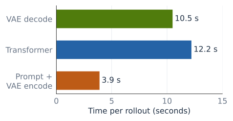

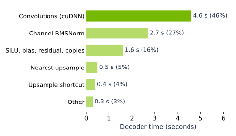

*Figure 1. Generation profile with trained Cosmos3-Nano-Sim-Bimanual weights: 901 frames at 832 × 480 on one B200, with two denoising steps per chunk. A chunk is a group of frames processed together. The second panel reconstructs a 10.1-second decoder-only breakdown from a kernel profile and the measured 2.7-second normalization-fusion saving. It is separate from the 10.5-second decode measured inside the generation run.*

Convolutions account for about 46% of that decoder-only profile. Normalization, activation, additions, upsampling, and copies account for the rest. More than half of the decoder's original cost lies outside convolution. Removing those surrounding memory passes is a separate part of the optimization.

### The decoder we are optimizing

The baseline is TensorRT-LLM's Wan 2.2 VAE in BF16, called **BF16 Wan VAE** here. Its decoder expands the latent representation through upsampling blocks. Spatial dimensions grow while channel counts decrease, so successive convolutions have different compute and memory costs. Residual blocks add a computed update to their input. Normalization and activation surround the convolutions with additional tensor reads and writes.

A typical 3 × 3 × 3 convolution mixes input channels over a 3 × 3 spatial neighborhood and three frames. It is causal: each output depends on the current and preceding frames. When decoding in chunks, the implementation carries the required history into the next call.

WinoVAE retains the trained weights and preserves these convolutions in exact arithmetic. Its starting point is an algebraic change: reuse combinations of neighboring inputs instead of computing every output's products independently. That creates fewer products, but also introduces transforms, temporary tensors, and new rounding errors. The implementation has to account for all of them.

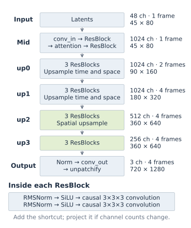

*Figure 2. Decoder structure for a steady-state chunk containing one latent frame at 720p. Operations within each box run from top to bottom. Dimensions at the right are the outputs of each stage. The first chunk has separate causal-start behavior. The green stages have larger spatial maps and fewer channels. Unpatchify rearranges 12 feature channels into RGB pixels at twice the height and width.*

The mid block operates at the smallest spatial resolution and includes attention over the frame. Three upsampling stages then increase the spatial resolution, and two also increase the frame count. The final rearrangement produces RGB video.

At inference, each residual block computes

$$
\begin{aligned}
h_1 &= C_1\bigl(\operatorname{SiLU}(N_1(x))\bigr),\\
h_2 &= C_2\bigl(\operatorname{SiLU}(N_2(h_1))\bigr),\\
y &= S(x)+h_2.
\end{aligned}
$$

Here, $N_1$ and $N_2$ are root-mean-square normalization (RMSNorm) over each pixel's channels. The activation is $\operatorname{SiLU}(x)=x\,\mathrm{sigmoid}(x)$. Each $C_j$ is a learned causal 3 × 3 × 3 convolution, including its bias. The shortcut $S(x)$ is $x$ when channel counts match, or a learned 1 × 1 × 1 projection otherwise. It bypasses both normalization, activation, and convolution sequences.

Early convolutions have many channels and small spatial maps. Later convolutions have fewer channels and many more pixels. One kernel decomposition need not be best at every stage.

## Methodology

WinoVAE addresses the two parts of the profile together. First, it fuses the operations around convolution and removes repeated work in upsampling, causal initialization, and encoder downsampling. Second, it replaces suitable convolutions with spatial and temporal Winograd transforms followed by batched GEMMs. Finally, it partitions the feature maps across GPUs and fuses border communication into the kernels that already produce those maps.

The implementation keeps BF16 model inputs and outputs. Its Winograd operands and products use FP16 storage, with optimized spatial interpolation points. The following results use these implementation choices. The [Discussion](#discussion) explains their numerical motivation and limits.

### Remove memory passes around convolution

Memory traffic also arises between convolutions. Bias addition, residual addition, normalization, and activation need many of the same tensor values. Executing each as a separate pass repeatedly writes and rereads an intermediate. WinoVAE combines compatible operations and writes directly into the buffer required by the next convolution.

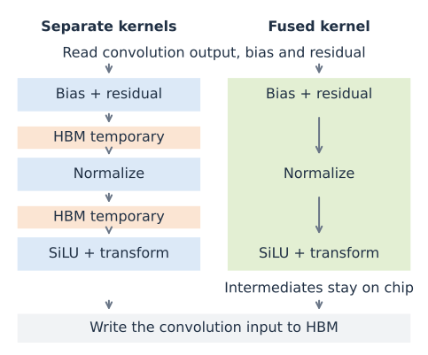

*Figure 3. A representative normalization and activation path. Both versions read the operands and write the convolution input. Fusion removes the two intermediate tensor write/read passes shown on the left.*

Normalization reduces across channels in FP32. The fused path also applies the affine transformation and SiLU, the elementwise activation $x\,\mathrm{sigmoid}(x)$. Its output can include the convolution's temporal transform or be placed beside the causal history, avoiding a separate concatenation of the full input window.

### Fold upsampling into a 2 × 2 convolution

Nearest-neighbor 2× upsampling repeats each source pixel in a 2 × 2 block. A subsequent 3 × 3 convolution reads only four distinct input values. Instead of multiplying each copy separately, WinoVAE sums the weights that multiply the same value. The resulting 2 × 2 filter operates on the original low-resolution input.

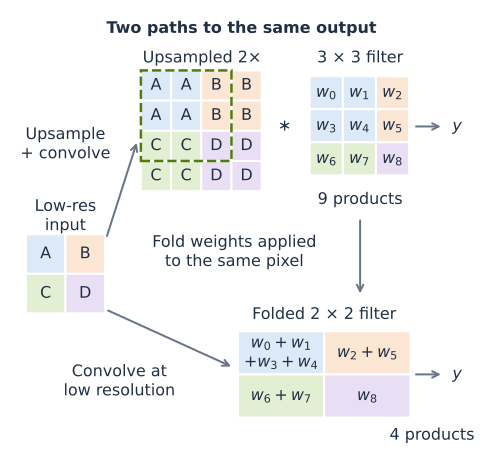

*Figure 4. Equivalent computations of one output for one input/output-channel pair. The upper path repeats each input pixel into a 2 × 2 block, then applies the 3 × 3 filter to the dashed window. The lower path applies a folded 2 × 2 filter to the original input. In the highlighted window, four weights multiply A, two multiply B, two multiply C, and one multiplies D. Summing each group gives the lower filter and the same output $y$ in exact arithmetic. This example shows the odd-row, odd-column output phase (zero-based). The symbol $\ast$ denotes convolution.*

The grouping depends on whether the output row and column are even or odd. These four combinations are the **output phases**. WinoVAE prepares one 2 × 2 filter per phase and packs them into one convolution with $C_{\mathrm{in}}$ input channels and $4C_{\mathrm{out}}$ output channels. A gather interleaves the four channel groups into the enlarged image, using phase-dependent spatial offsets to preserve the original zero padding. The gather also adds the convolution bias and the upsampling block's shortcut.

This replaces nine products per output and channel pair with four, approaching a 2.25× arithmetic reduction on large images. The padded low-resolution convolution computes some unused border values, so the implementation's reduction is slightly smaller. It also avoids materializing the repeated input at four times the spatial size. Preparing the weight sums once preserves the convolution in exact arithmetic but changes floating-point rounding.

### Remove copies from encoder downsampling

The encoder maps pixels into latents, reducing spatial dimensions instead of expanding them. Its downsampling blocks have two avoidable memory passes. One copies a residual sum into a zero-padded convolution input. WinoVAE writes the sum into that padded buffer directly. Another rearranges the shortcut tensor into a contiguous buffer before averaging it. A fused kernel computes the average from the original layout and adds the convolution output and bias.

### Avoid temporal work for the first frame

At the start of a causal sequence, the preceding frames are zero padding. For an image, they stay absent throughout the decode. WinoVAE uses a two-dimensional convolution for this case, avoiding temporal contributions that multiply zeros. Later chunks use the temporal history retained from earlier calls. The image and video gains are measured separately in Results.

### Reduce convolution arithmetic with Winograd

The example below is Winograd's $F(2,3)$ minimal-filtering algorithm, reproduced in [Lavin and Gray, *Fast Algorithms for Convolutional Neural Networks*, Section 4.1, Eq. (5)](https://arxiv.org/pdf/1509.09308#page=2).

Consider one channel and a three-tap filter. The inputs overlap between neighboring outputs:

$$
\begin{aligned}
y_0 &= d_0g_0+d_1g_1+d_2g_2,\\
y_1 &= d_1g_0+d_2g_1+d_3g_2.
\end{aligned}
$$

Direct convolution computes six products. Winograd's $F(2,3)$ construction computes four:

$$
\begin{aligned}
m_0&=(d_0-d_2)g_0,\\
m_1&=(d_1+d_2)(g_0+g_1+g_2)/2,\\
m_2&=(d_2-d_1)(g_0-g_1+g_2)/2,\\
m_3&=(d_1-d_3)g_2.
\end{aligned}
$$

The outputs are recovered with $y_0=m_0+m_1+m_2$ and $y_1=m_1-m_2-m_3$. Expanding the expressions gives the original convolution. The filter combinations can be prepared once when loading the weights, while the input combinations and reconstruction must be evaluated for each tile.

In $F(m,r)$, $m$ is the number of outputs and $r$ the filter length. The construction replaces $mr$ direct products with $m+r-1$ transformed products. “Direct” below means ordinary convolution without the Winograd transforms.

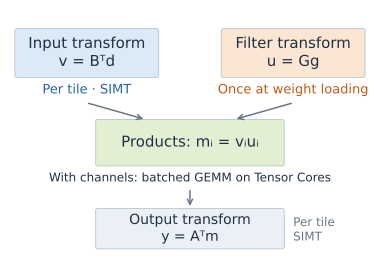

*Figure 5. The four stages of the one-dimensional construction. The fixed matrices B, G, and A implement input transformation, filter transformation, and reconstruction. Filter preparation runs once at weight loading. SIMT denotes ordinary GPU instruction execution. The channel contractions can use Tensor Cores. Each product index identifies one transform coordinate.*

#### Mapping channels and tiles to GEMMs

With multiple input channels, each $m_i$ becomes a sum of products over channels. We can evaluate the same coordinate $i$ for many tiles in one GEMM. Put each tile's transformed input channels in a row of $V_i$, and the transformed filters in $U_i$:

$$
\begin{aligned}
M_i &= V_iU_i,\\
V_i &: N_{\mathrm{tiles}}\times C_{\mathrm{in}},\\
U_i &: C_{\mathrm{in}}\times C_{\mathrm{out}}.
\end{aligned}
$$

Figure 6 follows coordinate zero from the scalar example. Window A reads positions 0 through 3, and window B reads positions 2 through 5. Subtracting the third sample from the first in each window produces two rows of $V_0$. Multiplication by $U_0$ sums over channels for every output filter. Repeating this for the four coordinates supplies everything needed to reconstruct both output pairs.

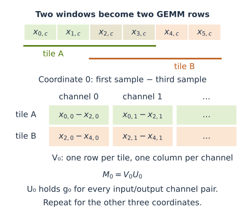

*Figure 6. Building the GEMM input for F(2,3) from input stream x. The first subscript identifies the sample position and the second identifies the input channel. Each window contributes one row, and all windows share the transformed filters.*

The important reuse is across outputs within a tile. Overlapping tiles still read shared input samples, but their reconstructed outputs are disjoint. Applying the one-dimensional construction along both rows and columns gives a two-dimensional Winograd convolution, denoted $F(h\times w, h_f\times w_f)$. Here, $h$ and $w$ are the **output tile height and width**, and $h_f$ and $w_f$ are the **filter height and width**. For stride 1 and no dilation, the required input tile has dimensions $(h+h_f-1)\times(w+w_f-1)$, as shown in Figure 7.

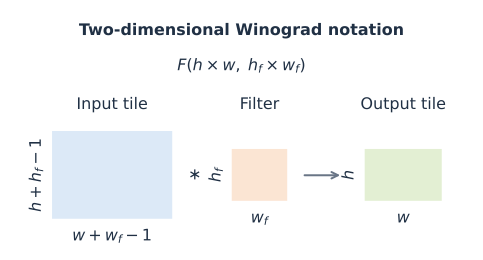

*Figure 7. The notation F(h × w, h_f × w_f) specifies the output tile and filter dimensions. The input tile is larger because the filter must cover every output position. The dimensions assume stride 1 and no dilation.*

For $F(2\times2,3\times3)$, a 4 × 4 input patch produces a 2 × 2 output tile through 16 channel dot products instead of 36. For $F(4\times4,3\times3)$, a 6 × 6 input patch produces 4 × 4 outputs through 36 dot products instead of 144. Below, **spatial F2** and **spatial F4** abbreviate these two-dimensional constructions. More generally, spatial Fm means $F(m\times m,3\times3)$. Temporal or width-only Fm means the one-dimensional $F(m,3)$ along time or width, respectively.

For a 360 × 640 feature frame with 256 input and output channels, spatial F2 produces 57,600 tiles. Each of its 16 coordinate GEMMs multiplies a 57,600 × 256 matrix by a 256 × 256 matrix. F4 produces 14,400 tiles and uses 36 GEMMs. The coordinate index is the batch dimension, so these are batched GEMMs rather than a separate launch for every tile.

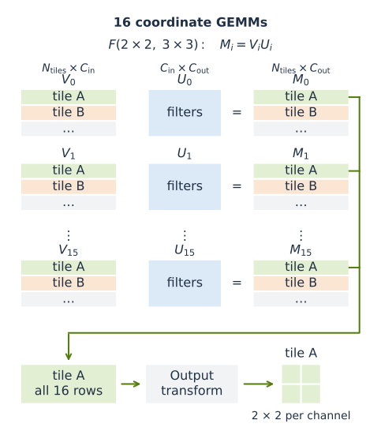

*Figure 8. The 16 coordinate GEMMs for F(2 × 2, 3 × 3). Each coordinate has its own transformed input matrix Vᵢ, transformed filter matrix Uᵢ, and product matrix Mᵢ. Green and orange rows identify tiles A and B. Additional tiles continue down each matrix. The green connectors collect tile A’s row from every Mᵢ. The output transform combines those 16 rows into a 2 × 2 tile for each output channel. Tile B and the remaining tiles are reconstructed in the same way.*

The same idea applies along time. Temporal F4 combines four current frames and two history frames into six spatial-convolution problems, replacing twelve direct temporal contributions. Combined with spatial F4, the product count is $6\times36/(4\times16)=3.375$ per output and input/output-channel pair, compared with 27 for direct 3D convolution. This eightfold arithmetic reduction applies to that convolution. A complete decoder still includes transforms and other layers, and some levels have too few frames available to use temporal F4.

### Account for transforms and workspace

The next obstacle is data movement. A direct cuDNN implicit-GEMM kernel computes a matrix multiplication using convolution patches assembled on demand, without storing the expanded input matrix. A Winograd implementation that materializes transformed inputs V and products M pays for those buffers as well as the transforms.

Figure 9 compares these costs for 1024 input and output channels. The arithmetic curve falls rapidly with tile size. Transform work grows, however, and runs on ordinary GPU execution units rather than Tensor Cores. Counting their FLOPs together would hide that difference.

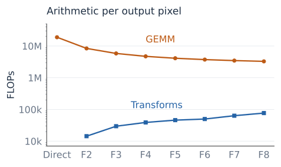

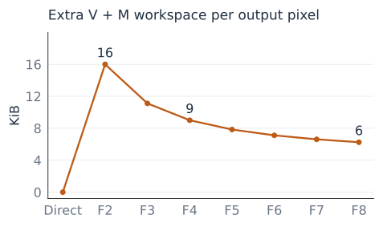

*Figure 9. Analytical costs per output pixel across all 1024 channels, with FP16 V and M. The axis labels $F(m\times m)$ denote $F(m\times m,3\times3)$ spatial convolutions. Transform counts use illustrative interpolation points. The lower panel measures extra high-bandwidth memory (HBM) capacity, not bytes transferred.*

For equal channel counts $C$, direct spatial convolution takes $18C^2$ FLOPs per output pixel, counting a multiply-add as two. Winograd's GEMMs take $2C^2(m+2)^2/m^2$. At 1024 channels, this is 18.9 million FLOPs for direct convolution, 8.4 million for F2, and 4.7 million for F4.

The V and M buffers occupy $4C(m+2)^2/m^2$ bytes per output pixel. That is 16 KiB for F2 and 9 KiB for F4 at 1024 channels, or 16 and 9 bytes per channel. Reading and writing both buffers doubles those bytes before cache effects: 32 KiB and 18 KiB per pixel. Original inputs, outputs, weights, and library workspace are outside this count. A fused kernel can avoid an intermediate round trip if it retains those values on chip.

### Choose convolution implementations for different layers

GEMM work grows with $C_{\mathrm{in}}C_{\mathrm{out}}$, while intermediate traffic grows with the individual channel counts. At high channel counts, reducing GEMM work can save more time than the transforms add. Later, when the feature maps are larger and channel counts smaller, eliminating memory passes becomes more important.

The two-dimensional paths apply Winograd along both height and width: $F(2\times2,3\times3)$ uses cuBLAS batched GEMMs, while $F(4\times4,3\times3)$ uses specialized Blackwell kernels in this comparison. The final 256-output-channel level uses a different decomposition: one-dimensional $F(2,3)$ along width, with direct filtering along height. This fused kernel keeps intermediates on chip and applies the output transform to accumulated GEMM sums held in Blackwell's Tensor Memory, an on-chip store for Tensor Core accumulators.

### Partition the decoder across GPUs

After reducing work within one GPU, spatial partitioning distributes the remaining work. WinoVAE divides each feature frame into strips and assigns each strip to one GPU. Each GPU retains all channels and temporal history for its strip, keeping channel normalization and purely temporal convolutions local.

A spatial 3 × 3 convolution also needs one column from either neighboring strip. The buffers reserve these border columns as **halos**. Neighboring GPUs supply interior halos. The outer image boundaries receive zeros to preserve convolution padding.

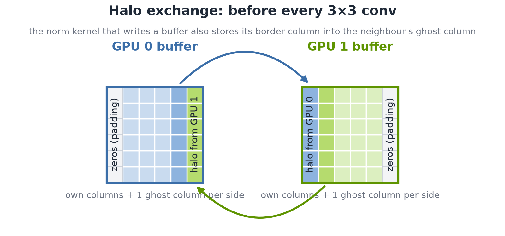

*Figure 10(a). Halo exchange for a width split across two GPUs. Blue and green identify the GPU that computes each column. Each buffer contains its own strip plus a halo column on either side. The arrows show Fused GPUDirect P2P writes into the neighbor's halo. The outer image boundaries use zero padding. Interior GPUs in a larger partition exchange borders with both neighbors.*

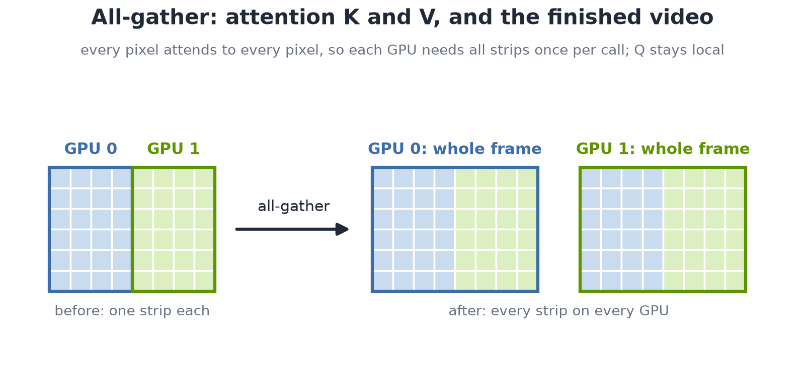

*Figure 10(b). All-gather combines the strips on every GPU. Attention gathers keys and values across the full spatial extent while queries remain local. At the end of decoding, a separate all-gather assembles complete video frames from the decoded strips. These operations transfer all strips, whereas halo exchange transfers only border columns.*

The partition need not divide the latent width evenly. For example, the 52-column latent grid of an 832-pixel-wide video can be split across eight GPUs into four seven-column strips and four six-column strips. WinoVAE tracks each rank's valid extent as resolution changes. Attention gathers accommodate unequal row counts, and the final gather retains only valid output regions. This supports resolutions that an equal-width split would reject. The wider strips still determine part of the load imbalance.

These exchanges are small but frequent. At the last up block of a 720p decode, one BF16 halo column holds $360\times256\times2=184{,}320$ bytes per frame. A decode performs about 1600 exchanges. Buffer preparation and kernel launches add overhead to every exchange, even when the data transfer itself is short.

The NCCL path sends packed border values. Separate kernels prepare the send buffers and unpack the received data. Including alignment clearing, this takes seven small kernels per exchange. WinoVAE's **Fused GPUDirect P2P** path uses [NVIDIA GPUDirect Peer to Peer](https://developer.nvidia.com/gpudirect) memory access over NVLink. Convolution buffers reside in symmetric memory: matching allocations on each GPU that peer GPUs can address. While normalization writes the local convolution input, it also stores border values into the neighbor's halo. Vectorized 16-byte stores replace the packing and unpacking passes, and a barrier orders those stores before the convolution reads them.

Alternating between two buffers protects transformed frames still being consumed. Synchronization limits each neighbor to at most one exchange ahead. NCCL remains the fallback for eager execution, where kernels launch individually, and for configurations without usable peer mappings. Attention requires a separate all-gather of keys and values, and decoded strips are gathered when every GPU needs the whole frame.

## Results

We first compare individual convolution paths with cuDNN, then measure complete VAE calls. Generation and multi-GPU measurements show how these improvements affect larger workloads. Synthetic timing workloads and trained-weight accuracy tests are separate throughout. The [measurement notes](../media/tech_blog31/measurement_notes.md) record their hardware, dates, inputs, and timing procedures.

### Convolution speedup over cuDNN and kernel assignment

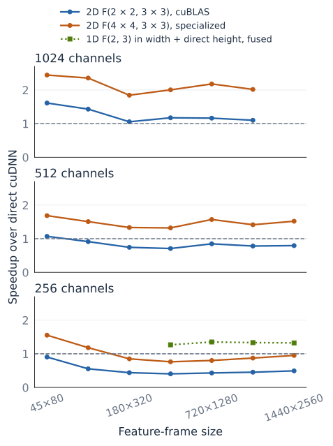

*Figure 11. Different implementations of the same spatial 3 × 3 convolution on one GB200, using random FP16 operands and four input frames. Blue and orange apply two-dimensional Winograd. Green applies one-dimensional Winograd along width and direct filtering along height in a fused kernel. Each timing includes transforms and reconstruction. Values above the horizontal dashed line beat direct cuDNN. The green series was measured only at 256 channels and the shown sizes.*

The sweep shows the change in preferred kernel. Spatial F4 is 1.8 to 2.4× faster than cuDNN at 1024 channels and 1.3 to 1.7× at 512 channels. At 256 channels, unfused F4 loses from 180 × 320 upward, while width-only Winograd with direct height filtering reaches 1.27 to 1.35× despite computing more products. This comparison changes both the decomposition and kernel fusion. It does not isolate the benefit of fusion alone. For a 360 × 640, 256-channel convolution, cuDNN takes 654.8 µs, unfused F4 takes 858.2 µs, and the fused path takes 516.7 µs.

WinoVAE selects among these paths using the channel count and the temporal frames available at each decoder level. On Hopper, spatial Winograd uses separate transforms and cuBLAS batched GEMMs. The current non-Blackwell path implements the transforms in CuTe DSL, without requiring Blackwell Tensor Memory.

*Table 1. Representative steady-state routing for one latent frame per chunk at 720p. Initial chunks and unsupported shapes have separate paths.*

| Decoder level | Frames | Convolution path |
| :--- | ---: | :--- |
| Mid and first up block: 1024 channels | 1 | Spatial F2. Temporal taps in the channel reduction |
| Next up block: 1024 channels | 2 | Temporal F2 + spatial F4 |
| Next up block: 512 channels | 4 | Temporal F4 + spatial F4 |
| Final residual level: 256 output channels | 4 | Temporal F4 + fused width F2. Direct height filtering |

### Complete encoder and decoder performance

The single-convolution sweep tests the arithmetic and data-movement choices in isolation. Complete VAE measurements include the surrounding operations, causal chunk handling, attention, and output assembly. The following Blackwell and Hopper measurements cover image, video, and streaming shapes. Each compares backends on the same GPU within its own experiment. The two GPU families were measured separately.

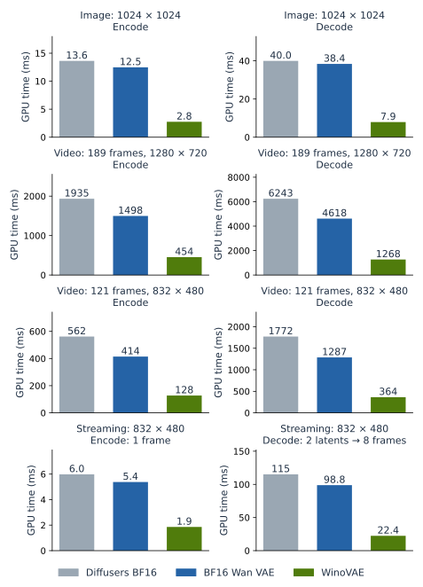

*Figure 12. One B300, BF16 source tensors, random weights at Cosmos3 VAE dimensions, CUDA-graph replay, median of ten CUPTI measurements after two warmups. Video workloads use 189 frames at 1280 × 720 and 121 frames at 832 × 480. The streaming encode takes one conditioning image. Its decode column times a steady-state two-latent-frame step producing eight frames. These measurements were recorded on November 1, 2026.*

For the 189-frame 720p workload, B300 decode falls from 4618.1 to 1268.5 ms (**3.64×**) and encode from 1497.7 to 454.0 ms (**3.30×**) relative to BF16 Wan VAE. The image and streaming panels show that the same implementation also handles short calls, where launch overhead and first-frame work matter more.

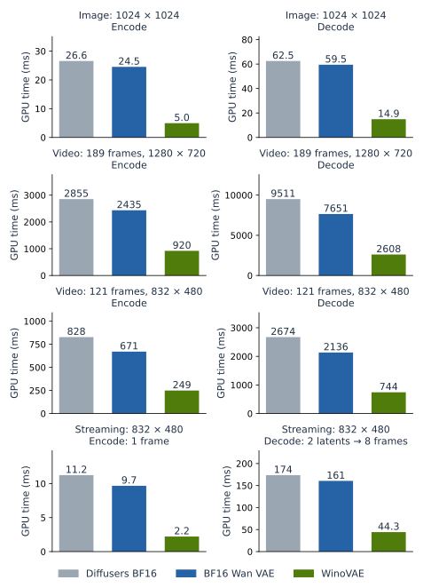

*Figure 13. One H200, BF16 source tensors, random Cosmos3-sized weights, CUDA graphs, median of ten CUPTI measurements after two warmups. These October 22, 2026 measurements use CUDA transforms and cuBLAS batched GEMMs, before the transform port to CuTe DSL. The plotted values come from the same unthrottled single-GPU measurement set as the H200 720p numbers below.*

The benefit extends to Hopper. On one **H200**, the non-Blackwell implementation reduced 189-frame 720p decode from **7.65 to 2.61 seconds (2.93×)** and encode from **2.44 to 0.92 seconds (2.65×)**. This test also used random weights at Cosmos3 VAE dimensions and CUDA graphs. It measured CUDA transforms with cuBLAS batched GEMMs, before the transform implementation moved to CuTe DSL.

### GB200 decoder timing and fusion savings

The arithmetic reduction, precision choices, and kernel routing are parts of one implementation. The decoder benchmark measures their combined effect: on one GB200, WinoVAE reduces median GPU time from 5959.3 to 1614.7 ms, a **3.69× speedup** over BF16 Wan VAE.

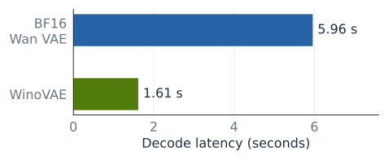

*Figure 14. Decoder benchmark on one GB200, using BF16 tensors and random weights with Cosmos3 VAE dimensions. The output is 189 frames at 1280 × 720. Median of ten CUDA-graph replays, measured from the first GPU kernel's start to the last kernel's completion with L2 flushed before replay. Model loading and video-file encoding are excluded.*

The kernel sweep supports the choices made at individual layers, while Figure 14 measures all decoder optimizations together. Separate full-model measurements also show where the surrounding fusions save time.

*Table 2. Measured savings from individual changes on one GB200. For the first four rows, the percentage is the saved time divided by the original 5964 ms video-decode baseline. The last two rows use their own before-change baseline. Each increment was measured at its corresponding optimization state, so the rows do not form an ablation of the final implementation.*

| Change | Workload | Time saved | Share of stated baseline |
| :--- | :--- | ---: | ---: |
| Fuse RMSNorm and SiLU | 189-frame 720p decode | 1716 ms | 29% |
| Fold upsampling into 2 × 2 convolution, then gather | 189-frame 720p decode | 868 ms | 15% |
| Fuse convolution bias into its consumer | 189-frame 720p decode | 221 ms | 4% |
| Fuse residual addition into the next norm | 189-frame 720p decode | 24 ms | 0.4% |
| Use Conv2d when no temporal history exists | Single-image 1024 × 1024 decode | 11.8 ms | 56% of 20.9 ms |
| Fuse encoder downsampling and block-exit operations | 189-frame 720p encode | 180 ms | 20% of 921 ms |

Isolated gains do not add reliably: removing a kernel changes cache use, clocks, and launch behavior for the others. Full encode and decode measurements determine the resulting gain.

On a GB200 720p encode, the padding copy accounted for about 70 ms and the shortcut rearrangement plus averaging for about 100 ms. Removing these passes together with block-exit Winograd combines and deferred biases reduced encoding from **921 to 741 ms (20%)**. That measurement covers the group, so it cannot assign the full 180 ms saving to either copy alone.

### Accuracy with trained weights

Accuracy is tested separately with trained Cosmos3-Nano VAE weights and a real 121-frame clip resized from 832 × 480 to 1280 × 720. The Wan VAE implementation in Hugging Face Diffusers, evaluated in FP32, is the numerical reference. Every implementation receives the same input. Decode latents come from the reference's encoding, so differences in encoding cannot change the decoder's test input. Diffusers in BF16 provides an additional baseline for rounding error. Relative-L2 error is the norm of the output difference divided by the reference-output norm.

*Table 3. Relative-L2 error against FP32 Diffusers on one GB200. Encoding is compared in latent space and decoding in pixel-tensor space.*

| VAE implementation | Decode error | Encode error |
| :--- | ---: | ---: |
| BF16 Wan VAE | 0.3695% | 0.4542% |
| WinoVAE | 0.3448% | 0.3828% |
| Diffusers BF16 | 0.3678% | 0.4545% |

For this checkpoint and input, WinoVAE remains near the existing BF16 implementations' error scale. Establishing broader perceptual quality requires evaluation across videos.

### Peak memory and frame buffers

The transformed tensors in Figure 9 are only part of the memory footprint. WinoVAE also reserves frame buffers to reuse storage across chunks. `frame_buffer_chunks` controls their capacity: smaller buffers wrap more often and need more history copies, but reduce peak allocated memory.

*Table 4. One B300, 189 frames at 1280 × 720, random Cosmos3-sized weights, and one latent frame per chunk. Timing uses CUDA graphs and the median of three CUPTI measurements. Memory is peak PyTorch allocation, expressed in GiB (2³⁰ bytes), rather than reserved allocator capacity.*

| Buffered chunks | Decode time | Peak allocated memory |
| ---: | ---: | ---: |
| 4 | 1300.2 ms | 17.48 GiB |
| 2 | 1304.9 ms | 16.47 GiB |
| 1 | 1310.3 ms | 15.96 GiB |

Reducing capacity from four chunks to one saves 1.52 GiB at a measured latency cost of 0.8%. The spatial Winograd workspace remains allocated at every frame-buffer capacity.

### Comparison with the existing dynamic NVFP4 decoder

TensorRT-LLM already provides a direct [NVFP4 Wan VAE path](https://github.com/NVIDIA/TensorRT-LLM/blob/main/tensorrt_llm/_torch/visual_gen/models/wan/vae_loader.py). We compare WinoVAE with that implementation here. Quantizing Winograd products is a separate experiment in the [Discussion](#discussion).

On one B300, WinoVAE decoded the 121-frame 720p clip in **797 ms versus 2327 ms for dynamic NVFP4**, a **2.92× speedup**. Relative-L2 error was **0.288% versus 2.530%**, with higher first-call peak allocation: **17.73 versus 13.49 GiB**.

We compared both implementations on one B300 using the same trained Cosmos3-Nano checkpoint and a real 121-frame clip. Each decoder received the same BF16 latents from an FP32 reference encoding. The NVFP4 path used runtime activation scales and the loader's default convolution selection, with no calibrated ModelOpt scales. WinoVAE uses FP16 Winograd intermediates in this comparison. The NVFP4 backend quantizes ordinary convolutions without Winograd.

*Table 5. Whole-decoder results. Relative-L2 error covers all pixels in all 121 output frames against the FP32 Wan VAE reference on identical latents. Timing is the median of ten CUDA-graph replays after warmup, with L2 flushed before replay. Memory is measured separately during the first accuracy call, before warmup. Both resolutions use the same clip, resized for the 720p case.*

| Output | Implementation | Decode time | Relative-L2 error | First-call peak |
| :--- | :--- | ---: | ---: | ---: |
| 121 × 832 × 480 | BF16 Wan VAE | 1287.2 ms | 0.4629% | 6.38 GiB |
| 121 × 832 × 480 | WinoVAE | 354.7 ms | 0.4057% | 11.04 GiB |
| 121 × 832 × 480 | Dynamic NVFP4 | 1029.1 ms | 4.3532% | 6.83 GiB |
| 121 × 1280 × 720 | BF16 Wan VAE | 2967.6 ms | 0.3372% | 13.20 GiB |
| 121 × 1280 × 720 | WinoVAE | 797.2 ms | 0.2881% | 17.73 GiB |
| 121 × 1280 × 720 | Dynamic NVFP4 | 2327.0 ms | 2.5304% | 13.49 GiB |

The 480p result shows the same trade-off: about 2.9× faster decoding and lower relative-L2 error, with higher first-call peak allocation. This comparison measures the complete implementations, including their different fusions and quantization overhead. It does not isolate Tensor Core precision or establish performance and perceptual quality for a calibrated NVFP4 checkpoint.

The memory figures include lazy initialization, such as packing NVFP4 weights, and any autotuning allocations made during that first call. The NVFP4 implementation retains BF16 weights alongside cached packed weights and quantizes BF16 activations into additional buffers. These measurements do not establish steady-state memory use or include CUDA-graph capture.

### Generation time and eager execution

A separate streaming integration tests the effect on generation time. On one B300, a 901-frame Cosmos3-Nano-Sim-Bimanual run at 832 × 480 fell from 20.5 to 16.5 seconds, including a decode reduction from 5.84 to 2.72 seconds. This integration already had some decoder kernels fused in its BF16 Wan VAE baseline, and used individually launched VAE kernels rather than CUDA-graph replay. The different GPU and already-fused baseline also distinguish this result from the B200 profile in Figure 1. It is a separate comparison from Figure 14.

Decoding identical generated latents, BF16 Wan VAE and WinoVAE measured 58.80 and 58.60 dB peak signal-to-noise ratio (PSNR) against the **FP32 Wan VAE reference**, the TensorRT-LLM decoder run in FP32. PSNR between the outputs was 60.07 dB. Using identical latents matters in autoregressive generation, where small differences can otherwise propagate into the inputs for later frames.

CUDA graphs avoid repeated CPU launch overhead, but the main video workloads were also close to graph performance in a separate untraced B300 wall-time test. Eager execution was within 0.2 to 2% of graph replay for the measured 480p videos and 1024 × 1024 image operations. Single-image 832 × 480 encoding was the exception: 2.59 ms eager versus 1.12 ms with a graph. These wall-time checks exclude CUPTI tracing and use a different timing procedure from Figure 14.

The same integration also tested two execution arrangements. Overlapping decode with the transformer on a side stream of one GPU took 21.0 seconds for BF16 Wan VAE and 16.9 seconds for WinoVAE, slightly slower than sequential execution for both. With decode on a second GPU, generation took 15.2 and 14.2 seconds respectively. Once decode was hidden, faster conditioning-frame encoding supplied most of the remaining saving. These complete-generation timings use a different execution setup from the isolated CUDA-graph decoder measurements.

### Communication overhead at a fixed GPU count

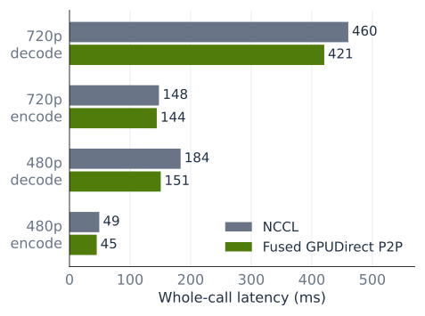

*Figure 15. Halo comparison on four GB200 GPUs in one tray, using width sharding and CUDA graphs. The 720p workload has 189 frames at 1280 × 720. The 480p workload has 121 frames at 832 × 480. Bars show median latency over ten calls and compare communication methods at a fixed GPU count.*

Fused GPUDirect P2P reduces 720p decode from 460.3 to 420.6 ms (8.6%) and 480p decode from 183.5 to 150.7 ms (17.9%). Encoding also improves: 147.7 to 144.1 ms (2.4%) at 720p and 49.2 to 45.0 ms (8.5%) at 480p. Fusion removes packing and unpacking while leaving convolution arithmetic unchanged. Its effect on total latency depends on how much time each workload spends in those copies and launches. Figure 15 shows width partitioning. The measurement notes also record results for height partitioning. Kernel count falls from about 16,400 to 12,000 per 720p decode. The lower launch and copy overhead matters increasingly as the frame is split across more GPUs: each GPU's convolution work shrinks, while a width split leaves the halo's height and channel count unchanged.

### Strong scaling and uneven partitions

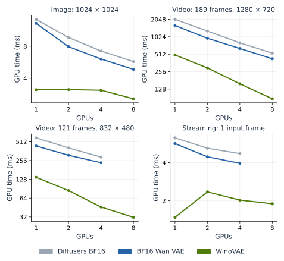

*Figure 16. Strong scaling of encoding within one eight-B200 node on October 24, 2026. Both axes are logarithmic. Random Cosmos3-sized weights, BF16, width partitioning, CUDA graphs, median of ten CUPTI measurements. WinoVAE uses Fused GPUDirect P2P. Each curve holds the workload fixed while changing GPU count.*

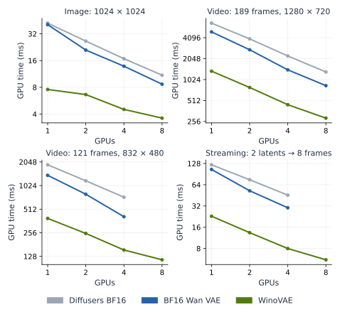

*Figure 17. Decode measurements from the same B200 scaling experiment. The streaming panel measures an eight-frame steady-state step. Missing eight-GPU baseline points at 832 × 480 reflect the equal-shard restriction of those tested implementations, not zero latency or an extrapolated result.*

For 189-frame 720p video on B200, WinoVAE decode decreases from 1351.3 to 285.5 ms from one to eight GPUs (**4.73×**). Encode decreases from 496.8 to 86.8 ms (**5.72×**). At 480p, WinoVAE also runs on eight GPUs despite the latent width of 52 columns. The corresponding BF16 Wan VAE and Diffusers measurements stop at four GPUs because those tested paths require equal shards.

The logarithmic plots show both absolute latency and the scaling trend. Short image calls flatten as communication and launch costs become comparable to local work. WinoVAE also removes enough single-GPU work that communication occupies a larger share of its remaining decode time. Consequently, a faster implementation can have a smaller one-to-eight-GPU speedup while still finishing sooner at every GPU count.

A separate B300 experiment measures strong scaling with NCCL halo exchange. With a fixed video size, adding GPUs reduces encode and decode latency, as Table 6 shows.

*Table 6. Strong scaling within one eight-B300 node: the same 189-frame 1280 × 720 video and random Cosmos3-sized weights at every GPU count. Width partitioning, BF16, and CUDA graphs. Times are median GPU milliseconds over ten calls. These runs use NCCL halo exchange.*

| Operation | 1 GPU | 2 GPUs | 4 GPUs | 8 GPUs |
| :--- | ---: | ---: | ---: | ---: |
| Decode | 1273.5 | 765.5 | 472.5 | 351.1 |
| Encode | 479.9 | 272.7 | 148.5 | 90.2 |

Eight GPUs give a 3.63× decode speedup and a 5.32× encode speedup. Communication and synchronization remain as each GPU receives less convolution work, limiting scaling efficiency. Fused GPUDirect P2P addresses one recurring part of that overhead, as the fixed-GPU-count comparison above shows.

## Discussion

The complete-model measurements put the chosen FP16 Winograd paths near the BF16 reference error scale for the tested inputs. Numerical experiments explain why other tile sizes and storage formats can behave differently, and what limits further reductions in arithmetic.

### Where rounding error enters and how it propagates

The four-product identity is exact, but its terms can be much larger than the final output. Large intermediate values may cancel during reconstruction while their rounding errors remain. FP32 accumulation cannot recover bits already lost when the GEMM operands were stored.

For a spatial tile, the input transform $V=B^TdB$ and filter transform $U=GgG^T$ create the GEMM operands. Their coefficients can increase magnitudes before storage rounding occurs. The coordinate products accumulate over input channels to form $M$. The output transform then reconstructs $Y=A^TMA$. If the accumulated error in those coordinates is $\Delta M$, its contribution to the output is

$$
\Delta Y \approx A^T(\Delta M)A + \Delta Y_{\mathrm{out}},
$$

where $\Delta Y_{\mathrm{out}}$ represents rounding in reconstruction itself. Errors introduced in V, U, or stored M pass through the output transform. Cancellation can make the exact output small without making the independently rounded errors small. Point optimization must account for the input, filter, and output transforms together. The size of the GEMM operands alone does not determine output error.

This makes intermediate precision a separate choice from model precision. WinoVAE keeps BF16 model inputs and outputs but stores transformed intermediates in FP16. Both formats occupy 16 bits. FP16 spends three more bits on the fraction, giving roughly eightfold finer spacing in its normal range, in exchange for a narrower exponent range.

#### Interpolation and transform coefficients

The transform coefficients come from polynomial arithmetic. To see the construction, take an auxiliary two-element sequence $a=[a_0,a_1]$ and the three filter coefficients $g=[g_0,g_1,g_2]$, and write

$$
\begin{aligned}
a(z)&=a_0+a_1z,\\
g(z)&=g_0+g_1z+g_2z^2.
\end{aligned}
$$

Their product $c(z)=a(z)g(z)$ has four coefficients. Those coefficients are the full convolution of the two sequences: for example, the coefficient of $z$ is $c_1=a_0g_1+a_1g_0$. The variable $z$ records coefficient positions. It is not a pixel coordinate.

Instead of forming all six pairwise products, evaluate the polynomials at $0$, $1$, and $-1$, multiply their values, and also multiply their leading coefficients:

$$
\begin{aligned}
q_0 &= a_0g_0,\\
q_+ &= (a_0+a_1)(g_0+g_1+g_2),\\
q_- &= (a_0-a_1)(g_0-g_1+g_2),\\
q_\infty &= a_1g_2.
\end{aligned}
$$

The notation $\infty$ means selecting the leading coefficient, not evaluating floating-point arithmetic at infinity. These four products determine all four coefficients of $c(z)$:

$$
\begin{aligned}
c_0 &= q_0,\\
c_1 &= (q_+-q_-)/2-q_\infty,\\
c_2 &= (q_++q_-)/2-q_0,\\
c_3 &= q_\infty.
\end{aligned}
$$

Recovering polynomial coefficients from these values is **interpolation**. Evaluation at $0$ and $\pm1$ requires only sums and differences because their powers are zeros, ones, or signs. The interpolation step supplies the fixed factors such as $1/2$.

This example maps two sequence elements to four full-convolution coefficients. To obtain the sliding filter used earlier, hold $g$ fixed and transpose that $4\times2$ linear map: its transpose maps the four inputs $d_0,\ldots,d_3$ to $y_0,y_1$. Transposing the evaluation and interpolation steps produces the Winograd input and output transforms. For example, $q_0$ contributes $+q_0$ to $c_0$ and $-q_0$ to $c_2$. The transposed step combines inputs as $d_0-d_2$. This is the first input combination in our $F(2,3)$ example. The [Cook–Toom construction described by Lavin and Gray](https://arxiv.org/abs/1509.09308) generalizes this approach to larger tiles. <!-- codespell:ignore toom -->

For one-dimensional $F(m,r)$, the polynomial product has $m+r-1$ coefficients, so the construction needs that many independent values: four for $F(2,3)$, six for $F(4,3)$. Applying the six-point construction along both spatial axes gives the 36 coordinates of spatial F4. Other valid point sets give the same convolution in exact arithmetic, but change the transform coefficients, intermediate magnitudes, and cancellation during reconstruction. That changes how much rounding error reaches the output. [Barabasz et al.](https://arxiv.org/abs/1803.10986) analyze this floating-point behavior.

#### Choosing coefficients and intermediate precision

We searched for points that reduce rounding sensitivity across the input, filter, and output transforms together. A continuous numerical search found a low-error set. A separate fraction grid found the nearby set $0,\pm3/2,\pm5/8,\infty$, which WinoVAE uses for spatial F4. Table 7 shows why: the simple fractions retain nearly all the accuracy benefit of the continuous search.

*Table 7. Spatial-F4 simulation with BF16-rounded Gaussian source tensors. V, U, and M are rounded to the indicated storage type. Other arithmetic uses FP64. Ranges cover three held-out seeds. Final output rounding is excluded.*

| Spatial F4 points | FP16 error | BF16 error |
| :--- | ---: | ---: |
| 0, 1, −1, 2, −1/2, ∞ | 0.2468 to 0.2486% | 1.958 to 1.977% |
| Best-found continuous set | 0.1657 to 0.1674% | 1.331 to 1.335% |
| Implemented: 0, ±3/2, ±5/8, ∞ | 0.1699 to 0.1716% | 1.362 to 1.365% |

The implemented fractions reduce simulated rounding error, although the search does not prove global optimality. Their effect on runtime would require a separate timing comparison. The [measurement notes](../media/tech_blog31/measurement_notes.md#precision-study) give the sensitivity objective and search procedure.

The temporal $F(4,3)$ transform uses a different set: $0,1,-1,2,-1/2,\infty$. Its transformed inputs, weights, and products also use FP16 storage. The point search and isolated error measurements in Table 7 apply only to spatial F4.

Larger tiles increase the numerical difficulty. In separate simulations, F6 reached about 0.73% FP16 storage error and optimized F8 about 4.0%, even after balancing the transform ranges. That balancing rescales input and filter coordinates by powers of two and compensates in the output transform. It prevents some underflow and subnormal precision loss, but cannot add fraction bits. F4 provided a more useful combination of arithmetic reduction and accuracy for this implementation.

### Quantizing the Winograd products

Combining NVFP4 with Winograd is a separate numerical problem. If $Q_4$ is NVFP4 quantization, $d$ an input tile, and $B$ the Winograd input-transform matrix, then $Q_4(B^TdB)\ne B^TQ_4(d)B$. Winograd quantizes transformed operands, and reconstruction can amplify their errors.

[NVFP4](https://developer.nvidia.com/blog/introducing-nvfp4-for-efficient-and-accurate-low-precision-inference/) uses four-bit values with two exponent bits and one fraction bit, plus block and tensor scales. In matched CPU tests of synthetic 3 × 3 × 3 convolutions, direct NVFP4 produced 13.4% relative-L2 error and spatial-F4 Winograd 64.1%. Channel sorting and reciprocal activation/weight scaling repaired artificial range mismatches. With additional scale search, the errors fell to 12.1% and 58.0%, leaving roughly the same **4.8× gap in single-convolution error**. This ratio does not predict how error accumulates through the full decoder.

These results concern the tested quantization recipes, not every possible NVFP4 Winograd implementation. Reconstruction-aware calibration remains untested. The [measurement notes](../media/tech_blog31/measurement_notes.md#channel-sorting-and-scale-search) describe the channel-grouping experiments and their arithmetic assumptions.

### Fourier68: fewer products without the same error amplification

A Fourier-transform convolution offers another way to reduce products. For background on FFT convolution, see [Mathieu et al., *Fast Training of Convolutional Networks through FFTs*](https://arxiv.org/abs/1312.5851). The specific 68-product configuration and NVFP4 quantization results below are our experiments.

We call the tested decomposition **Fourier68** because it computes a 4 × 4 output tile using 68 real channel dot products, compared with 144 for direct convolution and 36 for spatial F4. On a 6 × 6 Fourier grid, real inputs give four real coordinates and sixteen complex-conjugate pairs. Each pair uses four real products, giving $4+16\times4=68$ in total.

Figure 18 compares these decompositions on matched synthetic spatial 3 × 3 convolutions. This experiment measures error in one convolution, separately from the whole-decoder results in Table 5. Both operands are quantized to NVFP4, while transforms, accumulation, and reconstruction use FP64.

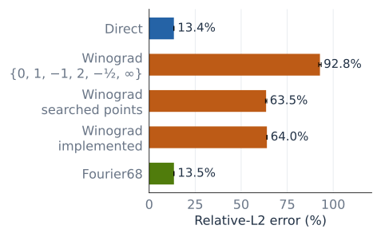

*Figure 18. CPU simulations of isolated spatial convolutions with matched BF16-rounded Gaussian source tensors. Bars show mean relative-L2 error across three seeds, and whiskers show the range. Product storage and final output rounding are excluded.*

*Table 8. Error ranges from the same experiment and real channel dot products per 4 × 4 output tile. Product counts exclude transforms and quantization.*

| Method | Relative-L2 error | Products |
| :--- | ---: | ---: |
| Direct NVFP4 | 13.36 to 13.51% | 144 |
| Winograd, {0, 1, −1, 2, −1/2, ∞} | 92.15 to 93.50% | 36 |
| Winograd, continuous search | 63.20 to 63.94% | 36 |
| Winograd, implemented points | 63.93 to 64.07% | 36 |
| Fourier68 | 13.37 to 13.53% | 68 |

Fourier68 stays near direct NVFP4 error in this test while requiring less than half as many products. Point optimization improves Winograd substantially, but leaves its error much higher. These arithmetic counts do not establish a GPU speedup: Fourier transforms, complex arithmetic, and memory traffic also cost time. Fourier68 has not yet been evaluated as a GPU kernel or with trained VAE weights. The [measurement notes](../media/tech_blog31/measurement_notes.md#nvfp4-decomposition-comparison) specify the test dimensions and quantizer.

### Relationship to other VAE optimizations

Several projects reduce the memory and launch overhead around VAE convolutions. [vLLM-Omni's VAE fast path](https://docs.vllm.ai/projects/vllm-omni/en/latest/user_guide/diffusion/vae_fast_path/) uses Triton fusions and a channels-last layout, which stores a pixel's channels contiguously. [Occipital Labs' fastvae](https://github.com/Occipital-Labs/fastvae) also uses Triton kernels for normalization, activation, and surrounding operations. [Reactor's Wan decoder work](https://www.reactor.inc/blog/optimizing-wan-decoder) combines `torch.compile` with layout and chunking changes. These techniques address costs that remain relevant when Winograd reduces convolution arithmetic.

Choosing one of [cuDNN's Winograd convolution algorithms](https://docs.nvidia.com/deeplearning/cudnn/backend/v9.8.0/api/cudnn-ops-library.html#cudnnconvolutionfwdalgo-t) changes how a convolution runs while leaving the surrounding VAE computation unchanged. Folding repeated upsampled pixels and carrying causal history through fused normalization require changes across operation boundaries. WinoVAE controls those operations together with its spatial and temporal transforms, and retains cuDNN for convolutions where it is the better choice.

## Conclusions

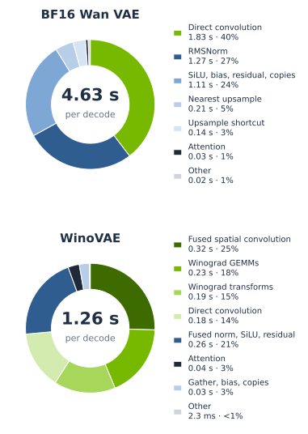

*Figure 19. One B300, 189-frame 720p decode, one latent frame per chunk, CUDA-graph replay, November 1, 2026. Ring fractions use the sum of categorized CUPTI kernel durations. Central values show median first-to-last kernel time. Green includes direct convolution, Winograd GEMMs, input/output transforms, and fused spatial convolution. The two totals are from this same profiling run.*

In the final profile, BF16 Wan VAE spends about 40% of its categorized kernel time in convolution. WinoVAE spends about 74% in convolution paths **including their Winograd transforms**. Normalization, activation, and residual work have been consolidated into a fused kernel. A larger convolution share is useful here because the total decode time falls from 4.63 to 1.26 seconds in the same B300 profile. The surrounding overhead has shrunk.

Winograd reduces the number of convolution products, but the transforms also introduce rounding error and memory traffic. WinoVAE uses FP16 storage and selected coefficients to limit rounding error, then combines kernel fusion with layer-specific convolution choices to reduce memory traffic. The complete decoder was 3.69× faster in the GB200 benchmark. In the separate trained-weight accuracy test, its error remained near the BF16 baselines. Fused GPUDirect P2P reduces the overhead of distributing that decoder across GPUs. Applying NVFP4 to Winograd products still requires a solution to reconstruction error.

Across the separate full-call tests, the implementation improves 720p decode by 3.69× on GB200 and 2.93× on H200, with H200 encode improving by 2.65×. In the trained Sim-Bimanual generation workload on B300, generation time falls from 20.5 to 16.5 seconds, a 19.5% latency reduction. Those end-to-end results include an already-fused baseline and an eager VAE, so they complement the isolated decoder benchmarks.

## Availability and data

The direct NVFP4 Wan VAE implementation is public. WinoVAE and its Cosmos3 integration are not yet publicly available. The WinoVAE timings and model-accuracy results here come from pre-release code. An NVFP4 Winograd GPU backend and trained-VAE quality result have not been demonstrated.

The [measurement notes](../media/tech_blog31/measurement_notes.md) record the separate experimental setups, numerical methods, and reproduction limits. [data.json](../media/tech_blog31/data.json) contains the recorded figure values. [plot.py](../media/tech_blog31/plot.py) and its [overview figure module](../media/tech_blog31/overview_plots.py) regenerate the figures with Matplotlib and NumPy. They do not rerun the experiments.
