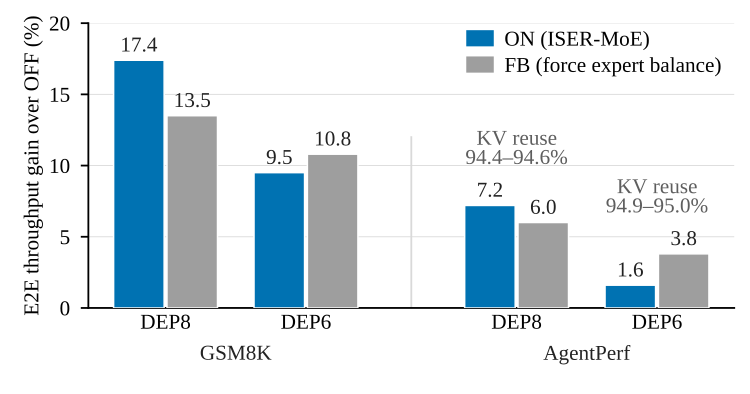

<!--
SPDX-FileCopyrightText: Copyright (c) 2026 NVIDIA CORPORATION & AFFILIATES. All rights reserved.
SPDX-License-Identifier: Apache-2.0
-->

# ISER-MoE: In-Switch Expert Replication for Load-Balanced MoE Prefill

*Per-Layer Dynamic Expert Load Balancing with NVLink Multicast in TensorRT LLM*

By NVIDIA TensorRT LLM Team

An expert-parallel mixture-of-experts (MoE) layer runs at the pace of its most loaded GPU, because fused MoE kernels such as TensorRT LLM's MegaMoE synchronize all GPUs. In DeepSeek-V4-Pro prefill routing recorded from a mixed trace of agentic coding and benchmark prompts, with expert parallelism (EP) over eight GPUs (EP8) and 8,192 tokens/rank (tokens per GPU per forward pass), the most loaded GPU averaged **1.44×** the mean load, and 2.24× at EP24. Replicating the few hot experts on lightly loaded GPUs would balance the layer, but each replica is a whole expert that must arrive within the layer: **37.16 MB** for DeepSeek-V4-Pro in NVFP4, NVIDIA's 4-bit floating-point (FP4) format.

**ISER-MoE (In-Switch Expert Replication for MoE) multicasts each hot expert through the NVLink switch into a fixed, aligned group of GPUs, so each byte leaves its owner GPU once, however many replicas the group holds.** At every MoE layer, HALO-Q (Hot-Aligned, Locality-Optimal expert replication with Quota repair), a GPU scheduler, picks hot experts and groups from that layer's routing, and a replication kernel multicasts each hot expert from its owner or through SAMI (Scalable Asynchronous Multi-port In-switch broadcast), which spreads the injection over the members' NVLink ports. Both run beside the shared expert, which every token uses, so the MoE kernel waits only for the plan.

In simulated replay of that routing at 8,192 tokens/rank, HALO-Q removed **98–99% of the excess load** (the most loaded GPU's load above the mean) at EP4–EP24, with four helper slots (spare expert buffers) per rank. With attention data parallelism (DP) and EP8 (DEP8) on GB300, ISER-MoE raised DeepSeek-V4-Pro's context-only (prefill-only) throughput by **17.4% on GSM8K** (Grade School Math 8K) and **7.2% on agentic prompts** from [AgentPerf](https://artificialanalysis.ai/methodology/agentperf), Artificial Analysis's agentic benchmark (Figure 1). In disaggregated serving of agentic coding traces on a GB300 NVL72 rack, it improved P90 (90th-percentile) request latency by **3.1–4.3%** and output throughput per GPU by **1.4–1.9%**.



*Figure 1. Context-only (prefill-only) serving of DeepSeek-V4-Pro (NVFP4) on GB300: end-to-end (E2E) throughput gain over OFF (load balancer off) of ON (ISER-MoE) and of FB (force expert balance: OFF with routing forced to be perfectly balanced; its outputs are not meaningful). Throughput counts computed (non-reused) tokens per GPU and second; all arms use a tile-wise FP4 combine. Labels above the AgentPerf bars: key-value (KV) cache reuse rate across the three arms.*

**What stays exact.** Replicas are byte copies of an expert's weights and block scales, and tokens keep their routing weights, so ISER-MoE changes where a token-expert pair is calculated, not what is computed; in the [MegaMoE kernel measurements](#megamoe-kernel-time-with-replicas) below, OFF and ON outputs matched bitwise.

TensorRT LLM's Expert Parallelism Load Balancer (EPLB), from Scaling Expert Parallelism [Part 1](https://nvidia.github.io/TensorRT-LLM/blogs/tech_blog/blog04_Scaling_Expert_Parallelism_in_TensorRT-LLM.html#ep-load-balancer) and [Part 2](https://nvidia.github.io/TensorRT-LLM/blogs/tech_blog/blog08_Scaling_Expert_Parallelism_in_TensorRT-LLM_part2.html#expert-parallelism-load-balancer-eplb), plans from load history, once (offline) or a few layers per iteration (online). ISER-MoE adds per-layer dynamic EPLB, which re-plans every MoE layer on every forward pass; pull request (PR) [#19646](https://github.com/NVIDIA/TensorRT-LLM/pull/19646) merged it as a prototype feature of the NVFP4 MegaMoE backend ([Enable ISER-MoE in TensorRT LLM](#enable-iser-moe-in-tensorrt-llm)). The method applies in principle to prefill, generation and training; this work implements and evaluates prefill, with attention DP inside one NVLink domain.

**Table of Contents**

- **[Rank Imbalance in Expert-Parallel MoE Prefill](#rank-imbalance-in-expert-parallel-moe-prefill)**
  - [Every MoE Layer Waits for Its Most Loaded Rank](#every-moe-layer-waits-for-its-most-loaded-rank)
  - [Imbalance Shifts with Workload, Layer, EP Size and Batch](#imbalance-shifts-with-workload-layer-ep-size-and-batch)
  - [A Few Hot Experts Carry the Excess](#a-few-hot-experts-carry-the-excess)
- **[Why Per-Layer Expert Replication Is Hard](#why-per-layer-expert-replication-is-hard)**
  - [Can Computation Hide the Copies?](#can-computation-hide-the-copies)
  - [Point-to-Point Copies Make the Owner a Hot Spot](#point-to-point-copies-make-the-owner-a-hot-spot)
  - [Broadcast Options and Their Overheads](#broadcast-options-and-their-overheads)
- **[How ISER-MoE Works](#how-iser-moe-works)**
  - [HALO-Q: Balance First, Then Keep Tokens Local](#halo-q-balance-first-then-keep-tokens-local)
  - [Multi-Level Symmetric Multicast: Fix the Groups, Not the Replicas](#multi-level-symmetric-multicast-fix-the-groups-not-the-replicas)
  - [In-Switch Weight Replication and SAMI: Spread the Injection over the Group](#in-switch-weight-replication-and-sami-spread-the-injection-over-the-group)
  - [Runtime Overlap: Hide the Copy Beside the Shared Expert](#runtime-overlap-hide-the-copy-beside-the-shared-expert)
- **[Performance Evaluation](#performance-evaluation)**
  - [Methodology](#methodology)
  - [HALO-Q in Trace Replay](#halo-q-in-trace-replay)
  - [SAMI Broadcast on GB200](#sami-broadcast-on-gb200)
  - [MegaMoE Kernel Time with Replicas](#megamoe-kernel-time-with-replicas)
  - [Context-Only Prefill Serving on GB300](#context-only-prefill-serving-on-gb300)
  - [Disaggregated Serving on a GB300 NVL72 Rack](#disaggregated-serving-on-a-gb300-nvl72-rack)
- **[Enable ISER-MoE in TensorRT LLM](#enable-iser-moe-in-tensorrt-llm)**
  - [Configuration](#configuration)
  - [Requirements and Constraints](#requirements-and-constraints)
  - [Measuring the Gain on Your Workload](#measuring-the-gain-on-your-workload)
  - [When It Helps and When It Does Not](#when-it-helps-and-when-it-does-not)
- **[Limitations and Related Approaches](#limitations-and-related-approaches)**
  - [Limitations](#limitations)
  - [Related Approaches](#related-approaches)
- **[Conclusion and Further Reading](#conclusion-and-further-reading)**
  - [Conclusion](#conclusion)
  - [Further Reading](#further-reading)

## Rank Imbalance in Expert-Parallel MoE Prefill

Agentic workloads send long, multi-turn prompts, so prefill holds most of the GPUs in disaggregated serving: TensorRT LLM's AgentPerf configurations of DeepSeek-V4-Pro on GB300 used 24 context GPUs against 8 or 16 for generation ([DeepSeek-V4 on NVIDIA Blackwell](https://nvidia.github.io/TensorRT-LLM/blogs/tech_blog/blog26_DeepSeek_V4_on_NVIDIA_Blackwell_Model_Specific_and_Agentic_Workload_Optimizations_in_TensorRT-LLM.html#agentperf-results-and-external-validation)).

### Every MoE Layer Waits for Its Most Loaded Rank

An MoE layer routes each token to $k$ of its $E$ experts. EP spreads the experts over $P$ ranks (one GPU each; EP8 means $P=8$), each holding $H=E/P$ *home* experts; every invocation *dispatches* tokens to their experts' ranks and *combines* the outputs back ([One-Sided AlltoAll over NVLink](https://nvidia.github.io/TensorRT-LLM/blogs/tech_blog/blog18_Optimizing_MoE_Communication_with_One_Sided_AlltoAll_Over_NVLink.html)). Under DEP, each rank contributes its own tokens (tokens/rank, counted before top-$k$ expansion), and DeepSeek-V4 also runs a *shared expert* on every token. MegaMoE, the `MEGAMOE_CUTEDSL` backend, is TensorRT LLM's fused MoE kernel in the CuTe domain-specific language (DSL), after [DeepGEMM](https://github.com/deepseek-ai/DeepGEMM)'s Mega MoE design: one persistent kernel runs dispatch, both expert general matrix multiplications (GEMMs) and combine, and synchronizes all ranks, **so every rank finishes with the most loaded one.**

Per layer, the *load* $L_r$ of rank $r$ counts its *routes* (token-expert assignments), and the rank imbalance ratio is

$$
R=\frac{\max_r L_r}{\bar{L}},\qquad 1\le R\le P,
$$

where $\bar{L}$ is the mean load; $R-1$ is the *excess*, and ranks above (below) the mean are *hot* (*cold*). On GB200 (EP8, 8,192 tokens/rank, trace-derived routing), MegaMoE without replicas took $513+1{,}051\thinspace R$ µs per layer, a fit across the 61 MoE layers (Pearson correlation 0.938).

### Imbalance Shifts with Workload, Layer, EP Size and Batch

DeepSeek-V4-Pro's prefill routing ([DeepSeek-V4 report](https://arxiv.org/abs/2606.19348): 61 MoE layers, $E=384$, $k=6$) was recorded before load balancing on random tokens and five public workloads: [GSM8K](https://arxiv.org/abs/2110.14168), Massive Multitask Language Understanding (MMLU), IFBench, SciCode and [agentic coding traces from SemiAnalysis](https://huggingface.co/datasets/semianalysisai/cc-traces-weka-062126). At EP8, the 61-layer mean of whole-trace $R$ was 1.40–1.45 for four workloads, 1.69 for GSM8K and 2.00 for random tokens (Figure 2); it ranged over 1.13–2.51 across the agentic traces' layers, and any two workloads share at most one of their five most imbalanced layers, much as [Part 1](https://nvidia.github.io/TensorRT-LLM/blogs/tech_blog/blog04_Scaling_Expert_Parallelism_in_TensorRT-LLM.html#observation-over-gsm8k-dataset) saw DeepSeek-R1's hot layer move between datasets. The means also grow with EP size (Figure 2(b)).


*Figure 2. Rank imbalance ratio R (the most loaded rank's routed tokens over the mean) of DeepSeek-V4-Pro prefill before load balancing (whole-trace loads, contiguous experts per rank): (a) per MoE layer at EP8, with 61-layer means; (b) 61-layer means at EP4, EP6 and EP8.*

**An invocation, however, sees only its batch.** In a mixed trace interleaving the five workloads by request (4,340 requests, 18.2M prefill tokens, 91% agentic), $R$ per iteration (forward pass) at 8,192 tokens/rank averaged 1.20, 1.44, 1.84 and 2.24 at EP4, EP8, EP16 and EP24, against 1.41 whole-trace at EP8. Most of a fixed mix's skew is thus standing: a static plan from load history, as in DeepSeek's [EPLB](https://github.com/deepseek-ai/EPLB), can remove most of it, but not its drift between batches.

### A Few Hot Experts Carry the Excess

Expert load is long-tailed (Figure 3): over the mixed trace, the four busiest of 384 experts received 13.02% of a layer's assignments on average (1.04% if uniform), and 13.6% per iteration (EP8, 16,384 tokens/rank). At EP8, the four busiest home experts of a layer's hottest rank carried at least that rank's load above the mean in 59 of the 61 layers.


*Figure 3. Expert load is long-tailed (DeepSeek-V4-Pro, whole datasets): cumulative share of a layer's assignments over its 384 experts sorted by load. Thin lines: MoE layers; thick: 61-layer average, labeled with the Top-1 to Top-16 shares; dashed: uniform load. Mixed: the mixed trace.*

A *replica* copies a hot expert into a *helper slot*, a per-rank buffer for one more expert (each rank has $S$ of them), and takes routes from the expert's *owner*, its home rank. **Which experts are hot changes with workload, layer and batch, so balance needs replicas planned per invocation, at every layer, each a whole expert copied within that invocation.**

## Why Per-Layer Expert Replication Is Hard

Replicas balance a layer only if whole experts arrive within the layer that uses them, and three obstacles stand in the way: copies compete with token traffic for link time, one owner must feed several replicas, and each of the three broadcast options examined below pays a latency or bandwidth overhead.

### Can Computation Hide the Copies?

A peak-rate model, not a measurement, counts the copies that computation can hide. Per MoE layer and rank, $\tau$ tokens make $\tau k$ token-expert pairs, each costing $6H_eI$ floating-point operations (FLOPs) in its routed expert (expert input width $H_e$ and intermediate width $I$) and, under uniform routing, moving $H_eb$ bytes off the rank with probability $(P-1)/P$ in both dispatch and combine ($b=0.5625$ B per NVFP4 element). Each of the $n$ expert copies a rank sends or receives moves $W=3H_eIb$ bytes. Per link direction,

$$
\frac{\text{math}}{\text{comm}}=\frac{6\thinspace\tau k H_e I}{2\thinspace\frac{P-1}{P}\thinspace\tau k H_e b+nW}.
$$

Communication hides at peak rates only if this ratio exceeds the *device ratio* of dense FP4 FLOP/s to per-direction link bandwidth, 16,667 FLOP/B on GB300 (15 PFLOP/s, 900 GB/s; [GB300 NVL72](https://www.nvidia.com/en-us/data-center/gb300-nvl72/)). For DeepSeek-V4-Pro and [Kimi K3](https://huggingface.co/moonshotai/Kimi-K3), both assumed NVFP4, the routed-only ratio without copies is 18,725 FLOP/B at EP8; each copy lowers it, and 12 of 16 scenarios (0, 1, 2 or 4 copies; 8,192 or 16,384 tokens/rank; two models) stay above GB300's ratio (Figure 4(a), orange). At 8,192 tokens/rank, DeepSeek-V4-Pro's routed computation (432.9 µs) exceeds its dispatch plus combine (385.4 µs) by only 1.15 copies of 41.3 µs; four copies would outlast it by 117.6 µs and delay the combine (Figure 4(b)).

The shared expert needs neither the plan nor token communication, so it can run before dispatch while the links are idle. GB300 computes FP4 at three times its 8-bit floating-point (FP8) rate, so weighting the shared expert's FP8 FLOPs by 3 (FP8 shared experts assumed in both models) raises the math/comm ratio to 19,661–32,768 FLOP/B, and all 16 scenarios allow overlap (Figure 4(a), green). DeepSeek-V4-Pro's shared expert lasts 216.5 µs at 8,192 tokens/rank, room for about five more copies at line rate. **Copies should therefore start right after routing, beside the shared expert, not at the entry of MegaMoE.**


*Figure 4. Peak-rate model per MoE layer and rank on GB300 (EP8, uniform routing, NVFP4). (a) Math/comm ratio with n copies per rank, routed experts only (orange) or with the FP8 shared expert weighted ×3 (green); hatched: below the device ratio (dashed). (b) DeepSeek-V4-Pro, 8,192 tokens/rank, four copies: they delay the combine beside the routed experts but hide beside the shared expert.*

With MegaMoE's default 16-bit brain floating-point (BF16) combine instead of the modeled FP4 one, the combine alone (685 µs) outlasts DeepSeek-V4-Pro's routed computation (433 µs) at 8,192 tokens/rank, so copies hide only beside the shared expert.

### Point-to-Point Copies Make the Owner a Hot Spot

Hot experts often need several replicas each, and a hot rank's busiest home experts share one owner. If an owner replicates $K$ experts, expert $e$ to $d_e$ ranks, point-to-point copies send $\sum_e d_e\le K(P-1)$ payloads out of it; relays, as in [UltraEP](https://arxiv.org/abs/2606.04101), which identified this fan-out bottleneck, relieve the owner but add a store-and-forward hop. In-switch multicast, part of the NVLink Scalable Hierarchical Aggregation and Reduction Protocol (NVLink SHARP, NVLS), replicates stores inside the NVLink switches: a store to a [CUDA multicast object](https://docs.nvidia.com/cuda/cuda-driver-api/group__CUDA__MULTICAST.html) reaches every member GPU's memory, so each byte leaves the owner once (Figure 5(a, b)).

In simulated replay of the mixed trace (8,192 tokens/rank, four helper slots per rank), a greedy point-to-point planner modeled on UltraEP and [MegaFlux](https://arxiv.org/abs/2610.00671), with no limit on an owner's send-outs, balanced slightly better than HALO-Q ($R$ = 1.001–1.009 against 1.006–1.020 at EP8–EP24), but its busiest owner sent 7/9/10 expert weights per invocation at EP8/16/24 at the 99th percentile, 289–413 µs at line rate and longer than the 216.5 µs shared-expert window, and up to 10/12/14, against four or fewer with multicast (Figure 5(c)).


*Figure 5. Point-to-point replication makes the owner a hot spot. (a, b) Idealized EP8 example: point to point, GPU 0 sends hot expert A five times; with in-switch multicast, each owner sends once. (c) The greedy planner in simulated replay (DeepSeek-V4-Pro, mixed trace, 8,192 tokens/rank, four helper slots per rank), point to point or multicast: the busiest rank's worst-case expert send-outs per layer invocation.*

Multicast has a catch: membership is fixed before use, and only members map the object, so a writer is a member and receives its own replica. Stores land at the same offset on all members, and each object takes one of a limited number of switch multicast IDs (MLIDs; 1,024 per GB200 NVLink domain, per the [partition guide](https://docs.nvidia.com/multi-node-nvlink-systems/partition-guide-v1-2.pdf)). Yet the GPUs that need a replica change with every layer and batch, which is why UltraEP set in-switch multicast aside.

### Broadcast Options and Their Overheads

Multicast lets each byte leave the owner once, but each of the following three ways to broadcast one expert to $g$ GPUs pays a latency or bandwidth overhead (Figure 6); A and B are modeled for one 37.16 MB expert at 900 GB/s per link direction and 5 µs per step, and C is measured:

- **A, software ring.** The NVIDIA Collective Communications Library ([NCCL](https://github.com/NVIDIA/nccl)) 2.31.2 broadcasts only along a pipelined ring ([Demystifying NCCL](https://arxiv.org/abs/2507.04786)), whose pipeline fill grows with the group: with 2-MiB slices, its algorithm bandwidth (payload/time) falls to 250 GB/s at $g=16$.
- **B, software scatter + all-gather.** The classic large-message broadcast of [MPICH's collectives](https://doi.org/10.1177/1094342005051521) spreads injection over all $g$ ports but moves the payload twice in series, capping its bandwidth near half the link bandwidth.
- **C, owner-direct (single-port) multicast issued by a copy engine (CE).** Everything enters the switch through one ingress port, replicated at a fixed rate: on four GB200 trays (160 MiB), the total output stayed at 2.0–2.1 TB/s, so each receiver got 535, 266 and 127 GB/s at $g$ = 4, 8 and 16.


*Figure 6. Three ways to broadcast one expert, each limited by latency or bandwidth. (a) One expert in four slices, from GPU 0 to g = 4 GPUs: A, software ring; B, software scatter + all-gather; C, owner-direct (single-port) multicast issued by a CE. (b) Algorithm bandwidth (BW) against g: A and B modeled, C measured on four GB200 trays.*

**One injection per byte is necessary but not sufficient; injection must also be spread over many ports.**

## How ISER-MoE Works

**ISER-MoE fixes the groups, not the replicas.** Right after routing, [HALO-Q](#halo-q-balance-first-then-keep-tokens-local) decides which hot experts to replicate where, bounding each owner's exports, and maps every route to an expert slot. A replication kernel then multicasts each replica with the Tensor Memory Accelerator (TMA) into one of a few [prebuilt aligned groups](#multi-level-symmetric-multicast-fix-the-groups-not-the-replicas), from its owner or through [SAMI](#in-switch-weight-replication-and-sami-spread-the-injection-over-the-group). Both [run beside the shared expert](#runtime-overlap-hide-the-copy-beside-the-shared-expert): MegaMoE waits only for the plan, and only its *helper tiles*, its work on replicas, wait for the weights (Figure 7).


*Figure 7. ISER-MoE in one MoE layer (schematic). (a) One rank under DEP: the highest-priority COPY stream runs HALO-Q and the weight replication (one fused kernel in the merged implementation) beside the shared expert; helper tiles wait at the READY gate until every rank has reached READY counter γ, which advances once per invocation, and a reuse fence orders the next layer's HALO-Q after MegaMoE. (b) HALO-Q on ranks 0–3: balance to the water level T, then quota repair. (c) SAMI with g = 4 and owner GPU 0. (d) Aligned groups of P, P/2 and P/4 ranks at EP16 with S = 4 helper slots per rank (h0–h3).*

### HALO-Q: Balance First, Then Keep Tokens Local

HALO-Q runs on the GPU once per MoE layer invocation, with no host step, and pursues two objectives in order:

- **Objective 1, balance.** MegaMoE finishes a layer with its most loaded rank, so HALO-Q brings every rank's routed load down to the *water level* $T=\lceil\sum_r L_r/P\rceil$, the mean rank load.
- **Objective 2, locality.** A route served off its source rank costs a token sent in dispatch and returned in combine, so among balanced routings HALO-Q calculates as many tokens as possible locally.

It plans in five stages:

1. **Count exchange.** Ranks exchange their $E$ route counts through a symmetric NVLink buffer and run the same deterministic planner, as in UltraEP, so all obtain the same plan.
2. **Placement (Objective 1).** HALO-Q repeatedly takes the busiest rank above $T$ that can still export, and its heaviest home expert not yet exported. The expert goes to an aligned group, with or without the owner, whose members all have a free helper slot: at the finest level that can absorb the whole expert at $T$ (coarser only if none there has room), the group with the most room below $T$. Up to the owner's excess over $T$ of the expert's routes move there, coldest member first. With $S$ helper slots per rank, each owner exports at most $S$ experts, among its $\min(S,H)$ heaviest, and each rank receives at most $S$ replicas.
3. **Slot coloring.** Each placed expert gets one helper index free on all members of its group.
4. **Quota repair (Objective 2).** Placement fixes each replicated expert's total quota, not its split among hosts, so two ranks may send each other tokens of different experts; in two round-robin passes over rank pairs, partners trade equal amounts of spare quota on experts both host, canceling such flows at unchanged loads.
5. **Route rewrite, local first.** Each rank fills its own quota first, and surplus routes fill other hosts' spare quotas in rank order, as in UltraEP's local-first cumulative quotas and [MoonEP](https://github.com/MoonshotAI/MoonEP)'s prefix sums.

### Multi-Level Symmetric Multicast: Fix the Groups, Not the Replicas

Since arbitrary groups cannot be prepared, and replicating a moderately hot expert on all $P$ ranks wastes helper slots, ISER-MoE fixes a few levels of aligned groups: level $\ell$ splits the $P$ ranks into $2^\ell$ groups of $P/2^\ell$ consecutive ranks, for $\ell=0$ and each finer level with $2^\ell\mid P$ and at least four ranks per group, such as 16, 8 and 4 ranks at EP16. Multicast objects exist per group, not per replica (seven groups in Figure 7(d)), all created at initialization, and HALO-Q picks the level per expert. In the merged implementation, each aligned group has two multicast objects for every set of helper slots, and the default [helper-slot mode](#configuration), `per_layer_resident`, gives each MoE layer its own set, so the object count also grows with the number of MoE layers; the `shared_banks` mode uses two sets for all layers. This post does not evaluate whether the default mode's multicast objects fit the MLID budget at large EP sizes or when several model instances share one NVLink domain. The four-rank floor is a software choice; smaller groups are unevaluated.

Each rank holds its $H$ home experts in slots $[0,H)$ and $S$ helper slots after them, allocated as CUDA fabric-handle memory bound to NVLink multicast objects; a *broadcast* installs an expert's weights and block scales (its *bundle*) in one helper slot on every member of an aligned group.

**Symmetric helper slots.** A multicast store lands at the same offset on every member, so a broadcast needs one helper index free on all members. Alignment guarantees one: aligned groups are nested or disjoint, so if every rank belongs to the groups of at most $S$ broadcasts, which HALO-Q ensures, coloring from coarse to fine with the smallest commonly free index never fails, whereas $S+1$ pairwise-overlapping unaligned groups would need $S+1$ indices. The price: **every member spends a helper slot and receives the whole expert.**

### In-Switch Weight Replication and SAMI: Spread the Injection over the Group

The replication kernel copies with TMA from streaming multiprocessors (SMs), avoiding a CE's host round trip: warps stage 8-KiB slices in shared memory and store them to the group's multicast address (`multimem.cp.async.bulk`), and the switch writes each slice into every member's helper slot. In *owner-direct* replication, the owner, a group member, multicasts the whole bundle through its own port. With SAMI, the $g$ members share the injection in two pipelined steps, with no barrier or reassembly: member $i$ pulls each slice $j\equiv i \pmod g$ from the owner (s1) and stores it through its own port to the multicast address (s2), and the switch delivers it to every member (s3).

SAMI is thus a scatter + all-gather broadcast whose all-gather is in-switch multicast, as in NCCL's NVLS AllGather: the owner still sends the expert's $W$ bytes, but each member injects only $W/g$, so the switch output fed by one port falls from $gW$ to $W$ and the issue work is shared, at the price of $W/g$ extra inbound traffic per non-owner member. Since a multicast writer must be a member, SAMI also serves owners outside the group.

**Which path a slot takes.** By default, owner-direct replication serves a slot whose owner is in the group $G$ if every broadcast that meets $G$ targets exactly $G$ with its owner inside, or if this is the owner's widest broadcast into a group containing it; SAMI serves the rest. Whether this rule pays off with many owners is untested, and [one measurement](#sami-broadcast-on-gb200) shows it picking the slower path.

### Runtime Overlap: Hide the Copy Beside the Shared Expert

Planning and copying start right after routing, where the [peak-rate model](#can-computation-hide-the-copies) found room:

- **Two streams.** The COPY stream, the model's highest-priority stream, runs HALO-Q and then the copy, in the merged implementation as one fused kernel with one cooperative thread array (CTA) on each of `auxiliary_sms` SMs (four by default). Meanwhile, the MAIN stream quantizes the routed input and computes the shared expert, which DeepSeek-V4 hands to `MoE.load_balancer_overlap(fn)` to run right after the COPY work is submitted.
- **MAIN waits only for the plan,** on the device and without holding an SM, then launches MegaMoE; dispatch never waits for the copy, and there is no steady-state host wait.
- **Only helper tiles wait for weights.** MegaMoE claims tiles in slot order, home slots first, so dispatch overlaps the home tiles, and combine overlaps the later home and helper tiles. After its writes drain, each rank's replication kernel multicasts the invocation's READY counter $\gamma$ to every rank, even with nothing to copy, and each MegaMoE CTA waits at the READY gate before its first helper tile until every rank has reached $\gamma$.

To first order, the copy is exposed only if it outlasts the shared expert and the home tiles; a copy issued inside MegaMoE, as described for MegaFlux, would miss the shared-expert window. **The overlap rests on scheduling, not on a hardware guarantee:** the fused kernel's CTAs must get SMs while MAIN runs input quantization and the shared expert. MAIN starts MegaMoE only after every one of these CTAs has finished its share of HALO-Q, so the copy already holds its `auxiliary_sms` SMs when persistent MegaMoE CTAs start waiting at the READY gate. Input quantization and, on the SM100 family, DeepSeek-V4's fused shared-expert kernel leave these SMs free, in response to [measured interference](#sami-broadcast-on-gb200); this post does not evaluate the effect of this SM budget.

## Performance Evaluation

### Methodology

Five experiments test ISER-MoE from the plan alone up to the whole serving system, all with DeepSeek-V4-Pro's MoE layer and NVFP4 routed experts; OFF has no helper slots, and ON has $S$ per rank. A GB200 compute tray holds four GPUs, so EP8 spans two trays. Unless stated otherwise, kernel times are the slowest rank's median over 20 iterations, reported as the time reduction (OFF − ON)/OFF or the speedup OFF/ON, and component results come from pre-merge builds, each labeled where it appears.

### HALO-Q in Trace Replay

A simulator replays the mixed trace at 8,192 tokens/rank through HALO-Q's stages, planning each (iteration, layer) independently and counting assignments, not time.

**With four helper slots per rank, HALO-Q removed 98.4–99.0% of the excess load**: the 61-layer mean $R$ fell from 1.20/1.44/1.84/2.24 to 1.002/1.006/1.010/1.020 at EP4/8/16/24, and every layer stayed within 13% of balance (Figure 8(a)); three slots removed 94.9–95.9%. An earlier *all-rank policy*, replicating four experts on every rank, left a mean $R$ of 1.038/1.193/1.348 at EP8/16/24.


*Figure 8. HALO-Q in simulated trace replay (DeepSeek-V4-Pro, mixed trace, 8,192 tokens/rank). (a) Balance: per-layer R without balancing and with HALO-Q at four (solid) or three (dashed) helper slots per rank, sorted by R without balancing; labels: 61-layer means, three slots in parentheses. (b) Locality (four helper slots): the most routed tokens any rank sends out or receives in during dispatch, mean per iteration and layer, and the change from no balancing.*

For locality, the most routed tokens any rank sent out fell by 2–8%, and the most any rank received in by 19–55% (Figure 8(b)); quota repair alone cut both by a further 0.5–2.3%.

A static per-layer plan with the same four extra slots per rank, built by a re-implementation of DeepSeek's EPLB rule from past or whole-trace loads under an optimistic even token split, left $R$ = 1.06–1.07 at EP8, against 1.006. By the [GB200 fit](#every-moe-layer-waits-for-its-most-loaded-rank), extrapolated below its fitted range and without helper-tile overhead, it would still capture an estimated 85–88% of the kernel-time gain of per-invocation planning, so the two approaches are complementary.

HALO-Q's chosen group excluded the owner in 53% of broadcasts at EP8 and 76% at EP16–EP24, and only SAMI serves such groups; restricted to groups containing the owner, $R$ rose to 1.038/1.201/1.296 at EP8/16/24.

### SAMI Broadcast on GB200

These reference measurements, taken with a CE prototype and pre-merge builds of the replication kernel rather than the merged implementation, broadcast bundles from one owner to $g$ GPUs (Figure 9).


*Figure 9. Broadcasts from one owner on GB200 (reference measurements). (a) CE prototype (g = 4: two trays, 144 MiB; g = 8, 16: four trays, 160 MiB). (b) Pre-merge replication kernel, standalone, slowest rank: eight 37.16 MB bundles (283.5 MiB) to 8 GPUs, owner included. (c) One broadcast at a time, until the slowest rank holds it: fastest SAMI variant against fastest tuned ncclBroadcast (nccl-tests, NCCL 2.31.2). (d) Time increase from the shared expert's start to the end of MegaMoE while the build of (b) copies four experts (4 × 36 MiB) during the shared expert (EP8). Labels in (a, d): SAMI's speedup.*

**Multi-port injection.** On a CE prototype that issues SAMI's steps as host CE copies, in the measured placements (Figure 9(a)), a single injecting port lost per-receiver bandwidth as $g$ grew, while SAMI stayed near the owner's egress limit, 1.13×, 2.03× and 3.76× faster at $g$ = 4, 8 and 16. At $g=4$, HALO-Q's group size at EP8 and EP16 in replay, one port's 535 GB/s per receiver on four trays at 160 MiB (Figure 6(b)) is already close to that limit.

**SM-issued copies** add a per-SM issue limit. In a pre-merge build of the replication kernel, which, like the merged implementation, uses four SMs by default (Figure 9(b)), owner-direct multicast was issue-bound, rising from 46 GB/s on one SM to 258 GB/s on eight, while SAMI, with every member issuing a share, reached 481 GB/s from four SMs on. The default [per-slot rule](#in-switch-weight-replication-and-sami-spread-the-injection-over-the-group) nonetheless picks owner-direct here.

**Against tuned NCCL** (Figure 9(c)), each broadcast completes on every rank before the next starts, and NCCL 2.31.2 was tuned at every point over protocol, buffer size, channel count, buffer registration and CUDA-graph launch; the LL128 protocol with CUDA-graph launch won all 12 points. **SAMI's fastest variant, mostly another TMA build with the owner outside the multicast group, was 1.07/1.21/1.34× faster for one expert (35.4 MiB) at 8/12/16 GPUs** and 1.22–1.29× faster for eight. With the owner inside the group, as in Figure 9(b), SAMI only matched tuned ncclBroadcast (1.00×) for eight experts on 8 GPUs, as the owner also receives every replica, which slows the pulls it serves.

**Overlap with a shared expert.** In Figure 9(d), the pre-merge build copied four experts (EP8, balanced synthetic routing, dummy weights) during a 7168→2048→7168 FP8 shared expert, narrower than the model's. SAMI's copy took 310–330 µs and lengthened the span by 2.0/0.6/0.3% at 8K/16K/32K tokens/rank, against 0.98–1.20 ms and 36.3/14.7/2.9% for owner-direct multicast, mostly where its copy outlasted the shared expert (256/480/936 µs); SAMI slowed the shared expert by 10/4.8/2.0% and MegaMoE by at most 0.5%.

**The overlap degrades when the copy competes for SMs.** With an earlier revision of the replication kernel on eight SMs, none set aside, SAMI slowed the shared expert at 8K tokens/rank by 49%: the copy ran beside the shared expert's GEMMs for 99.9% of its time. The merged implementation's `auxiliary_sms` budget is the design response; this post does not evaluate its effect.

### MegaMoE Kernel Time with Replicas

Each measurement times one MegaMoE call for a DeepSeek-V4-Pro layer on GB200, OFF and ON with four helper slots per rank, on a pre-merge revision with an FP4 combine instead of the default BF16. ON's replicas, routes (from the all-rank policy) and READY flags were installed before timing, so **the times exclude HALO-Q, the copy and any READY wait**; OFF ran before and after ON and was averaged, and outputs matched bitwise.


*Figure 10. MegaMoE kernel time on GB200 (DeepSeek-V4-Pro layer, NVFP4, FP4 combine, four helper slots per rank; slowest rank, median of 20 iterations; replicas and routes from an earlier all-rank policy, installed before timing). (a) Power-law routing (exponent 0.8) at EP4 and EP8, 8K or 16K tokens/rank. (b) 61 layers, routes sampled from the trace (EP8, 8,192 tokens/rank); L20: layer 20. Dashes: balanced routing (OFF).*

With **power-law routing** (exponent 0.8) at EP4 and EP8 and 8,192 or 16,384 tokens/rank, replicas cut the skewed cells' $R$ from 1.27–1.69 to 1.00–1.03 and kernel time by 17.2–34.1% (1.21–1.52×), **to within 0.3–3.5% of balanced routing** (Figure 10(a)); on balanced routing, time changed by −0.7% to +0.4%.

For **trace routing**, EP8 routes at 8,192 tokens/rank were sampled per layer from the mixed trace's expert popularity, calibrated to the layer's EP8 imbalance within 3% (one seed). Every layer improved, from 1.3% (layer 45, $R=1.12$) to 42.8% (layer 20, $R=2.36$), and the mean fell from 1,999.3 to 1,624.3 µs (1.23×), 2.1% above balanced routing (Figure 10(b)); ON time was uncorrelated with $R$ (Pearson 0.01). Both routings are stationary, so this measures the kernel's gain from replicas, not the value of per-invocation planning.

**Costs outside the kernel** come from earlier builds. Run sequentially, HALO-Q took 19.6–29.2 µs and the replication kernel (eight SMs, READY included) 128.7–340.6 µs, so the copy must overlap other work. Beside a 300 µs single-CTA delay kernel that stood in for the shared expert but moved no data, with ranks arriving 10 µs apart, ON took 15.6–29.2% less time than OFF on the skewed cells and 0.2–1.5% more on the balanced ones, planning, copy and READY waits included.

### Context-Only Prefill Serving on GB300

Figure 1 shows the whole system serving prefill only: DeepSeek-V4-Pro (NVFP4) context-only in TensorRT LLM at DEP8 and DEP6, with FB using TensorRT LLM's [perfect router](https://github.com/NVIDIA/TensorRT-LLM/blob/main/docs/source/developer-guide/perf-analysis.md#moe-expert-load-balance-analysis-perfect-router) to force synthetic, perfectly balanced routing. All arms used a tile-wise FP4 combine, in which the second GEMM's epilogue quantizes each output tile to NVFP4.

On GSM8K, ON raised throughput by 17.4% at DEP8 and 9.5% at DEP6, against FB's 13.5% and 10.8%; on AgentPerf, with 94.4–95.0% KV cache reuse in every arm, ON gained 7.2% and 1.6%, against FB's 6.0% and 3.8%. **ON exceeded FB at DEP8 and stayed below it at DEP6**: FB is a balanced-routing reference, not a ceiling. The implementation has no unicast copy path, so multicast and point-to-point copies were not compared in serving.

### Disaggregated Serving on a GB300 NVL72 Rack

DeepSeek-V4-Pro (NVFP4) was also served with prefill and decode disaggregated ([Disaggregated Serving in TensorRT LLM](https://nvidia.github.io/TensorRT-LLM/blogs/tech_blog/blog05_Disaggregated_Serving_in_TensorRT-LLM.html)) on a GB300 NVL72 rack, in configurations C1–C4. Decoding used speculative decoding with three draft tokens and acceptance fixed at 2.01; clients replayed the agentic coding traces with [AIPerf](https://github.com/ai-dynamo/aiperf) for 1,200 s after warm-up. ISER-MoE ran on the prefill instances with three helper slots per rank, and KV cache reuse was 94.6–95.2%, equal in both arms of every configuration.

In C3 and C4, ON kept replicas resident, as the merged implementation's default `per_layer_resident` mode does, and C4 also skipped replications that would move fewer than 256 routes, a threshold the merged implementation does not have. In C1–C3, the arms split the prefill instances and shared the decode instance; C4 ran each arm in its own job. Since serving varies between runs, each arm reports the best of repeated runs of one fixed configuration.

<div align="center">

| Config | Prefill | Decode | GPUs | Concurrent requests | P90 latency improvement (OFF/ON − 1) | Output throughput per GPU (ON/OFF − 1) |
| :---: | :---: | :---: | :---: | :---: | :---: | :---: |
| C1 | 5 × DEP8 | DEP16 | 56 | 2,626 | 4.0% | 1.6% |
| C2 | 3 × DEP8 | DEP16 | 40 | 1,152 | 4.1% | 1.4% |
| C3 | 2 × DEP8 | DEP32 | 48 | 736 | 3.1% | 1.6% |
| C4 | 1 × DEP8 | DEP32 | 40 | 388 | 4.3% | 1.9% |

</div>


*Figure 11. Disaggregated serving of DeepSeek-V4-Pro (NVFP4) on a GB300 NVL72 rack with agentic coding traces: output throughput per GPU against P90 request E2E latency, OFF and ON, C1–C4 in order of concurrency. Labels: OFF/ON − 1 for latency and ON/OFF − 1 for throughput (tput); each arm's best run.*

**Every configuration moved toward lower latency and higher throughput (Figure 11).**

## Enable ISER-MoE in TensorRT LLM

Per-layer dynamic EPLB is a prototype feature: all four of its configuration fields carry prototype status. It copies helper weights GPU to GPU through the NVLink switch, so online EPLB's host shared-memory and GDRCopy setup does not apply.

### Configuration

The [per-layer dynamic EPLB guide](https://github.com/NVIDIA/TensorRT-LLM/tree/main/examples/wide_ep/ep_load_balancer#per-layer-dynamic-ep-load-balancer) gives this example for a model with 384 routed experts on 8 GPUs:

```bash
cat > ./config_per_layer_dynamic.yaml <<EOF
enable_attention_dp: true
cuda_graph_config: null
moe_config:
    backend: MEGAMOE_CUTEDSL
    load_balancer:
      mode: per_layer_dynamic
      num_slots: 416    # 384 experts + 4 helper slots on each of 8 EP ranks
      auxiliary_sms: 4  # optional; 4 is the default
      helper_slot_mode: per_layer_resident  # optional; the default
EOF
```

Pass the file with `--config` to `trtllm-bench` (with `--tp 8 --ep 8`) or `trtllm-serve` (with `--tp_size 8 --ep_size 8`), since `num_slots` assumes eight EP ranks; the `load_balancer` section can also be a path to a YAML file with the same fields, and omitting it turns load balancing off ([`num_slots` field](https://github.com/NVIDIA/TensorRT-LLM/blob/main/examples/wide_ep/README.md#num_slots)).

- **`num_slots`** $=E+P\cdot S$: each rank keeps its $H=E/P$ home experts and gets $S$ helper slots. At EP8, 416 gives DeepSeek-V4-Pro $S=4$, and 408 gives $S=3$.
- **`helper_slot_mode`**: the default, `per_layer_resident`, gives every MoE layer its own helper slots (about 6.4 GiB per GPU for DeepSeek-V4-Pro with $S=3$, per the guide) and skips a broadcast when every member of its group already holds the expert in the assigned helper slot. `shared_banks` alternates all layers between two banks and copies every helper expert in every forward pass; for DeepSeek-V4-Pro at $S=4$, it cuts helper storage per GPU from 9.07 GB for 61 per-layer sets to about 297 MB (both computed).
- **`auxiliary_sms`** (default 4, range 1–8, below the GPU's SM count) is the number of SMs, one CTA each, of the kernel that runs HALO-Q and then the copy. Input quantization and, on the SM100 family, DeepSeek-V4's fused shared-expert kernel leave these SMs free, so raising the value takes SMs from that work.

### Requirements and Constraints

<div align="center">

| Item | Requirement |
| :--- | :--- |
| Backend | `MEGAMOE_CUTEDSL` only; `AUTO` resolves to it, and other explicit backends are rejected. |
| Model | An architecture in `moe_model_arch_list` with NVFP4 MoE weights, at most 384 routed experts, and an expert count divisible by the EP size; results here cover DeepSeek-V4-Pro only. |
| GPUs | Blackwell SM100 or SM103, evaluated on GB200 and GB300 (the [per-layer dynamic EPLB guide](https://github.com/NVIDIA/TensorRT-LLM/tree/main/examples/wide_ep/ep_load_balancer#per-layer-dynamic-ep-load-balancer) lists every supported GPU), all EP ranks in one multicast-capable NVLink domain, and CUDA 13.1 or later for the TMA multicast copy. |
| Parallelism | Attention DP with pure EP (no MoE tensor or pipeline parallelism), an even EP size from 2 to 32, and no MoE smart router; unsupported setups raise an error. |
| CUDA graphs | Not supported: a non-null `cuda_graph_config` is replaced with `null`, with a warning, and any `prefill_cuda_graph_backend` other than `DISABLED` is rejected. |
| Launch queues | `CUDA_SCALE_LAUNCH_QUEUES=4x` before CUDA initializes: the LLM API behind `trtllm-bench` and `trtllm-serve` sets it; a process that initializes CUDA before creating its `LLM` instance, or that does not use the LLM API, such as the layer-wise benchmarks, must export it. |
| Other | Distributed Weight Data Parallelism ([DWDP](https://nvidia.github.io/TensorRT-LLM/blogs/tech_blog/blog19_DWDP_Distributed_Weight_Data_Parallelism_for_High_Performance_LLM_Inference_on_NVL72.html)) is not supported. |

</div>

**Failures abort rather than hang**: HALO-Q traps once a peer exceeds its spin bound ([MoE developer guide](https://github.com/NVIDIA/TensorRT-LLM/blob/main/tensorrt_llm/_torch/moe/fused_moe/MOE_DEVELOPER_GUIDE.md#scheduler--eplb-constraints)), MegaMoE traps after 120 s at the READY gate, and there is no fallback to home experts.

### Measuring the Gain on Your Workload

**First measure the imbalance** with the expert statistics (`EXPERT_STATISTIC_PATH`, `EXPERT_STATISTIC_ITER_RANGE`) and `report_load_statistics.py` from the [offline EPLB guide](https://github.com/NVIDIA/TensorRT-LLM/tree/main/examples/wide_ep/ep_load_balancer#step-1-run-inference-and-collect-statistics): its `imbalance-ratio` column, (max − mean)/mean of the ranks' routed tokens averaged over iterations, is the mean of $R-1$. In this mode, the statistics record expert IDs before HALO-Q, so they show the imbalance HALO-Q starts from.

**Then compare OFF and ON in serving:** OFF has no `load_balancer` section, and both use otherwise identical configurations with `cuda_graph_config: null`. OFF with `ENABLE_PERFECT_ROUTER=expert_ids` ([perfect router](https://github.com/NVIDIA/TensorRT-LLM/blob/main/docs/source/developer-guide/perf-analysis.md#moe-expert-load-balance-analysis-perfect-router)) adds a balanced-routing reference (not a strict ceiling); its model outputs are not meaningful.

**On a layer slice**, the [layer-wise benchmarks](https://github.com/NVIDIA/TensorRT-LLM/blob/main/examples/layer_wise_benchmarks/README.md) run three DeepSeek-V4 arms: load balancer off, per-layer dynamic, and perfect router. The per-layer dynamic arm, run from `examples/layer_wise_benchmarks/` on one node with eight GPUs through the README's OpenMPI launcher:

```bash
NP=8 ./mpi_launch.sh -x MEGAMOE_COMBINE_FORMAT=16e2m1xbf16 -x CUDA_SCALE_LAUNCH_QUEUES=4x ./run.sh config_ctx.yaml \
  --model $DSV4 --layer-indices 7,8 --tokens-per-block 128 --batch-size 64 \
  --seq-len-q 128 --max-seq-len 512 --moe-backend MEGAMOE_CUTEDSL \
  --balance-method NotModified --moe-load-balancer eplb_per_layer_dynamic.yaml
```

Here `eplb_per_layer_dynamic.yaml` is a file you create in that directory with the two lines `mode: per_layer_dynamic` and `num_slots: 408`. `$DSV4` is a local checkpoint directory, and `MEGAMOE_COMBINE_FORMAT=16e2m1xbf16` selects the FP4 combine; `CUDA_SCALE_LAUNCH_QUEUES=4x` is exported because the layer-wise runner does not go through the LLM API, which sets it. Without `--replay-file-path`, repeated inputs leave the planned experts in the helper slots, so copies are skipped: a best case. On GB200 or GB300 NVL72 compute trays, which hold four GPUs each, run the same `./run.sh` arguments over two trays with the README's Slurm launcher (`NODES=2 NP=8 ./slurm_launch.sh`), setting the environment variables in front of it instead of with `-x`.

### When It Helps and When It Does Not

- **Skewed routing gains most.** In the [kernel measurements](#megamoe-kernel-time-with-replicas) (GB200, planning and copy excluded), the time saved at EP8 grew with $R$, from 1.3% (layer 45, $R=1.12$) to 42.8% (layer 20, $R=2.36$), while balanced routing changed by −0.7% to +0.4%. Serving gains also vary by deployment: on GB300, AgentPerf throughput gained 7.2% at DEP8 but 1.6% at DEP6.
- **The shared expert gives the copy its window.** Without one, only home tiles hide the copy: at most about one DeepSeek-V4-Pro-sized copy (GB300 peak-rate model, EP8, 8,192 tokens/rank), and none with the BF16 combine.
- **Prefill first.** The [parallelism guide](https://github.com/NVIDIA/TensorRT-LLM/blob/main/docs/source/features/parallel-strategy.md#best-practices) recommends this mode for context-heavy serving whose hot experts change from batch to batch, and online EPLB for generation-heavy deployments that rely on CUDA graphs; generation is untested here.
- **Tested range.** On hardware, EP4–EP8 for kernels and DEP6–DEP8 for serving; in replay, EP4–EP24. No controlled hardware point used fewer than 8,192 tokens/rank.

## Limitations and Related Approaches

### Limitations

Beyond the [tested range](#when-it-helps-and-when-it-does-not):

- **Missing measurements.** On GB200, neither a layer with the real shared expert nor serving throughput was measured, and no hardware result compares ISER-MoE with a static plan; the 85–88% estimate comes from a model fit.
- **Alignment cost.** Every group member spends a helper slot and receives the whole expert: in [replay](#halo-q-in-trace-replay), HALO-Q made 2.5–3.3× as many remote copies at EP8–EP24 as the greedy point-to-point planner capped at four copies per owner, which balanced worse ($R$ = 1.016–1.100).
- **Replica lifetime.** HALO-Q plans each replica for one invocation, although in replay 74–78% of the all-rank policy's expert selections recur in the next iteration; the merged implementation's default `per_layer_resident` mode skips a broadcast only when every member of its group still holds the expert in the helper slot HALO-Q assigns, and slot coloring does not try to keep an expert in its previous slot.
- **Static plus dynamic, and arrival skew.** Per-layer dynamic EPLB cannot currently start from an offline EPLB map, and placement cannot fix ranks that reach the layer at different times.

### Related Approaches

- **Static plans from load history** complement per-invocation replication: [DeepSeek-V3](https://arxiv.org/abs/2412.19437)'s redundant prefill experts, DeepSeek's [EPLB](https://github.com/deepseek-ai/EPLB), TensorRT LLM's online EPLB, [vLLM v0.23.0](https://github.com/vllm-project/vllm/releases/tag/v0.23.0)'s EPLB for DeepSeek-V4 Mega-MoE and the Linear-Programming-Based Load Balancer ([LPLB](https://github.com/deepseek-ai/LPLB)).
- **Per-invocation replication** copies replica weights point to point in [UltraEP](https://arxiv.org/abs/2606.04101), [MoonEP](https://github.com/MoonshotAI/MoonEP) (from the [Kimi K3 report](https://arxiv.org/abs/2607.24653)), the concurrent [MegaFlux](https://arxiv.org/abs/2610.00671), Elastic Cloning for Hot Experts (ECHO) in [Megatron Core](https://arxiv.org/abs/2603.07685) and [DeepEP](https://github.com/deepseek-ai/DeepEP) V2.5; ISER-MoE multicasts them into fixed groups, as [FasterMoE](https://doi.org/10.1145/3503221.3508418) broadcasts to one fixed group.
- **Hiding copies and multi-port injection.** [FEPLB](https://arxiv.org/abs/2604.19654), Topology-Aware Optimal Transport ([TAOT](https://arxiv.org/abs/2608.03676)) and [PROBE](https://arxiv.org/abs/2602.00509) hide replica copies behind computation, and NCCL's NVLS AllGather and TensorRT LLM's [MultiShot](https://developer.nvidia.com/blog/3x-faster-allreduce-with-nvswitch-and-tensorrt-llm-multishot/) all-reduce already inject from every member's port, as SAMI does for weights.

Reported gains are not directly comparable: MegaFlux's 1.45× kernel-level mean speedup on eight B200 GPUs includes planning and transfers, which the 1.21–1.52× [MegaMoE speedup](#megamoe-kernel-time-with-replicas) above excludes, and UltraEP reports 1.29× the prefill throughput of SGLang with EPLB at EP40–EP64.

## Conclusion and Further Reading

### Conclusion

Per-invocation replicas of hot experts can remove most of the rank imbalance in expert-parallel MoE layers, but only if their weights arrive within the layer. **ISER-MoE fixes the groups, not the replicas: it multicasts hot experts through the NVLink switch into aligned GPU groups created once, so each byte leaves its owner once.** HALO-Q plans balance, then locality, on the GPU; SAMI spreads the injection over the group's ports; and planning and replication overlap the shared expert, so only helper tiles wait for their weights.

The generation phase, training, attention-side imbalance, replication across NVLink domains and a hardware comparison with static plans remain future work. To try ISER-MoE, [enable](#enable-iser-moe-in-tensorrt-llm) `moe_config.load_balancer.mode: per_layer_dynamic` and compare it against OFF on your own traffic.

### Further Reading

<!-- TODO: link the ISER-MoE paper once it is public -->

Using per-layer dynamic EPLB:

- [Per-layer dynamic EPLB guide](https://github.com/NVIDIA/TensorRT-LLM/tree/main/examples/wide_ep/ep_load_balancer#per-layer-dynamic-ep-load-balancer): how the mode works, an example configuration and its constraints.
- [Wide-EP `mode` field](https://github.com/NVIDIA/TensorRT-LLM/blob/main/examples/wide_ep/README.md#mode) and [layer-wise benchmarks](https://github.com/NVIDIA/TensorRT-LLM/blob/main/examples/layer_wise_benchmarks/README.md): choosing the mode, and comparing it on a DeepSeek-V4 layer slice.

Implementation:

- [PR #19646: Add DynamicEPLB kernels and runtime integration](https://github.com/NVIDIA/TensorRT-LLM/pull/19646), and the [MoE developer guide's scheduler and EPLB constraints](https://github.com/NVIDIA/TensorRT-LLM/blob/main/tensorrt_llm/_torch/moe/fused_moe/MOE_DEVELOPER_GUIDE.md#scheduler--eplb-constraints).
- [Per-layer dynamic EPLB runtime](https://github.com/NVIDIA/TensorRT-LLM/tree/4c2238ee524c65dd25259274debf1b3bfe8181e9/tensorrt_llm/_torch/moe/fused_moe/per_layer_dynamic_eplb) and [HALO-Q and replication kernels](https://github.com/NVIDIA/TensorRT-LLM/tree/4c2238ee524c65dd25259274debf1b3bfe8181e9/cpp/tensorrt_llm/kernels/moe/loadBalance/dynamicEplb), including SAMI.

Earlier TensorRT LLM posts: Scaling Expert Parallelism [Part 1](https://nvidia.github.io/TensorRT-LLM/blogs/tech_blog/blog04_Scaling_Expert_Parallelism_in_TensorRT-LLM.html), [Part 2](https://nvidia.github.io/TensorRT-LLM/blogs/tech_blog/blog08_Scaling_Expert_Parallelism_in_TensorRT-LLM_part2.html) and [Part 3](https://nvidia.github.io/TensorRT-LLM/blogs/tech_blog/blog14_Scaling_Expert_Parallelism_in_TensorRT-LLM_part3.html), [One-Sided AlltoAll over NVLink](https://nvidia.github.io/TensorRT-LLM/blogs/tech_blog/blog18_Optimizing_MoE_Communication_with_One_Sided_AlltoAll_Over_NVLink.html), and [DeepSeek-V4 on NVIDIA Blackwell](https://nvidia.github.io/TensorRT-LLM/blogs/tech_blog/blog26_DeepSeek_V4_on_NVIDIA_Blackwell_Model_Specific_and_Agentic_Workload_Optimizations_in_TensorRT-LLM.html).
