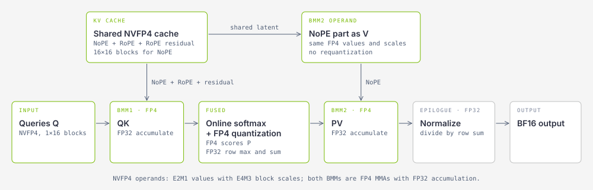
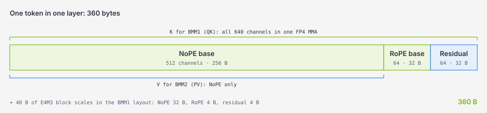
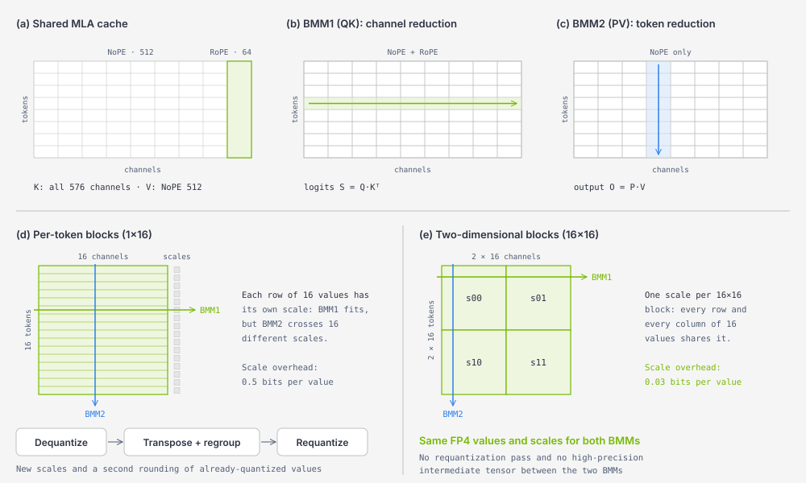
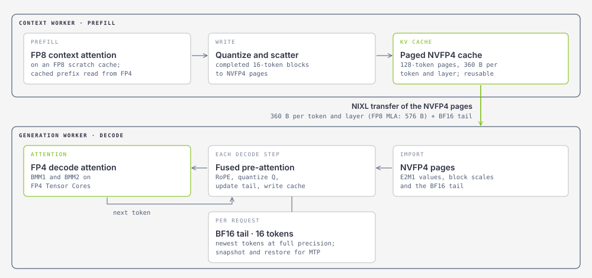
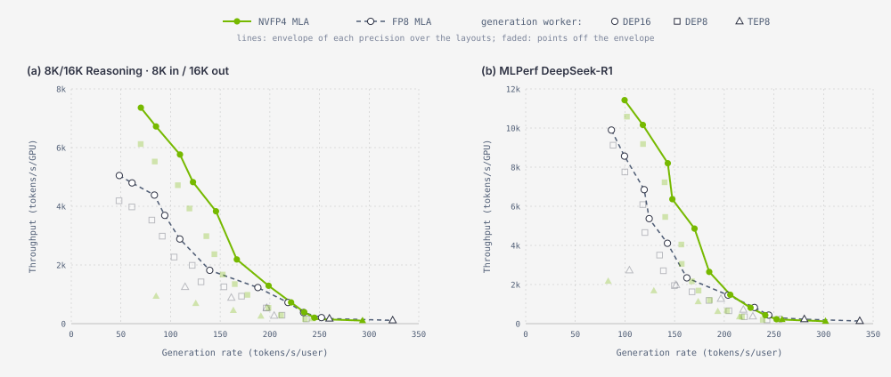

<!--
SPDX-FileCopyrightText: Copyright (c) 2026 NVIDIA CORPORATION & AFFILIATES. All rights reserved.
SPDX-License-Identifier: Apache-2.0
-->

# NVFP4 MLA: Unified 4-bit KV Cache Storage and Attention Compute in TensorRT LLM

By NVIDIA TensorRT LLM team

## Table of Contents
- [NVFP4 MLA: Unified 4-bit KV Cache Storage and Attention Compute in TensorRT LLM](#nvfp4-mla-unified-4-bit-kv-cache-storage-and-attention-compute-in-tensorrt-llm)
  - [Table of Contents](#table-of-contents)
  - [Introduction](#introduction)
  - [Why MLA Needs 4-bit Compute, Not Just 4-bit Storage](#why-mla-needs-4-bit-compute-not-just-4-bit-storage)
    - [One Latent, Two BMMs](#one-latent-two-bmms)
    - [MTP Makes MLA Decoding Compute-Bound](#mtp-makes-mla-decoding-compute-bound)
    - [NVFP4 in Brief](#nvfp4-in-brief)
  - [Design](#design)
    - [Quantizing Q, K, P, and V](#quantizing-q-k-p-and-v)
    - [Selective RoPE Residual Compensation](#selective-rope-residual-compensation)
    - [Two-Dimensional Blocks for the Shared Latent](#two-dimensional-blocks-for-the-shared-latent)
    - [The Stored Cache: 360 Bytes per Token and Layer](#the-stored-cache-360-bytes-per-token-and-layer)
  - [The Decode Attention Kernel](#the-decode-attention-kernel)
  - [Integration in TensorRT LLM](#integration-in-tensorrt-llm)
    - [Writing the Cache During Prefill and Decode](#writing-the-cache-during-prefill-and-decode)
    - [Speculative Decoding with MTP](#speculative-decoding-with-mtp)
    - [Disaggregated Serving](#disaggregated-serving)
    - [Prefix Reuse and Chunked Prefill](#prefix-reuse-and-chunked-prefill)
  - [How to Use](#how-to-use)
  - [Evaluation](#evaluation)
    - [Setup](#setup)
    - [Accuracy](#accuracy)
    - [KV Cache Footprint](#kv-cache-footprint)
    - [Attention Kernel](#attention-kernel)
    - [Disaggregated Serving Throughput](#disaggregated-serving-throughput)
    - [Agentic Multi-Turn Serving](#agentic-multi-turn-serving)
  - [Limitations and Future Work](#limitations-and-future-work)
  - [Acknowledgements](#acknowledgements)
  - [References](#references)

## Introduction

Multi-head latent attention (MLA) caches one compressed latent vector per token instead of separate keys and values for every head. It has become the attention mechanism of several leading open models, including DeepSeek-V3, DeepSeek-R1, Kimi-K2.6, Kimi-K3 and LongCat-Flash. Even so, the latent cache grows with every token and every concurrent request, and each decode step reads all of it. Long reasoning traces and agentic sessions keep growing contexts alive across many turns, which makes the capacity of this cache, and the time attention spends reading it, a dominant cost of serving.

FP8 is the usual KV cache format for these models today. Going to 4 bits looks like a storage problem, but for MLA it is just as much a compute problem: with multi-token prediction (MTP), MLA decoding is compute-bound on current GPUs, so a smaller cache alone does not make attention faster. NVFP4, the 4-bit block-scaled format that NVIDIA Tensor Cores execute natively, addresses both costs: it stores the cache in fewer bits than FP8 and multiplies at a higher rate than FP8.

In this blog, we introduce **NVFP4 MLA** in TensorRT LLM. It stores the MLA KV cache in NVFP4 and, during decode, runs **both attention batched matrix multiplications (BMMs) on native FP4 Tensor Cores**. It is an algorithm-system co-design with three parts:

- **Selective RoPE residual compensation** stores a second FP4 component only for the 64 quantization-sensitive RoPE channels, which restores accuracy without leaving the NVFP4 format.
- **Two-dimensional quantization blocks** make one NVFP4 representation of the shared latent valid for both BMMs, although the two reduce it along different axes, so the cache never needs to be requantized.
- **A matching kernel and cache system** quantize queries and softmax scores online and integrate the FP4 cache with paged KV cache management, MTP, disaggregated serving and prefix reuse.

The results, for DeepSeek-R1 on NVIDIA Rubin GPUs unless noted otherwise:

- **Accuracy:** NVFP4 MLA **matches BF16 MLA average accuracy** on DeepSeek-R1 and Kimi-K3 across nine benchmarks covering reasoning, coding, instruction following, 128K-token long context and agentic tool use.
- **Memory:** the stored cache takes **360 bytes per token and layer**, **3.20x smaller than BF16 MLA and 1.60x smaller than FP8 MLA** on DeepSeek-R1, and 3.05x and 1.52x smaller on Kimi-K3.
- **Attention kernel:** up to **2.82x faster** than FP8 MLA on DeepSeek-R1 and up to **2.71x faster** on Kimi-K3.
- **Serving:** up to **2.30x the throughput per GPU at the same per-user generation rate** in disaggregated DeepSeek-R1 serving with MTP, with each precision on its best generation layout, and 26.7% and 39.9% more on average over the measured rates of the two workloads.
- **Agentic serving:** up to **3.5x lower p90 time to first token (TTFT)** on DeepSeek-R1 and 2.1x on Kimi-K3 in multi-turn agent replays, once FP8 starts evicting session histories.

NVFP4 MLA complements the [NVFP4 cold-page compression](blog30_KV_Cache_Compression_in_TensorRT-LLM.md#nvfp4-cold-page-compression) described in our previous blog. Cold-page compression keeps KV pages in NVFP4 only while they sit off the GPU, and attention still sees the model's normal KV format. NVFP4 MLA keeps the active cache on the GPU in NVFP4 and computes attention on it directly.

## Why MLA Needs 4-bit Compute, Not Just 4-bit Storage

### One Latent, Two BMMs

For every token, MLA caches a single latent vector that all heads share. In DeepSeek-R1, this latent has 576 channels: 512 content channels without position rotation, called **NoPE**, and 64 channels with rotary position encoding, called **RoPE**. In FP8, that is 576 bytes per token and layer. Kimi-K3 keeps the same 512 + 64 layout but applies no positional encoding to either part; we still call its 64-channel part RoPE.

For decode, TensorRT LLM uses the absorbed form of MLA: the key and value up-projections are folded into the query and output projections, so attention runs directly on the cached latent for all 128 query heads. Two BMMs read the cache:

- **BMM1 (QK)** multiplies the queries with all 576 latent channels and **reduces over channels** to produce the attention logits.
- **BMM2 (PV)** multiplies the softmax scores P with the 512 NoPE channels and **reduces over cached tokens** to produce the output. The RoPE channels contribute to the logits only.

The same cached values are therefore consumed in two orientations, by two BMMs that reduce along different axes. In grouped-query attention (GQA), K and V are separate tensors whose layouts can be chosen independently. In MLA they are one tensor, and this coupling shapes the whole design below.

### MTP Makes MLA Decoding Compute-Bound

Absorption trades bytes for math. For each cached token, one query position performs 278,528 FLOPs of BMM work in DeepSeek-R1 (2 × 128 heads × (576 + 512) channels), so FP8 MLA does 484 FLOPs per byte of cache. MTP raises this further. It verifies several query positions, the next token and the draft tokens, against the same cache, and a kernel that reuses each cache read across all of them multiplies the arithmetic intensity. With MTP=3, four query positions share each read, and FP8 MLA does **1,934 FLOPs per byte**. That is more than twice the ridge point of a Rubin GPU, about 911 FLOPs per byte (17.5 PFLOP/s of dense FP8 compute over 19.2 TB/s of HBM bandwidth).

Measurements confirm the analysis. At 30K tokens of context, the optimized FP8 MLA decode kernel reads its cache at 10.4 TB/s without MTP. With MTP=3, it reads at only 2.7 TB/s, 14% of peak bandwidth, while sustaining 5.3 PFLOP/s of BMM work: **with MTP, FP8 MLA decoding is limited by matrix throughput, not by memory bandwidth**.

This bounds any storage-only approach. An NVFP4 cache that is dequantized to FP8 before attention runs the same FP8 matrix multiplications and the same softmax as FP8 MLA, adds the dequantization, and only shortens memory reads that are not the bottleneck. On this workload (batch 26, MTP=3, 30K context), it therefore cannot beat the 165 µs of FP8 MLA. NVFP4 MLA completes the same work in **107 µs**, because its FP4 BMMs shorten the computation itself. Storage and compute have to move to 4 bits together.

### NVFP4 in Brief

NVFP4 encodes each value as a 4-bit E2M1 number and attaches one FP8 E4M3 scale to every block of 16 values, plus one FP32 scale for the whole tensor. Compared with MXFP4, which uses power-of-two scales over blocks of 32 values, the smaller blocks and fractional scales follow local value ranges more closely. Block-scaled FP4 Tensor Core instructions consume the 4-bit codes and their scales directly and accumulate in FP32. One of their requirements matters a great deal for MLA: each operand must carry its scales along **its own reduction axis**.

## Design

Figure 1 shows the decode dataflow of NVFP4 MLA. The shared cache holds the latent in NVFP4 together with an FP4 residual for the RoPE channels. BMM1 reads the whole cache along channels, BMM2 reads its NoPE part along tokens, and the queries and softmax scores are quantized on the fly, so both BMMs run with FP4 operands on both sides.

<div align="center">
<figure>
  
</figure>
</div>
<p align="center"><sub><em>Figure 1: Decode dataflow of NVFP4 MLA. The shared NVFP4 cache holds the NoPE and RoPE channels plus an FP4 residual for RoPE. BMM1 (QK) and BMM2 (PV) both multiply FP4 operands on FP4 Tensor Cores and accumulate in FP32. Online softmax turns the logits into FP4 scores for BMM2, and the output is normalized in FP32. BMM2 reads the same FP4 values and scales as BMM1, without requantization.</em></sub></p>

### Quantizing Q, K, P, and V

During decode, NVFP4 MLA quantizes all four attention operands. Each operand is quantized in blocks that follow the reduction axis of the BMM that consumes it:

| Operand | Consumed by | Block shape, one scale per block | Tensor scale |
|---|---|---|---|
| Queries Q | BMM1 | 1×16 along channels | Calibrated offline |
| RoPE part of the cache (K only) | BMM1 | 1×16 along channels | Calibrated offline |
| NoPE part of the cache (K and V) | BMM1 and BMM2 | 16×16, tokens × channels | Calibrated offline |
| Softmax scores P | BMM2 | 1×16 along tokens | Fixed |

The queries are quantized at every step by the pre-attention kernel, and P is quantized inside the attention kernel. P holds the stable, unnormalized softmax scores and needs no calibration: they lie in (0, 1], so a fixed tensor scale of 1/2688, the reciprocal of the largest E2M1 magnitude (6) times the largest E4M3 magnitude (448), maps the row maximum to the top of the NVFP4 range, and no block scale can saturate. Both BMMs accumulate in FP32, and softmax keeps the logits, the running row maxima and sums, and the final normalization in FP32.

### Selective RoPE Residual Compensation

Quantizing these operands naively costs accuracy. Across the nine benchmarks of the [evaluation](#accuracy), NVFP4 for all four operands without compensation loses **5.71 points** on average on DeepSeek-R1 and **16.48 points** on Kimi-K3. To find where the error comes from, we recorded the BF16 cache of every MLA layer of both models and measured how well NVFP4 reconstructs it. **The error concentrates in the 64 RoPE channels.** In the first few MLA layers of both models, their values peak at 3.9 to 125 times the NoPE maximum and change sharply from token to token, while the 512 NoPE channels stay flat.

NVFP4 MLA therefore keeps one NVFP4 component for NoPE and adds a second FP4 component only for RoPE, holding the quantization error of the first:

$$\widehat E_R = \mathcal Q_{1\times16}\left(C_R - \widehat C_R\right)$$

where $C_R$ is the RoPE part of the cache, $\widehat C_R$ its NVFP4 base, and $\mathcal Q_{1\times16}$ NVFP4 quantization in 1×16 blocks. The residual uses the same blocks as the RoPE base, with its own scales. Compensating these 64 of the 576 channels lowers the mean reconstruction error (normalized mean squared error, NMSE) of the whole cache by **60.3%** on DeepSeek-R1, averaged over its first 30 MLA layers, and by **66.1%** on Kimi-K3, with NoPE unchanged. On the RoPE channels themselves, the error drops by 115x and 116x on average. Keeping RoPE in FP8 instead would leave 9.5x and 9.1x as much error as the residual on average, and at least 7.9x as much in every layer.

<div align="center">
<figure>
  
</figure>
</div>
<p align="center"><sub><em>Figure 2: Cache layout of one token. The NoPE base (B<sub>N</sub>) and the RoPE base (B<sub>R</sub>) form the base NVFP4 latent; the RoPE residual (E<sub>R</sub>) is a second FP4 component for the 64 RoPE channels only. Each component stores E2M1 values with its own E4M3 block scales.</em></sub></p>

Why an FP4 residual instead of keeping RoPE in FP8, which would also fix the error? Because the residual keeps BMM1 a **single** block-scaled FP4 matrix multiplication. The kernel stores the base and the residual as separate FP4 tiles, places them side by side along the reduction dimension, and repeats the RoPE query in front of both:

$$S = \left[\widehat{q}_N,\ \widehat{q}_R,\ \widehat{q}_R\right]\left[\widehat{C}_N,\ \widehat{C}_R,\ \widehat{E}_R\right]^{\mathsf T} = \widehat{q}_N\widehat{C}_N^{\mathsf T} + \widehat{q}_R\left(\widehat{C}_R + \widehat{E}_R\right)^{\mathsf T}$$

BMM1 is thus one FP4 matrix multiply-accumulate (MMA) over 640 channels with one operand format and one scale layout, and the base and the residual are never merged into a wider tensor. An FP8 RoPE part would need a second MMA at the FP8 rate, with its own operand format and scale layout, and it would also be less accurate. The residual costs 36 bytes per token and layer (32 bytes of values and 4 bytes of scales), 10% of the cache, and it affects BMM1 only, because RoPE does not enter BMM2.

### Two-Dimensional Blocks for the Shared Latent

BMM1 reduces the NoPE latent over channels and BMM2 reduces it over tokens, and each needs one scale per 16 values along its own axis. A conventional per-token 1×16 layout fits BMM1 but runs the wrong way for BMM2 (Figure 3d). Feeding BMM2 from it means dequantizing the cached values, transposing and regrouping them, and requantizing them into token-wise blocks: a second rounding of values that are already quantized, plus extra memory traffic, a scale reduction and synchronization right before BMM2.

NVFP4 MLA instead quantizes the NoPE latent in **16×16 blocks of 16 tokens by 16 channels, with one scale per block** (Figure 3e). Every 16-value row and every 16-value column of a block shares that scale, so the block is valid in both reduction directions: both BMMs read **the same FP4 values and the same scales**, with no wider intermediate tensor and no dequantize-requantize pass. The logical scale overhead also drops from 0.5 to 0.03 bits per value. The stored cache keeps the scales in the layout that the BMM1 Tensor Core instruction reads, one scale byte per 16 channels of every token, so each block scale is repeated along the block's 16 rows. The RoPE base and residual keep 1×16 blocks, because only BMM1 reads them.

<div align="center">
<figure>
  
</figure>
</div>
<p align="center"><sub><em>Figure 3: (a) The shared MLA cache: K uses all 576 channels and V uses the 512 NoPE channels. (b) BMM1 reduces over channels and (c) BMM2 reduces over tokens. (d) With per-token 1×16 blocks, BMM2 needs a dequantize, regroup and requantize pass that rounds the values a second time. (e) With 16×16 blocks, one scale covers 16 values in both directions, so both BMMs use the same FP4 values and scales.</em></sub></p>

### The Stored Cache: 360 Bytes per Token and Layer

Putting the pieces together, one DeepSeek-R1 layer stores the following for every token:

| Component | Bytes per token |
|---|---|
| NoPE values, 512 channels in E2M1 | 256 |
| RoPE base values, 64 channels in E2M1 | 32 |
| RoPE residual values, 64 channels in E2M1 | 32 |
| E4M3 block scales in the BMM1 layout (NoPE 32, RoPE base 4, RoPE residual 4) | 40 |
| **Total** | **360** |

That is 5.0 bits per cached value, compared with 8 for FP8 and 16 for BF16. This is the cache that TensorRT LLM stores, transfers between disaggregated workers and keeps for prefix reuse.

## The Decode Attention Kernel

On Rubin GPUs, the decode attention of NVFP4 MLA is a CuTe DSL kernel. Native FP4 Tensor Core throughput speeds up the whole kernel only if the work around the BMMs keeps up. Between the two BMMs, the logits have to become softmax scores that are quantized, scaled and packed into FP4 before BMM2 can start. In FP8 this logit-to-score stage is a type conversion; in FP4 it also has to derive the block scales, and it can easily eat the gain of the faster BMMs. The kernel applies four optimizations. The first three keep this stage off the critical path, and the fourth adapts the scheduling of the kernel's thread blocks to the shape of the batch:

- **Fusing online softmax with FP4 score quantization.** For every block of 16 logits, the block maximum defines a bias for the exponent: a single fused multiply-add evaluates the exponent of each score against that maximum, and the resulting power of two is at most the top of the E2M1 range. The kernel converts it to E2M1 and packs it right away, before the row maximum over the whole sequence is known. Once the cross-block reduction produces that maximum, only the block scale remains to be computed. Because each value is computed against its block maximum, neither the values nor the block scales can saturate, and the division by the softmax sum happens in FP32 after BMM2.
- **Balancing FP4 score construction and accumulator rescaling.** Online softmax must also rescale the BMM2 accumulator whenever the running maximum changes. Rather than dedicating separate warp groups to building the FP4 scores and to rescaling, each warp group builds the FP4 scores for its part of a logit tile and rescales a complementary part of the accumulator, so this stage does not serialize the pipeline.
- **Reusing FP4 score operands across BMM2 output tiles.** Each packed slice of FP4 scores contributes to several BMM2 output tiles. The kernel keeps it resident through the Tensor Core operand-reuse mechanism instead of loading it again for every output tile, which leaves more execution bandwidth for building the scores.
- **Shape-adaptive CTA scheduling.** With MTP, each request has several query positions, so the kernel can use larger MMA tiles. It gives each cluster of thread blocks (cooperative thread arrays, CTAs) the packed query rows of one request; the CTAs of a cluster split the KV tiles, exchange the FP4 scores through distributed shared memory, and use the same FP4 operands and softmax. At long KV lengths, the kernel also splits the KV of a request into pieces that run on idle streaming multiprocessors and merges them with a reduction kernel.

The kernels live in [`tensorrt_llm/_torch/attention/backends/fp4_mla/`](https://github.com/NVIDIA/TensorRT-LLM/tree/main/tensorrt_llm/_torch/attention/backends/fp4_mla).

## Integration in TensorRT LLM

A fast kernel is only part of the work. The FP4 cache also has to be written during prefill, extended one token at a time during decode, rolled back when draft tokens are rejected, moved between disaggregated workers and reused across turns, all without letting quantization error accumulate. In TensorRT LLM, NVFP4 MLA is a dedicated path of the TRTLLM attention backend with its own cache manager, `Fp4MlaKVCacheManagerV2`, which builds on `KVCacheManagerV2`. Figure 4 follows a request through it.

<div align="center">
<figure>
  
</figure>
</div>
<p align="center"><sub><em>Figure 4: A request in disaggregated serving with NVFP4 MLA. The context worker runs FP8 context attention and writes completed 16-token blocks into the paged NVFP4 cache. Only these NVFP4 pages, together with a small BF16 tail, are transferred. The generation worker decodes from the imported pages with FP4 attention, keeping the newest tokens of each request in a BF16 tail until their block is complete.</em></sub></p>

### Writing the Cache During Prefill and Decode

The cache is paged in blocks of 128 tokens, a page size that TensorRT LLM selects automatically for NVFP4 MLA. During prefill, context attention runs the existing FP8 MLA context kernel on an FP8 scratch cache, and a quantize-and-scatter kernel writes the completed 16-token blocks of the prompt into the paged NVFP4 cache. FP4 attention compute is used for decode, where cache reads and BMM work grow with every generated token.

A 16×16 block can be quantized only once all 16 of its tokens exist, but decode adds one token per step. Each request therefore owns a slot in a **16-token BF16 tail**, a ring buffer that keeps the newest tokens at full precision. At each decode step, a fused pre-attention kernel applies RoPE, appends the new token to the tail, quantizes the queries, refreshes the active FP4 block from the BF16 values and writes the cache. Once a block has all 16 tokens, it is frozen. Every FP4 block is therefore quantized from BF16 values and never from FP4 values, and error cannot accumulate through repeated requantization.

### Speculative Decoding with MTP

MTP writes draft tokens into the cache before they are verified. Before these speculative writes, the runtime snapshots the BF16 tail; afterwards, it commits the accepted tokens and restores the positions that rejected tokens overwrote. Completed FP4 pages are never modified during rollback, so rejected tokens cannot leak into the persistent cache. The MTP layer uses the same NVFP4 cache format, so a DeepSeek-R1 request has 62 NVFP4 cache layers: 61 MLA layers plus the MTP layer.

### Disaggregated Serving

In disaggregated serving, context and generation run on separate workers, and the cache of every prompt crosses the network once. NVFP4 MLA transfers only the stored NVFP4 pages, namely the E2M1 values and their block scales, plus the BF16 tail of the incomplete last block. For DeepSeek-R1, that is **360 bytes per token and layer instead of 576 bytes with FP8, 37.5% fewer bytes**. NVFP4 MLA moves its cache with the NIXL backend and the Python transceiver runtime.

On the context servers of a disaggregated deployment, whose role `trtllm-serve` takes from `--server_role CONTEXT` or from the server type of a disaggregated MPI launch, the same memory holds 60% more cached tokens than with FP8, which matters for the [agentic workloads](#agentic-multi-turn-serving) below.

### Prefix Reuse and Chunked Prefill

Agentic and multi-turn workloads resend a growing history with every turn. Serving them efficiently depends on finding that history in the cache instead of prefilling it again. NVFP4 MLA supports KV cache block reuse and chunked prefill, together or separately. When a request finds cached blocks, context attention gathers the cached FP4 prefix into the operands of the FP8 context kernel and merges the attention over the prefix with the attention over the new tokens; the later chunks of a chunked prefill take the same path. Reuse works on whole 128-token blocks, and chunk boundaries align with the 16-token quantization tiles. Because the prefix is read back from the NVFP4 cache, context attention sees the same values that decode sees.

## How to Use

NVFP4 MLA is enabled by setting the KV cache data type of an MLA model to `nvfp4`. In a `trtllm-serve` configuration file:

```yaml
kv_cache_config:
  dtype: nvfp4
speculative_config:
  decoding_type: MTP
  max_draft_len: 3
```

Or with the LLM API:

```python
from tensorrt_llm import LLM
from tensorrt_llm.llmapi import KvCacheConfig, MTPDecodingConfig

llm = LLM(
    model="nvidia/DeepSeek-R1-0528-FP4-v2",
    tensor_parallel_size=4,
    moe_expert_parallel_size=4,
    enable_attention_dp=True,
    kv_cache_config=KvCacheConfig(dtype="nvfp4"),
    speculative_config=MTPDecodingConfig(max_draft_len=3),
)
```

Run generation workers with attention data parallelism (`enable_attention_dp=True`), as in this example. NVFP4 MLA is designed for generation workers that decode all 128 heads of their requests; see [Limitations and Future Work](#limitations-and-future-work).

TensorRT LLM then does the following automatically:

- It uses `Fp4MlaKVCacheManagerV2`. NVFP4 MLA requires KV cache manager V2, so do not set `use_kv_cache_manager_v2: false`.
- It sets `tokens_per_block` to 128 and logs `Change tokens_per_block to: 128 for using FP4 MLA attention`. If you enable chunked prefill, make `max_num_tokens` a multiple of 128.
- On Rubin (SM107) GPUs, it selects the CuTe DSL kernels described in this blog. They are built with the `nvidia-cutlass-dsl` package that TensorRT LLM installs as a dependency.

For disaggregated serving, use the NIXL backend with the Python transceiver runtime on both context and generation workers:

```yaml
cache_transceiver_config:
  backend: NIXL
  transceiver_runtime: PYTHON
```

NVFP4 MLA supports DeepSeek-V3 and DeepSeek-R1 models and Kimi-K3. For Kimi-K3, NVFP4 is used in 22 of its 24 MLA layers, and the last two MLA layers keep an FP8 cache.

One environment variable controls the kernels:

| Environment variable | Default | Effect |
|---|---|---|
| `TRTLLM_FP4_MLA_ATTENTION_BACKEND` | `cutedsl` on SM107 when the CuTe DSL kernels can be loaded; `triton` otherwise | Selects the NVFP4 MLA kernels. If the CuTe DSL kernels cannot be loaded, TensorRT LLM falls back to a Triton implementation without an error, and other GPU architectures always use the Triton implementation. Set this variable to `cutedsl` to raise an error instead of falling back. |

We recommend setting `TRTLLM_FP4_MLA_ATTENTION_BACKEND=cutedsl` in production deployments on Rubin, so that a broken environment cannot silently fall back to the slower path. All results in this blog use the CuTe DSL kernels.

## Evaluation

### Setup

**Accuracy.** Both models use the same nine tasks, and RULER and MRCR use a 128K-token context. We compare NVFP4 MLA with three baselines on DeepSeek-R1 and Kimi-K3:

- **BF16 MLA** keeps the KV cache and the attention BMM computation in BF16.
- **FP8 MLA** quantizes the KV cache and the attention BMM computation, that is all four operands (Q, K, P and V), to FP8 E4M3.
- **Vanilla NVFP4 MLA** quantizes them directly to NVFP4, with the block layouts of NVFP4 MLA but without residual compensation.

All configurations keep the weight format of the checkpoint.

**Performance.** All performance results are on NVIDIA Rubin GPUs, for DeepSeek-R1 with MTP=3 unless the table says otherwise, served by TensorRT LLM. FP8 MLA and NVFP4 MLA share the same KV cache manager, NIXL transfer, runtime settings and parallel layout. They differ only in the cache and attention precision and in the page size: 128 tokens for NVFP4 MLA, and 32 tokens for FP8 MLA, whose decode kernel on this GPU does not support 128-token pages. The serving workloads use natural-text prompts, so that MTP acceptance reflects real text. In the table, DEP *n* denotes attention data parallelism with expert parallelism over *n* GPUs, and TEP *n* attention tensor parallelism with expert parallelism over *n* GPUs.

| Workload | Description | Layout |
|---|---|---|
| MLPerf | All 4,388 DeepSeek-R1 MLPerf evaluation prompts in a fixed random order. Inputs average 804 tokens. Outputs end naturally, average about 3.8K tokens and are capped at 20K tokens. Decode contexts average about 5K tokens. | One context worker (DEP2) and one generation worker with DEP16, DEP8 or TEP8, 18 or 10 GPUs |
| 8K/16K Reasoning | Problems from the same set packed into prompts of about 8K tokens, with about 16K output tokens per request. Decode contexts average about 16K tokens. | Two context workers (DEP2 each) and one generation worker with DEP16, DEP8 or TEP8, 20 or 12 GPUs |
| AgentX, DeepSeek-R1 | 393 recorded multi-turn Claude Code sessions from the SemiAnalysis InferenceX AgentX benchmark, replayed with their recorded think times. Each operating point keeps a fixed number of sessions alive for 15 minutes. The context worker uses prefix reuse, chunked prefill and session affinity, with a KV cache budget of 43 or 12 GiB per GPU plus 8 GiB of host memory. | One context worker (DEP2) and one generation worker (DEP4) |
| AgentX, Kimi-K3 | The same sessions, 128 of them kept alive for 30 minutes. Context serving only, with 47.4 GiB of KV cache memory per GPU, 41% of it for the state of the Kimi Delta Attention (KDA) layers, and no host cache. A cached prefix is reusable only if both its MLA cache and its KDA state remain. | 16 GPUs with [Distributed Weight Data Parallelism](blog19_DWDP_Distributed_Weight_Data_Parallelism_for_High_Performance_LLM_Inference_on_NVL72.md) (DWDP16) |
| Attention kernel | One decode call of one MLA layer at 39 shapes per model: KV lengths from 2K to 128K tokens and per-GPU batches from 8 to 1,024 requests, with MTP=3 on DeepSeek-R1 (128 heads) and MTP=7 on Kimi-K3 (96 heads). Each measurement profiles a single attention kernel under a CUDA Graph, with equal KV lengths across requests, and includes the split-KV reduction. FP8 MLA uses the faster of its split-KV strategies for each shape, and NVFP4 MLA uses its best CTA scheduling for each shape. | One GPU |

### Accuracy

NVFP4 MLA **matches BF16 MLA average accuracy on both models**: its nine-task average is 59.82 compared with 59.80 on DeepSeek-R1 and 80.28 compared with 80.27 on Kimi-K3, whereas FP8 MLA is 0.06 and 0.33 points below BF16 MLA. The vanilla baseline shows that this result is not automatic: without residual compensation, NVFP4 loses 5.71 and 16.48 points on average, and up to 56 points on a single Kimi-K3 task.

DeepSeek-R1:

| Configuration | GPQA | IFBench | AIME 2025 | LiveCodeBench v6 | SciCode | RULER 128K | MRCR 128K | AA-LCR | τ²-Bench | Average |
|---|---|---|---|---|---|---|---|---|---|---|
| BF16 MLA | 80.07 | 39.53 | 87.14 | 71.31 | 42.60 | 92.97 | 36.35 | 52.52 | 35.75 | 59.80 |
| FP8 MLA | 80.16 | 37.93 | 87.60 | 71.75 | 42.27 | 92.67 | 37.21 | 52.62 | 35.42 | 59.74 |
| Vanilla NVFP4 MLA | 77.38 | 34.87 | 73.80 | 62.11 | 40.64 | 90.52 | 29.54 | 46.06 | 31.91 | 54.09 |
| **NVFP4 MLA** | 79.83 | 38.07 | 85.94 | 71.78 | 43.12 | 92.77 | 36.95 | 51.86 | 38.05 | **59.82** |

Kimi-K3:

| Configuration | GPQA | IFBench | AIME 2025 | LiveCodeBench v6 | SciCode | RULER 128K | MRCR 128K | AA-LCR | τ²-Bench | Average |
|---|---|---|---|---|---|---|---|---|---|---|
| BF16 MLA | 93.66 | 73.96 | 96.20 | 57.49 | 58.48 | 97.00 | 85.02 | 81.75 | 78.84 | 80.27 |
| FP8 MLA | 93.50 | 73.69 | 95.63 | 57.32 | 58.19 | 97.06 | 84.38 | 82.19 | 77.49 | 79.94 |
| Vanilla NVFP4 MLA | 88.26 | 61.79 | 87.71 | 10.68 | 2.27 | 95.98 | 75.21 | 77.31 | 74.89 | 63.79 |
| **NVFP4 MLA** | 93.43 | 74.91 | 96.20 | 57.30 | 58.09 | 97.11 | 84.10 | 82.31 | 79.06 | **80.28** |

<p align="center"><sub><em>Scores in percent. The average is the unweighted mean of the nine tasks. Repeats per task: 64 for GPQA, AIME 2025 and AA-LCR; 8 for LiveCodeBench, SciCode and τ²-Bench; 5 for IFBench; 3 for MRCR; 1 for RULER.</em></sub></p>

### KV Cache Footprint

Including the residual, NVFP4 MLA compresses the stored MLA cache by **3.20x and 3.05x relative to BF16 MLA** and by 1.60x and 1.52x relative to FP8 MLA on DeepSeek-R1 and Kimi-K3. Per million cached tokens, that is 20.5 GiB instead of 65.4 GiB with BF16 MLA on DeepSeek-R1, and 8.4 GiB instead of 25.7 GiB on Kimi-K3. The RoPE residual accounts for only 10% of each NVFP4 layer's cache.

| Cache | DeepSeek-R1, bytes per token | Reduction | Kimi-K3, bytes per token | Reduction |
|---|---|---|---|---|
| BF16 MLA | 70,272 | 1.00x | 27,648 | 1.00x |
| FP8 MLA | 35,136 | 2.00x | 13,824 | 2.00x |
| **NVFP4 MLA** | **21,960** | **3.20x** | **9,072** | **3.05x** |

<p align="center"><sub><em>Stored MLA cache in bytes per cached token, summed over all MLA layers, including the RoPE residual and the block scales. DeepSeek-R1 uses NVFP4 in all 61 MLA layers. Kimi-K3 has 24 MLA layers among its 93 layers, with NVFP4 in 22 and FP8 in the last two, and the counts exclude the recurrent state of its 69 Kimi Delta Attention (KDA) layers. The buffers that generation workers use for decode, update buffers and allocation padding are not included.</em></sub></p>

On Kimi-K3, the MLA cache shares the KV cache budget with the recurrent state of the KDA layers. Under the same budget, NVFP4 MLA holds 47% to 49% more cached tokens than FP8 MLA, depending on the share that the KDA state takes.

### Attention Kernel

Besides its smaller cache, NVFP4 MLA shortens the attention computation itself, because both BMMs run on FP4 Tensor Cores. Its speedup over FP8 MLA grows with the KV length and reaches **2.82x on DeepSeek-R1 and 2.71x on Kimi-K3**. The two tables give the speedup of one decode call at each measured shape, for the per-GPU batches of a generation worker, from 8 to 1,024 requests, and for KV lengths from 2K to 128K tokens.

DeepSeek-R1, MTP=3:

| KV length | B = 8 | B = 32 | B = 64 | B = 128 | B = 256 | B = 512 | B = 1,024 |
|---|---|---|---|---|---|---|---|
| 2K | 1.33x | 1.31x | 1.34x | 1.44x | 1.45x | 1.51x | 1.54x |
| 4K | 1.61x | 1.49x | 1.57x | 1.67x | 1.68x | 1.64x | 1.74x |
| 8K | 1.39x | 1.97x | 1.95x | 1.89x | 2.05x | 1.80x | 1.80x |
| 16K | 1.42x | 2.37x | 2.27x | 2.13x | 2.24x | 1.86x | – |
| 32K | 1.75x | 2.65x | 2.39x | 2.26x | 2.34x | – | – |
| 64K | 1.93x | 2.77x | 2.39x | 2.39x | – | – | – |
| 128K | 2.15x | **2.82x** | 2.39x | – | – | – | – |

Kimi-K3, MTP=7:

| KV length | B = 8 | B = 32 | B = 64 | B = 128 | B = 256 | B = 512 | B = 1,024 |
|---|---|---|---|---|---|---|---|
| 2K | 1.35x | 1.52x | 1.37x | 1.52x | 1.54x | 1.52x | 1.52x |
| 4K | 1.56x | 1.63x | 1.66x | 1.86x | 1.80x | 1.81x | 1.83x |
| 8K | 1.71x | 2.00x | 1.98x | 2.31x | 1.90x | 1.98x | 1.99x |
| 16K | 1.84x | 2.36x | 2.51x | 2.52x | 1.96x | 1.99x | – |
| 32K | 1.96x | 2.58x | 2.65x | 2.67x | 1.99x | – | – |
| 64K | 2.16x | **2.71x** | 2.66x | 2.69x | – | – | – |
| 128K | 2.28x | 2.69x | 2.66x | – | – | – | – |

<p align="center"><sub><em>Speedup of one NVFP4 MLA decode call of one MLA layer over FP8 MLA on one Rubin GPU, with 128 heads on DeepSeek-R1 and 96 heads on Kimi-K3. Both kernels include their split-KV reduction. Shapes marked – were not measured.</em></sub></p>

NVFP4 MLA is faster at every measured shape: by 1.31x to 2.82x, with a geometric mean of 1.87x, on the 39 DeepSeek-R1 shapes, and by 1.35x to 2.71x, with a geometric mean of 1.99x, on the 39 Kimi-K3 shapes. The speedup generally grows with the KV length, from 1.3x to 1.5x at 2K tokens, where the fixed cost per call dominates, to 2.2x to 2.8x at 128K tokens, where the attention work per token dominates.

### Disaggregated Serving Throughput

We measure the throughput-latency trade-off of disaggregated DeepSeek-R1 serving on the MLPerf and 8K/16K Reasoning workloads with each of the three generation layouts in the setup. Closed-loop clients sweep the number of requests in flight: from 16 to 2,048 with DEP16 and from 8 to 1,024 with DEP8, 1 to 128 per generation GPU, and with TEP8 from 4 to 256 on MLPerf and from 4 to 128 on 8K/16K Reasoning. Each client slot issues at least twelve MLPerf requests or three 8K/16K Reasoning requests in sequence, and we discard the first and last wave of each client to keep only the steady state. For a request with $o$ output tokens, time to first token $t$ and end-to-end latency $e$, the per-user generation rate is the median of $(o-1)/(e-t)$ over requests, and the throughput per GPU counts the output tokens of all requests over all context and generation GPUs. We interpolate each layout's sweep linearly between the measured loads, and a precision's Pareto frontier, the envelope over its layouts, takes the highest throughput that any of its layouts reaches at a given per-user rate or above. Comparing the envelopes gives each precision its best layout at every rate.

<div align="center">
<figure>
  
</figure>
</div>
<p align="center"><sub><em>Figure 5: Measured throughput and per-user generation rate of disaggregated DeepSeek-R1 serving with MTP=3 on Rubin GPUs, for (a) 8K/16K Reasoning with about 8K input and 16K output tokens per request and (b) the MLPerf DeepSeek-R1 dataset. Marker shapes give the generation layout, lines give each precision's envelope over the layouts, and faded points lie below the envelope of their precision. Throughput counts all context and generation GPUs.</em></sub></p>

With each precision on its best layout, NVFP4 MLA serves about twice the throughput per GPU at the same per-user rate in the middle of the range (Figure 5). On MLPerf, NVFP4 MLA with 1,024 requests in flight and FP8 MLA with 512 both generate 143 tokens/s/user, and NVFP4 MLA delivers 8,200 instead of 4,107 tokens/s/GPU. On 8K/16K Reasoning, the same two loads both generate 109 tokens/s/user, at 5,762 and 2,886 tokens/s/GPU. Neither DEP8 nor TEP8 reaches these rates at a higher throughput with FP8 MLA. The envelopes are furthest apart at 162 tokens/s/user on MLPerf and 139 tokens/s/user on 8K/16K Reasoning, where NVFP4 MLA delivers 2.30x and 2.25x the throughput of FP8 MLA. Averaged uniformly over the shared rate ranges, 86 to 302 tokens/s/user on MLPerf and 70 to 293 tokens/s/user on 8K/16K Reasoning, the envelope gains are 26.7% and 39.9%.

The gap comes from a decode step that grows more slowly with load. As the load rises from 5-8 to 9-16 requests per generation GPU with DEP16, the median FP8 MLA decode step grows from 13.1 to 16.9 ms on MLPerf and from 14.1 to 19.3 ms on 8K/16K Reasoning, while the NVFP4 MLA step grows only from 13.0 to 14.7 ms and from 13.5 to 16.0 ms, so NVFP4 MLA sustains about twice the load at the same per-user rate. With at most eight requests per generation GPU, attention is a small part of the step, and the two precisions deliver the same throughput within about 5% at the same concurrency with DEP16 and DEP8.

DEP16 gives both precisions their highest throughput up to about 250 tokens/s/user, and TEP8 at higher per-user rates. DEP8 never does, largely because its context workers take a larger share of the GPUs. At the highest per-user rates, which only TEP8 reaches, the FP8 MLA envelope lies above that of NVFP4 MLA in these measurements; see [Limitations and Future Work](#limitations-and-future-work).

At the same number of requests in flight, from 256 to 2,048 with DEP16, NVFP4 MLA raises both throughput and per-user generation rate. Throughput per GPU rises by 13.2% to 19.7% on MLPerf and by 20.3% to 45.8% on 8K/16K Reasoning, and DEP8 shows the same pattern from 16 requests per generation GPU, with gains of 11% to 19% and 18% to 46%. With DEP16, both precisions accept 2.75 to 2.83 tokens per MTP step on 8K/16K Reasoning, so the gains come from shorter decode steps, not from different MTP acceptance.

| Workload | KV cache | In flight | tok/s/user | tok/s/GPU | Gain | TPOT p50 / p99 (ms) | MTP acceptance |
|---|---|---|---|---|---|---|---|
| MLPerf | FP8 MLA | 256 | 162 | 2,339 | | 6.16 / 7.56 | |
| | **NVFP4 MLA** | 256 | 185 | 2,647 | **+13.2%** | 5.41 / 6.55 | |
| | FP8 MLA | 1,024 | 119 | 6,852 | | 8.38 / 10.15 | |
| | **NVFP4 MLA** | 1,024 | 143 | 8,200 | **+19.7%** | 6.99 / 8.27 | |
| 8K/16K Reasoning | FP8 MLA | 256 | 139 | 1,819 | | 7.17 / 8.34 | 2.77 |
| | **NVFP4 MLA** | 256 | 167 | 2,188 | **+20.3%** | 6.00 / 6.39 | 2.80 |
| | FP8 MLA | 1,024 | 84 | 4,382 | | 11.94 / 13.72 | 2.75 |
| | **NVFP4 MLA** | 1,024 | 109 | 5,762 | **+31.5%** | 9.13 / 9.91 | 2.79 |

<p align="center"><sub><em>Disaggregated DeepSeek-R1 serving with MTP=3 and the DEP16 generation layout at the same number of requests in flight, over steady-state requests. Throughput counts all context and generation GPUs, and the gain is the throughput gain per GPU of NVFP4 MLA over FP8 MLA. TPOT is the time per output token. MTP acceptance is the mean number of tokens accepted per MTP step, recorded for 8K/16K Reasoning.</em></sub></p>

### Agentic Multi-Turn Serving

Agentic sessions add a capacity benefit. Context workers keep the KV cache of earlier turns and prefill only the newly appended tokens, so the number of session histories that fit in the cache decides how often a turn has to be prefilled from scratch. We replay the AgentX sessions with the same KV cache budget per context GPU for both precisions, in which NVFP4 MLA holds 60% more cached tokens than FP8 MLA.

NVFP4 MLA delays cache eviction as the number of concurrent sessions grows. While both caches retain the session histories, both serve 93% to 95% of the prompt tokens from the cache and keep the p90 TTFT at 2 to 3 seconds. With 43 GiB, FP8 MLA starts evicting at 32 sessions: from 32 to 64 sessions, its hit rate falls from 87.6% to 54.1%, and its p90 TTFT rises from 11.9 to 178 seconds. The larger effective cache of NVFP4 MLA sustains higher hit rates, so fewer prompt tokens have to be prefilled again. With 48 sessions, the hit rate rises from 77.0% to 87.1%, and the p90 TTFT falls from 108 to 30.9 seconds. With 12 GiB, the transition starts at 12 sessions, where the p90 TTFT falls from 5.44 to 2.23 seconds. Across all measured points after FP8 starts evicting, NVFP4 MLA lowers the p90 TTFT by **1.5x to 3.5x**.

Kimi-K3 shows the same effect. Its context servers hold 47.4 GiB of KV cache memory per GPU, shared with the KDA state, in which NVFP4 MLA keeps 47% to 49% more cached tokens than FP8 MLA. With 128 sessions, FP8 MLA already evicts histories: NVFP4 MLA raises the cache hit rate from 90.8% to 94.4%, close to the 95.4% that the trace allows, and lowers the p90 TTFT from 11.0 to 5.24 seconds, **a 2.1x reduction**.

| Model | KV cache per context GPU | Sessions | p90 TTFT, FP8 MLA (s) | p90 TTFT, NVFP4 MLA (s) | Cache hit, FP8 MLA | Cache hit, NVFP4 MLA |
|---|---|---|---|---|---|---|
| DeepSeek-R1 | 43 GiB | 16 | 2.98 | 1.99 | 95.2% | 95.1% |
| | | 24 | 2.68 | 2.41 | 93.6% | 94.4% |
| | | 32 | 11.9 | 5.36 | 87.6% | 92.4% |
| | | 40 | 36.6 | 23.7 | 82.3% | 87.9% |
| | | 48 | 108 | **30.9** | 77.0% | 87.1% |
| | | 64 | 178 | 79.8 | 54.1% | 79.6% |
| | 12 GiB | 12 | 5.44 | **2.23** | 89.9% | 94.8% |
| | | 16 | 7.73 | 4.23 | 87.5% | 91.3% |
| | | 20 | 12.8 | 5.62 | 81.6% | 88.7% |
| | | 24 | 32.5 | 13.0 | 73.1% | 85.5% |
| Kimi-K3 | 47.4 GiB | 128 | 11.0 | **5.24** | 90.8% | 94.4% |

<p align="center"><sub><em>AgentX multi-turn replay with prefix reuse: DeepSeek-R1 with MTP=3, and Kimi-K3 context serving on 16 GPUs. The KV cache budget per context GPU is the same for both precisions. Each DeepSeek-R1 context GPU also has 8 GiB of host memory; the Kimi-K3 budget also holds the KDA state, and Kimi-K3 uses no host cache. Sessions is the number of agent sessions kept alive. The cache hit rate is the server-reported share of prompt tokens served from the prefix cache, which the traces cap at about 94% to 96%.</em></sub></p>

## Limitations and Future Work

**Short contexts and few requests.** The advantage of FP4 attention grows with the context length and the load. At 2K tokens of context, the attention kernel is 1.3x to 1.5x faster, the smallest gain of the sweep, and with few requests per GPU, attention is a small share of the generation step, so NVFP4 MLA and FP8 MLA perform about the same there. NVFP4 MLA pays off most for long reasoning traces, high concurrency and agentic sessions.

**Attention tensor parallelism.** NVFP4 MLA targets generation with attention data parallelism, where each GPU decodes all 128 heads of its requests. With attention tensor parallelism, each GPU decodes only 16 of the 128 heads, which leaves part of every 128-row Tensor Core tile empty, and in our TEP8 measurements FP8 MLA reaches the most interactive operating points.

**One GPU generation.** Our performance evaluation covers NVIDIA Rubin only. Speedups on other GPUs depend on their FP4 and FP8 Tensor Core throughput and memory bandwidth.

**Future work.** We plan to extend NVFP4 MLA to more models with MLA layers and to reduce the cost of writing the FP4 cache in the context phase.

## Acknowledgements

NVFP4 MLA is a joint effort across NVIDIA, spanning the quantization recipe, the CuTe DSL attention kernels, the TensorRT LLM runtime and the serving evaluation. We thank everyone who contributed to its design, implementation and evaluation.

## References

- DeepSeek-AI. DeepSeek-V2: A Strong, Economical, and Efficient Mixture-of-Experts Language Model. [arXiv:2405.04434](https://arxiv.org/abs/2405.04434), 2024.
- DeepSeek-AI. DeepSeek-V3 Technical Report. [arXiv:2412.19437](https://arxiv.org/abs/2412.19437), 2024.
- DeepSeek-AI. DeepSeek-R1: Incentivizing Reasoning Capability in LLMs via Reinforcement Learning. [arXiv:2501.12948](https://arxiv.org/abs/2501.12948), 2025.
- Kimi Team. Kimi K3: Open Frontier Intelligence. [arXiv:2607.24653](https://arxiv.org/abs/2607.24653), 2026.
- NVIDIA. Pretraining Large Language Models with NVFP4. [arXiv:2509.25149](https://arxiv.org/abs/2509.25149), 2025.
- B. D. Rouhani et al. Microscaling Data Formats for Deep Learning. [arXiv:2310.10537](https://arxiv.org/abs/2310.10537), 2023.
- NVIDIA. [Vera Rubin NVL72 product specifications](https://www.nvidia.com/en-us/data-center/vera-rubin-nvl72/), 2026.
- TensorRT LLM. [DWDP: Distributed Weight Data Parallelism for High-Performance LLM Inference on NVL72](blog19_DWDP_Distributed_Weight_Data_Parallelism_for_High_Performance_LLM_Inference_on_NVL72.md), 2026.
- TensorRT LLM. [KV Cache Compression in TensorRT LLM](blog30_KV_Cache_Compression_in_TensorRT-LLM.md), 2026.
