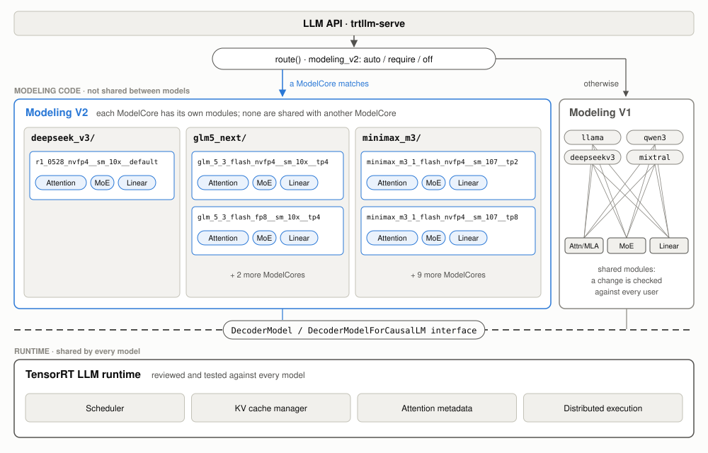
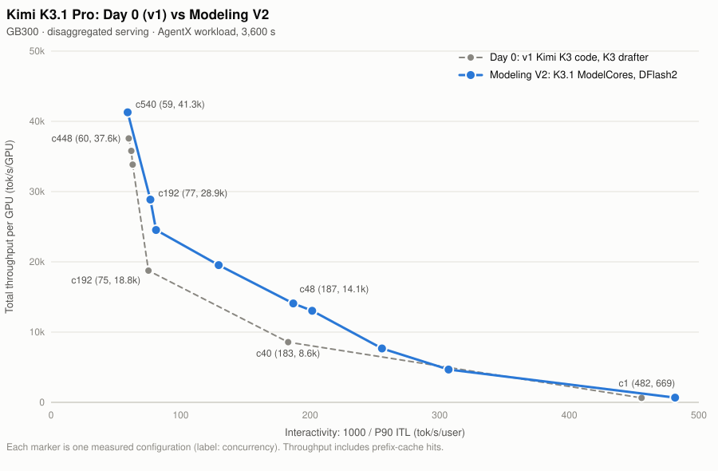
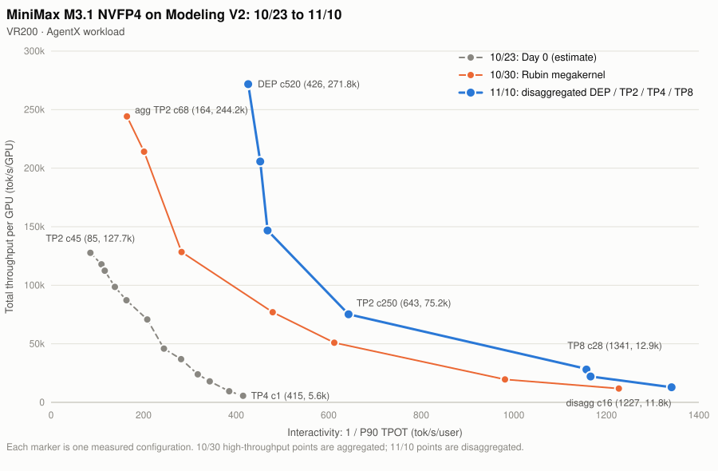
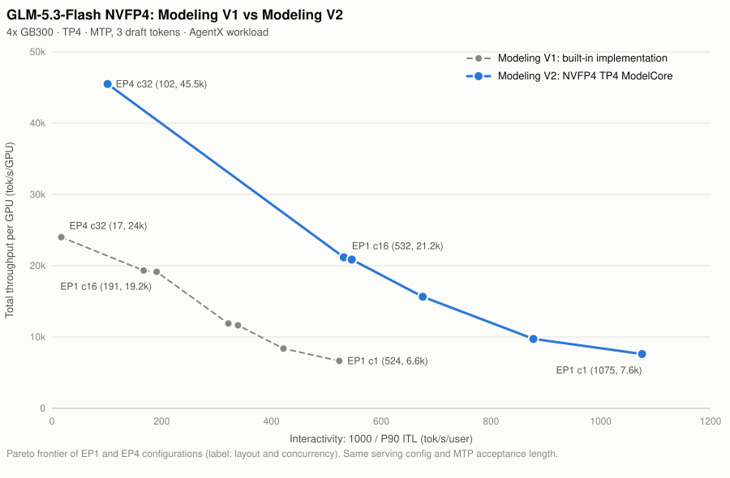

<!--
SPDX-FileCopyrightText: Copyright (c) 2026 NVIDIA CORPORATION & AFFILIATES. All rights reserved.
SPDX-License-Identifier: Apache-2.0
-->

# Modeling V2: Exploring a Refactor of Modeling Code for the Agent Era

By NVIDIA TensorRT LLM team

## Table of Contents
- [Modeling V2: Exploring a Refactor of Modeling Code for the Agent Era](#modeling-v2-exploring-a-refactor-of-modeling-code-for-the-agent-era)
  - [Table of Contents](#table-of-contents)
  - [Introduction](#introduction)
  - [Motivation](#motivation)
    - [How models are built in TensorRT LLM today](#how-models-are-built-in-tensorrt-llm-today)
    - [The problem: shared modules slow down iteration](#the-problem-shared-modules-slow-down-iteration)
    - [Why this matters more in the age of agents](#why-this-matters-more-in-the-age-of-agents)
    - [Rethinking code reuse](#rethinking-code-reuse)
  - [Design](#design)
    - [Architecture: isolate the modeling, share the runtime](#architecture-isolate-the-modeling-share-the-runtime)
    - [Routing: two levels](#routing-two-levels)
    - [Core abstractions: a thin contract](#core-abstractions-a-thin-contract)
    - [Code organization](#code-organization)
    - [Keeping redundancy under control](#keeping-redundancy-under-control)
    - [Designed for agents](#designed-for-agents)
  - [Case Study](#case-study)
    - [Overview](#overview)
    - [Kimi K3.1: moving a heavily optimized model to Modeling V2](#kimi-k31-moving-a-heavily-optimized-model-to-modeling-v2)
    - [MiniMax M3.1: built on Modeling V2 from the start](#minimax-m31-built-on-modeling-v2-from-the-start)
    - [GLM-5.3-Flash: porting optimizations from outside TensorRT LLM](#glm-53-flash-porting-optimizations-from-outside-tensorrt-llm)
  - [Future Work](#future-work)
    - [Keep the architecture lean](#keep-the-architecture-lean)
    - [Runtime specialization](#runtime-specialization)
    - [Specialized agent harnesses](#specialized-agent-harnesses)

## Introduction

Coding agents have changed how model code is written in TensorRT LLM. An engineer working with an agent can now implement and tune model-specific optimizations in days instead of weeks. The way we organize model code, however, was designed for a time when writing code was the expensive part.

Modeling V2 ([`tensorrt_llm/_torch/modeling_v2/`](https://github.com/NVIDIA/TensorRT-LLM/blob/main/tensorrt_llm/_torch/modeling_v2/README.md)) is our exploration of how model code should be organized when agents write most of it. This post explains why we started it, how it is designed, what it has delivered on three models, and where it goes next.

**Modeling V2 is now the default workflow for supporting new models in TensorRT LLM.** A new model is brought up as a Modeling V2 family. Modeling V1 keeps serving the models it already supports, and nothing changes for their users.

## Motivation

### How models are built in TensorRT LLM today

In the PyTorch backend of TensorRT LLM, each model is assembled from a shared library of building blocks. A model file such as `modeling_llama.py` or `modeling_deepseekv3.py` mostly defines how the layers are wired together. The heavy lifting is done by common modules:

- `Attention` and `MLA`, on top of a family of attention backends;
- the fused MoE module, with its many backends, communication strategies and quantization paths;
- `Linear`, `RMSNorm`, `GatedMLP`, and so on.

This design has served us well. An optimization made to one of these modules, such as a faster attention kernel, a new quantization recipe or a better MoE communication scheme, benefits every model that uses it. Adding a new model is often a matter of putting existing pieces together. Today, dozens of models depend on the shared attention and MoE modules.

### The problem: shared modules slow down iteration

The same sharing that made the codebase efficient to build has made it slow to change.

Performance work on an LLM inference engine is increasingly **model-specific and scenario-specific**: a fused kernel that only pays off for one model's head dimension, a scheduling trick for one MoE topology, a low-latency path for one deployment setting. When this kind of optimization is made for model A, it usually has to be made inside a shared module, because that is where the attention or MoE logic lives. At that moment, the change is no longer about model A. Models B, C and D run the same code, and two costs follow:

- **Code review becomes expensive.** A reviewer cannot just check whether the change is right for model A. They have to reason about every other model, configuration and backend that goes through the same code path. Shared modules also slowly fill up with model-specific branches and flags, which makes each later review harder.
- **CI becomes expensive.** Since the change can affect any model that uses the module, it has to be checked with end-to-end tests across all of those models. That costs a lot of GPU time, makes turnaround slow, and exposes the change to unrelated flaky failures.

In other words, the cost of verifying a change grows with the number of models that share the code it touches, not with the size of the change itself.

### Why this matters more in the age of agents

AI coding agents have sharply reduced the cost of *writing* code. An engineer working with an agent can explore and implement model-specific optimizations far faster than before, and the number of such changes is growing quickly. But the cost of *verifying* code has not dropped in the same way. Every change still needs a careful human review and a CI run whose size depends on how many models are affected. As a result, review and CI, rather than implementation, have become the bottleneck of the project.

### Rethinking code reuse

This leads us to revisit a principle we long took for granted: **maximize code reuse**.

Reuse is valuable because it assumes that writing code is expensive, and that keeping several copies of similar logic in sync is even more expensive. Under that assumption, the coupling that reuse brings is a price worth paying. With agents, the assumption no longer holds in the same way. Writing code, and even updating several similar copies, is cheap. What remains expensive is understanding and verifying the impact of a change, and the coupling that reuse brings now directly increases that cost.

So in Modeling V2 we make a deliberate trade-off: **we accept some code redundancy in exchange for stronger isolation between models.** When a model owns its own implementation, a change to it only needs to be reviewed and tested against that model. Redundancy is not free: fixes have to be propagated, and copies can drift apart. In the Design section, we describe how Modeling V2 keeps these costs under control.

## Design

### Architecture: isolate the modeling, share the runtime

Modeling V2 draws a clear line through the stack.

<div align="center">
<figure>
  
</figure>
</div>
<p align="center"><sub><em>Figure 1: The Modeling V2 architecture. Modeling code sits above the line. In Modeling V2, each ModelCore has its own attention, MoE and linear modules and shares none of them with another ModelCore. Modeling V1 models, in contrast, share these modules. Below the line, every model uses the same TensorRT LLM runtime through the <code>DecoderModel</code> / <code>DecoderModelForCausalLM</code> interface.</em></sub></p>

**Above the line is modeling code, which is not shared between models.** Each model family lives in its own directory, `models/<family>/`. Inside it, each *ModelCore* lives in its own subdirectory, `models/<family>/<model_core>/`. A ModelCore is one complete model implementation for a specific checkpoint, GPU architecture and parallel layout, for example `r1_0528_nvfp4__sm_10x__default`. A ModelCore should not import, subclass or call Modeling V1 model code: the model classes in `_torch/models/`, the layers in `_torch/modules/`, or the shared attention and fused MoE modules. It also should not import code from its sibling ModelCores. Each ModelCore spells out its own forward pass, its own weight loading and its own model-specific kernels.

**Below the line is the runtime, which stays shared.** Modeling V2 is not a separate inference engine. Every ModelCore plugs into TensorRT LLM through the existing `DecoderModel` / `DecoderModelForCausalLM` interfaces. It uses the same scheduler, KV cache manager, attention metadata, distributed execution, sampling, speculative decoding infrastructure and serving stack as every other model. Users keep using the LLM API and `trtllm-serve` unchanged.

We drew the line here because the two layers change at very different rates. The runtime is general-purpose infrastructure, and a change to it should be reviewed and tested against every model. That is the right cost to pay for code that is meant to be shared. Modeling code is where model-specific and scenario-specific optimization happens, and where the rate of change is highest. By isolating it, an optimization for one model no longer needs to be verified against every other model.

Modeling V2 runs side by side with Modeling V1. A deployment uses a Modeling V2 ModelCore only if one matches it; everything else keeps running on Modeling V1.

### Routing: two levels

In Modeling V2, a single model can have several implementations. Routing decides which one runs, at two levels:

| Level | When | Decides on | Selects |
|---|---|---|---|
| **Level 1: `route`** | Once, at model load | Model architecture, checkpoint, GPU, parallel layout, LLM arguments | A **ModelCore** |
| **Level 2: the ModelCore** | Every step, at runtime | Host-side values of the step, such as prefill vs. decode or the number of tokens | A **Target** |

Modeling V2 does not fix the factors used at either level. Each model family defines its own routing policy.

#### Level 1: from architecture and checkpoint to a ModelCore

Each family provides a `route` function, registered for the Hugging Face architectures it handles. `route` runs once, when the model is loaded, and can use anything known at that point: the checkpoint config, the LLM arguments and the GPU's compute capability. It returns a ModelCore class, or raises `NoTarget` explaining why none fits. A simplified example:

```python
@routes("GlmMoeDsaForCausalLM")
def route(model_config, llm_args, compute_capability):
    if compute_capability == (10, 7) and is_glm_5_2(model_config):
        if is_low_latency_deployment(model_config, llm_args):
            return Glm52Sm107LowLatency
        if is_high_throughput_deployment(model_config, llm_args):
            return Glm52Sm107HighThroughput
    ...
    raise NoTarget("no GLM-5.2 ModelCore for this deployment")
```

Common routing factors include the GPU architecture, the checkpoint and its quantization format, the parallel layout, the speculative decoding method and the serving configuration. For example, GLM-5.2 on SM107 has two ModelCores for the same checkpoint: one optimized for low latency and one optimized for high throughput. Each can make its own choices of parallel layout, KV cache format and kernels without affecting the other.

If no ModelCore fits, the `modeling_v2` option decides what happens: under `auto` (the default), the deployment falls back to Modeling V1; under `require`, it fails with the `NoTarget` message.

#### Level 2: from a runtime step to a Target

Some conditions are only known at runtime and change from step to step. On each step, the ModelCore reads host-side values from the step's attention metadata and dispatches to a *Target*, implemented as classes such as `PrefillTarget` and `DecodeTarget`. A typical split is one Target for pure decode steps and a general Target for everything else. These values are fixed for a CUDA graph capture, so each Target can be captured as its own graph.

#### Which level decides what

The two levels follow from one rule: **a ModelCore owns the model's weights in one format, and all of its Targets run on the same weights.** A factor that changes how weights are sharded, packed or quantized has to be decided at load time, so it selects a ModelCore. A factor that only changes the computation on the same weights is decided per step, and selects a Target.

### Core abstractions: a thin contract

The abstractions in Modeling V2 have to serve two goals that pull in opposite directions. First, we do not want to limit how modeling code is written. The optimizations that pay off most, such as fusing across layers or running speculative decoding inside the forward pass, are exactly the ones a rigid structure would rule out. Second, the code still needs clear boundaries between its parts. Without them, a growing body of model-specific code, much of it written quickly by agents, would soon become hard to read, review and maintain. Our answer is a thin contract layer. It defines what each part is responsible for and how the parts connect, and says nothing about how each part is implemented inside.

Modeling V2 defines only a few abstractions, nested as family → ModelCore → Target:

- **Family**: one model architecture, usually one Hugging Face `architectures` value. It owns the `route` function and the code its ModelCores share.
- **ModelCore**: the class that holds all of the model's weights in one format, the state derived from them, such as dimensions and communication groups, and its Targets. On each step, it picks a Target.
- **Target**: a modeling class that calls ops to run the forward pass for one kind of step, on the ModelCore's weights. `PrefillTarget` and `DecodeTarget` are typical examples.
- **Weights**: a ModelCore's `weights.py` describes how checkpoint tensors map to its weight format, including mapping, transformation and sharding. This keeps loading logic out of the forward pass.
- **`OpWrapper`**: a thin, stateless wrapper around one kernel call, whose contract can be executed:

| Member | Purpose |
|---|---|
| `__call__` | Calls the kernel. Every argument is passed explicitly. |
| `reference` | The expected result, computed in plain PyTorch. |
| `is_valid` | Rejects inputs the kernel accepts but computes incorrectly. |
| `CELLS` | The input configurations the op is certified on. |
| `ARCHS` | The GPU architectures those configurations were tested on. |

Each op's tests check `__call__` against `reference` on every cell. If an upstream kernel change breaks a claim the op makes, the build fails, rather than leaving an outdated comment.

ModelCore and Target are concepts, not classes. The code has no `ModelCore` or `Target` base class, because a base class would fix how a ModelCore stores its weights or how a Target runs its forward, and that is exactly what we want to leave open. Every Modeling V2 model still has both levels, and they are easy to find in its code. Here is a shortened excerpt from the GLM-5.3-Flash FP8 TP4 ModelCore:

```python
class PrefillTarget:  # a Target: runs a step that has context requests
    def __init__(self, core):
        self.core = core  # reads the weights through the ModelCore; holds none

    def forward(self, step, input_ids, attn_metadata):
        ...  # calls ops layer by layer on self.core's weights


class Glm53FlashFp8Sm10xTp4Core(DecoderModel):  # the ModelCore
    def post_load_weights(self):
        ...  # builds the layers on this rank's weights
        self._prefill = PrefillTarget(self)
        self._decode = DecodeTarget(self)

    def forward(self, attn_metadata, input_ids=None, **kwargs):
        target = self._decode if attn_metadata.num_contexts == 0 else self._prefill
        return target.forward(StepSchedule.build(attn_metadata), input_ids, attn_metadata)
```

`Glm53FlashFp8Sm10xTp4Core` holds the weights and the two Targets, and picks one Target per step. `PrefillTarget` and `DecodeTarget` are plain Python classes that call ops one after another. The class that `route` returns, `ModelingV2Glm53FlashFp8Sm10xTp4`, is a `DecoderModelForCausalLM` that wraps the ModelCore in the shape the runtime expects.

The guiding principle is to **provide the thinnest contract that keeps semantics consistent, and nothing more.** Most Modeling V2 code is written by coding agents. The abstractions make sure that every op states what it computes and where it has been verified, that every ModelCore's weights are well defined, and that every ModelCore plugs into the runtime the same way. Beyond that, we deliberately do not constrain how the code is written. A thick framework of base layers and plug-in points would bring back the coupling we set out to remove, and would limit the optimizations an agent can explore.

### Code organization

Code lives at one of three scopes:

| Scope | What goes there | Location |
|---|---|---|
| ModelCore | Code only this ModelCore uses | `models/<family>/<model_core>/` |
| Family | Code shared by ModelCores of one family | `models/<family>/` |
| Catalog | Ops used by more than one family | `catalog/<category>/` |

Each piece of code lives at the smallest scope that covers all of its users. An op starts in the ModelCore that needs it. It moves up to the family when a second ModelCore needs it, and into the catalog only when another family needs it. Code should not be imported sideways from a sibling ModelCore.

Tests mirror this structure, and CI uses the mirror to select tests:

- a change inside a ModelCore runs that ModelCore's tests;
- a change to family code runs the tests of that family's ModelCores that use it;
- a change to a catalog op runs the tests of every ModelCore that uses it.

The cost of verifying a change matches its real scope.

### Keeping redundancy under control

Accepting redundancy does not mean ignoring its costs. Modeling V2 limits them in several ways:

- **Promotion instead of copying**: when code is needed in more than one place, it moves up to the family or the catalog. It is not copied between sibling ModelCores.
- **Executable contracts**: ops in the catalog carry their own `reference` and `CELLS`, so a shared kernel cannot silently drift away from what its users rely on.
- **Clear ownership**: each family and ModelCore has owners in `CODEOWNERS`, who maintain it and decide when duplicated code should be merged.
- **Shared fixes stay shared**: a fix that clearly helps every user of shared code still goes into the shared code. Isolation is for model-specific optimizations, not an excuse to fork bug fixes.
- **Cheap porting**: when a fix applies to several similar ModelCores, coding agents make porting it inexpensive. Each port is still tested in every ModelCore it touches.

### Designed for agents

We expect coding agents to write most of Modeling V2, so we shaped the code to suit them. The most visible choice is to **keep the code flat**. In Modeling V1, a forward pass goes through several layers of modules: a decoder layer calls an attention module, which calls an attention backend, which calls a kernel wrapper. Each layer has its own configuration and branches. In Modeling V2, a Target's forward pass is a readable sequence of op calls with every argument passed explicitly:

```python
x = flashinfer_rmsnorm(h, self._norm0, eps)
for L in self._layers:
    qkv = cublas_mm(x, L.qkv, L.qkv_bias)
    qkv = fused_qk_norm_rope(qkv, num_heads_q=d.heads_q, ...)
    ...
```

This helps agents in three ways:

- **Discovery**: the whole computation is visible in one place, so an agent can spot optimization opportunities across what used to be module boundaries.
- **Local change**: an optimization is a local edit to one ModelCore. It does not need a new hook in a shared module.
- **Self-verification**: every op has a `reference` and certified `CELLS`, so an agent can check its work op by op before running whole-model accuracy tests.

## Case Study

### Overview

Modeling V2 now serves 8 model families through 36 ModelCores, across Blackwell, Blackwell Ultra and Rubin GPUs. **Every new model now starts on Modeling V2 by default**, so this number will keep growing.

The way models split into ModelCores shows what Modeling V2 enables. In [disaggregated serving](blog05_Disaggregated_Serving_in_TensorRT-LLM.md), the same model runs in very different roles, and each role is limited by something different:

- **Context servers** process long prompts in large batches. Their cost is GEMM throughput and attention over long sequences, so their ModelCores favor few ranks per instance and compute-efficient kernels. Kimi K3's context ModelCore on Rubin runs on a single GPU and uses [DWDP](blog19_DWDP_Distributed_Weight_Data_Parallelism_for_High_Performance_LLM_Inference_on_NVL72.md) to fetch the expert weights it does not hold. MiniMax M3.1 has two context ModelCores: TP2, and attention data parallelism.
- **Low-latency generation servers** decode a handful of requests per step. Their time goes to reading weights, waiting on small all-reduces and launching kernels. Their ModelCores use tensor or context parallelism to spread the weight reads, and fuse aggressively across operator and layer boundaries.
  - GLM-5.2's low-latency ModelCore on Rubin uses pure tensor parallelism with an FP8 KV cache and [MTP](blog02_DeepSeek_R1_MTP_Implementation_and_Optimization.md).
  - Kimi K3's low-latency ModelCores use [Helix context parallelism](blog22_Helix_Parallelism_Scaling_Multi_Million_Token_Decoding_with_KV_Cache_Sharding.md) over eight GPUs.
  - MiniMax M3.1 has separate TP2, TP4 and TP8 ModelCores, and each carries its own decode megakernels.
- **High-throughput generation servers** run hundreds of requests per step. There, MoE throughput and KV cache capacity dominate. Their ModelCores use attention data parallelism with [expert parallelism](blog04_Scaling_Expert_Parallelism_in_TensorRT-LLM.md), and MegaMoE, which exchanges tokens in a single cross-rank round trip on the critical path. GLM-5.2's high-throughput ModelCore also moves the KV cache to [NVFP4](blog33_NVFP4_MLA_Unified_4bit_KV_Cache_Storage_and_Attention_Compute_in_TensorRT-LLM.md) to fit more requests.

In a shared module, each of these needs would be a branch inside the same attention or MoE code, and every optimization for one role would be checked against all the others. In Modeling V2, each role is its own ModelCore. Routing picks one from the deployment's parallel layout and server role, and an optimization for one role cannot slow down another.

Beyond common techniques such as CUDA graphs and multiple CUDA streams, these ModelCores already contain many complex optimizations. This supports the claim we made earlier: breaking the boundaries between modules pays off. The optimizations fall into a few groups:

- communication fused with compute, such as all-reduce with residual and RMSNorm, and GEMMs that write their output straight into the all-reduce buffer;
- large fusions, from a whole routed MoE in one launch to per-layer megakernels;
- fast Targets chosen per step by batch size;
- hardware-specific tuning, such as Rubin die locality and weight prefetch under PDL;
- quantization hand-offs between kernels;
- speculative decoding run inside the model's own forward.

Most of these cross the boundaries that Modeling V1 draws between attention, MoE, communication and speculative decoding.

We describe three models below. Each one reached Modeling V2 in a different way.

### Kimi K3.1: moving a heavily optimized model to Modeling V2

Kimi K3 was optimized in Modeling V1 for months. Its Modeling V1 implementation includes:

- fused MoE front-end kernels;
- an attention-residual kernel with PDL;
- Rubin-specific GEMM and MoE paths;
- Helix context parallelism;
- DWDP for context servers;
- an NVFP4 KV cache.

Kimi K3.1 has the same backbone as K3. It adds a [DeepSeek sparse-attention](blog15_Optimizing_DeepSeek_V32_on_NVIDIA_Blackwell_GPUs.md) indexer on every MLA layer and ships its own DFlash2 drafter. On day 0, we served K3.1 with the Modeling V1 K3 implementation and the K3 drafter.

An agent then moved the model to Modeling V2 in three days. We consider this a short time for a model this heavily optimized, and it matches what we expected from Modeling V2. In Modeling V2, an optimization is code inside a ModelCore directory, not a change spread across shared modules. Moving the model therefore meant carrying those optimizations into the new family, with no review of shared modules and no change to the Modeling V1 code that other models depend on. On top of this, the agent added the DSA indexer and DFlash2.

Figure 2 shows the result on GB300. At about 185 tok/s/user, throughput per GPU rose from 8.6k to 14.1k tokens/s (+64%). At about 76 tok/s/user, it rose from 18.8k to 28.9k (+54%), with one third fewer GPUs. K3.1 has no Modeling V1 implementation: all of its work lives in Modeling V2.

<div align="center">
<figure>
  
</figure>
</div>
<p align="center"><sub><em>Figure 2: Kimi K3.1 Pro on GB300 with disaggregated serving. The Day 0 line runs K3.1 on the Modeling V1 Kimi K3 implementation with the K3 drafter. The Modeling V2 line runs the K3.1 ModelCores with the DFlash2 drafter. Each marker is one measured configuration, labeled by concurrency.</em></sub></p>

### MiniMax M3.1: built on Modeling V2 from the start

MiniMax M3.1 was optimized on Modeling V2 from its first day. Its ModelCores split by deployment: TP2, TP4 and TP8 low-latency generation, disaggregated context servers, and a high-throughput DEP server. Each ModelCore changes only its own directory, so each change needs only that ModelCore's tests and that ModelCore's owners. This lets the team land optimizations as fast as the agents produce them.

Figure 3 shows how fast the Pareto frontier moved on VR200. In one week, from 10/23 to 10/30, peak interactivity rose from 415 to 1,227 tok/s/user. By 11/10, it reached 1,341 tok/s/user (3.2×), and peak throughput reached 271.8k tokens/s per GPU (2.1×). Part of the 11/10 gain comes from disaggregated serving, not only from the modeling code.

<div align="center">
<figure>
  
</figure>
</div>
<p align="center"><sub><em>Figure 3: MiniMax M3.1 NVFP4 on VR200. The 10/23 line is an estimate of the day-0 performance. The 10/30 line adds the Rubin megakernels, with aggregated serving at the high-throughput points. The 11/10 line uses disaggregated serving with DEP, TP2, TP4 and TP8 generation servers.</em></sub></p>

The step from 10/23 to 10/30 came mostly from megakernels: fusions across operator and layer boundaries that a shared module could not reasonably host. One decode stage, for example, runs in a single kernel:

- the routed-MoE finalize;
- the shared-expert add;
- a one-shot Lamport all-reduce with residual and RMSNorm;
- the MXFP8 quantization of the next layer's QKV input.

It saves 5.6–6.5 µs per layer, and its output is bitwise identical to the kernels it replaces. In Modeling V1, a kernel like this would have to cut through the shared MoE, all-reduce and attention modules. In Modeling V2, it is one more op in the ModelCore. It declares the row range it covers, outside which the step falls back to the generic kernels. It has a reference implementation to test against, and an environment switch turns it off.

### GLM-5.3-Flash: porting optimizations from outside TensorRT LLM

GLM-5.3-Flash already had a Modeling V1 implementation. We wanted to know how fast coding agents could make it if no framework stood in their way. So we had them write a standalone inference engine for the model from scratch, outside TensorRT LLM. There, the agents were free to change anything, from the kernels to the step loop, and the engine reached strong performance.

We then ported the optimizations that the standalone engine found back into TensorRT LLM as Modeling V2 ModelCores. The port went smoothly, and the ModelCores match the standalone engine's performance. A ModelCore is a flat, self-contained implementation with a thin contract to the runtime. The port therefore moved kernels and step logic largely as they were, instead of redesigning them around shared modules.

The deepest change is speculative decoding. In the GLM-5.3-Flash ModelCores, MTP runs inside the model's own forward:

- the verify logits;
- the acceptance of the previous drafts;
- the commit of the recurrent KDA state;
- the next draft chain.

No separate speculative worker runs after the forward. The engine keeps only what lies outside it: input packing, the sampler and the KV rewind. The whole step therefore runs in one CUDA graph, and the draft and verify kernels are tuned together with the rest of the model. On the NVFP4 TP4 ModelCore, the entire decode step is launched by one native C++ step program.

Figure 4 compares the Modeling V2 ModelCores with the Modeling V1 implementation as it stood before the standalone engine work began. Both run on four GB300 GPUs with TP4 and MTP with three draft tokens, on the same workload. Both fix the MTP acceptance length to the same value, so the comparison measures the cost of a step, not the quality of the drafts. At concurrency 1, interactivity rises from 465 to 1,075 tok/s/user (2.3×). At concurrency 16, it rises from 129 to 532 tok/s/user (4.1×). At concurrency 32, throughput per GPU rises from 31.0k to 45.5k tokens/s (1.5×).

<div align="center">
<figure>
  
</figure>
</div>
<p align="center"><sub><em>Figure 4: GLM-5.3-Flash NVFP4 on four GB300 GPUs with TP4 and MTP (three draft tokens). The Modeling V1 line is the built-in implementation before the standalone engine work began; the Modeling V2 line runs the NVFP4 TP4 ModelCore. Each line is the Pareto frontier of the layouts measured for it, labeled by layout and concurrency.</em></sub></p>

## Future Work

**Since Modeling V2 is now the default workflow for new models**, the directions below matter for every model we add. Some of this work is already under way, and parts of it have produced early results.

### Keep the architecture lean

Modeling V2 trades shared code for isolation. To keep that trade worth it, we will keep refining the architecture:

- **Clearer boundaries for each ModelCore and Target.** A ModelCore should state precisely which deployments it serves: checkpoint format, hardware, parallel layout and server role. A Target should state precisely which steps it serves. Each should refuse everything else, so that its scope is obvious to the people and agents who route to it, review it and maintain it.
- **Clearer ranges where each Target and op leads.** Each Target and each op should state the problem sizes where it delivers state-of-the-art performance: batch sizes, token counts, sequence lengths. Outside those ranges, the generic path is just as good. This tells us which specialized code earns its cost and where new work should go.
- **A retirement mechanism.** A Target, op or ModelCore that no longer leads anywhere, or a model that is no longer served, should be removed, not kept forever. Retirement keeps the total code size under control, so the redundancy we accept stays bounded.

### Runtime specialization

Modeling V2 isolates the modeling code but shares the runtime. While onboarding and optimizing new models, we found that some optimizations still require changes to runtime code. Such a change brings back the problem described in the Motivation: every model shares the runtime, so the change must be reviewed against all of them and tested on all of them.

We will gradually decouple the model-specific parts of the runtime more thoroughly, and let each model customize them:

- the KV cache manager's memory layout;
- the KV cache transfer strategy between context and generation servers in disaggregated serving;
- the host-to-device copies before and after the model forward, including which copies to merge and which to skip.

The shared runtime will keep the services that every model depends on, such as scheduling, memory management and serving. Each model will declare its own policy on top of them, instead of adding branches to shared code.

### Specialized agent harnesses

General-purpose agent harnesses keep getting more capable, and most Modeling V2 work today uses them directly. We will still explore whether a harness specialized for one kind of task can finish it more efficiently. A specialized harness carries domain knowledge as fixed steps, tools and checks, instead of rediscovering it in every session. Today we use one in the model onboarding stage. Next, we will try specialized harnesses in more stages of the workflow, such as performance optimization and porting code between ModelCores.
