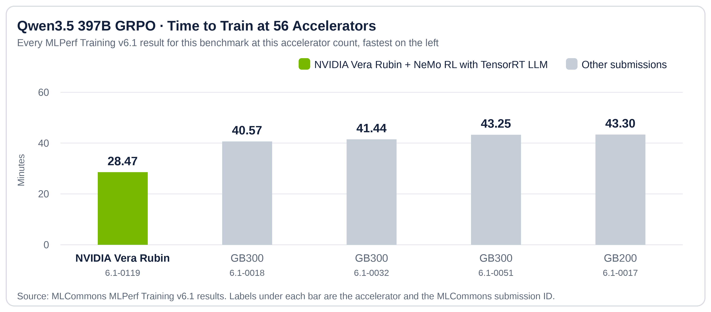
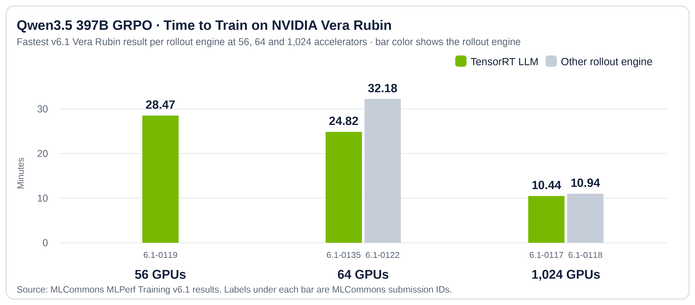
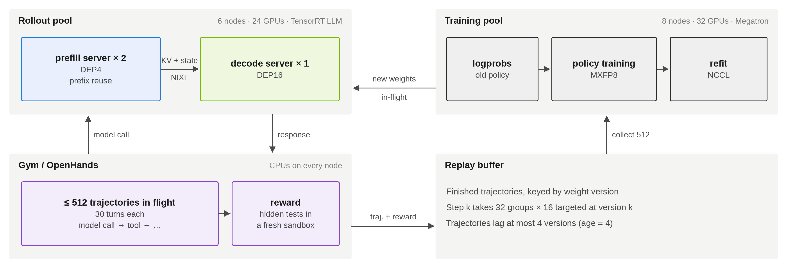
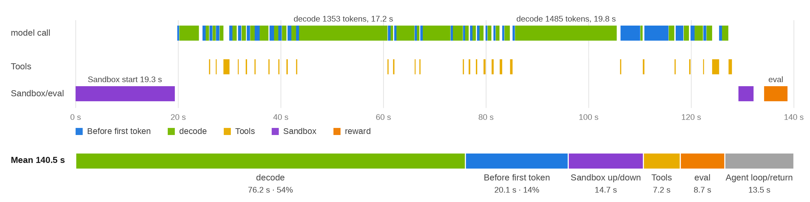
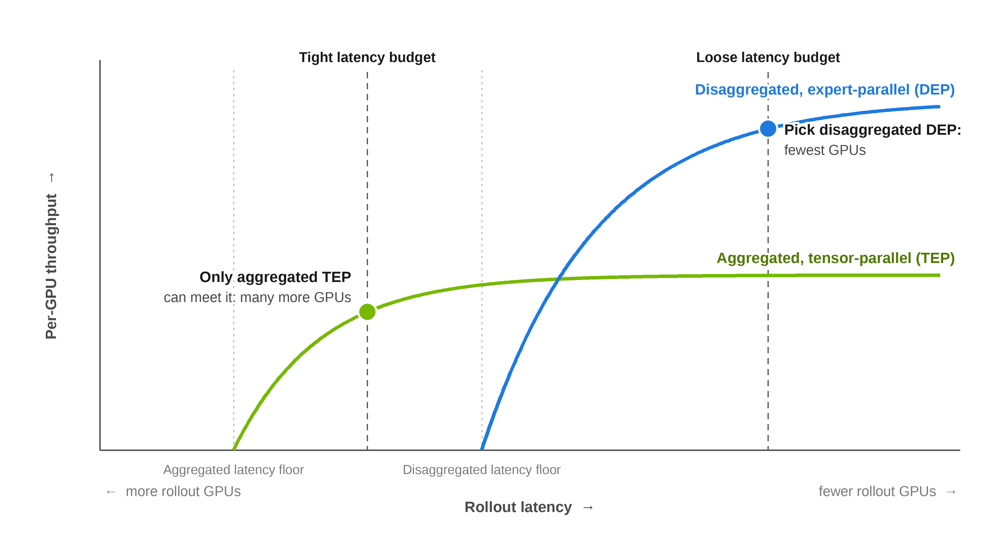
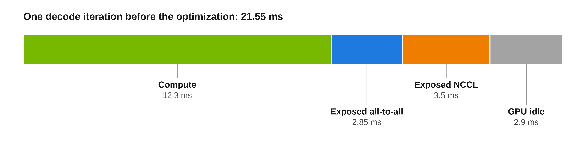
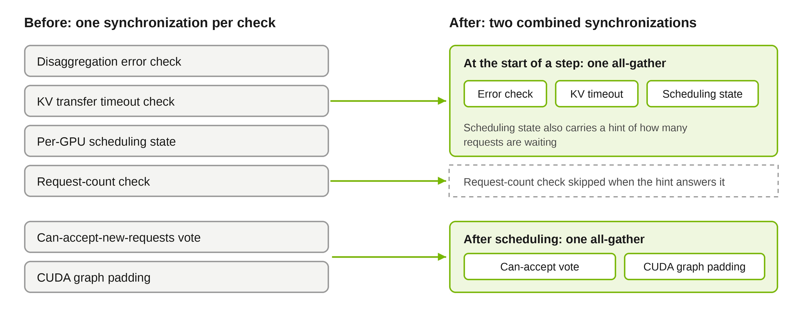
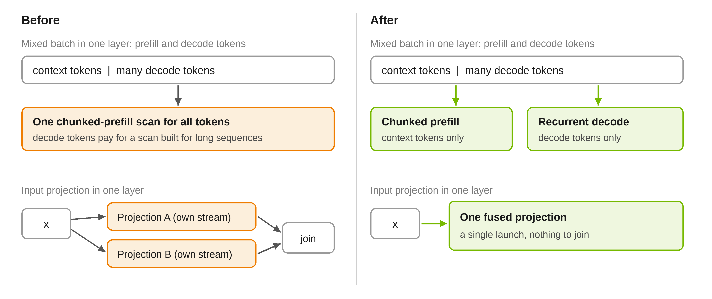

<!--
SPDX-FileCopyrightText: Copyright (c) 2026 NVIDIA CORPORATION & AFFILIATES. All rights reserved.
SPDX-License-Identifier: Apache-2.0
-->

# TensorRT LLM for Reinforcement Learning: Powering the Fastest MLPerf Training v6.1 Qwen3.5 397B GRPO Result on NVIDIA Vera Rubin

By NVIDIA TensorRT LLM team

**Table of Contents**
- [Introduction](#introduction)
- [MLPerf Training v6.1 results](#mlperf-training-v61-results)
- [Inference in RL: A Different Optimization Problem](#inference-in-rl-a-different-optimization-problem)
  - [Rollout in One Training Step](#rollout-in-one-training-step)
  - [RL Rollout vs. Online Serving](#rl-rollout-vs-online-serving)
  - [Decode Latency Dominates Rollout Time](#decode-latency-dominates-rollout-time)
- [Deriving the Recipe from a Latency Budget](#deriving-the-recipe-from-a-latency-budget)
  - [Step 1: Derive the Latency Budget from the Trainer](#step-1-derive-the-latency-budget-from-the-trainer)
  - [Step 2: Plot Curves for Candidate Deployments](#step-2-plot-curves-for-candidate-deployments)
  - [Step 3: Size the Prefill Servers and Balance](#step-3-size-the-prefill-servers-and-balance)
- [Optimizations](#optimizations)
  - [Reducing Host Synchronization in Attention Data Parallelism (for 56 and 64 GPUs)](#reducing-host-synchronization-in-attention-data-parallelism-for-56-and-64-gpus)
  - [Fixing the Host-Bound TEP Path (for 1,024 GPUs)](#fixing-the-host-bound-tep-path-for-1024-gpus)
  - [Faster GDN Decode and Prefill (for 1,024 GPUs)](#faster-gdn-decode-and-prefill-for-1024-gpus)
  - [Shard-to-Shard Weight Refit in NeMo RL (for All Scales)](#shard-to-shard-weight-refit-in-nemo-rl-for-all-scales)
- [How to Reproduce](#how-to-reproduce)
- [Future Work](#future-work)
- [Acknowledgements](#acknowledgements)
- [References](#references)

## Introduction

TensorRT LLM has all the essential capabilities to serve as the rollout engine in reinforcement learning (RL) training, including in-flight weight updates, pause and resume of generation, and APIs for asynchronous training. These capabilities are built on an opt-in [Ray orchestrator](https://nvidia.github.io/TensorRT-LLM/features/ray-orchestrator.html), as many modern RL frameworks favor the flexibility of Ray for placing different types of workers. TensorRT LLM is officially integrated with [NVIDIA NeMo RL](https://github.com/NVIDIA-NeMo/RL), and its worker extension and collective RPC interfaces make it straightforward to integrate with other custom RL frameworks. In this blog, we showcase our latest MLPerf Training v6.1 result on the RL track and take a deep dive into how we achieved the fastest time to train at 56, 64 and 1,024 GPUs.

## MLPerf Training v6.1 results

In MLPerf Training v6.1, MLCommons added a new benchmark: Qwen3.5-397B GRPO, a large-scale LLM post-training workload, a stage central to recent progress in agentic AI. In this benchmark, [Qwen3.5-397B-A17B](https://huggingface.co/Qwen/Qwen3.5-397B-A17B), an MoE model with 17B active parameters per token that combines Gated DeltaNet linear-attention layers with full-attention layers, is trained with Group Relative Policy Optimization (GRPO) to solve software engineering tasks. The score of this benchmark is the time to train for about 10 steps to reach a target accuracy, excluding validation time.

In large-scale RL training, rollout is often the bottleneck: the throughput of the rollout engine sets the pace for the end-to-end time to train. At the same scale of 56 accelerators, **RL post-training on NVIDIA Vera Rubin with NeMo RL and TensorRT LLM achieves the fastest time to train at 28.47 minutes** ([our submission](https://results.mlcommons.org/training#view=submission&benchmark=qwen35_397b_grpo&rid=6.1-0119%3Aqwen35_397b_grpo), Figure 1), compared to submissions on NVIDIA GB300 and GB200 GPUs.

<figure>
  
</figure>

<em>Figure 1: Time to train at the same scale of 56 accelerators in the Qwen3.5 397B GRPO benchmark. RL post-training on NVIDIA Vera Rubin with NeMo RL and TensorRT LLM (in green) achieves the fastest time to train at 28.47 minutes. Source: <a href="https://results.mlcommons.org/training#benchmark=qwen35_397b_grpo&amp;round=v6.1">MLCommons MLPerf Training v6.1 results</a> (<a href="https://results.mlcommons.org/training#view=submission&amp;benchmark=qwen35_397b_grpo&amp;rid=6.1-0119%3Aqwen35_397b_grpo">submission details</a>).1</em>

On NVIDIA Vera Rubin, **submissions that use TensorRT LLM as the rollout engine train the fastest at 56, 64 and 1,024 GPUs**. For example, a Nebius submission ([6.1-0135](https://results.mlcommons.org/training#view=submission&benchmark=qwen35_397b_grpo&rid=6.1-0135%3Aqwen35_397b_grpo)) using NeMo RL and TensorRT LLM reached 24.82 minutes at 64 GPUs (Figure 2).

<figure>
  
</figure>

<em>Figure 2: Time to train on NVIDIA Vera Rubin GPUs with different rollout engines in the Qwen3.5 397B GRPO benchmark, grouped by accelerator count (56, 64 and 1,024 GPUs), showing the fastest result for each rollout engine. See all submission results for the GRPO track in the <a href="https://results.mlcommons.org/training#benchmark=qwen35_397b_grpo&amp;round=v6.1">MLPerf Training v6.1 results</a>.1</em>

## Inference in RL: A Different Optimization Problem

### Rollout in One Training Step

In RL, a rollout is one attempt by the model to solve a task in an environment, and generating rollouts is the inference part of RL training. Figure 3 shows how it fits into one training step. [NeMo Gym](https://github.com/NVIDIA-NeMo/gym) runs an agent on each software engineering problem: the agent makes model calls to the inference engine and runs tools in a sandbox, then Gym scores the result with hidden tests to compute the reward. The trainer pulls finished trajectories from a replay buffer while rollout keeps generating, and a weight refit updates the rollout engine in flight at every step.

<figure>
  
</figure>

<em>Figure 3: One training step in the 56-GPU recipe. Training pulls trajectories from the replay buffer while rollout keeps generating in the background, and a weight refit connects the two at every step.</em>

The rest of the performance numbers in this blog, such as the percentage gains, timings and rollout breakdowns, are NVIDIA internal measurements.

### RL Rollout vs. Online Serving

In our submissions, the global batch is 512 trajectories per training step, and the trainer starts a step only once all 512 have been collected. The rollout engine therefore has to match the trainer's pace: generating faster gains nothing, because generation just waits ahead of training, while generating slower starves the trainer. The goal is to use the fewest GPUs that keep the trainer fed, running each GPU at the highest throughput that still lets rollouts finish within a latency budget set by the trainer's step time. These constraints make optimizing RL rollout different from conventional inference optimization for online serving.

| | Online serving | RL rollout (this GRPO benchmark) |
| --- | --- | --- |
| **Goal** | Tokens per second under a latency SLA (TTFT and TPOT) | Time to train. Each training step needs 512 finished trajectories, so the slowest rollouts hold training back |
| **Concurrency** | Varies with load; bigger batches raise throughput | Set by the training recipe, not by traffic: only a few steps' worth of rollouts can be in flight |
| **Request pattern** | Single-turn and multi-turn requests, driven by user traffic | Agentic multi-turn: about 30 dependent calls per trajectory, context grows from roughly 8k to 30k tokens, only about 1.4k new tokens per turn (~96% prefix cache hit) |
| **Weights** | Fixed | In-flight weight update (refit) after every training step |
| **Outputs** | Generated tokens | Must also return the logprob of every sampled token, which can add overhead to the inference engine. |
| **Environment** | Dedicated machines | Cluster shared with the trainer and sandboxes; host CPUs contended by Gym and the sandboxes |

### Decode Latency Dominates Rollout Time

In our 64-GPU setting, a rollout takes about 140 seconds, and most of that time goes to model calls: decode alone takes more than half, while tools account for only about 5%. Inference latency is therefore the main driver of rollout time, and the next section uses this to derive the rollout recipe.

<figure>
  
</figure>

<em>Figure 4: An example of where rollout time goes: the timeline of the median rollout (top) and the mean time breakdown over 7K training rollouts (bottom), from a run on 64 GPUs.</em>

## Deriving the Recipe from a Latency Budget

To decide a suitable recipe, which includes how many rollouts may be in flight, how many GPUs go to the prefill and decode servers, and the parallel config of each, our process has three major steps. The final recipes at three scales, 56, 64 and 1,024 Rubin GPUs, can be found in our submissions [6.1-0119](https://results.mlcommons.org/training#view=submission&benchmark=qwen35_397b_grpo&rid=6.1-0119%3Aqwen35_397b_grpo), [6.1-0121](https://results.mlcommons.org/training#view=submission&benchmark=qwen35_397b_grpo&rid=6.1-0121%3Aqwen35_397b_grpo) and [6.1-0117](https://results.mlcommons.org/training#view=submission&benchmark=qwen35_397b_grpo&rid=6.1-0117%3Aqwen35_397b_grpo) on the official MLPerf Training v6.1 website.

### Step 1: Derive the Latency Budget from the Trainer

We start by measuring the trainer's step time and how long a rollout takes. From these we derive the latency budget, the longest a rollout may take while still keeping the trainer fed. The budget depends on the step time and on the max concurrency, the number of rollouts allowed to run at the same time: with more rollouts running at once, each can take longer and still keep up. Formally, W ≤ η × (C / GBS) × T, where W is the rollout time, C the max concurrency, GBS the global batch size, T the trainer's step time and η ≈ 0.7 is headroom (at most about 70% of the slots busy on average). Max concurrency is also capped: in our recipes, rollout can run at most 4 training steps ahead of the trainer (the staleness age), so at most 4 × 512 trajectories can be in flight or waiting. The budget then guides the rest of the recipe, including the max concurrency itself. If the model calls cannot fit in the budget however many GPUs we add, the max concurrency has to go up, within that cap. Raising the cap means a larger batch or more off-policy data.

For example, our Megatron trainer consumes 512 trajectories every 108 seconds and a rollout takes about 140 seconds, so about 670 rollouts run at once. A max concurrency of 512 gives a budget of only 76 seconds (0.7 × 108), which no number of GPUs can meet, so our larger recipes raise it to 1,024, which gives 151 seconds (0.7 × 2 × 108).

The 56-GPU recipe instead runs at 512 (the 64- and 1,024-GPU recipes use 1,024), so the cap binds and a step stretches to about GBS × W / C: 141 seconds on our 14-node runs against the trainer's 108, trading a longer step for 8 fewer rollout GPUs.

### Step 2: Plot Curves for Candidate Deployments

Rollout can be laid out in two ways: aggregated, where prefill and decode run in the same replicas, or disaggregated, where prefill and decode have separate servers. In our recipes, aggregated layouts use tensor-parallel attention with expert parallelism (TEP), and disaggregated layouts use data-parallel attention with expert parallelism (DEP). Our 56- and 64-GPU recipes are disaggregated, and our 1,024-GPU recipe is aggregated.

For each layout, we first plot per-GPU throughput against rollout latency as we vary the number of rollout GPUs: more GPUs make rollouts faster but each GPU less efficient (Figure 5). We then use the latency budget from Step 1 to choose, and the best layout has the highest per-GPU throughput where its curve meets the budget. A loose budget favors disaggregated DEP, which wins when each GPU decodes many requests. A tight budget can only be met by aggregated TEP, which has lower latency but needs many more GPUs.

<figure>
  
</figure>

<em>Figure 5: How the latency budget guides deployment selection (illustrative). Each line is one deployment option. Moving left along a line adds rollout GPUs, and moving right removes them.</em>

### Step 3: Size the Prefill Servers and Balance

In a disaggregated layout, as in our 56- and 64-GPU recipes, a prefill server must hold the model weights and the KV cache of ongoing sessions, so each turn can reuse its prefix. The smallest server that fits is 4 GPUs, and smaller is better: under attention data parallelism a request's attention runs on one GPU however wide the server is, while its MoE layers span the whole expert-parallel group. On the same 8 GPUs, two 4-GPU servers cut the context path from 0.67 to 0.43 seconds per call (35%) compared with one 8-GPU server: queueing fell 50% and prefill 25%.

Then we balance the prefill servers against the decode server. We keep both below 70% busy as headroom, since queueing grows quickly above that, give each extra GPU to whichever side cuts rollout time most, and check the budget from Step 1 and the queueing time again (the 56-GPU recipe accepts a longer step, as described there). This gave 2 × DEP4 prefill plus DEP16 decode (24 rollout GPUs) for the 56-GPU recipe, and 2 × DEP8 plus DEP16 (32 rollout GPUs) for the 64-GPU recipe. At 64 GPUs we kept 2 × DEP8: the context path was only about 18% of a call, with 49 ms mean queueing, so prefill had headroom, and 4 × DEP4 was not tested.

## Optimizations

With the recipe settled (layout, GPU counts and parallel config), we then optimize TensorRT LLM further to maximize per-GPU throughput for rollout. Here we cover only a selection of those optimizations, and each subsection notes the recipes it applies to.

### Reducing Host Synchronization in Attention Data Parallelism (for 56 and 64 GPUs)

In attention data parallelism (ADP), each GPU serves its own requests but must exchange scheduling state with the others at every decode step. In our 16-GPU decode server, this added up to 21 all-gathers and 2 all-reduces per step, because every check is a pickled Python object sent with two all-gathers. Each is a barrier that waits for the slowest GPU, so the GPUs sat idle for about 2.9 ms of every iteration (Figure 6).

<figure>
  
</figure>

<em>Figure 6: One decode iteration of a 16-GPU decode server at a concurrency of 512, before the optimization, from a profiling trace.</em>

We packed these checks into two synchronizations (Figure 7): the votes and per-GPU state needed at the start of a step go into one all-gather, and those needed after scheduling go into a second. This came on top of moving the underlying collectives from gloo over TCP to NCCL, the largest single win, which cut a busy 16-GPU decode step from about 88 to 15 ms. In the profiling trace, the step now needs about 7 all-gathers and no all-reduces, and GPU idle time fell from 2.9 to 0.7 ms. In a generation-only A/B test, building responses less often with `stream_interval=100` took an iteration from 16.6 to 14.3 ms, and packing the synchronizations brought it to 13.9 ms, about 16% faster in total. The packing lives in TensorRT LLM's `PyExecutor`, the Python executor loop that schedules and runs every iteration.

<figure>
  
</figure>

<em>Figure 7: Packing the synchronizations of attention data parallelism.</em>

### Fixing the Host-Bound TEP Path (for 1,024 GPUs)

At large scale, rollout uses aggregated tensor-parallel (TEP) replicas, and each GPU decodes only a few requests, so a step takes just 4 to 5 ms. An aggregated iteration also mixes prefill and decode, and the parts of the model that run between CUDA graphs are eager Python, so host overhead turns directly into wall time.

Two changes helped most. Running the model in piecewise CUDA graphs cut the end-to-end time of a 64-GPU aggregated run by about 24%, and getting the multi-node all-reduce (MNNVL) to work under Ray cut aggregated rollout time by about 11%.

### Faster GDN Decode and Prefill (for 1,024 GPUs)

Gated DeltaNet (GDN) layers make up 45 of Qwen3.5-397B's 60 layers, and each runs many small operations per step, so they are limited by host launch overhead more than by GPU math. We fused the separate projection GEMMs into one, switched to a channel-last convolution, replaced the per-layer state resets with a single kernel launch, and launched FlashInfer kernels directly. Prefill state is now read and written by index, and decode tokens that share a batch with prefill chunks take a recurrent path instead of the chunked prefill kernel (Figure 8).

<figure>
  
</figure>

<em>Figure 8: A mixed batch in a GDN layer before and after the change.</em>

Together, these host-path changes cut the median host time of a mixed iteration by about 16–19%.

### Shard-to-Shard Weight Refit in NeMo RL (for All Scales)

After every training step, the rollout engine loads the new weights and generation pauses while it does. Refit takes about 4% of a training step for our recipes, but every rollout GPU pays for it on every step. Our first version sent the whole model, about 790 GB, to every rollout GPU, which then quantized all 512 experts. The main change is on the NeMo RL side, shard-to-shard refit (`nccl_reshard`): the Megatron trainer sends each routed expert over NCCL straight to the GPU that stores it, so a rollout GPU receives and quantizes only its own experts. Together with whole-stack expert loading in TensorRT LLM and a few related tuning changes, this cut the refit time by about 88%, from about 21 to 2.5 seconds in our small-scale setup.

## How to Reproduce

The recipes use the [`feat/rl_rc`](https://github.com/NVIDIA/TensorRT-LLM/tree/feat/rl_rc) branch of TensorRT LLM and the [`26.09-beta`](https://github.com/NVIDIA-NeMo/RL/tree/26.09-beta) branch of NeMo RL. The submission Dockerfiles pin the exact versions: NeMo RL commit [`34116c2`](https://github.com/NVIDIA-NeMo/RL/commit/34116c24284b88952ed1f3f27374ab2fb9ee990d) for the 64- and 1,024-GPU recipes and [`4c823cd`](https://github.com/NVIDIA-NeMo/RL/commit/4c823cd8955cd41e09a65399f4abaad6240fe396) for the 56-GPU recipe, which in turn build TensorRT LLM commit [`6c6303b`](https://github.com/NVIDIA/TensorRT-LLM/commit/6c6303bc26ed63a1a5210487ef7c4260b81c2ca6) from `feat/rl_rc`. Parts of both branches are already in main, and the rest will follow soon.

The configs and instructions for all three Rubin recipes are in our [MLPerf Training v6.1 submission repository](https://github.com/mlcommons/training_results_v6.1/tree/main/NVIDIA/benchmarks/qwen35_397b_grpo/implementations). Each submission directory has a README with the full setup and reproduction instructions:

| Submission | Scale | Directory | Config |
| --- | --- | --- | --- |
| [6.1-0119](https://results.mlcommons.org/training#view=submission&benchmark=qwen35_397b_grpo&rid=6.1-0119%3Aqwen35_397b_grpo) | 56 GPUs | [`hecate_ngpu56_nemo_rl_trtllm`](https://github.com/mlcommons/training_results_v6.1/tree/main/NVIDIA/benchmarks/qwen35_397b_grpo/implementations/hecate_ngpu56_nemo_rl_trtllm) | `config_VR_14x4_t8g6_tp4pp2ep16_2p4d16_mxfp8.sh` |
| [6.1-0121](https://results.mlcommons.org/training#view=submission&benchmark=qwen35_397b_grpo&rid=6.1-0121%3Aqwen35_397b_grpo) | 64 GPUs | [`hecate_ngpu64_nemo_rl_trtllm`](https://github.com/mlcommons/training_results_v6.1/tree/main/NVIDIA/benchmarks/qwen35_397b_grpo/implementations/hecate_ngpu64_nemo_rl_trtllm) | `config_VR_16x4_t8g8_tp4pp2ep16_2p8d16_mxfp8.sh` |
| [6.1-0117](https://results.mlcommons.org/training#view=submission&benchmark=qwen35_397b_grpo&rid=6.1-0117%3Aqwen35_397b_grpo) | 1,024 GPUs | [`hecate_ngpu1024_nemo_rl_trtllm`](https://github.com/mlcommons/training_results_v6.1/tree/main/NVIDIA/benchmarks/qwen35_397b_grpo/implementations/hecate_ngpu1024_nemo_rl_trtllm) | `config_VR_256x4_t64g192_tp4pp2ep32gtp8_mxfp8.sh` |

## Future Work

Looking ahead, we plan to extend TensorRT LLM's role in RL training. In the near term, our priorities are end-to-end NVFP4 support for RL and working toward zero logprob mismatch between training and rollout, with minimal performance penalty. We also plan to support more RL algorithms. If you are building RL on TensorRT LLM and have requirements we should know about, tell us by [opening an issue on GitHub](https://github.com/NVIDIA/TensorRT-LLM/issues).

## Acknowledgements

This is a joint effort across NVIDIA, spanning the TensorRT LLM, NeMo RL and MLPerf teams. We also thank the MLCommons MLPerf Training committees.

## References

- Blog: [NVIDIA Vera Rubin NVL72 Achieves up to 2x Blackwell Ultra Performance in MLPerf Training v6.1](https://developer.nvidia.com/blog/nvidia-vera-rubin-nvl72-achieves-up-to-2x-blackwell-ultra-performance-in-mlperf-training-v6-1/)
- [MLPerf Training v6.1 results, Qwen3.5 397B GRPO](https://results.mlcommons.org/training#benchmark=qwen35_397b_grpo&round=v6.1)
- Submissions at the 56-GPU scale ([6.1-0119](https://results.mlcommons.org/training#view=submission&benchmark=qwen35_397b_grpo&rid=6.1-0119%3Aqwen35_397b_grpo)), the 64-GPU scale ([6.1-0121](https://results.mlcommons.org/training#view=submission&benchmark=qwen35_397b_grpo&rid=6.1-0121%3Aqwen35_397b_grpo)) and the 1,024-GPU scale ([6.1-0117](https://results.mlcommons.org/training#view=submission&benchmark=qwen35_397b_grpo&rid=6.1-0117%3Aqwen35_397b_grpo))
- [MLCommons Training v6.1 results repository](https://github.com/mlcommons/training_results_v6.1)
- [TensorRT LLM Ray orchestrator](https://nvidia.github.io/TensorRT-LLM/features/ray-orchestrator.html)
- [NVIDIA NeMo RL](https://github.com/NVIDIA-NeMo/RL)
- [NVIDIA NeMo Gym](https://github.com/NVIDIA-NeMo/gym)

1 MLPerf Training v6.1 Closed division results retrieved from www.mlcommons.org on Nov 23, 2026. The MLPerf name and logo are trademarks of MLCommons Association in the United States and other countries. All rights reserved. Unauthorized use is strictly prohibited. See [www.mlcommons.org](https://www.mlcommons.org) for more information.
