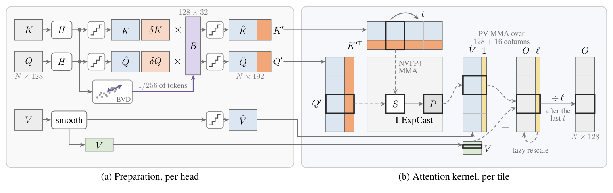
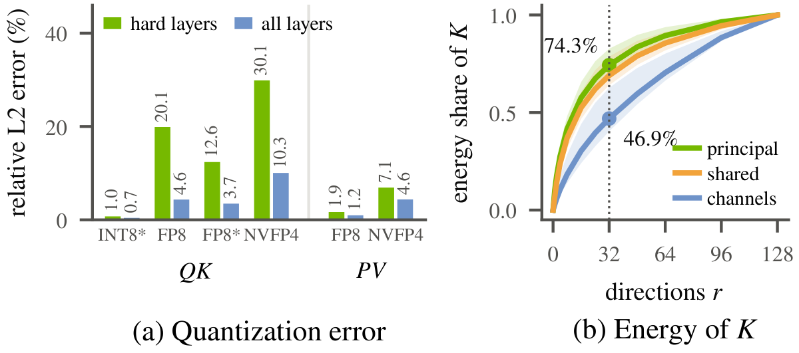
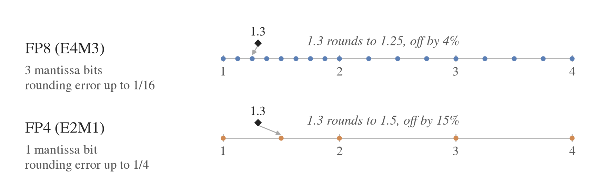
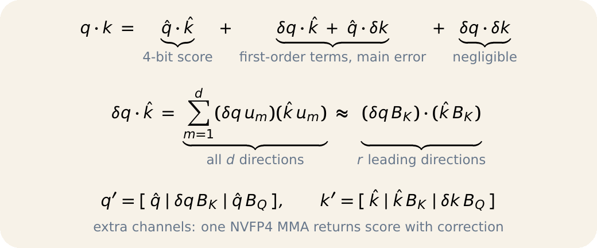
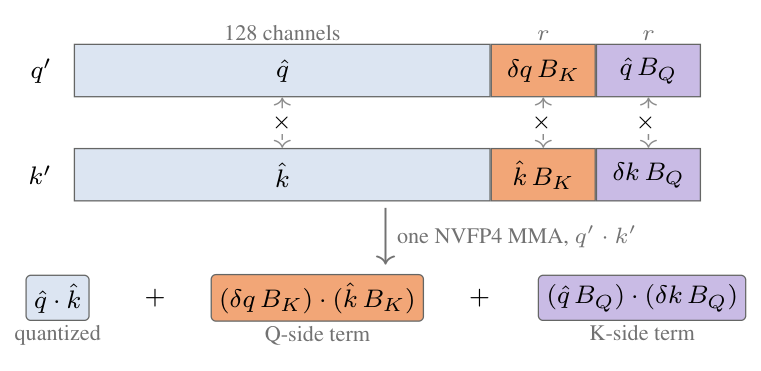
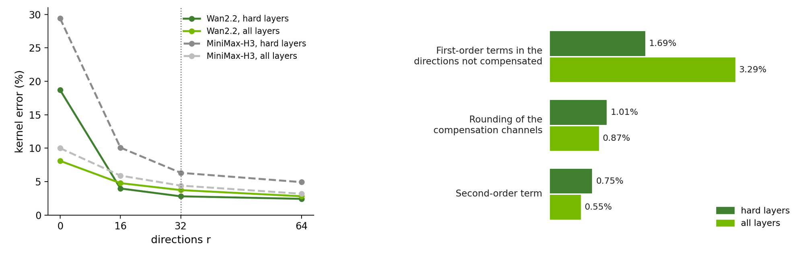
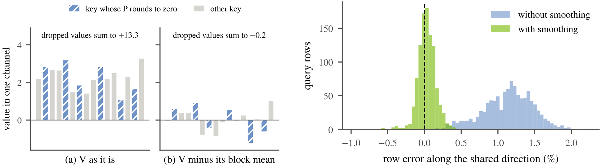
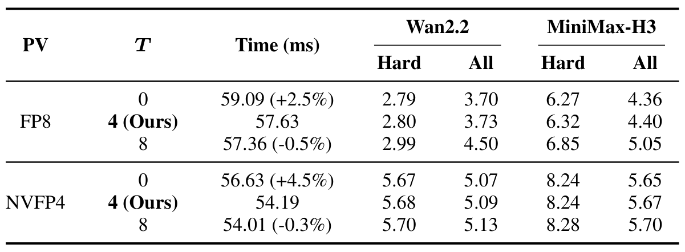
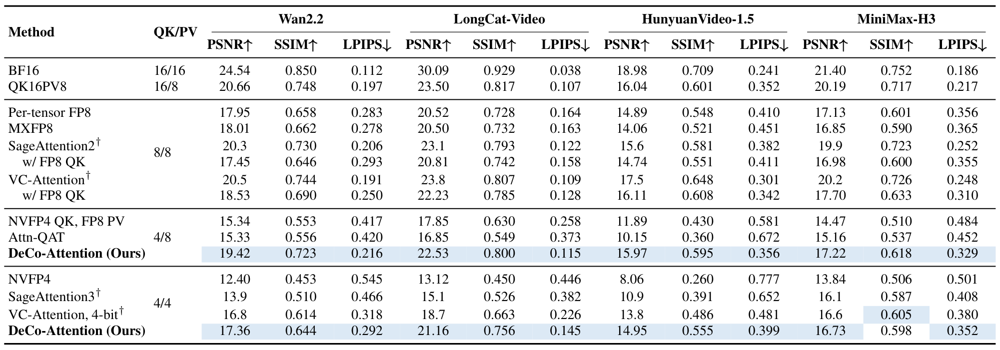

<!--
SPDX-FileCopyrightText: Copyright (c) 2026 NVIDIA CORPORATION & AFFILIATES. All rights reserved.
SPDX-License-Identifier: Apache-2.0
-->

# DeCo-Attention: Accurate and Fast 4-Bit Attention for Video Generation in TensorRT-LLM

By NVIDIA TensorRT-LLM team

*An algorithm-system co-design that makes NVFP4 attention fast and accurate for video generation without model retraining or calibration.*

**Paper**: [DeCo-Attention: Decompose to Compensate for Low-Precision Attention](https://arxiv.org/abs/2611.32035)<br>
**Code**: [TensorRT-LLM VisualGen, PR #22614](https://github.com/NVIDIA/TensorRT-LLM/pull/22614)

**Table of Contents**
- [Introduction](#introduction)
- [Overview](#overview)
- [Background](#background)
- [Error Analysis of 4-Bit Attention](#error-analysis-of-4-bit-attention)
- [Principal Residual Compensation](#principal-residual-compensation)
  - [Compensation Directions](#compensation-directions)
  - [Preparation Cost](#preparation-cost)
  - [V Smoothing](#v-smoothing)
- [Kernel Design](#kernel-design)
  - [I-ExpCast](#i-expcast)
  - [Row Sum and Lazy Rescale](#row-sum-and-lazy-rescale)
- [Co-Design Ablation](#co-design-ablation)
- [Results](#results)
  - [Speedup](#speedup)
  - [Accuracy](#accuracy)
- [Usage in TensorRT-LLM VisualGen](#usage-in-tensorrt-llm-visualgen)
- [Conclusion and Future Work](#conclusion-and-future-work)
- [Acknowledgements](#acknowledgements)
- [References](#references)

## Introduction

DeCo-Attention (Decompose to Compensate) is a low-precision attention for video diffusion transformers in TensorRT-LLM VisualGen. The query-key product runs in NVFP4, the 4-bit floating-point format of NVIDIA Blackwell and Rubin GPUs, while the generated videos stay close to the output of BF16 attention. Existing checkpoints run unchanged, without retraining or calibration data. Figure 1 places the kernel among existing attention kernels on Wan2.2 and gives the key results. DeCo-Attention, the two stars, is the fastest kernel and holds the error of the kernels that keep QK in FP8. A 4-bit query-key product therefore moves the Pareto frontier of accuracy and speed.

<p align="center">
  
</p>

<p align="center"><sub><em>Figure 1. Mean relative L2 error over all layers of Wan2.2 against the attention time of one call on GB300, with one point per kernel and the key results of DeCo-Attention on Wan2.2 beside the plot. Kernels toward the lower left are both faster and more accurate.</em></sub></p>

Figure 2 shows what the error means for the generated videos. Each clip shows one prompt and seed under three attention kernels, BF16 attention on the left, a baseline in the middle, and DeCo-Attention on the right. On GB300, DeCo-Attention runs NVFP4 QK with FP8 PV. The middle clip, the uncompensated NVFP4 QK of TensorRT-LLM, drifts from the BF16 video, while DeCo-Attention follows the BF16 reference and preserves its output fidelity.

<p align="center">
  
</p>

<p align="center"><sub><em>Wan2.2</em></sub></p>

<p align="center">
  
</p>

<p align="center"><sub><em>MiniMax-H3</em></sub></p>

On RTX PRO 6000, DeCo-Attention runs both products in NVFP4. The middle clip, the fully 4-bit SageAttention3, drifts from the BF16 video, while DeCo-Attention follows the BF16 reference and preserves its output fidelity.

<p align="center">
  
</p>

<p align="center"><sub><em>HunyuanVideo-1.5</em></sub></p>

<p align="center">
  
</p>

<p align="center"><sub><em>LongCat-Video</em></sub></p>

<p align="center"><sub><em>Figure 2. Demo clips as reduced GIF previews of the generated videos, with BF16 attention on the left, the baseline in the middle, and DeCo-Attention on the right.</em></sub></p>

This blog explains how DeCo-Attention works and why. The sections below cover where the error of a 4-bit attention comes from, how the compensation removes most of that error, and how the kernels turn the FP4 tensor-core rate into kernel speedup. The derivations and the full experiments are in the paper.

## Overview

DeCo-Attention is a co-design of an algorithm and a kernel. The algorithm decomposes the rounding error of Q and K and adds the main part of that error back inside the same 4-bit matrix product, which takes neither a second product nor retraining nor calibration data. The CuTe DSL kernels shorten the softmax between the two matrix products, which lets the faster products shorten the kernel. Figure 3 shows the two halves of the design, the preparation per head and the attention kernel per tile.

<p align="center">
  
</p>

<p align="center"><sub><em>Figure 3. The preparation in (a) runs once per head. The attention kernel in (b) runs per tile of queries and keys.</em></sub></p>

The preparation rotates Q and K by a Hadamard matrix H and rounds both to NVFP4. The rounding residuals, projected on a basis B of a few principal directions estimated from 1/256 of the tokens, become extra channels next to the rounded ones, and V is smoothed by subtracting the block means. The kernel computes the scores S with the compensation in one NVFP4 MMA over the extended operands, forms the probabilities P with I-ExpCast without the special-function unit, and runs the PV MMA over the smoothed V and a column of ones that returns the row sum l with the output. The lazy rescale skips most rescales, and one high-precision MMA adds the block means of V back.

The hard layers named throughout this blog are the three layers of Wan2.2 where per-tensor FP8 attention is least accurate. On the hard layers, the compensation brings the error of an NVFP4 QK down to the level of an FP8 QK, and end to end DeCo-Attention reaches the generation quality of methods that keep QK in FP8.

## Background

Attention takes most of the generation time. A video diffusion transformer denoises the latent of a whole clip over tens of steps, and every self-attention layer attends over all tokens of the clip at a cost quadratic in the token count. An 81-frame 720p clip of Wan2.2 has 75,600 tokens, and generating the clip takes 302.7 s on GB300, with attention at 67.6% of every denoising step. Therefore, any large end-to-end gain has to come from attention.

FP4 is fast, but a 4-bit QK is not accurate. For one head, attention computes two matrix products with a softmax between the two products (Figure 4).

<p align="center">
  
</p>

<p align="center"><sub><em>Figure 4. The three stages of attention for one head and the units that run each stage.</em></sub></p>

The tensor cores execute the two products as matrix multiply-accumulates (MMAs) in several number formats, at a rate that rises as the precision falls. BF16 is the usual format of attention in diffusion models. FP8 (E4M3) elements have four exponent bits and three mantissa bits, and NVFP4 elements are E2M1 with two exponent bits and one mantissa bit, an FP8 scale per block of 16 elements, and an FP32 scale per tensor. On GB300 and VR200, FP4 MMAs run at 2 to 3x the FP8 rate and 6 to 9x the BF16 rate. With one mantissa bit, however, rounding changes an E2M1 element by up to 1/4 against 1/16 in FP8, and the softmax exponential amplifies this error of Q and K. TensorRT-LLM VisualGen already ships an NVFP4 QK, FP8 PV attention, and the next section shows what the 4-bit QK costs without compensation.

Low-precision MMAs also expose the softmax as the next bottleneck. Once both products run in low precision, the kernel waits on the exponential, which runs on the special-function unit at far fewer scores per cycle than the MMAs and hides the FP4 speed. In this blog, a pair such as NVFP4 / FP8 names the formats of the two products, QK first and PV second.

## Error Analysis of 4-Bit Attention

Which part of attention produces the error? We quantize one product at a time and measure the relative L2 error of the attention output against FP32 attention, on the hard layers and over all layers of Wan2.2 (Figure 5(a)). In the same format, rounding Q and K costs several times the accuracy of rounding P and V. On the hard layers, an NVFP4 QK alone gives an error of 30.1%, and an NVFP4 PV alone gives 7.1%. Therefore, the problem to solve is reducing the error of the QK product.

<p align="center">
  
</p>

<p align="center"><sub><em>Figure 5. Panel (a) gives the relative L2 error of the attention output on Wan2.2 when only Q and K or only P and V are quantized, where the formats marked with a star use the per-block scales of SageAttention. Panel (b) gives the share of the energy of K held by the first r directions, over the heads of Wan2.2, for three choices of directions, the principal directions of K, the shared basis of Q and K, and the largest channels.</em></sub></p>

QK is sensitive because the scores go through an exponential. Rounding a tensor *x* gives a low-precision tensor *x̂* and leaves a residual δ*x* = *x* − *x̂*. For a query *q* and a key *k*, the exact product therefore has four terms.

$$q \cdot k = \hat q \cdot \hat k + \delta q \cdot \hat k + \hat q \cdot \delta k + \delta q \cdot \delta k$$

A quantized kernel computes only the first term, and the other three form the error *e*<sub>j</sub> of the score of key *j*. The softmax then sees *s*<sub>j</sub> + *e*<sub>j</sub> in place of the exact score *s*<sub>j</sub>, which multiplies every attention weight by the exponential of the score error of that key before the weights are normalized again.

$$\tilde p_j = \frac{p_j \exp(e_j)}{\sum_l p_l \exp(e_l)} \approx p_j \,(1 + e_j - \bar e), \qquad \bar e = \sum_l p_l e_l$$

The approximation holds while the errors are small, where exp(*x*) ≈ 1 + *x*. An error that all keys of a query share then cancels, because such an error moves *e*<sub>j</sub> and *ē* alike, and a weight changes in proportion to the centered error *e*<sub>j</sub> − *ē*, about 10% for an error of 0.1. The approximation breaks as a centered error approaches 1.0, where exp(*e*<sub>j</sub>) grows much faster than 1 + *e*<sub>j</sub>. With an NVFP4 QK the centered errors do exceed 1.0, and the exponential amplifies the errors until the attention output tracks the wrong keys. Figure 6 shows one query on a hard layer of Wan2.2, where without compensation the top key loses about 60% of the weight, the second key gains about 70%, and the two swap places. With the compensation, the errors stay within about a third and the weights stay near the first-order line.

<p align="center">
  
</p>

<p align="center"><sub><em>Figure 6. Relative change of the attention weight of each key against its centered score error for one query of Wan2.2, without and with compensation. The marker size indicates the weight of the key.</em></sub></p>

The PV product is not followed by an exponential. The rounding errors of P and V therefore add up in the output without amplification, which is why attention tolerates a low-precision PV much better.

The score errors of an NVFP4 QK are large because of the format itself (Figure 7). A floating-point format with *t* mantissa bits rounds every element with a relative error up to 2<sup>−(*t*+1)</sup>, whatever the scale of the element, and finer scales only decide where the representable range sits. Figure 5(a) shows the effect directly for the two formats with the same per-block scales, where a floating-point FP8 QK has an error of 12.6% on the hard layers against 1.0% for an integer INT8 QK, and NVFP4 has the finest scales and the largest error.

<p align="center">
  
</p>

<p align="center"><sub><em>Figure 7. The representable values of an FP8 element and an FP4 element between 1 and 4, and where the value 1.3 rounds in each format.</em></sub></p>

Q and K also hold outliers, a few channels with very large values whose rounding errors are large in absolute terms and amplified further by the exponential. An accurate 4-bit QK therefore cannot come from better scales alone, and the rounding error itself has to be treated.

## Principal Residual Compensation

Rounding splits a query and a key into the rounded value and a known residual, *q* = *q̂* + δ*q* and *k* = *k̂* + δ*k*, and a 4-bit kernel computes only the first of the four terms of the exact score. The two first-order terms are the main error of the 4-bit score, and most of that error lies along a few principal directions of Q and K. Figure 8 states the method.

<p align="center">
  
</p>

<p align="center"><sub><em>Figure 8. Principal residual compensation.</em></sub></p>

The first line is the decomposition of the exact score. Adding the two first-order terms back exactly would take two more full-width matrix products, which costs more than running QK in FP8, and the second-order term δ*q* · δ*k* is small enough to leave out. The second line approximates a first-order term in an orthonormal basis of the head, where most of the sum over the *d* directions lies along the leading eigenvectors of the keys. With *B*<sub>K</sub> holding the *r* leading eigenvectors, the term becomes a dot product of *r* numbers, and the K-side term is treated the same way along the *r* leading eigenvectors *B*<sub>Q</sub> of the queries. The third line appends the two dot products as extra channels of the same product (Figure 9), and *q*′ · *k*′ then gives the quantized score plus both corrections in one block-scaled NVFP4 MMA. With *r* = 32, a head of 128 channels grows to 192 without a second matrix product.

<p align="center">
  
</p>

<p align="center"><sub><em>Figure 9. The extended operands and the three terms of the product q′ · k′.</em></sub></p>

The two first-order terms are not equally important, because the softmax passes on only the differences of the score errors between the keys of a query. In the K-side term, the residuals of different keys are multiplied by the whole query and do not cancel. In the Q-side term, the same residual δ*q* meets every key, and only the differences between keys remain. Figure 10 confirms the ordering of the two terms, since the K-side term alone removes most of the error and the Q-side term adds the rest.

<p align="center">
  
</p>

<p align="center"><sub><em>Figure 10. Relative L2 error of the attention output on Wan2.2 with FP8 PV when the compensation adds neither term, one term, or both terms. All four rows use the Hadamard rotation and V smoothing.</em></sub></p>

### Compensation Directions

Take the Q-side term of one query and add up the squared term over all keys. The total splits along the eigenvectors *u*<sub>m</sub> of the Gram matrix of the quantized keys, and the error along a direction is the eigenvalue λ<sub>m</sub>, the energy of the keys along the direction, times the squared component of the residual along that direction.

$$\sum_j (\delta q \cdot \hat k_j)^2 = \sum_{m=1}^{d} \lambda_m \, (\delta q \, u_m)^2$$

The first factor is strongly concentrated (Figure 5(b)). On Wan2.2, the 32 leading eigenvectors hold a median of 74.3% of the energy of K over the heads, while the 32 largest channels hold 46.9%. Therefore, the directions to compensate have to be eigenvectors. The second factor depends on the residual of each query, which the eigenvalues say nothing about. DeCo-Attention therefore rotates Q and K before rounding by a normalized Hadamard matrix with random row signs, which leaves the scores unchanged and does two things.

- The rotation ties the error to the eigenvalues. Without the rotation the residual sits mostly in the outlier channels, and the component along a direction varies widely between directions. The rotation spreads the residual evenly over all directions (Figure 11(a)), which makes the error along a direction proportional to the eigenvalue and the leading eigenvectors the directions to compensate.
- The rotation lowers the rounding error itself. NVFP4 rounds a block with one shared scale, which a few large channels next to many small ones fit badly. The rotation makes the values of a block similar in size, and in Figure 11(b) the second-order term, the rounding of the compensation channels, and the compensated QK error all fall.

<p align="center">
  
</p>

<p align="center"><sub><em>Figure 11. The Hadamard rotation on the hard layers of Wan2.2. Panel (a) plots the squared residual component along each direction against its eigenvalue, one point per direction and head. Panel (b) gives the three parts of the QK error that remain after the compensation, and the error of the compensated QK, without and with the rotation.</em></sub></p>

A compensation along the largest channels behaves the opposite way, because after the rotation no channel stands out. Such a compensation therefore gets worse where the compensation along eigenvectors gets better.

More directions remove more error but widen the product. Figure 12 (left) shows the trade-off on Wan2.2 and MiniMax-H3. The first 16 directions remove most of the error, and the step to 32 still helps on the hard layers. DeCo-Attention therefore uses *r* = 32 on every model and GPU. Figure 12 (right) splits the QK error that remains after the compensation into parts. The largest part is the first-order error in the dropped directions, which a larger *r* would reduce, and the second-order term is the smallest, which justifies leaving the term out.

<p align="center">
  
</p>

<p align="center"><sub><em>Figure 12. The left panel gives the kernel error with FP8 PV against the number of compensated directions r. The right panel gives the three parts of the QK error that remain after the compensation with r = 32 on Wan2.2, each measured as the relative L2 error that part alone causes.</em></sub></p>

### Preparation Cost

Because the principal directions depend on the data, DeCo-Attention estimates the directions at run time for every head of every call. Three choices keep the cost of the estimate low.

- One basis *B* replaces *B*<sub>K</sub> and *B*<sub>Q</sub>, since Q and K project the same activations and the leading subspaces of Q and K overlap by 0.75 on Wan2.2, against 0.25 for unrelated subspaces. Each Gram matrix is divided by the trace so that Q and K weigh equally, and the *r* leading eigenvectors of the summed Gram matrices form the basis. One eigendecomposition per head then serves both operands at almost no loss, 2.80% error on the hard layers of Wan2.2 against 2.91% with separate bases.
- The Gram matrices come from a random sample of 1/256 of the tokens, at least 64, which costs almost no kernel accuracy on Wan2.2.
- The preparation is a short chain of fused kernels, linear in the sequence length where attention is quadratic. On Wan2.2 the chain takes 1.55 ms on GB300 and 1.05 ms on VR200 and adds 2.7% to 3.6% to the attention time.

### V Smoothing

The PV product is less sensitive than QK, but the PV error has a direction. Rounding P sends the smallest probabilities to zero and loses the corresponding values of V. When the values of a block share a common offset, the losses all point the same way (Figure 13, left), and the bias accumulates over the layers and the denoising steps. DeCo-Attention therefore applies V smoothing, introduced by VC-Attention. The mean of each block of consecutive keys is subtracted from V before rounding, and one high-precision MMA adds the block means back after the low-precision PV product, which centers the row errors near zero (Figure 13, right).

<p align="center">
  
</p>

<p align="center"><sub><em>Figure 13. The left panels show, for one channel, the values of the keys whose probabilities round to zero, with V as it is and with the block mean subtracted. The right panel shows the error of the output rows along the shared direction, without and with V smoothing.</em></sub></p>

The block is 128 keys with FP8 PV and 16 keys with NVFP4 PV. On the hard layers of Wan2.2, the kernel error goes from 2.95% to 2.80% with FP8 PV and from 7.50% to 5.68% with NVFP4 PV.

## Kernel Design

An accurate 4-bit QK is half of the work, because with both matrix products in low precision the kernel no longer waits on the tensor cores but on the softmax between the products. The expensive part of the softmax is the exponential, which runs on the special-function unit (SFU) through MUFU instructions, and the SFU handles far fewer scores per cycle than the tensor cores. As the MMAs get faster, the exponential takes a growing share of the kernel time. Earlier kernels reduce the cost of the exponential in two ways.

- FlashAttention-4 emulates part of the exponentials on the fused multiply-add (FMA) units, which frees the SFU at the cost of many more instructions.
- ExpCast, from VC-Attention, and Direct-P skip the exponential and build the code of each probability from a linear function of the score. Both are fast, but neither rounds to the nearest code or covers the subnormal codes, which costs accuracy on small probabilities.

We implement the kernels of DeCo-Attention in CuTe DSL for GB300, VR200, and RTX PRO 6000. The format of the PV product depends on the GPU, FP8 on GB300 and VR200 where a 4-bit PV would gain little speed, and NVFP4 on RTX PRO 6000. The kernels shorten the softmax in three ways.

- I-ExpCast forms the probabilities without the special-function unit.
- The PV MMA returns the row sum of the probabilities together with the output.
- The lazy rescale skips most rescales of the accumulated output.

### I-ExpCast

I-ExpCast, our improved ExpCast, does not use the MUFU instructions and still rounds correctly. One multiply-add builds the bit pattern of each probability from the score, which a hardware conversion then rounds to the nearest FP8 or FP4 code. The whole step takes three instructions per pair of scores and nearly matches the exact exponential.

The idea is to form each probability in FP16 and leave the final rounding to a hardware conversion. FP16 has ten mantissa bits and represents every value of E4M3 and of E2M1 exactly. A conversion from FP16 therefore rounds to the nearest code of either format, subnormal codes included. What remains is to produce the FP16 value cheaply. Let *x* be the base-2 logarithm of a scaled probability, which is a linear function of the score. Read as an integer, the FP16 bit pattern of 2<sup>*x*</sup> is close to a linear function of *x*.

$$\operatorname{bits}_{\mathrm{FP16}}\big(2^x\big) \approx 1024\,(x + 15)$$

I-ExpCast evaluates this linear function in the subnormal range of FP32, where the values are evenly spaced and the bit pattern of a value is the multiple of the spacing. One FMA therefore maps a score to the bit pattern and rounds the pattern to an integer in the same step. A saturating pack then narrows the pattern to the 16 bits of FP16, and the last step converts the FP16 value to E4M3 or E2M1.

$$\hat p_j = \mathcal{Q}\Big(\operatorname{sat}_{16}\big(\operatorname{bits}_{\mathrm{FP32}}(a\,s_j + c)\big)\Big)$$

The same routine serves FP8 and FP4 probabilities, and Figure 14 compares the decoded probabilities with the exact ones. I-ExpCast matches the exact exponential with rounding over the whole range including the subnormal codes, where ExpCast drops to zero. Direct-P departs from the exact value over much of the range.

<p align="center">
  
</p>

<p align="center"><sub><em>Figure 14. Ratio of the decoded probability to the exact probability for each way of forming the codes, for (a) FP8 and (b) FP4 probabilities.</em></sub></p>

Inside the kernel, the way of forming P shows directly in the time (Figure 15). Computing the exponential on the SFU gives the same accuracy and takes 21.5% longer with FP8 PV and 34.3% longer with NVFP4 PV, while ExpCast is close in time but loses accuracy on the small probabilities. Direct-P needs the fewest instructions, yet the released Direct-P kernel is the slowest of the three. Emulated alone with only P rounded to FP4, the Direct-P codes give an error of 5.06% over all layers of Wan2.2 against 1.90% for I-ExpCast.

<p align="center">
  
</p>

<p align="center"><sub><em>Figure 15. Kernel time on GB300 and relative L2 error of the attention output on Wan2.2 for each way of forming the probabilities. Direct-P (†) is timed in its released kernel. Some Direct-P outputs are not finite on the measured calls, which leaves the Direct-P error unmeasured.</em></sub></p>

### Row Sum and Lazy Rescale

The softmax needs the sum of each row of probabilities, and computing the sum next to the exponentials adds work where the kernel is already limited. Since the tensor cores have spare capacity, a column of ones appended to V lets the PV MMA return the row sum of P with the output, which moves the work to the tensor cores.

The online softmax rescales the accumulated output whenever a new tile raises the running row maximum. The lazy rescale moves the base only when the maximum grows by more than a factor of 2<sup>*T*</sup>, which skips most rescales at a cost in accuracy that depends on the format of P. FP8 probabilities are relative to the row base. At *T* = 8, the setting of FlashAttention-4, probabilities below 2<sup>−9</sup> of the base round to zero, whereas at *T* = 4 probabilities survive down to 2<sup>−13</sup> while most rescales are still skipped. With only P rounded, the mean error over all layers of Wan2.2 rises from 0.93% at *T* = 4 to 2.72% at *T* = 8. NVFP4 probabilities carry a scale per block of 16 keys and hardly react to *T*.

At *T* = 4, more of the small FP8 probabilities fall into the subnormal range of E4M3, which I-ExpCast rounds to the nearest code. With ExpCast, the error at *T* = 4 is 3.26%. DeCo-Attention therefore uses *T* = 4 for both formats. Figure 16 confirms the choice in the complete kernels, where *T* = 0 costs 2.5% more time with FP8 PV and *T* = 8 raises the error over all layers of Wan2.2 from 3.73% to 4.50%.

<p align="center">
  
</p>

<p align="center"><sub><em>Figure 16. Attention time of a Wan2.2 call and relative L2 error (%) of the kernels with FP8 PV and NVFP4 PV on GB300 at three thresholds T of the lazy rescale.</em></sub></p>

## Co-Design Ablation

Figure 17 shows why the compensation and the kernel optimizations were designed together. The ablation adds the pieces one at a time to the DeCo kernel with FP8 PV on GB300 and measures one attention call of Wan2.2, with the error measured on the hard layers.

<p align="center">
  
</p>

<p align="center"><sub><em>Figure 17. The pieces of DeCo-Attention added one at a time to the kernel with FP8 PV on GB300, with the time of one Wan2.2 call, the speedup over BF16 attention, the SM clock under the power limit, and the error on the hard layers. The FP8-QK reference is the same kernel with an uncompensated FP8 QK and one scale per tensor.</em></sub></p>

Compensation makes the 4-bit QK usable at all. The error on the hard layers falls from 30.56% for the NVFP4 QK, FP8 PV attention of TensorRT-LLM to 2.92%. The kernel optimizations turn the FP4 speed into end-to-end speedup. With compensation only, the softmax hides the gain of the 4-bit QK, 79.0 ms against 82.1 ms for the same kernel with an FP8 QK, whereas the three optimizations bring the kernel to 55.8 ms. The three optimizations are nearly lossless, with the error between 2.92% and 2.95% through all three additions, because I-ExpCast rounds to the nearest code, subnormal codes included, and therefore combines with the lazy rescale. V smoothing then costs 2.2 ms and lowers the error to 2.80%.

The optimizations pay off most with the 4-bit QK. The same four changes speed up the FP8-QK reference by 1.20x against 1.36x with the NVFP4 QK, because the slower FP8 MMAs then bound the kernel, and the complete kernel is 1.17x faster than that reference and more accurate on the hard layers. The clock column shows one more effect of the optimizations. The optimized kernel does more work per cycle and draws more power, which lowers the SM clock under the power limit from 2017 to 1582 MHz and gives back part of the gain. At a fixed clock, the same changes give 1.67x in place of 1.36x. Therefore, the speedup of DeCo-Attention comes from the 4-bit QK MMA and the softmax optimizations together, and the accuracy that makes the 4-bit QK acceptable comes from the compensation.

## Results

We evaluate DeCo-Attention at the kernel level and end to end. At the kernel level, we measure the error on attention calls captured from the models and the attention time, and end to end we measure the quality of the generated videos and the generation time in TensorRT-LLM VisualGen. The models are Wan2.2, LongCat-Video, HunyuanVideo-1.5, and MiniMax-H3, on GB300, VR200, and RTX PRO 6000. In the tables, QK/PV gives the bit widths of the two products, and DeCo-Attention is in bold.

### Speedup

Figure 18 gives the speed of the kernels and of the whole generation, with DeCo-Attention running FP8 PV on GB300 and VR200 and NVFP4 PV on RTX PRO 6000. On Wan2.2, the DeCo kernel runs 2.13x, 2.49x, and 2.82x faster than the fastest BF16 kernel on the three GPUs, and the whole generation runs 1.55x, 1.68x, and 1.80x faster, while on MiniMax-H3 the speedups are similar.

<p align="center">
  
</p>

<p align="center"><sub><em>Figure 18. Speedup of the attention kernel over the fastest BF16 kernel in (a) and of the whole generation in TensorRT-LLM VisualGen over BF16 attention in (b). The SageAttention and VC-Attention bars show the FP8-QK kernels of both methods on GB300 and VR200 and the 4-bit kernels on RTX PRO 6000.</em></sub></p>

DeCo-Attention is the fastest of the compared attention kernels on every GPU. On GB300 and VR200 the DeCo kernel is 1.44x and 1.65x faster than the fastest prior method, VC-Attention, with the generation 1.22x and 1.32x faster, and on RTX PRO 6000, where SageAttention3 is the fastest prior method, the DeCo kernel is 1.08x faster at the kernel level and 1.09x end to end.

### Accuracy

Figure 19 gives the kernel error on the hard layers and over all layers of Wan2.2 and MiniMax-H3. With FP8 PV, DeCo-Attention has the lowest error of all kernels with an FP8 or a 4-bit QK on the hard layers of both models, and over all layers the DeCo error lies between the errors of VC-Attention and SageAttention2 with an FP8 QK. With NVFP4 PV, DeCo-Attention has the lowest error of the fully 4-bit kernels. On the hard layers of Wan2.2, the DeCo error is about a quarter of the error of SageAttention3 and of the 4-bit VC-Attention, and below that of SageAttention2 with an FP8 QK.

<p align="center">
  
</p>

<p align="center"><sub><em>Figure 19. Kernel-level accuracy as the relative L2 error (%) of the attention output against FP32 attention, where lower is better. Blue marks the lowest error within each group with a 4-bit QK.</em></sub></p>

For the end-to-end quality we generate videos for the 100 prompts of MovieGen Bench and compare each video with the BF16-attention video for the same prompt and seed (Figure 20). PSNR and SSIM are higher when two videos agree more, while LPIPS tracks what a viewer notices and is lower. A diffusion model amplifies any numeric difference along the sampling trajectory, which is why even two BF16 kernels do not produce identical videos. The BF16 row scores the BF16 attention of cuDNN against the reference and shows the scale.

<p align="center">
  
</p>

<p align="center"><sub><em>Figure 20. End-to-end quality on four video models against BF16 attention, as the mean over 100 prompts. Blue cells mark the best PSNR, SSIM, and LPIPS within each group with a 4-bit QK. SageAttention2 and VC-Attention use the default INT8 QK on B200, and the rows with an FP8 QK run on GB300. The means marked † are reported by VC-Attention.</em></sub></p>

With FP8 PV, DeCo-Attention reaches the quality of the FP8-QK methods. DeCo-Attention is more accurate than MXFP8 and than SageAttention2 with an FP8 QK on every model. Against VC-Attention with an FP8 QK, DeCo-Attention is more accurate on Wan2.2 and LongCat-Video and less on the other two models. Compared with the existing NVFP4 QK, FP8 PV attention, the compensation gains about 3 to 5 dB of PSNR on every model. With NVFP4 PV, DeCo-Attention has better PSNR and LPIPS than SageAttention3 and the 4-bit VC-Attention on every model, and the fully NVFP4 DeCo kernel also matches SageAttention2 with an FP8 QK on every model, with both products in 4 bits.

## Usage in TensorRT-LLM VisualGen

DeCo-Attention is integrated into TensorRT-LLM VisualGen as an attention backend. The kernels are written in CuTe DSL with FP8 PV for GB300 and VR200 and NVFP4 PV for RTX PRO 6000, and run on existing checkpoints of Wan2.2, HunyuanVideo-1.5, and MiniMax-H3. DeCo-Attention is a switch on the quantized attention configuration of VisualGen and does not need calibration or model-specific code. The following YAML enables DeCo-Attention with FP8 PV.

```yaml
attention_config:
  backend: CUTEDSL
  quant_attention_config:
    qk_dtype: nvfp4
    v_dtype: fp8
    deco_attention: true
```

For NVFP4 PV, set `v_dtype` to `nvfp4`. Pass the file to the server with `--visual_gen_args`.

```bash
trtllm-serve Wan-AI/Wan2.2-T2V-A14B-Diffusers --visual_gen_args config.yml
```

The same configuration in Python:

```python
args = VisualGenArgs(
    model="Wan-AI/Wan2.2-T2V-A14B-Diffusers",
    attention_config=AttentionConfig(
        backend="CUTEDSL",
        quant_attention_config=QuantAttentionConfig(
            qk_dtype="nvfp4",
            v_dtype="fp8",
            deco_attention=True,
        ),
    ),
)
```

NVFP4 QK with FP8 PV runs on SM100, SM103, SM107, and SM120, which covers B200, GB300, VR200, and RTX PRO 6000, while NVFP4 PV runs on SM120 only. All options of the quantized attention are described in the [VisualGen quantized attention guide](../../features/visualgen-quantized-attention.md).

## Conclusion and Future Work

DeCo-Attention shows that the 4-bit tensor cores can serve the QK product of attention without giving up the quality of the generated video. The rounding error of a 4-bit QK lies mostly along a few principal directions, and compensating that error inside the same matrix product makes the 4-bit QK accurate, while softmax optimizations turn the speed of the FP4 MMAs into kernel speedup. The result is the fastest attention kernel of our comparison on GB300, VR200, and RTX PRO 6000, at the generation quality of FP8-QK methods. Three directions of future work remain.

- The principal directions are estimated at run time for every head of every call, which adds 2.7% to 3.6% to the attention time, and reducing this cost matters most in low-latency scenarios.
- The kernels target the self-attention of video diffusion models today, and bringing DeCo-Attention to LLM inference with a KV cache is the next step.
- We will keep improving the integration in TensorRT-LLM VisualGen and bring DeCo-Attention to more models and use cases.

## Acknowledgements

DeCo-Attention is a joint effort across several NVIDIA teams, from the algorithm and the numerical analysis to the CuTe DSL kernels, the integration in TensorRT-LLM VisualGen, and the evaluation. We thank everyone who took part in this work, and the colleagues who reviewed the work and shared feedback along the way.

## References

- Y. He et al. DeCo-Attention: Decompose to Compensate for Low-Precision Attention. [arXiv:2611.32035](https://arxiv.org/abs/2611.32035), 2026.
- J. Shah et al. FlashAttention-3: Fast and Accurate Attention with Asynchrony and Low-precision. NeurIPS, 2024.
- T. Zadouri et al. FlashAttention-4: Algorithm and Kernel Pipelining Co-Design for Asymmetric Hardware Scaling. MLSys, 2026.
- J. Zhang et al. SageAttention2: Efficient Attention with Thorough Outlier Smoothing and Per-thread INT4 Quantization. ICML, 2025.
- J. Zhang et al. SageAttention3: Microscaling FP4 Attention for Inference and An Exploration of 8-Bit Training. NeurIPS, 2025.
- X. Li et al. VC-Attention: Value Smoothing and Softmax Casting for Low-bit Attention. [arXiv:2609.15810](https://arxiv.org/abs/2609.15810), 2026.
- P. Zhang et al. Attn-QAT: 4-Bit Attention With Quantization-Aware Training. ICML, 2026.
- R. Hu. Hardware-Aware FP4 FlashAttention-4 (Direct-P). [arXiv:2609.04105](https://arxiv.org/abs/2609.04105), 2026.
- S. Ashkboos et al. QuaRot: Outlier-Free 4-Bit Inference in Rotated LLMs. NeurIPS, 2024.
- NVIDIA. Pretraining Large Language Models with NVFP4. [arXiv:2509.25149](https://arxiv.org/abs/2509.25149), 2025.
- B. D. Rouhani et al. Microscaling Data Formats for Deep Learning. [arXiv:2310.10537](https://arxiv.org/abs/2310.10537), 2023.
- Team Wan. Wan: Open and Advanced Large-Scale Video Generative Models. [arXiv:2503.20314](https://arxiv.org/abs/2503.20314), 2025.
- Meituan LongCat Team. LongCat-Video Technical Report. [arXiv:2510.22200](https://arxiv.org/abs/2510.22200), 2025.
- B. Wu et al. HunyuanVideo 1.5 Technical Report. [arXiv:2511.18870](https://arxiv.org/abs/2511.18870), 2025.
- MiniMax. MiniMax H3: An Open Model Breaking the Boundaries Between Tasks and Modalities. Blog post, 2026.
- A. Polyak et al. Movie Gen: A Cast of Media Foundation Models. [arXiv:2410.13720](https://arxiv.org/abs/2410.13720), 2024.
