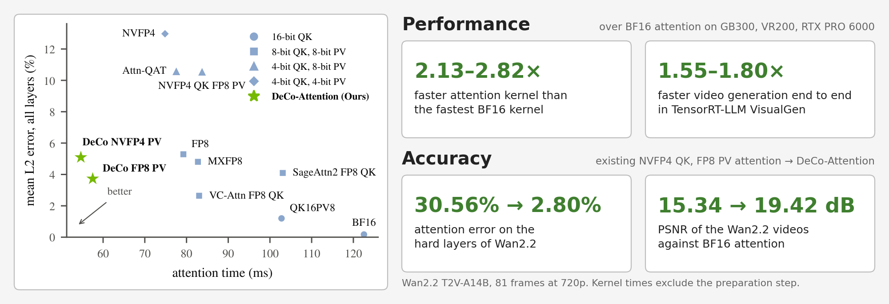
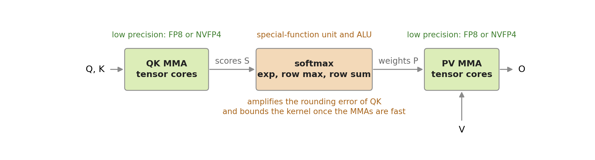
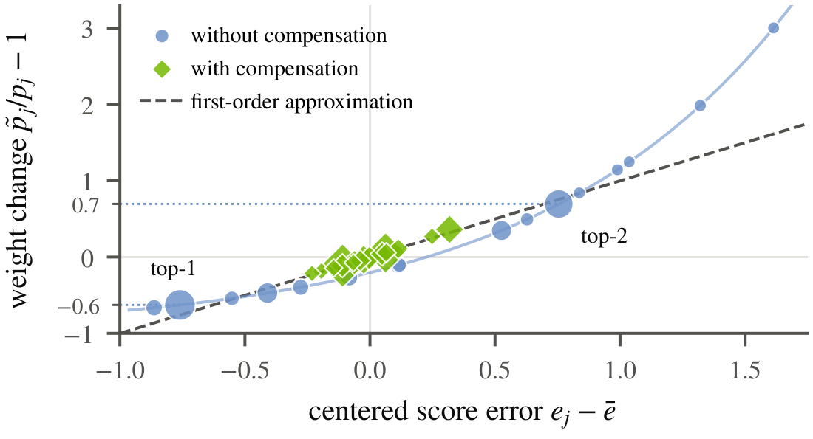
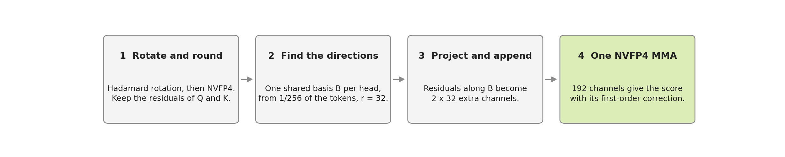
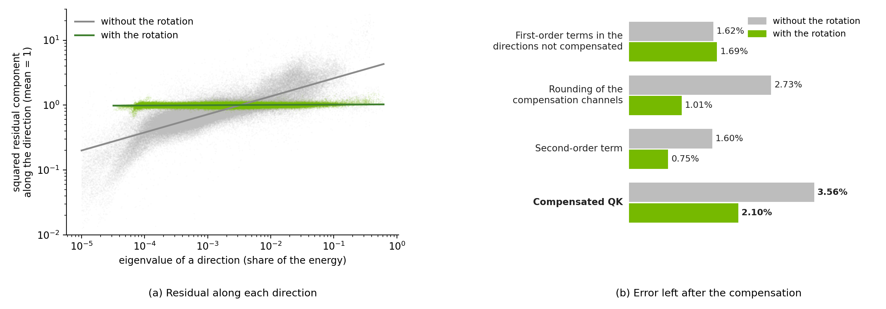
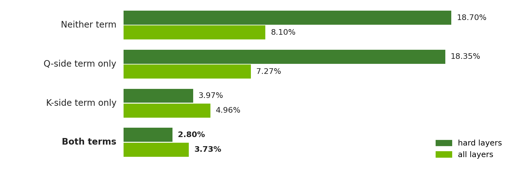
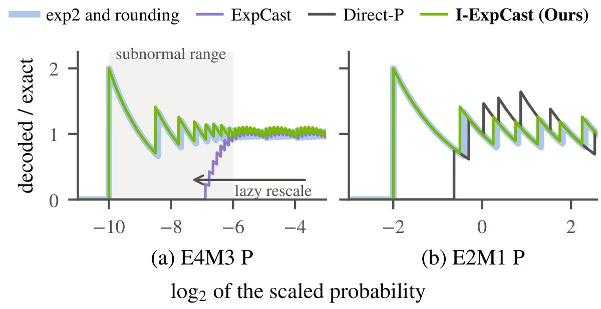

<!--
SPDX-FileCopyrightText: Copyright (c) 2026 NVIDIA CORPORATION & AFFILIATES. All rights reserved.
SPDX-License-Identifier: Apache-2.0
-->

# DeCo-Attention: Accurate and Fast 4-Bit Attention for Video Generation in TensorRT LLM

By NVIDIA TensorRT LLM team

**Table of Contents**
- [Introduction](#introduction)
- [Overview](#overview)
- [Background](#background)
  - [Attention dominates video generation](#attention-dominates-video-generation)
  - [Two matrix products and a softmax](#two-matrix-products-and-a-softmax)
  - [Low-precision tensor cores](#low-precision-tensor-cores)
- [Where the error of a 4-bit attention comes from](#where-the-error-of-a-4-bit-attention-comes-from)
  - [Observation 1: QK is the sensitive product](#observation-1-qk-is-the-sensitive-product)
  - [Observation 2: softmax amplifies score errors](#observation-2-softmax-amplifies-score-errors)
  - [Observation 3: a 4-bit float keeps only one mantissa bit](#observation-3-a-4-bit-float-keeps-only-one-mantissa-bit)
- [Algorithm: principal residual compensation](#algorithm-principal-residual-compensation)
  - [Most of the error lies along a few directions](#most-of-the-error-lies-along-a-few-directions)
  - [What the Hadamard rotation is for](#what-the-hadamard-rotation-is-for)
  - [Compensating along r directions](#compensating-along-r-directions)
  - [One MMA for the score and its correction](#one-mma-for-the-score-and-its-correction)
  - [How much is enough, and what remains](#how-much-is-enough-and-what-remains)
  - [Keeping the preparation cheap](#keeping-the-preparation-cheap)
  - [V smoothing for the PV product](#v-smoothing-for-the-pv-product)
- [System: kernels that turn FP4 speed into kernel speedup](#system-kernels-that-turn-fp4-speed-into-kernel-speedup)
  - [Why the softmax is the bottleneck](#why-the-softmax-is-the-bottleneck)
  - [I-ExpCast: probabilities without the SFU](#i-expcast-probabilities-without-the-sfu)
  - [Row sum in the PV MMA](#row-sum-in-the-pv-mma)
  - [Lazy rescale](#lazy-rescale)
  - [One kernel family, two PV formats](#one-kernel-family-two-pv-formats)
- [Why co-design: neither half works alone](#why-co-design-neither-half-works-alone)
- [Results](#results)
  - [Kernel-level accuracy](#kernel-level-accuracy)
  - [End-to-end quality](#end-to-end-quality)
  - [Performance](#performance)
- [How to use it in TensorRT LLM VisualGen](#how-to-use-it-in-tensorrt-llm-visualgen)
- [Summary and Future Work](#summary-and-future-work)
- [Acknowledgements](#acknowledgements)
- [References](#references)

## Introduction

DeCo-Attention (Decompose to Compensate) is a low-precision attention for video diffusion transformers in TensorRT LLM VisualGen. It computes the query-key product of attention in NVFP4, the 4-bit floating-point format of NVIDIA Blackwell and Rubin GPUs, and still keeps the generated videos close to those of BF16 attention. Figure 1 places it among existing attention kernels: DeCo-Attention is the fastest of them, at an error close to that of the kernels that keep the query-key product in FP8. With a 4-bit query-key product, it advances the Pareto frontier of accuracy and speed.

<div align="center">
<figure>
  
</figure>
</div>

<p align="center"><sub><em>Figure 1: Left: accuracy against speed of attention kernels, as the mean relative L2 error over all layers of Wan2.2 against the attention time of one call on GB300. Lower left is better, and DeCo-Attention is the two stars. Right: key results of DeCo-Attention on Wan2.2.</em></sub></p>

Figure 2 shows what this means for the generated videos. Each clip shows one prompt and seed under three attention kernels: BF16 attention on the left, a baseline in the middle, and DeCo-Attention on the right.

With FP8 PV on GB300, the baseline is the NVFP4 QK, FP8 PV attention of TensorRT LLM, which has no compensation.

<div align="center">
<figure>
  
</figure>
</div>

<p align="center"><sub><em>Wan2.2</em></sub></p>

<div align="center">
<figure>
  
</figure>
</div>

<p align="center"><sub><em>MiniMax-H3</em></sub></p>

With NVFP4 PV on RTX PRO 6000, the baseline is SageAttention3, a fully 4-bit attention.

<div align="center">
<figure>
  
</figure>
</div>

<p align="center"><sub><em>HunyuanVideo-1.5</em></sub></p>

<div align="center">
<figure>
  
</figure>
</div>

<p align="center"><sub><em>LongCat-Video</em></sub></p>

<p align="center"><sub><em>Figure 2: Demo clips, shown as reduced GIF previews of the generated videos. Left: BF16 attention. Middle: the baseline. Right: DeCo-Attention.</em></sub></p>

This tech blog explains how it works and why. We walk through where the error of a 4-bit attention comes from, how DeCo-Attention removes most of it, and how the kernels turn the speed of the 4-bit tensor cores into real speedups.

The full derivations and experiments are in our paper, [DeCo-Attention: Decompose to Compensate for Low-Precision Attention](https://arxiv.org/abs/2611.32035).

## Overview

Attention takes most of the time of video generation, so it is the natural place to use the fastest tensor cores. The catch is accuracy. Existing attention kernels with a 4-bit query-key product (QK) change the generated video visibly, and once the matrix products are fast, the softmax between them limits the kernel.

DeCo-Attention is a co-design of an algorithm and a kernel that addresses both problems.

- **Algorithm.** The rounding error of Q and K is decomposed, and its main part is added back inside the same 4-bit matrix product. No second product, no retraining, no calibration data.
- **System.** The kernels, written in CuTe DSL, shorten the softmax so that the faster matrix products actually shorten the kernel.

<div align="center">
<figure>
  
</figure>
</div>

<p align="center"><sub><em>Figure 3: Overview of DeCo-Attention. (a) The preparation runs once per head: it rotates and rounds Q and K, builds the compensation channels, and smooths V. (b) The kernel computes the scores with their correction in one NVFP4 MMA, forms P with I-ExpCast, and accumulates the PV product.</em></sub></p>

On Wan2.2 in TensorRT LLM VisualGen, the attention kernel of DeCo-Attention is 2.13x, 2.49x, and 2.82x faster than the fastest BF16 attention kernel on GB300, VR200, and RTX PRO 6000, and the whole generation is 1.55x, 1.68x, and 1.80x faster. GB300 and VR200 run NVFP4 QK with FP8 PV, and RTX PRO 6000 runs both products in NVFP4.

On the hard layers, the three layers where per-tensor FP8 attention has its largest error, the error of the attention output drops from 30.56% for the existing NVFP4 QK, FP8 PV attention of TensorRT LLM to 2.80%. End to end, DeCo-Attention reaches the generation quality of methods that keep QK in FP8.

## Background

### Attention dominates video generation

A video diffusion transformer denoises the latent of a whole clip over tens of steps. In every step, each self-attention layer attends over all spatiotemporal tokens of the clip, and the cost grows with the square of their number.

An 81-frame 720p clip of Wan2.2 has 75,600 tokens. Generating it with TensorRT LLM takes 302.7 s on GB300, and attention takes 67.6% of each denoising step. Any large end-to-end gain has to come from attention.

### Two matrix products and a softmax

For one head, attention computes three things in sequence.

$$S = \frac{Q K^\top}{\sqrt{d}}, \qquad P = \operatorname{softmax}(S), \qquad O = P V$$

Q, K, and V are the queries, keys, and values, and $d$ is the head dimension. The scores S come from the first matrix product, which we call QK. The output O comes from the second, PV. The softmax sits between the two.

<div align="center">
<figure>
  
</figure>
</div>

<p align="center"><sub><em>Figure 4: The three stages of attention. The two matrix products run on the tensor cores and can use low-precision formats. The softmax between them runs on the special-function unit and the ALU.</em></sub></p>

A FlashAttention-style kernel never stores the whole score matrix. It walks over tiles of queries and keys, runs the QK product of a tile on the tensor cores, turns the scores into probabilities, and accumulates the PV product, while it tracks the running maximum and the row sum that the softmax needs.

### Low-precision tensor cores

The tensor cores execute matrix multiply-accumulates (MMAs) in several number formats, and the lower the precision, the higher the rate.

| Format | Bits per element | Notes |
| --- | --- | --- |
| BF16 | 16 | The usual format of attention in diffusion models |
| FP8 | 8 | E4M3 elements, 4 exponent bits and 3 mantissa bits |
| NVFP4 | 4 | E2M1 elements, 2 exponent bits and 1 mantissa bit, with an FP8 scale per block, and an FP32 scale per tensor |

On GB300 and VR200, the FP4 MMAs run at two to three times the FP8 rate and six to nearly nine times the BF16 rate. Moving the two products of attention to these formats is therefore the most direct way to speed it up.

Throughout this blog, a pair such as NVFP4 / FP8 names the formats of the two products, QK first and PV second. TensorRT LLM VisualGen already ships an NVFP4 / FP8 attention. It is fast, but as the next section shows, the 4-bit QK costs too much accuracy without further help.

## Where the error of a 4-bit attention comes from

Before fixing the error, we need to know which part of attention produces it. Three observations lead to the design of DeCo-Attention.

### Observation 1: QK is the sensitive product

We quantize one product of attention at a time and measure the relative L2 error of the attention output against FP32 attention. We report its mean over the hard layers and over all layers.

On the hard layers of Wan2.2, rounding only Q and K gives an error of 20.14% in FP8 and 30.12% in NVFP4, against 1.90% and 7.14% for rounding only P and V (Figure 5(a)). Over all layers, the errors are 4.58% and 10.29%, against 1.20% and 4.60%. In the same format, rounding Q and K always costs more accuracy than rounding P and V, several times more on the hard layers. The problem to solve is the QK product.

<div align="center">
<figure>
  
</figure>
</div>

<p align="center"><sub><em>Figure 5: (a) Relative L2 error of the attention output on Wan2.2 when only Q and K or only P and V are quantized, on the hard layers and over all layers. Formats marked with a star use the per-block scales of SageAttention. (b) Share of the energy of K that r directions hold, over the heads of Wan2.2, which the compensation builds on.</em></sub></p>

### Observation 2: softmax amplifies score errors

Why is QK so sensitive? Because its result goes through an exponential.

Rounding a tensor $x$ gives a low-precision tensor $\hat x$ and leaves a residual $\delta x = x - \hat x$. For a query $q$ and a key $k$, the exact product then has four terms.

$$q \cdot k = \hat q \cdot \hat k + \delta q \cdot \hat k + \hat q \cdot \delta k + \delta q \cdot \delta k$$

A quantized kernel computes only the first term. The other three form the error $e_j$ of the score of key $j$, so the kernel works with the score $s_j + e_j$ in place of the exact score $s_j$. What does this do to the attention weights? We derive it in two steps.

**Step 1: the exact effect.** The exact weight of key $j$ is the softmax of the exact scores.

$$p_j = \frac{\exp(s_j)}{\sum_l \exp(s_l)}$$

Writing out the softmax of the wrong scores and dividing the numerator and the denominator by the sum of the exact exponentials gives the new weights in terms of the exact ones.

$$\tilde p_j = \frac{\exp(s_j + e_j)}{\sum_l \exp(s_l + e_l)} = \frac{p_j \exp(e_j)}{\sum_l p_l \exp(e_l)}$$

Nothing is approximated yet. Every weight is multiplied by the exponential of its own score error, and the weights are then normalized again.

**Step 2: the first-order approximation.** Near zero, the exponential is close to a straight line.

$$\exp(x) \approx 1 + x$$

We apply this to every exponential above and keep only the terms that are linear in the errors, which is what first order means.

$$\tilde p_j \approx \frac{p_j \, (1 + e_j)}{1 + \bar e} \approx p_j \, (1 + e_j - \bar e), \qquad \bar e = \sum_l p_l e_l$$

Here $\bar e$ is the mean score error of the query, weighted by the attention weights. The denominator uses that the weights sum to one. The last step applies the same idea to the fraction and drops the product of two errors.

$$\frac{1}{1 + \bar e} \approx 1 - \bar e$$

**What the approximation says.** To first order, the relative change of a weight equals its centered error $e_j - \bar e$. Two things follow. An error that all keys of a query share cancels, because it moves $e_j$ and $\bar e$ by the same amount. And the weights change in proportion to the centered errors: an error of 0.1 changes a weight by about 10%. In this linear range, softmax passes the score errors on without making them larger.

**Where it breaks.** The straight line stands in for the exponential only near zero. As a centered error approaches 1.0, the exact factor $\exp(e_j)$ grows much faster than $1 + e_j$. With an NVFP4 QK, the centered errors can exceed 1.0. The exponential then amplifies the errors, and the attention output follows the wrong keys.

The PV product has no exponential after it. Its rounding errors simply add up in the output, which is why attention tolerates a low-precision PV much better.

Figure 6 shows this for one query on a hard layer of Wan2.2, where each point is a key. Without compensation, the key with the largest weight has a centered error of about -3/4 and loses about 60% of its weight. The second key gains about 70%, and the two swap places. The points leave the dashed line of the first-order approximation and follow the exponential. With the compensation described below, the errors stay within about a third, and the weights stay close to the dashed line.

<div align="center">
<figure>
  
</figure>
</div>

<p align="center"><sub><em>Figure 6: Relative change of the attention weight of each key against its centered score error, for one query of Wan2.2, without and with compensation. The dashed line is the first-order approximation, and the curve is the exact relation.</em></sub></p>

### Observation 3: a 4-bit float keeps only one mantissa bit

The score errors of an NVFP4 QK are large mainly because of the floating-point format itself. A format with $t$ mantissa bits rounds every element $x$ with a relative error that depends only on $t$, whatever the scale of $x$.

$$|\delta x| \le 2^{-(t+1)} \, |x|$$

- FP8 (E4M3) has three mantissa bits, so rounding can change an element by up to 1/16 of its value.
- NVFP4 (E2M1) has one mantissa bit, so rounding can change an element by up to 1/4 of its value.

<div align="center">
<figure>
  
</figure>
</div>

<p align="center"><sub><em>Figure 7: The values that an FP8 and an FP4 element can represent between 1 and 4. With one mantissa bit, a value such as 1.3 has no close neighbor.</em></sub></p>

This is why the usual remedies do not solve the problem. Finer scales, as in the per-block scales of NVFP4, decide where the representable range sits. They do not add mantissa bits, so the relative error of each element stays. The comparison of FP8 with INT8 in Figure 5(a) shows the effect of the format clearly: with the same per-block scales, a floating-point FP8 QK has an error of 12.63% on the hard layers, against about 1% for an integer INT8 QK. NVFP4 has the largest error although it has the finest scales.

Q and K also contain outliers, a few channels with very large values. Their rounding errors are large in absolute terms, and the exponential amplifies them further.

Taken together: an accurate 4-bit QK cannot come from better scales alone. The rounding error itself has to be treated.

## Algorithm: principal residual compensation

DeCo-Attention treats the QK error numerically. The starting point is simple: after rounding, the residuals $\delta q$ and $\delta k$ are known exactly. The two first-order terms of the score, $\delta q \cdot \hat k$ and $\hat q \cdot \delta k$, can therefore be added back. The second-order term $\delta q \cdot \delta k$ is small, and we neglect it.

Adding the two terms exactly would take two more full-width matrix products, which costs more than running QK in FP8 in the first place. Principal residual compensation instead approximates each term over a few channels, along the directions that hold most of its error, so that the QK MMA computes them together with the scores.

The result is a pipeline of four steps (Figure 8). The rest of this section gives the reasoning behind them: where the error lies, what the rotation is for, how $r$ directions compensate the error inside one MMA, how many directions are enough, and how to find them cheaply.

<div align="center">
<figure>
  
</figure>
</div>

<p align="center"><sub><em>Figure 8: The four steps of principal residual compensation.</em></sub></p>

### Most of the error lies along a few directions

Take the Q-side term of one query. Add up its square over all keys. This total error can be split along a set of orthogonal directions, the eigenvectors of the Gram matrix of the quantized keys.

$$\sum_j (\delta q \cdot \hat k_j)^2 = \delta q \, G_K \, \delta q^\top = \sum_{m=1}^{d} \lambda_m \, (\delta q \, u_m)^2, \qquad G_K = \hat K^\top \hat K = \sum_{m=1}^{d} \lambda_m u_m u_m^\top$$

The eigenvalue $\lambda_m$ is the energy of the keys along the direction $u_m$. The error along a direction is this energy times the squared component of the residual along it. It thus has two factors: the energy of the keys along it, and the size of the residual along it.

The first factor is strongly concentrated, as Figure 5(b) shows. On Wan2.2, the 32 leading eigenvectors hold a median of 74.3% of the energy of K over the heads. The 32 channels with the largest energy, taken before any rotation, hold only 46.9%, so it matters that the directions are eigenvectors and not just the largest channels.

The second factor depends on the residual $\delta q$ of each query, and the eigenvalues say nothing about it. It can be larger along some directions than along others. The energy of the keys alone therefore does not tell where the error is, and we cannot yet pick the directions from the eigenvalues. The Hadamard rotation closes this gap.

### What the Hadamard rotation is for

Before rounding, DeCo-Attention rotates Q and K by a normalized Hadamard matrix with random row signs, a rotation widely used in low-precision quantization. It leaves the scores unchanged and has two benefits.

**It ties the remaining error to the eigenvalues.** Without the rotation, the residual sits mostly in the outlier channels, so its component along a direction, the second factor above, differs widely from one direction to the next. The rotation spreads the residual evenly over all directions (Figure 9(a)). The error along a direction then no longer depends on the residual and is proportional to its eigenvalue, which the rotation does not change, and the leading eigenvectors of Q and K are the directions to compensate.

**It makes the values more uniform, which lowers the rounding error.** Raw Q and K contain outliers, a few channels with very large values next to many small ones, and NVFP4 rounds the values of a block with one shared scale. The rotation mixes all channels, so the values of a block become similar in size and fit their shared scale better. In Figure 9(b), the second-order term, the rounding of the compensation channels, and the error of the compensated QK all fall. The rotation also spreads the first-order error over more directions, so the $r$ directions cover a smaller share of it, but of a smaller error, and the part left outside them rises only slightly.

<div align="center">
<figure>
  
</figure>
</div>

<p align="center"><sub><em>Figure 9: The Hadamard rotation on the hard layers of Wan2.2. (a) Squared residual component along each direction against its eigenvalue, one point per direction and head. (b) Parts of the QK error left after the compensation, and the error of the compensated QK.</em></sub></p>

A compensation along the largest channels behaves the opposite way: after the rotation no channel stands out, so it gets worse, while the compensation along eigenvectors gets better.

The rotation has one side effect. The block scale of NVFP4 stores a single dominant value of a block almost exactly, and the rotation spreads such a value over channels that are each rounded to 4 bits. This raises the error slightly on the hard layers of MiniMax-H3. We keep the rotation for every model.

### Compensating along r directions

Let $B_K$ hold the $r$ leading eigenvectors of $G_K$. In the eigenbasis, the Q-side term of key $j$ is a sum over $d$ directions, of which DeCo-Attention keeps the first $r$.

$$\delta q \cdot \hat k_j = \sum_{m=1}^{d} (\delta q \, u_m)(\hat k_j \, u_m) \approx (\delta q \, B_K) \cdot (\hat k_j \, B_K)$$

The K-side term $\hat q \cdot \delta k_j$ is treated the same way along the $r$ leading eigenvectors $B_Q$ of the queries.

The two terms are not equally important. Softmax passes on only the differences of the score errors between the keys of a query. In the K-side term, the residuals of different keys are multiplied by the whole query and do not cancel. In the Q-side term, the same residual $\delta q$ meets every key, so only the differences between keys remain, and these are small when the weight of a query lies on similar keys. The ablation in Figure 10 confirms it: the K-side term alone removes most of the error, and the Q-side term adds the rest.

<div align="center">
<figure>
  
</figure>
</div>

<p align="center"><sub><em>Figure 10: Relative L2 error of the attention output on Wan2.2 with FP8 PV, with neither term, one term, or both terms of the compensation. The baseline with neither term keeps the rotation and the V smoothing.</em></sub></p>

### One MMA for the score and its correction

Both approximations are dot products of $r$ numbers, so they can be appended to the 4-bit score as extra channels of the same product.

$$q' = [\, \hat q \mid \delta q \, B_K \mid \hat q \, B_Q \,], \qquad k' = [\, \hat k \mid \hat k \, B_K \mid \delta k \, B_Q \,]$$

The product $q' \cdot k'$ gives the quantized score plus both corrections. The compensation channels are quantized to NVFP4 as well, so one block-scaled NVFP4 MMA over the extended operands does all the work. With $r = 32$, a head of 128 channels grows to 192.

<div align="center">
<figure>
  
</figure>
</div>

<p align="center"><sub><em>Figure 11: The extended operands. Each query and key keeps its 128 rounded channels and gains two groups of r compensation channels. Their product gives the quantized score, the Q-side term, and the K-side term.</em></sub></p>

### How much is enough, and what remains

More directions remove more error, but they also widen the product. Figure 12 (left) shows the trade-off.

The first 16 directions remove most of the error, and the step to 32 still helps on the hard layers. On Wan2.2 the error there is 18.70% without compensation, where the kernel still keeps the rotation and the V smoothing, 3.97% with 16 directions, 2.80% with 32, and 2.42% with 64, while the operands grow from 128 channels to 160, 192, and 256.

What is left after the compensation? We split the remaining QK error on Wan2.2 into its parts (Figure 12, right).

<div align="center">
<figure>
  
</figure>
</div>

<p align="center"><sub><em>Figure 12: Left: kernel error with FP8 PV against the number of compensated directions r. Right: parts of the QK error that remain after the compensation with r = 32, each as the relative L2 error it causes on its own on Wan2.2.</em></sub></p>

The largest part is the first-order error in the dropped directions, which is exactly what a larger $r$ would reduce. The neglected second-order term is the smallest, which justifies leaving it out.

### Keeping the preparation cheap

The principal directions depend on the data, so DeCo-Attention estimates them at run time, for every head of every call. Three choices keep this preparation light.

**One shared basis for Q and K.** Q and K are linear projections of the same activations, and their leading eigenvectors span largely the same subspace. On Wan2.2 the two subspaces overlap by 0.75, against 0.25 for two unrelated subspaces. We therefore add the two Gram matrices, each divided by its trace so that Q and K weigh equally, and take the $r$ leading eigenvectors of the sum as one basis $B$ in place of both $B_K$ and $B_Q$.

$$G = \frac{K_{\mathcal S}^\top K_{\mathcal S}}{\operatorname{tr}(K_{\mathcal S}^\top K_{\mathcal S})} + \frac{Q_{\mathcal S}^\top Q_{\mathcal S}}{\operatorname{tr}(Q_{\mathcal S}^\top Q_{\mathcal S})}$$

One eigendecomposition per head is then enough, and the accuracy does not suffer. In Figure 5(b), the 32 directions of the shared basis hold 69.0% of the energy of K, against 74.3% for the eigenvectors of K alone. On the hard layers of Wan2.2 the kernel error is 2.80% with the shared basis and 2.91% with separate bases for Q and K.

**A small sample of the tokens.** The Gram matrices are built from a random sample of 1/256 of the tokens, and at least 64 of them. The shared basis of Figure 5(b) is estimated this way. In our experiments on Wan2.2, the sample costs almost no kernel accuracy.

**A short chain of fused kernels.** The preparation finds the basis from the sample, then rotates, quantizes, and projects Q and K in one fused pass, and one more pass prepares V. All of it is linear in the sequence length, while attention is quadratic. On Wan2.2 it takes 1.55 ms on GB300 and 1.05 ms on VR200, and overall it adds 2.7% to 3.6% to the attention time.

### V smoothing for the PV product

The PV product is less sensitive than QK, but its error has a direction. Rounding P sends the smallest probabilities to zero, and the values they multiply are lost. When the values of a block share a common offset, these losses all point the same way (Figure 13, left). The errors of the output rows then lean to one side, and such a bias accumulates over the layers and the denoising steps.

DeCo-Attention applies V smoothing, a technique introduced by VC-Attention. The mean of each block of consecutive keys is subtracted from V before rounding, the kernel multiplies P with the centered V in low precision, and one high-precision MMA adds the block means back. With the smoothing, the row errors center near zero and the output stays unbiased.

<div align="center">
<figure>
  
</figure>
</div>

<p align="center"><sub><em>Figure 13: Left: the values of one channel whose probabilities round to zero. With V as it is, they sum to +13.3. With the block mean subtracted, they sum to -0.2. Right: error of the output rows along the direction they share, without and with V smoothing.</em></sub></p>

The block is 128 keys with FP8 PV and 16 keys with NVFP4 PV. The effect is modest with FP8 PV and large with NVFP4 PV. On the hard layers of Wan2.2, the kernel error goes from 2.95% to 2.80% with FP8 PV and from 7.50% to 5.68% with NVFP4 PV.

## System: kernels that turn FP4 speed into kernel speedup

An accurate 4-bit QK is only half of the work. With both matrix products in low precision, the kernel no longer waits on the tensor cores. It waits on the softmax between them, and the speed of the FP4 MMAs stays hidden.

We implement the kernels of DeCo-Attention in CuTe DSL for GB300, VR200, and RTX PRO 6000, and shorten the softmax in three ways.

### Why the softmax is the bottleneck

Within the softmax, the expensive part is the exponential. On the GPU it runs on the special-function unit (SFU) through MUFU instructions, and that unit handles far fewer scores per cycle than the tensor cores handle in their MMAs. The faster the MMAs become, the more the exponential stands out.

Earlier kernels attack this in two ways. FlashAttention-4 emulates part of the exponentials on the fused multiply-add (FMA) units, which frees the SFU but takes many more instructions. ExpCast, from VC-Attention, and Direct-P skip the exponential altogether and build the code of each probability from a linear function of its score. They are fast, but neither rounds to the nearest code and neither covers the subnormal codes, so they lose accuracy on small probabilities.

### I-ExpCast: probabilities without the SFU

I-ExpCast, our improved ExpCast, needs no MUFU instruction and still rounds correctly. The idea is to form each probability in FP16 and leave the final rounding to a hardware conversion.

FP16 has ten mantissa bits and represents every value of E4M3 and of E2M1 exactly. A conversion from FP16 therefore rounds to the nearest code of either format, subnormal codes included. What remains is to produce the FP16 value cheaply. Let $x$ be the base-2 logarithm of a scaled probability, which is a linear function of the score. Read as an integer, the FP16 bit pattern of $2^x$ is close to a linear function of $x$.

$$\operatorname{bits}_{\mathrm{FP16}}\big(2^x\big) \approx 1024\,(x + 15)$$

I-ExpCast evaluates this linear function in the subnormal range of FP32, where the values are evenly spaced and the bit pattern of a value is simply its multiple of the spacing. One FMA therefore maps a score to the bit pattern and rounds it to an integer in the same step.

$$\hat p_j = \mathcal{Q}\Big(\operatorname{sat}_{16}\big(\operatorname{bits}_{\mathrm{FP32}}(a\,s_j + c)\big)\Big)$$

Here the saturating pack narrows the pattern to the 16 bits of FP16, and the last step converts it to E4M3 or E2M1. In total, three instructions per pair of scores form the codes. The same routine serves FP8 and FP4 probabilities, and its result stays close to an exact exponential followed by rounding.

<div align="center">
<figure>
  
</figure>
</div>

<p align="center"><sub><em>Figure 14: Decoded value of a probability over its exact value, per way of forming the codes, for (a) FP8 and (b) FP4 probabilities. I-ExpCast follows the exact exponential with rounding over the whole range, the subnormal codes included.</em></sub></p>

Inside the kernel, the way of forming P shows up directly in the time. Figure 15 compares I-ExpCast with the alternatives in the GB300 kernels.

<div align="center">
<figure>
  
</figure>
</div>

<p align="center"><sub><em>Figure 15: Kernel time on GB300 and relative L2 error of the attention output on Wan2.2, per way of forming the probabilities. † Direct-P is timed in its released kernel. Some of its outputs are not finite on these calls, so its error is not measured.</em></sub></p>

Computing the exponential on the SFU gives the same accuracy but takes 21.5% longer with FP8 PV and 34.3% longer with NVFP4 PV. ExpCast is close in time and loses accuracy, 4.82% against 3.73% over all layers. Direct-P needs the fewest instructions, but its released kernel takes 40.2% longer than our NVFP4-PV kernel. Emulated on its own, with only P rounded to FP4, its way of forming P gives an error of 5.06% over all layers of Wan2.2, against 1.90% for I-ExpCast.

### Row sum in the PV MMA

The softmax needs the sum of each row of probabilities. Computing it next to the exponentials adds work exactly where the kernel is already limited.

Since the softmax bounds the kernel and not the MMAs, the tensor cores have spare capacity. We append a column of ones to V, so the PV MMA returns the row sum of P together with the output. The work moves from the softmax to the tensor cores.

### Lazy rescale

The online softmax keeps the running maximum of each row as its base, and it rescales the accumulated output whenever a new tile raises that maximum. The lazy rescale moves the base only when a tile exceeds it by more than a factor of $2^T$, which skips most of the rescales.

The threshold $T$ trades speed against accuracy, and the two formats of P react differently.

- **FP8 probabilities are sensitive to $T$.** At $T = 8$, the setting of FlashAttention-4, probabilities below $2^{-9}$ of the row base round to zero. At $T = 4$ they survive down to $2^{-13}$, and most rescales are still skipped. With only P rounded, the mean error over all layers of Wan2.2 is 0.93% at $T = 4$ and rises to 2.72% at $T = 8$.
- **NVFP4 probabilities are much less sensitive**, since each block of 16 keys carries its own scale.

At the smaller threshold, more of the small probabilities fall into the subnormal range of E4M3. I-ExpCast still rounds these to the nearest code, so the two optimizations can be combined: with ExpCast instead, the error at $T = 4$ is 3.26%. DeCo-Attention uses $T = 4$ for both formats, which serves both accuracy and performance.

The same trade-off shows in the complete kernels.

<div align="center">
<figure>
  
</figure>
</div>

<p align="center"><sub><em>Attention time of a Wan2.2 call and relative L2 error (%) of the kernels with FP8 PV and NVFP4 PV on GB300, at three thresholds T of the lazy rescale.</em></sub></p>

$T = 4$ keeps the error of $T = 0$ at nearly the time of $T = 8$. With FP8 PV, $T = 0$ takes 2.5% longer, and $T = 8$ raises the error over all layers of Wan2.2 from 3.73% to 4.50%. With NVFP4 PV, the error hardly depends on $T$.

### One kernel family, two PV formats

The format of the PV product is chosen per GPU. On GB300 and VR200, PV runs in FP8, where a 4-bit PV would gain little speed. On RTX PRO 6000, the kernel runs both products in NVFP4. The ablations above also time an NVFP4-PV kernel on GB300 for comparison.

## Why co-design: neither half works alone

The ablation below adds the pieces one at a time to the kernel with FP8 PV on GB300. It measures one attention call of Wan2.2, and the error is on the hard layers.

<div align="center">
<figure>
  
</figure>
</div>

<p align="center"><sub><em>Figure 16: The pieces added one at a time to the kernel with FP8 PV on GB300: time of one Wan2.2 call, speedup over BF16 attention, SM clock under the power limit, and error on the hard layers. The FP8-QK reference is the same kernel with an uncompensated FP8 QK and one scale per tensor.</em></sub></p>

The figure supports four statements.

**Compensation makes the 4-bit QK usable.** The existing NVFP4 QK, FP8 PV attention has an error of 30.56% on these layers. With the compensation alone it is 2.92%.

**Without the kernel work, the 4-bit QK barely pays off.** With compensation only, the kernel takes 79.0 ms, against 82.1 ms for the same kernel with an FP8 QK. The softmax bounds both, and the faster MMA has nowhere to show.

**The kernel optimizations are nearly lossless.** I-ExpCast, the row sum in the PV MMA, and the lazy rescale shorten the kernel from 79.0 ms to 55.8 ms, while the error stays between 2.92% and 2.95%. V smoothing then costs 2.2 ms and lowers the error to 2.80%.

**The 4-bit QK is what benefits from them.** The same four changes speed up the FP8-QK reference by 1.20x, against 1.36x with the NVFP4 QK, because the slower FP8 MMAs then bound the kernel. The complete kernel is 1.17x faster than that reference and also more accurate on the hard layers, 2.80% against 3.60%.

One more effect is visible in the clock column. The optimized kernel does more work per cycle and draws more power, which lowers the SM clock under the power limit from 2017 to 1582 MHz and gives back part of the gain. At a fixed clock, the same changes give 1.67x instead of 1.36x.

The speedup of DeCo-Attention therefore comes from the 4-bit QK MMA and the softmax optimizations together, and the accuracy that makes the 4-bit QK acceptable comes from the compensation.

## Results

We evaluate DeCo-Attention for accuracy and for speed, at two levels. At the kernel level, we measure the error on captured attention calls and the attention time. End to end, we measure the quality of the generated videos and the generation time in TensorRT LLM VisualGen. The models are Wan2.2, LongCat-Video, HunyuanVideo-1.5, and MiniMax-H3, and the GPUs are GB300, VR200, and RTX PRO 6000.

In the tables, QK/PV gives the bit widths of the two products: 16/16 is BF16 attention, 8/8 an 8-bit format for both products, 4/8 a 4-bit QK with an 8-bit PV, and 4/4 a 4-bit format for both. For DeCo-Attention, the 4-bit format is NVFP4 and the 8-bit format is FP8. DeCo-Attention is in bold.

### Kernel-level accuracy

The kernel error is the relative L2 error of the attention output against FP32 attention, on self-attention calls captured from the models. "Hard" is the mean over the hard layers, and "All" the mean over all layers.

<div align="center">
<figure>
  
</figure>
</div>

<p align="center"><sub><em>Kernel-level accuracy: relative L2 error (%) of the attention output, lower is better. Blue marks the lowest error within each group with a 4-bit QK. NVFP4 QK, FP8 PV is the existing attention of TensorRT LLM.</em></sub></p>

With FP8 PV, DeCo-Attention reaches the accuracy of kernels that keep QK in FP8. On the hard layers of both models it has the lowest error of all kernels with an FP8 or a 4-bit QK. Over all layers, its error lies between those of VC-Attention and SageAttention2 with an FP8 QK.

With NVFP4 PV, it has the lowest error of the fully 4-bit kernels. On the hard layers of Wan2.2, its 5.68% is about a quarter of the error of SageAttention3 and of the 4-bit VC-Attention, and it is also below the 13.03% of SageAttention2 with an FP8 QK.

### End-to-end quality

For every model we generate videos for the 100 prompts of MovieGen Bench and compare each video with the one that BF16 attention gives for the same prompt and seed. PSNR and SSIM are higher when two videos agree more, and LPIPS, which follows what a viewer notices, is lower.

<div align="center">
<figure>
  
</figure>
</div>

<p align="center"><sub><em>End-to-end quality on four video models against BF16 attention, mean over 100 prompts. QK/PV gives the bits of the two products. Blue cells mark the best PSNR, SSIM, and LPIPS within each group with a 4-bit QK. SageAttention2 and VC-Attention use their default INT8 QK on B200, and their rows w/ FP8 QK run on GB300. † Means reported by VC-Attention.</em></sub></p>

A note on how to read these numbers. A diffusion model amplifies any numeric difference along its sampling trajectory, so even two BF16 kernels do not produce identical videos. The first row scores the BF16 attention of cuDNN against the reference and shows the scale: 24.54 dB on Wan2.2.

With FP8 PV, DeCo-Attention reaches the generation quality of FP8-QK methods. On every model it is more accurate than MXFP8 and than SageAttention2 with an FP8 QK. Against VC-Attention with an FP8 QK, it is more accurate on Wan2.2 and LongCat-Video and less on the other two models. SageAttention2 and VC-Attention are also listed with their default INT8 QK, which runs on B200, and DeCo-Attention narrows the gap of a 4-bit QK to these rows. Compared with the existing NVFP4 QK, FP8 PV attention, the compensation gains about 3 to 5 dB of PSNR on every model.

With NVFP4 PV, DeCo-Attention has better PSNR and LPIPS than SageAttention3 and the 4-bit VC-Attention on every model. It also matches SageAttention2 with an FP8 QK on every model, with both products in 4 bits.

### Performance

On Wan2.2, the kernel of DeCo-Attention runs 2.13x, 2.49x, and 2.82x faster than the fastest BF16 kernel on GB300, VR200, and RTX PRO 6000, and the whole generation runs 1.55x, 1.68x, and 1.80x faster. On MiniMax-H3 the speedups are similar, 2.25x to 2.86x for the kernel and 1.54x to 1.78x end to end.

<div align="center">
<figure>
  
</figure>
</div>

<p align="center"><sub><em>Figure 17: (a) Speedup of the attention kernel over the fastest BF16 kernel. (b) Speedup of the whole generation in TensorRT LLM VisualGen over BF16 attention. The SageAttention and VC-Attention bars show their FP8-QK kernels on GB300 and VR200 and their 4-bit kernels on RTX PRO 6000.</em></sub></p>

DeCo-Attention is also the fastest of the attention kernels we compared on every GPU. On GB300 and VR200 it is 1.44x and 1.65x faster than VC-Attention, the fastest prior method there, at the kernel level, and 1.22x and 1.32x faster end to end. On RTX PRO 6000, where SageAttention3 is the fastest prior method, it is 1.08x faster at the kernel level and 1.09x end to end.

## How to use it in TensorRT LLM VisualGen

DeCo-Attention is a switch on the quantized attention configuration of VisualGen. It uses the `CUTEDSL` attention backend with an NVFP4 QK, and it needs no calibration and no model-specific code.

The following YAML enables it with FP8 PV.

```yaml
attention_config:
  backend: CUTEDSL
  quant_attention_config:
    qk_dtype: nvfp4
    v_dtype: fp8
    deco_attention: true
```

For NVFP4 PV, set `v_dtype` to `nvfp4`. Pass the file to the server with `--visual_gen_args`.

```bash
trtllm-serve Wan-AI/Wan2.2-T2V-A14B-Diffusers --visual_gen_args config.yml
```

The same configuration in Python:

```python
args = VisualGenArgs(
    model="Wan-AI/Wan2.2-T2V-A14B-Diffusers",
    attention_config=AttentionConfig(
        backend="CUTEDSL",
        quant_attention_config=QuantAttentionConfig(
            qk_dtype="nvfp4",
            v_dtype="fp8",
            deco_attention=True,
        ),
    ),
)
```

What to know before turning it on:

- **GPUs.** NVFP4 QK with FP8 PV runs on SM100, SM103, SM107, and SM120, which covers B200, GB300, VR200, and RTX PRO 6000. NVFP4 PV runs on SM120 only.
- **Which calls use the kernels.** Self-attention calls with a head dimension of 128, BF16 inputs, and at least 8,192 tokens. All other attention calls run unquantized.
- **Composition.** It works with Ulysses sequence parallelism. It is not combined with Attention2D or Ring attention, and it is rejected together with a sparse attention configuration.

All options of the quantized attention are described in the [VisualGen quantized attention guide](../../features/visualgen-quantized-attention.md).

## Summary and Future Work

DeCo-Attention shows that the 4-bit tensor cores can be used for the QK product of attention without giving up the quality of the generated video. The rounding error of a 4-bit QK lies mostly along a few principal directions, and compensating it inside the same matrix product makes the 4-bit QK accurate. Softmax optimizations then turn the speed of the FP4 MMAs into kernel speedup. The result is the fastest attention kernel of our comparison on GB300, VR200, and RTX PRO 6000, at the generation quality of FP8-QK methods.

We see several directions for future work.

- **Lower preparation overhead.** The principal directions are estimated at run time for every head of every call, which adds 2.7% to 3.6% to the attention time. Reducing this cost matters most in low-latency scenarios.
- **Attention with a KV cache.** The kernels target the self-attention of video diffusion models today. Bringing DeCo-Attention to LLM inference with a KV cache is the next step.
- **Integration and applications.** We will keep improving the integration in TensorRT LLM VisualGen and bring DeCo-Attention to more models and use cases.

## Acknowledgements

DeCo-Attention is a joint effort across several NVIDIA teams, from the algorithm and the numerical analysis to the CuTe DSL kernels, the integration in TensorRT LLM VisualGen, and the evaluation. We thank everyone who took part in this work, and the colleagues who reviewed it and shared their feedback along the way.

## References

- Y. He et al. DeCo-Attention: Decompose to Compensate for Low-Precision Attention. [arXiv:2611.32035](https://arxiv.org/abs/2611.32035), 2026.
- J. Shah et al. FlashAttention-3: Fast and Accurate Attention with Asynchrony and Low-precision. NeurIPS, 2024.
- T. Zadouri et al. FlashAttention-4: Algorithm and Kernel Pipelining Co-Design for Asymmetric Hardware Scaling. MLSys, 2026.
- J. Zhang et al. SageAttention2: Efficient Attention with Thorough Outlier Smoothing and Per-thread INT4 Quantization. ICML, 2025.
- J. Zhang et al. SageAttention3: Microscaling FP4 Attention for Inference and An Exploration of 8-Bit Training. NeurIPS, 2025.
- X. Li et al. VC-Attention: Value Smoothing and Softmax Casting for Low-bit Attention. [arXiv:2609.15810](https://arxiv.org/abs/2609.15810), 2026.
- P. Zhang et al. Attn-QAT: 4-Bit Attention With Quantization-Aware Training. ICML, 2026.
- R. Hu. Hardware-Aware FP4 FlashAttention-4 (Direct-P). [arXiv:2609.04105](https://arxiv.org/abs/2609.04105), 2026.
- S. Ashkboos et al. QuaRot: Outlier-Free 4-Bit Inference in Rotated LLMs. NeurIPS, 2024.
- NVIDIA. Pretraining Large Language Models with NVFP4. [arXiv:2509.25149](https://arxiv.org/abs/2509.25149), 2025.
- B. D. Rouhani et al. Microscaling Data Formats for Deep Learning. [arXiv:2310.10537](https://arxiv.org/abs/2310.10537), 2023.
- Team Wan. Wan: Open and Advanced Large-Scale Video Generative Models. [arXiv:2503.20314](https://arxiv.org/abs/2503.20314), 2025.
- Meituan LongCat Team. LongCat-Video Technical Report. [arXiv:2510.22200](https://arxiv.org/abs/2510.22200), 2025.
- B. Wu et al. HunyuanVideo 1.5 Technical Report. [arXiv:2511.18870](https://arxiv.org/abs/2511.18870), 2025.
- MiniMax. MiniMax H3: An Open Model Breaking the Boundaries Between Tasks and Modalities. Blog post, 2026.
- A. Polyak et al. Movie Gen: A Cast of Media Foundation Models. [arXiv:2410.13720](https://arxiv.org/abs/2410.13720), 2024.
