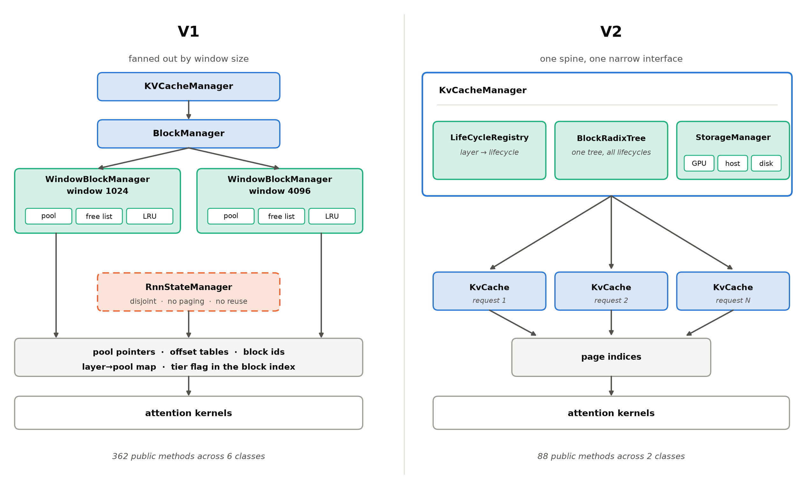
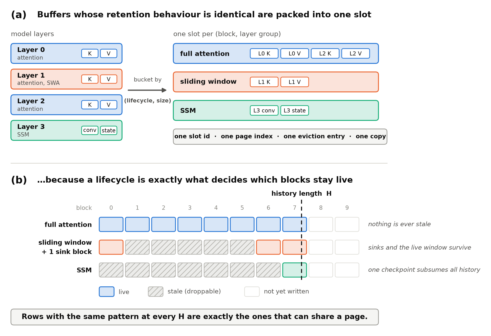
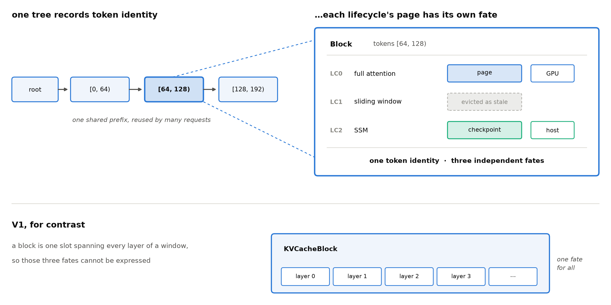
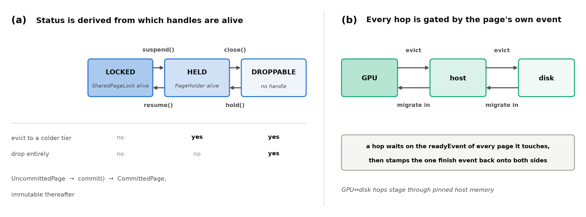
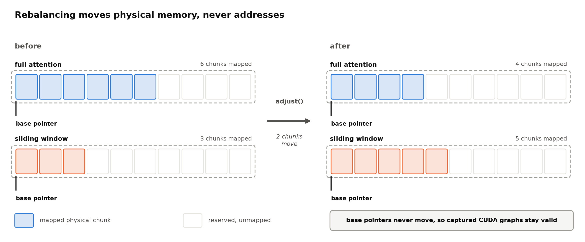

# KVCacheManagerV2: Redesigning KV Cache Management in TensorRT LLM

By NVIDIA TensorRT LLM Team

**Table of Contents**
- [Introduction and Motivation](#introduction-and-motivation)
- [What KVCM2 Is For](#what-kvcm2-is-for)
- [KVCacheManagerV2 Design](#kvcachemanagerv2-design)
  - [Terms](#terms)
  - [Design Philosophy](#design-philosophy)
  - [Describing a Model](#describing-a-model)
  - [Lifecycles: Grouping Buffers Into Big Pages](#lifecycles-grouping-buffers-into-big-pages)
  - [One Tree, Multiple Lifecycles](#one-tree-multiple-lifecycles)
  - [Pages, Locks, and Tiers](#pages-locks-and-tiers)
  - [Tracking Data Dependencies](#tracking-data-dependencies)
  - [Elastic Memory](#elastic-memory)
  - [Suspend, Resume, and Scratch Slots](#suspend-resume-and-scratch-slots)
  - [Block Keys and Reuse Scopes](#block-keys-and-reuse-scopes)
  - [The Public API](#the-public-api)
  - [Flexibility in Practice](#flexibility-in-practice)
- [Current State](#current-state)
- [Future Work](#future-work)
- [Acknowledgment](#acknowledgment)

## Introduction and Motivation

The KV cache is the largest and most contended resource in an LLM inference server. It decides how many requests fit on a GPU, how much of a conversation can be reused across turns, and how long a million-token context takes to prefill. Everything else — scheduling, batching, attention kernels, disaggregated serving — negotiates with it.

TensorRT LLM's original KV cache manager, which we will call V1 throughout this post, served that role from the start and still runs behind a good deal of production traffic. But over the past two years the shape of the models it manages changed faster than the shape of the manager could follow. Sliding-window attention arrived, then *variable* sliding-window attention (VSWA) where the window alternates layer by layer. State-space and Mamba layers arrived, whose "cache" is not a growing list of tokens at all but a fixed-size recurrent state. Sparse attention arrived, attaching auxiliary per-layer buffers with their own shapes and dtypes. Each was accommodated, and each accommodation left a mark.

KVCacheManagerV2 (KVCM2) is a ground-up redesign built around a single question: *which buffers, across which layers, live and die together?* Answering that question explicitly — instead of assuming the answer is "all of them" — is what lets one manager serve full attention, sliding-window attention, and recurrent state with a single prefix-reuse tree, a narrow public API, and first-class GPU/host/disk storage.

What that buys is capability: which models can be served well, and what it costs to add the next one. The sharpest example is below — for a hybrid Mamba model, V1 must disable prefix caching for the entire model, while V2 treats recurrent state as just another lifecycle and keeps reuse on.

## What KVCM2 Is For

KVCM2 exists so that a single manager — one prefix-reuse tree, one set of policies, one storage stack — can serve:

- **full and sliding-window attention together**, including variable windows that change layer by layer, with attention sinks, and with prefix reuse working across both;
- **recurrent and linear state as a first-class citizen**: a Mamba checkpoint is cached, matched, migrated and evicted by the same machinery as a KV page, so hybrid models keep prefix caching instead of giving it up;
- **per-layer buffer sets of any shape** — a sparse-attention layer's auxiliary indexer cache is simply another buffer the model declares, needing no new code in the manager;
- **GPU, host and disk as real tiers**, with pools that resize at runtime and preempted requests that are parked in host memory and resumed rather than recomputed.

All of it follows from one decision — grouping buffers by how long they live — and the rest of this post is about that decision and what falls out of it.

Why a new manager rather than an extension of the existing one? We tried the extension first: adding a single feature — letting a sliding-window model stop retaining out-of-window blocks — took months, produced two production bugs and left workarounds still being cleaned up the better part of a year later. The obstacles turned out to be structural. A cache block is one indivisible slot spanning every layer, so everything inside it must agree on its geometry; each window size gets its own manager, pool and eviction policy, with the memory split fixed at startup; recurrent state lives outside the cache altogether, which forces prefix caching off for an entire hybrid model; out-of-window blocks are released only during generation, so a 256-token window on a 128K prompt still pays 128K of allocations to prefill; and pool pointers, block IDs and offset tables are part of the interface that kernels and schedulers use, so none of it could be repaired behind the API. Each of those reappears below as something KVCM2 does differently.

<figure>
  
</figure>

<em>Figure 1: V1 and V2 KV cache manager architectures.</em>

## KVCacheManagerV2 Design

### Terms

- **Block** — a fixed run of tokens in a sequence; the unit of matching in the reuse tree.
- **Lifecycle** — a set of buffers, across layers, with identical retention behavior.
- **Coalesced buffer** — all buffers of one lifecycle that have the same size, laid out contiguously so that one index reaches every layer.
- **Pool** — a memory pool of fixed-size pages at one tier (GPU, host or disk).
- **Pool group** — pools that share slot IDs and grow and shrink together. Each serves one or more lifecycles; quotas and eviction are per pool group.
- **Slot** — one ID in a pool group: the memory one block needs for one lifecycle, across all of its layers and buffers.
- **Page** — a slot holding one block's data, together with its status, locks and readiness event. A page index names the whole slot; a kernel reaches one layer's part of it from that index and a per-layer offset.

### Design Philosophy

Five principles shape the design; each gets a section below.

- **Treat buffer contents as opaque.** The manager knows a buffer's role and its size in bytes, never its shape, dtype or layout.
- **Group by behavior, not by proxy.** Buffers share a page only if they are provably allocated, evicted and freed together.
- **Separate token identity from memory.** One tree records *which tokens*; pages record *which memory*.
- **Make data dependencies a property of the resource.** The CUDA event saying when a page is safe to touch is a field of that page.
- **Keep the public surface narrow and high-level.** Requests, tokens and page indices — nothing about how the cache is laid out.

### Describing a Model

KVCM2 does not accept a model shape as a bag of scalars. It accepts a list of layer descriptions, where each layer is either an attention layer or an SSM layer and carries its own list of buffers. An attention layer may also declare a sliding-window size and a number of sink tokens. Each buffer declares a role — key, value, block scales, indexer K, conv state — and its size in bytes per page.

Everything V1 had to make uniform is per-layer here. A sparse-attention layer needing an auxiliary indexer cache declares an extra buffer; a Mamba layer declares its conv state and SSM state as two buffers. Neither requires a new code path in the manager.

Note what a buffer description does *not* contain: no head count, no head dimension, no dtype, no element count, no notion of how keys and values are arranged relative to each other. A buffer is a role and a number of bytes; a page is a range of bytes; a migration is a byte copy. The role is just a name, never interpreted.

That knowledge has not vanished — it stays with the parties that need it. Layout is a contract among the model, the attention kernels that read the buffers, and, in disaggregated serving where prefill and decode may run at different parallelism, the KV transceiver that reshapes them in flight. The allocator is not one of those parties, and once it is out of the conversation a new attention variant can lay its memory out however its kernels prefer.

### Lifecycles: Grouping Buffers Into Big Pages

This is the central idea, and it is a memory-layout idea rather than a policy one.

Managing KV cache at the granularity of individual per-layer buffers is expensive. A 60-layer model with two buffer roles per layer has 120 buffers per block; tracking, allocating, evicting and migrating each separately means 120 page objects, 120 eviction-queue entries, 120 page-table indices and 120 small transfers every time that block moves between tiers. You want big pages.

You can only merge buffers into one page if they are always allocated, evicted, promoted and freed **together**. If two buffers could become droppable at different times, packing them into one page forces the whole page to stay resident for the longer-lived one, trading memory for bookkeeping. So the merging criterion is precisely: two buffers belong in the same page when their retention behavior is identical and tied — under every sequence length, the same blocks are live for both.

That equivalence relation is what a **lifecycle** names. Every buffer of every layer is bucketed by lifecycle and size, and each bucket is laid out contiguously as a single unit: the key buffers of all twenty full-attention layers become one contiguous region, reached by one index meaning "this block, for this entire lifecycle." Only equal sizes merge, since most attention kernels expect a page's size to be its stride, but differing sizes still share one allocation by being grouped into pools that grow and shrink together.

The payoff runs through the whole system: one page index, one page object, one eviction entry and one coarse byte copy per (block, lifecycle) instead of per (block, layer, role) — and deciding what must be resident each step becomes a computation over two or three groups rather than sixty layers.

A lifecycle expresses its retention behavior through exactly one function: given a history of *H* tokens, which of the sequence's blocks are *stale*? Three answers cover everything TensorRT LLM supports today:

- **Full attention** — the stale range is empty; no block ever dies.
- **Sliding window with sinks** — everything between the sink blocks and the first block of the live window is stale.
- **Recurrent state** — every block before the current checkpoint is stale, because the state already subsumes that history.

Each is a handful of lines of integer arithmetic over block ordinals, and that is the whole semantic difference between the three. Two lifecycles are equal — and therefore coalescable — when these functions agree for every input. A 36-layer GPT-OSS model with alternating windows collapses to two lifecycles, and because both end up with the same pool sizes, to a single allocation. A hybrid Mamba model collapses to two as well, one attention and one SSM. Downstream, everything — page allocation, eviction, migration, pool sizing, statistics — is indexed by lifecycle rather than by layer or window size.

V1 coalesces across layers too, but on a proxy: every layer sharing a window size, which breaks whenever layers differ in head count, head dimension, dtype or buffer count, and which cannot express a recurrent state at all. Grouping on the real relation is what makes aggressive coalescing safe, and adding a new retention behavior means adding one function.

<figure>
  
</figure>

<em>Figure 2: Lifecycles group buffers into big pages, and why the grouping must be by lifecycle.</em>

### One Tree, Multiple Lifecycles

The second structural idea follows directly. In V1 a tree node *is* a block of memory. In KVCM2 a tree node is a **token range** holding one page slot per lifecycle, left empty when that lifecycle has nothing cached for those tokens. Each slot is itself a coalesced multi-layer slot, so even a 60-layer model's tree node holds two or three of them.

This decouples which tokens — tree structure, shared globally across requests — from which memory, sized and evicted per lifecycle. A block covering tokens [512, 576) may hold a full-attention page, a sliding-window page and an SSM checkpoint at once, or only some of them, if the sliding-window page was already dropped as stale while the full-attention page survives. That last case is exactly what a per-window V1 block cannot express: the two share a token identity but not a fate.

Matching is therefore two-phase: find the longest token prefix by walking the tree, then shorten it until every lifecycle can actually serve it. Shortening is iterative, because a shorter history moves the stale ranges and can expose a requirement that was not there a moment ago; since every retry strictly shortens the match, it terminates. The phase is what makes sliding-window prefix reuse work at all — a sliding-window lifecycle is never asked for pages covering blocks it would have discarded anyway, only for its sink blocks and its trailing window.

Multi-turn conversations show what this buys. Under the `per_conversation` reuse policy, a conversation's full-attention pages are committed as usual, but its sliding-window blocks and SSM state are kept only at the ends of the last `max_num_turns` turns. Older turns lose those copies while their full-attention pages stay in the tree, so the next turn — or an agent's next tool call — still matches its whole history for a fraction of the memory.

<figure>
  
</figure>

<em>Figure 3: A radix-tree block holds one page slot per lifecycle.</em>

### Pages, Locks, and Tiers

Pages carry an explicit status that governs what the system may do to them. A `LOCKED` page is pinned at its required storage tier and can be neither evicted nor dropped; a `HELD` page may migrate to a colder tier but not be dropped; a `DROPPABLE` page may be either. The status is not stored — it is derived from the page's reference counts, which RAII handles maintain as they are taken and dropped.

Storage is a stack of cache levels: GPU, host and disk, where disk is a real tier with its own eviction rather than a debug path. Freeing space cascades — evicting *N* GPU pages pushes them to host, recursing if host is also full, and at the last level pages must be droppable and are simply released. Migration is always batched, so resuming a suspended request with 200 host-resident blocks is a handful of copies rather than 200.

A page need not keep the same representation on every tier. A pluggable **cold-page codec** re-encodes pages once they leave the GPU, which is buffer opacity paying off again: because the core never interprets a page's contents, a codec may represent them however it likes. KV cache compression is the first use.

<figure>
  
</figure>

<em>Figure 4: Page status and tier migration.</em>

### Tracking Data Dependencies

KVCM2 ties memory access to synchronization through page locks. Before a request uses a page it acquires a lock, which keeps the page resident and makes the request's CUDA stream wait on the page's readiness event. Releasing the lock records completion of that stream's use, so a later migration or recycle can wait until the access has actually finished.

Compute and transfer streams therefore proceed independently, with events — not stream order — governing their access to shared memory. The rule is simple: acquiring access carries a readiness dependency; releasing access carries a completion dependency. There is no separate protocol for migration, eviction or reuse, and no way for a caller to forget one, because the lock is the only way to obtain the memory.

### Elastic Memory

Within each level, lifecycles map to pool groups with a per-group quota and priority-ordered LRU eviction. Because a slot already spans an entire lifecycle, one eviction decision moves all of that group's layers at once. Two mechanisms make the split elastic where V1's is static.

**CUDA virtual memory.** The obvious way to resize a pool — allocate a new buffer, copy, free the old one — is unusable, and the reason is CUDA graphs. TensorRT LLM captures the decode step into CUDA graphs during warmup and replays them for the rest of the run, and a captured graph freezes the device addresses its kernels were captured with. Move a KV pool and every captured graph points at an address that is no longer valid; the only recovery is re-capture, which costs more than the rebalancing was worth. So each GPU pool reserves a virtual address range once and maps physical chunks into it on demand. Growing or shrinking changes only *which physical pages back that range*, and the base address baked into every captured graph never moves.

**Ratio-driven rebalancing.** Pool ratios are derived during warmup and, by default, stay there. Setting `enable_kv_pool_rebalance` turns on an auto-tuner that retargets them between iterations from observed traffic — clamped by a floor that keeps a configured set of batches runnable, so it can never tune the system into being unable to serve its guaranteed workload. For a hybrid Mamba model it is what lets the attention KV pool and the Mamba state pool find their own balance for the workload actually being served, rather than the one guessed at startup.

<figure>
  
</figure>

<em>Figure 5: Elastic pools over CUDA virtual memory.</em>

### Suspend, Resume, and Scratch Slots

Two capabilities fall directly out of the page-status machine.

**Preemption without recomputation.** When the scheduler needs to evict a request, `suspend()` demotes its locks to holders, taking its pages from `LOCKED` to `HELD`: eligible to migrate to host or disk, but not to be dropped. `resume()` reverses it, batch-migrating whatever moved back to GPU, and the request keeps its place in the tree and its committed prefix throughout. Where V1 must drop a preempted sequence and recompute its prefill, V2 can park it in host memory and bring it back.

**Scratch slots for sliding-window prefill.** When a prefill chunk is longer than the window, most blocks it writes are already out of window by the end of the step; their KV data is needed only while each layer attends over the chunk. These blocks form the scratch range, and they get shared scratch slots instead of pages of their own. Only one layer runs at a time, so scratch blocks share a slot's per-layer parts: *n* scratch blocks in an *L*-layer lifecycle need about *n / L* slots. For example, a 32K-token chunk over a 128-token window with 64-token blocks leaves about 510 scratch blocks, which 24 sliding-window layers serve from about 22 slots. Scratch memory therefore grows with the chunk size for a single layer, not with the window or the layer count. The trade-off is that scratch blocks keep nothing after the step, so later requests cannot reuse them. We have not seen this technique described elsewhere; as far as we know it originated here.

### Block Keys and Reuse Scopes

Prefix identity is a SHA-256 chain: the root key is the digest of the request's reuse scope — an optional LoRA task ID and an optional user-supplied `cache_salt` — and each block key is the digest of the previous key concatenated with that block's tokens. A cryptographic hash is a deliberate security boundary, since the tree is a cross-tenant index matched purely by digest equality, and each distinct reuse scope gets its own root, so tenant isolation is structural rather than probabilistic. Because the chain folds in both the scope and the entire preceding history, a block key is globally unique on its own: the tree is a convenience, not a requirement, and the same keys would work unchanged in a flat hash map.

### The Public API

A request is a `KvCache` object with a small, explicit lifecycle. It starts `SUSPENDED`, becomes `ACTIVE` through `resume()`, and must eventually be `close()`d. In between it matches its tokens against the tree, allocates pages for whatever did not match, brings matched pages to GPU, and `commit()`s completed blocks back for other requests to reuse.

One thing in that interface has no V1 counterpart: a request carries **three distinct lengths**, not one.

- **Capacity** — how far the request has pages reserved. It bounds where writes may land, including tokens still in flight.
- **History length** — how much of that is finalized: KV data that will not change again. This, not capacity, is what a lifecycle's stale range is computed against, so it alone decides what a sliding window may drop.
- **Committed tokens** — the prefix published into the tree, and therefore the only part other requests can reuse.

They are nested — committed ≤ history ≤ capacity — and both gaps are load-bearing. Between history and capacity sit the input tokens of the step being run, the space their KV data is about to be written into; ordinary decoding keeps one token there, a prefill chunk or a speculative-decoding step many. Between committed and history sits data that is final for this request but deliberately not yet shared. V1 models none of this, keeping one count per sequence and leaving the runtime to track on its own which tokens are reserved, which are settled and which are safe to hand to another request — knowledge the cache manager is in the best position to hold.

The kernel-facing contract is correspondingly narrow. Kernels need the base address of each pool to pair with an index, and the manager reports those once, when storage is set up, not per step. Beyond that there are no block IDs, no offset tables and no window-size parameters: the caller supplies one `int32` buffer per lifecycle, and the manager writes that lifecycle's page indices straight into it, so a batched runtime can hand over rows of its own table and have them filled in place. The whole public surface is 88 methods across two classes, against V1's 362 across six.

### Flexibility in Practice

The design's real test came from models that did not exist when it was written. Supporting DeepSeek-V4 and Kimi K3 — two architectures with genuine structural novelty — required **no new features in the KVCM2 core**.

DeepSeek-V4 brought sparse attention with auxiliary per-layer indexer buffers carrying their own shape and dtype, precisely the case V1's unified pool cannot represent. KVCM2 needed no new pool species, because "an extra buffer on this layer, with this role and this size" is already all a model description says.

Kimi K3, a hybrid linear-attention model, gives the cleanest number: bringing it up changed 545 lines, of which **35 insertions and 16 deletions were in the C++ core** — and those were fixes to existing behavior rather than new capability. The rest went where it belongs: the model definition, a hybrid cache-manager subclass, manager selection and new tests.

That is the extension pattern in general. A model needing more than pages — extra bookkeeping, its own snapshot policy, a second kind of state — gets a model-specific resource manager built on top of KVCM2 and describes its layers and buffers. The core stays a general-purpose page allocator that has never heard of the model, and contains zero references to any model name.

## Current State

KVCM2 is now the default KV cache manager; V1 is reached only by asking for it or by tripping one of the few feature combinations V2 does not yet serve. See the [user guide](../../features/kvcache.md#selecting-the-kv-cache-manager) for configuration. The implementation spent its first year in pure Python, chosen to lower the barrier for outside contributors, and was translated to C++ once coding agents made the implementation language a much weaker constraint on who can contribute than the language a team's reviewers know best.

## Future Work

- **Sparse attention**: HiSparse-style schemes keep a *selected* subset of a sequence's history resident at each step rather than a contiguous window.
- **Retiring V1**: With V2 the default, V1 survives only as the fallback for the last feature combinations V2 does not yet serve. As those close out, so does V1.

## Acknowledgment

KVCacheManagerV2 is the work of many people across the TensorRT LLM team, spanning design, implementation, integration, review and testing. We thank everyone who contributed, and the reviewers in particular.
