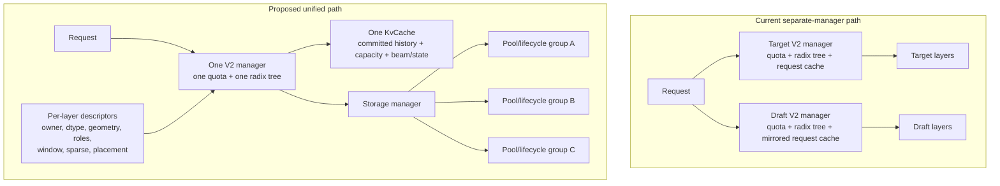

<!-- SPDX-FileCopyrightText: Copyright (c) 2026 NVIDIA CORPORATION & AFFILIATES. All rights reserved. -->
<!-- SPDX-License-Identifier: Apache-2.0 -->

# Target and draft KV cache unification in KV Cache Manager V2

> **Audit basis:** upstream `main` at `dc8451c50864edc07c75dedeafcb91dbb7a5d478`
> (fetched October 12, 2026).

## Executive verdict

The central framing is correct:

> A unified manager owns one committed request timeline. Layer-specific storage
> geometry may differ, but request state, allocation, reuse depth, and admission
> cannot.

The original report is also correct that reuse policy is already a per-layer
configuration. The audit has four material corrections and one remaining
reuse-policy wiring requirement:

1. **Per-layer reuse policy already exists in the V2 C++ and Python contracts.**
   `AttentionReusePolicy` defines `REQUIRED`, `PRIVATE`, and `OPTIONAL`;
   `AttentionLayerConfig.reusePolicy` defaults to `REQUIRED`. The remaining
   manager change is to choose and pass the policy explicitly when building
   target and draft layer configurations.
2. **`is_draft` should not simply become a per-layer flag.** Some behavior
   disappears under unification, some becomes request-wide, and only some
   becomes layer metadata.
3. **Per-layer heads, dimensions, and windows are supported by allocation, but
   not by all speculative-decoding mutation kernels.**
4. **Mixed dtype requires more than a `get_layer_dtype()` accessor.** Storage is
   already byte-oriented, but much of the Python/runtime layer assumes one dtype
   and one cache type.
5. **Capacity accounting cannot remain unchanged.** Lifecycle registry behavior
   can remain, but estimation, budget splitting, pool sizing, and speculative
   headroom must be recomputed for the combined layout.

The existing limited one-manager speculative path, which appends speculative
layers after the target layers, is a useful starting point. It currently
inherits target-wide assumptions for dtype, layout, and several runtime
operations ([`_util.py`](../../../tensorrt_llm/_torch/pyexecutor/_util.py)).

## Proposed model



A useful refinement is to distinguish:

- **Committed timeline:** one history length and reuse depth for the request.
- **Speculative scratch tail:** one conservatively sized allocation extent,
  within which different layer groups may temporarily use different
  token-position mappings.

That distinction permits one `KvCache` without requiring target and draft
temporary data layouts to be identical.

## Audit of the original report

| Claim | Verdict | Audit |
|---|---|---|
| One `KvCache` per request | **Correct** | This is the fundamental unification invariant. Capacity, committed history, beam state, suspension, and request lifetime become shared. |
| One logical block grid and radix tree | **Correct, with nuance** | `tokens_per_block` is manager-wide. Individual buffers may use a `tokensPerBlockOverride`, but it must divide the logical block size ([`config.h`](../../../cpp/tensorrt_llm/batch_manager/kv_cache_manager_v2/config.h)). |
| One reuse depth | **Correct, with policy semantics** | The request has one claimed reuse endpoint. `REQUIRED` lifecycles constrain that endpoint, `OPTIONAL` lifecycles are checked for complete coverage there without shortening it, and `PRIVATE` lifecycles do not participate ([`kvCache.cpp`](../../../cpp/tensorrt_llm/batch_manager/kv_cache_manager_v2/kvCache.cpp)). |
| One quota, eviction policy, and resume gate | **Correct** | These are manager/request policies and cannot differ between target and draft in a single manager. |
| One sharding scheme | **Correct for the initial implementation** | The current manager has one `Mapping`. Target and draft rank ownership must be representable by that mapping. Helix and other specialized layouts need explicit compatibility checks. |
| One manager specialization | **Mostly correct** | It may be one existing specialization or a composite implementation that supports the union of required hooks. “Same existing class” need not be a permanent restriction. |
| Per-layer heads and head dimension | **Partially correct** | Construction accepts per-layer values, but accepted-token relocation currently requires uniform heads and one local pool ([`kv_cache_manager_v2.py`](../../../tensorrt_llm/_torch/pyexecutor/kv_cache/kv_cache_manager_v2.py)). |
| Per-layer window and sink tokens | **Partially correct** | C++ lifecycle identity supports both window and sink tokens. The generic Python builder currently supplies a per-layer window but always passes `num_sink_tokens=None`. |
| Per-layer buffers and byte sizes | **Correct** | C++ groups buffers by lifecycle and expanded byte size; storage does not require identical layer geometry ([`storage/config.cpp`](../../../cpp/tensorrt_llm/batch_manager/kv_cache_manager_v2/storage/config.cpp)). |
| Sparse and dense layers | **Correct** | `isSparse` is lifecycle identity, and sparse/dense storage pools are separated even when slot sizes match. |
| Per-layer addressing | **Correct, with wording adjustment** | Layers share the request row and committed timeline, but different layers may select different pool groups through `kv_cache_pool_mapping`. They do not necessarily use the same physical block-offset array. |
| Per-layer dtype needs wiring | **Correct, but understated** | C++ storage is byte-oriented, but Python buffer views, cost calculations, attention backends, quantization scale roles, relocation, cold codecs, and disaggregation commonly read a manager-wide dtype. |
| Per-layer reuse policy already exists | **Correct** | `AttentionReusePolicy` and `AttentionLayerConfig.reusePolicy` are present in C++, included in lifecycle identity and pool grouping, and exposed as `reuse_policy` in Python ([`config.h`](../../../cpp/tensorrt_llm/batch_manager/kv_cache_manager_v2/config.h), [`lifeCycleRegistry.h`](../../../cpp/tensorrt_llm/batch_manager/kv_cache_manager_v2/lifeCycleRegistry.h), [`__init__.pyi`](../../../tensorrt_llm/runtime/kv_cache_manager_v2/__init__.pyi)). `BlockReusePolicy` remains a separate manager-wide request-scope policy. |
| Stats, connectors, and events are all skipped for draft | **Partially incorrect** | Request stats and connectors have `is_draft` gates. Event-manager construction itself is not categorically disabled for draft managers. |
| Dynamic-tree headroom becomes request-wide | **Correct** | The unified cache must reserve enough scratch capacity for the larger target/draft requirement. The over-reservation is not necessarily small; it depends on `topK`, tree width, draft length, and layer costs. |
| Compatibility reduces to specialization, sharding, and block size | **Incomplete** | These are necessary but not sufficient. Placement, buffer roles/layout, reuse identity, relocation capability, and transfer/codec support also matter. |
| Registry invariant and capacity accounting stay unchanged | **Half correct** | Lifecycle registry semantics can remain. Capacity and quota accounting must change because two independently sized managers become one composite manager. |

## Recommended changes

### 1. Introduce one canonical per-layer cache descriptor

Define a compact internal descriptor directly in `kv_cache_manager_v2.py`:

```python
@dataclass(frozen=True)
class KVCacheLayerSpec:
    global_layer_id: int
    owner: LayerOwner                 # TARGET or DRAFT
    dtype: DataType
    num_kv_heads: int
    head_dim: int
    buffer_roles: tuple[DataRole, ...]
    sliding_window_size: int | None
    num_sink_tokens: int | None
    reuse_policy: AttentionReusePolicy
```

The tuple position is the C++ local layer id. Manager construction and the
pre-construction cost classmethods consume the same target-plus-draft sequence.
There is no separate layout module or transfer-policy abstraction in the first
implementation.

`draft_layer_ids` should be derived from `owner`, rather than serving as the
only source of layer identity.

**Justification:** This prevents dtype, buffer roles, cache type, placement, and
geometry from developing separate parallel lists with inconsistent indexing.

### 2. Make dtype genuinely per layer

Add accessors such as:

```python
get_layer_dtype(global_layer_id)
get_layer_bytes_per_token(global_layer_id, role)
get_layer_buffer_roles(global_layer_id)
```

Then update:

- `BufferConfig` construction.
- Tensor views returned by `get_buffers()`.
- KV byte and capacity calculations.
- NVFP4/FP8 scale-buffer handling.
- Attention backend dtype lookup.
- Cold-page codecs.
- Disaggregated transfer descriptors.
- Accepted-token relocation.

Do **not** add dtype to `AttnLifeCycle`. Lifecycle identity describes retention
and reuse behavior; storage already separates incompatible byte sizes.

The existing manager-wide `.dtype` can temporarily remain valid only for
homogeneous layouts. Mixed layouts should fail loudly until every consumer has
moved to a layer-aware accessor.

**Justification:** Otherwise allocation may be correct while kernels interpret
the bytes using the wrong element type.

### 3. Replace manager-wide `kv_cache_type` assumptions with per-layer roles

The wrapper currently derives a manager-wide `kv_factor` from `SELFKONLY`
versus ordinary K/V storage. C++ already understands arbitrary per-layer
`BufferConfig` roles.

Move toward descriptors such as:

```text
Target layer 0:   K + V
Target MLA layer: K only
Draft layer 48:   K + V
FP4 layer:        K + V + K_SCALE + V_SCALE
```

**Justification:** Dtype unification alone is insufficient if target and draft
use different physical roles or quantization metadata.

### 4. Split `is_draft` by responsibility

Do not replace manager-level `is_draft` with a layer-level boolean everywhere.
Use the following disposition:

| Existing `is_draft` responsibility | Unified disposition |
|---|---|
| Separate request mirror and draft admission | **Eliminate** in the unified path |
| Separate request index and release behavior | **Eliminate** |
| Draft-layer identification | `KVCacheLayerSpec.owner` |
| Dynamic-tree generation reserve | Request-wide `SpeculativeCapacityPolicy` |
| Accepted-token relocation | Explicit target/draft layer sets or homogeneous layer groups |
| Block publication | One radix tree, with publication governed by each lifecycle's existing reuse policy |
| Reuse backoff | One conservative request-wide backoff |
| Stats | Record once; optionally aggregate by layer owner |
| Events | Emit one unified event stream; owner tags are optional metadata |
| Connectors/disaggregation | Transfer the complete required layer set by default |
| Cold-page codec | Select codec/dtype by layer or buffer |
| SWA scratch reuse | Capability decision per lifecycle; initially disable for mixed target/draft managers |
| Helix and special layouts | Compatibility rejection until their ownership model supports the combined layout |

**Justification:** Most existing draft branches exist because there are two
managers. Preserving those branches as per-layer behavior would retain
unnecessary complexity.

### 5. Wire the existing reuse policy and define the draft default

The current V2 core already implements the required policy semantics:

- `REQUIRED` lifecycles constrain the common prefix match.
- `OPTIONAL` lifecycles do not shorten the `REQUIRED` match. Their coverage is
  checked at that endpoint, and the caller selects complete optional groups on
  the first resume. Missing or unselected groups receive fresh pages for
  recomputation.
- `PRIVATE` lifecycles remain request-local and are neither published to nor
  reused from the radix tree.

The policy participates in `AttnLifeCycle` identity, and storage keeps distinct
reuse policies in separate pool groups. The request-side implementation is in
[`kvCache.cpp`](../../../cpp/tensorrt_llm/batch_manager/kv_cache_manager_v2/kvCache.cpp),
while the Python contract exposes `reuse_policy` in
[`__init__.pyi`](../../../tensorrt_llm/runtime/kv_cache_manager_v2/__init__.pyi).

The manager-first work therefore needs to:

1. Add `reuse_policy` to the composite layer descriptor.
2. Set `AttentionLayerConfig.reuse_policy` explicitly in the Python config
   builder instead of relying on its `REQUIRED` default.
3. Map returned layer-group status back to target/draft ownership.
4. Have the scheduler select available `OPTIONAL` groups on first resume.
5. Ensure missing or unselected draft groups are recomputed before a draft
   forward consumes that prefix.

The appropriate draft policy is an algorithm contract:

- **`REQUIRED`** is the safest initial default. Draft coverage limits the shared
  reuse endpoint, so no catch-up path is needed. This matches the original
  report's recommendation when draft KV must be reused with target KV.
- **`OPTIONAL`** allows target KV to determine the reuse endpoint and reuses
  draft KV only when complete there. Use it only when the algorithm can
  explicitly reconstruct a missing draft prefix from target state.
- **`PRIVATE`** always reconstructs the draft prefix and is useful only when
  publishing draft KV is undesirable or unsupported.

Also ensure the radix reuse identity includes every target and draft setting
that can change generated KV, including model or adapter identity where
applicable.

### 6. Rework capacity and budget accounting

For an eligible unified configuration:

- Do not split `max_gpu_total_bytes` between target and draft.
- Do not split host or disk-tier budgets.
- Build one composite storage configuration containing all layers.
- Run pool-ratio selection over the combined lifecycle and buffer groups.
- Compute per-request fixed and variable cost from the composite descriptor.
- Use the larger speculative scratch requirement across target and draft.
- Apply `max_util_for_resume`, eviction, and quota retuning once.

The current V2 path explicitly splits draft budgets when a separate manager is
selected ([`_util.py`](../../../tensorrt_llm/_torch/pyexecutor/_util.py)). That
logic must be bypassed for a unified plan.

**Justification:** Adding the independently calculated target and draft
capacities does not necessarily yield the capacity of one shared request
timeline.

### 7. Add layer-group-aware relocation primitives

Current accepted-token relocation assumes:

- One attention window.
- Uniform KV heads.
- One local KV pool.
- One dtype or element size.
- One broad layer range.

Those assumptions are enforced directly in
[`_update_kv_cache_draft_token_location()`](../../../tensorrt_llm/_torch/pyexecutor/kv_cache/kv_cache_manager_v2.py).

Introduce a manager-level operation conceptually like:

```python
relocate_speculative_tokens(
    requests,
    layer_ids,
    source_positions,
    destination_positions,
)
```

The manager should partition `layer_ids` into compatible execution groups, for
example by:

```text
(pool, buffer role, dtype, head geometry, window/layout)
```

Each group can invoke an appropriate relocation kernel. Once every required
group has been relocated, the shared `KvCache` can be rewound or advanced once.

**Justification:** This is the main place where “storage supports heterogeneous
layers” currently fails to imply “speculative decoding supports heterogeneous
layers.”

### 8. Define an explicit compatibility check

Return a structured result rather than a boolean:

```python
UnifiedKvCacheCompatibility(
    supported=True,
    reasons=(),
)
```

A target/draft pair is compatible only when:

- They can share one committed request timeline and beam width.
- They use the same logical `tokens_per_block`.
- Their layer placement and TP/PP/CP ownership fit one mapping.
- One manager implementation can express the union of buffer roles and hooks.
- All dtype/layout consumers are layer-aware.
- The speculative relocation implementation supports the resulting pool groups.
- Reuse hashing and backoff are valid for both models.
- Connectors, offload codecs, and disaggregation can transfer the required union.
- Specialized features such as Helix, DSA, Mamba state, or model-specific
  buffers explicitly declare support.

In the eventual design, dtype, heads, dimensions, and windows should not
independently reject unification. Until their consumers are migrated, they
remain implementation capability gates.

## Suggested implementation order

1. Add `KVCacheLayerSpec` directly to `KVCacheManagerV2` without changing
   runtime behavior.
2. Centralize all per-layer geometry and byte calculations behind the
   descriptor.
3. Implement per-layer dtype and buffer-role accessors.
4. Wire `AttentionLayerConfig.reuse_policy` from the composite descriptor and
   add scheduler selection/recomputation handling for `OPTIONAL` draft groups.
5. Add the structured compatibility checker and retain the separate-manager
   fallback.
6. Build one V2 C++ storage configuration from target plus draft layers.
7. Replace `is_draft` with request-wide policy, layer ownership, or deletion
   according to the table above.
8. Rework composite capacity estimation and stop splitting budgets.
9. Add grouped relocation APIs.
10. Enable unification for the simplest speculative algorithm first.
11. Migrate additional algorithms one by one, expanding the compatibility
    checker as each gains support.

For the initial rollout, use these conservative defaults:

- Default target and draft lifecycles to `REQUIRED`; enable `OPTIONAL` only for
  algorithms with a validated draft-prefix recomputation path.
- Use the maximum required reuse backoff.
- Reserve the maximum speculative scratch width request-wide.
- Disable SWA scratch reuse for mixed managers until validated.
- Reject unsupported CP/Helix/specialized layouts.
- Preserve the existing separate-manager path as the fallback.

## Revised contract

> A unified V2 KV-cache manager owns one committed timeline, one request cache,
> one logical block grid, one radix-tree reuse depth, and one memory quota for
> the target and draft layers. Each layer independently describes its buffer
> roles, dtype, geometry, retention lifecycle, sparsity, and physical pool
> mapping. Speculative tails may use layer-specific temporary layouts inside a
> shared request-wide allocation, but committing, rewinding, suspending,
> resuming, and reusing the request occur once and at a common history position.
