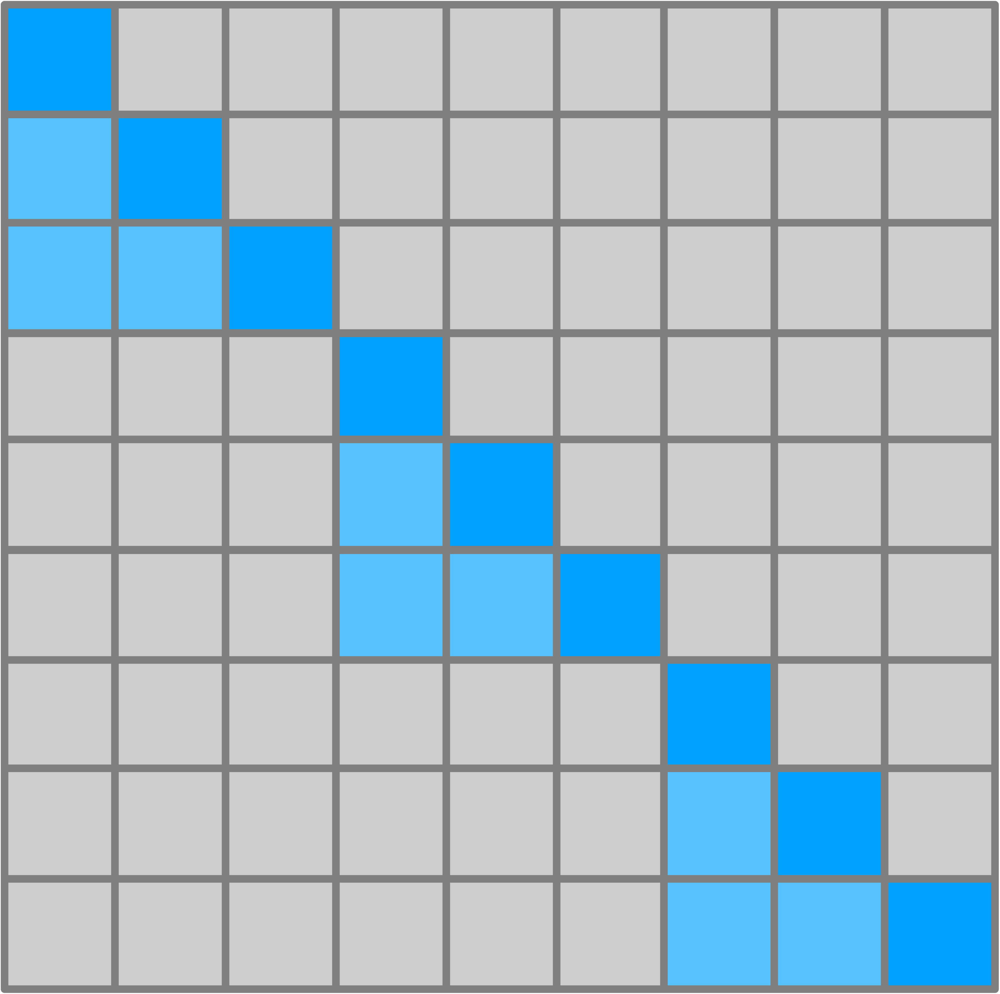
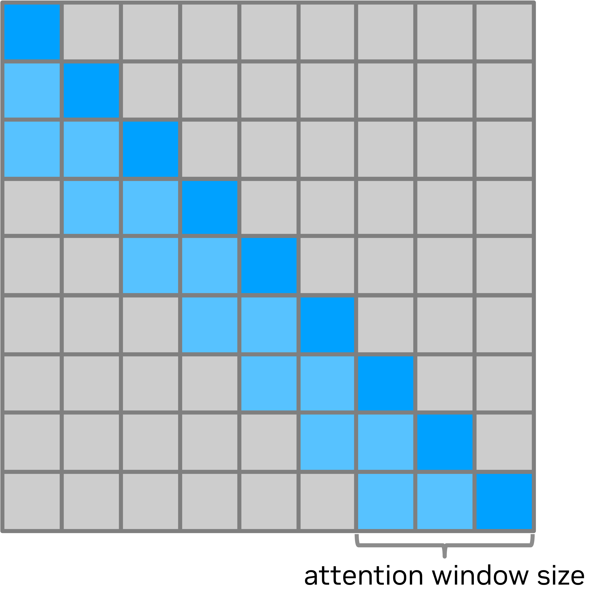

# Long Sequences

In many real-world scenarios, such as long documents summarization or multi-turn conversations, LLMs are required to perform cognitive tasks across long sequences to get better results. This will present challenges to the LLM inference. TensorRT LLM can support different methods to process long sequences efficiently. This document will introduce those optimization techniques.


## Chunked Context

Chunked context allows TensorRT LLM to divide the input tokens into smaller chunks and batch those chunks with the decode requests.

With the chunked context feature, there are two benefits:
- This can prevent the context phase from becoming a bottleneck, enable more parallelization with tokens in the decode phase, and increase GPU utilization.
- Chunked context allows TensorRT LLM to handle requests with longer contexts while achieving higher concurrency. Since memory usage depends on the number of tokens processed per iteration, chunked context decouples memory consumption from the input request's context length, changing it to the smaller chunk size. This enables TensorRT LLM to process longer contexts without increasing memory requirements, which can also help increase the concurrency under the same memory consumption.

To enable chunked context, please set the `enable_chunked_prefill` in `LLM` API to `True`.
```python
    llm = LLM(
        ...
        enable_chunked_prefill=True,
        ...
    )
```

Note that if chunked context is enabled, please set the `max_num_tokens` to be an integer multiple of the kv-cache block size `tokens_per_block`. The generic `KvCacheConfig.tokens_per_block` defaults to 32, but some model and attention-backend combinations select a different block size (for example, FlashMLA uses 64 and FP4 MLA attention uses 128), so align `max_num_tokens` with the `tokens_per_block` actually in effect for your configuration.

## Chunked attention

<div align="center">
<figure>
  
</figure>
</div>
<p align="center"><sub><em>Figure 1. Illustration of chunked attention </em></sub></p>

Instead of splitting the input tokens into smaller chunks for the whole model, chunked attention is another method that is only applied to the attention layers in models.

Chunked attention divides a sequence into chunks of a specified size. Each token attends only to itself and earlier tokens in its own chunk, as illustrated in Figure 1 for a chunk size of 3. This applies during context processing and, with the TRTLLM backend's native generation kernels (MMHA and TRTLLM-Gen through the XQA dispatcher), during generation. Both the KV cache size and the attention computation can be significantly reduced.

Currently TensorRT LLM can only support chunked attention in llama4 model with TRTLLM attention backend. TensorRT LLM will read `attention_chunk_size` from the model config. If it is not None, the chunked attention will be enabled with chunk size `attention_chunk_size`. If you want to enable chunked attention to other models, you can set the `attention_chunk_size` in attention API to a valid value.

Generation chunking is not supported by the FlashInfer TRTLLM-Gen kernels, which are preferred by default for supported configurations with beam width 1 on Blackwell (SM100/SM103), or by tree-based speculative decoding. On Hopper, Llama4 disables chunked attention in both phases when speculative decoding is enabled. On the supported native generation paths, chunking is enabled by default.

```{warning}
Leave `TRTLLM_DISABLE_CHUNKED_ATTENTION_IN_GEN_PHASE` unset when using chunked attention. In the MMHA fallback, setting it to `1` disables the chunk mask but retains the chunk-size limit used to size shared memory and distribute KV work. For sequences longer than a chunk, this can cause incorrect attention results or out-of-bounds shared-memory accesses. The setting is not a safe general-purpose way to disable generation chunking in the current implementation.
```

For configurations supported by the native fallback kernels, set `TLLM_FMHA_LIBS=fallback` before initializing the model to select that path. This setting also restricts kernel selection during context processing.

## Sliding Window Attention

<div align="center">
<figure>
  
</figure>
</div>
<p align="center"><sub><em>Figure 2. Illustration of sliding window attention </em></sub></p>


Since attention layers are usually the performance bottleneck when processing requests with long sequences, sliding window attention is an effective method to limit the attention span of each token to a fixed size window around it, dramatically reducing the amount of computation and memory required.

Figure 2 shows the sliding window attention mask. Each token will only attend to the past `N` tokens. If the number of past tokens surpasses the max attention window size, `Sliding Window Attention` will be activated.

TensorRT LLM treats the kv cache as a circular buffer to support this feature, which is also called `Cyclic KV Cache`. It only stores the kv cache for the last `N` tokens, where `N` is determined by the `KvCacheConfig.max_attention_window` parameter in `LLM` API. TensorRT LLM allows different `N` values for each layer and users can simply provide a `list[int]` to the `KvCacheConfig.max_attention_window`. To enable this feature, users can set
```python
    kv_cache_config = KvCacheConfig(
        ...
        max_attention_window = [...],
        ...
    )
    llm = LLM(
        ...
        kv_cache_config=kv_cache_config,
        ...
    )
```
If the number of the provided elements in `KvCacheConfig.max_attention_window` is less than the number of layers, the provided list will be repeated multiple times to the number of layers to set unique values for each layer. However, it's important to note that the memory allocation for the kv cache still relies on the buffer's maximum value.

Note that the `Sliding Window Attention` feature doesn't work with beam searching currently as the context kv cache is shared across beams.
