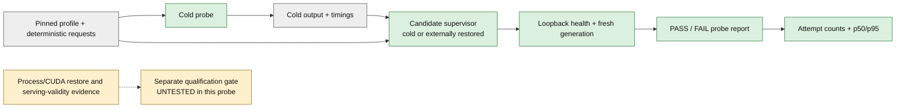

<!--
SPDX-FileCopyrightText: Copyright (c) 2026 NVIDIA CORPORATION & AFFILIATES. All rights reserved.
SPDX-License-Identifier: Apache-2.0
-->

# Low-Level HTTP Startup Probe

This optional CPU-testable probe measures an externally supplied foreground HTTP
candidate. It does not implement capture/restore and cannot qualify Snapshot.
Use the [standalone qualification runner](README.md) for the real host workflow.

## Probe Workflow



Gray is input/evidence, green is executable probe behavior and amber is unfinished
qualification evidence. Solid arrows are data flow. The dashed arrow is a required
evidence boundary, not an implemented adapter.

The probe launches the supplied foreground command in a new POSIX process group.
It requires a numeric loopback address, bounds HTTP time and response size, checks
deterministic completions, and terminates its owned process group. Every launched
attempt retains a JSON report, including failures. Existing run directories are
rejected.

Do not use a command that detaches, creates a new session, or restores children
outside that process group. Container/MPI supervisors must explicitly own their
complete workload lifetime. The probe cannot prove CRIU or remote cleanup.

## Native Cold Baseline

Use a test host with the matching TRTLLM runtime and local model weights. Set
`LLM_MODELS_ROOT` for model-based tests. Pin the model, tokenizer, quantization,
TRTLLM/Snapshot builds, container/wheel, CPU/driver/GPU, MPI/transport, graph and
cache settings in a private `profile.json`. The profile is operator-declared
JSON, not hardware attestation or the final compatibility-manifest schema.

Create a private `requests.json` with deterministic, non-streaming requests:

```json
[
  {
    "model": "Qwen3-0.6B",
    "prompt": "The capital of Germany is",
    "temperature": 0,
    "max_tokens": 8,
    "stream": false
  }
]
```

Use the server's actual model name consistently. Launch one frontend; the native
`--report_addr` path reports the actual port selected by `--port 0`.

```bash
python scripts/snapshot_probe.py probe \
  --mode cold --profile profile.json --requests requests.json \
  --run-dir results/cold-01 --timeout 600 -- \
  trtllm-serve "$LLM_MODELS_ROOT/Qwen3/Qwen3-0.6B" \
  --host 127.0.0.1 --port 0 --report_addr '{address}'
```

Set the intended MPI/TP configuration through the normal serving arguments.
Record it in the profile. Repeat with fresh run directories for independent
samples. Never infer multi-GPU execution from a profile label alone.

## Externally Restored Candidate

Use the same probe command with `--mode restore` and
`--baseline results/cold-01/report.json`. Replace the server command with a
qualified foreground restore supervisor. It must write the candidate's numeric
loopback address to the literal `{address}` argument and stay alive while its
workers run.

This low-level probe does not invoke the bundled host driver. Do not substitute ordinary
cold startup and report it as a successful restore. The mode is an operator
label; every report keeps `snapshot_qualification: UNTESTED`, even when output
matches. The upstream
[Snapshot TRTLLM recipe](https://github.com/ai-dynamo/snapshot/blob/4b1300a82c6676df020c201fa884cc602251e12e/docs/guides/tensorrt-llm.md)
is a separate Kubernetes/LLM-wrapper reference, not this native supervisor.

Only test disposable, access-controlled workers. This probe is not a public
admission gate. Keep ordinary traffic out of the test environment.

## Reports And Repeated Runs

`report.json` records the fresh attempt ID, mode, command, declared profile,
profile/request digests, candidate PID, outputs, failure details, cleanup and
monotonic timings. Output comparison includes text, finish reason and generated
token count. `first_completion` is time from launch to the first fully received,
validated non-streaming completion, not time to first token.

```bash
python scripts/snapshot_probe.py summarize --output results/summary.json \
  results/cold-01/report.json results/cold-02/report.json \
  results/restore-01/report.json results/restore-02/report.json
```

Use all attempts for the selected profile, including failures. The summary
requires matching profile/request digests and consistent passing output. It
rejects duplicate attempt IDs and does not overwrite an existing output file.
It reports attempted/passed/failed counts by mode and p50/p95 for passing probes
only, with the sample count and percentile definition. Small sample sets are
not a performance qualification.

Profile digests establish equality, not compatibility or authenticity. Keep
resident and compact policy campaigns separate. Retain failures when comparing
their latency; never hide cold fallback in restore success counts.

Reports and logs can contain prompts, model paths and launcher arguments. Use
private test data and restrictive parent-directory permissions. Do not include
tokens or passwords in commands/profiles, or upload raw reports automatically.

## CPU Tests

The tests exercise the actual probe against a subprocess HTTP boundary double.
The double is not an inference engine or a restore simulator. Coverage includes
dead supervisors, missing addresses, stalled/dribbling responses, malformed or
mismatched output, invalid input, incompatible baselines, duplicate evidence,
cleanup, and CLI operation.

```bash
pytest -m cpu_only tests/unittest/scripts/test_snapshot_probe.py
```

The CPU CI test list includes this target. For a workstation without TRTLLM's
native test dependencies, isolate only this standard-library test boundary:

```bash
PYTEST_DISABLE_PLUGIN_AUTOLOAD=1 python -m pytest -c /dev/null \
  --confcutdir=tests/unittest/scripts -p no:cacheprovider \
  -o 'markers=cpu_only: CPU-only test' -m cpu_only \
  tests/unittest/scripts/test_snapshot_probe.py
```

That local command does not verify repository-wide fixture integration, GPUs,
Snapshot or MPI. Run the normal CI path as well.
