<!--
SPDX-FileCopyrightText: Copyright (c) 2026 NVIDIA CORPORATION & AFFILIATES. All rights reserved.
SPDX-License-Identifier: Apache-2.0
-->

# Standalone Warm-Startup Qualification

This experiment runs real Snapshot capture and restore without Kubernetes or
Dynamo. It compares a native `trtllm-serve` cold start with resident and compact
KV capture. It is not a production controller or a declaration of supported
restore profiles. A profile passes only after its actual runtime evidence passes.

**Current qualification status:** the adapter builds and its unit tests pass.
Native-only TP1 and TP2 resident/compact checks passed on B200 GPUs. The available
test cluster rejected privileged helper creation before capture. No real Snapshot
restore profile is qualified. See [results and remaining gates](RESULTS.md).

The source/host audit is [#21480](https://github.com/NVIDIA/TensorRT-LLM/pull/21480).
Snapshot is pinned to
[`4b1300a82c6676df020c201fa884cc602251e12e`](https://github.com/ai-dynamo/snapshot/tree/4b1300a82c6676df020c201fa884cc602251e12e).
The compact experiment requires a matching Python/native build with
[#21221](https://github.com/NVIDIA/TensorRT-LLM/pull/21221) V2 sleep primitives.
Do not overlay candidate Python onto another revision's wheel.

## Workflow

```mermaid
flowchart LR
    P["Pinned images, model, config<br/>fresh private attempts"]
    C["Native cold MPI cohort<br/>private deterministic completion"]
    W["Warmed source cohort<br/>final weights + CUDA graphs"]
    K{"KV capture policy"}
    R["Retain resident backing"]
    D["Native discard / release<br/>retain logical internal owners"]
    H["Snapshot host adapter<br/>capture + terminate source"]
    I["Fresh inert destination<br/>process + CUDA restore"]
    M["Memory-ready"]
    V["All-rank runtime validation<br/>compact reconstruction if needed"]
    G["Private generation<br/>cold parity + real graph replay"]
    E["Profile result + evidence<br/>all attempts + owned cleanup"]
    P --> C
    P --> W
    W --> K
    K --> R --> H
    K --> D --> H
    H --> I --> M --> V --> G --> E
    C -.->|"baseline outputs"| G
    classDef input fill:#eeeeee,stroke:#555555,color:#111111
    classDef snapshot fill:#d9eafa,stroke:#2463a6,color:#111111
    classDef engine fill:#dcf0df,stroke:#287a3e,color:#111111
    classDef gate fill:#fff0cd,stroke:#946800,color:#111111
    class P,E input
    class H,I snapshot
    class C,W,R,D,V,G engine
    class K,M gate
```



Gray is input/evidence; blue is Snapshot; green is TRTLLM; amber is a policy or
readiness boundary. Solid arrows show execution order. The dashed arrow supplies
comparison data. Memory-ready is not serving-ready.

The host supervisor is outside the worker MPI job and captured process tree.
Workload containers have no external network and no restart policy. Their HTTP
endpoint is used only by a private in-container client. Production admission and
request-drain APIs are intentionally not added here.

## Components

| File | Responsibility |
| --- | --- |
| `build_host.py` | Verify a clean exact Snapshot checkout; build the adapter and run Go unit tests; record image/input identities. |
| `host_driver/main.go` | Implement Docker-managed containerd `runtime.Runtime`; call pinned Snapshot executors; enforce ownership, compatibility, single-use targets and failure cleanup. |
| `qualify.py` | Own containers, PageBroker, deadlines, cold/capture/restore attempts, private validation, artifact inventory and retained reports. |
| `snapshot_observer.py`, `sitecustomize.py` | Observe real load/transform/capture/replay operations without advancing Torch/MPI initialization; park the final native executor before admission. |
| `private_client.py` | Validate private HTTP completions through the native API or the pinned upstream reference API. |
| `reference_workload.py` | Run the unchanged upstream LLM/V1 application with its existing benchmark-token hook. |
| `inventory_artifact.py` | Read root-owned CRIU files through a read-only CPU container; do not weaken checkpoint permissions. |
| `host_io.py` | Sample the checkpoint filesystem's Linux block-device I/O around host operations; preserve attribution and availability limits. |

The adapter compiles inside Snapshot's agent module because its executor is a
Go internal package. This is experimental reuse of pinned implementation code,
not a supported public standalone Snapshot SDK.

## Host Requirements

Use an authorized isolated Linux Docker host. The host helper and PageBroker are
privileged and can access host processes/devices. Docker-socket access is host-root
authority. Do not expose this driver as an unauthenticated service or run it on
unapproved shared infrastructure.

The helper requires host PID/cgroup namespaces, procfs, writable cgroups,
securityfs, Docker/containerd sockets, the actual Docker storage path, the
Snapshot binary bundle, private checkpoint storage and shared PageBroker paths.
Workload containers remain nonprivileged with private PID/network namespaces.
Their seccomp policy must block io_uring. Only explicitly supplied GPU UUIDs are
selected; allocate those GPUs before running.

The driver supports Docker's `moby` containerd namespace, not generic containerd.
Targets use full immutable container and image IDs, an ownership label, a fresh
control mount and a single-use operation record. Failed destinations are not
reused. Keep checkpoints private: they contain model and process state.

## Build the Host Adapter

```bash
git clone https://github.com/ai-dynamo/snapshot.git /path/to/snapshot
git -C /path/to/snapshot checkout --detach 4b1300a82c6676df020c201fa884cc602251e12e
python examples/serve/snapshot/build_host.py \
  --snapshot-source /path/to/snapshot \
  --tag trtllm-snapshot-host:experiment \
  --evidence /private/results/host-build
```

The Dockerfile pins both the Go builder and matching Snapshot agent image by
digest. The build record contains the driver-file hashes and resulting image ID.
PageBroker must come from the same Snapshot build, currently
`ghcr.io/ai-dynamo/snapshot/pagebroker@sha256:bf75b039ca231d2fd81cf41291e1a11e26f3b6628788a8d22ce292327505eac6`.
The runner checks its resolved immutable ID against this digest.

## Native TP1 and TP2

Use a local immutable Qwen3-0.6B model and one complete matching TRTLLM image.
Set `LLM_MODELS_ROOT` for model-based tests. Cold, resident and compact attempts
must use the same image, model, graph shapes and serving configuration.
Package required FlashInfer/kernel assets in that image before testing. The
private workload has no network; an on-demand kernel download is a setup failure.

```bash
python examples/serve/snapshot/qualify.py \
  --allow-privileged-host-driver \
  --workload-image sha256:<matching-trtllm-image-id> \
  --host-image sha256:<built-host-image-id> \
  --broker-image sha256:<matching-pagebroker-image-id> \
  --model "$LLM_MODELS_ROOT/Qwen3/Qwen3-0.6B" \
  --gpu GPU-<allocated-uuid> --tp 1 \
  --repeats 3 --output /private/results/native-tp1
```

Run TP2 independently with two distinct `--gpu` arguments and `--tp 2`.
Do not infer TP2 success from a TP1 result. The native profile uses MPI, dense
attention, batch-1 graphs, no prefix reuse, no external KV exposure and no
HOST/DISK tiers. It retains weights and transformed tensors for both policies.
Compact uses native resource callbacks; it does not independently unmap a pool.
It requires positive initial KV bytes and zero remaining backing after release.
One frontend, no overlap scheduler, no torch.compile/userbuffers and ordinary
NCCL with symmetric windows disabled are explicit profile guards. MPI uses
loopback inside the private network namespace; it does not depend on external peers.

The observer records registered weight content/layout/aliases and addresses,
final graph inventory, logical KV owners, pool geometry and per-tier backing.
Incidental manifest timestamps are not state identity. After compact release,
the observer reads raw pool addresses/counters without constructing views from
unmapped backing. Restore must rebuild valid indices before real graph replay.

The test-only pre-admission boundary is narrower than production lifecycle
support. It does not claim to drain a server that already has user requests.

### Nonprivileged Native Checks

Use this independent mode to check observers, MPI startup, real graph replay and
native compact release/materialization without checkpointing a process:

```bash
python examples/serve/snapshot/qualify.py --native-only \
  --workload-image sha256:<matching-trtllm-image-id> \
  --model "$LLM_MODELS_ROOT/Qwen3/Qwen3-0.6B" \
  --gpu GPU-<allocated-uuid> --tp 1 \
  --repeats 3 --output /private/results/native-only-tp1
```

This mode uses no Snapshot helper, PageBroker, CRIU or privileged container. It
reports `NATIVE_ONLY_PASS` and `process_restore: NOT_RUN`, never a restore PASS.
Do not use it as a substitute for host approval or process-restore qualification.

## Pinned Upstream Reference

Use the unchanged pinned `docs/guides/tensorrt-llm/app.py` and the upstream
`1.3.0rc24` image digest, verified by the runner. Pass `--reference-app` in
addition to the common host/model arguments:

```bash
python examples/serve/snapshot/qualify.py \
  --allow-privileged-host-driver \
  --workload-image nvcr.io/nvidia/tensorrt-llm/release@sha256:16a103b8b1b682d287e8043fc674d23fa52d5b5f2127da913bf6c0643db3a073 \
  --host-image sha256:<built-host-image-id> \
  --broker-image sha256:<matching-pagebroker-image-id> \
  --model "$LLM_MODELS_ROOT/Qwen3/Qwen3-0.6B" \
  --reference-app /path/to/snapshot/docs/guides/tensorrt-llm/app.py \
  --gpu GPU-<allocated-uuid> --tp 1 \
  --repeats 3 --output /private/results/upstream-reference
```

This reproduces the pinned LLM/V1 application's source checks, compact KV,
restored semantic generation and captured-memory token on the standalone adapter.
It uses a read-only local model instead of an online download, and the pinned
cuInterpose launcher. It does not reproduce Kubernetes deployment orchestration
or qualify native HTTP/V2 behavior.

## Evidence and Acceptance

Every attempt has fresh IDs and a new directory. Source capture must terminate
the source; restore creates only an inert placeholder before Snapshot runs.
A normal cold fallback cannot supply the captured observer state or token.

Native acceptance requires all of the following for every rank:

- Fresh source and restore identities bound to one profile and artifact.
- Complete host capture/restore, with source termination before destination use.
- Weight content/layout/alias and graph-visible address checks.
- Valid logical KV ownership and reconstructed pool/index state.
- Positive graph replay during fresh private generation, with no repeated model
  load, transformation walk or graph capture.
- Exact deterministic completion agreement with the matched cold baseline.
- No public admission; successful owned-resource cleanup; retained failed evidence.

Reports include capture/restore wall times and structured upstream CPU/CUDA phase
timing events, runtime reconstruction and observer costs, first correct completion,
and file hashes/logical/allocated bytes. Known GPU device payloads are identified.
CPU-only bytes remain unavailable when conventional GPU offload is embedded in
process images. Do not equate file size with physical disk I/O.

Each host attempt also writes `<operation>-device-io.json`, including on failure.
The runner samples the checkpoint filesystem's block device before and after the
operation, using [Linux disk counters](https://docs.kernel.org/block/stat.html).
Read/write byte deltas cover all host users of that device, not only Snapshot.
Page-cache hits and deferred writeback can fall outside the device interval.
The runner does not flush caches, force writeback or sum stacked devices. Use an
isolated host/device for performance work. Missing counters, network/overlay
filesystems without a matching device and counter resets report `UNAVAILABLE`,
not zero I/O; storage-specific counters are required for those filesystems.

Use repeated trials and retain failures. Instrumented timing includes evidence
collection; report that cost and sample count before drawing performance
conclusions. A single successful profile does not complete all distributed
qualification.
The summary includes attempted/passed counts and nearest-rank p50/p95 for each
policy; native-cycle samples are separate from restore samples. Small sample
counts are not a statistically reliable tail-latency estimate.

## Unsupported Profiles and Handoff

The Snapshot pin supports single-node workloads, not multi-node capture/restore.
Do not emit a simulated multi-node PASS. The multi-node extension requires:

1. An agreed Snapshot host/cohort transaction across nodes and artifact publication.
2. Frozen rank/GPU/topology compatibility, complete-group failure cleanup and a
   coordinator outside every participating launcher failure domain.
3. Cross-node communication reconstruction, peer/membership agreement and explicit
   readiness coordination before traffic.
4. Multi-node positive cycles and injected missing-rank, stale-peer, timeout and
   partial-restore failures on a supported upstream host implementation.

External KV transfer is a separate profile. It requires closed exposure,
retirement of local copies and remote/provider access, fresh registrations,
peer discovery and coordinated readiness. Reuse PACT's existing ownership and
deadline evidence; add the missing restartable cross-owner/cohort adapter.
Live-request preservation, KV migration and interrupted-transfer resumption are
not implied by this experiment.

## Tests

The CPU CI list includes the probe and qualification-invariant tests:

```bash
pytest -m cpu_only tests/unittest/scripts/test_snapshot_probe.py \
  tests/unittest/scripts/test_snapshot_qualification.py
```

The Go adapter tests run during `build_host.py`. CPU tests validate reporting,
ownership checks and invariants; they do not execute CUDA checkpoint/restore.
Actual profile results require the privileged GPU workflow above.

The optional [low-level HTTP probe](LOW_LEVEL_PROBE.md) remains available for
isolated launcher checks. Its results intentionally retain
`snapshot_qualification: UNTESTED`.
