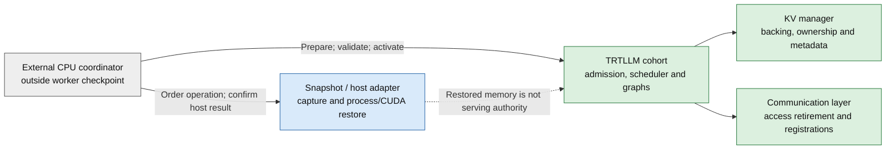

<!--
SPDX-FileCopyrightText: Copyright (c) 2026 NVIDIA CORPORATION & AFFILIATES. All rights reserved.
SPDX-License-Identifier: Apache-2.0
-->

# Checkpoint Startup: State And Host-Contract Audit

Status: initial review draft. This audit does not enable process restore or
declare a supported profile. Items marked OPEN require implementation evidence or
agreement with the host-runtime owner.

The objective is to reduce native `trtllm-serve` launch-to-first-correct-response
latency by reusing a warmed process artifact. Neither Dynamo, Kubernetes nor GMS
is a baseline requirement.

**Snapshot restores execution state. TensorRT-LLM establishes serving validity.**

## Control And Evidence Boundaries

Solid arrows identify responsibility, not implemented APIs. The dashed arrow
identifies an evidence boundary. Gray is the coordinator; blue is the host
runtime; green is TRTLLM and its subsystems.

Start with an aggregate, fixed-cohort MPI workload on one node. Use a local,
immutable model and an isolated HTTP listener. Prove absence of external KV
exposure, not just an empty request queue. Test one and multiple GPUs separately.
Keep live-request preservation, partial-rank failover, membership policy, GMS and
KV migration outside this audit.

## Source Baseline

This review uses TRTLLM
[`4fd6d1cc4521`](https://github.com/NVIDIA/TensorRT-LLM/tree/4fd6d1cc4521502a90f08df491af17ebac8e8fb1)
and Snapshot
[`4b1300a82c66`](https://github.com/ai-dynamo/snapshot/tree/4b1300a82c6676df020c201fa884cc602251e12e).

| Observation | Evidence | Qualification boundary |
| --- | --- | --- |
| Runtime memory controls exist. | [Sleep/wakeup guide](https://github.com/NVIDIA/TensorRT-LLM/blob/4fd6d1cc4521502a90f08df491af17ebac8e8fb1/docs/source/features/sleep-wakeup.md), [#19016](https://github.com/NVIDIA/TensorRT-LLM/pull/19016) | In-process release/resume is not persistent process restore. |
| Main rejects V2 KV sleep. | [`validate_sleep_tags`](https://github.com/NVIDIA/TensorRT-LLM/blob/4fd6d1cc4521502a90f08df491af17ebac8e8fb1/tensorrt_llm/_torch/pyexecutor/py_executor.py) | Resident capture remains unqualified, not proven impossible. |
| V2 has a reuse reset. | [`reset_reuse_state`](https://github.com/NVIDIA/TensorRT-LLM/blob/4fd6d1cc4521502a90f08df491af17ebac8e8fb1/tensorrt_llm/_torch/pyexecutor/kv_cache/kv_cache_manager_v2.py) | Clears reusable blocks, conversation/sharing metadata and streaming events; does not by itself prove scheduler or transfer quiescence. |
| MNNVL has process-local checkpoint hooks. | [`_run_mnnvl_checkpoint_resources`](https://github.com/NVIDIA/TensorRT-LLM/blob/4fd6d1cc4521502a90f08df491af17ebac8e8fb1/tensorrt_llm/_torch/pyexecutor/py_executor.py) | Do not treat these as a general external-KV reconnect contract. |
| The upstream TRTLLM recipe uses an LLM wrapper. | [Snapshot guide](https://github.com/ai-dynamo/snapshot/blob/4b1300a82c6676df020c201fa884cc602251e12e/docs/guides/tensorrt-llm.md) | V1, disabled reuse and compact KV; not native HTTP/V2 qualification. |
| Snapshot supports single-node workloads. | [Workload contract](https://github.com/ai-dynamo/snapshot/blob/4b1300a82c6676df020c201fa884cc602251e12e/docs/reference/workload-contract.md) | Multi-node is unsupported at this pin. Kubernetes packaging does not supply standalone delivery. |
| New application-hook configuration is not enabled. | [Container settings](https://github.com/ai-dynamo/snapshot/blob/4b1300a82c6676df020c201fa884cc602251e12e/api/v1alpha1/container_config_types.go), [#734](https://github.com/ai-dynamo/snapshot/pull/734) | Do not use a test flag as proof of runtime support. Qualify the legacy file binding separately. |

Candidate native V2 primitives are in
[#21221](https://github.com/NVIDIA/TensorRT-LLM/pull/21221), successor to
[#20087](https://github.com/NVIDIA/TensorRT-LLM/pull/20087). Pin the candidate SHA
in each experiment. Its native sleep/wake tests do not qualify Snapshot restore.
Do not stack this audit on that implementation: resident capture and the host
audit can proceed independently.

## Pool And Runtime Inventory

Each row has two independent outcomes: **correctness** and **footprint**.
Resident capture retains backing; compact capture releases selected disposable
backing and reconstructs it after restore. A metadata reset does not reduce
checkpoint bytes. Releasing backing does not establish valid references.

All process-restore outcomes below are OPEN, even where native primitives exist.

| Resource / responsible subsystem | Capability and demonstrated boundary | Required evidence / follow-up |
| --- | --- | --- |
| Model weights and transformed tensors / model engine | Loaded tensors can be part of the process artifact; no GMS prerequisite. | Record addresses, dtypes, weight digests and transform/load counts. Prove no repeated load or transform for the admitted profile. |
| GPU KV pools / V2 storage manager | Main lacks KV sleep; #21221 supplies candidate release/materialization. | Inventory reservation and physical backing separately. Compare addresses, block handles, page slots, free lists and refcounts after process restore. |
| HOST tier / V2 storage manager | Host backing has asynchronous readiness; native sleep correctness is a separate test. | Retire copies before release. Wait for backing readiness before access; measure captured host bytes and reconstruction cost. |
| Disk/offload staging / offload managers | Independent staging can remain allocated after KV release. | List buffers, file descriptors and pending I/O. Measure retained bytes; require reopenable files and completion evidence. |
| Batch/sparse arenas / V2 Batch and sparse cache | Rows, leases, scratch cells and page bindings have distinct lifetimes. | Preserve required held data or prove it disposable. Validate restored bindings and index refresh before graph replay. |
| Prefix, conversation and sharing metadata / V2 wrapper | Existing reset invalidates reusable state. | Audit scheduler preconditions and attached lender holds. No stale prefix hit, owner, refcount or request association may survive. |
| Mamba/SSM and model-specific caches / cache managers | State and index views can exist outside the main KV pool. | Enumerate each configured pool, alias and graph reference. Reject unsupported combinations explicitly. |
| Graph dummy/padding allocations / model engine | Warmup allocations can remain valid with no user request. | Distinguish required dummy ownership from leaked user ownership. Prove replay without recapture for each admitted shape. |
| Scheduler and output queues / executor | Memory status does not prove all work is retired. | Include queued/active requests, output callbacks and private validation work. Keep admission closed through validation. |
| MPI/NCCL/MNNVL / communication owners | Process-local hooks and collectives are not cross-host support. | Record process tree, namespaces and fixed rank/GPU mapping. Test full-cohort restore and incomplete-rank rejection. |
| External KV sessions and registrations / transceiver or connector | Request completion can precede physical access retirement. | Account for requestless incoming work, provider holds, late callbacks and deregistration before backing reuse. |

For every experiment, expand applicable rows into records containing:
`resource_id`, owning subsystem, native capability, demonstrated gap, GPU/HOST
bytes, address constraints, capture policy, pending copies/holds, proposed
change owner, exact test command, source/runtime pins and evidence location.
A missing row or unknown resource is not a passing profile.

## Host Contract For Review

The operations in this table describe responsibilities. They are not new public
engine endpoints or a claim that Snapshot exports a standalone API.

| Operation | Proposed owner | Preconditions and result | Open agreement |
| --- | --- | --- | --- |
| Launch source | Standalone MPI/host adapter | Fresh private operation directory; fixed profile; coordinator outside captured tree; no public admission. | Process-tree boundary, namespaces, privilege and supervisor policy. |
| Prepare capture | TRTLLM lifecycle with all required ranks | Close admission/exposure; drain or safely cancel all affected work; apply selected KV policy; latch safety evidence. | Native aggregation calls, deadline binding and evidence schema. |
| Capture | Snapshot/host implementation | Consume current latched evidence; save process/CUDA state and resolved settings; publish a complete artifact. | Supported host calls, interposer ordering, atomic publication and failure cleanup. |
| Restore isolated candidate | Snapshot/host implementation | Fresh destination/session; compatible manifest; inert destination; no competing cold process. | Supervision, final host-success result, partial-restore cleanup and control reachability. |
| Validate runtime | TRTLLM and subsystem owners | Reconstruct deferred capacity, refresh references, validate ranks/peers, run private generation and retire it. | Evidence lifetime, graph coverage and required local checks. |
| Activate | External authority and TRTLLM gate | Confirm host success and current validation evidence; obtain required rank acknowledgements before public admission. | Authentication, acknowledgement semantics and coordinator-loss policy. |
| Abort before activation | Coordinator plus host adapter | Stop progression; keep admission closed; prove cleanup before resource reuse. | Cleanup evidence and containment scope; never infer safety from timeout alone. |

Resolve these questions with the Snapshot owner before enabling a binding:

1. Which host operations and versions can be reused outside Kubernetes? Which
   privileges, namespaces, container runtime and CUDA/interposer tools are required?
2. How does the adapter bind a file or HTTP notification to a fresh attempt?
   Specify authentication, marker isolation, retries and saved settings.
3. What proves final host success, distinct from an early restore notification?
   Test a lost notification response followed by host cleanup.
4. How are fixed deadlines carried through retries and controller loss? Do not
   restart a transfer retirement deadline or interpret expiry as cleanup.
5. Does MPI fail-stop terminate co-launched peers outside the intended cohort?
   Test the actual launcher failure domain before choosing containment.
6. How are user probes and recovery budgets preserved? An ordinary health check,
   Pod Ready, `/memory_status` or a rank barrier is not serving authority.

## Transfer Dependencies

Use the existing [retirement arbitration](https://github.com/NVIDIA/TensorRT-LLM/blob/4fd6d1cc4521502a90f08df491af17ebac8e8fb1/tensorrt_llm/_torch/disaggregation/lifecycle/README.md)
and [backend access contract](https://github.com/NVIDIA/TensorRT-LLM/blob/4fd6d1cc4521502a90f08df491af17ebac8e8fb1/tensorrt_llm/_torch/disaggregation/base/backend.py).
Do not introduce a second transfer-lifecycle or membership protocol.

| Profile | Evidence required before capture |
| --- | --- |
| Clean aggregate, no external exposure | Prove no transfer-capable path has published memory; retire local/offload copies and user requests. No blanket dependency on external-transfer cancellation. |
| Transfer-bearing natural drain | Per-transfer access-end evidence, retained protection records and registration/provider holds, aggregated over all affected work. Quiescence must stay latched. |
| Coordinated cancellation | The same physical-safety evidence plus qualified cancellation support for that transport/profile. A cancellation acknowledgement is insufficient. |
| Shared backing or requestless receive | Enumerate lender leases, incoming work and provider holds even without scheduler requests. Keep protection until every applicable owner releases it. |

Record existing calls, missing evidence/aggregation APIs, exact transport/backing
profile, owner and negative tests separately. For example,
`has_retired_send_session` is not a bulk capture barrier. A returned lease does
not prove deregistration; process termination is not remote fencing evidence.

## Compatibility Manifest For Review

Use immutable values and reject missing identity. This is a proposed experiment
record, not a committed serving-YAML schema or public API.

| Field group | Required contents |
| --- | --- |
| Source | TRTLLM and Snapshot commit, build and wheel/container digests; dirty-source status. |
| Model | Model ID, immutable weight revision/digest, tokenizer, quantization and transformed-weight configuration. |
| CPU/runtime | Architecture, instruction features, OS/glibc, driver, CUDA, CRIU and interposer identities. |
| Cohort | Node count, rank count and mapping, GPU model/UUID assignment, MPI/NCCL settings and transport. |
| Cache/graphs | KV version, host tier and staging sizes, reuse policy, graph shapes, capture policy and resource inventory. |
| Host/control | Namespace/volume layout, resolved control settings, supervisor and privilege policy, protocol version. |
| Artifact | Artifact/template digest, completeness, capture evidence and permissions; no restored admission authority. |
| Attempt | Fresh operation and restore-session IDs, monotonic budget, compatible profile/cohort digests and evidence paths. |

A template can contain credentials. Restrict artifact/control directories, avoid
logging secrets and qualify credential renewal. Do not publish raw checkpoint
contents or model inputs as routine CI artifacts.

## Qualification Matrix And Exit

| Case | Initial state | Acceptance evidence |
| --- | --- | --- |
| Pinned upstream reference | UNTESTED locally | Reproduce its documented capture/restore with the pinned image; label wrapper/Kubernetes evidence separately. |
| Native MPI, one GPU, resident | UNTESTED | Source terminated; restored fresh generation matches cold; no load/transform/graph recapture; all readiness boundaries observed. |
| Native MPI, one node, multiple GPUs, resident | UNTESTED | Same checks on every rank, fixed topology, private validation and partial-rank failure injection. |
| Matching compact profiles | BLOCKED pending candidate/host qualification | Independent correctness checks plus GPU/HOST artifact bytes, I/O, reconstruction and end-to-end comparison. |
| Multi-node | UNSUPPORTED at Snapshot pin | Agree upstream support before running a qualification case; do not relabel a one-node pass. |
| Transfer-bearing or cancellation | BLOCKED pending exact lifecycle/reconnect profile | Late access, retained registration, cancellation and containment negative tests. |

Use PASS only for executed assertions, FAIL for an observed violation, UNTESTED
for an unexecuted case, BLOCKED for a named prerequisite and UNSUPPORTED for a
known product limit. Preserve attempted/failed counts and cold fallback results.

Report p50/p95 launch-to-first-correct-response, capture time, artifact I/O,
CPU/CUDA restore, KV reconstruction, validation/admission and steady-state
throughput separately. Compare resident and compact policies on the same profile.
Weight-byte transfer remains a cost.

The audit exits only when the host/security contract and first profile are
agreed, separate KV/API and communication gaps have owners/tests, and actual
restore evidence identifies a feasible path. Merging this initial inventory
alone does not satisfy that exit.
