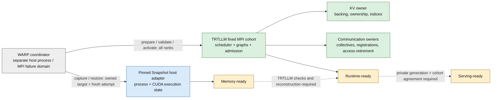

<!--
SPDX-FileCopyrightText: Copyright (c) 2026 NVIDIA CORPORATION & AFFILIATES. All rights reserved.
SPDX-License-Identifier: Apache-2.0
-->

# Warm Startup: State Audit and Standalone Host Contract

Source-audit date: 2026-11-02. This document records findings and implementation
decisions, not a supported Snapshot profile. The companion
[native state findings](NATIVE_STATE_FINDINGS.md) contain 17 concrete findings
with immutable source references. The [startup-owner findings](STARTUP_OWNER_FINDINGS.md)
cover TP userbuffers, runner storage, startup IPC and process-tree containment.
Runtime evidence belongs to
[restore qualification #21481](https://github.com/NVIDIA/TensorRT-LLM/pull/21481).

The goal is a shorter native `trtllm-serve` launch-to-first-correct-response time
through warm execution-state reuse. Dynamo, Kubernetes and GMS are not required.

**Snapshot restores execution state. TensorRT-LLM establishes serving validity.**

## Decision and Scope

Proceed with a WARP-owned experimental host adapter and an isolated, fixed-cohort
MPI qualification harness. Start with dense, text-only Qwen3, TP1 and single-node
TP2 as separate experiments. Keep weights and final CUDA graphs resident. Compare
resident KV with discard/rematerialize KV using one matching Python/native build.
Do not infer general model, transport or multi-node support from these profiles.

The first profile excludes live user requests, prefix reuse, speculative models,
HOST/DISK tiers, sparse caches, externally exposed KV and partial-rank recovery.
These exclusions bound the initial experiment; they do not remove those resources
from the audit or silently count them as qualified.

| Decision | Evidence and consequence |
| --- | --- |
| Build the standalone adapter ourselves. | The pinned Snapshot node agent uses `rest.InClusterConfig`. Its internal executor can be reused with an implementation of `runtime.Runtime`; this is not a stable upstream standalone API. |
| Keep resident capture independent of V2 sleep. | Retaining backing does not call release/wakeup. It still requires process/CUDA, graph, MPI and logical-state validation. |
| Use native V2 sleep only for the compact experiment. | [#21221](https://github.com/NVIDIA/TensorRT-LLM/pull/21221), successor to [#20087](https://github.com/NVIDIA/TensorRT-LLM/pull/20087), supplies release/reconstruction primitives. It does not supply process restore or serving readiness. |
| Prove no external exposure by construction. | An idle transceiver can already have registered memory. Exclude constructed transceivers, KV-moving connectors, attached lenders and plugin-published memory on every rank. |
| Keep the supervisor outside the MPI job. | MPI abort can terminate the effective launcher job, not only the supplied communicator. A separate communicator is not a failure boundary. |
| Fail closed for unqualified profiles. | Multi-node is unsupported by the Snapshot pin. External-transfer profiles require specific retirement/reconnect work. No blanket PACT dependency blocks the no-exposure experiment. |

## Responsibilities and Readiness

Gray identifies WARP control; blue identifies Snapshot execution; green identifies
TRTLLM owners; amber identifies evidence boundaries. Solid arrows show ownership
or messages. Dashed arrows show additional required validation, not implemented
public APIs.

- **Memory-ready:** the host reports restored process/CUDA memory.
- **Runtime-ready:** every rank has valid weights, graph references, KV ownership,
  reconstructed indices and configured communication.
- **Serving-ready:** fresh private generation matches the cold baseline; each
  required rank replays its existing graph; validation work retires; the current
  attempt and cohort agree before public admission opens.

`/memory_status` does not establish the last two boundaries. Native last-tag
wakeup can return admission to RUNNING; a separate restore gate must prevent
that state from opening public traffic.

## Audited Source Pins

| Component | Exact input | Status |
| --- | --- | --- |
| TRTLLM base | [`4fd6d1cc4521502a90f08df491af17ebac8e8fb1`](https://github.com/NVIDIA/TensorRT-LLM/tree/4fd6d1cc4521502a90f08df491af17ebac8e8fb1) | Source-audited. V2 KV sleep is rejected. |
| Native V2 candidate | [`b8b0ef930808b8e02ba4c99912b8e8f44d0c1145`](https://github.com/chienchunhung/TensorRT-LLM/tree/b8b0ef930808b8e02ba4c99912b8e8f44d0c1145) | Source-audited independently. Do not mix its wheel with base Python. |
| Snapshot | [`4b1300a82c6676df020c201fa884cc602251e12e`](https://github.com/ai-dynamo/snapshot/tree/4b1300a82c6676df020c201fa884cc602251e12e) | Internal executor and workload contract inspected. |
| Upstream reference | [TRTLLM recipe](https://github.com/ai-dynamo/snapshot/blob/4b1300a82c6676df020c201fa884cc602251e12e/docs/guides/tensorrt-llm.md) | LLM wrapper, V1, reuse disabled, compact KV. Not native HTTP/V2 qualification. |

The base and candidate are independent pinned trees. Their whole-tree difference
is not the change set of #21221. A matching candidate wheel may qualify that
candidate profile, not the newer base.

## Native Findings and Required Changes

Correctness and footprint are separate objectives. Clearing metadata does not
reduce artifact bytes. Releasing backing does not prove reference validity.

| Owner/resource | Verified native capability or limitation | Capture policy and required engineering evidence |
| --- | --- | --- |
| Executor/scheduler | `control_action(drain=True)` parks at a scoped step boundary; its context releases in `finally`. Sleep PREPARE/COMMIT is operation-scoped. | Add persistent, attempt-bound admission/quiescence protection. Include queued/active requests, overlap copies, outputs and callbacks. [F01-F03](NATIVE_STATE_FINDINGS.md#f01-the-executor-has-a-useful-scoped-barrier-not-a-capture-transaction). |
| GPU KV backing | Reserved VMM addresses, mapped pages, logical owners and slot indices have separate lifetimes. Candidate release keeps reservations and reconstructs slots. | Resident: retain backing. Compact: use owner-ordered reconstruction and validate derived indices; do not require identical physical page handles. [F04](NATIVE_STATE_FINDINGS.md#f04-v2-gpu-pool-reservations-backing-and-logical-pages-are-different-resources). |
| HOST tier | Capacity can be published before asynchronous fill makes backing usable. Range readiness is not a whole-tier capture fence. | Exclude initially. Add fill/copy retirement and materialization-ready evidence before extension; measure retained HOST bytes. |
| DISK and staging | Disk pools use anonymous/unlinked FDs. Pinned/device staging and copy callbacks have independent lifetimes. | Exclude DISK initially. Qualify FD restoration or add reopenable ownership; do not assume a path already exists. Account for staging separately. |
| Batch/sparse arenas | Batch publication, later device readers, row leases and sparse HOST backups are distinct. Preserve can move GPU bytes to HOST rather than remove them. | Inventory each arena and copy barrier; compare total CPU/GPU artifact bytes and reconstruction time. |
| Reuse/lender metadata | `reset_reuse_state` clears native reusable state, clears conversation state, invalidates lender reuse naming and flushes events. Native clear requires no living cache, including dummies. | Do not blindly reset after graph warmup. Distinguish reset from transfer retirement and preserve graph-required ownership. |
| Dummy/model-specific state | Main, draft, cross-KV, speculative and SSM managers can own graph-visible resources. Candidate SSM wake refreshes relocated slot indices. | First profile excludes optional model families. Later profiles enumerate all owners, aliases and index refresh before graph replay. |
| Weights and graphs | Existing weight manifests hash content/layout/aliases. Graph pointer assertions inspect selected tensor attributes, not all references. | Record per-rank digests/addresses and final graph inventory; prove positive replay and unchanged load/transform/capture counts after source termination. |
| Runner inputs and pinned staging | Graphs and metadata retain runner-owned storage. An input-copy event does not retire later GPU work. | Preserve storage and aliases in both policies; synchronize copies and device work. Compact KV must rebuild indices without replacing runner input storage. |
| TP userbuffers and collective storage | UB singleton deallocation is incomplete; NCCL windows and MNNVL are separate owners. | Exclude UB, symmetric windows and MNNVL in the first profile with explicit per-rank guards. Ordinary NCCL still needs real restore qualification. |
| Proxy IPC and process monitor | Queues and identity ACKs precede the capture boundary; READY and some RPC startup follow it. | Retain the whole process tree and internal peers; validate pidfds/cached identities and completion of startup. One container alone does not prove cohort containment. |
| MPI/NCCL/MNNVL | Selected MNNVL checkpoint hooks exist. They are not a generic MPI/NCCL or external-KV restore contract. | Record rank/GPU mapping and launcher boundaries. Exercise TP2, fail a rank, and verify actual supervisor survival and cohort cleanup. |
| Transfer/lender owners | `Attempt.quiesced()` and formal `Backend.shutdown(timeout)` provide per-attempt/per-instance evidence. Native `TransferWorker.shutdown()` can log deregistration errors and return without typed proof. | Add restartable cross-owner/cohort retirement and re-registration only for explicitly selected transfer profiles. Do not treat advisory cancellation, released leases or empty request queues as access-end proof. |

The detailed audit gives source locations, capture-policy consequences, proposed
owners and tests for each resource, including HOST fill, disk staging, Batch,
sparse preservation, graph dummies, SSM relocation and failure containment.

## Standalone Host Binding

This is the experimental binding implemented by WARP in #21481. It is intentionally
version-pinned. It does not introduce public engine endpoints or imply a supported
Snapshot-team standalone SDK.

| Operation | Concrete binding | Required protection and evidence |
| --- | --- | --- |
| Source launch | Docker-managed containerd, namespace `moby`; real `trtllm-serve` and its native MPI workers. | Full immutable image/container IDs; fresh private control mount; fixed GPU UUIDs; no public network; no auto-restart. |
| Prepare | Experiment observer at final `PyExecutor.start_worker`, after profiling executor teardown and final graph capture. | No user request was admitted; all ranks confirm exact profile and owners. Compact uses native resource callbacks, not ad hoc pool deletion. Production scoped drain/latch remains later work. |
| Capture | `executor.Checkpoint(ctx, runtime, logger, request, config)` inside the pinned Snapshot agent module. | Ready sentinel only after all-rank evidence. Preserve upstream CUDA/CRIU ordering. Source must terminate before artifact acceptance. |
| Restore target | Fresh same-image Docker container with only `/bin/sleep infinity`. | Fresh ownership nonce and control mount; persistent single-use target record; no stale source/restore sentinels. |
| Restore | Upstream `GatePreflight`, then `executor.Restore(..., WithoutProxy=true)` and upstream `GateInspect`. | Compare kernel, CPU features, limits, image, GPU and mounts. Do not skip compatibility. Use upstream `nsmount` rather than custom namespace shell commands. |
| Host completion | Write `restore-complete` using `podcontract.FormatRestoreComplete`, including restored namespace PID. | This permits workload reconstruction only. It is not a serving-ready signal or an arbitrary nonce file. |
| Validate | Fresh operation config plus per-rank memory/runtime observations, private HTTP generation and graph counters. | Match cold output and every rank; reject repeated load/transform/capture, missing ranks, stale evidence or incomplete reconstruction. |
| Failure/cleanup | Outer host-process deadline; terminate owned immutable helper/workload containers; retain logs/artifacts. | Mark failed restore; never reuse a partially modified target. A killed workload is not proof of remote access fencing. |

The adapter implements `runtime.Runtime` using Docker identity/ownership checks
and containerd OCI/task inspection. Explicit GPU UUIDs avoid Kubernetes allocation
lookup. Compile it inside the pinned Snapshot agent module to honor Go's internal
package boundary. This is Docker-managed-containerd support, not generic runtime
support. PageBroker is a separate matching host service.

### Security and Failure Domain

The host helper is a trusted privileged component. Restrict execution to an
authorized isolated host and actor; do not expose its JSON stdin interface as an
unauthenticated network service. Docker-socket access is host-root authority.
A label is target ownership evidence, not protection against a hostile host root.

Required host access: host PID/cgroup namespaces, host procfs, writable cgroups,
securityfs, the Docker/containerd sockets, actual runtime storage paths,
Snapshot binary bundle, shared PageBroker control/staging and private checkpoint
storage. Use read-only mounts where the executor permits them. Select only
allocated GPU UUIDs; workload containers remain nonprivileged with private PID
and network namespaces. Block io_uring as required by the pinned workload contract.

Authenticate each operation by local process access and an immutable target
allowlist. Bind it to a fresh attempt, image, profile, artifact and container ID.
Serialize and consume target operations durably; reject reuse after failure.
Keep deadlines outside checkpointed memory. A timeout must stop the owned helper
and target and report uncertain cleanup instead of retrying against the same
process. Preserve attempt evidence, including failed operations.

The coordinator is a host process outside the worker's MPI launcher job. Confirm
this with a real rank-abort test. Process-tree placement alone does not prove
failure isolation. Kubernetes or Dynamo may later drive the same owner protocol;
neither should become a prerequisite for the standalone contract.

## Compatibility and Evidence Record

Each experiment must bind the following fields, not merely record a successful
HTTP response:

| Record | Required fields |
| --- | --- |
| Inputs | TRTLLM source/wheel hash, Snapshot source and agent/PageBroker image digests, experiment-script hashes, model-file hashes, complete serving config. |
| Host | Kernel, CPU architecture/features, GPU model/UUID/order, driver and CUDA libraries, MIG state, MPI/NCCL versions, namespace/cgroup and CPU/memory limits. |
| Attempt | Fresh source/restore IDs, immutable container IDs, artifact ID, cohort mapping, absolute external deadlines and terminal result. |
| State | Per-rank weight content/layout/aliases/addresses, positive load/transform/capture counters, final graph inventory, logical KV owners, tier quotas/bytes, indices and exposure guards. |
| Artifact | Manifest, logical and allocated file bytes, hashes, identifiable GPU device payloads, separately identified process/metadata bytes, total I/O and capture/restore timings. |
| Validation | Source termination; memory/runtime/serving boundaries; exact cold/restore output comparison; real graph replay on every rank; no repeated startup work; cleanup status. |

Do not label all CRIU process-image bytes as CPU-only: conventional CUDA offload
can be embedded there. Report an unavailable CPU/GPU split as unavailable, with a
reason. Measure observer/hash overhead separately; do not subtract guessed costs
to claim a startup improvement.

## Verification and Remaining Agreement

Completed source work: 17 findings, 49 immutable source references across 30
files, plus three startup-owner investigations, candidate/base separation,
per-owner policies and explicit failure-domain analysis. A read-only Linux host audit observed kernel 6.8, B200 GPUs, driver
615.71.10 and Docker 27/containerd 1.6. A first experimental adapter build compiled
against the pinned Snapshot executor. Neither observation qualifies restore;
subsequent adapter revisions and runtime experiments require their own results.

The revised standalone adapter compiled and passed its Go unit tests against the
pinned Snapshot module. A real reference attempt was rejected by the test
cluster's policy before PageBroker could start: privileged containers are not
allowed. No checkpoint or restore completed. This is a deployment prerequisite,
not a reason to require Kubernetes or ask users to supply an adapter. Obtain an
administrator-approved host or documented exception; do not bypass cluster policy.

| Item | WARP-owned decision/work | External agreement still needed |
| --- | --- | --- |
| R1: host operations | Implement local Docker/containerd adapter around pinned executor; retain both compatibility gates and bounded cleanup. | Snapshot owners review use of internal executor interfaces, supported runtime assumptions and future API stability. |
| R2: workload binding | Use current file protocol, inert destination and separate fresh-attempt evidence. Keep public admission closed. | Confirm supported lifecycle notification binding and migration path when new application-hook configuration is enabled. |
| R3: execution/security | Trusted local actor, no remote service, isolated privileged host component, immutable targets and durable single-use attempts. | Deployment/security owners approve the privilege model and failure containment for production delivery. |

S1 provides the completed source audit and concrete proposed host contract. It
does **not** claim R1-R3 have external sign-off. S2 must supply actual runtime
qualification or precise observed blockers. Later production work owns durable
serving admission/lifecycle, host-controller packaging, KV-policy extensions and
communication reconstruction. Keep these implementation responsibilities separate
from the experiment's test-only boundary.

## Primary References

- [Snapshot workload contract](https://github.com/ai-dynamo/snapshot/blob/4b1300a82c6676df020c201fa884cc602251e12e/docs/reference/workload-contract.md).
- [Checkpoint executor](https://github.com/ai-dynamo/snapshot/blob/4b1300a82c6676df020c201fa884cc602251e12e/agent/internal/executor/checkpoint.go) and [restore executor](https://github.com/ai-dynamo/snapshot/blob/4b1300a82c6676df020c201fa884cc602251e12e/agent/internal/executor/restore.go).
- [Runtime interface](https://github.com/ai-dynamo/snapshot/blob/4b1300a82c6676df020c201fa884cc602251e12e/agent/internal/runtime/runtime.go), [compatibility gates](https://github.com/ai-dynamo/snapshot/blob/4b1300a82c6676df020c201fa884cc602251e12e/api/compat/checks.go), and [host deployment privileges](https://github.com/ai-dynamo/snapshot/blob/4b1300a82c6676df020c201fa884cc602251e12e/charts/snapshot/templates/daemonset.yaml).
- [Application contract #437](https://github.com/ai-dynamo/snapshot/pull/437) is design history; the pinned implementation and current workload contract control this experiment.
- [Native state findings and test handoff](NATIVE_STATE_FINDINGS.md).
- [Startup-owner findings and explicit profile guards](STARTUP_OWNER_FINDINGS.md).
