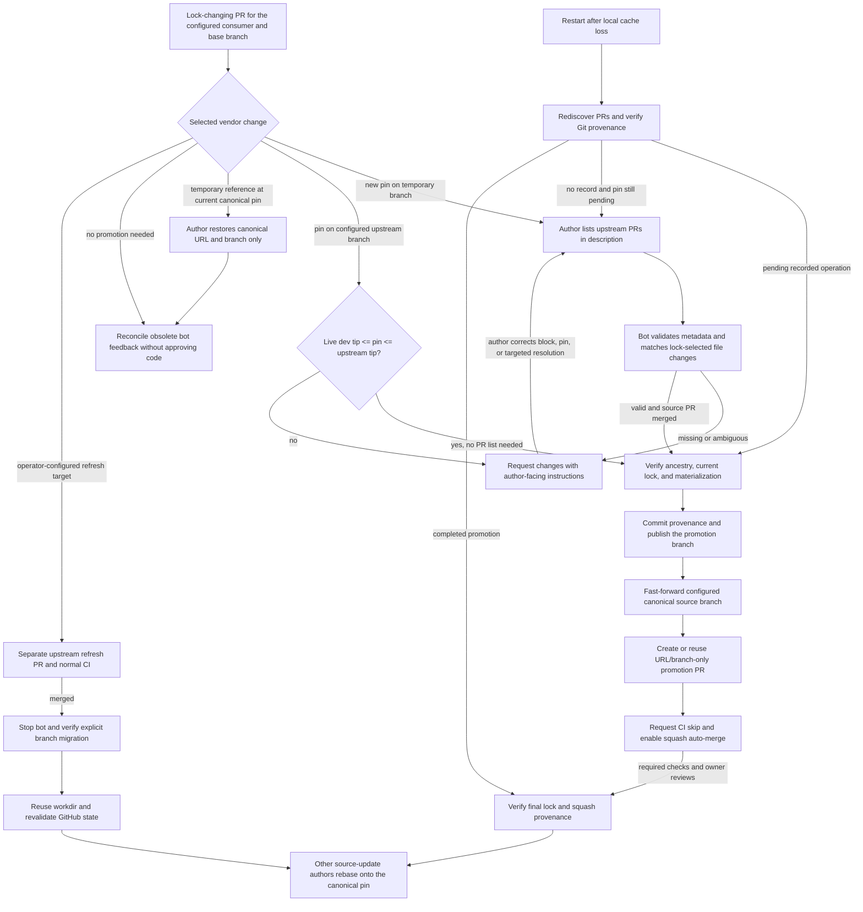

<!--
SPDX-FileCopyrightText: Copyright (c) 2026 NVIDIA CORPORATION & AFFILIATES. All rights reserved.
SPDX-License-Identifier: Apache-2.0
-->

# Vendor source toolkit

These tools work with any vendor key in `3rdparty/vendor_sources.lock.yaml`.
They contain no operator credentials, personal repository defaults, or private
configuration. Use Python 3.10+, Git, PyYAML, and, for GitHub promotion/monitoring,
an authenticated `gh` CLI. Promotion and monitoring currently support GitHub.com
repositories and canonical **branches**, not tag promotion or periodic rebases.

| Entry point | Responsibility |
| --- | --- |
| `python scripts/vendor/manage.py` | Create, inspect, sync, export, patch, pin, and verify vendored trees |
| `python scripts/vendor/promote.py promote` | Promote an immutable, merged source update and prepare a lock-only PR |
| `python scripts/vendor/bot.py run` | Monitor source-update PRs, validate metadata, resolve attribution, and promote |

Use these entry points directly; no backward compatibility is promised for the
old top-level scripts or PrimTS-specific CLI aliases. Supply vendor and repository
configuration explicitly. The separate legacy Triton packager does not use this
lock and is not migrated by this change.

## Workflow



Promotion preserves the source SHA, selected files, compatibility patch, and
digests. It does not re-vendor code. A periodic upstream refresh is a separate
code-changing operation and must not use the promotion CI-skip path.

### Upstream-main fast-forward exception

A source update can pin the configured `--upstream-repo` and `--upstream-branch`
(normally `main`) directly, provided immutable Git ancestry proves:

```text
previous canonical lock pin <= live canonical dev tip <= reviewed source pin <= observed upstream tip
```

Here `<=` means ancestor-or-equal, not patch similarity. The source pin may be
older than the upstream tip. Other upstream branches/tags do not qualify, and a
fork branch named `main` still uses normal contributor metadata. Divergent dev
and upstream histories require a temporary fork based on dev or an explicitly
audited maintainer refresh; do not rebase upstream or force-push dev.

For a qualifying vendor, no `vendor-promotion` block entry, upstream PR list, or
`unpaired_reason` is required. Existing metadata for that vendor is not parsed
or matched. Other vendors in the same consumer PR still need their own normal
metadata unless they independently qualify. The exception does not bypass
source/include selection checks, materialization verification, normal source-PR
review/CI, or canonical publishing-fork checks. Upstream merge commits are allowed;
temporary-fork updates still require linear history.

After merge, promotion advances dev to the **reviewed pin**, never to the moving
upstream tip, then restores the canonical URL/branch in a lock-only PR. Live
ancestry is rechecked before valid feedback and publication steps; ref movement
that invalidates it stops promotion without force-pushing. This is not a permanent
switch to tracking upstream and does not select a new canonical branch.

New upstream-main promotions use `VENDOR PROMOTION V2` commit-message provenance:
`source_mode: upstream-main`, the prior pin, `checked_canonical_tip`, `promoted`,
`upstream_observed_main`, repository/branch identities, and attribution scope.
They contain no synthetic unpaired commits or PR mappings. Retries verify and
reuse the original immutable proof; mutable refs cannot rewrite published
provenance. V1 temporary-fork records remain supported. A future refresh must
verify that its **actual chosen upstream target contains the promoted pin**
before omitting these commits; an old observation of upstream is not permission
to drop them after an upstream history rewrite or an older target selection.

## Operator setup

Use your own approved GitHub credentials (`gh auth login`, `GH_CONFIG_DIR`, or
the usual GitHub CLI token environment). Configure Git authentication for pushes
and a real Git name/email for DCO-signed commits. Tokens are never accepted in
repository URLs, stored in SQLite, or copied into repository configuration by
these tools. Do not put credentials in command-line arguments.

The operator needs permission to push the configured canonical source branch
and consumer publishing fork, create consumer PRs/comments/reviews, request the
CI-skip path, and enable auto-merge. Review dismissal can require additional
repository authorization. No GitHub App, repository-admin access, webhook
server, or systemd unit is required merely to run the monitor. Repository rules,
SSO/token policies, CI-bot authorization, and required owner reviews still apply.

Run only one **publishing** monitor per consumer repository/base/vendor. If
multiple monitors share a canonical source branch, serialize their publications
as well. The workdir lock prevents duplicate processes using the same directory;
it is not a distributed lock between operators, machines, or workdirs. Finish
one promotion before merging the next source update for that consumer/base/vendor.
Unexpected concurrent changes stop publication rather than force-pushing or
selecting an arbitrary newer pin.

## Contributor metadata

Source-update PRs normally pin a temporary branch in a fork of the configured
upstream. The upstream-main exception below also permits the configured upstream
repository/branch when Git ancestry proves that it contains the dev history.
The pinned commit must contain the **latest canonical dev-branch tip**, even
when the consumer's lock still names an older commit. Fetch and rebase onto
the dev branch, push the temporary branch, then regenerate the consumer lock
and vendor snapshot at the new SHA. Updating only the temporary branch or PR
description is insufficient. A broader upstream refresh uses the separate,
explicitly configured maintainer refresh workflow.

For temporary-fork updates, authors add exactly one block to the source-update
PR description. Multiple vendors can share it; each monitor reads its configured
vendor entry:

````markdown
<!-- vendor-promotion:start -->
```yaml
schema_version: 1
vendors:
  example-library:
    upstream_prs:
      - https://github.com/UPSTREAM/library/pull/123
      - https://github.com/UPSTREAM/library/pull/456
```
<!-- vendor-promotion:end -->
````

No complete commit map is required. The bot compares only files selected by the
vendor lock's `source` directory and `include` patterns, using the same selection
rules as vendoring, on both sides of each comparison. For `flashinfer-prims-ts`,
this currently selects `flashinfer/attention/prims_ts/**/*.py`: differences in
external tests, benchmarks, or unselected documentation do not prevent a match.
Changing `source` or `include` during the source update requires a separate
selection change; automatic attribution refuses to silently narrow its scope.

The selected source delta is compared against immutable upstream PR snapshots.
Matching uses commit identity, zero-context edits, and whole-series aggregate
changes for squash/split cases.
Edit matching ignores unchanged neighboring lines, line numbers, blob IDs, and
Git-generated hunk labels. It preserves changed-line whitespace, file paths/modes,
binary data, and hunk boundaries. Function definitions that are actually added or
removed remain part of the comparison; only labels in hunk headers are ignored.
Identical edits at different locations in the same file can therefore match;
this establishes textual attribution, not semantic equivalence. Exact matches
take priority; multiple exact matches remain ambiguous.
Merged upstream PRs can still be paired using their original head history.

When a source commit has no exact match, the bot compares its normalized patch
lines against each upstream commit and PR aggregate. A unique upstream PR with
similarity **>= 0.9** is accepted. The metric is Python
`SequenceMatcher(autojunk=False)`: `2 * matched_lines / (source_lines + upstream_lines)`.
Whitespace remains significant, repeated lines are not discarded, and empty
patches never establish similarity. The unrounded score determines acceptance;
comments display rounded percentages. Whole-source-series matching still requires
exact equality, so aggregate similarity cannot hide an unmatched individual commit.

Comments show accepted non-exact matches with their scores and threshold. Below
the threshold, or when multiple PRs qualify, author-action feedback shows the
closest upstream PRs and scores. Similarity matches record the score, metric,
threshold, compared immutable revisions, and `retain-until-verified` refresh policy
in promotion provenance. They count as attribution for promotion, not code-review
approval or proof that changes can be dropped during refresh. Commit titles and
cherry-pick trailers are not evidence. Authors still resolve ambiguous or
below-threshold matches explicitly.

Commits with no lock-selected changes need no upstream attribution or author
resolution. Empty selected patches never count as an upstream match; omit PRs
that cover only excluded changes. The promotion record saves `attribution_scope`
and marks excluded-only commits `outside-vendor-scope`, in an unpaired group with
`refresh_policy: retain`. Temporary-fork source commits still undergo the linear-history
and ancestry checks, and the promoted SHA and vendored-tree verification remain
unchanged. Scoped attribution does not prove whole-commit equivalence or authorize
dropping changes to excluded files during a future source-branch refresh.

If attribution is unresolved, feedback lists the full source SHAs and candidate
PRs. **The PR author**, not the operator, resolves it by adding missing upstream
PRs, removing unrelated PRs, correcting/rebasing the pinned source, or adding a
targeted explanation under that vendor:

```yaml
resolutions:
  FULL_40_CHARACTER_SOURCE_SHA:
    upstream_pr: https://github.com/UPSTREAM/library/pull/123
    reason: Explain the downstream adaptation or why this PR owns the change.
```

This is an explicit author assertion, not an automatic equivalence claim. The
final provenance records its reason and `retain-until-verified` refresh policy.
When there is no upstream PR for the update, replace `upstream_prs` with a
nonempty `unpaired_reason`. Do not combine those alternatives. Unpaired changes
are retained during future refresh until equivalence is established separately.

Before a new operation is committed, the source head and normalized metadata
are rechecked before feedback and publication. Metadata corrections rerun
validation. The live canonical tip is checked before and after attribution and
again before publication; it is not inferred from the consumer lock or cached
successful feedback. A canonical tip already contained in the pinned source
is allowed, including one advanced by another consumer branch. Divergent or
newer tips require a rebase, and a canonical history rewrite requires maintainer
inspection. Durable promotion records remain authoritative; later description
edits or upstream PR changes do not rewrite a recorded operation's provenance.

## Launch the local monitor

All operator-specific settings are CLI inputs. Start with one dry-run pass:

```bash
python scripts/vendor/bot.py run \
  --vendor example-library \
  --consumer-repo NVIDIA/TensorRT-LLM \
  --base-branch main \
  --upstream-repo UPSTREAM/library \
  --canonical-repo MAINTAINER/library \
  --canonical-branch consumer-dev \
  --fork YOUR_ACCOUNT/TensorRT-LLM \
  --workdir /path/to/private/vendor-bot-state \
  --once
```

For PrimTS, use vendor `flashinfer-prims-ts`, upstream
`flashinfer-ai/flashinfer`, and the operator's current canonical fork/branch.
The canonical repository is always explicit: the bot never adopts a contributor
fork as the publishing destination merely because it appears in a lock or PR.

Omit `--once` to run continuously in the foreground. Add **both** `--daemon` and
`--publish` to detach and enable remote writes. `--daemon` alone remains dry-run.
The bot always enables squash auto-merge when publishing. It retains the
complete signed-off provenance message and verifies the final merge later.

```bash
python scripts/vendor/bot.py status --workdir /path/to/private/vendor-bot-state
python scripts/vendor/bot.py stop --workdir /path/to/private/vendor-bot-state
```

`stop` requests a graceful exit after the current operation; it does not kill an
unrelated process using a stale PID. Logs go to `WORKDIR/bot.log` in daemon mode.
The daemon survives terminal closure but does not automatically restart after a
crash or reboot; a supervisor is optional. Stop before changing launch settings.

The workdir must be empty on first use, owned by the current user, and outside a
Git worktree. It holds a disposable SQLite cache, a bare source cache, process-lock
and stop files, and isolated promotion worktrees. Runtime state is not committed.
An existing workdir is bound to its operator, vendor, and consumer base branch;
use a different directory for another operator/vendor/base. Authentication is inherited
from the launching environment and is not persisted in that state.

### Different consumer base branches

Each monitor handles one `--base-branch` (default `main`) and one
`--canonical-branch`. The consumer target must be `main` or `release/<name>`;
development branches are rejected at startup. This is an allowed naming pattern,
not wildcard monitoring: only the exact configured branch is monitored. Running
instances for `main` and `release/1.3` does not enable any other release branch.
Different consumer branches may use different canonical
source branches: run separate instances with separate workdirs. Discovery,
promotion provenance, follow-up PR targets, and migration checks are scoped to
the consumer repository and base branch. Retargeting a tracked PR makes it
ineligible for its old monitor; changing `--base-branch` requires a new workdir.

When an open PR moves to a development branch, the bot withdraws only its own
vendor-marked blocking reviews and posts one superseding notice explaining that
vendor validation no longer applies. Human reviews and other vendors/operators'
feedback are untouched; no approval is issued. After successful cleanup the PR
leaves active tracking. Failed cleanup remains pending for retry, with a clear
notice if review-dismissal permission is missing. Unchanged retries do not post
duplicate comments. A move between `main` and a release branch is instead handed
off to the destination monitor, if one was explicitly launched; the old monitor
does not dismiss the destination's reviews.

GitHub feedback records the originating consumer base branch so only one monitor
owns cleanup. Legacy feedback with no recorded base is cleaned up by the `main`
monitor. Discovery checks existing feedback on out-of-scope open PRs to recover
unfinished cleanup after SQLite loss, even if the PR predates `--since`; it does
not validate their vendor source or require metadata. Completed cleanup is cached
until the PR changes. Retargeting back to a monitored branch automatically
rediscovers the PR and performs fresh validation.

For example, a main monitor can use `--base-branch main --canonical-branch
consumer-dev-new`, while a release monitor uses `--base-branch release/1.3
--canonical-branch consumer-dev`. These are independent opt-in launches;
configuring one does not start the other. If both consumers later share one
canonical source branch, serialize publication across them: separate workdir
locks do not coordinate concurrent pushes to the same source branch.

### Switching canonical branches after a refresh

Before opening a refresh PR, either stop the monitor for its target base branch
until the refresh merges, or restart it with an explicit refresh target:

```bash
--canonical-branch consumer-dev \
--refresh-branch consumer-dev-YYYYMMDD
```

`--refresh-branch` is repeatable and applies only to `--canonical-repo`. It tells
the monitor that a PR pointing at that branch is a manual refresh, not a
temporary-branch update requiring promotion metadata. The monitor does not
promote it, skip its CI, or infer refresh targets from contributor metadata or
branch naming conventions. Normal review and CI still apply to the refresh.
The operator must audit these targets; do not list contributor temporary branches.
The option does not authorize publishing to a new branch or start another monitor.
Changing this policy on restart is allowed in the same workdir without migrating
the canonical configuration. Reuse the policy after cache loss. If the monitor
previously requested metadata changes on the open refresh PR, it updates its
existing feedback and dismisses its obsolete automated review when authorized.
If dismissal is forbidden, the comment asks an authorized maintainer to dismiss it.

Keep the same workdir when a periodic source refresh introduces a new canonical
branch. Stop the publishing process for the cutover, and wait for the consumer
refresh PR to merge. Relaunch with the same configuration except for:

```bash
--canonical-branch consumer-dev-YYYYMMDD \
--migrate-canonical-branch-from consumer-dev \
--workdir /path/to/private/vendor-bot-state \
--once
```

First omit `--publish`: migration only changes local configuration/cache state;
this pass makes no remote writes. The bot verifies the merged base lock names
the new canonical repository/branch and its pin is reachable from that branch.
It refuses outstanding old-branch promotion PRs or unpublished promotion branches
for the same consumer repository and base branch. Promotions for other consumer
bases do not block this migration; missing or malformed scope provenance still
requires maintainer inspection.
Finish those operations, or explicitly close superseded follow-up PRs after
maintainer review; migration never deletes branches or redirects old promotions.
Other operator/vendor identity changes still require a separate workdir.
If the refresh has merged but the old monitor is still running, new updates based
on a configured refresh target report a maintainer cutover action, not a request
to promote the lock back to the old canonical branch. After migration, the
`--refresh-branch` entry for the now-current canonical branch can be omitted.

The configuration update and invalidation are one SQLite transaction. Old
branch-dependent results are archived, while logs, source caches, promotion
worktrees, tracked candidates, and the historical `--since` cutoff are retained.
Discovery restarts and rechecks candidates against Git/GitHub. Old successful
polls are cleared from active health status; `status` reports the canonical
repository/branch and the verified migration revision. Existing Git promotion
provenance is never rewritten. Repeating the same migration is a no-op and does
not discard subsequent discovery progress.

After inspecting the dry-run results, restart with the new branch and
`--daemon --publish`, omitting `--migrate-canonical-branch-from`. Verify a completed
poll under the new configuration, then notify outstanding source-update PRs to
rebase their temporary source branches, update their consumer PRs and pins, and
regenerate vendor snapshots. If SQLite is lost, launch normally using the new
canonical configuration and the same cutoff; omit the migration flag.

The default interval is 120 seconds (`--interval`, minimum 30). A cold start
discovers existing open PRs and backfills merged PRs from all history. This scan
can be expensive; subsequent polls use a cached cursor and tracked candidates.
An explicit `--since 2026-01-01T00:00:00Z` restricts historical discovery; use the
same cutoff on every launch, including recovery. Historical updates belonging
to another canonical branch, or superseded pins without a recoverable promotion,
are not promoted or sent author feedback.

Open PRs qualify for promotion only when they change the selected vendor's source commit
relative to their Git merge base. A stale PR head after a canonical refresh is
not itself a source update: changes only to other vendors or patch/digest fields
do not require promotion metadata. Eligible updates are still checked against
the latest canonical lock, so their source branches must include the refreshed
canonical history before promotion.

A same-commit temporary URL/branch redirect is not a source update, but can still
need author feedback: if the PR itself changes the reference and its pin equals
the current canonical base pin, restore the base's canonical URL/branch only.
No promotion metadata is required. When an open PR no longer needs promotion,
the bot reconciles any existing feedback instead of leaving a stale objection.
It does not post new feedback on otherwise ignored PRs.

### Monitoring health

`--log-level INFO` is the default, in both foreground and daemon mode. Logs use
UTC timestamps. INFO includes poll start/end, discovery counts, elapsed time,
PR metadata/feedback and promotion transitions, and the next polling deadline.
Unchanged PR outcomes are not logged repeatedly. `WARNING`/`ERROR` suppress the
INFO heartbeat and summaries; DEBUG is not needed for normal monitoring. Git
and promotion subprocess output still goes to the daemon log independently of
the Python logging threshold.

During an active operation, a log-only heartbeat runs every 30 seconds, including
while the worker waits for GitHub or Git. It reports the phase, PR number (when
known), operation age, and counters. A heartbeat proves only that the reporting
thread is alive: unchanged counters and growing operation age may indicate a
slow or stuck operation. It does not advance the progress or completion timestamp.
Idle intervals are described by `Next poll at ...`, not continuous heartbeat noise.

`status` reads the local cache without creating or repairing a database:

```bash
python scripts/vendor/bot.py status --workdir /path/to/private/vendor-bot-state
tail -n 100 /path/to/private/vendor-bot-state/bot.log
```

The JSON separates process liveness from work completion:

| Field | Meaning |
| --- | --- |
| `running`, `pid`, `publish` | Process lock held, recorded PID, and whether remote writes are enabled; not a health verdict |
| `vendor`, `base_branch`, `canonical_repo`, `canonical_branch` | Cached monitor scope and publishing destination; verify these after a restart or migration |
| `refresh_branches`, `migration` | Explicit refresh-target policy and last verified canonical-branch migration; not authorization to publish to a refresh target |
| `operation`, `progress_at` | Current phase/PR/start time and last worker checkpoint |
| `counts` | Current poll's scanned records, tracked lock PRs, relevant vendor updates, processed PRs, author-blocked PRs, and errors |
| `last_completed_poll` | Last fully scanned/processed poll, even if individual PRs needed attention |
| `last_successful_poll` | Last completed poll with no blocked PRs or processing errors; not a code-review approval or guarantee that promotions have merged |
| `last_poll_summary` | Duration, counts, and outcome: `ok`, `needs_attention`, `failed`, or `interrupted` |
| `last_error` | Historical error timestamp, PR, and bounded single-line diagnostic; retained after recovery |
| `next_poll_at` | Next scheduled poll, including exponential backoff after discovery failures |
| `state_available`, `state_error` | Whether cached telemetry could be read; missing/corrupt state does not mean a held process lock is healthy |

`scanned` counts PR records visited, not unique PRs (the initial open/history
scans overlap). `tracked` includes lock changes for other vendors; `relevant`
counts the selected vendor's eligible updates before promotion-state checks.
Blocked PRs are author/metadata issues; errors are failed processing attempts.
Logs include their PR numbers and reasons. Diagnostic summaries redact configured
GitHub tokens, recognizable token formats, URL credentials, and authorization
headers, and omit multiline YAML excerpts; no PR bodies or authentication
configuration are intentionally logged.

For monitoring, check the latest poll outcome and deadline along with the log.
Do not interpret `running: true` or an old `last_error` alone as health/failure.
Stopped processes have no current PID, operation, or next deadline in `status`,
but retain historical poll/error information. Telemetry is disposable and never
authorizes publication; restart recovery still verifies Git/GitHub provenance.

### Recovery after cache loss

Git/GitHub are the source of truth; SQLite is not required to reconstruct a
promotion. Stop the old process before replacing or discarding its database.
Relaunch with the **same account, repositories, consumer base branch, canonical
branch, and cutoff**, and re-supply any `--refresh-branch` policy.
The bot accepts an existing workdir containing only recognized bot artifacts
even if SQLite is missing. It preserves those artifacts and refuses unrelated
files and symlinks. A new empty workdir also works; existing registered Git
worktrees are validated and reused, or recreated when their directories are gone.

Recovery checks the deterministic promotion PR/branch and its signed-off commit
before parsing the source PR description or consulting upstream PR heads. It
verifies the operation identity, lock-only diff, and provenance, then resumes
the recorded operation. Completed promotions are verified against their squash
commit without requiring the old source fork or mutable PR metadata. Existing
feedback, reviews, CI-skip comments, and auto-merge settings are discovered from
GitHub rather than duplicated from missing local IDs.

Before the first canonical-branch push, the signed promotion commit is pushed to
the configured publishing fork. Therefore loss after any remote publication
step retains a durable provenance record. A locally committed but not yet pushed
operation can also be recovered from the consumer repository's Git branch.
Before any provenance commit exists, attribution is recomputed from current
remote inputs; a previous successful match in SQLite is never authoritative.

Recovery assumes a single publishing operator and accessible, unmodified Git/GitHub
artifacts. It is not recovery from deleted remote history or a replacement
publishing account/fork. Tampered commits, unexpected branch moves, closed-unmerged
promotion PRs, and unrelated worktree edits still stop the operation for inspection.

One process monitors one vendor; separate workdirs can monitor different vendors.
`--consumer-repo`, `--base-branch`, and `--upstream-branch` also support consumers
and upstreams whose default branch is not `main`. `--repo` selects a **trusted**
local consumer checkout; no code or hooks from source forks are executed.

## Feedback and review safety

With `--publish`, recognized author-actionable problems produce a new
comment containing the specific problem, its location, and a **Fix** section.
Examples are included only when relevant, using the configured vendor and
upstream repository. Missing metadata gets a complete copyable marked block;
field errors get focused instructions; attribution failures get a correctly
nested resolution example. Existing entries for other vendors must be preserved.
Edit the **PR description**, not a comment, when correcting metadata. The bot
rechecks automatically on later polls; no manual recheck comment is required.

Each comment is headed **Vendor validation**, mentions the PR author, identifies
the checked PR revision and source pin when available, and links to the previous
result it supersedes. The bot posts a new comment when the source URL/branch/pin,
problem, fix instructions, or validation status changes. Earlier comments remain
unchanged snapshots; the bot's marked reviews link to the newest result with
**Latest vendor validation and step-by-step fix**.

Unchanged polls do not post again. Moving observed dev/upstream tips alone or
unrelated consumer commits do not notify unless they change the validation
result. Each comment warns that observed tip SHAs can become stale; fetch the
live branch before rebasing or selecting a new pin. The bot still revalidates
against live tips on each poll. Deduplication
compares a versioned fingerprint in the newest bot-owned GitHub comment, not
SQLite or every historical result: A → B → A posts three results. This also
recovers after a lost POST response or a restart without SQLite. Legacy comments
without a fingerprint are preserved and superseded once by the new format.
Only comments/reviews from the configured account with the vendor marker count;
manual feedback and other accounts/vendors are not modified.

| Problem | What the bot tells the author to fix |
|---------|-------------------------------------|
| Missing markers | Names exactly which of `<!-- vendor-promotion:start -->` and `<!-- vendor-promotion:end -->` is missing, and where to insert it. |
| Duplicate or reversed markers | Reports marker counts or ordering; asks the author to consolidate metadata into one block without losing vendor entries. |
| Malformed YAML or schema | Reports YAML line/column or the affected field path and the expected structure, without copying raw parser excerpts. YAML line 1 is the first line inside the fence. |
| Invalid upstream PR or resolution | Identifies the list entry, duplicated PR, source SHA, missing reason, or unlisted PR, and gives the correction. |
| Unresolved attribution | Shows candidate PRs and similarity scores where applicable; explains how to correct the PR list/source pin or supply a targeted author assertion. |
| Source-history or lock-selection problem | Explains the rebase or lock-file change and vendor regeneration needed. Rebase guidance targets the latest canonical dev tip, not just the older consumer lock pin. Merge diagnostics explain the linear-history requirement for temporary-fork attribution. Metadata edits alone cannot fix these failures. |
| Upstream source fails the exception | Reports the configured-branch, latest-dev ancestry, and upstream-reachability checks together, with observed SHAs and comparison links. Gives both the temporary-fork recovery path and the requirements for using upstream directly; renaming the lock branch alone cannot repair ancestry. |
| Same-commit temporary reference | If the PR redirects the source URL/branch but pins the current canonical commit, asks the author to restore the canonical URL/branch from its target base. Keep the commit, other lock fields, vendored files, and patch unchanged; no upstream-PR metadata is needed. |

`unpaired_reason` is appropriate only when there genuinely is no paired upstream
PR, not as a workaround for failed matching. The similarity threshold, matching
rules, and retained provenance are unchanged by diagnostic formatting.

Eligible open PRs receive one metadata-only `REQUEST_CHANGES` review for an
author-actionable problem. Waiting for a preceding promotion is identified as
**maintainer action**, with a comment but no new change-request review. Unexpected
API, authentication, network, and local-cache failures stay in operator logs and
`status`; they do not post author-fix instructions or request changes. The bot
deduplicates feedback, including after SQLite loss, updates its existing review
body when the author-actionable problem changes, and never submits `APPROVE`
just because metadata is valid. Same-commit reference checks compare the PR's
own changes against its Git merge base; inherited references and explicitly
configured refresh targets are not treated as unnecessary temporary redirects.

After correction it dismisses only its own marked metadata reviews, when
authorized. If an open PR no longer needs promotion, it also reconciles existing
comments/reviews from GitHub, without requiring SQLite history. It posts a new
result to explain that the previous request no longer applies, rather than
claiming metadata validation succeeded. It posts no feedback on an ignored PR
unless it already has a bot comment or a marked bot review to reconcile.
If dismissal is forbidden, an authorized human must dismiss the
review; the bot reports the failure rather than approving the code. If the
authenticated account already has a manual approval/objection, the bot uses
comments so it does not supersede that review. It likewise uses comments on the
operator's own PRs. Polling and review permissions do not create a mandatory
pre-merge gate: strict blocking requires repository-admin rules. Promotion still
refuses invalid metadata even if the source PR merges between polls.

## Manual promotion and recovery

The same generic engine can run without a daemon:

```bash
python scripts/vendor/promote.py promote \
  --vendor example-library \
  --source-pr 123 \
  --upstream-repo UPSTREAM/library \
  --canonical-repo MAINTAINER/library \
  --canonical-branch consumer-dev \
  --fork YOUR_ACCOUNT/TensorRT-LLM \
  --from-pr-description \
  --publish --auto-merge
```

Omit the final flags for a dry run. Alternatively supply repeated `--upstream-pr`
with `--auto-match`, or an explicit `--unpaired-reason`. The existing
`--map-upstream SHA=PR` interface remains available for manual provenance
assertions but cannot accompany automatic matching. `--source-repo` selects a
local immutable source checkout for materialization; `--worktree` overrides the
follow-up checkout location. `--wait` optionally waits for and verifies merge.

For the verified upstream-main exception, omit the attribution options
(`--from-pr-description`, `--upstream-pr`, `--unpaired-reason`, `--map-upstream`). The engine infers
the mode from the reviewed lock and verifies live ancestry; no additional opt-in
flag or PR list is needed. If `--from-pr-description` is supplied, it is ignored
only for this qualifying mode. Explicit `--upstream-pr`, `--unpaired-reason`, or
`--map-upstream` values are rejected rather than silently discarded. Omitting
attribution for an ordinary fork update still fails with instructions to provide it.

Publication checks the merged source PR, expected previous canonical lock,
fast-forward ancestry (linear for temporary forks), current consumer pin, complete materialization,
and full lock-only diff. It uses non-force pushes and DCO-signed commits. The
`VENDOR PROMOTION V1` JSON block in the commit/squash message records vendor,
source/consumer identities, source SHAs, upstream snapshots, and attribution.
Upstream-main promotions use the V2 ancestry record described above instead.
Historical `PRIMTS PROMOTION V1` messages remain readable. No provenance file is
added to the consumer repository.

## Tests

Tests use temporary Git repositories and fake GitHub responses, including a real
detached-process smoke test with a fake `gh`; no credentials, network, or GPU:

```bash
PYTEST_DISABLE_PLUGIN_AUTOLOAD=1 pytest --noconftest -c /dev/null \
  -p no:cacheprovider -o 'markers=cpu_only: CPU-only test' \
  tests/unittest/others/test_vendor_sources.py \
  tests/unittest/others/test_maintain_prims_ts.py \
  tests/unittest/others/test_vendor_bot.py
```

These suites carry `cpu_only` markers and are included in normal CPU CI through
the `unittest/others` parent entry in
`tests/integration/test_lists/test-db/l0_cpu.yml`. The standalone command above
avoids loading the TensorRT-LLM runtime or unrelated pytest plugins; it does not
replace normal CI for changes to the tools.
